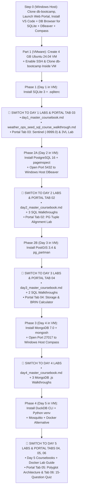

> **Navigation:** [🏠 Master README](./README.md) | [🌐 Interactive Portal](./bootcamp_portal.html) | [🛠️ Attendee Setup Guide](./ATTENDEE_SETUP_GUIDE.md) | **💿 Blank Ubuntu VM Lab Guide** | [📚 Reference Cards](./reference_cards/README.md)

# Complete Blank Lab Runbook: 4 GB RAM-Optimized Hybrid Setup (Windows Host GUIs + Blank Ubuntu 24.04 VM in VMware)

> [!IMPORTANT]
> **Why We Use the Hybrid "Windows Host + 4 GB Ubuntu VM" Architecture**  
> Graphical applications (**VS Code**, **Firefox/Chrome**, **DBeaver JVM**, **MongoDB Compass**) consume **2.5 GB+ of RAM** on their own. Running them inside a **4 GB RAM VM** alongside PostgreSQL 16, MongoDB 7.0 WiredTiger, and Docker would starve the database buffer pools and trigger the Linux OOM killer.  
>
> Instead, we split the workload just like real production engineering:
> - **On the Windows (or macOS) Host Machine:** Clone `db-bootcamp`, open the **Built-In Web Portal (`bootcamp_portal.html`)**, and run **VS Code**, **DBeaver Community**, and **MongoDB Compass** natively on the host.
> - **Inside the 4 GB Ubuntu 24.04 VM (VMware):** Clone `db-bootcamp` and install every **Database Server, Extension, CLI Client, Python `venv`, and Docker Stack** from scratch — freeing **100% of the VM's 4 GB RAM** for database execution!

```text
┌───────────────────────────────────────────────────┐       VMware NAT Network (<VM_IP>)       ┌──────────────────────────────────────────────────┐
│           WINDOWS / MACOS HOST MACHINE            │    (SSH :22 | PG :5432 | Mongo :27017)   │         UBUNTU 24.04 VM (4 GB RAM)               │
│ ───────────────────────────────────────────────── │ ───────────────────────────────────────> │ ──────────────────────────────────────────────── │
│ • git clone https://github.com/abdelouahabb/...   │  1. SSH Terminal (Windows Terminal /     │ • git clone https://github.com/abdelouahabb/...  │
│ • Web Portal (python start_bootcamp.py -> :8088)  │     VS Code Remote-SSH -> meteo@<VM_IP>) │ • Day 1: sqlite3 + .sqliterc                     │
│ • VS Code + DB Browser for SQLite (Day 1 GUI)     │  2. DBeaver GUI -> <VM_IP>:5432          │ • Day 2-3: postgresql-16 + postgis-3 (:5432)     │
│ • DBeaver Community (PostGIS Maps & Explain)      │  3. MongoDB Compass -> <VM_IP>:27017     │ • Day 4: mongodb-org 7.0 + mongosh (:27017)      │
│ • MongoDB Compass (2dsphere GeoJSON Maps)         │  4. FastAPI / Adminer -> <VM_IP>:8000    │ • Day 5: duckdb + Python venv + Mosquitto/Docker │
└───────────────────────────────────────────────────┘                                          └──────────────────────────────────────────────────┘
```



---

## Table of Contents

1. [Step 0: Preparing the Windows Host Machine (Clone Repo, Launch Portal & Install GUIs)](#step-0-preparing-the-windows-host-machine-clone-repo-launch-portal--install-guis)
2. [Part 1: Creating the 4 GB Blank Ubuntu 24.04 VM in VMware & Connecting via SSH](#part-1-creating-the-4-gb-blank-ubuntu-2404-vm-in-vmware--connecting-via-ssh)
   - [1.1 VMware Hardware Sizing for 4 GB RAM Efficiency](#11-vmware-hardware-sizing-for-4-gb-ram-efficiency)
   - [1.2 Installing Ubuntu 24.04, Enabling `openssh-server` & Finding `<VM_IP>`](#12-installing-ubuntu-2404-enabling-openssh-server--finding-vm_ip)
   - [1.3 Connecting from Windows Host via Windows Terminal & VS Code (`Remote - SSH`)](#13-connecting-from-windows-host-via-windows-terminal--vs-code-remote---ssh)
   - [1.4 Taking Snapshot 1: `00_Clean_Ubuntu_2404_Blank_Lab`](#14-taking-snapshot-1-00_clean_ubuntu_2404_blank_lab)
3. [Phase 1 (Day 1 in VM): Install Native SQLite 3 $\rightarrow$ Switch to Day 1 Labs & Sentinel Simulator](#phase-1-day-1-in-vm-install-native-sqlite-3--switch-to-day-1-labs--sentinel-simulator)
4. [Phase 2A (Day 2 in VM): Install Native PostgreSQL 16 Internals $\rightarrow$ Switch to Day 2 Labs & Tuple Tetris Simulator](#phase-2a-day-2-in-vm-install-native-postgresql-16-internals--switch-to-day-2-labs--tuple-tetris-simulator)
5. [Phase 2B (Day 3 in VM): Enable PostGIS 3.4 & Partitioning $\rightarrow$ Switch to Day 3 Labs & BRIN Calculator](#phase-2b-day-3-in-vm-enable-postgis-34--partitioning--switch-to-day-3-labs--brin-calculator)
6. [Phase 3 (Day 4 in VM): Install Native MongoDB 7.0 $\rightarrow$ Switch to Day 4 Labs & Windows Compass GUI](#phase-3-day-4-in-vm-install-native-mongodb-70--switch-to-day-4-labs--windows-compass-gui)
7. [Phase 4 (Day 5 in VM): Install DuckDB, Python 3.12 `venv`, Mosquitto & Docker Alternative $\rightarrow$ Switch to Day 5 Labs & Final Quiz](#phase-4-day-5-in-vm-install-duckdb-python-312-venv-mosquitto--docker-alternative--switch-to-day-5-labs--final-quiz)

---

## Step 0: Preparing the Windows Host Machine (Clone Repo, Launch Portal & Install GUIs)

Perform these steps **directly on your Windows Host laptop** so your reading pane, simulators, and GUI tools consume **zero RAM** inside the Ubuntu VM:

### 0.1 Clone the Bootcamp Repository & Launch the Built-In Web Portal on Windows
Open **PowerShell** or **Windows Terminal** on Windows and run:

```powershell
git clone https://github.com/abdelouahabb/db-bootcamp.git
cd db-bootcamp

# Launch the Built-In Web Command Center & Coursebook Reader on Windows:
python start_bootcamp.py
```
*(Your Windows browser will automatically open **`http://127.0.0.1:8088/bootcamp_portal.html`**, where you can read every coursebook, SQL/JS walkthrough, and reference card, and run the 3 interactive simulators!)*

### 0.2 Install the 4 Free GUI Clients on Windows (Not Inside the VM!)

| Windows Host Application | Download Link | Purpose During the Bootcamp |
| :--- | :--- | :--- |
| **1. Visual Studio Code** | [code.visualstudio.com](https://code.visualstudio.com/) | Read `.md` coursebooks on Windows + install the **`Remote - SSH`** extension (`ms-vscode-remote.remote-ssh`) to edit and run files inside the Ubuntu VM with zero VM GUI overhead! |
| **2. DB Browser for SQLite (`DB4S`)** | [sqlitebrowser.org](https://sqlitebrowser.org/dl/) | Featherweight native SQLite GUI (`~35 MB` RAM, zero JDBC driver downloads) for **Day 1**: inspect the **Edit Pragmas** tab (`Foreign Keys` toggle), `sqlite_autoindex_*` B-Trees, and color-coded `NULL` vs `-9999.0` cells in `weather_ops.db` and `weather_telemetry.db`! |
| **3. DBeaver Community Edition** | [dbeaver.io/download](https://dbeaver.io/download/) | Universal SQL GUI: connect from Windows to `<VM_IP>:5432` to view **PostGIS Leaflet Spatial Maps**, ER diagrams, and `Ctrl+Shift+E` visual execution plans (Days 1, 2, 3 & 5). |
| **4. MongoDB Compass GUI** | [mongodb.com/try/download/compass](https://www.mongodb.com/try/download/compass) | Connect from Windows to `mongodb://<VM_IP>:27017` to visualize **`2dsphere` GeoJSON storm polygons** and build Aggregation Pipelines visually (Day 4). |

---

## Part 1: Creating the 4 GB Blank Ubuntu 24.04 VM in VMware & Connecting via SSH

### 1.1 VMware Hardware Sizing for 4 GB RAM Efficiency

1. **Choose Your Ubuntu 24.04 LTS ISO:**
   - **Option A — Ubuntu 24.04 LTS Server ISO (`ubuntu-24.04.1-live-server-amd64.iso`, ~2.6 GB, Recommended for 4 GB RAM):** Boots straight to a fast Linux terminal using only **~220 MB of RAM at idle**, leaving **3.75 GB of RAM** free for PostgreSQL, MongoDB, DuckDB, and Docker!
   - **Option B — Ubuntu 24.04 LTS Desktop ISO (`ubuntu-24.04.1-desktop-amd64.iso`, ~5.8 GB):** Also works great! *(Pro-Tip: On a 4 GB Desktop VM, you can disable the GNOME desktop anytime with `sudo systemctl set-default multi-user.target && sudo reboot` to reclaim 1 GB of RAM, and re-enable it anytime with `sudo systemctl set-default graphical.target`).*
2. **VMware New Virtual Machine Wizard (`Ctrl+N`):**
   - Select **Typical (recommended)** $\rightarrow$ **"I will install the operating system later"** *(skips VMware Easy Install so `subiquity` runs cleanly)*.
   - **Guest OS:** `Linux` $\rightarrow$ **`Ubuntu 64-bit`**.
   - **Virtual Machine Name:** `Weather-DB-Bootcamp-Ubuntu2404`
   - **Maximum Disk Size:** **`60.0 GB`** (*Store virtual disk as a single file* — thin-provisioned).
3. **Customize Hardware Settings:**

| Component | Setting for 4 GB Lab | Why |
| :--- | :--- | :--- |
| **Memory (RAM)** | **`4096 MB` (4 GB)** *(or `8192 MB` if host has 16+ GB)* | Sufficient for all database engines because VS Code, Browser, DBeaver, and Compass run on the Windows Host! |
| **Processors (vCPU)** | **`2` or `4` cores** | Enables PostgreSQL parallel workers and DuckDB vectorized threads. |
| **Network Adapter** | **`NAT`** *(or `Bridged`)* | Assigns the VM an internal IP (e.g., `192.168.x.x`) reachable from the Windows Host for SSH (`22`), PostgreSQL (`5432`), and MongoDB (`27017`). |
| **CD/DVD (SATA)** | Attach Ubuntu 24.04 ISO | Check *"Connect at power on"*. |

---

### 1.2 Installing Ubuntu 24.04, Enabling `openssh-server` & Finding `<VM_IP>`

1. Install Ubuntu with:
   - **Hostname:** `weather-lab`
   - **Username:** `meteo`
   - **Password:** `meteo`
2. Once logged into the Ubuntu VM terminal, install the SSH server, core Linux tools, and clone `db-bootcamp`:

```bash
sudo apt update && sudo apt upgrade -y
sudo apt install -y \
  openssh-server open-vm-tools \
  curl wget git gnupg lsb-release ca-certificates \
  apt-transport-https software-properties-common \
  build-essential jq htop iotop tree unzip net-tools

# Enable SSH daemon so Windows Host can connect
sudo systemctl enable --now ssh

# Clone the bootcamp repository inside the Ubuntu VM:
cd ~
git clone https://github.com/abdelouahabb/db-bootcamp.git
cd ~/db-bootcamp
```

3. **Find Your Ubuntu VM's IP Address (`<VM_IP>`):**
```bash
hostname -I | awk '{print $1}'
```
*(Write down this IP address—for example, `192.168.159.128`. You will use it from Windows to SSH in and connect DBeaver & MongoDB Compass!)*

---

### 1.3 Connecting from Windows Host via Windows Terminal & VS Code (`Remote - SSH`)

You can now minimize the VMware window (let it run quietly in the background) and do all your work from **Windows**:

1. **From Windows PowerShell / Windows Terminal:**
   ```powershell
   ssh meteo@<VM_IP>
   ```
   *(Replace `<VM_IP>` with the IP printed by `hostname -I`, e.g., `ssh meteo@192.168.159.128`).*
2. **Or From VS Code on Windows (`Remote - SSH`):**
   - Press `F1` or `Ctrl+Shift+P` in VS Code on Windows $\rightarrow$ select **Remote-SSH: Connect to Host...** $\rightarrow$ enter `meteo@<VM_IP>` $\rightarrow$ open folder `/home/meteo/db-bootcamp`.

---

### 1.4 Taking Snapshot 1: `00_Clean_Ubuntu_2404_Blank_Lab`

Before installing any database engines, take a snapshot in VMware (**VM $\rightarrow$ Snapshot $\rightarrow$ Take Snapshot...**):
- **Name:** `00_Clean_Ubuntu_2404_Blank_Lab`
- **Description:** `Fresh 4GB Ubuntu 24.04 VM with SSH enabled and ~/db-bootcamp cloned. Zero databases installed.`

---

## Phase 1 (Day 1 in VM): Install Native SQLite 3 $\rightarrow$ Switch to Day 1 Labs & Sentinel Simulator

Inside your SSH terminal connected to the Ubuntu VM (`meteo@weather-lab:~/db-bootcamp$`), install **SQLite 3** from scratch:

### 1.1 Install SQLite 3 CLI and Development Headers
```bash
sudo apt install -y sqlite3 libsqlite3-dev
sqlite3 --version
```

### 1.2 Create the Production `~/.sqliterc` Startup File
By default, SQLite prints unformatted pipe-delimited output, hides `NULL` values as empty strings, and disables `FOREIGN KEY` enforcement. Create `~/.sqliterc` so every `sqlite3` session starts properly configured:

```bash
cat << 'EOF' > ~/.sqliterc
PRAGMA foreign_keys = ON;
.headers on
.mode box
.nullvalue [NULL]
.timer on
EOF
```

### 1.3 Seed `weather_ops.db` and Generate the 250,000-Row `weather_telemetry.db` Dataset
```bash
cd ~/db-bootcamp/day1
sqlite3 weather_ops.db < weather_ops_seed.sql
sqlite3 weather_ops.db "SELECT station_id, station_name, elevation_m, is_active FROM stations;"
python3 generate_weather_db.py
```

> [!IMPORTANT]
> ### 🚀 STOP INSTALLATION HERE FOR DAY 1! Switch Now to Your Windows Host Browser Portal & Day 1 Docs
> Now that `sqlite3`, `~/.sqliterc`, `weather_ops.db`, and `weather_telemetry.db` are ready inside the VM, **do not install PostgreSQL yet**. On your **Windows Host**, click the links below to complete all **Day 1 SQLite & Hardware Sentinel Labs**:
>
> | Step | Resource / Interactive Tab to Open on Windows Host | What You Will Do |
> | :---: | :--- | :--- |
> | **1** | 📖 **[day1/weather_ops_seed_sql_course_walkthrough.md](./day1/weather_ops_seed_sql_course_walkthrough.md)** | Read the line-by-line explanation of every `PRAGMA`, `CHECK` constraint, `ON DELETE CASCADE`, `3NF` Normalization vs. Denormalization, all 7 SQL `JOIN`s, and planted anomalies in `weather_ops_seed.sql`. |
> | **2** | 📖 **[day1/day1_master_coursebook.md](./day1/day1_master_coursebook.md)** | Follow Modules 1–7 in your SSH terminal: Declarative 8-step execution order, Three-Valued Logic (`3VL`), `-9999.0` sentinel hygiene (`NULLIF`), `1NF–3NF` Normalization vs. Denormalization, all 7 SQL `JOIN`s + SQLite `<3.39`/`3.39+` compatibility, `WITH RECURSIVE` outage grids, and `LAG() OVER` window functions. |
> | **3** | 🧪 **[Switch to Portal Tab 03: Sentinel (`-9999.0`) & 3VL Simulator](./bootcamp_portal.html#tab-sentinel)** | Drag the sensor fault-rate slider to see how a `0.5%` `-9999.0` dropout corrupts Mediterranean temperatures into an Ice Age (`-27.7°C`) vs. `AVG(NULLIF(temp_c, -9999.0))`, and test the interactive 3VL Truth Table! |
> | **4** | 📖 **[day1/day1_hardware_sentinels_and_qc_guide.md](./day1/day1_hardware_sentinels_and_qc_guide.md)** | Deep-dive into RS-485/Modbus/SDI-12 & Pt100 ADC hardware fault physics and WMO Code 306 quality flags. |
> | **5** | 📋 **[day1/day1_sqlite_and_sql_cheatsheet.md](./day1/day1_sqlite_and_sql_cheatsheet.md)** | Keep open alongside your SSH terminal for `.mode`, `.timer`, `JOIN` compatibility & portable `<3.39` rewrites, date/time bucketing, and window frame syntax. |
> | **6** | 🗄️ **DB Browser for SQLite & DBeaver on Windows Host:**<br>• In **DB Browser for SQLite (`DB4S`)**: Open `db-bootcamp\day1\weather_ops.db` $\rightarrow$ inspect the **Edit Pragmas** tab (`Foreign Keys` checkbox!), the **Database Structure** tab (`CHECK` constraints & `sqlite_autoindex_*`), and the **Browse Data** tab (color-coded `NULL` vs `-9999.0` cells).<br>• In **DBeaver**: Open `weather_ops.db` to inspect the visual Entity-Relationship (ER) diagram! |
>
> *(Once you finish Day 1, return here and proceed to **Phase 2A** below!)*

---

## Phase 2A (Day 2 in VM): Install Native PostgreSQL 16 Internals $\rightarrow$ Switch to Day 2 Labs & Tuple Tetris Simulator

Welcome to **Day 2**! Inside the Ubuntu VM, we install **PostgreSQL 16** from the official PGDG repository, enable its C-level forensic extensions (`pageinspect`, `pgstattuple`), and expose port `5432` to the VMware network so **DBeaver on your Windows Host** can connect directly to `<VM_IP>:5432`.

### 2A.1 Add the Official PostgreSQL (PGDG) Repository & Install PostgreSQL 16 + Contrib
```bash
sudo install -d /usr/share/postgresql-common/pgdg
sudo curl -o /usr/share/postgresql-common/pgdg/apt.postgresql.org.asc --fail https://www.postgresql.org/media/keys/ACCC4CF8.asc

echo "deb [signed-by=/usr/share/postgresql-common/pgdg/apt.postgresql.org.asc] https://apt.postgresql.org/pub/repos/apt $(lsb_release -cs)-pgdg main" | \
  sudo tee /etc/apt/sources.list.d/pgdg.list

sudo apt update
sudo apt install -y \
  postgresql-16 \
  postgresql-client-16 \
  postgresql-contrib-16 \
  postgresql-16-repack \
  pgbouncer
```

### 2A.2 Configure Roles, Enable Windows Host Network Access (`5432`), and Enable `pageinspect` / `pgstattuple`
```bash
sudo systemctl enable --now postgresql

# 1. Create a PostgreSQL superuser matching your Linux username ($USER) so 'psql' works without sudo
sudo -u postgres createuser --superuser "$USER" 2>/dev/null || true

# 2. Set password for 'postgres' user and create the Day 2 database
psql -U postgres -d postgres -c "ALTER USER postgres WITH PASSWORD 'meteo_password';"
psql -U postgres -d postgres -c "CREATE DATABASE weather_ops;"

# 3. Allow DBeaver on the Windows Host to connect to <VM_IP>:5432
sudo sed -i "s/#listen_addresses = 'localhost'/listen_addresses = '*'/" /etc/postgresql/16/main/postgresql.conf
grep -qxF "host all all 0.0.0.0/0 md5" /etc/postgresql/16/main/pg_hba.conf || \
  echo "host all all 0.0.0.0/0 md5" | sudo tee -a /etc/postgresql/16/main/pg_hba.conf
sudo systemctl restart postgresql

# 4. Enable C-level storage & buffer inspection extensions for Day 2
psql -d weather_ops -c "CREATE EXTENSION IF NOT EXISTS pageinspect;"
psql -d weather_ops -c "CREATE EXTENSION IF NOT EXISTS pgstattuple;"
psql -d weather_ops -c "CREATE EXTENSION IF NOT EXISTS pg_buffercache;"
psql -d weather_ops -c "CREATE EXTENSION IF NOT EXISTS pg_stat_statements;"
```

### 2A.3 Seed the Multi-Schema Operational Database (`weather_ops_pg.sql`)
```bash
cd ~/db-bootcamp
psql -d weather_ops -f day2/weather_ops_pg.sql
```

> [!IMPORTANT]
> ### 🚀 STOP INSTALLATION HERE FOR DAY 2! Switch Now to the Day 2 Coursebooks, Walkthroughs & Tuple Tetris Simulator
> PostgreSQL 16 and its forensic inspection extensions (`pageinspect`, `pgstattuple`) are now running inside the VM and listening on `<VM_IP>:5432`. Click the links below to execute all **Day 2 Storage Engine, MVCC & Concurrency Labs**:
>
> | Step | Resource / Interactive Tab to Open on Windows Host | What You Will Do |
> | :---: | :--- | :--- |
> | **1** | 📖 **[day2/day2_master_coursebook.md](./day2/day2_master_coursebook.md)** | Study PostgreSQL process/memory architecture (`shared_buffers` vs OS Page Cache), 8 KB heap pages, 23-byte `HeapTupleHeaderData`, CPU byte alignment, MVCC, WAL, `VACUUM`, and cost-based query planning. |
> | **2** | 🧪 **[Switch to Portal Tab 02: PG Tuple Alignment ("Tuple Tetris") Lab](./bootcamp_portal.html#tab-tetris)** | Reorder columns interactively between Naive Unaligned (`80 bytes/row`) and Packed Aligned (`64 bytes/row`) to visualize 8-byte CPU word boundaries and save `16 GB` per billion rows! |
> | **3** | 📖 **[day2/weather_ops_pg_sql_course_walkthrough.md](./day2/weather_ops_pg_sql_course_walkthrough.md)** | Understand the multi-schema DDL (`synoptic`, `nwp`, `alerts`), `TOAST` out-of-line compression, `GENERATED ALWAYS AS ... STORED`, and `generate_series()` wave synthesis. |
> | **4** | 📖 **[day2/day2_pageinspect_and_storage_lab_course_walkthrough.md](./day2/day2_pageinspect_and_storage_lab_course_walkthrough.md)** | Run `psql -d weather_ops -f day2/day2_pageinspect_and_storage_lab.sql` in your SSH terminal alongside this walkthrough to inspect `lp_off`, `t_xmin`, `t_xmax`, `t_ctid`, `VACUUM` vs `VACUUM FULL`, and 1M-row `EXPLAIN (ANALYZE, BUFFERS)`. |
> | **5** | 📖 **[day2/day2_two_terminal_acid_lab_course_walkthrough.md](./day2/day2_two_terminal_acid_lab_course_walkthrough.md)** | Open **two SSH tabs** in Windows Terminal (`[TERMINAL A]` and `[TERMINAL B]`) to trigger row locks, `pg_blocking_pids()`, `40P01` circular deadlocks, and `REPEATABLE READ` serialization errors (`40001`). |
> | **6** | 🖥️ **DBeaver on Windows Host:** Connect DBeaver on Windows to **Host:** `<VM_IP>`, **Port:** `5432`, **Database:** `weather_ops`, **User:** `postgres`, **Password:** `meteo_password` and test `Ctrl+Shift+E` Visual Explain! |
>
> *(Once you finish Day 2, return here and proceed to **Phase 2B** below for Day 3!)*

---

## Phase 2B (Day 3 in VM): Enable PostGIS 3.4 & Partitioning $\rightarrow$ Switch to Day 3 Labs & BRIN Calculator

Welcome to **Day 3**! Inside the Ubuntu VM, we install **PostGIS 3.4** (`GEOGRAPHY(Point, 4326)` & `GiST` spatial indexing) and **partitioning extensions** (`pg_partman`, `pg_cron`, `btree_gist`).

### 2B.1 Install PostGIS 3.4 and Partitioning Extensions
```bash
sudo apt install -y \
  postgresql-16-postgis-3 \
  postgresql-16-postgis-3-scripts \
  postgresql-16-partman \
  postgresql-16-cron

# Create the 5M-row benchmark database and enable PostGIS + btree_gist
psql -U postgres -d postgres -c "CREATE DATABASE weather_ops_db;" 2>/dev/null || true

for db in weather_ops weather_ops_db; do
  psql -d "$db" -c "CREATE EXTENSION IF NOT EXISTS postgis;"
  psql -d "$db" -c "CREATE EXTENSION IF NOT EXISTS btree_gist;"
done

# Verify PostGIS 3.4, GEOS, and PROJ spheroidal libraries:
psql -d weather_ops -c "SELECT PostGIS_Full_Version();"
```

### 2B.2 Execute the Day 3 Partitioning, Specialized Indexing & 5,000,000-Row PostGIS Benchmark Scripts
```bash
cd ~/db-bootcamp
psql -d weather_ops -f day3/day3_weather_advanced_pg.sql
psql -d weather_ops_db -f day3/day3_postgis_5m_benchmark.sql
```

> [!IMPORTANT]
> ### 🚀 STOP INSTALLATION HERE FOR DAY 3! Switch Now to the Day 3 Coursebooks, PostGIS Walkthroughs & BRIN Calculator
> PostGIS 3.4 and the 5,000,000-row partitioned telemetry tables are now live inside the VM. Click the links below to complete all **Day 3 Partitioning, BRIN Indexing, PostGIS Geodesy & High-Availability Labs**:
>
> | Step | Resource / Interactive Tab to Open on Windows Host | What You Will Do |
> | :---: | :--- | :--- |
> | **1** | 📖 **[day3/day3_master_coursebook.md](./day3/day3_master_coursebook.md)** | Master Declarative Range Partitioning (`PARTITION BY RANGE`), zero-bloat `DETACH PARTITION CONCURRENTLY`, Index Selection (`B-Tree` vs `BRIN` vs `Partial` vs `INCLUDE` vs `GIN`), PostGIS `GEOGRAPHY(Point, 4326)`, `LAG()` pressure tendency ($\Delta P_{3\text{h}}$), idempotent `UPSERT`, and `REFRESH MATERIALIZED VIEW CONCURRENTLY`. |
> | **2** | 🧪 **[Switch to Portal Tab 04: Storage & BRIN vs B-Tree Calculator](./bootcamp_portal.html#tab-scaling)** | Scale the row slider from 1 Million to 1 Billion rows to compare PostgreSQL B-Tree (`~28 MB / 1M rows`) against BRIN (`~32 KB / 1M rows` — 99.89% smaller!). |
> | **3** | 📖 **[day3/day3_weather_advanced_pg_sql_course_walkthrough.md](./day3/day3_weather_advanced_pg_sql_course_walkthrough.md)** | Line-by-line walkthrough of `synoptic.observations_part`, the 5 specialized indexes, `nwp.mv_daily_model_verification`, and dynamic PostGIS `GEOGRAPHY`. |
> | **4** | 📖 **[day3/day3_postgis_5m_benchmark_sql_course_walkthrough.md](./day3/day3_postgis_5m_benchmark_sql_course_walkthrough.md)** | Line-by-line walkthrough of the 5,000,000-row partitioned benchmark, WGS-84 Haversine great-circle math, B-Tree (`28 MB`) vs BRIN (`24 KB`) size audit, and `ST_DWithin` Dellys Cape squall-line queries. |
> | **5** | 🖥️ **DBeaver Spatial Map Lab (on Windows Host):** In DBeaver on Windows, connect to `<VM_IP>:5432/weather_ops_db` (`postgres` / `meteo_password`), run `SELECT station_id, station_name, region, geom FROM stations;`, and click the **Spatial** tab on the right of the result grid to view your Algerian weather stations on an interactive **OpenStreetMap / Leaflet map**! |
> | **6** | 📋 **[day3/day3_postgres_extensions_guide.md](./day3/day3_postgres_extensions_guide.md)** & **[day3/day3_postgres_ha_patroni_and_ops_guide.md](./day3/day3_postgres_ha_patroni_and_ops_guide.md)** | Deep-dive reference guides on 15 essential extensions and Patroni + `etcd` + HAProxy High Availability. |
>
> *(Once you finish Day 3, return here and proceed to **Phase 3** below for Day 4!)*

---

## Phase 3 (Day 4 in VM): Install Native MongoDB 7.0 $\rightarrow$ Switch to Day 4 Labs & Windows Compass GUI

Welcome to **Day 4**! To save RAM on our 4 GB VM, we stop PostgreSQL while working on MongoDB (`sudo systemctl stop postgresql` — optional, frees ~300 MB RAM immediately), install **MongoDB 7.0 + `mongosh`** inside the VM, and bind port `27017` to `0.0.0.0` so **MongoDB Compass on your Windows Host** connects directly to `mongodb://<VM_IP>:27017`!

### 3.1 Add the Official MongoDB 7.0 GPG Key & APT Repository Inside the VM
```bash
# Optional on 4 GB RAM VMs: stop PostgreSQL while focusing on Day 4 MongoDB labs
sudo systemctl stop postgresql

curl -fsSL https://www.mongodb.org/static/pgp/server-7.0.asc | \
  sudo gpg -o /usr/share/keyrings/mongodb-server-7.0.gpg --dearmor --yes

echo "deb [ arch=amd64,arm64 signed-by=/usr/share/keyrings/mongodb-server-7.0.gpg ] https://repo.mongodb.org/apt/ubuntu jammy/mongodb-org/7.0 multiverse" | \
  sudo tee /etc/apt/sources.list.d/mongodb-org-7.0.list

sudo apt update
sudo apt install -y mongodb-org mongodb-mongosh mongodb-database-tools
```

### 3.2 Enable Windows Host Access (`bindIp: 0.0.0.0`) & Start `mongod`
```bash
# Allow MongoDB Compass on the Windows Host to connect to <VM_IP>:27017
sudo sed -i "s/bindIp: 127.0.0.1/bindIp: 0.0.0.0/" /etc/mongod.conf

sudo systemctl daemon-reload
sudo systemctl enable --now mongod
sudo systemctl status mongod --no-pager

# Verify mongosh connection:
mongosh --eval "db.runCommand({ connectionStatus: 1, buildInfo: 1 }).version"
```

### 3.3 Seed the Day 4 MongoDB Databases & Run the 50,000-Document Polymorphic Benchmark
```bash
cd ~/db-bootcamp
mongosh day4/day4_weather_ops_mongo.js
mongosh day4/day4_weather_ops_mongo_advanced.js
mongosh day4/day4_mongo_50k_polymorphic_benchmark.js
```

### 3.4 Optional Native HA Lab: Running a 3-Node Replica Set (`rs_meteo`) Natively Without Docker
If you want to test **3-Node Replica Set Election & Automatic Failover (`27017`, `27018`, `27019`)** using 100% native `mongod` processes inside the VM:

```bash
sudo systemctl stop mongod
mkdir -p ~/mongo_rs/{node1,node2,node3,logs}

mongod --replSet rs_meteo --port 27017 --dbpath ~/mongo_rs/node1 --bind_ip_all --wiredTigerCacheSizeGB 0.5 --fork --logpath ~/mongo_rs/logs/node1.log
mongod --replSet rs_meteo --port 27018 --dbpath ~/mongo_rs/node2 --bind_ip_all --wiredTigerCacheSizeGB 0.5 --fork --logpath ~/mongo_rs/logs/node2.log
mongod --replSet rs_meteo --port 27019 --dbpath ~/mongo_rs/node3 --bind_ip_all --wiredTigerCacheSizeGB 0.5 --fork --logpath ~/mongo_rs/logs/node3.log

mongosh --port 27017 --eval '
rs.initiate({
  _id: "rs_meteo",
  members: [
    { _id: 0, host: "localhost:27017", priority: 2 },
    { _id: 1, host: "localhost:27018", priority: 1 },
    { _id: 2, host: "localhost:27019", priority: 1, tags: { role: "analytics" } }
  ]
})'
```
*(Notice `--wiredTigerCacheSizeGB 0.5`—that caps each node's WiredTiger cache at 512 MB so all 3 nodes run comfortably inside a 4 GB VM! To return to single-node `mongod` afterwards: `pkill -f "mongod --replSet rs_meteo" && sudo systemctl start mongod`).*

> [!IMPORTANT]
> ### 🚀 STOP INSTALLATION HERE FOR DAY 4! Switch Now to the Day 4 MongoDB Coursebooks, `.js` Walkthroughs & Windows Compass GUI
> MongoDB 7.0 and `mongosh` are now running inside the VM and listening on `<VM_IP>:27017`. Click the links below on your **Windows Host** to complete all **Day 4 Labs**:
>
> | Step | Resource / GUI Workflow to Open on Windows Host | What You Will Do |
> | :---: | :--- | :--- |
> | **1** | 📖 **[day4/day4_master_coursebook.md](./day4/day4_master_coursebook.md)** | Work through Modules 1–5: `$jsonSchema` validation, BSON & WiredTiger internals, Radiosonde `$elemMatch`, Native Time-Series vs Manual Bucket Pattern, `$unwind` Aggregation Pipelines, `2dsphere` GeoJSON storm polygons, the `ESR` Compound Index Rule, Replica Sets, Tunable CAP, and Sharding. |
> | **2** | 📖 **[day4/day4_weather_ops_mongo_js_course_walkthrough.md](./day4/day4_weather_ops_mongo_js_course_walkthrough.md)** | Line-by-line walkthrough of `stations` (`$jsonSchema`), `radiosonde_soundings`, `synoptic_timeseries` (`system.buckets.*`), and `cap_alerts`. |
> | **3** | 📖 **[day4/day4_weather_ops_mongo_advanced_js_course_walkthrough.md](./day4/day4_weather_ops_mongo_advanced_js_course_walkthrough.md)** | Line-by-line walkthrough of `2dsphere` S2 cell indexing, GeoJSON Polygon Ring Closure rules (`storm_polygons`), `idx_sonde_esr`, and isobaric pressure level aggregations. |
> | **4** | 📖 **[day4/day4_mongo_50k_polymorphic_benchmark_js_course_walkthrough.md](./day4/day4_mongo_50k_polymorphic_benchmark_js_course_walkthrough.md)** | Line-by-line walkthrough of the 50,000-document batch ingestion across 4 sensor classes, Manual Bucket Pattern atomic upserts (`hourly_sensor_buckets`), Road Grip Safety & `$unwind` Fault Diagnostics, and WiredTiger vs Columnar `stats()`. |
> | **5** | 🧭 **MongoDB Compass on Windows Host:** Open **MongoDB Compass** on Windows $\rightarrow$ connect to **`mongodb://<VM_IP>:27017`** $\rightarrow$ open `weather_nosql.stations` and `weather_nosql.storm_polygons` $\rightarrow$ click the **Schema** tab $\rightarrow$ click **Analyze Schema** to view the interactive **2dsphere GeoJSON Map**! |
> | **6** | 📋 **[day4/day4_mongodb_complete_cheatsheet.md](./day4/day4_mongodb_complete_cheatsheet.md)** & **[day4/day4_mongodb_architecture_ha_and_sharding_guide.md](./day4/day4_mongodb_architecture_ha_and_sharding_guide.md)** | SQL-to-MQL translator, Aggregation stages, and Replica Set / Sharding administration commands. |
>
> *(Once you finish Day 4, return here and proceed to **Phase 4** below for Day 5!)*

---

## Phase 4 (Day 5 in VM): Install DuckDB, Python 3.12 `venv`, Mosquitto & Docker Alternative $\rightarrow$ Switch to Day 5 Labs & Final Quiz

Welcome to **Day 5**! Today we install the **Vectorized Analytical OLAP & Polyglot Lakehouse Stack** (`DuckDB`, `PyArrow`, `Apache Parquet`, `xarray`/`NetCDF4`, `Mosquitto MQTT`, and `FastAPI`) natively inside the Ubuntu VM, and then install **Docker Engine & Docker Compose v2** as the multi-container orchestration alternative.

### 4.1 Install the Native DuckDB CLI Binary Inside the VM
```bash
wget -qO /tmp/duckdb_cli-linux-amd64.zip https://github.com/duckdb/duckdb/releases/latest/download/duckdb_cli-linux-amd64.zip
sudo unzip -o /tmp/duckdb_cli-linux-amd64.zip -d /usr/local/bin/
sudo chmod +x /usr/local/bin/duckdb
rm -f /tmp/duckdb_cli-linux-amd64.zip

duckdb --version
```

### 4.2 Install Native Mosquitto MQTT Broker & Ensure Both PostgreSQL + MongoDB Are Running
```bash
sudo apt install -y mosquitto mosquitto-clients
sudo systemctl enable --now postgresql mongod mosquitto
```

### 4.3 Create the Bootcamp Python 3.12 Virtual Environment (`~/.venvs/weather_bootcamp`)
Ubuntu 24.04 enforces **PEP 668** (`externally-managed-environment`). Create and auto-activate a dedicated virtual environment with all OLAP, Parquet, NetCDF4, database driver, MQTT, and FastAPI libraries:

```bash
sudo apt install -y python3-venv python3-pip python3-dev libpq-dev libhdf5-dev libnetcdf-dev

python3 -m venv ~/.venvs/weather_bootcamp
source ~/.venvs/weather_bootcamp/bin/activate
grep -qxF 'source ~/.venvs/weather_bootcamp/bin/activate' ~/.bashrc || \
  echo 'source ~/.venvs/weather_bootcamp/bin/activate' >> ~/.bashrc

pip install --upgrade pip
pip install \
  duckdb \
  pyarrow \
  pandas \
  numpy \
  xarray \
  netCDF4 \
  h5netcdf \
  scipy \
  "psycopg[binary]" \
  psycopg2-binary \
  pymongo \
  paho-mqtt \
  fastapi \
  "uvicorn[standard]" \
  requests
```

### 4.4 Execute the Day 5 Native Parquet, DuckDB & Gridded NetCDF4 Benchmarks
```bash
cd ~/db-bootcamp/day5
python3 parquet_vs_csv_benchmark.py
python3 compact_small_parquet_files.py
python3 satellite_cog_int16_quantization.py
python3 seed_olap_data.py
```

---

### 4.5 Installing Docker Engine & Docker Compose v2 (The Multi-Node Alternative)

Now that attendees have installed and operated every database engine **natively**, install **Docker Engine & Docker Compose v2** to show how multi-node topologies (`3-Node MongoDB Replica Set`, `Mosquitto + Redpanda Kafka + PostGIS + MongoDB + MinIO S3 + Adminer`) can be orchestrated declaratively:

```bash
sudo install -m 0755 -d /etc/apt/keyrings
sudo curl -fsSL https://download.docker.com/linux/ubuntu/gpg -o /etc/apt/keyrings/docker.asc
sudo chmod a+r /etc/apt/keyrings/docker.asc

echo \
  "deb [arch=$(dpkg --print-architecture) signed-by=/etc/apt/keyrings/docker.asc] https://download.docker.com/linux/ubuntu \
  $(. /etc/os-release && echo "$VERSION_CODENAME") stable" | \
  sudo tee /etc/apt/sources.list.d/docker.list > /dev/null

sudo apt update
sudo apt install -y docker-ce docker-ce-cli containerd.io docker-buildx-plugin docker-compose-plugin

sudo usermod -aG docker "$USER"
newgrp docker

docker --version
docker compose version
```

#### Switching Cleanly Between Native Services and Docker Compose Stacks on 4 GB RAM

```
┌───────────────────────────────────────────────────────────────────────────────────┐
│ MODE A: NATIVE LINUX SERVICES               MODE B: DOCKER COMPOSE CLUSTERS      │
│ ─────────────────────────────               ───────────────────────────────      │
│ • postgresql.service (Port 5432)   <===>    • weather-pg-primary (Port 5432)      │
│ • mongod.service     (Port 27017)  <===>    • mongo-node1..3     (27017..27019)   │
│ • mosquitto.service  (Port 1883)   <===>    • mosquitto + kafka + minio + adminer │
└───────────────────────────────────────────────────────────────────────────────────┘
```

- **Switch from Native Mode $\rightarrow$ Docker Compose Mode:**
  ```bash
  sudo systemctl stop postgresql mongod mosquitto
  cd ~/db-bootcamp
  # Launch Stack 1 (HA Replica Set) or Stack 2 (6-Service Polyglot Lakehouse):
  docker compose -f docker/docker-compose.polyglot-lakehouse.yml up -d
  ```
- **Switch from Docker Compose Mode $\rightarrow$ Back to Native Mode:**
  ```bash
  cd ~/db-bootcamp
  docker compose -f docker/docker-compose.polyglot-lakehouse.yml down
  docker compose -f docker/docker-compose.ha-replicaset.yml down
  sudo systemctl start postgresql mongod mosquitto
  ```

---

### 4.6 Take VMware Snapshot 2 (`01_Full_Bootcamp_Native_And_Docker_Ready`)
Take a second snapshot in VMware (`VM -> Snapshot -> Take Snapshot...`) named **`01_Full_Bootcamp_Native_And_Docker_Ready`** so you can jump between **`00_Clean_Ubuntu_2404_Blank_Lab`** (100% blank Ubuntu) and **`01_Full_Bootcamp_Native_And_Docker_Ready`** (every native engine + Docker installed) in seconds.

> [!IMPORTANT]
> ### 🚀 SWITCH NOW TO DAY 5 LABS, POLYGLOT ARCHITECTURE MAP & FINAL CERTIFICATION QUIZ!
> Click the links below on your **Windows Host** to complete the **Day 5 Vectorized OLAP, Gridded Data, Polyglot Streaming Capstone & 15-Question Certification Quiz**:
>
> | Step | Resource / Interactive Tab to Open on Windows Host | What You Will Do |
> | :---: | :--- | :--- |
> | **1** | 📖 **[day5/day5_part1_olap_duckdb_parquet_and_gridded_data_coursebook.md](./day5/day5_part1_olap_duckdb_parquet_and_gridded_data_coursebook.md)** | Study Volcano vs. Vectorized SIMD execution, Apache Parquet binary internals (`RLE`, Dictionary, `ZSTD`), Hive partitioning, DuckDB zero-copy Arrow scans, and 4D Gridded Data (`GRIB2`, `NetCDF4`, `Zarr`, `COG`, `BUFR`). |
> | **2** | 📖 **[day5/day5_part2_enterprise_polyglot_lakehouse_and_capstone_coursebook.md](./day5/day5_part2_enterprise_polyglot_lakehouse_and_capstone_coursebook.md)** | Build the Grand Unified National Weather Center Polyglot Architecture (`simulate_edge_sensors.py` $\rightarrow$ `stream_router.py` $\rightarrow$ PostGIS + MongoDB $\rightarrow$ `compact_hot_to_cold.py` $\rightarrow$ `serving_api.py` Sub-10ms FastAPI Gateway at `http://<VM_IP>:8000/docs`) and solve the Dellys Cape Squall Line Capstone! |
> | **3** | 🐳 **[docker/docker_lab_guide.md](./docker/docker_lab_guide.md)** | Execute the Docker Compose Multi-Node HA & Chaos Engineering live Primary crash election lab. |
> | **4** | 🗺️ **[Switch to Portal Tab 05: Interactive Polyglot Architecture Map](./bootcamp_portal.html#tab-arch)** | Click each tier of the National Meteorological Data Center architecture to inspect SLAs, storage formats, tuning parameters, and failure modes. |
> | **5** | 📖 **[day5/bootcamp_capstone_troubleshooting_and_quiz.md](./day5/bootcamp_capstone_troubleshooting_and_quiz.md)** | Review the 15 production troubleshooting scenarios and architectural trade-offs. |
> | **6** | 🏆 **[Switch to Portal Tab 06: 15-Question Bootcamp Certification Quiz](./bootcamp_portal.html#tab-quiz)** | Take the interactive 15-question certification quiz with instant explanations and live scoring! |

---

## Complete End-to-End Verification Command

Run `./verify_bootcamp.sh` inside the Ubuntu VM (or on the Host) at any time to verify all 89 curriculum, SQLite, Python AST, SQL, MongoDB JS, Docker Compose, and portability checks:

```bash
cd ~/db-bootcamp
./verify_bootcamp.sh
```

---

> **Navigation:** [🏠 Master README](./README.md) | [🌐 Interactive Portal](./bootcamp_portal.html) | [🛠️ Attendee Setup Guide](./ATTENDEE_SETUP_GUIDE.md) | **💿 Blank Ubuntu VM Lab Guide** | [📚 Reference Cards](./reference_cards/README.md)
