> **Navigation:** [🏠 Master README](../README.md) | [🌐 Interactive Portal](../bootcamp_portal.html) | [📚 Reference Cards](../reference_cards/README.md) | **Day 1 Coursebook** | [⏭️ Day 2 Coursebook](../day2/day2_master_coursebook.md)

# Weather Forecast Engineering Database Bootcamp
## Day 1 Master Coursebook: SQL Foundations, WMO Relational Modeling & Telemetry Wrangling with SQLite

**Bootcamp:** Database & NoSQL Engineering (5-Day Intensive)  
**Target Audience:** Weather Forecast Engineers, Meteorological Software Engineers, Weather Systems Administrators & Environmental Data Scientists  
**Execution Environment:** Local zero-friction `sqlite3` CLI (3.38+) + DBeaver / DB Browser for SQLite / TablePlus  
**Primary Working Datasets:**
1. **`weather_ops.db` (`weather_ops_seed.sql`):** Curated WMO Surface Synoptic Network (`stations`, `observations`, `forecasts`, `weather_alerts`) with physical `CHECK` constraints and multi-model NWP verification data (`ECMWF-HRES`, `GFS`, `AROME`).
2. **`weather_telemetry.db` (`generate_weather_db.py`):** 250,000 synthetic high-frequency observations across 50 Automated Weather Stations (`AWS-001` to `AWS-050`) with injected hardware sentinels (`-999.0`), barometric plunges, thermal spikes, and a 6-hour communications blackout.

**Companion Reference Files in `day1/`:**
- [day1_sqlite_and_sql_cheatsheet.md](./day1_sqlite_and_sql_cheatsheet.md) — Authoritative CLI Directives, 3VL Truth Tables, WMO Queries & Window Recipes
- [day1_hardware_sentinels_and_qc_guide.md](./day1_hardware_sentinels_and_qc_guide.md) — Deep-Dive on `-9999` / `-999` In-Band Signaling, ADC Physics, WMO QC Flags & Contamination Math
- [weather_ops_seed_sql_course_walkthrough.md](./weather_ops_seed_sql_course_walkthrough.md) — **Detailed Markdown Course Walkthrough** explaining every SQL statement, constraint, and telemetry anomaly in `weather_ops_seed.sql`
- [weather_ops_seed.sql](./weather_ops_seed.sql) & `weather_ops.db` — WMO Synoptic & NWP Verification Relational Seed
- [generate_weather_db.py](./generate_weather_db.py) — Standalone 250,000-row Python SQLite Telemetry Generator
- *(Cross-Day OLAP Previews)*: Columnar Parquet formats and DuckDB (OLAP) vs. SQLite (OLTP) architectural comparisons

---

## 1. The 5-Day Arc & Architectural Overview

### 1.1 Core Engineering Objective
Move beyond ad-hoc procedural file scripts (nested loops over fragile CSV/ASCII files) to **set-based declarative SQL**, enforce physical meteorological integrity directly at the database schema layer, sanitize time-series telemetry anomalies (`NULL` vs. `-9999.0`/`-999.0`), verify Numerical Weather Prediction (NWP) models with relational joins, and establish a rigorous ANSI SQL foundation before examining PostgreSQL storage engine internals on Day 2.

### 1.2 The 5-Day Journey: Why Start with Local SQLite?
1. **Day 1 — SQLite (Core Relational Modeling, Declarative SQL & Telemetry Wrangling):**
   - **Zero Infrastructure Friction:** A complete relational database resides inside a single cross-platform disk file (`weather_ops.db` and `weather_telemetry.db`), requiring zero background daemons or network sockets.
   - **Architectural Focus:** Isolates relational set theory and query execution from multi-process server administration. Day 1 covers **DDL constraints, declarative execution order, Three-Valued Logic (3VL), hardware sentinel hygiene (`NULLIF`), climatological aggregations (`GROUP BY`/`HAVING`), NWP forecast verification (`JOIN`s), recursive gap-filling CTEs (`WITH RECURSIVE`), and sliding window functions (`OVER`, `PARTITION BY`, `LAG`)**.
   - **Real-World Meteorological Role:** Widely deployed inside edge weather stations, autonomous ocean buoys, mobile field loggers, and local data-science pipelines.
2. **Days 2 & 3 — PostgreSQL (Production Relational & Spatial Engine):**
   - Moving from a single-file embedded library to a concurrent multi-process client-server architecture (`postgres`).
   - Physical 8 KB heap pages (`pageinspect`), 23-byte MVCC tuple headers, CPU byte-alignment padding, strict data types (`TIMESTAMPTZ`, `NUMERIC`), declarative table partitioning for billions of synoptic rows, indexing (`B-Tree`, `BRIN`, `GIN`), and geospatial meteorology (`PostGIS`).
3. **Days 4 & 5 — MongoDB & Hybrid Polyglot Architectures (NoSQL Document Store & Columnar Lakehouse):**
   - Handling semi-structured, rapidly evolving payloads (heterogeneous IoT weather sensors, nested JSON radar metadata, Common Alerting Protocol (CAP) documents) alongside high-compression columnar formats (Apache Parquet / DuckDB) for multi-decade reanalysis scans.

---

## 2. Comprehensive Module Outline

```
┌─────────────────┬──────────────────────────────────────────────────────────────────────────┐
│ Module 1        │ Why Databases? Architecture, CLI Directives & Dual Datasets              │
├─────────────────┼──────────────────────────────────────────────────────────────────────────┤
│ Module 2        │ Relational Schema Design, WMO Constraints, CRUD & Lab 1                  │
├─────────────────┼──────────────────────────────────────────────────────────────────────────┤
│ Module 3        │ The Declarative Engine, Execution Order & 3VL Truth Tables               │
├─────────────────┼──────────────────────────────────────────────────────────────────────────┤
│ Module 4        │ Hardware Sentinels (-9999/-999), QC Hygiene & Lab 2                      │
├─────────────────┼──────────────────────────────────────────────────────────────────────────┤
│ Module 5        │ Climatological Aggregations, Rollups & NWP Verification (Lab 3)          │
├─────────────────┼──────────────────────────────────────────────────────────────────────────┤
│ Module 6        │ CTE Pipelines, Recursive Outage Grids & Window Functions                 │
├─────────────────┼──────────────────────────────────────────────────────────────────────────┤
│ Module 7        │ Capstone Walkthroughs (NWP Leaderboard + AWS Production Diagnostics)     │
└─────────────────┴──────────────────────────────────────────────────────────────────────────┘
```

---

## 3. Module 1: Why Databases? Architecture, Tooling & Dual Dataset Setup

### 3.1 Flat Files vs. Relational DBMS in Meteorological Engineering
- **The Fragility of Flat Files in Weather Operations:**
  - When a meteorological center stores observations across tens of thousands of loose CSV or ASCII synoptic files, a single firmware update that reorders two columns or emits `-9999.0` for a broken rain gauge silently corrupts downstream scripts.
  - **File-Processing Scripts vs. Relational DBMS:** Ad-hoc file scripts lack concurrent write locking, atomic crash recovery, physical schema constraints, and indexed time-range lookups. A **Relational DBMS** enforces physical domain boundaries via `CHECK` constraints, guarantees ACID transactions, and uses B-Tree/BRIN indexes to slice multi-year time windows in milliseconds rather than scanning every file on disk.
- **How SQLite Works vs. PostgreSQL & DuckDB:**
  - **SQLite (Embedded Row-Oriented OLTP):** An *in-process* SQL engine (`libsqlite3`). Your application or CLI reads and writes directly to a single ordinary disk file (`weather_ops.db`). Ideal for local analysis, embedded data loggers on weather buoys/stations, and transactional lookups.
  - **Concurrency Limitation (Bridge to Day 2):** SQLite arbitrates writes using OS file locks (even in `WAL` mode, only **one writer** can append at a time). When 500 automated weather stations push telemetry simultaneously while forecasters query live dashboards, a client-server engine with row-level MVCC (**PostgreSQL**) is required.
  - **Row Store vs. Columnar OLAP Preview (Parquet & DuckDB):** SQLite stores entire rows contiguously inside 4 KB B-Tree pages, which is optimal for inserting individual station pings or retrieving all attributes of station `60390`. For scanning 50 years of temperature alone across 10 billion rows, columnar formats (**Apache Parquet**) and vectorized engines (**DuckDB**) read only the compressed temperature bytes.

### 3.2 Dataset 1 Setup: Curated WMO Synoptic & NWP Database (`weather_ops.db`)
Open a terminal in the `day1` directory and build/inspect `weather_ops.db` from `weather_ops_seed.sql`:

```bash
sqlite3 weather_ops.db < weather_ops_seed.sql
sqlite3 weather_ops.db
```

#### Essential `sqlite3` CLI Dot-Commands
Dot-commands are evaluated directly by the `sqlite3` client shell (not the SQL parser), must begin at column 1 with a `.`, and **never** end with a semicolon:

```sql
.help                  -- Show available shell commands
.tables                -- List all tables (forecasts, observations, stations, weather_alerts)
.schema stations       -- Show exact CREATE TABLE DDL for stations
.headers on            -- Display column names
.mode box              -- Pretty-print output in Unicode box tables (or .mode column)
.nullvalue NULL        -- Print NULL explicitly instead of blank spaces
.timer on              -- Measure CPU and wall-clock query execution time

SELECT * FROM stations;
```

> [!TIP]
> **Engineering Tip — Making `NULL` Visible in the Terminal:**  
> By default, the `sqlite3` shell renders `NULL` values as an empty string (`""`), making missing sensor dropouts visually indistinguishable from blank whitespace. Always run `.nullvalue NULL` and `.mode box` at the start of a session (or add them to `~/.sqliterc`) so Three-Valued Logic (`3VL`) and sensor dropouts are explicitly displayed as `NULL`.

To inspect **`weather_ops.db` visually in DBeaver / DB Browser for SQLite**:
1. Create a New Connection $\rightarrow$ Select **SQLite** $\rightarrow$ Browse to `day1/weather_ops.db`.
2. Double-click the `stations` table $\rightarrow$ open the **ER Diagram** tab to inspect how `station_id` links `stations` to `observations`, `forecasts`, and `weather_alerts`.

### 3.3 Dataset 2 Setup: 250,000-Row High-Frequency AWS Stream (`weather_telemetry.db`)
Run the standalone Python generator (`generate_weather_db.py`) using Python 3 (standard library only; zero external dependencies). It synthesizes 250,000 rows across 50 Automated Weather Stations (`AWS-001` to `AWS-050`) over a 48-hour window in $\approx 2\text{--}3\text{ seconds}$:

```bash
chmod +x generate_weather_db.py
./generate_weather_db.py
sqlite3 weather_telemetry.db
```

Inside `sqlite3 weather_telemetry.db`:
```text
.headers on
.mode box
.timer on
.tables
.schema raw_telemetry
```
*(Refer to `day1_sqlite_and_sql_cheatsheet.md` for how `.tables` and `.schema` query `sqlite_schema` under the hood and how to configure `~/.sqliterc` permanently).*

---

## 4. Module 2: Relational Schema Design, WMO Constraints & CRUD

### 4.1 Relational Schema Architecture & Physical Integrity
#### WMO Synoptic & NWP Relational Entity-Relationship Architecture (`weather_ops.db`)


1. **Tables, Rows, and Primary Keys (Natural vs. Surrogate):**
   - In `weather_ops.db`, `stations` uses `station_id` (the official 5-digit WMO station number, e.g., `60390` for Algiers - Dar El Beida) as a **Natural Primary Key**.
   - `observations` uses `obs_id INTEGER PRIMARY KEY AUTOINCREMENT` (a **Surrogate Key**) paired with a composite `UNIQUE (station_id, obs_time)` constraint so a station can never log two conflicting synoptic reports for the same timestamp.
2. **Physical Integrity via `CHECK` Constraints:**
   - Weather sensors fail and transmit corrupted packets (e.g., relative humidity of `145%`, negative wind speed, or latitude `115.0`).
   - Defining declarative `CHECK` constraints directly on the table forces the storage engine to reject physically impossible measurements at insert time:
     ```sql
     CREATE TABLE stations (
         station_id   INTEGER PRIMARY KEY,               -- WMO 5-digit station identifier
         station_name TEXT    NOT NULL UNIQUE,           -- Official station name
         latitude     REAL    NOT NULL CHECK (latitude BETWEEN -90.0 AND 90.0),
         longitude    REAL    NOT NULL CHECK (longitude BETWEEN -180.0 AND 180.0),
         elevation_m  REAL    NOT NULL CHECK (elevation_m >= -500.0 AND elevation_m <= 9000.0),
         climate_zone TEXT    NOT NULL CHECK (climate_zone IN ('Mediterranean', 'Arid', 'Semi-Arid', 'Highland', 'Maritime')),
         is_active    INTEGER NOT NULL DEFAULT 1 CHECK (is_active IN (0, 1))
     );

     CREATE TABLE observations (
         obs_id         INTEGER PRIMARY KEY AUTOINCREMENT,
         station_id     INTEGER NOT NULL,
         obs_time       TEXT    NOT NULL,                -- ISO-8601 UTC: YYYY-MM-DD HH:MM:SS
         temp_c         REAL,                            -- 2m Air Temperature (°C); NULL if sensor offline
         dewpoint_c     REAL,                            -- 2m Dewpoint Temperature (°C)
         humidity_pct   REAL    CHECK (humidity_pct IS NULL OR (humidity_pct >= 0.0 AND humidity_pct <= 100.0)),
         pressure_hpa   REAL,                            -- Mean Sea Level Pressure (hPa)
         wind_speed_kt  REAL    CHECK (wind_speed_kt IS NULL OR wind_speed_kt >= 0.0),
         precip_1h_mm   REAL,                            -- 1h Precipitation (mm)
         qc_flag        TEXT    NOT NULL DEFAULT 'VALID' CHECK (qc_flag IN ('VALID', 'SUSPECT', 'ERRONEOUS')),
         FOREIGN KEY (station_id) REFERENCES stations(station_id) ON DELETE CASCADE,
         UNIQUE (station_id, obs_time)
     );
     ```
3. **SQLite Dynamic Typing & Type Affinity vs. PostgreSQL Strict Typing:**
   - Unlike PostgreSQL (where a column's type is rigidly enforced on every row), standard SQLite uses **Dynamic Typing (Manifest Typing)**: the data type is associated with the *individual value* rather than the column container (unless a table is explicitly declared `STRICT` in SQLite 3.37+).
   - Every value stored in an SQLite database belongs to one of **5 Fundamental Storage Classes**:

     | Storage Class | Internal Representation | Meteorological Usage in SQLite |
     | :--- | :--- | :--- |
     | **`NULL`** | 0-byte header flag | Missing sensor reading / offline probe |
     | **`INTEGER`** | Variable-length signed integer (`1, 2, 3, 4, 6, or 8 bytes` depending on magnitude) | WMO `station_id` (`60390`), `lead_hours`, boolean flags (`0`/`1`), or Unix epochs |
     | **`REAL`** | 8-byte IEEE 754 floating-point number | `temp_c`, `pressure_hpa`, `wind_speed_kt`, `latitude`, `longitude` |
     | **`TEXT`** | UTF-8 / UTF-16 string | `station_name`, `qc_flag`, and ISO-8601 UTC timestamps (`'2026-10-05 12:00:00'`) |
     | **`BLOB`** | Raw byte sequence (stored verbatim) | Compact binary payloads (though large gridded arrays belong in object storage) |

   - **How Type Affinity Works:** Column declarations (`INTEGER`, `REAL`, `TEXT`, `NUMERIC`) act as *Type Affinity* hints—if you insert the text string `'24.5'` into a `REAL` column, SQLite automatically converts it to a float (`24.5`), but if you insert `'N/A'` into a `REAL` column without a `CHECK(typeof(col) = 'real')` or `STRICT` table modifier, SQLite will store `'N/A'` as `TEXT`!
   - **Why ISO-8601 `TEXT` Timestamps Work in SQLite:** Because ISO-8601 UTC strings (`YYYY-MM-DD HH:MM:SS`) order most-significant to least-significant digit, standard byte-by-byte lexicographical sorting (`BETWEEN` and `ORDER BY`) matches chronological order.
   - *Day 2 Contrast:* In PostgreSQL, timestamps are stored as native 8-byte `TIMESTAMPTZ` integers (microseconds since `2000-01-01 00:00:00 UTC`), and calibrated measurements use exact base-10 `NUMERIC(5,2)`.
4. **Foreign Keys in SQLite (`PRAGMA foreign_keys = ON;`):**
   - For backwards compatibility with legacy SQLite 3.6 applications, SQLite starts every new connection with foreign key enforcement turned **off** by default. Always execute `PRAGMA foreign_keys = ON;` so the engine rejects observations referencing non-existent WMO stations.

> [!WARNING]
> **Production Engineering Pitfall — `PRAGMA foreign_keys = ON;` Is Per-Connection:**  
> In SQLite, `PRAGMA foreign_keys = ON;` is a **session-level setting**, not a persistent flag stored inside the `.db` file header. Whenever you open a new `sqlite3` terminal session, reconnect in DBeaver, or open a new Python `sqlite3.connect()` handle, you must execute `PRAGMA foreign_keys = ON;` (verify with `PRAGMA foreign_keys;`, which returns `1` when active) to enforce referential integrity.

5. **Safe CRUD Operations (`INSERT`, `UPDATE`, `DELETE`):**
   - **Operational Rule:** Never run an `UPDATE` or `DELETE` statement on production telemetry without first testing the exact `WHERE` predicate using a `SELECT` query.

### 4.2 Lab 1 Walkthrough: DDL, Physical Constraints & CRUD on `weather_ops.db`
In this walkthrough on `weather_ops.db`, we verify foreign-key and physical `CHECK` constraints, add a new desert synoptic station (`60602 In Salah`), create a `sensor_calibration` metadata table, and reactivate a station returning from maintenance (`60402 Bejaia - Soummam`):

```sql
-- Enable referential integrity enforcement on the current connection
PRAGMA foreign_keys = ON;

-- 1. Insert new desert station In Salah (60602)
INSERT INTO stations (station_id, station_name, latitude, longitude, elevation_m, climate_zone, is_active)
VALUES (60602, 'In Salah', 27.2500, 2.5100, 269.0, 'Arid', 1);

-- 2a. Test physical CHECK safety rail (Latitude > 90.0):
-- Expected Result: Runtime error: CHECK constraint failed: latitude BETWEEN -90.0 AND 90.0
INSERT INTO stations VALUES (60999, 'Invalid Lat Station', 115.0, 0.0, 10.0, 'Arid', 1);

-- 2b. Test relational FOREIGN KEY safety rail (Non-existent WMO station 99999):
-- Expected Result: Runtime error: FOREIGN KEY constraint failed
INSERT INTO observations (station_id, obs_time, temp_c, qc_flag)
VALUES (99999, '2026-10-06 12:00:00', 25.0, 'VALID');

-- 3. Create a sensor_calibration table linked to stations with ON DELETE CASCADE
CREATE TABLE IF NOT EXISTS sensor_calibration (
    cal_id         INTEGER PRIMARY KEY AUTOINCREMENT,
    station_id     INTEGER NOT NULL,
    sensor_type    TEXT    NOT NULL CHECK (sensor_type IN ('THERMOMETER', 'BAROMETER', 'ANEMOMETER', 'RAIN_GAUGE')),
    calibrated_at  TEXT    NOT NULL,
    offset_applied REAL    NOT NULL DEFAULT 0.0,
    FOREIGN KEY (station_id) REFERENCES stations(station_id) ON DELETE CASCADE
);

-- 4. Reactivate Bejaia - Soummam (60402) after maintenance completion
UPDATE stations
SET is_active = 1
WHERE station_id = 60402;
```

---

## 5. Module 3: The Declarative Engine, Query Execution Order & Three-Valued Logic

### 5.1 The Procedural Mindset vs. Relational Sets
Software developers write code imperatively: lines execute sequentially in loops. In SQL, the engineer specifies **what** set of tuples must be generated, and the query planner constructs the physical retrieval plan.

### 5.2 The 8-Step Physical & Logical Execution Order

```mermaid
flowchart LR
    S1["1. FROM / JOIN<br/>(Cartesian & Join Graph)"] --> S2["2. WHERE<br/>(Row-Level Pushdown)"]
    S2 --> S3["3. GROUP BY<br/>(Bucket Partitioning)"]
    S3 --> S4["4. HAVING<br/>(Aggregate Filtering)"]
    S4 --> S5["5. WINDOW<br/>(OVER / PARTITION BY)"]
    S5 --> S6["6. SELECT & DISTINCT<br/>(Projection & Aliases)"]
    S6 --> S7["7. ORDER BY<br/>(Sort Execution)"]
    S7 --> S8["8. LIMIT / OFFSET<br/>(Result Slicing)"]
```



```
┌────────────────────────────────────────────────────────────────────────┐
│ 1. FROM & JOIN     Identify source tables & calculate Cartesian joins  │
│ 2. WHERE           Filter raw rows BEFORE allocating group memory      │
│ 3. GROUP BY        Partition surviving rows into aggregate buckets     │
│ 4. HAVING          Filter aggregate buckets based on metric thresholds │
│ 5. SELECT          Evaluate scalar expressions & assign column aliases │
│ 6. DISTINCT        Sort/hash deduplication of result rows              │
│ 7. ORDER BY        Sort output records (spills to disk if RAM exceeds) │
│ 8. LIMIT / OFFSET  Slice result set window delivered to the client     │
└────────────────────────────────────────────────────────────────────────┘
```

### 5.3 The Premature Alias Bug (Why `WHERE` Cannot Reference `SELECT` Aliases)
Executing this query against `weather_telemetry.db` triggers an immediate planner error:

```sql
-- DELIBERATE FAILURE: Run directly in SQLite terminal
SELECT 
    station_id,
    recorded_at,
    (temperature * 1.8 + 32.0) AS temp_f
FROM raw_telemetry
WHERE temp_f > 85.0;
```

* **Observed Error:** `Error: no such column: temp_f`
* **Architectural Reason:** `WHERE` evaluates at **Step 2** to determine which disk pages and rows to filter. `SELECT` does not evaluate scalar column expressions or assign aliases until **Step 5/6**. Therefore, the alias `temp_f` does not exist when `WHERE` executes at Step 2!
* **Production Fix (Expression Repetition or CTE):**
  ```sql
  SELECT 
      station_id,
      recorded_at,
      (temperature * 1.8 + 32.0) AS temp_f
  FROM raw_telemetry
  WHERE (temperature * 1.8 + 32.0) > 85.0
  LIMIT 5;
  ```
* **Calculated Columns on Synoptic Data (`weather_ops.db`):**
  - Celsius to Kelvin: `ROUND(temp_c + 273.15, 2) AS temp_k`
  - Dewpoint depression (indicator of dry air / cloud base height): `ROUND(temp_c - dewpoint_c, 1) AS dewpoint_spread_c`

### 5.4 The Cost of `HAVING` vs. `WHERE` Pushdown
Comparing filter placement on 250,000 rows demonstrates why non-aggregate filters belong in `WHERE` rather than `HAVING`:

```sql
-- POOR: Allocates memory for 250,000 rows across 50 stations before discarding 48
SELECT station_id, AVG(temperature) AS mean_temp
FROM raw_telemetry
GROUP BY station_id
HAVING station_id IN ('AWS-001', 'AWS-002');

-- OPTIMAL: Discards 96% of data at Step 2 before allocating group hash tables
SELECT station_id, AVG(temperature) AS mean_temp
FROM raw_telemetry
WHERE station_id IN ('AWS-001', 'AWS-002')
GROUP BY station_id;
```

### 5.5 Three-Valued Logic (3VL) & `NULL` Truth Tables
In SQL, `NULL` does not mean zero or blank space—it means **unknown/missing**. Relational algebra uses Three-Valued Logic (`TRUE`, `FALSE`, `UNKNOWN`):

| Condition $A$ | Condition $B$ | $A \text{ AND } B$ | $A \text{ OR } B$ | $\text{NOT } A$ |
| :--- | :--- | :--- | :--- | :--- |
| `TRUE` | `NULL` | `UNKNOWN` | `TRUE` | `FALSE` |
| `FALSE` | `NULL` | `FALSE` | `UNKNOWN` | `TRUE` |
| `NULL` | `NULL` | `UNKNOWN` | `UNKNOWN` | `UNKNOWN` |

* **The `= NULL` Trap:** `temp_c = NULL` and `temp_c != NULL` **always** evaluate to `UNKNOWN`. Because `WHERE` only admits rows that evaluate strictly to `TRUE`, `WHERE temp_c = NULL` returns 0 rows! Always use `WHERE temp_c IS NULL` or `WHERE temp_c IS NOT NULL`.

> [!IMPORTANT]
> **Production Engineering Pitfall — The `NOT IN (..., NULL)` Silent Zero-Row Bug:**  
> In Three-Valued Logic (`3VL`), `x NOT IN (10, 20, NULL)` expands algebraically to `x != 10 AND x != 20 AND x != NULL`. Because `x != NULL` is always `UNKNOWN`, and `TRUE AND UNKNOWN` evaluates to `UNKNOWN`, **the entire `WHERE` clause returns 0 rows!** Whenever filtering against a subquery that might contain `NULL`s, always filter `WHERE col IS NOT NULL` inside the subquery or use `NOT EXISTS`.

---

## 6. Module 4: Hardware Sentinels (`-9999` / `-999`), In-Band Signaling & QC Hygiene

### 6.1 The Physical Problem: Why `-999.0` and `-9999.0` Exist
In embedded systems and legacy WMO/Fortran files, sensors communicate over fixed-width serial buses (RS-485, Modbus, SDI-12). When a thermistor wire breaks or an ADC saturates, firmware emits an **in-band hardware sentinel value** (`-999.0`, `-9999.0`, `9999.0`) because `NULL` cannot physically exist on a binary wire.
*(See `day1_hardware_sentinels_and_qc_guide.md` for the full ADC physics and variance explosion math).*

### 6.2 Naive Query Contamination Across Both Datasets
1. **In `weather_telemetry.db` (250,000 rows):**
   ```sql
   SELECT 
       COUNT(*) AS total_records,
       ROUND(AVG(temperature), 2) AS network_avg_temp,
       MIN(temperature) AS network_min_temp,
       MAX(temperature) AS network_max_temp
   FROM raw_telemetry;
   ```
   **Terminal Output:**
   ```
   ┌───────────────┬──────────────────┬──────────────────┬──────────────────┐
   │ total_records │ network_avg_temp │ network_min_temp │ network_max_temp │
   ├───────────────┼──────────────────┼──────────────────┼──────────────────┤
   │ 250000        │ -1.42            │ -999.0           │ 32.41            │
   └───────────────┴──────────────────┴──────────────────┴──────────────────┘
   ```
2. **In `weather_ops.db` (WMO Synoptic Observations):**
   - Constantine (`60419`) has a `-9999.0` rain gauge reading at `2026-10-06 12:00:00`, dragging `AVG(precip_1h_mm)` into massive negative numbers (`-1660.4 mm`).
   - Bechar (`60571`) has an erroneous `68.5°C` sensor spike at `2026-10-06 12:00:00` (`qc_flag = 'ERRONEOUS'`).

> [!TIP]
> **Architectural Analysis — Why the October Network Mean Dropped to `-1.42°C`:**  
> The query engine did not make an arithmetic error: it treated `-999.0` and `-9999.0` as legitimate physical readings. Just a ~2% rate of `-999.0` sensor dropouts (`MIN(temperature) = -999.0`) pulled the average temperature across a warm Mediterranean station network down from $+18.4^\circ\text{C}$ to $-1.42^\circ\text{C}$. Operational databases require explicit sentinel translation (`NULLIF`) or physical range filtering (`CASE WHEN`) before computing climatological aggregates.

### 6.3 The Core Rule: Clean at the Attribute Level, Not the Row Level
Inspect an anomaly row in `weather_telemetry.db`:

```sql
SELECT station_id, recorded_at, temperature, pressure, wind_speed 
FROM raw_telemetry 
WHERE temperature <= -900.0 
LIMIT 3;
```

```
┌────────────┬─────────────────────┬─────────────┬──────────┬────────────┐
│ station_id │     recorded_at     │ temperature │ pressure │ wind_speed │
├────────────┼─────────────────────┼─────────────┼──────────┼────────────┤
│ AWS-013    │ 2026-10-02 14:10:00 │ -999.0      │ 1012.4   │ 3.2        │
└────────────┴─────────────────────┴─────────────┴──────────┴────────────┘
```

**Crucial Takeaway:** While temperature is corrupted (`-999.0`), pressure ($1012.4\text{ hPa}$) and wind speed ($3.2\text{ m/s}$) are completely valid. Running `DELETE WHERE temperature < -900.0` or filtering with `WHERE temperature > -900.0` discards valid multi-sensor telemetry. Cleaning must happen at the **column expression level**.

### 6.4 Remediation Patterns (`NULLIF` and `CASE WHEN`)

#### Pattern A: `NULLIF()` (Exact Sentinel Matching)
```sql
SELECT 
    COUNT(*) AS total_rows,
    COUNT(NULLIF(temperature, -999.0)) AS valid_readings,
    ROUND(AVG(NULLIF(temperature, -999.0)), 2) AS clean_mean_temp,
    MIN(NULLIF(temperature, -999.0)) AS clean_min_temp
FROM raw_telemetry;
```

#### Pattern B: Physical Guard-Rails (`CASE WHEN`)
Handles real-world variations such as dying sensor drift (`-998.2`) or electrical short spikes (`9999.0` or `68.5°C`):

```sql
SELECT 
    station_id,
    ROUND(AVG(CASE 
        WHEN temperature BETWEEN -60.0 AND 60.0 THEN temperature 
        ELSE NULL 
    END), 2) AS physical_mean_temp,
    ROUND(AVG(CASE 
        WHEN pressure BETWEEN 870.0 AND 1085.0 THEN pressure 
        ELSE NULL 
    END), 2) AS physical_mean_pressure
FROM raw_telemetry
GROUP BY station_id
LIMIT 5;
```

### 6.5 Lab 2 Walkthrough: Synoptic Filtering, Data Cleaning & Operational Classification (`weather_ops.db`)
In this walkthrough on `weather_ops.db`, we isolate observations with non-valid QC flags or out-of-range measurements (`precip_1h_mm < 0` or `temp_c > 58.0`), remediate the `-9999.0` sentinel and `68.5°C` thermal spike into proper SQL `NULL`s, and classify wind speeds into operational Beaufort warning tiers (`Light Breeze`, `Moderate Wind`, `Strong Wind`, `Gale Warning`):

```sql
-- 1. Inspect suspect/erroneous or out-of-range rows
SELECT obs_id, station_id, obs_time, temp_c, precip_1h_mm, qc_flag
FROM observations
WHERE qc_flag != 'VALID'
   OR temp_c IS NULL
   OR temp_c > 58.0
   OR precip_1h_mm < 0.0;

-- 2a. Clean legacy -9999.0 sentinel values into proper SQL NULLs
UPDATE observations
SET precip_1h_mm = NULL
WHERE precip_1h_mm = -9999.0;

-- 2b. Nullify corrupted 68.5°C temperature spike at Bechar (60571)
UPDATE observations
SET temp_c = NULL
WHERE station_id = 60571
  AND obs_time = '2026-10-06 12:00:00'
  AND qc_flag = 'ERRONEOUS';

-- 3. Classify wind speeds into operational Beaufort categories
SELECT
    station_id,
    obs_time,
    temp_c,
    wind_speed_kt,
    CASE
        WHEN wind_speed_kt >= 34.0 THEN 'Gale Warning'
        WHEN wind_speed_kt >= 22.0 THEN 'Strong Wind'
        WHEN wind_speed_kt >= 10.0 THEN 'Moderate Wind'
        ELSE 'Light Breeze'
    END AS wind_category
FROM observations
WHERE wind_speed_kt IS NOT NULL
ORDER BY wind_speed_kt DESC
LIMIT 10;
```

---

## 7. Module 5: Climatological Aggregations, Rollups & Relational `JOIN`s

### 7.1 Aggregate Functions & Sensor Uptime Math
- `COUNT(*)` counts **all rows** (all synoptic timestamps logged).
- `COUNT(temp_c)` counts **only non-NULL** temperature readings!
- **Pro Tip for Weather Engineers:** Calculate **Sensor Uptime %** in a single expression:
  ```sql
  ROUND(100.0 * COUNT(temp_c) / COUNT(*), 1) AS temp_sensor_uptime_pct
  ```
- Extract the date from an ISO timestamp using `DATE(obs_time)` or `STRFTIME('%Y-%m-%d', obs_time)`, or extract the synoptic hour (`00`, `06`, `12`, `18`) using `STRFTIME('%H', obs_time)`.

### 7.2 Relational Normalization & `JOIN` Mechanics
1. **Why Normalize into Separate Tables?**
   - Storing `station_name`, `latitude`, `longitude`, and `climate_zone` inside every row of `observations` and `forecasts` wastes gigabytes and creates update anomalies. Instead, store station metadata once in `stations` and combine tables at query time with `JOIN`.
2. **`INNER JOIN` vs. `LEFT JOIN` in Weather Operations:**
   - `INNER JOIN`: Returns only rows that match in both tables (e.g., stations that have observations).
   - `LEFT JOIN`: Preserves all rows from the left table (`stations`) even if there are **zero** matching rows in `observations`.
   - **Classic Operational Query:** *"Which weather stations have sent 0 observations?"* $\rightarrow$ `LEFT JOIN` + `WHERE o.obs_id IS NULL`.
3. **Multi-Condition `JOIN`s for NWP Forecast Verification:**
   - To verify an NWP forecast (`forecasts` table) against ground truth (`observations` table), you must join on **both** `station_id` **AND** timestamp (`f.station_id = o.station_id AND f.valid_time = o.obs_time`)!

> [!WARNING]
> **Production Engineering Pitfall — Accidental Cartesian Explosion in NWP Verification Joins:**  
> When joining `forecasts f` and `observations o`, writing only `ON f.station_id = o.station_id` while omitting `AND f.valid_time = o.obs_time` causes a **Cartesian product per station**. Because each station has 6 synoptic observations and 18 forecast rows, omitting the timestamp join predicate multiplies every station's rows into $6 \times 18 = 108$ mismatched pairs—comparing Tuesday's 12:00 UTC forecast against Monday's 06:00 UTC observation! Always verify that NWP joins include **both** spatial (`station_id`) and temporal (`valid_time = obs_time`) predicates.

### 7.3 Lab 3 Walkthrough: Daily Climatological Summaries & Sensor Quality Audit (`weather_ops.db`)
The following queries on `weather_ops.db` compute per-station sensor uptime and diurnal temperature range, generate a daily synoptic climate rollup per station (`obs_date`, `daily_min_c`, `daily_max_c`, `avg_mslp_hpa`, `daily_rain_mm`), and isolate heavy rainfall events (`> 15.0 mm/day`) using `HAVING`:

```sql
-- 1. Station Summary & Sensor Uptime Report
SELECT
    station_id,
    COUNT(*)                                       AS total_logs,
    COUNT(temp_c)                                  AS valid_temp_logs,
    ROUND(100.0 * COUNT(temp_c) / COUNT(*), 1)     AS uptime_pct,
    ROUND(MIN(temp_c), 1)                          AS min_temp_c,
    ROUND(MAX(temp_c), 1)                          AS max_temp_c,
    ROUND(AVG(temp_c), 1)                          AS mean_temp_c,
    ROUND(MAX(temp_c) - MIN(temp_c), 1)            AS temp_range_c,
    ROUND(SUM(COALESCE(precip_1h_mm, 0.0)), 1)     AS total_precip_mm
FROM observations
GROUP BY station_id
ORDER BY mean_temp_c DESC;

-- 2. Daily Synoptic Rollup per Station
SELECT
    station_id,
    DATE(obs_time)                             AS obs_date,
    ROUND(MIN(temp_c), 1)                      AS daily_min_c,
    ROUND(MAX(temp_c), 1)                      AS daily_max_c,
    ROUND(AVG(pressure_hpa), 1)                AS avg_mslp_hpa,
    ROUND(SUM(COALESCE(precip_1h_mm, 0.0)), 1) AS daily_rain_mm
FROM observations
GROUP BY station_id, DATE(obs_time)
ORDER BY station_id, obs_date;

-- 3. Heavy Rainfall Days (> 15.0 mm) using HAVING
SELECT
    station_id,
    DATE(obs_time)                             AS obs_date,
    ROUND(SUM(COALESCE(precip_1h_mm, 0.0)), 1) AS daily_rain_mm,
    MAX(wind_speed_kt)                         AS peak_wind_kt
FROM observations
GROUP BY station_id, DATE(obs_time)
HAVING SUM(COALESCE(precip_1h_mm, 0.0)) > 15.0
ORDER BY daily_rain_mm DESC;
```

---

## 8. Module 6: CTE Time Pipelines, Recursive Outage Grids & Window Functions

### 8.1 Constructing Multi-Stage Pipelines with CTEs (`WITH`)
CTEs (`WITH` blocks) transform queries from deeply nested subqueries into readable linear Directed Acyclic Graphs (DAGs). Run this on `weather_telemetry.db`:

```sql
WITH stage1_cleansed AS (
    -- Stage 1: Strip out electrical artifacts and invalid bounds
    SELECT 
        station_id,
        recorded_at,
        temperature,
        pressure,
        wind_speed
    FROM raw_telemetry
    WHERE (temperature BETWEEN -60.0 AND 60.0 OR temperature IS NULL)
      AND (pressure BETWEEN 870.0 AND 1085.0 OR pressure IS NULL)
      AND (wind_speed >= 0.0 OR wind_speed IS NULL)
),
stage2_hourly_synoptic AS (
    -- Stage 2: Aggregate high-frequency pings into 1-hour reporting bins
    SELECT 
        station_id,
        strftime('%Y-%m-%d %H:00:00', recorded_at) AS synoptic_hour,
        ROUND(AVG(temperature), 2) AS mean_temp,
        ROUND(AVG(pressure), 2) AS mean_pressure,
        ROUND(MAX(wind_speed), 2) AS peak_gust
    FROM stage1_cleansed
    GROUP BY station_id, synoptic_hour
)
-- Stage 3: Isolate gale or low-pressure conditions
SELECT * 
FROM stage2_hourly_synoptic
WHERE peak_gust >= 20.0 OR mean_pressure < 990.0
ORDER BY peak_gust DESC
LIMIT 10;
```

### 8.2 Network Outage Gap Detection via Recursive Time Grid (`WITH RECURSIVE`)
A standard `GROUP BY` cannot report on hours where a station sent zero packets. To detect communication blackouts, build a continuous time series using a **Recursive CTE** and `LEFT JOIN` the observations:

```sql
WITH RECURSIVE time_grid(slot) AS (
    -- Start 48 hours ago
    SELECT strftime('%Y-%m-%d %H:00:00', datetime('now', '-48 hours'))
    UNION ALL
    -- Increment by 1 hour until reaching the current hour
    SELECT strftime('%Y-%m-%d %H:00:00', datetime(slot, '+1 hour'))
    FROM time_grid
    WHERE slot < strftime('%Y-%m-%d %H:00:00', datetime('now', '-1 hour'))
)
SELECT 
    g.slot AS expected_hour,
    'AWS-033' AS station_id,
    COUNT(t.recorded_at) AS packets_received,
    CASE 
        WHEN COUNT(t.recorded_at) = 0 THEN 'COMPLETE_BLACKOUT'
        WHEN COUNT(t.recorded_at) < 30 THEN 'DEGRADED_UPLINK'
        ELSE 'NOMINAL'
    END AS telemetry_status
FROM time_grid g
LEFT JOIN raw_telemetry t 
       ON strftime('%Y-%m-%d %H:00:00', t.recorded_at) = g.slot 
      AND t.station_id = 'AWS-033'
GROUP BY g.slot
ORDER BY g.slot DESC
LIMIT 24;
```
*Executing this query on `weather_telemetry.db` exposes the 6-hour communication outage (`COMPLETE_BLACKOUT`, `0` packets received) on station `AWS-033`.*

> [!IMPORTANT]
> **Production Engineering Pitfall — Putting `LEFT JOIN` Filters in `WHERE` Instead of `ON`:**  
> In the `WITH RECURSIVE` outage query above, notice that `AND t.station_id = 'AWS-033'` is placed inside the **`LEFT JOIN ... ON`** clause, **not** in the `WHERE` clause! If you place `WHERE t.station_id = 'AWS-033'` after the `LEFT JOIN`, any blackout hour where `t.station_id` is `NULL` evaluates to `UNKNOWN` and gets stripped out—silently converting the `LEFT JOIN` into an `INNER JOIN` and hiding the exact 6-hour blackout you are trying to detect!

### 8.3 Window Functions on Sensor Streams (`OVER`, `PARTITION BY`, `LAG`, `ROWS BETWEEN`)
* **`GROUP BY`:** Collapses rows into summaries, destroying original observation identity.
* **Window Functions:** Preserve individual observation records while computing sliding context across partitions.

```
       GROUP BY (Destroys Granularity)             WINDOW FUNCTION (Retains Granularity)
┌──────────┬──────┐     ┌─────────┐      ┌──────────┬──────┬─────────────────────────┐
│Timestamp │ Temp │     │ Mean    │      │Timestamp │ Temp │ Rolling Avg (Past 3 Obs)│
├──────────┼──────┤     ├─────────┤      ├──────────┼──────┼─────────────────────────┤
│ 12:00:00 │ 18.2 │ ──> │  19.1   │      │ 12:00:00 │ 18.2 │ 18.2                    │
│ 12:01:00 │ 19.0 │     └─────────┘      │ 12:01:00 │ 19.0 │ 18.6                    │
│ 12:02:00 │ 20.1 │                      │ 12:02:00 │ 20.1 │ 19.1                    │
└──────────┴──────┘                      └──────────┴──────┴─────────────────────────┘
```

#### Recipe 1: 3-Hour Barometric Tendency ($\Delta P$ with `LAG`)
In synoptic meteorology, barometric tendency ($\Delta P \le -4\text{ hPa}$ over 3 steps/hours) triggers automated squall line and storm warnings:
```sql
SELECT 
    station_id,
    recorded_at,
    pressure,
    LAG(pressure, 3) OVER (
        PARTITION BY station_id 
        ORDER BY recorded_at
    ) AS pressure_3step_prior,
    ROUND(pressure - LAG(pressure, 3) OVER (
        PARTITION BY station_id 
        ORDER BY recorded_at
    ), 2) AS barometric_tendency
FROM raw_telemetry
WHERE station_id = 'AWS-007' 
  AND pressure > -900.0
LIMIT 15;
```

#### Recipe 2: Latest Sensor State Deduplication (`ROW_NUMBER()`)
Avoid correlated subqueries (`SELECT ... WHERE recorded_at = (SELECT MAX...)`) which force nested loop scans:
```sql
WITH ranked_observations AS (
    SELECT 
        station_id,
        recorded_at,
        temperature,
        pressure,
        wind_speed,
        ROW_NUMBER() OVER (
            PARTITION BY station_id 
            ORDER BY recorded_at DESC
        ) AS recency_rank
    FROM raw_telemetry
    WHERE temperature > -900.0
)
SELECT station_id, recorded_at, temperature, pressure, wind_speed
FROM ranked_observations
WHERE recency_rank = 1;
```

#### Recipe 3: Rolling 5-Point Moving Average (`ROWS BETWEEN`)
Smooth out turbulent wind gusts into a 5-step simple moving average:
```sql
SELECT 
    station_id,
    recorded_at,
    wind_speed,
    ROUND(AVG(wind_speed) OVER (
        PARTITION BY station_id 
        ORDER BY recorded_at 
        ROWS BETWEEN 4 PRECEDING AND CURRENT ROW
    ), 2) AS wind_sma5
FROM raw_telemetry
WHERE station_id = 'AWS-018' 
  AND wind_speed >= 0.0
LIMIT 15;
```

---

## 9. Module 7: Capstone Production Walkthroughs & NWP Verification

### Part A: NWP Forecast Verification Capstone (`weather_ops.db`)

This 3-part operational suite on `weather_ops.db` (1) identifies silent stations with zero recorded observations using an anti-join (`LEFT JOIN ... WHERE o.obs_id IS NULL`), (2) performs point-by-point forecast verification joining `forecasts`, `observations`, and `stations` on both `station_id` and `valid_time = obs_time`, and (3) builds an **NWP Model Verification Leaderboard** ranking `AROME`, `ECMWF-HRES`, and `GFS` by **Mean Absolute Error (MAE)** and **Mean Bias**:

```sql
-- 1. Detect Silent Stations (0 observations logged) using LEFT JOIN
SELECT
    s.station_id,
    s.station_name,
    s.climate_zone,
    s.is_active
FROM stations s
LEFT JOIN observations o ON s.station_id = o.station_id
WHERE o.obs_id IS NULL;

-- 2. Detailed Point-by-Point Forecast vs. Observation Matchup
SELECT
    s.station_name,
    f.model_name,
    f.valid_time,
    f.lead_hours,
    o.temp_c                                AS obs_temp_c,
    f.pred_temp_c                           AS fcst_temp_c,
    ROUND(f.pred_temp_c - o.temp_c, 2)      AS temp_bias_c,
    ROUND(ABS(f.pred_temp_c - o.temp_c), 2) AS temp_abs_err_c,
    o.precip_1h_mm                          AS obs_rain_mm,
    f.pred_precip_mm                        AS fcst_rain_mm
FROM forecasts f
INNER JOIN observations o
    ON f.station_id = o.station_id
   AND f.valid_time = o.obs_time
INNER JOIN stations s
    ON s.station_id = f.station_id
WHERE o.temp_c IS NOT NULL
ORDER BY s.station_name, f.valid_time, f.model_name;

-- 3. NWP Model Leaderboard (MAE & Bias across ECMWF-HRES, GFS, AROME)
WITH verification_pairs AS (
    SELECT
        f.model_name,
        f.lead_hours,
        (f.pred_temp_c - o.temp_c)            AS temp_err,
        ABS(f.pred_temp_c - o.temp_c)         AS temp_abs_err,
        (f.pred_wind_kt - o.wind_speed_kt)    AS wind_err,
        ABS(f.pred_wind_kt - o.wind_speed_kt) AS wind_abs_err
    FROM forecasts f
    INNER JOIN observations o
        ON f.station_id = o.station_id
       AND f.valid_time = o.obs_time
    WHERE o.temp_c IS NOT NULL
      AND o.wind_speed_kt IS NOT NULL
)
SELECT
    model_name,
    COUNT(*)                        AS verified_points,
    ROUND(AVG(temp_err), 2)         AS temp_bias_c,     -- Positive = warm bias, Negative = cold bias
    ROUND(AVG(temp_abs_err), 2)     AS temp_mae_c,      -- Mean Absolute Error (°C)
    ROUND(AVG(wind_err), 2)         AS wind_bias_kt,
    ROUND(AVG(wind_abs_err), 2)     AS wind_mae_kt
FROM verification_pairs
GROUP BY model_name
ORDER BY temp_mae_c ASC;
```

---

### Part B: High-Frequency Telemetry Production Diagnostics (`weather_telemetry.db`)

These three diagnostic queries analyze the 250,000-row high-frequency AWS dataset (`weather_telemetry.db`):

#### 1. Sensor Quality Control (QC) Network Audit (`AWS-013` and `AWS-042` at ~17–19% Failure Rate)
**Operational Scenario:** Two stations in the network have failing hardware emitting high rates of sentinel codes (`-999.0`). Using conditional aggregation (`COUNT(CASE WHEN ...)`), we compute total readings, faulty readings, and failure rate percentage for every station, filtering for stations exceeding a $10\%$ failure threshold:

```sql
SELECT 
    station_id,
    COUNT(*) AS total_readings,
    COUNT(CASE WHEN temperature <= -900.0 OR pressure <= -900.0 THEN 1 END) AS faulty_readings,
    ROUND(
        COUNT(CASE WHEN temperature <= -900.0 OR pressure <= -900.0 THEN 1 END) * 100.0 / COUNT(*), 
        2
    ) AS failure_rate_pct
FROM raw_telemetry
GROUP BY station_id
HAVING failure_rate_pct > 10.0
ORDER BY failure_rate_pct DESC;
```

#### 2. Cold Front / Squall Line Detector (`AWS-007` and `AWS-018` Frontal Passage)
**Operational Scenario:** A sharp barometric drop accompanied by increasing wind gusts marks an approaching cold front. Using `LAG(pressure, 3)` and a sliding `MAX(wind_speed)` window (`ROWS BETWEEN 3 PRECEDING AND CURRENT ROW`), this query surfaces every timestamp where a station's barometric pressure dropped by $\ge 4.0\text{ hPa}$ within a 3-step reading window:

```sql
WITH stream_analysis AS (
    SELECT 
        station_id,
        recorded_at,
        pressure,
        wind_speed,
        LAG(pressure, 3) OVER (
            PARTITION BY station_id 
            ORDER BY recorded_at
        ) AS baseline_pressure,
        MAX(wind_speed) OVER (
            PARTITION BY station_id 
            ORDER BY recorded_at 
            ROWS BETWEEN 3 PRECEDING AND CURRENT ROW
        ) AS peak_gust
    FROM raw_telemetry
    WHERE pressure > -900.0
)
SELECT 
    station_id,
    recorded_at,
    baseline_pressure,
    pressure AS current_pressure,
    ROUND(pressure - baseline_pressure, 2) AS pressure_drop_hpa,
    peak_gust
FROM stream_analysis
WHERE baseline_pressure IS NOT NULL 
  AND (pressure - baseline_pressure) <= -4.0
ORDER BY pressure_drop_hpa ASC;
```

#### 3. Thermal Anomaly Detection / Microburst Probe (`AWS-025` $+8.5^\circ\text{C}$ Spike)
**Operational Scenario:** Sudden thermal spikes signal microbursts or radiation shield damage. By first filtering out `-999.0` sentinels in a CTE and then computing a centered 5-reading moving average (`ROWS BETWEEN 2 PRECEDING AND 2 FOLLOWING`), this query isolates any observation deviating by $>6.0^\circ\text{C}$ from its local temporal neighborhood:

```sql
WITH filtered_stream AS (
    SELECT 
        station_id,
        recorded_at,
        temperature
    FROM raw_telemetry
    WHERE temperature > -900.0
),
centered_baseline AS (
    SELECT 
        station_id,
        recorded_at,
        temperature,
        ROUND(AVG(temperature) OVER (
            PARTITION BY station_id 
            ORDER BY recorded_at 
            ROWS BETWEEN 2 PRECEDING AND 2 FOLLOWING
        ), 2) AS local_centered_mean
    FROM filtered_stream
)
SELECT 
    station_id,
    recorded_at,
    temperature AS actual_temp,
    local_centered_mean,
    ROUND(ABS(temperature - local_centered_mean), 2) AS thermal_deviation
FROM centered_baseline
WHERE ABS(temperature - local_centered_mean) > 6.0
ORDER BY thermal_deviation DESC;
```

---

## 10. Closing Wrap-Up: Bridging Day 1 (SQLite) to Day 2 (PostgreSQL Storage Internals)

### 10.1 Architectural Comparison Across the 5-Day Bootcamp

| Feature / Requirement | Day 1: SQLite | Days 2–3: PostgreSQL | Days 4–5: MongoDB + DuckDB/Parquet |
| :--- | :--- | :--- | :--- |
| **Architecture** | Serverless single disk file (`weather_ops.db`) | Multi-process Client-Server (`postgres`) | Distributed Document Cluster (`mongod`) + Embedded Columnar OLAP |
| **Concurrent Ingestion** | 1 writer at a time (file-level lock) | Thousands of concurrent station writers (MVCC) | High-throughput document ingestion + bulk Parquet archival |
| **Timestamps** | Stored as `TEXT` (`'2026-10-05 12:00:00'`) | Native `TIMESTAMPTZ` (8-byte UTC $\mu$s) + `INTERVAL` | BSON `ISODate()` / Parquet `INT64` |
| **Spatial / GIS Queries** | Manual math on `lat`/`lon` columns | **PostGIS** (`ST_DWithin`, radar polygons, basins) | `2dsphere` GeoJSON indexes (`$near`, `$geoWithin`) |
| **Schema Flexibility** | Fixed relational columns (`ALTER TABLE`) | Fixed relational + indexed `JSONB` hybrid | Dynamic schema-per-document |

### 10.2 Performance Benchmark & Architectural Bridge to Day 2
Executing a full-table aggregation on `weather_telemetry.db` with `.timer on` enabled highlights why in-memory page caching masks row-store I/O bottlenecks at small scale:

```sql
SELECT station_id, ROUND(AVG(temperature), 2) AS mean_temp
FROM raw_telemetry 
WHERE temperature > -900.0 
GROUP BY station_id;
```
*Typical execution time in SQLite:* $\approx 70\text{--}110\text{ ms}$.

> **Architectural Synthesis:**  
> SQLite aggregates 250,000 records in under 100 milliseconds because the entire 20 MB database file fits inside the operating system's RAM page cache.  
>
> In production, a national meteorological agency ingests hundreds of millions of records per year, reaching hundreds of gigabytes on disk. On **Day 2**, we transition from SQLite to **PostgreSQL Storage Engine Internals**—inspecting physical 8 KB binary disk blocks using `pageinspect`, examining the 23-byte MVCC header on every tuple, calculating hidden CPU byte-alignment padding ("Tuple Tetris"), and proving mathematically why analytical `AVG()` scans across a row-store table saturate disk I/O and motivate an OLAP Lakehouse tier.

> [!TIP]
> **Next Step — Interactive Simulator & Installing PostgreSQL 16 (Day 2)**
> - 🧪 **Test in the Interactive Simulator:** [Switch to Portal Tab 03: Sentinel (`-9999.0`) & 3VL Lab](../bootcamp_portal.html#tab-sentinel)
> - 📖 **Review the SQL Seed Walkthrough:** [weather_ops_seed_sql_course_walkthrough.md](./weather_ops_seed_sql_course_walkthrough.md)
> - 💿 **Install Day 2 Engine From Scratch:** Return to **[VM_BLANK_LAB_FROM_SCRATCH_GUIDE.md (Phase 2A: Native PostgreSQL 16 & Forensic Extensions)](../VM_BLANK_LAB_FROM_SCRATCH_GUIDE.md)** to install PostgreSQL 16 before starting Day 2!

---

> **Navigation:** [🏠 Master README](../README.md) | [🌐 Interactive Portal](../bootcamp_portal.html) | [💿 Blank VM Lab Guide](../VM_BLANK_LAB_FROM_SCRATCH_GUIDE.md) | [📚 Reference Cards](../reference_cards/README.md) | **Day 1 Coursebook** | [⏭️ Day 2 Coursebook](../day2/day2_master_coursebook.md)

