> **Navigation:** [🏠 Master README](../README.md) | [🌐 Interactive Portal](../bootcamp_portal.html) | [📚 Reference Cards](../reference_cards/README.md) | **Day 1 Coursebook** | [⏭️ Day 2 Coursebook](../day2/day2_master_coursebook.md)

# Weather Forecast Engineering Database Bootcamp
## Day 1 Master Coursebook & Instructor Guide: SQL Foundations, WMO Relational Modeling & Telemetry Wrangling with SQLite

**Bootcamp:** Database & NoSQL Engineering (5-Day Intensive)  
**Target Audience:** Weather Forecast Engineers, Meteorological Software Engineers, Weather Systems Administrators & Environmental Data Scientists  
**Execution Environment:** Local zero-friction `sqlite3` CLI (3.38+) + DBeaver / DB Browser for SQLite / TablePlus  
**Primary Working Datasets:**
1. **`weather_ops.db` (`weather_ops_seed.sql`):** Curated WMO Surface Synoptic Network (`stations`, `observations`, `forecasts`, `weather_alerts`) with physical `CHECK` constraints and multi-model NWP verification data (`ECMWF-HRES`, `GFS`, `AROME`).
2. **`weather_telemetry.db` (`generate_weather_db.py`):** 250,000 synthetic high-frequency observations across 50 Automated Weather Stations (`AWS-001` to `AWS-050`) with injected hardware sentinels (`-999.0`), barometric plunges, thermal spikes, and a 6-hour communications blackout.

**Companion Reference Files in `day1/`:**
- `day1_sqlite_and_sql_cheatsheet.md` — Authoritative CLI Directives, 3VL Truth Tables, WMO Queries & Window Recipes
- `day1_hardware_sentinels_and_qc_guide.md` — Deep-Dive on `-9999` / `-999` In-Band Signaling, ADC Physics, WMO QC Flags & Contamination Math
- `weather_ops_seed.sql` & `weather_ops.db` — WMO Synoptic & NWP Verification Relational Seed
- `generate_weather_db.py` — Standalone 250,000-row Python SQLite Telemetry Generator
- *(Cross-Day OLAP Previews)*: Columnar Parquet formats and DuckDB (OLAP) vs. SQLite (OLTP) architectural comparisons

---

## 1. The 5-Day Arc & Pedagogical Philosophy

### 1.1 Core Philosophy
Shift attendees from procedural programming habits (loops, fragile CSV/NetCDF file scripts, ad-hoc array filtering) to **set-based declarative thinking**, enforce physical meteorological integrity at the schema layer, master time-series telemetry anomalies (`NULL` vs. `-9999.0`/`-999.0`), verify Numerical Weather Prediction (NWP) models with relational joins, and establish a rock-solid ANSI SQL baseline before tearing down PostgreSQL storage internals on Day 2.

### 1.2 The 5-Day Journey: Why Start with Local SQLite?
1. **Day 1 — SQLite (Core Relational Modeling, Declarative SQL & Telemetry Wrangling):**
   - **Zero Infrastructure Failure at 09:05 AM:** A complete relational database lives inside a single disk file (`weather_ops.db` and `weather_telemetry.db`). Eliminates Docker port conflicts, permission issues, or authentication firewalls on attendee laptops.
   - **Pedagogical Isolation:** Separates SQL logic and set theory from multi-process server internals. Attendees spend 100% of Day 1 mastering **DDL constraints, declarative execution order, Three-Valued Logic (3VL), hardware sentinel hygiene (`NULLIF`), climatological aggregations (`GROUP BY`/`HAVING`), NWP forecast verification (`JOIN`s), recursive gap-filling CTEs (`WITH RECURSIVE`), and sliding window functions (`OVER`, `PARTITION BY`, `LAG`)**.
   - **Real-World Meteorological Role:** Widely used in edge weather stations, autonomous ocean buoys, mobile field loggers, and local data-science prototyping.
2. **Days 2 & 3 — PostgreSQL (Production Relational & Spatial Engine):**
   - Moving from a single-file embedded library to a concurrent multi-process client-server architecture (`postgres`).
   - Physical 8 KB heap pages (`pageinspect`), 23-byte MVCC tuple headers, CPU byte-alignment padding, strict data types (`TIMESTAMPTZ`, `NUMERIC`), declarative table partitioning for billions of synoptic rows, indexing (`B-Tree`, `BRIN`, `GIN`), and geospatial meteorology (`PostGIS`).
3. **Days 4 & 5 — MongoDB & Hybrid Polyglot Architectures (NoSQL Document Store & Columnar Lakehouse):**
   - Handling semi-structured, rapidly evolving payloads (heterogeneous IoT weather sensors, nested JSON radar metadata, Common Alerting Protocol (CAP) documents) alongside high-compression columnar formats (Apache Parquet / DuckDB) for multi-decade reanalysis scans.

---

## 2. Daily Schedule & Comprehensive Module Timetable

```
┌─────────────────┬──────────────────────────────────────────────────────────────────────────┐
│ 09:00 – 09:45   │ Module 1: Why Databases? Architecture, CLI Directives & Dual Datasets    │
├─────────────────┼──────────────────────────────────────────────────────────────────────────┤
│ 09:45 – 10:45   │ Module 2: Relational Schema Design, WMO Constraints, CRUD & Lab 1        │
├─────────────────┼──────────────────────────────────────────────────────────────────────────┤
│ 10:45 – 11:00   │ Morning Coffee Break                                                     │
├─────────────────┼──────────────────────────────────────────────────────────────────────────┤
│ 11:00 – 12:00   │ Module 3: The Declarative Engine, Execution Order & 3VL Truth Tables     │
├─────────────────┼──────────────────────────────────────────────────────────────────────────┤
│ 12:00 – 13:00   │ Module 4: Hardware Sentinels (-9999/-999), QC Hygiene & Lab 2            │
├─────────────────┼──────────────────────────────────────────────────────────────────────────┤
│ 13:00 – 14:00   │ Lunch Break                                                              │
├─────────────────┼──────────────────────────────────────────────────────────────────────────┤
│ 14:00 – 15:00   │ Module 5: Climatological Aggregations, Rollups & NWP Verification (Lab 3)│
├─────────────────┼──────────────────────────────────────────────────────────────────────────┤
│ 15:00 – 16:00   │ Module 6: CTE Pipelines, Recursive Outage Grids & Window Functions       │
├─────────────────┼──────────────────────────────────────────────────────────────────────────┤
│ 16:00 – 17:00   │ Module 7: Capstone Labs (NWP Leaderboard + AWS Production Challenges)    │
└─────────────────┴──────────────────────────────────────────────────────────────────────────┘
```

---

## 3. Module 1: Why Databases? Architecture, Tooling & Dual Dataset Setup (09:00 – 09:45)

### 3.1 Instructor Talking Points: Flat Files vs. Relational DBMS
- **The Pain of Flat Files in Weather Engineering:**
  - Ask the room: *"How many of you have a folder of 10,000 CSV or ASCII synoptic files where one station changed its column order or wrote `-9999.0` for a broken rain gauge?"*
  - Contrast **File-processing scripts** (fragile, no concurrent locking, no enforced data validation, slow filtering across years) with a **Relational DBMS** (declarative SQL, ACID transactions, schema enforcement, composite indexes).
- **How SQLite Works vs. PostgreSQL & DuckDB:**
  - **SQLite (Embedded Row-Oriented OLTP):** An *embedded* SQL engine (`libsqlite3`). Your application or CLI reads/writes directly to a single disk file (`weather_ops.db`). Great for local analysis, embedded data loggers on weather buoys/stations, and transactional lookups.
  - **Concurrency Limitation (Bridge to Day 2):** SQLite locks the database file during writes (even with WAL mode, only one writer at a time). When 500 automated weather stations push data simultaneously while forecasters query dashboards, you need **PostgreSQL**.
  - **Row Store vs. Columnar OLAP Preview (Parquet & DuckDB):** SQLite stores rows contiguously (B-Tree pages), which is fast for inserting single station pings or fetching all attributes of station `60390`. For scanning 50 years of temperature alone across 10 billion rows, columnar formats (**Apache Parquet**) and vectorized engines (**DuckDB**) read only the compressed temperature column.

### 3.2 Dataset 1 Setup: Curated WMO Synoptic & NWP Database (`weather_ops.db`)
Have attendees open their terminal in the `day1` directory and build/inspect `weather_ops.db` from `weather_ops_seed.sql`:

```bash
sqlite3 weather_ops.db < weather_ops_seed.sql
sqlite3 weather_ops.db
```

Teach the essential **`sqlite3` CLI dot-commands** (emphasize that dot-commands are evaluated by the client shell, start at column 1 with `.`, and **never** end with a semicolon):

```sql
.help                  -- Show available shell commands
.tables                -- List all tables (forecasts, observations, stations, weather_alerts)
.schema stations       -- Show exact CREATE TABLE DDL for stations
.headers on            -- Display column names
.mode box              -- Pretty-print output in Unicode box tables (or .mode column)
.nullvalue NULL        -- Print NULL explicitly instead of blank spaces
.timer on              -- Measure CPU and wall-clock query execution time

SELECT * FROM stations;
```

> [!TIP]
> **Instructor Live Demo Tip — Making `NULL` Visible in the Terminal:**  
> Before running any queries on `observations`, demonstrate what happens when `.nullvalue` is left at its default (an empty string): `NULL` temperature dropouts look identical to blank whitespace! Have every student run `.nullvalue NULL` and `.mode box` immediately so Three-Valued Logic (`3VL`) and sensor dropouts are visually unmistakable on screen.

Have attendees also open **`weather_ops.db` in DBeaver / DB Browser for SQLite**:
1. Create a New Connection $\rightarrow$ Select **SQLite** $\rightarrow$ Browse to `weather_ops.db`.
2. Double-click the `stations` table $\rightarrow$ open the **ER Diagram** tab to visually inspect how `station_id` links `stations` to `observations`, `forecasts`, and `weather_alerts`.

### 3.3 Dataset 2 Setup: 250,000-Row High-Frequency AWS Stream (`weather_telemetry.db`)
Next, have attendees run the standalone Python generator (`generate_weather_db.py`) using Python 3 (standard library only; zero external dependencies). It synthesizes 250,000 rows across 50 Automated Weather Stations (`AWS-001` to `AWS-050`) over a 48-hour window in $\approx 2\text{--}3\text{ seconds}$:

```bash
chmod +x generate_weather_db.py
./generate_weather_db.py
sqlite3 weather_telemetry.db
```

Inside `sqlite3 weather_telemetry.db`:
```text
.headers on
.mode box
.timer on
.tables
.schema raw_telemetry
```
*(Refer to `day1_sqlite_and_sql_cheatsheet.md` for how `.tables` and `.schema` query `sqlite_schema` under the hood and how to configure `~/.sqliterc` permanently).*

---

## 4. Module 2: Relational Schema Design, WMO Constraints & CRUD (09:45 – 10:45)

### 4.1 Instructor Talking Points (30 min)

#### WMO Synoptic & NWP Relational Entity-Relationship Architecture (`weather_ops.db`)


1. **Tables, Rows, and Primary Keys (Natural vs. Surrogate):**
   - In `weather_ops.db`, `stations` uses `station_id` (the official 5-digit WMO station number, e.g., `60390` for Algiers - Dar El Beida) as a **Natural Primary Key**.
   - `observations` uses `obs_id INTEGER PRIMARY KEY AUTOINCREMENT` (a **Surrogate Key**) paired with a composite `UNIQUE (station_id, obs_time)` constraint so a station can never log two conflicting synoptic reports for the same timestamp.
2. **Physical Integrity via `CHECK` Constraints:**
   - Weather sensors fail and transmit garbage (e.g., relative humidity of `145%`, negative wind speed, or latitude `115.0`).
   - Show how the database itself rejects impossible physics at insert time:
     ```sql
     CREATE TABLE stations (
         station_id   INTEGER PRIMARY KEY,               -- WMO 5-digit station identifier
         station_name TEXT    NOT NULL UNIQUE,           -- Official station name
         latitude     REAL    NOT NULL CHECK (latitude BETWEEN -90.0 AND 90.0),
         longitude    REAL    NOT NULL CHECK (longitude BETWEEN -180.0 AND 180.0),
         elevation_m  REAL    NOT NULL CHECK (elevation_m >= -500.0 AND elevation_m <= 9000.0),
         climate_zone TEXT    NOT NULL CHECK (climate_zone IN ('Mediterranean', 'Arid', 'Semi-Arid', 'Highland', 'Maritime')),
         is_active    INTEGER NOT NULL DEFAULT 1 CHECK (is_active IN (0, 1))
     );

     CREATE TABLE observations (
         obs_id         INTEGER PRIMARY KEY AUTOINCREMENT,
         station_id     INTEGER NOT NULL,
         obs_time       TEXT    NOT NULL,                -- ISO-8601 UTC: YYYY-MM-DD HH:MM:SS
         temp_c         REAL,                            -- 2m Air Temperature (°C); NULL if sensor offline
         dewpoint_c     REAL,                            -- 2m Dewpoint Temperature (°C)
         humidity_pct   REAL    CHECK (humidity_pct IS NULL OR (humidity_pct >= 0.0 AND humidity_pct <= 100.0)),
         pressure_hpa   REAL,                            -- Mean Sea Level Pressure (hPa)
         wind_speed_kt  REAL    CHECK (wind_speed_kt IS NULL OR wind_speed_kt >= 0.0),
         precip_1h_mm   REAL,                            -- 1h Precipitation (mm)
         qc_flag        TEXT    NOT NULL DEFAULT 'VALID' CHECK (qc_flag IN ('VALID', 'SUSPECT', 'ERRONEOUS')),
         FOREIGN KEY (station_id) REFERENCES stations(station_id) ON DELETE CASCADE,
         UNIQUE (station_id, obs_time)
     );
     ```
3. **SQLite Dynamic Typing vs. PostgreSQL Strict Typing (Crucial Gotcha!):**
   - Explain SQLite's 5 storage classes (`INTEGER`, `REAL`, `TEXT`, `BLOB`, `NULL`) and *Type Affinity*.
   - SQLite stores timestamps as ISO-8601 `TEXT` (`'2026-10-05 12:00:00'`), Julian `REAL`, or Unix `INTEGER`. Because ISO-8601 strings sort lexicographically in exact chronological order (`YYYY-MM-DD HH:MM:SS`), `BETWEEN` and `ORDER BY` work naturally!
   - *Day 2 Preview:* In PostgreSQL tomorrow, we will enforce strict native types (`TIMESTAMPTZ` and `NUMERIC(5,2)`).
4. **Foreign Keys in SQLite (`PRAGMA foreign_keys = ON;`):**
   - By default, for backwards compatibility from the early 2000s, SQLite starts with foreign key enforcement turned **off** on each new connection! Always run `PRAGMA foreign_keys = ON;` so you cannot insert an observation for a non-existent WMO station.

> [!WARNING]
> **Common Student Pitfall — Forgotten `PRAGMA foreign_keys = ON;` Across Sessions:**  
> In SQLite, `PRAGMA foreign_keys = ON;` is a **per-connection setting**, not a persistent database flag! If a student closes their `sqlite3` terminal or opens a new SQL editor tab in DBeaver and runs Lab 1 Step 2b (`INSERT INTO observations` with `station_id = 99999`), the insert will silently succeed if they forgot to re-enable `PRAGMA foreign_keys = ON;`. Remind students to check `PRAGMA foreign_keys;` (returns `1` when active) before testing referential integrity.

5. **Safe CRUD Operations (`INSERT`, `UPDATE`, `DELETE`):**
   - Golden Rule: **Never run `UPDATE` or `DELETE` without testing the `WHERE` clause using a `SELECT` first!**

### 4.2 Lab 1: DDL, Physical Constraints & CRUD on `weather_ops.db` (30 min)
**Tasks for Attendees (in `weather_ops.db`):**
1. Enable foreign keys (`PRAGMA foreign_keys = ON;`) and insert a new desert weather station: `60602` (`'In Salah'`, lat `27.25`, lon `2.51`, elev `269.0`, climate `'Arid'`, active `1`).
2. Test the database's physical and relational safety rails:
   - Try inserting a station with `latitude = 115.0`. Observe the `CHECK constraint failed` error.
   - Try inserting an observation for station `99999` (which doesn't exist). Observe the `FOREIGN KEY constraint failed` error.
3. Create a new table called `sensor_calibration` with columns: `cal_id` (PK), `station_id` (FK to `stations` with `ON DELETE CASCADE`), `sensor_type` (`CHECK` in `'THERMOMETER'`, `'BAROMETER'`, `'ANEMOMETER'`, `'RAIN_GAUGE'`), `calibrated_at` (`TEXT NOT NULL`), and `offset_applied` (`REAL NOT NULL DEFAULT 0.0`).
4. Station `60402` (`Bejaia - Soummam`) just finished maintenance! Write an `UPDATE` statement to change its `is_active` status from `0` to `1`.

<details>
<summary><strong>Lab 1 — Instructor Solution Key</strong></summary>

```sql
PRAGMA foreign_keys = ON;

-- 1. Insert new desert station In Salah (60602)
INSERT INTO stations (station_id, station_name, latitude, longitude, elevation_m, climate_zone, is_active)
VALUES (60602, 'In Salah', 27.2500, 2.5100, 269.0, 'Arid', 1);

-- 2a. Expect error: CHECK constraint failed: latitude BETWEEN -90.0 AND 90.0
INSERT INTO stations VALUES (60999, 'Invalid Lat Station', 115.0, 0.0, 10.0, 'Arid', 1);

-- 2b. Expect error: FOREIGN KEY constraint failed
INSERT INTO observations (station_id, obs_time, temp_c, qc_flag)
VALUES (99999, '2026-10-06 12:00:00', 25.0, 'VALID');

-- 3. Create sensor_calibration table
CREATE TABLE IF NOT EXISTS sensor_calibration (
    cal_id         INTEGER PRIMARY KEY AUTOINCREMENT,
    station_id     INTEGER NOT NULL,
    sensor_type    TEXT    NOT NULL CHECK (sensor_type IN ('THERMOMETER', 'BAROMETER', 'ANEMOMETER', 'RAIN_GAUGE')),
    calibrated_at  TEXT    NOT NULL,
    offset_applied REAL    NOT NULL DEFAULT 0.0,
    FOREIGN KEY (station_id) REFERENCES stations(station_id) ON DELETE CASCADE
);

-- 4. Reactivate Bejaia - Soummam
UPDATE stations
SET is_active = 1
WHERE station_id = 60402;
```
</details>

---

## 5. Module 3: The Declarative Engine, Query Execution Order & Three-Valued Logic (11:00 – 12:00)

### 5.1 The Procedural Mindset vs. Relational Sets
Software developers write code imperatively: lines execute sequentially in loops. In SQL, the engineer specifies **what** set of tuples must be generated, and the query planner constructs the physical retrieval plan.

### 5.2 The 8-Step Physical & Logical Execution Order

```mermaid
flowchart LR
    S1["1. FROM / JOIN<br/>(Cartesian & Join Graph)"] --> S2["2. WHERE<br/>(Row-Level Pushdown)"]
    S2 --> S3["3. GROUP BY<br/>(Bucket Partitioning)"]
    S3 --> S4["4. HAVING<br/>(Aggregate Filtering)"]
    S4 --> S5["5. WINDOW<br/>(OVER / PARTITION BY)"]
    S5 --> S6["6. SELECT & DISTINCT<br/>(Projection & Aliases)"]
    S6 --> S7["7. ORDER BY<br/>(Sort Execution)"]
    S7 --> S8["8. LIMIT / OFFSET<br/>(Result Slicing)"]
```



```
┌────────────────────────────────────────────────────────────────────────┐
│ 1. FROM & JOIN     Identify source tables & calculate Cartesian joins  │
│ 2. WHERE           Filter raw rows BEFORE allocating group memory      │
│ 3. GROUP BY        Partition surviving rows into aggregate buckets     │
│ 4. HAVING          Filter aggregate buckets based on metric thresholds │
│ 5. SELECT          Evaluate scalar expressions & assign column aliases │
│ 6. DISTINCT        Sort/hash deduplication of result rows              │
│ 7. ORDER BY        Sort output records (spills to disk if RAM exceeds) │
│ 8. LIMIT / OFFSET  Slice result set window delivered to the client     │
└────────────────────────────────────────────────────────────────────────┘
```

### 5.3 Classroom Exercise: The Premature Alias Bug
Instruct the room to execute this query against `weather_telemetry.db`:

```sql
-- DELIBERATE FAILURE: Run directly in SQLite terminal
SELECT 
    station_id,
    recorded_at,
    (temperature * 1.8 + 32.0) AS temp_f
FROM raw_telemetry
WHERE temp_f > 85.0;
```

* **Observed Error:** `Error: no such column: temp_f`
* **Teaching Point:** `WHERE` evaluates at **Step 2** to determine which disk pages to load. `SELECT` does not allocate column expressions or aliases until **Step 5/6**. The alias `temp_f` does not exist at Step 2!
* **Production Fix (Expression Repetition or CTE):**
  ```sql
  SELECT 
      station_id,
      recorded_at,
      (temperature * 1.8 + 32.0) AS temp_f
  FROM raw_telemetry
  WHERE (temperature * 1.8 + 32.0) > 85.0
  LIMIT 5;
  ```
* **Calculated Columns on Synoptic Data (`weather_ops.db`):**
  - Celsius to Kelvin: `ROUND(temp_c + 273.15, 2) AS temp_k`
  - Dewpoint depression (indicator of dry air / cloud base height): `ROUND(temp_c - dewpoint_c, 1) AS dewpoint_spread_c`

### 5.4 The Cost of `HAVING` vs. `WHERE` Pushdown
Demonstrate memory conservation by comparing filter placement on 250,000 rows:

```sql
-- POOR: Allocates memory for 250,000 rows across 50 stations before discarding 48
SELECT station_id, AVG(temperature) AS mean_temp
FROM raw_telemetry
GROUP BY station_id
HAVING station_id IN ('AWS-001', 'AWS-002');

-- OPTIMAL: Discards 96% of data at Step 2 before allocating group hash tables
SELECT station_id, AVG(temperature) AS mean_temp
FROM raw_telemetry
WHERE station_id IN ('AWS-001', 'AWS-002')
GROUP BY station_id;
```

### 5.5 Three-Valued Logic (3VL) & `NULL` Truth Tables
In SQL, `NULL` does not mean zero or blank space—it means **unknown/missing**. Relational algebra uses Three-Valued Logic (`TRUE`, `FALSE`, `UNKNOWN`):

| Condition $A$ | Condition $B$ | $A \text{ AND } B$ | $A \text{ OR } B$ | $\text{NOT } A$ |
| :--- | :--- | :--- | :--- | :--- |
| `TRUE` | `NULL` | `UNKNOWN` | `TRUE` | `FALSE` |
| `FALSE` | `NULL` | `FALSE` | `UNKNOWN` | `TRUE` |
| `NULL` | `NULL` | `UNKNOWN` | `UNKNOWN` | `UNKNOWN` |

* **The `= NULL` Trap:** `temp_c = NULL` and `temp_c != NULL` **always** evaluate to `UNKNOWN`. Because `WHERE` only admits rows that evaluate strictly to `TRUE`, `WHERE temp_c = NULL` returns 0 rows! Always use `WHERE temp_c IS NULL` or `WHERE temp_c IS NOT NULL`.

> [!IMPORTANT]
> **Common Student Pitfall — The `NOT IN (..., NULL)` Silent Zero-Row Bug:**  
> In Three-Valued Logic (`3VL`), `x NOT IN (10, 20, NULL)` expands algebraically to `x != 10 AND x != 20 AND x != NULL`. Because `x != NULL` is always `UNKNOWN`, and `TRUE AND UNKNOWN` evaluates to `UNKNOWN`, **the entire `WHERE` clause returns 0 rows!** Whenever filtering against a subquery that might contain `NULL`s, always filter `WHERE col IS NOT NULL` inside the subquery or use `NOT EXISTS`.

---

## 6. Module 4: Hardware Sentinels (`-9999` / `-999`), In-Band Signaling & QC Hygiene (12:00 – 13:00)

### 6.1 The Physical Problem: Why `-999.0` and `-9999.0` Exist
In embedded systems and legacy WMO/Fortran files, sensors communicate over fixed-width serial buses (RS-485, Modbus, SDI-12). When a thermistor wire breaks or an ADC saturates, firmware emits an **in-band hardware sentinel value** (`-999.0`, `-9999.0`, `9999.0`) because `NULL` cannot physically exist on a binary wire.
*(See `day1_hardware_sentinels_and_qc_guide.md` for the full ADC physics and variance explosion math).*

### 6.2 Live Naive Query Demonstrations (Both Databases!)
1. **In `weather_telemetry.db` (250,000 rows):**
   ```sql
   SELECT 
       COUNT(*) AS total_records,
       ROUND(AVG(temperature), 2) AS network_avg_temp,
       MIN(temperature) AS network_min_temp,
       MAX(temperature) AS network_max_temp
   FROM raw_telemetry;
   ```
   **Terminal Output:**
   ```
   ┌───────────────┬──────────────────┬──────────────────┬──────────────────┐
   │ total_records │ network_avg_temp │ network_min_temp │ network_max_temp │
   ├───────────────┼──────────────────┼──────────────────┼──────────────────┤
   │ 250000        │ -1.42            │ -999.0           │ 32.41            │
   └───────────────┴──────────────────┴──────────────────┴──────────────────┘
   ```
2. **In `weather_ops.db` (WMO Synoptic Observations):**
   - Constantine (`60419`) has a `-9999.0` rain gauge reading at `2026-10-06 12:00:00`, dragging `AVG(precip_1h_mm)` into massive negative numbers!
   - Bechar (`60571`) has an erroneous `68.5°C` sensor spike at `2026-10-06 12:00:00` (`qc_flag = 'ERRONEOUS'`).

**Teaching Script:**
> *"The query engine did not make an arithmetic error. It treated `-999.0` and `-9999.0` as legitimate physical readings. A few disconnected sensors pulled down the average temperature across a warm Mediterranean station network into sub-zero values. The database failed because we treated an operational engine as if it understood atmospheric physics."*

> [!TIP]
> **Instructor Live Demo Tip — The `-1.42°C` Reveal:**  
> Run the naive `AVG(temperature)` query on `weather_telemetry.db` first without warning the class about `-999.0`. Ask the room: *"Why does our coastal Algerian network have an average October temperature of `-1.42°C`?"* Let a student spot `MIN(temperature) = -999.0` in the output box—this creates an unforgettable "aha!" moment about in-band hardware sentinels.

### 6.3 The Core Rule: Clean at the Attribute Level, Not the Row Level
Inspect an anomaly row in `weather_telemetry.db`:

```sql
SELECT station_id, recorded_at, temperature, pressure, wind_speed 
FROM raw_telemetry 
WHERE temperature <= -900.0 
LIMIT 3;
```

```
┌────────────┬─────────────────────┬─────────────┬──────────┬────────────┐
│ station_id │     recorded_at     │ temperature │ pressure │ wind_speed │
├────────────┼─────────────────────┼─────────────┼──────────┼────────────┤
│ AWS-013    │ 2026-10-02 14:10:00 │ -999.0      │ 1012.4   │ 3.2        │
└────────────┴─────────────────────┴─────────────┴──────────┴────────────┘
```

**Crucial Takeaway:** While temperature is corrupted (`-999.0`), pressure ($1012.4\text{ hPa}$) and wind speed ($3.2\text{ m/s}$) are completely valid. Running `DELETE WHERE temperature < -900.0` or filtering with `WHERE temperature > -900.0` discards valid multi-sensor telemetry. Cleaning must happen at the **column expression level**.

### 6.4 Remediation Patterns (`NULLIF` and `CASE WHEN`)

#### Pattern A: `NULLIF()` (Exact Sentinel Matching)
```sql
SELECT 
    COUNT(*) AS total_rows,
    COUNT(NULLIF(temperature, -999.0)) AS valid_readings,
    ROUND(AVG(NULLIF(temperature, -999.0)), 2) AS clean_mean_temp,
    MIN(NULLIF(temperature, -999.0)) AS clean_min_temp
FROM raw_telemetry;
```

#### Pattern B: Physical Guard-Rails (`CASE WHEN`)
Handles real-world variations such as dying sensor drift (`-998.2`) or electrical short spikes (`9999.0` or `68.5°C`):

```sql
SELECT 
    station_id,
    ROUND(AVG(CASE 
        WHEN temperature BETWEEN -60.0 AND 60.0 THEN temperature 
        ELSE NULL 
    END), 2) AS physical_mean_temp,
    ROUND(AVG(CASE 
        WHEN pressure BETWEEN 870.0 AND 1085.0 THEN pressure 
        ELSE NULL 
    END), 2) AS physical_mean_pressure
FROM raw_telemetry
GROUP BY station_id
LIMIT 5;
```

### 6.5 Lab 2: Synoptic Filtering, Data Cleaning & Operational Classification (`weather_ops.db`) (30 min)
**Tasks for Attendees (in `weather_ops.db`):**
1. Find all observations where `qc_flag` is **not** `'VALID'` or where `temp_c` or `precip_1h_mm` looks suspicious (`IS NULL`, `< 0`, or `temp_c > 58.0`).
2. Clean the synoptic database!
   - Update `observations` so any `precip_1h_mm = -9999.0` is set to `NULL`.
   - Nullify (`SET temp_c = NULL`) the corrupted `68.5°C` erroneous reading at Bechar (`station_id = 60571` at `'2026-10-06 12:00:00'`).
3. Write a query returning `station_id`, `obs_time`, `temp_c`, `wind_speed_kt`, and a new derived column `wind_category` using `CASE WHEN`:
   - `< 10` kt $\rightarrow$ `'Light Breeze'`
   - `10` to `< 22` kt $\rightarrow$ `'Moderate Wind'`
   - `22` to `< 34` kt $\rightarrow$ `'Strong Wind'`
   - `>= 34` kt $\rightarrow$ `'Gale Warning'`
   Order the results by `wind_speed_kt` descending, showing the top 10 windiest observations.

<details>
<summary><strong>Lab 2 — Instructor Solution Key</strong></summary>

```sql
-- 1. Inspect suspect/erroneous or out-of-range rows
SELECT obs_id, station_id, obs_time, temp_c, precip_1h_mm, qc_flag
FROM observations
WHERE qc_flag != 'VALID'
   OR temp_c IS NULL
   OR temp_c > 58.0
   OR precip_1h_mm < 0.0;

-- 2a. Clean legacy -9999.0 sentinel values into proper SQL NULLs
UPDATE observations
SET precip_1h_mm = NULL
WHERE precip_1h_mm = -9999.0;

-- 2b. Nullify corrupted 68.5°C temperature spike at Bechar
UPDATE observations
SET temp_c = NULL
WHERE station_id = 60571
  AND obs_time = '2026-10-06 12:00:00'
  AND qc_flag = 'ERRONEOUS';

-- 3. Classify wind speeds into operational Beaufort categories
SELECT
    station_id,
    obs_time,
    temp_c,
    wind_speed_kt,
    CASE
        WHEN wind_speed_kt >= 34.0 THEN 'Gale Warning'
        WHEN wind_speed_kt >= 22.0 THEN 'Strong Wind'
        WHEN wind_speed_kt >= 10.0 THEN 'Moderate Wind'
        ELSE 'Light Breeze'
    END AS wind_category
FROM observations
WHERE wind_speed_kt IS NOT NULL
ORDER BY wind_speed_kt DESC
LIMIT 10;
```
</details>

---

## 7. Module 5: Climatological Aggregations, Rollups & Relational `JOIN`s (14:00 – 15:00)

### 7.1 Aggregate Functions & Sensor Uptime Math
- `COUNT(*)` counts **all rows** (all synoptic timestamps logged).
- `COUNT(temp_c)` counts **only non-NULL** temperature readings!
- **Pro Tip for Weather Engineers:** Calculate **Sensor Uptime %** in a single expression:
  ```sql
  ROUND(100.0 * COUNT(temp_c) / COUNT(*), 1) AS temp_sensor_uptime_pct
  ```
- Extract the date from an ISO timestamp using `DATE(obs_time)` or `STRFTIME('%Y-%m-%d', obs_time)`, or extract the synoptic hour (`00`, `06`, `12`, `18`) using `STRFTIME('%H', obs_time)`.

### 7.2 Relational Normalization & `JOIN` Mechanics
1. **Why Normalize into Separate Tables?**
   - Storing `station_name`, `latitude`, `longitude`, and `climate_zone` inside every row of `observations` and `forecasts` wastes gigabytes and creates update anomalies. Instead, store station metadata once in `stations` and combine tables at query time with `JOIN`.
2. **`INNER JOIN` vs. `LEFT JOIN` in Weather Operations:**
   - `INNER JOIN`: Returns only rows that match in both tables (e.g., stations that have observations).
   - `LEFT JOIN`: Preserves all rows from the left table (`stations`) even if there are **zero** matching rows in `observations`.
   - **Classic Operational Query:** *"Which weather stations have sent 0 observations?"* $\rightarrow$ `LEFT JOIN` + `WHERE o.obs_id IS NULL`.
3. **Multi-Condition `JOIN`s for NWP Forecast Verification:**
   - To verify an NWP forecast (`forecasts` table) against ground truth (`observations` table), you must join on **both** `station_id` **AND** timestamp (`f.station_id = o.station_id AND f.valid_time = o.obs_time`)!

> [!WARNING]
> **Common Student Pitfall — Accidental Cartesian Explosion in NWP Verification Joins:**  
> When joining `forecasts f` and `observations o`, students frequently write `ON f.station_id = o.station_id` and forget `AND f.valid_time = o.obs_time`. Because each station has 6 synoptic observations and 18 forecast rows, omitting the timestamp join predicate multiplies every station's rows into $6 \times 18 = 108$ bogus pairs—comparing Tuesday's 12:00 UTC forecast against Monday's 06:00 UTC observation! Always verify that NWP joins include **both** spatial (`station_id`) and temporal (`valid_time = obs_time`) predicates.

### 7.3 Lab 3: Daily Climatological Summaries & Sensor Quality Audit (`weather_ops.db`) (30 min)
**Tasks for Attendees (in `weather_ops.db`):**
1. **Station Summary Report:** For each `station_id`, compute:
   - Total observations logged (`COUNT(*)`)
   - Valid temperature readings (`COUNT(temp_c)`) and `uptime_pct`
   - Minimum, Maximum, and Mean temperature (rounded to 1 decimal place)
   - Diurnal temperature range (`MAX(temp_c) - MIN(temp_c)`)
   - Total accumulated precipitation (`SUM(COALESCE(precip_1h_mm, 0.0))`)
2. **Daily Synoptic Rollup:** Group observations by `station_id` and `DATE(obs_time)` to produce a daily climate table (`obs_date`, `daily_min_c`, `daily_max_c`, `avg_mslp_hpa`, `daily_rain_mm`).
3. **Wet Event Detection (`HAVING`):** Find all `(station_id, DATE(obs_time))` pairs where total daily rainfall exceeded `15.0 mm`.

<details>
<summary><strong>Lab 3 — Instructor Solution Key</strong></summary>

```sql
-- 1. Station Summary & Sensor Uptime Report
SELECT
    station_id,
    COUNT(*)                                       AS total_logs,
    COUNT(temp_c)                                  AS valid_temp_logs,
    ROUND(100.0 * COUNT(temp_c) / COUNT(*), 1)     AS uptime_pct,
    ROUND(MIN(temp_c), 1)                          AS min_temp_c,
    ROUND(MAX(temp_c), 1)                          AS max_temp_c,
    ROUND(AVG(temp_c), 1)                          AS mean_temp_c,
    ROUND(MAX(temp_c) - MIN(temp_c), 1)            AS temp_range_c,
    ROUND(SUM(COALESCE(precip_1h_mm, 0.0)), 1)     AS total_precip_mm
FROM observations
GROUP BY station_id
ORDER BY mean_temp_c DESC;

-- 2. Daily Synoptic Rollup per Station
SELECT
    station_id,
    DATE(obs_time)                             AS obs_date,
    ROUND(MIN(temp_c), 1)                      AS daily_min_c,
    ROUND(MAX(temp_c), 1)                      AS daily_max_c,
    ROUND(AVG(pressure_hpa), 1)                AS avg_mslp_hpa,
    ROUND(SUM(COALESCE(precip_1h_mm, 0.0)), 1) AS daily_rain_mm
FROM observations
GROUP BY station_id, DATE(obs_time)
ORDER BY station_id, obs_date;

-- 3. Heavy Rainfall Days (> 15.0 mm) using HAVING
SELECT
    station_id,
    DATE(obs_time)                             AS obs_date,
    ROUND(SUM(COALESCE(precip_1h_mm, 0.0)), 1) AS daily_rain_mm,
    MAX(wind_speed_kt)                         AS peak_wind_kt
FROM observations
GROUP BY station_id, DATE(obs_time)
HAVING SUM(COALESCE(precip_1h_mm, 0.0)) > 15.0
ORDER BY daily_rain_mm DESC;
```
</details>

---

## 8. Module 6: CTE Time Pipelines, Recursive Outage Grids & Window Functions (15:00 – 16:00)

### 8.1 Constructing Multi-Stage Pipelines with CTEs (`WITH`)
CTEs (`WITH` blocks) transform queries from deeply nested subqueries into readable linear Directed Acyclic Graphs (DAGs). Run this on `weather_telemetry.db`:

```sql
WITH stage1_cleansed AS (
    -- Stage 1: Strip out electrical artifacts and invalid bounds
    SELECT 
        station_id,
        recorded_at,
        temperature,
        pressure,
        wind_speed
    FROM raw_telemetry
    WHERE (temperature BETWEEN -60.0 AND 60.0 OR temperature IS NULL)
      AND (pressure BETWEEN 870.0 AND 1085.0 OR pressure IS NULL)
      AND (wind_speed >= 0.0 OR wind_speed IS NULL)
),
stage2_hourly_synoptic AS (
    -- Stage 2: Aggregate high-frequency pings into 1-hour reporting bins
    SELECT 
        station_id,
        strftime('%Y-%m-%d %H:00:00', recorded_at) AS synoptic_hour,
        ROUND(AVG(temperature), 2) AS mean_temp,
        ROUND(AVG(pressure), 2) AS mean_pressure,
        ROUND(MAX(wind_speed), 2) AS peak_gust
    FROM stage1_cleansed
    GROUP BY station_id, synoptic_hour
)
-- Stage 3: Isolate gale or low-pressure conditions
SELECT * 
FROM stage2_hourly_synoptic
WHERE peak_gust >= 20.0 OR mean_pressure < 990.0
ORDER BY peak_gust DESC
LIMIT 10;
```

### 8.2 Network Outage Gap Detection via Recursive Time Grid (`WITH RECURSIVE`)
A standard `GROUP BY` cannot report on hours where a station sent zero packets. To detect communication blackouts, build a continuous time series using a **Recursive CTE** and `LEFT JOIN` the observations:

```sql
WITH RECURSIVE time_grid(slot) AS (
    -- Start 48 hours ago
    SELECT strftime('%Y-%m-%d %H:00:00', datetime('now', '-48 hours'))
    UNION ALL
    -- Increment by 1 hour until reaching the current hour
    SELECT strftime('%Y-%m-%d %H:00:00', datetime(slot, '+1 hour'))
    FROM time_grid
    WHERE slot < strftime('%Y-%m-%d %H:00:00', datetime('now', '-1 hour'))
)
SELECT 
    g.slot AS expected_hour,
    'AWS-033' AS station_id,
    COUNT(t.recorded_at) AS packets_received,
    CASE 
        WHEN COUNT(t.recorded_at) = 0 THEN 'COMPLETE_BLACKOUT'
        WHEN COUNT(t.recorded_at) < 30 THEN 'DEGRADED_UPLINK'
        ELSE 'NOMINAL'
    END AS telemetry_status
FROM time_grid g
LEFT JOIN raw_telemetry t 
       ON strftime('%Y-%m-%d %H:00:00', t.recorded_at) = g.slot 
      AND t.station_id = 'AWS-033'
GROUP BY g.slot
ORDER BY g.slot DESC
LIMIT 24;
```
*Run this in class to expose the 6-hour communication outage simulated on station `AWS-033`.*

> [!IMPORTANT]
> **Common Student Pitfall — Putting `LEFT JOIN` Filters in `WHERE` Instead of `ON`:**  
> In the `WITH RECURSIVE` outage query above, notice that `AND t.station_id = 'AWS-033'` is placed inside the **`LEFT JOIN ... ON`** clause, **not** in the `WHERE` clause! If a student writes `WHERE t.station_id = 'AWS-033'`, any blackout hour where `t.station_id` is `NULL` evaluates to `UNKNOWN` and gets stripped out—converting the `LEFT JOIN` into an `INNER JOIN` and hiding the exact 6-hour blackout they were trying to detect!

### 8.3 Window Functions on Sensor Streams (`OVER`, `PARTITION BY`, `LAG`, `ROWS BETWEEN`)
* **`GROUP BY`:** Collapses rows into summaries, destroying original observation identity.
* **Window Functions:** Preserve individual observation records while computing sliding context across partitions.

```
       GROUP BY (Destroys Granularity)             WINDOW FUNCTION (Retains Granularity)
┌──────────┬──────┐     ┌─────────┐      ┌──────────┬──────┬─────────────────────────┐
│Timestamp │ Temp │     │ Mean    │      │Timestamp │ Temp │ Rolling Avg (Past 3 Obs)│
├──────────┼──────┤     ├─────────┤      ├──────────┼──────┼─────────────────────────┤
│ 12:00:00 │ 18.2 │ ──> │  19.1   │      │ 12:00:00 │ 18.2 │ 18.2                    │
│ 12:01:00 │ 19.0 │     └─────────┘      │ 12:01:00 │ 19.0 │ 18.6                    │
│ 12:02:00 │ 20.1 │                      │ 12:02:00 │ 20.1 │ 19.1                    │
└──────────┴──────┘                      └──────────┴──────┴─────────────────────────┘
```

#### Recipe 1: 3-Hour Barometric Tendency ($\Delta P$ with `LAG`)
In synoptic meteorology, barometric tendency ($\Delta P \le -4\text{ hPa}$ over 3 steps/hours) triggers automated squall line and storm warnings:
```sql
SELECT 
    station_id,
    recorded_at,
    pressure,
    LAG(pressure, 3) OVER (
        PARTITION BY station_id 
        ORDER BY recorded_at
    ) AS pressure_3step_prior,
    ROUND(pressure - LAG(pressure, 3) OVER (
        PARTITION BY station_id 
        ORDER BY recorded_at
    ), 2) AS barometric_tendency
FROM raw_telemetry
WHERE station_id = 'AWS-007' 
  AND pressure > -900.0
LIMIT 15;
```

#### Recipe 2: Latest Sensor State Deduplication (`ROW_NUMBER()`)
Avoid correlated subqueries (`SELECT ... WHERE recorded_at = (SELECT MAX...)`) which force nested loop scans:
```sql
WITH ranked_observations AS (
    SELECT 
        station_id,
        recorded_at,
        temperature,
        pressure,
        wind_speed,
        ROW_NUMBER() OVER (
            PARTITION BY station_id 
            ORDER BY recorded_at DESC
        ) AS recency_rank
    FROM raw_telemetry
    WHERE temperature > -900.0
)
SELECT station_id, recorded_at, temperature, pressure, wind_speed
FROM ranked_observations
WHERE recency_rank = 1;
```

#### Recipe 3: Rolling 5-Point Moving Average (`ROWS BETWEEN`)
Smooth out turbulent wind gusts into a 5-step simple moving average:
```sql
SELECT 
    station_id,
    recorded_at,
    wind_speed,
    ROUND(AVG(wind_speed) OVER (
        PARTITION BY station_id 
        ORDER BY recorded_at 
        ROWS BETWEEN 4 PRECEDING AND CURRENT ROW
    ), 2) AS wind_sma5
FROM raw_telemetry
WHERE station_id = 'AWS-018' 
  AND wind_speed >= 0.0
LIMIT 15;
```

---

## 9. Module 7: Capstone Production Challenges & NWP Verification (16:00 – 17:00)

### Part A: NWP Forecast Verification Capstone (`weather_ops.db`)

**Tasks for Attendees:**
1. **Find Silent Stations (`LEFT JOIN`):** Write a query joining `stations` and `observations` to identify any station in our WMO network that has **zero** recorded observations (such as `60402 Bejaia - Soummam` or `60602 In Salah`).
2. **Point-by-Point Forecast Verification:** Join `forecasts` (`f`), `observations` (`o`), and `stations` (`s`) on both station and timestamp (`f.station_id = o.station_id AND f.valid_time = o.obs_time`). Calculate `temp_bias_c`, `temp_abs_err_c`, and compare observed vs. forecast rainfall.
3. **NWP Model Leaderboard (CTE + Aggregation):** Using a CTE (`WITH verification_pairs AS (...)`), aggregate the errors by `model_name` (`ECMWF-HRES`, `GFS`, `AROME`) to rank the models from lowest **Mean Absolute Error (MAE)** to highest, alongside their **Mean Bias** (`AVG(pred - obs)`) for both temperature and wind speed!

<details>
<summary><strong>Part A — Instructor Solution Key (weather_ops.db)</strong></summary>

```sql
-- 1. Detect Silent Stations (0 observations logged) using LEFT JOIN
SELECT
    s.station_id,
    s.station_name,
    s.climate_zone,
    s.is_active
FROM stations s
LEFT JOIN observations o ON s.station_id = o.station_id
WHERE o.obs_id IS NULL;

-- 2. Detailed Point-by-Point Forecast vs. Observation Matchup
SELECT
    s.station_name,
    f.model_name,
    f.valid_time,
    f.lead_hours,
    o.temp_c                                AS obs_temp_c,
    f.pred_temp_c                           AS fcst_temp_c,
    ROUND(f.pred_temp_c - o.temp_c, 2)      AS temp_bias_c,
    ROUND(ABS(f.pred_temp_c - o.temp_c), 2) AS temp_abs_err_c,
    o.precip_1h_mm                          AS obs_rain_mm,
    f.pred_precip_mm                        AS fcst_rain_mm
FROM forecasts f
INNER JOIN observations o
    ON f.station_id = o.station_id
   AND f.valid_time = o.obs_time
INNER JOIN stations s
    ON s.station_id = f.station_id
WHERE o.temp_c IS NOT NULL
ORDER BY s.station_name, f.valid_time, f.model_name;

-- 3. NWP Model Leaderboard (MAE & Bias across ECMWF-HRES, GFS, AROME)
WITH verification_pairs AS (
    SELECT
        f.model_name,
        f.lead_hours,
        (f.pred_temp_c - o.temp_c)            AS temp_err,
        ABS(f.pred_temp_c - o.temp_c)         AS temp_abs_err,
        (f.pred_wind_kt - o.wind_speed_kt)    AS wind_err,
        ABS(f.pred_wind_kt - o.wind_speed_kt) AS wind_abs_err
    FROM forecasts f
    INNER JOIN observations o
        ON f.station_id = o.station_id
       AND f.valid_time = o.obs_time
    WHERE o.temp_c IS NOT NULL
      AND o.wind_speed_kt IS NOT NULL
)
SELECT
    model_name,
    COUNT(*)                        AS verified_points,
    ROUND(AVG(temp_err), 2)         AS temp_bias_c,     -- Positive = warm bias, Negative = cold bias
    ROUND(AVG(temp_abs_err), 2)     AS temp_mae_c,      -- Mean Absolute Error (°C)
    ROUND(AVG(wind_err), 2)         AS wind_bias_kt,
    ROUND(AVG(wind_abs_err), 2)     AS wind_mae_kt
FROM verification_pairs
GROUP BY model_name
ORDER BY temp_mae_c ASC;
```
</details>

---

### Part B: High-Frequency Telemetry Production Challenges (`weather_telemetry.db`)

Have attendees complete these three real-world telemetry diagnostic challenges on the 250,000-row dataset:

#### Challenge 1: Sensor Quality Control (QC) Network Audit
**Business Scenario:** Two stations in the network have failing hardware emitting high rates of sentinel codes (`-999.0`). Write a query calculating total readings, faulty readings, and failure rate percentage for every station. Return only stations exhibiting a failure rate $> 10\%$.

<details>
<summary><strong>Challenge 1 — Solution (`AWS-013` and `AWS-042` at ~17–19%)</strong></summary>

```sql
SELECT 
    station_id,
    COUNT(*) AS total_readings,
    COUNT(CASE WHEN temperature <= -900.0 OR pressure <= -900.0 THEN 1 END) AS faulty_readings,
    ROUND(
        COUNT(CASE WHEN temperature <= -900.0 OR pressure <= -900.0 THEN 1 END) * 100.0 / COUNT(*), 
        2
    ) AS failure_rate_pct
FROM raw_telemetry
GROUP BY station_id
HAVING failure_rate_pct > 10.0
ORDER BY failure_rate_pct DESC;
```
</details>

#### Challenge 2: Cold Front / Squall Line Detector
**Business Scenario:** A sharp barometric drop accompanied by increasing wind gusts marks an approaching cold front. Write a query using window functions that surfaces any occurrence where a station's pressure dropped by $\ge 4.0\text{ hPa}$ within a 3-step reading window. Include the timestamp, starting pressure, current pressure, pressure delta, and the maximum wind gust during that drop.

<details>
<summary><strong>Challenge 2 — Solution (`AWS-007` and `AWS-018` frontal passage)</strong></summary>

```sql
WITH stream_analysis AS (
    SELECT 
        station_id,
        recorded_at,
        pressure,
        wind_speed,
        LAG(pressure, 3) OVER (
            PARTITION BY station_id 
            ORDER BY recorded_at
        ) AS baseline_pressure,
        MAX(wind_speed) OVER (
            PARTITION BY station_id 
            ORDER BY recorded_at 
            ROWS BETWEEN 3 PRECEDING AND CURRENT ROW
        ) AS peak_gust
    FROM raw_telemetry
    WHERE pressure > -900.0
)
SELECT 
    station_id,
    recorded_at,
    baseline_pressure,
    pressure AS current_pressure,
    ROUND(pressure - baseline_pressure, 2) AS pressure_drop_hpa,
    peak_gust
FROM stream_analysis
WHERE baseline_pressure IS NOT NULL 
  AND (pressure - baseline_pressure) <= -4.0
ORDER BY pressure_drop_hpa ASC;
```
</details>

#### Challenge 3: Thermal Anomaly Detection (Microburst Probe)
**Business Scenario:** Sudden thermal spikes signal microbursts or sensor damage. Write a query to flag any reading where observed temperature deviates by $>6.0^\circ\text{C}$ from the centered 5-reading moving average (`2 PRECEDING AND 2 FOLLOWING`), ignoring all sentinel values.

<details>
<summary><strong>Challenge 3 — Solution (`AWS-025` +8.5°C spike)</strong></summary>

```sql
WITH filtered_stream AS (
    SELECT 
        station_id,
        recorded_at,
        temperature
    FROM raw_telemetry
    WHERE temperature > -900.0
),
centered_baseline AS (
    SELECT 
        station_id,
        recorded_at,
        temperature,
        ROUND(AVG(temperature) OVER (
            PARTITION BY station_id 
            ORDER BY recorded_at 
            ROWS BETWEEN 2 PRECEDING AND 2 FOLLOWING
        ), 2) AS local_centered_mean
    FROM filtered_stream
)
SELECT 
    station_id,
    recorded_at,
    temperature AS actual_temp,
    local_centered_mean,
    ROUND(ABS(temperature - local_centered_mean), 2) AS thermal_deviation
FROM centered_baseline
WHERE ABS(temperature - local_centered_mean) > 6.0
ORDER BY thermal_deviation DESC;
```
</details>

---

## 10. Closing Wrap-Up: Bridging Day 1 (SQLite) to Day 2 (PostgreSQL Storage Internals)

### 10.1 Architectural Comparison Across the 5-Day Bootcamp

| Feature / Requirement | Day 1: SQLite | Days 2–3: PostgreSQL | Days 4–5: MongoDB + DuckDB/Parquet |
| :--- | :--- | :--- | :--- |
| **Architecture** | Serverless single disk file (`weather_ops.db`) | Multi-process Client-Server (`postgres`) | Distributed Document Cluster (`mongod`) + Embedded Columnar OLAP |
| **Concurrent Ingestion** | 1 writer at a time (file-level lock) | Thousands of concurrent station writers (MVCC) | High-throughput document ingestion + bulk Parquet archival |
| **Timestamps** | Stored as `TEXT` (`'2026-10-05 12:00:00'`) | Native `TIMESTAMPTZ` (8-byte UTC $\mu$s) + `INTERVAL` | BSON `ISODate()` / Parquet `INT64` |
| **Spatial / GIS Queries** | Manual math on `lat`/`lon` columns | **PostGIS** (`ST_DWithin`, radar polygons, basins) | `2dsphere` GeoJSON indexes (`$near`, `$geoWithin`) |
| **Schema Flexibility** | Fixed relational columns (`ALTER TABLE`) | Fixed relational + indexed `JSONB` hybrid | Dynamic schema-per-document |

### 10.2 Live Timing Demonstration & Closing Handoff Script
Conclude Day 1 by executing this query on `weather_telemetry.db` and directing attendees' attention to the execution time displayed by `.timer on`:

```sql
SELECT station_id, ROUND(AVG(temperature), 2) AS mean_temp
FROM raw_telemetry 
WHERE temperature > -900.0 
GROUP BY station_id;
```
*Typical execution time in SQLite:* $\approx 70\text{--}110\text{ ms}$.

> *"Notice the execution speed: SQLite aggregated 250,000 records in under 100 milliseconds. Why? Because the entire 20 MB database file lives inside your operating system's RAM page cache.*
>
> *In production, your national meteorological agency does not store 250,000 records. You ingest 500 million records per year, reaching hundreds of gigabytes on disk.*
>
> *Tomorrow morning, we step away from SQLite and enter **PostgreSQL Storage Engine Internals**. We will inspect physical 8 KB binary disk blocks using `pageinspect`, examine the 23-byte MVCC header on every tuple, calculate hidden CPU byte-alignment padding, and see why executing an analytical `AVG()` across a row-store table saturates disk I/O and creates the architectural need for an OLAP tier.*
>
> *Day 1 is complete. Tomorrow, we look inside the engine."*

---

> **Navigation:** [🏠 Master README](../README.md) | [🌐 Interactive Portal](../bootcamp_portal.html) | [📚 Reference Cards](../reference_cards/README.md) | **Day 1 Coursebook** | [⏭️ Day 2 Coursebook](../day2/day2_master_coursebook.md)

