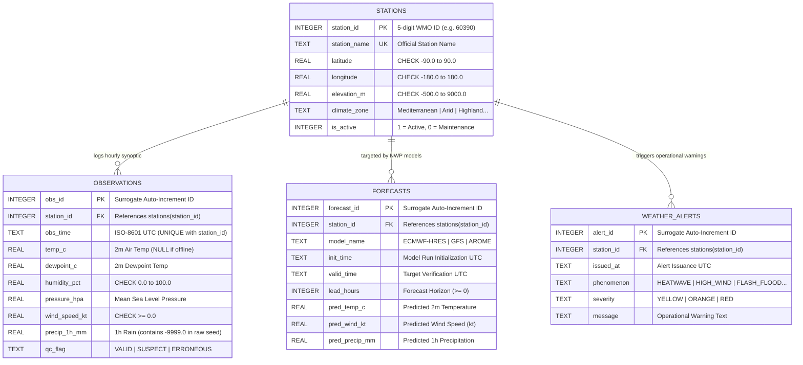
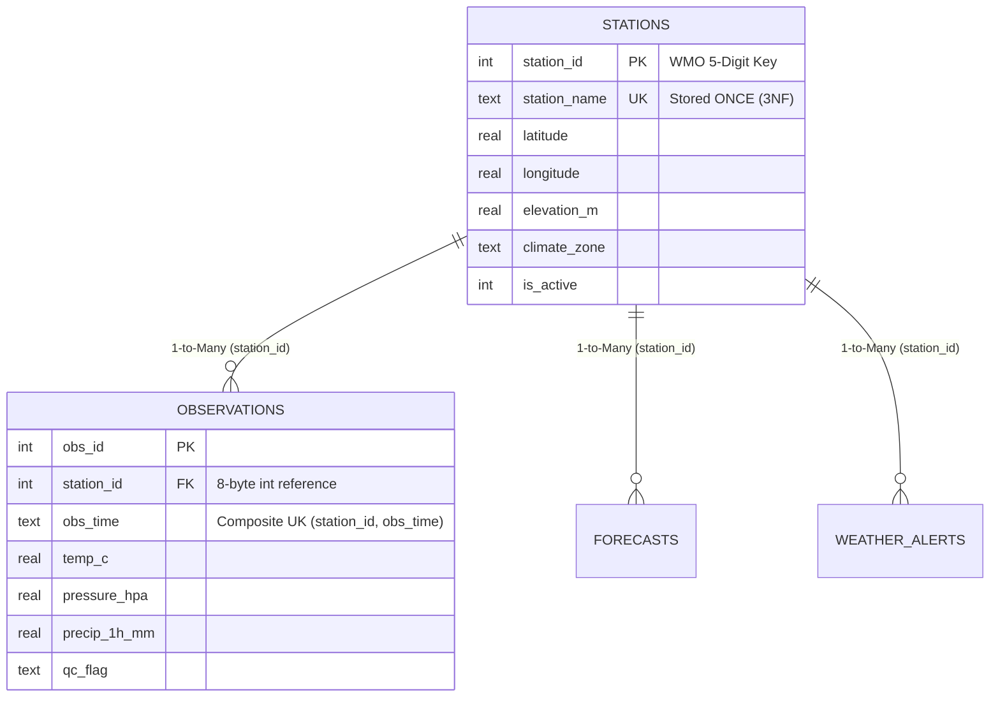

> **Navigation:** [🏠 Master README](../README.md) | [🌐 Interactive Portal](../bootcamp_portal.html) | [📚 Reference Cards](../reference_cards/README.md) | **Day 1 Coursebook** | [⏭️ Day 2 Coursebook](../day2/day2_master_coursebook.md)

# Weather Forecast Engineering Database Bootcamp
## Day 1 Master Coursebook: SQL Foundations, WMO Relational Modeling & Telemetry Wrangling with SQLite

**Bootcamp:** Database & NoSQL Engineering (5-Day Intensive)  
**Target Audience:** Weather Forecast Engineers, Meteorological Software Engineers, Weather Systems Administrators & Environmental Data Scientists  
**Execution Environment:** Local zero-friction `sqlite3` CLI (3.38+) + DBeaver / DB Browser for SQLite / TablePlus  
**Primary Working Datasets:**
1. **`day1/weather_ops.db` (`weather_ops_seed.sql`):** Curated WMO Surface Synoptic Network (`stations`, `observations`, `forecasts`, `weather_alerts`) with physical `CHECK` constraints and multi-model NWP verification data (`ECMWF-HRES`, `GFS`, `AROME`).
2. **`day1/weather_telemetry.db` (`generate_weather_db.py`):** 250,000 synthetic high-frequency observations across 50 Automated Weather Stations (`AWS-001` to `AWS-050`) with injected hardware sentinels (`-999.0`), barometric plunges, thermal spikes, and a 6-hour communications blackout (`stations`, `raw_telemetry`).

> [!IMPORTANT]
> **🚨 STOP & READ FIRST — Which SQLite `.db` File Do I Open? (Fixing `"no such table: raw_telemetry"` / `"no such table: observations"`)**  
> Day 1 uses **TWO separate SQLite database files** inside the `day1/` folder. Because each SQLite file is a standalone database, running a `raw_telemetry` query while connected to `weather_ops.db` (or running `sqlite3` from the wrong folder so SQLite creates an empty 0-byte file!) immediately throws `Parse error: no such table: raw_telemetry`.
>
> | Database File (`cd day1` first!) | How to Build / Open It | Exact Tables Inside This File | Key Columns | Coursebook Sections Using This File |
> | :--- | :--- | :--- | :--- | :--- |
> | **📂 File 1: `weather_ops.db`**<br>*(69 rows — WMO Synoptic & NWP)* | `sqlite3 weather_ops.db < weather_ops_seed.sql`<br>Open: **`sqlite3 weather_ops.db`**<br>*(or inside `sqlite>`: **`.open weather_ops.db`**)* | • `stations` *(7 WMO stations: `60390`..`60680`)*<br>• **`observations`** *(36 hourly rows)*<br>• **`forecasts`** *(22 NWP rows)*<br>• **`weather_alerts`** *(4 CAP alerts)* | `obs_time`, `temp_c`, `dewpoint_c`, `pressure_hpa`, `wind_speed_kt`, `precip_1h_mm` (`-9999.0`), `qc_flag` | • **§3.2** (Dataset 1 Setup)<br>• **§4.2 Lab 1** (DDL & CRUD)<br>• **§6.5 Lab 2** (Synoptic Cleaning)<br>• **§7.3 & §7.4 Lab 3** (All 7 `JOIN`s)<br>• **§9 Part A** (NWP Verification) |
> | **📂 File 2: `weather_telemetry.db`**<br>*(250,050 rows — 50 AWS Stream)* | `python3 generate_weather_db.py`<br>Open: **`sqlite3 weather_telemetry.db`**<br>*(or inside `sqlite>`: **`.open weather_telemetry.db`**)* | • `stations` *(50 AWS stations: `'AWS-001'`..`'AWS-050'``)*<br>• **`raw_telemetry`** *(250,000 1-min rows)* | `recorded_at`, `temperature` (`-999.0`), `pressure` (`-999.0`), `wind_speed`, `wind_direction`, `rain_accum_1m` | • **§3.3** (Dataset 2 Setup)<br>• **§5.3–5.4** (`WHERE` vs `HAVING`)<br>• **§6.2–6.4** (`-999.0` Sentinels)<br>• **§8.1–8.3** (CTEs & Window `OVER`)<br>• **§9 Part B & §10.2** (Diagnostics) |
>
> **3 Instant Rules so You Never Get Lost:**
> 1. **Check which file you are inside right now:** Type **`.databases`** and **`.tables`** at the `sqlite>` prompt (if `.tables` is blank, you opened `sqlite3` in the wrong folder—type `.quit`, run `cd day1`, and reopen!).
> 2. **Switch between the two files in 1 second without exiting `sqlite3`:** Type **`.open weather_ops.db`** or **`.open weather_telemetry.db`** directly at the `sqlite>` prompt!
> 3. **Recommended Classroom Setup:** Open **Two Terminal Tabs** in `day1/` (**Tab 1:** `sqlite3 weather_ops.db`, **Tab 2:** `sqlite3 weather_telemetry.db`), or in **DBeaver / DB Browser for SQLite** use the top database dropdown to select the matching `.db` file shown at the top of each SQL block below.

**Companion Reference Files in `day1/`:**
- [day1_sqlite_and_sql_cheatsheet.md](./day1_sqlite_and_sql_cheatsheet.md) — Authoritative CLI Directives, 3VL Truth Tables, WMO Queries & Window Recipes
- [day1_hardware_sentinels_and_qc_guide.md](./day1_hardware_sentinels_and_qc_guide.md) — Deep-Dive on `-9999` / `-999` In-Band Signaling, ADC Physics, WMO QC Flags & Contamination Math
- [weather_ops_seed_sql_course_walkthrough.md](./weather_ops_seed_sql_course_walkthrough.md) — **Detailed Markdown Course Walkthrough** explaining every SQL statement, constraint, and telemetry anomaly in `weather_ops_seed.sql`
- [weather_ops_seed.sql](./weather_ops_seed.sql) & `weather_ops.db` — WMO Synoptic & NWP Verification Relational Seed
- [generate_weather_db.py](./generate_weather_db.py) — Standalone 250,000-row Python SQLite Telemetry Generator
- *(Cross-Day OLAP Previews)*: Columnar Parquet formats and DuckDB (OLAP) vs. SQLite (OLTP) architectural comparisons

---

## 1. The 5-Day Arc & Architectural Overview

### 1.1 Core Engineering Objective
Move beyond ad-hoc procedural file scripts (nested loops over fragile CSV/ASCII files) to **set-based declarative SQL**, enforce physical meteorological integrity directly at the database schema layer, sanitize time-series telemetry anomalies (`NULL` vs. `-9999.0`/`-999.0`), verify Numerical Weather Prediction (NWP) models with relational joins, and establish a rigorous ANSI SQL foundation before examining PostgreSQL storage engine internals on Day 2.

### 1.2 The 5-Day Journey: Why Start with Local SQLite?
1. **Day 1 — SQLite (Core Relational Modeling, Declarative SQL & Telemetry Wrangling):**
   - **Zero Infrastructure Friction:** A complete relational database resides inside a single cross-platform disk file (`weather_ops.db` and `weather_telemetry.db`), requiring zero background daemons or network sockets.
   - **Architectural Focus:** Isolates relational set theory and query execution from multi-process server administration. Day 1 covers **DDL constraints, declarative execution order, Three-Valued Logic (3VL), hardware sentinel hygiene (`NULLIF`), climatological aggregations (`GROUP BY`/`HAVING`), NWP forecast verification (`JOIN`s), recursive gap-filling CTEs (`WITH RECURSIVE`), and sliding window functions (`OVER`, `PARTITION BY`, `LAG`)**.
   - **Real-World Meteorological Role:** Widely deployed inside edge weather stations, autonomous ocean buoys, mobile field loggers, and local data-science pipelines.
2. **Days 2 & 3 — PostgreSQL (Production Relational & Spatial Engine):**
   - Moving from a single-file embedded library to a concurrent multi-process client-server architecture (`postgres`).
   - Physical 8 KB heap pages (`pageinspect`), 23-byte MVCC tuple headers, CPU byte-alignment padding, strict data types (`TIMESTAMPTZ`, `NUMERIC`), declarative table partitioning for billions of synoptic rows, indexing (`B-Tree`, `BRIN`, `GIN`), and geospatial meteorology (`PostGIS`).
3. **Days 4 & 5 — MongoDB & Hybrid Polyglot Architectures (NoSQL Document Store & Columnar Lakehouse):**
   - Handling semi-structured, rapidly evolving payloads (heterogeneous IoT weather sensors, nested JSON radar metadata, Common Alerting Protocol (CAP) documents) alongside high-compression columnar formats (Apache Parquet / DuckDB) for multi-decade reanalysis scans.

---

## 2. Comprehensive Module Outline

```
┌─────────────────┬──────────────────────────────────────────────────────────────────────────┐
│ Module 1        │ Why Databases? Architecture, CLI Directives & Dual Datasets              │
├─────────────────┼──────────────────────────────────────────────────────────────────────────┤
│ Module 2        │ Relational Schema Design, WMO Constraints, CRUD & Lab 1                  │
├─────────────────┼──────────────────────────────────────────────────────────────────────────┤
│ Module 3        │ The Declarative Engine, Execution Order & 3VL Truth Tables               │
├─────────────────┼──────────────────────────────────────────────────────────────────────────┤
│ Module 4        │ Hardware Sentinels (-9999/-999), QC Hygiene & Lab 2                      │
├─────────────────┼──────────────────────────────────────────────────────────────────────────┤
│ Module 5        │ Climatological Aggregations, Rollups & NWP Verification (Lab 3)          │
├─────────────────┼──────────────────────────────────────────────────────────────────────────┤
│ Module 6        │ CTE Pipelines, Recursive Outage Grids & Window Functions                 │
├─────────────────┼──────────────────────────────────────────────────────────────────────────┤
│ Module 7        │ Capstone Walkthroughs (NWP Leaderboard + AWS Production Diagnostics)     │
└─────────────────┴──────────────────────────────────────────────────────────────────────────┘
```

---

## 3. Module 1: Why Databases? Architecture, Tooling & Dual Dataset Setup

### 3.1 Flat Files vs. Relational DBMS in Meteorological Engineering
- **The Fragility of Flat Files in Weather Operations:**
  - When a meteorological center stores observations across tens of thousands of loose CSV or ASCII synoptic files, a single firmware update that reorders two columns or emits `-9999.0` for a broken rain gauge silently corrupts downstream scripts.
  - **File-Processing Scripts vs. Relational DBMS:** Ad-hoc file scripts lack concurrent write locking, atomic crash recovery, physical schema constraints, and indexed time-range lookups. A **Relational DBMS** enforces physical domain boundaries via `CHECK` constraints, guarantees ACID transactions, and uses B-Tree/BRIN indexes to slice multi-year time windows in milliseconds rather than scanning every file on disk.
- **How SQLite Works vs. PostgreSQL & DuckDB:**
  - **SQLite (Embedded Row-Oriented OLTP):** An *in-process* SQL engine (`libsqlite3`). Your application or CLI reads and writes directly to a single ordinary disk file (`weather_ops.db`). Ideal for local analysis, embedded data loggers on weather buoys/stations, and transactional lookups.
  - **Concurrency Limitation (Bridge to Day 2):** SQLite arbitrates writes using OS file locks (even in `WAL` mode, only **one writer** can append at a time). When 500 automated weather stations push telemetry simultaneously while forecasters query live dashboards, a client-server engine with row-level MVCC (**PostgreSQL**) is required.
  - **Row Store vs. Columnar OLAP Preview (Parquet & DuckDB):** SQLite stores entire rows contiguously inside 4 KB B-Tree pages, which is optimal for inserting individual station pings or retrieving all attributes of station `60390`. For scanning 50 years of temperature alone across 10 billion rows, columnar formats (**Apache Parquet**) and vectorized engines (**DuckDB**) read only the compressed temperature bytes.

### 3.2 Dataset 1 Setup: Curated WMO Synoptic & NWP Database (`day1/weather_ops.db`)
Open a terminal, change into the **`day1`** directory (`cd day1`), and build/open `weather_ops.db` from `weather_ops_seed.sql`:

```bash
cd day1
sqlite3 weather_ops.db < weather_ops_seed.sql
sqlite3 weather_ops.db
```

#### Essential `sqlite3` CLI Dot-Commands (Inside `sqlite3 weather_ops.db`)
Dot-commands are evaluated directly by the `sqlite3` client shell (not the SQL parser), must begin at column 1 with a `.`, and **never** end with a semicolon:

```sql
-- ============================================================================
-- 📂 TARGET FILE: day1/weather_ops.db  (Tables: stations, observations, forecasts, weather_alerts)
-- 👉 In sqlite3 CLI, verify or switch with:   .open weather_ops.db
-- ============================================================================
.help                  -- Show available shell commands
.databases             -- Confirm you are connected to day1/weather_ops.db
.tables                -- List all 4 tables (forecasts, observations, stations, weather_alerts)
.schema stations       -- Show exact CREATE TABLE DDL for stations
.headers on            -- Display column names
.mode box              -- Pretty-print output in Unicode box tables (or .mode column)
.nullvalue NULL        -- Print NULL explicitly instead of blank spaces
.timer on              -- Measure CPU and wall-clock query execution time

SELECT * FROM stations;
```

> [!TIP]
> **Engineering Tip — Making `NULL` Visible in the Terminal:**  
> By default, the `sqlite3` shell renders `NULL` values as an empty string (`""`), making missing sensor dropouts visually indistinguishable from blank whitespace. Always run `.nullvalue NULL` and `.mode box` at the start of a session (or add them to `~/.sqliterc`) so Three-Valued Logic (`3VL`) and sensor dropouts are explicitly displayed as `NULL`.

To inspect **`weather_ops.db` visually in DBeaver / DB Browser for SQLite**:
1. Create a New Connection $\rightarrow$ Select **SQLite** $\rightarrow$ Browse to `day1/weather_ops.db`.
2. Double-click the `stations` table $\rightarrow$ open the **ER Diagram** tab to inspect how `station_id` links `stations` to `observations`, `forecasts`, and `weather_alerts`.

### 3.3 Dataset 2 Setup: 250,000-Row High-Frequency AWS Stream (`day1/weather_telemetry.db`)
First, exit the `sqlite>` prompt (type **`.quit`** or open a **second terminal tab** inside `day1/`) so you are back at your Linux/macOS/Windows shell prompt (`$`). Then run the standalone Python generator (`generate_weather_db.py`), which synthesizes 250,000 rows across 50 Automated Weather Stations (`AWS-001` to `AWS-050`) over a 48-hour window in $\approx 2\text{--}3\text{ seconds}$:

```bash
# Run from your bash/terminal prompt inside day1/ (if still in sqlite>, type .quit first!):
chmod +x generate_weather_db.py
./generate_weather_db.py
sqlite3 weather_telemetry.db
```

Inside `sqlite3 weather_telemetry.db` (or from an existing `sqlite>` prompt via `.open weather_telemetry.db`):
```text
.open weather_telemetry.db
.databases
.headers on
.mode box
.timer on
.tables
.schema raw_telemetry
```
*(Notice that `.tables` inside `weather_telemetry.db` displays **`raw_telemetry`** and **`stations`**. Whenever a section below queries `raw_telemetry`, use `.open weather_telemetry.db`; whenever a section queries `observations`, `forecasts`, or `weather_alerts`, use `.open weather_ops.db`!)*

### 3.4 SQLite `PRAGMA` Engine Directives vs. CLI Dot-Commands

A critical distinction in SQLite engineering is the difference between **CLI Dot-Commands** (`.headers`, `.mode`, `.schema`) and **`PRAGMA` Statements**:
- **CLI Dot-Commands (`.cmd`):** Evaluated **only** by the `sqlite3` terminal program. They do not end with a semicolon and will throw a syntax error if executed inside Python (`cur.execute(".tables")`) or DBeaver.
- **`PRAGMA` Statements (`PRAGMA name = value;`):** SQLite-specific SQL extensions evaluated directly by the **SQLite Storage Core (`libsqlite3`)**. They **end with a semicolon (`;`)**, work identically across the `sqlite3` CLI, Python `sqlite3`, and DBeaver, and control runtime engine behavior, crash recovery, memory caching, and schema introspection.

#### 1. The Scope Rule: Per-Connection vs. Persistent Database Header Pragmas
- **Per-Connection (Session) Pragmas:** Reset to compile-time defaults every time a new connection opens! You must run them at the start of every session (or inside `~/.sqliterc` / Python connection hooks):
  - `PRAGMA foreign_keys = ON;` (Default: `OFF` / `0`)
  - `PRAGMA synchronous = NORMAL;` (Default: `FULL` / `2`)
  - `PRAGMA busy_timeout = 5000;` (Default: `0` ms)
  - `PRAGMA cache_size = -64000;` (Default: `-2000` $\approx 2\text{ MiB}$)
  - `PRAGMA temp_store = MEMORY;` (Default: `DEFAULT` / `0`)
- **Persistent (Database File Header) Pragmas:** Stored permanently inside the `.db` file header and remembered across all future connections:
  - `PRAGMA journal_mode = WAL;` (Switches the database file permanently to Write-Ahead Logging until changed back).
  - `PRAGMA page_size = 4096;` (Persists when set before table creation or immediately followed by `VACUUM;`).
  - `PRAGMA auto_vacuum = NONE | FULL | INCREMENTAL;`

#### 2. Complete Categorized Matrix of Essential SQLite `PRAGMA` Options

| Category | `PRAGMA` Statement | Default | Scope | Meteorological Engineering Purpose & When to Use |
| :--- | :--- | :---: | :---: | :--- |
| **Integrity & Constraints** | `PRAGMA foreign_keys = ON;` | `0` (`OFF`) | Connection | Enforces `FOREIGN KEY` constraints and `ON DELETE CASCADE` (Line 7 of [`weather_ops_seed.sql`](./weather_ops_seed.sql)). |
| **Integrity & Constraints** | `PRAGMA foreign_key_check;` | — | Action | Scans existing tables (or a single table: `PRAGMA foreign_key_check(observations);`) for orphaned rows inserted while foreign keys were disabled. |
| **Integrity & Constraints** | `PRAGMA integrity_check;` / `PRAGMA quick_check;` | — | Action | Audits physical B-Tree pages, index sort order, `UNIQUE`, and `NOT NULL` constraints after power loss on remote field data loggers (`ok` = healthy). |
| **Journaling & Concurrency** | `PRAGMA journal_mode = WAL \| DELETE \| TRUNCATE \| PERSIST \| MEMORY \| OFF;` | `DELETE` | **Persistent** (`WAL`) | • **`WAL`:** Enables concurrent readers + 1 writer via `.db-wal`/`.db-shm` (prevents `database is locked` when a daemon ingests while a dashboard reads).<br>• **`OFF`:** Disables rollback journal (used in [`generate_weather_db.py`](./generate_weather_db.py) for 2-second scratch generation; unsafe for live production). |
| **Journaling & Concurrency** | `PRAGMA synchronous = EXTRA \| FULL \| NORMAL \| OFF;` | `FULL` (`2`) | Connection | Controls how often SQLite calls OS `fsync()`. Pair `WAL` + `NORMAL` (`1`) for high-speed crash-safe production ingestion; `generate_weather_db.py` uses `OFF` (`0`) during disposable bulk seeding. |
| **Journaling & Concurrency** | `PRAGMA busy_timeout = 5000;` | `0` ms | Connection | Instructs SQLite to wait up to `5000 ms` (5 seconds) for an active write lock to clear instead of failing immediately with `SQLITE_BUSY` (`database is locked`). |
| **Journaling & Concurrency** | `PRAGMA wal_autocheckpoint = 1000;` | `1000` pages | Connection | Automatically triggers a `PASSIVE` checkpoint once `.db-wal` reaches `1000` 4 KB frames ($\approx 4\text{ MB}$). |
| **Journaling & Concurrency** | `PRAGMA wal_checkpoint(PASSIVE \| FULL \| RESTART \| TRUNCATE);` | — | Action | Flushes committed frames from `.db-wal` back into `.db` and returns the 3-integer tuple `(busy, log, checkpointed)`. |
| **Journaling & Concurrency** | `PRAGMA journal_size_limit = 67108864;` | `-1` (No limit) | Connection | Automatically truncates `.db-wal` down to the specified byte cap (e.g., `64 MiB`) whenever a checkpoint rewinds the WAL to frame 1. |
| **Memory & I/O Tuning** | `PRAGMA cache_size = -64000;` *(or `+100000`)* | `-2000` ($2\text{ MiB}$) | Connection | Negative = KiB (`-64000` = `64 MiB` RAM cache). Positive = page count (`100000` pages $\times 4\text{ KB} \approx 400\text{ MB}$ RAM in `generate_weather_db.py` for rapid index builds). |
| **Memory & I/O Tuning** | `PRAGMA temp_store = MEMORY;` | `0` (`DEFAULT`) | Connection | Keeps temporary B-Trees for `ORDER BY`, `GROUP BY`, `DISTINCT`, and window functions in RAM rather than `/tmp` disk files. |
| **Memory & I/O Tuning** | `PRAGMA mmap_size = 268435456;` | `0` | Connection | Memory-maps up to `256 MiB` of the `.db` file directly into process memory, avoiding `read()` syscall overhead during large analytical scans. |
| **Schema Introspection** | `PRAGMA table_info('observations');` | — | Query / TVF | Returns columns (`cid, name, type, notnull, dflt_value, pk`). Can also be queried as a table in SQL: `SELECT * FROM pragma_table_info('observations');`! |
| **Schema Introspection** | `PRAGMA index_list('observations');` & `PRAGMA index_info('...');` | — | Query / TVF | Lists table indexes (including `sqlite_autoindex_observations_1` created by `UNIQUE (station_id, obs_time)`) and their indexed column order. |
| **Schema Introspection** | `PRAGMA foreign_key_list('observations');` | — | Query / TVF | Lists parent tables (`stations`), referencing columns (`station_id`), and `on_delete` rules (`CASCADE`). |
| **Planner Maintenance** | `PRAGMA optimize;` | — | Action | Run right before closing a database connection; selectively runs `ANALYZE` on tables whose row counts shifted substantially. |

#### 3. Why `generate_weather_db.py` Uses `OFF` While Production Uses `WAL`
Notice Lines 23–25 of [`generate_weather_db.py`](./generate_weather_db.py):
```python
cur.execute("PRAGMA journal_mode = OFF;")
cur.execute("PRAGMA synchronous = OFF;")
cur.execute("PRAGMA cache_size = 100000;")
```
- **Why this is valid in `generate_weather_db.py`:** The script builds a brand-new synthetic `.db` file from scratch in 2 seconds. If power fails mid-script, you simply re-run `./generate_weather_db.py`. Turning off the rollback journal (`journal_mode = OFF`) and OS disk barriers (`synchronous = OFF`) while allocating `100,000` pages ($\approx 400\text{ MB}$) of RAM cache allows 250,000 rows + 2 composite B-Tree indexes to materialize in ~2 seconds.
- **Why you must NEVER use `OFF` on a live weather station:** On a real station logger or operational database (`weather_ops.db`), a power cut during `journal_mode = OFF` corrupts the B-Tree permanently. In production, always use `PRAGMA journal_mode = WAL; PRAGMA synchronous = NORMAL; PRAGMA foreign_keys = ON; PRAGMA busy_timeout = 5000;`.

#### 4. Deep-Dive: SQLite `WAL` Checkpointing, Durability & Production Pitfalls
When `PRAGMA journal_mode = WAL;` is active, writers append modified 4 KB frames to `.db-wal` while readers consult `.db-shm` (Shared Memory WAL Index). Mastering WAL in production requires understanding four operational rules:
1. **Decoding `PRAGMA wal_checkpoint(<MODE>);` Output (`busy | log | checkpointed`):**
   - Every checkpoint call returns `(busy, log, checkpointed)`: `busy` (`0` = completed, `1` = blocked by active reader/writer), `log` (total 4 KB frames currently in `.db-wal`), and `checkpointed` (frames copied back to `.db`).
   - **The 4 Checkpoint Modes:**
     - `PASSIVE` *(used by `wal_autocheckpoint = 1000`)*: Never blocks readers or writers; stops at the oldest active reader snapshot ("Read-Mark").
     - `FULL`: Waits (up to `busy_timeout`) for active writers/readers to finish and flushes all frames.
     - `RESTART`: Flushes all frames and waits for readers so the next writer **must** rewind `.db-wal` back to frame 1 (reusing the file without shrinking it).
     - `TRUNCATE`: Flushes all frames, rewinds to frame 1, and calls `ftruncate()` to shrink `.db-wal` to **`0` bytes** on disk.
2. **Why `WAL` + `PRAGMA synchronous = NORMAL;` Is the Production Sweet Spot:**
   - In legacy `DELETE` mode, `synchronous = NORMAL` has a small corruption risk on sudden power loss. In **`WAL` mode**, `synchronous = NORMAL` is **100% B-Tree corruption-safe**: commits append to `.db-wal` in RAM without stalling on OS `fsync()`, and `fsync()` is only called during checkpoints ($10\text{--}25\times$ faster writes while preserving SD/SSD flash lifespan).
3. **Preventing "WAL Starvation" (Unbounded `.db-wal` Growth):**
   - If a Python script or GUI leaves an unfinished `SELECT` cursor open, it holds a "Read-Mark" that prevents `wal_autocheckpoint` from rewinding `.db-wal`, causing `.db-wal` to grow to gigabytes. Always close read cursors promptly and set `PRAGMA journal_size_limit = 67108864;` (`64 MiB`).
4. **Why `PRAGMA busy_timeout = 5000;` Requires `BEGIN IMMEDIATE;` for Concurrent Writers:**
   - If Connection A starts with a deferred `BEGIN;`, runs a `SELECT`, and later tries to run `INSERT` after Connection B has already committed a new WAL frame, SQLite **immediately aborts with `SQLITE_BUSY_SNAPSHOT` (`0 ms`)—ignoring `busy_timeout`**—because upgrading a stale read snapshot would violate serializability. Always begin write transactions with **`BEGIN IMMEDIATE;`** so the write lock is acquired up front and `busy_timeout` is honored!

---

## 4. Module 2: Relational Schema Design, WMO Constraints & CRUD

### 4.1 Relational Schema Architecture & Physical Integrity
#### WMO Synoptic & NWP Relational Entity-Relationship Architecture (`weather_ops.db`)



1. **Tables, Rows, and Primary Keys (Natural vs. Surrogate):**
   - In `weather_ops.db`, `stations` uses `station_id` (the official 5-digit WMO station number, e.g., `60390` for Algiers - Dar El Beida) as a **Natural Primary Key**.
   - `observations` uses `obs_id INTEGER PRIMARY KEY AUTOINCREMENT` (a **Surrogate Key**) paired with a composite `UNIQUE (station_id, obs_time)` constraint so a station can never log two conflicting synoptic reports for the same timestamp.
2. **Physical Integrity via `NOT NULL` vs. `CHECK` vs. `NOT NULL CHECK`:**
   - Weather sensors fail and transmit corrupted packets (e.g., relative humidity of `145%`, negative wind speed, or latitude `115.0`), or drop offline entirely (`NULL`).
   - Defining declarative constraints directly on the table forces the storage engine to reject invalid measurements at `INSERT` / `UPDATE` time:
     ```sql
     CREATE TABLE stations (
         station_id   INTEGER PRIMARY KEY,               -- WMO 5-digit station identifier
         station_name TEXT    NOT NULL UNIQUE,           -- Pattern 1: Mandatory presence + uniqueness
         latitude     REAL    NOT NULL CHECK (latitude BETWEEN -90.0 AND 90.0),          -- Pattern 2: Mandatory + range
         longitude    REAL    NOT NULL CHECK (longitude BETWEEN -180.0 AND 180.0),       -- Pattern 2: Mandatory + range
         elevation_m  REAL    NOT NULL CHECK (elevation_m >= -500.0 AND elevation_m <= 9000.0),
         climate_zone TEXT    NOT NULL CHECK (climate_zone IN ('Mediterranean', 'Arid', 'Semi-Arid', 'Highland', 'Maritime')),
         is_active    INTEGER NOT NULL DEFAULT 1 CHECK (is_active IN (0, 1))
     );

     CREATE TABLE observations (
         obs_id         INTEGER PRIMARY KEY AUTOINCREMENT,
         station_id     INTEGER NOT NULL,
         obs_time       TEXT    NOT NULL,                -- Pattern 1: Mandatory timestamp
         temp_c         REAL,                            -- Pattern 4: Nullable raw reading (can hold 68.5°C spike w/ ERRONEOUS flag)
         dewpoint_c     REAL,                            -- Pattern 4: Nullable raw reading
         humidity_pct   REAL    CHECK (humidity_pct IS NULL OR (humidity_pct >= 0.0 AND humidity_pct <= 100.0)), -- Pattern 3: Nullable + range
         pressure_hpa   REAL,                            -- Pattern 4: Nullable raw reading
         wind_speed_kt  REAL    CHECK (wind_speed_kt IS NULL OR wind_speed_kt >= 0.0),   -- Pattern 3: Nullable + range
         precip_1h_mm   REAL,                            -- Pattern 4: Nullable raw landing (accepts -9999.0 sentinel for Day 1 lab)
         qc_flag        TEXT    NOT NULL DEFAULT 'VALID' CHECK (qc_flag IN ('VALID', 'SUSPECT', 'ERRONEOUS')), -- Pattern 2
         FOREIGN KEY (station_id) REFERENCES stations(station_id) ON DELETE CASCADE,
         UNIQUE (station_id, obs_time)
     );
     ```

   #### 2a. Why Do Some Columns Use `NOT NULL`, Some Use `CHECK`, and Some Use `NOT NULL CHECK`?
   A common source of confusion in SQL schema design is assuming that `CHECK (latitude BETWEEN -90.0 AND 90.0)` automatically forbids `NULL`, or that `NOT NULL` protects against garbage values. In SQL, **`NOT NULL` and `CHECK` enforce two completely orthogonal dimensions of data integrity**:
   - **`NOT NULL` enforces Existence (Presence):** It asks: *"Is a value present?"* It rejects `NULL`, but happily accepts `-9999.0`, `99999.0`, or an empty string `''`.
   - **`CHECK (expression)` enforces Domain Validity (Physics/Business Rules):** It asks: *"If a value is present, does it obey the rule?"* It rejects any value where `expression` evaluates to `FALSE`—**but in ANSI SQL, a `CHECK` constraint silently ALLOWS `NULL`!**

   #### 2b. The Three-Valued Logic (`3VL`) Surprise: Why `WHERE` Rejects `NULL` While `CHECK` Accepts `NULL`!
   When a column is `NULL`, any comparison like `NULL >= 0.0` or `NULL BETWEEN -90.0 AND 90.0` evaluates to neither `TRUE` nor `FALSE`—it evaluates to **`UNKNOWN`**.
   Here is the critical asymmetry in the ANSI SQL standard (implemented identically across **SQLite**, **PostgreSQL**, **DuckDB**, and **MySQL 8.0.16+**):
   - **`WHERE` and `HAVING` clauses are "Strict Inclusion Filters" (Require `TRUE`):** A row is returned **only if** the predicate evaluates to `TRUE`. Both `FALSE` and `UNKNOWN` (`NULL`) are rejected.
   - **`CHECK` constraints are "Conflict Exclusion Guards" (Reject Only `FALSE`):** A row insertion is aborted **only if** the constraint evaluates strictly to `FALSE`. Both `TRUE` **and `UNKNOWN` (`NULL`) pass!**

   | Inserted Column Value | Expression (`col >= 0.0`) Result | `WHERE col >= 0.0` (Query Filter) | `CHECK (col >= 0.0)` Alone (No `NOT NULL`) | `NOT NULL CHECK (col >= 0.0)` (Combined) |
   | :--- | :--- | :--- | :--- | :--- |
   | `15.0` (Valid reading) | **`TRUE`** | Kept in query result | **Allowed** | **Allowed** |
   | `-5.0` (Unphysical value) | **`FALSE`** | Filtered out | **REJECTED** (`CHECK` failed) | **REJECTED** (`CHECK` failed) |
   | `NULL` (Missing value) | **`UNKNOWN`** | Filtered out (`UNKNOWN` $\neq$ `TRUE`) | **ALLOWED!** (`UNKNOWN` $\neq$ `FALSE`) | **REJECTED** (`NOT NULL` failed) |

   > [!WARNING]
   > **The #1 Schema Design Trap (`CHECK` Without `NOT NULL`):**  
   > If you declare `latitude REAL CHECK (latitude BETWEEN -90.0 AND 90.0)` **without** `NOT NULL`, a buggy ingestion script can insert `latitude = NULL` and the database will accept it without complaint—because `NULL BETWEEN -90.0 AND 90.0` evaluates to `UNKNOWN`, which passes `CHECK`!  
   > **Golden Rule:**
   > - If a column **must never be `NULL`** *and* **must obey a range or enum**, you **must** write **`NOT NULL CHECK (...)`**.
   > - Neither `NOT NULL` alone nor `CHECK (...)` alone is sufficient!

   #### 2c. Why Write `CHECK (col IS NULL OR (...))` on Nullable Sensor Columns?
   Look at `observations.wind_speed_kt` above:
   ```sql
   wind_speed_kt REAL CHECK (wind_speed_kt IS NULL OR wind_speed_kt >= 0.0)
   ```
   Wait: if `CHECK (wind_speed_kt >= 0.0)` already allows `NULL` (because `NULL >= 0.0` is `UNKNOWN`), why did we explicitly write `wind_speed_kt IS NULL OR wind_speed_kt >= 0.0`?
   While both forms accept the exact same rows inside a `CREATE TABLE` definition, writing `col IS NULL OR (...)` explicitly on nullable columns is a **production engineering best practice** for three reasons:
   1. **Self-Documenting Architectural Intent:** When another engineer reviews your DDL, seeing `REAL CHECK (wind_speed_kt >= 0.0)` looks like a bug where the author forgot `NOT NULL`. Writing `REAL CHECK (wind_speed_kt IS NULL OR wind_speed_kt >= 0.0)` documents unmistakably that **`NULL` is intentionally allowed** (because a physical cup anemometer can drop offline during an icing event), while negative numbers are forbidden.
   2. **Safe Copy-Pasting Between `CHECK` and `WHERE` / `dbt` Tests:** If an engineer copies `wind_speed_kt >= 0.0` from a `CHECK` constraint into a SQL `WHERE` filter (`SELECT * FROM observations WHERE wind_speed_kt >= 0.0`), the `WHERE` clause will **silently drop all rows where `wind_speed_kt IS NULL`** because `WHERE` rejects `UNKNOWN`! By contrast, `wind_speed_kt IS NULL OR wind_speed_kt >= 0.0` evaluates to `TRUE` (`TRUE OR UNKNOWN` $\equiv$ `TRUE`) when `wind_speed_kt` is `NULL`, behaving identically in both `CHECK` constraints and `WHERE` filters.
   3. **Protection Against `CHECK (col IS NOT NULL AND ...)` Edits:** It makes the nullability rule explicit right inside the boolean expression.

   #### 2d. The 4-Pattern Decision Matrix: When to Use What
   Every column across our 5-day bootcamp follows one of four deliberate constraint patterns:

   | Pattern | SQL Declaration Syntax | Allows `NULL`? | Restricts Domain / Range? | When to Use It in Telemetry & Forecasting | Examples in `weather_ops.db` |
   | :--- | :--- | :---: | :---: | :--- | :--- |
   | **Pattern 1: Mandatory Presence Only** | `col TYPE NOT NULL` | ❌ No | ❌ No (any value of `TYPE` accepted) | Mandatory identity, timestamp, free-text, or unbounded continuous variables where `NULL` is invalid, and any value of the data type is acceptable. | `obs_time TEXT NOT NULL`, `pred_temp_c REAL NOT NULL`, `message TEXT NOT NULL` |
   | **Pattern 2: Mandatory + Domain Rule** | `col TYPE NOT NULL CHECK (...)` | ❌ No | ✅ Yes | Mandatory attributes that **must always be present** AND **must fall within a strict physical range or enumeration**. | `latitude`, `longitude`, `elevation_m`, `climate_zone`, `pred_wind_kt`, `qc_flag` |
   | **Pattern 3: Nullable Sensor + Physical Guard** | `col TYPE CHECK (col IS NULL OR (...))` | ✅ Yes | ✅ Yes (when non-null) | Real-world field sensor readings that **can legitimately be `NULL`** when a probe drops offline, **but if a number is reported**, it must obey physical laws. | `humidity_pct` (`0–100%`), `wind_speed_kt` (`>= 0.0`), Day 2 `precip_1h_mm` (`>= 0.0`) |
   | **Pattern 4: Raw Landing / Unconstrained Nullable** | `col TYPE` *(no `NOT NULL`, no `CHECK`)* | ✅ Yes | ❌ No | **Bronze / Raw staging columns** that must ingest raw wire frames containing in-band hardware sentinels (`-9999.0`) or uncalibrated spikes (`68.5°C`) without aborting the batch, so downstream SQL (`NULLIF` / `qc_flag`) can audit and clean them. | Day 1 `precip_1h_mm` (holds `-9999.0` sentinel), `temp_c` (holds `68.5°C` spike marked `'ERRONEOUS'`) |

   > [!TIP]
   > **The Text Empty-String Trap (`NOT NULL` $\neq$ Non-Empty `''`) & Multi-Engine `CHECK` Support:**  
   > - **`NULL` vs. Empty String `''`:** In SQLite, PostgreSQL, DuckDB, and MySQL, an empty string `''` or whitespace `'   '` is **not `NULL`**—it is a valid 0-character `TEXT` value! Therefore, `station_name TEXT NOT NULL` rejects `NULL`, but **allows `''`**. To forbid both `NULL` and blank strings on free-text columns, combine `NOT NULL` with a `CHECK` constraint:
   >   ```sql
   >   station_name TEXT NOT NULL CHECK (LENGTH(TRIM(station_name)) > 0)
   >   ```
   > - **Cross-Engine Compatibility Note:** **SQLite**, **PostgreSQL**, and **DuckDB** have enforced `CHECK` constraints for decades. **MySQL** famously parsed and *silently ignored* `CHECK` constraints prior to **MySQL 8.0.16** (released 2019); in **MySQL 8.0.16+ and 8.4 LTS** (and **MariaDB 10.2.1+**), `CHECK` constraints are fully enforced using this exact same Three-Valued Logic! (See [Reference Card 14: MySQL & MariaDB Complete Guide](../reference_cards/14_mysql_and_mariadb_innodb_complete_engineering_guide.md)).
3. **SQLite Dynamic Typing & Type Affinity vs. PostgreSQL Strict Typing:**
   - Unlike PostgreSQL (where a column's type is rigidly enforced on every row), standard SQLite uses **Dynamic Typing (Manifest Typing)**: the data type is associated with the *individual value* rather than the column container (unless a table is explicitly declared `STRICT` in SQLite 3.37+).
   - Every value stored in an SQLite database belongs to one of **5 Fundamental Storage Classes**:

     | Storage Class | Internal Representation | Meteorological Usage in SQLite |
     | :--- | :--- | :--- |
     | **`NULL`** | 0-byte header flag | Missing sensor reading / offline probe |
     | **`INTEGER`** | Variable-length signed integer (`1, 2, 3, 4, 6, or 8 bytes` depending on magnitude) | WMO `station_id` (`60390`), `lead_hours`, boolean flags (`0`/`1`), or Unix epochs |
     | **`REAL`** | 8-byte IEEE 754 floating-point number | `temp_c`, `pressure_hpa`, `wind_speed_kt`, `latitude`, `longitude` |
     | **`TEXT`** | UTF-8 / UTF-16 string | `station_name`, `qc_flag`, and ISO-8601 UTC timestamps (`'2026-10-05 12:00:00'`) |
     | **`BLOB`** | Raw byte sequence (stored verbatim) | Compact binary payloads (though large gridded arrays belong in object storage) |

   - **How Type Affinity Works:** Column declarations (`INTEGER`, `REAL`, `TEXT`, `NUMERIC`) act as *Type Affinity* hints—if you insert the text string `'24.5'` into a `REAL` column, SQLite automatically converts it to a float (`24.5`), but if you insert `'N/A'` into a `REAL` column without a `CHECK(typeof(col) = 'real')` or `STRICT` table modifier, SQLite will store `'N/A'` as `TEXT`!
   - **Why ISO-8601 `TEXT` Timestamps Work in SQLite:** Because ISO-8601 UTC strings (`YYYY-MM-DD HH:MM:SS`) order most-significant to least-significant digit, standard byte-by-byte lexicographical sorting (`BETWEEN` and `ORDER BY`) matches chronological order.
   - *Day 2 Contrast:* In PostgreSQL, timestamps are stored as native 8-byte `TIMESTAMPTZ` integers (microseconds since `2000-01-01 00:00:00 UTC`), and calibrated measurements use exact base-10 `NUMERIC(5,2)`.
4. **Foreign Keys in SQLite (`PRAGMA foreign_keys = ON;`):**
   - For backwards compatibility with legacy SQLite 3.6 applications, SQLite starts every new connection with foreign key enforcement turned **off** by default. Always execute `PRAGMA foreign_keys = ON;` so the engine rejects observations referencing non-existent WMO stations.

> [!WARNING]
> **Production Engineering Pitfall — `PRAGMA foreign_keys = ON;` Is Per-Connection:**  
> In SQLite, `PRAGMA foreign_keys = ON;` is a **session-level setting**, not a persistent flag stored inside the `.db` file header. Whenever you open a new `sqlite3` terminal session, reconnect in DBeaver, or open a new Python `sqlite3.connect()` handle, you must execute `PRAGMA foreign_keys = ON;` (verify with `PRAGMA foreign_keys;`, which returns `1` when active) to enforce referential integrity.

5. **Safe CRUD Operations (`INSERT`, `UPDATE`, `DELETE`):**
   - **Operational Rule:** Never run an `UPDATE` or `DELETE` statement on production telemetry without first testing the exact `WHERE` predicate using a `SELECT` query.

### 4.2 Lab 1 Walkthrough: DDL, Physical Constraints & CRUD on `weather_ops.db`
> **📂 Active Database File for Lab 1:** **`day1/weather_ops.db`** (`stations`, `observations`, `forecasts`, `weather_alerts`)  
> - **In `sqlite3` CLI:** Type **`.open weather_ops.db`** first (if you were previously in `weather_telemetry.db`).  
> - **In DBeaver / DB Browser:** Select **`weather_ops.db`** in the active connection dropdown.

In this walkthrough on `weather_ops.db`, we verify foreign-key and physical `CHECK` constraints, add a new desert synoptic station (`60602 In Salah`), create a `sensor_calibration` metadata table, and reactivate a station returning from maintenance (`60402 Bejaia - Soummam`):

```sql
-- ============================================================================
-- 📂 TARGET FILE: day1/weather_ops.db  (Tables: stations, observations, forecasts, weather_alerts)
-- 👉 In sqlite3 CLI, switch first with:   .open weather_ops.db
-- ============================================================================

-- Enable referential integrity enforcement on the current connection
PRAGMA foreign_keys = ON;

-- 1. Insert new desert station In Salah (60602)
INSERT INTO stations (station_id, station_name, latitude, longitude, elevation_m, climate_zone, is_active)
VALUES (60602, 'In Salah', 27.2500, 2.5100, 269.0, 'Arid', 1);

-- 2a. Test physical CHECK safety rail (Latitude > 90.0):
-- Expected Result: Runtime error: CHECK constraint failed: latitude BETWEEN -90.0 AND 90.0
INSERT INTO stations VALUES (60999, 'Invalid Lat Station', 115.0, 0.0, 10.0, 'Arid', 1);

-- 2b. Test relational FOREIGN KEY safety rail (Non-existent WMO station 99999):
-- Expected Result: Runtime error: FOREIGN KEY constraint failed
INSERT INTO observations (station_id, obs_time, temp_c, qc_flag)
VALUES (99999, '2026-10-06 12:00:00', 25.0, 'VALID');

-- 3. Create a sensor_calibration table linked to stations with ON DELETE CASCADE
CREATE TABLE IF NOT EXISTS sensor_calibration (
    cal_id         INTEGER PRIMARY KEY AUTOINCREMENT,
    station_id     INTEGER NOT NULL,
    sensor_type    TEXT    NOT NULL CHECK (sensor_type IN ('THERMOMETER', 'BAROMETER', 'ANEMOMETER', 'RAIN_GAUGE')),
    calibrated_at  TEXT    NOT NULL,
    offset_applied REAL    NOT NULL DEFAULT 0.0,
    FOREIGN KEY (station_id) REFERENCES stations(station_id) ON DELETE CASCADE
);

-- 4. Reactivate Bejaia - Soummam (60402) after maintenance completion
UPDATE stations
SET is_active = 1
WHERE station_id = 60402;
```

---

## 5. Module 3: The Declarative Engine, Query Execution Order & Three-Valued Logic

### 5.1 The Procedural Mindset vs. Relational Sets
Software developers write code imperatively: lines execute sequentially in loops. In SQL, the engineer specifies **what** set of tuples must be generated, and the query planner constructs the physical retrieval plan.

### 5.2 The 8-Step Physical & Logical Execution Order

```mermaid
flowchart LR
    S1["1. FROM / JOIN<br/>(Cartesian & Join Graph)"] --> S2["2. WHERE<br/>(Row-Level Pushdown)"]
    S2 --> S3["3. GROUP BY<br/>(Bucket Partitioning)"]
    S3 --> S4["4. HAVING<br/>(Aggregate Filtering)"]
    S4 --> S5["5. WINDOW<br/>(OVER / PARTITION BY)"]
    S5 --> S6["6. SELECT & DISTINCT<br/>(Projection & Aliases)"]
    S6 --> S7["7. ORDER BY<br/>(Sort Execution)"]
    S7 --> S8["8. LIMIT / OFFSET<br/>(Result Slicing)"]
```



```
┌────────────────────────────────────────────────────────────────────────┐
│ 1. FROM & JOIN     Identify source tables & calculate Cartesian joins  │
│ 2. WHERE           Filter raw rows BEFORE allocating group memory      │
│ 3. GROUP BY        Partition surviving rows into aggregate buckets     │
│ 4. HAVING          Filter aggregate buckets based on metric thresholds │
│ 5. SELECT          Evaluate scalar expressions & assign column aliases │
│ 6. DISTINCT        Sort/hash deduplication of result rows              │
│ 7. ORDER BY        Sort output records (spills to disk if RAM exceeds) │
│ 8. LIMIT / OFFSET  Slice result set window delivered to the client     │
└────────────────────────────────────────────────────────────────────────┘
```

### 5.3 The Premature Alias Bug (Why `WHERE` Cannot Reference `SELECT` Aliases)
> **📂 Active Database File for Sections 5.3 & 5.4:** **`day1/weather_telemetry.db`** (`stations`, `raw_telemetry`)  
> - **⚠️ SWITCH DATABASE NOW:** If you are still in `weather_ops.db` from Lab 1, type **`.open weather_telemetry.db`** at the `sqlite>` prompt (or select `weather_telemetry.db` in DBeaver) before running `FROM raw_telemetry`!

Executing this query against `weather_telemetry.db` triggers an immediate planner error:

```sql
-- ============================================================================
-- 📂 TARGET FILE: day1/weather_telemetry.db  (Table: raw_telemetry)
-- 👉 In sqlite3 CLI, switch first with:   .open weather_telemetry.db
-- ============================================================================

-- DELIBERATE FAILURE: Run directly in SQLite terminal
SELECT 
    station_id,
    recorded_at,
    (temperature * 1.8 + 32.0) AS temp_f
FROM raw_telemetry
WHERE temp_f > 85.0;
```

* **Observed Error:** `Error: no such column: temp_f` *(Note: if you instead see `Parse error: no such table: raw_telemetry`, you are still connected to `weather_ops.db`—run `.open weather_telemetry.db` first!)*
* **Architectural Reason:** `WHERE` evaluates at **Step 2** to determine which disk pages and rows to filter. `SELECT` does not evaluate scalar column expressions or assign aliases until **Step 5/6**. Therefore, the alias `temp_f` does not exist when `WHERE` executes at Step 2!
* **Production Fix (Expression Repetition or CTE):**
  ```sql
  -- ============================================================================
  -- 📂 TARGET FILE: day1/weather_telemetry.db  (Table: raw_telemetry)
  -- 👉 In sqlite3 CLI, switch first with:   .open weather_telemetry.db
  -- ============================================================================
  SELECT 
      station_id,
      recorded_at,
      (temperature * 1.8 + 32.0) AS temp_f
  FROM raw_telemetry
  WHERE (temperature * 1.8 + 32.0) > 85.0
  LIMIT 5;
  ```
* **Calculated Columns on Synoptic Data (`weather_ops.db`):**
  - Celsius to Kelvin: `ROUND(temp_c + 273.15, 2) AS temp_k`
  - Dewpoint depression (indicator of dry air / cloud base height): `ROUND(temp_c - dewpoint_c, 1) AS dewpoint_spread_c`

### 5.4 The Cost of `HAVING` vs. `WHERE` Pushdown
Comparing filter placement on 250,000 rows in **`weather_telemetry.db`** demonstrates why non-aggregate filters belong in `WHERE` rather than `HAVING`:

```sql
-- ============================================================================
-- 📂 TARGET FILE: day1/weather_telemetry.db  (Table: raw_telemetry)
-- 👉 In sqlite3 CLI, switch first with:   .open weather_telemetry.db
-- ============================================================================

-- POOR: Allocates memory for 250,000 rows across 50 stations before discarding 48
SELECT station_id, AVG(temperature) AS mean_temp
FROM raw_telemetry
GROUP BY station_id
HAVING station_id IN ('AWS-001', 'AWS-002');

-- OPTIMAL: Discards 96% of data at Step 2 before allocating group hash tables
SELECT station_id, AVG(temperature) AS mean_temp
FROM raw_telemetry
WHERE station_id IN ('AWS-001', 'AWS-002')
GROUP BY station_id;
```

### 5.5 Three-Valued Logic (3VL) & `NULL` Truth Tables
In SQL, `NULL` does not mean zero or blank space—it means **unknown/missing**. Relational algebra uses Three-Valued Logic (`TRUE`, `FALSE`, `UNKNOWN`):

| Condition $A$ | Condition $B$ | $A \text{ AND } B$ | $A \text{ OR } B$ | $\text{NOT } A$ |
| :--- | :--- | :--- | :--- | :--- |
| `TRUE` | `NULL` | `UNKNOWN` | `TRUE` | `FALSE` |
| `FALSE` | `NULL` | `FALSE` | `UNKNOWN` | `TRUE` |
| `NULL` | `NULL` | `UNKNOWN` | `UNKNOWN` | `UNKNOWN` |

* **The `= NULL` Trap:** `temp_c = NULL` and `temp_c != NULL` **always** evaluate to `UNKNOWN`. Because `WHERE` only admits rows that evaluate strictly to `TRUE`, `WHERE temp_c = NULL` returns 0 rows! Always use `WHERE temp_c IS NULL` or `WHERE temp_c IS NOT NULL`.
* **`WHERE` / `HAVING` / `JOIN ON` vs. `CHECK` Constraint Gate:** Query filters (`WHERE`, `HAVING`, `JOIN ON`) require **`TRUE`** and reject `UNKNOWN`. Table `CHECK (...)` constraints only reject **`FALSE`** and **accept `UNKNOWN` (`NULL`)**—which is why `CHECK (col >= 0.0)` never prevents `NULL` insertions unless paired with `NOT NULL` (`NOT NULL CHECK (col >= 0.0)`).

> [!IMPORTANT]
> **Production Engineering Pitfall — The `NOT IN (..., NULL)` Silent Zero-Row Bug:**  
> In Three-Valued Logic (`3VL`), `x NOT IN (10, 20, NULL)` expands algebraically to `x != 10 AND x != 20 AND x != NULL`. Because `x != NULL` is always `UNKNOWN`, and `TRUE AND UNKNOWN` evaluates to `UNKNOWN`, **the entire `WHERE` clause returns 0 rows!** Whenever filtering against a subquery that might contain `NULL`s, always filter `WHERE col IS NOT NULL` inside the subquery or use `NOT EXISTS`.

---

## 6. Module 4: Hardware Sentinels (`-9999` / `-999`), In-Band Signaling & QC Hygiene

### 6.1 The Physical Problem: Why `-999.0` and `-9999.0` Exist
In embedded systems and legacy WMO/Fortran files, sensors communicate over fixed-width serial buses (RS-485, Modbus, SDI-12). When a thermistor wire breaks or an ADC saturates, firmware emits an **in-band hardware sentinel value** (`-999.0`, `-9999.0`, `9999.0`) because `NULL` cannot physically exist on a binary wire.
*(See `day1_hardware_sentinels_and_qc_guide.md` for the full ADC physics and variance explosion math).*

### 6.2 Naive Query Contamination Across Both Datasets
> **📂 Active Database File for Sections 6.2–6.4:** **`day1/weather_telemetry.db`** (`raw_telemetry`, 250,000 rows)  
> - **In `sqlite3` CLI:** Ensure you are connected via **`.open weather_telemetry.db`**.

1. **In `weather_telemetry.db` (250,000 rows):**
   ```sql
   -- ============================================================================
   -- 📂 TARGET FILE: day1/weather_telemetry.db  (Table: raw_telemetry)
   -- 👉 In sqlite3 CLI, switch first with:   .open weather_telemetry.db
   -- ============================================================================
   SELECT 
       COUNT(*) AS total_records,
       ROUND(AVG(temperature), 2) AS network_avg_temp,
       MIN(temperature) AS network_min_temp,
       MAX(temperature) AS network_max_temp
   FROM raw_telemetry;
   ```
   **Terminal Output:**
   ```
   ┌───────────────┬──────────────────┬──────────────────┬──────────────────┐
   │ total_records │ network_avg_temp │ network_min_temp │ network_max_temp │
   ├───────────────┼──────────────────┼──────────────────┼──────────────────┤
   │ 250000        │ -1.42            │ -999.0           │ 32.41            │
   └───────────────┴──────────────────┴──────────────────┴──────────────────┘
   ```
2. **In `weather_ops.db` (WMO Synoptic Observations):**
   - Constantine (`60419`) has a `-9999.0` rain gauge reading at `2026-10-06 12:00:00`, dragging `AVG(precip_1h_mm)` into massive negative numbers (`-1660.4 mm`).
   - Bechar (`60571`) has an erroneous `68.5°C` sensor spike at `2026-10-06 12:00:00` (`qc_flag = 'ERRONEOUS'`).

> [!TIP]
> **Architectural Analysis — Why the October Network Mean Dropped to `-1.42°C`:**  
> The query engine did not make an arithmetic error: it treated `-999.0` and `-9999.0` as legitimate physical readings. Just a ~2% rate of `-999.0` sensor dropouts (`MIN(temperature) = -999.0`) pulled the average temperature across a warm Mediterranean station network down from $+18.4^\circ\text{C}$ to $-1.42^\circ\text{C}$. Operational databases require explicit sentinel translation (`NULLIF`) or physical range filtering (`CASE WHEN`) before computing climatological aggregates.

### 6.3 The Core Rule: Clean at the Attribute Level, Not the Row Level
Inspect an anomaly row in **`weather_telemetry.db`**:

```sql
-- ============================================================================
-- 📂 TARGET FILE: day1/weather_telemetry.db  (Table: raw_telemetry)
-- 👉 In sqlite3 CLI, switch first with:   .open weather_telemetry.db
-- ============================================================================
SELECT station_id, recorded_at, temperature, pressure, wind_speed 
FROM raw_telemetry 
WHERE temperature <= -900.0 
LIMIT 3;
```

```
┌────────────┬─────────────────────┬─────────────┬──────────┬────────────┐
│ station_id │     recorded_at     │ temperature │ pressure │ wind_speed │
├────────────┼─────────────────────┼─────────────┼──────────┼────────────┤
│ AWS-013    │ 2026-10-02 14:10:00 │ -999.0      │ 1012.4   │ 3.2        │
└────────────┴─────────────────────┴─────────────┴──────────┴────────────┘
```

**Crucial Takeaway:** While temperature is corrupted (`-999.0`), pressure ($1012.4\text{ hPa}$) and wind speed ($3.2\text{ m/s}$) are completely valid. Running `DELETE WHERE temperature < -900.0` or filtering with `WHERE temperature > -900.0` discards valid multi-sensor telemetry. Cleaning must happen at the **column expression level**.

### 6.4 Remediation Patterns (`NULLIF` and `CASE WHEN`)

#### Pattern A: `NULLIF()` (Exact Sentinel Matching on `weather_telemetry.db`)
```sql
-- ============================================================================
-- 📂 TARGET FILE: day1/weather_telemetry.db  (Table: raw_telemetry)
-- 👉 In sqlite3 CLI, switch first with:   .open weather_telemetry.db
-- ============================================================================
SELECT 
    COUNT(*) AS total_rows,
    COUNT(NULLIF(temperature, -999.0)) AS valid_readings,
    ROUND(AVG(NULLIF(temperature, -999.0)), 2) AS clean_mean_temp,
    MIN(NULLIF(temperature, -999.0)) AS clean_min_temp
FROM raw_telemetry;
```

#### Pattern B: Physical Guard-Rails (`CASE WHEN` on `weather_telemetry.db`)
Handles real-world variations such as dying sensor drift (`-998.2`) or electrical short spikes (`9999.0` or `68.5°C`):

```sql
-- ============================================================================
-- 📂 TARGET FILE: day1/weather_telemetry.db  (Table: raw_telemetry)
-- 👉 In sqlite3 CLI, switch first with:   .open weather_telemetry.db
-- ============================================================================
SELECT 
    station_id,
    ROUND(AVG(CASE 
        WHEN temperature BETWEEN -60.0 AND 60.0 THEN temperature 
        ELSE NULL 
    END), 2) AS physical_mean_temp,
    ROUND(AVG(CASE 
        WHEN pressure BETWEEN 870.0 AND 1085.0 THEN pressure 
        ELSE NULL 
    END), 2) AS physical_mean_pressure
FROM raw_telemetry
GROUP BY station_id
LIMIT 5;
```

### 6.5 Lab 2 Walkthrough: Synoptic Filtering, Data Cleaning & Operational Classification (`weather_ops.db`)
> **📂 Active Database File for Lab 2:** **`day1/weather_ops.db`** (`stations`, `observations`, `forecasts`, `weather_alerts`)  
> - **⚠️ SWITCH DATABASE NOW:** Type **`.open weather_ops.db`** at the `sqlite>` prompt (or select `weather_ops.db` in DBeaver) before running `FROM observations`!

In this walkthrough on `weather_ops.db`, we isolate observations with non-valid QC flags or out-of-range measurements (`precip_1h_mm < 0` or `temp_c > 58.0`), remediate the `-9999.0` sentinel and `68.5°C` thermal spike into proper SQL `NULL`s, and classify wind speeds into operational Beaufort warning tiers (`Light Breeze`, `Moderate Wind`, `Strong Wind`, `Gale Warning`):

```sql
-- ============================================================================
-- 📂 TARGET FILE: day1/weather_ops.db  (Tables: stations, observations, forecasts, weather_alerts)
-- 👉 In sqlite3 CLI, switch first with:   .open weather_ops.db
-- ============================================================================

-- 1. Inspect suspect/erroneous or out-of-range rows
SELECT obs_id, station_id, obs_time, temp_c, precip_1h_mm, qc_flag
FROM observations
WHERE qc_flag != 'VALID'
   OR temp_c IS NULL
   OR temp_c > 58.0
   OR precip_1h_mm < 0.0;

-- 2a. Clean legacy -9999.0 sentinel values into proper SQL NULLs
UPDATE observations
SET precip_1h_mm = NULL
WHERE precip_1h_mm = -9999.0;

-- 2b. Nullify corrupted 68.5°C temperature spike at Bechar (60571)
UPDATE observations
SET temp_c = NULL
WHERE station_id = 60571
  AND obs_time = '2026-10-06 12:00:00'
  AND qc_flag = 'ERRONEOUS';

-- 3. Classify wind speeds into operational Beaufort categories
SELECT
    station_id,
    obs_time,
    temp_c,
    wind_speed_kt,
    CASE
        WHEN wind_speed_kt >= 34.0 THEN 'Gale Warning'
        WHEN wind_speed_kt >= 22.0 THEN 'Strong Wind'
        WHEN wind_speed_kt >= 10.0 THEN 'Moderate Wind'
        ELSE 'Light Breeze'
    END AS wind_category
FROM observations
WHERE wind_speed_kt IS NOT NULL
ORDER BY wind_speed_kt DESC
LIMIT 10;
```

---

## 7. Module 5: Climatological Aggregations, Rollups & Relational `JOIN`s

### 7.1 Aggregate Functions & Sensor Uptime Math
- `COUNT(*)` counts **all rows** (all synoptic timestamps logged).
- `COUNT(temp_c)` counts **only non-NULL** temperature readings!
- **Pro Tip for Weather Engineers:** Calculate **Sensor Uptime %** in a single expression:
  ```sql
  ROUND(100.0 * COUNT(temp_c) / COUNT(*), 1) AS temp_sensor_uptime_pct
  ```
- Extract the date from an ISO timestamp using `DATE(obs_time)` or `STRFTIME('%Y-%m-%d', obs_time)`, or extract the synoptic hour (`00`, `06`, `12`, `18`) using `STRFTIME('%H', obs_time)`.

### 7.2 Normalization (`1NF` $\rightarrow$ `2NF` $\rightarrow$ `3NF`) vs. Deliberate Denormalization in Weather Systems

Before writing multi-table `JOIN` queries, a database engineer must understand **why** our data is split across `stations`, `observations`, `forecasts`, and `weather_alerts` in the first place—and when high-scale architectures intentionally break that rule.

#### 1. The Unnormalized "Flat Table" Anti-Pattern (`observations_flat`)
Suppose a developer designs a single flat table that repeats station metadata inside every hourly observation row:

```text
❌ ANTI-PATTERN: UNNORMALIZED FLAT TABLE (observations_flat)
┌────────────┬────────────────────────┬───────────┬──────────┬─────────────┬───────────────┬─────────────────────┬────────┐
│ station_id │ station_name           │ latitude  │ longitude│ elevation_m │ climate_zone  │ obs_time            │ temp_c │
├────────────┼────────────────────────┼───────────┼──────────┼─────────────┼───────────────┼─────────────────────┼────────┤
│ 60390      │ Algiers - Dar El Beida │ 36.6910   │ 3.2154   │ 25.0        │ Mediterranean │ 2026-10-05 06:00:00 │ 19.4   │
│ 60390      │ Algiers - Dar El Beida │ 36.6910   │ 3.2154   │ 25.0        │ Mediterranean │ 2026-10-05 12:00:00 │ 27.8   │
│ 60390      │ Algiers - Dar El Beida │ 36.6910   │ 3.2154   │ 25.0        │ Mediterranean │ 2026-10-05 18:00:00 │ 23.1   │
│ 60402      │ Bejaia - Soummam       │ 36.7120   │ 5.0699   │ 6.0         │ Mediterranean │ NULL (Cannot exist!)│ NULL   │
└────────────┴────────────────────────┴───────────┴──────────┴─────────────┴───────────────┴─────────────────────┴────────┘
```

In a row-oriented database (`SQLite` or `PostgreSQL`), this flat design triggers **four severe engineering failures**:

1. **Massive Storage & RAM Buffer Pool Waste:**
   - The static station attributes (`station_name`, `latitude`, `longitude`, `elevation_m`, `climate_zone`) consume **`~68 bytes` per row**.
   - Across $100,000,000$ synoptic observations, repeating those 5 static columns wastes **$6.8\text{ GB}$ of disk space and RAM (`shared_buffers`)** storing identical copies of `'Algiers - Dar El Beida'` and `'Mediterranean'`!
2. **Insertion Anomaly (Cannot Register Silent/New Stations):**
   - Because the composite primary key of an observation table is `(station_id, obs_time)` where `obs_time NOT NULL`, you **cannot insert a newly built or under-maintenance station** (like **`60402 Bejaia - Soummam`**, which has `0` observations) until it transmits its first weather reading!
3. **Update Anomaly (Millions of Redundant Row Writes & MVCC Bloat):**
   - If station `60390` (`Algiers - Dar El Beida`) resurveys its barometer elevation from `25.0 m` to `25.4 m`, a flat table forces you to `UPDATE` millions of historical observation rows instead of updating **1 row** in `stations`. Worse, if a query timeout interrupts the update halfway, the database now claims Algiers sits at two different elevations simultaneously.
4. **Deletion Anomaly (Accidental Loss of Master Metadata):**
   - If an engineer purges corrupted test observations (`DELETE FROM observations_flat WHERE station_id = 60571 AND qc_flag = 'ERRONEOUS'`) and happens to delete the last observation for that station, the station's GPS coordinates, WMO ID, and elevation vanish from the database forever!

---

#### 2. Step-by-Step Normal Forms (`1NF` $\rightarrow$ `2NF` $\rightarrow$ `3NF`) in Meteorological Schemas

Relational **Normalization** (formulated by Edgar F. Codd) eliminates redundancy and modification anomalies by decomposing tables according to functional dependencies ($X \rightarrow Y$):

| Normal Form | Core Rule | Meteorological Violation Example (❌ Bad) | Normalized WMO Design (✅ Good) |
| :--- | :--- | :--- | :--- |
| **`1NF`**<br>*(First Normal Form)* | **Atomic columns & no repeating column groups.** Every cell holds a single scalar value. | • Storing a comma-separated string: `temps_csv = '19.4,27.8,23.1'`<br>• Or wide hour columns: `temp_00z`, `temp_06z`, `temp_12z`, `temp_18z` | One row per `(station_id, obs_time)` with a single scalar `temp_c REAL` column. |
| **`2NF`**<br>*(Second Normal Form)* | **`1NF` + No Partial Dependencies on a composite key.** Every non-key column must depend on the *whole* composite key, not just part of it. | In a table keyed by `(station_id, obs_time)`:<br>• `temp_c` depends on **both** `station_id` + `obs_time` ✅<br>• `station_name` and `elevation_m` depend **only on `station_id`** ❌ *(Partial Dependency!)* | Move `station_name`, `latitude`, `longitude`, `elevation_m`, `climate_zone` into a parent **`stations`** table keyed solely by `station_id`. |
| **`3NF`**<br>*(Third Normal Form)* | **`2NF` + No Transitive Dependencies.** No non-key column may depend on another non-key column ($A \rightarrow B \rightarrow C$). | Storing `climate_zone`, `koppen_code`, and `zone_arid_index` inside `stations` where `station_id -> climate_zone -> koppen_code`. | Either keep only `climate_zone` in `stations` and move zone definitions to a lookup table `climate_zones(climate_zone PRIMARY KEY, koppen_code, ...)`, or ensure all attributes depend directly on `station_id`. |



---

#### 3. Normalization vs. Denormalization: When Do We Deliberately Break `3NF`?

While **`3NF` Normalization** is the law for **OLTP Relational Databases** (`SQLite` on Day 1 and `PostgreSQL` hot tables on Days 2–3), **strict normalization is not free**: reading normalized data requires CPU and I/O to **re-join** tables at query time.

Across our 5-day bootcamp, we use **both** Normalization and **Deliberate, Controlled Denormalization** depending on the storage engine and workload:

| Engineering Dimension | Normalized Schema (`3NF`) | Denormalized Schema (Flat / Pre-Joined / Embedded) |
| :--- | :--- | :--- |
| **Primary Goal** | **Write integrity, zero redundancy, compact OLTP updates** | **Maximum read/scan speed, zero runtime `JOIN` CPU overhead** |
| **Write / `UPDATE` Cost** | **Fast & Safe ($O(1)$):** Updating a station's metadata touches **1 row** in `stations`. | **Slow & Expensive ($O(N)$):** Updating metadata requires rewriting millions of fact rows. |
| **Read / Query Cost** | Requires runtime `JOIN` (`Nested Loop`, `Hash Join`, or `Merge Join`) between `stations` and `observations`. | **Zero `JOIN`s:** All attributes are co-located in the same row, document, or columnar stripe. |
| **Row-Store Disk Footprint (`SQLite`, `PostgreSQL`)** | **Smallest:** Static strings stored once; fact table stores only a 4/8-byte integer `station_id`. | **Bloated ($2\times\text{–}4\times$ larger):** Repeating strings in every row wastes gigabytes of heap pages. |
| **Columnar Lakehouse Footprint (`Apache Parquet` / `DuckDB`)** | Requires multi-file joins during petabyte analytical scans. | **Tiny!** Parquet's **Dictionary Encoding + RLE** compresses 10 million repeated `'Mediterranean'` strings into a few kilobytes! |

##### Concrete Examples of Deliberate Denormalization Across This Bootcamp
1. **Example A — PostgreSQL Materialized Views (Day 3: `nwp.mv_daily_model_verification`):**
   - *The Bottleneck:* Joining 50 million `observations` + 150 million `forecasts` + `stations` to compute `ECMWF-HRES` vs. `AROME` Mean Absolute Error takes several seconds of CPU—too slow for a live forecaster dashboard queried 100 times/minute.
   - *The Denormalization:* We keep the base tables in strict **`3NF`**, but create a **pre-joined, pre-aggregated Materialized View** (`CREATE MATERIALIZED VIEW nwp.mv_daily_model_verification AS SELECT s.station_name, s.climate_zone, f.model_name, ... FROM forecasts f JOIN observations o ... JOIN stations s ...`). Dashboards query the single denormalized view in **`< 2 ms`**, refreshed in the background via `REFRESH MATERIALIZED VIEW CONCURRENTLY`.
2. **Example B — PostgreSQL Covering Indexes (Day 3: `CREATE INDEX ... ON observations (station_id, obs_time) INCLUDE (temp_c, pressure_hpa)`):**
   - *The Denormalization:* We intentionally duplicate `temp_c` and `pressure_hpa` inside the B-Tree index leaf pages so PostgreSQL can answer time-series queries via an **`Index Only Scan` (`Heap Fetches: 0`)** without touching the main table heap.
3. **Example C — MongoDB Embedded Document Arrays (Day 4: `radiosonde_soundings.vertical_levels`):**
   - *The Bottleneck:* A weather balloon launch (`RS41` radiosonde) records ~80 pressure levels (`1000 hPa` to `10 hPa`). In `3NF`, this requires a parent `soundings` table and a child `sounding_levels` table (80 rows per flight). Fetching 1,000 soundings requires joining 80,000 child rows.
   - *The Denormalization:* Because a radiosonde flight is **immutable once the balloon bursts** and **always queried as a complete vertical profile**, we denormalize all 80 levels into an **embedded BSON array** (`vertical_levels: [{pressure_hpa: 1000, temp_c: 24.5}, ...]`) inside a single MongoDB document—reading the entire atmospheric profile in **1 disk seek with 0 joins**!
4. **Example D — Apache Parquet & DuckDB Columnar Lakehouse (Day 5: Cold Archival Tier):**
   - *Why Columnar Flips the Normalization Rule:* When archiving historical PostgreSQL partitions to **Apache Parquet** on Day 5 (`export_pg_to_parquet.py`), we often **denormalize `station_name` and `climate_zone` directly into the Parquet file**!
   - *Why doesn't this waste gigabytes like in SQLite/PostgreSQL?* Because Parquet is **columnar** and applies **Dictionary Encoding + Run-Length Encoding (RLE)**:
     ```text
     ROW STORE (SQLite / Postgres Heap): Repeats 13-byte string 'Mediterranean' in every row
       Row 1: [60390, 'Mediterranean', 19.4]
       Row 2: [60390, 'Mediterranean', 27.8]  --> 10,000,000 rows = 130 MB of repeated strings!

     COLUMNAR PARQUET (Dictionary + RLE): Stores string ONCE in Column Chunk Dictionary
       Dictionary: { 0: 'Mediterranean', 1: 'Highland', 2: 'Arid', 3: 'Semi-Arid' }
       RLE Data  : [Run of 2,000,000 zeros (0)] --> 10,000,000 rows = < 50 KB on disk + ZERO JOINs!
     ```

---

### 7.3 Complete Taxonomy of SQL `JOIN`s & SQLite Compatibility Matrix

When data is normalized into `stations`, `observations`, `forecasts`, and `weather_alerts`, we reconstruct unified views at query time using relational **`JOIN`** operators.

#### 1. Visual Set-Theory Guide to All 7 SQL `JOIN` Patterns

```text
  1. INNER JOIN                 2. LEFT [OUTER] JOIN          3. LEFT ANTI-JOIN
     (Only matching rows)          (All Left + matching Right)   (Only Left with NO match)
     ┌───╭───╮───┐                 ┌███████╭───╮───┐             ┌███████╭───╮───┐
     │ A │███│ B │                 │███████│███│ B │             │███████│   │ B │
     └───╰───╯───┘                 └███████╰───╯───┘             └███████╰───╯───┘
  ON A.id = B.id                ON A.id = B.id                LEFT JOIN B ON A.id = B.id
                                                              WHERE B.id IS NULL

  4. RIGHT [OUTER] JOIN         5. FULL [OUTER] JOIN          6. CROSS JOIN (Cartesian)
     (All Right + matching Left)   (All Left + All Right)        (Every A paired with Every B)
     ┌───╭───╮███████┐             ┌███████╭───╮███████┐         ┌───┐   ┌───┐   m × n
     │ A │███│███████│             │███████│███│███████│         │ A │ × │ B │ = total
     └───╰───╯███████┘             └███████╰───╯███████┘         └───┘   └───┘   rows
  ON A.id = B.id                ON A.id = B.id                FROM A CROSS JOIN B
```

---

#### 2. Crucial Compatibility Matrix: SQLite (`< 3.39` vs. `3.39+`) vs. MySQL 8.0+ vs. PostgreSQL 16 vs. DuckDB

> [!IMPORTANT]
> **The SQLite `3.39.0` Compatibility Boundary & The MySQL `FULL OUTER JOIN` Gotcha:**  
> - **SQLite `< 3.39.0` (prior to July 2022):** Only supported `INNER JOIN`, `LEFT JOIN`, and `CROSS JOIN`. Running `RIGHT JOIN` or `FULL OUTER JOIN` on legacy edge loggers aborts with `Parse error: RIGHT and FULL OUTER JOINs are not currently supported`. Starting in **SQLite `3.39.0+`** (Ubuntu 24.04 ships `3.45.x`), both are supported natively.  
> - **MySQL 8.0 / 8.4 (See [Reference Card 14](../reference_cards/14_mysql_and_mariadb_innodb_complete_engineering_guide.md)):** Supports `RIGHT JOIN`, `LATERAL` (8.0.14+), and `Hash Join` (8.0.18+), **but still does NOT support native `FULL OUTER JOIN`**! Knowing the portable `LEFT JOIN ... UNION ALL ... Anti-Join` rewrite below is therefore essential in **both** legacy SQLite and modern MySQL!

| SQL `JOIN` Type / Feature | SQLite `< 3.39.0`<br>*(Legacy Edge)* | SQLite `3.39.0+`<br>*(Ubuntu 24.04)* | MySQL 8.0 / 8.4<br>*(Ref Card 14)* | PostgreSQL 16<br>*(Days 2–3)* | DuckDB OLAP<br>*(Day 5)* | Portable Workaround / Engineering Notes |
| :--- | :---: | :---: | :---: | :---: | :---: | :--- |
| **`INNER JOIN`** (`JOIN`) | ✅ Yes | ✅ Yes | ✅ Yes | ✅ Yes | ✅ Yes | Keeps only rows matching the `ON` predicate in both tables. |
| **`LEFT [OUTER] JOIN`** | ✅ Yes | ✅ Yes | ✅ Yes | ✅ Yes | ✅ Yes | Keeps 100% of left table rows; fills unmatched right columns with `NULL`. |
| **`LEFT ANTI-JOIN`** (`LEFT JOIN ... WHERE B.id IS NULL`) | ✅ Yes | ✅ Yes | ✅ Yes | ✅ Yes | ✅ Yes *(+ native `ANTI JOIN`)* | Finds left rows with **zero** matches in the right table (e.g., silent stations). |
| **`RIGHT [OUTER] JOIN`** | ❌ **No!** | ✅ Yes | ✅ Yes | ✅ Yes | ✅ Yes | **Portable `< 3.39` Rewrite:** Swap table order from `A RIGHT JOIN B` to **`B LEFT JOIN A`**! |
| **`FULL [OUTER] JOIN`** | ❌ **No!** | ✅ Yes | ❌ **No!** | ✅ Yes | ✅ Yes | **Portable Rewrite (for SQLite `< 3.39` & MySQL):** `A LEFT JOIN B UNION ALL B LEFT JOIN A WHERE A.id IS NULL`. |
| **`CROSS JOIN`** (Cartesian $M \times N$) | ✅ Yes | ✅ Yes | ✅ Yes | ✅ Yes | ✅ Yes | Generates every combination of rows (no `ON` clause). |
| **`SELF JOIN`** (`FROM t AS t1 JOIN t AS t2`) | ✅ Yes | ✅ Yes | ✅ Yes | ✅ Yes | ✅ Yes | Joins a table to itself using distinct table aliases (`t1`, `t2`). |
| **`NATURAL JOIN`** / **`JOIN ... USING (col)`** | ✅ Yes | ✅ Yes | ✅ Yes | ✅ Yes | ✅ Yes | ⚠️ **Avoid `NATURAL JOIN` in production** (breaks silently when schemas add columns). `USING (station_id)` is safe. |
| **`LATERAL` Join** (`CROSS / LEFT JOIN LATERAL (...)`) | ❌ **No** | ❌ **No** | ✅ **Yes (8.0.14+)** | ✅ **Yes** | ✅ **Yes** | Allows a subquery on the right to reference columns from the left row (e.g., *"Top 3 gusts per station"*). In SQLite, use **`ROW_NUMBER() OVER (PARTITION BY ...)`** inside a CTE instead. |
| **`ASOF JOIN`** *(Temporal Nearest-Match Join)* | ❌ **No** | ❌ **No** | ❌ **No** *(uses `LATERAL`)* | ❌ **No** *(uses `LATERAL ... LIMIT 1`)* | ✅ **Native `ASOF JOIN`!** | Matches asynchronous 1-min sensor pings to the closest prior NWP forecast timestamp (`ON s.station_id = f.station_id AND s.obs_time >= f.valid_time`). |
| **Physical Execution Algorithms** | **Nested Loop Only** *(+ auto-index)* | **Nested Loop Only** *(+ auto-index)* | **Nested Loop + Hash Join** *(8.0.18+; no Merge Join)* | **1. Nested Loop**<br>**2. Parallel Hash**<br>**3. Sort-Merge Join** | **Vectorized SIMD Hash & Piece-wise Merge Join** | Because SQLite lacks `Hash Join` and `Merge Join`, joining two multi-million-row tables in SQLite is $10\times\text{–}50\times$ slower than in PostgreSQL, MySQL 8.0+, or DuckDB! |

> [!WARNING]
> **Production Engineering Pitfall — Accidental Cartesian Explosion in Multi-Key NWP Verification Joins:**  
> When joining `forecasts f` and `observations o`, writing only `ON f.station_id = o.station_id` while omitting `AND f.valid_time = o.obs_time` causes a **Cartesian product per station**. Because each station has 6 synoptic observations and 9 forecast rows, omitting the timestamp join predicate multiplies each station's rows into $6 \times 9 = 54$ mismatched pairs—comparing Tuesday's `12:00 UTC` forecast against Monday's `06:00 UTC` observation! Always verify that NWP verification joins include **both** spatial (`station_id`) and temporal (`valid_time = obs_time`) predicates.

---

#### 3. Complete Runnable Examples of All 7 `JOIN` Types on `weather_ops.db`

> **📂 Active Database File for Sections 7.3 & 7.4 (Lab 3):** **`day1/weather_ops.db`** (`stations`, `observations`, `forecasts`, `weather_alerts`)  
> - **In `sqlite3` CLI:** Ensure you are connected via **`.open weather_ops.db`**.

Every query below runs directly against `day1/weather_ops.db` (`sqlite3 -header -box weather_ops.db`):

##### 1. `INNER JOIN` — Stations With Active Weather Alerts
Returns **only** stations that have at least one matching row in `weather_alerts` (4 rows; stations without alerts like `Oran`, `Tlemcen`, and `Bejaia` are excluded):
```sql
-- ============================================================================
-- 📂 TARGET FILE: day1/weather_ops.db  (Tables: stations, weather_alerts)
-- 👉 In sqlite3 CLI, switch first with:   .open weather_ops.db
-- ============================================================================
SELECT
    s.station_id,
    s.station_name,
    s.climate_zone,
    a.phenomenon,
    a.severity,
    a.issued_at
FROM stations s
INNER JOIN weather_alerts a
    ON s.station_id = a.station_id
ORDER BY a.issued_at;
```

##### 2. `LEFT OUTER JOIN` — Complete Station Network Rollup (Preserving Unmatched Left Rows)
Preserves **all 7 stations** from the left table (`stations`), even **`60402 Bejaia - Soummam`** which has `0` observations (`COUNT(o.obs_id)` returns `0`, whereas `COUNT(*)` would mistakenly return `1` for the `NULL`-padded row!):
```sql
-- ============================================================================
-- 📂 TARGET FILE: day1/weather_ops.db  (Tables: stations, observations)
-- 👉 In sqlite3 CLI, switch first with:   .open weather_ops.db
-- ============================================================================
SELECT
    s.station_id,
    s.station_name,
    s.is_active,
    COUNT(o.obs_id)          AS obs_count,
    ROUND(AVG(o.temp_c), 1)  AS mean_temp_c
FROM stations s
LEFT JOIN observations o
    ON s.station_id = o.station_id
GROUP BY s.station_id, s.station_name, s.is_active
ORDER BY obs_count ASC, s.station_id;
```

##### 3. `LEFT ANTI-JOIN` (`LEFT JOIN ... WHERE IS NULL`) — Detect Silent / Uncovered Stations
Finds stations in `stations` that have **zero** NWP forecasts in `forecasts` (`Oran 60490`, `Tamanrasset 60680`, `Tlemcen 60531`, and `Bejaia 60402`):
```sql
-- ============================================================================
-- 📂 TARGET FILE: day1/weather_ops.db  (Tables: stations, forecasts)
-- 👉 In sqlite3 CLI, switch first with:   .open weather_ops.db
-- ============================================================================
SELECT
    s.station_id,
    s.station_name,
    s.climate_zone
FROM stations s
LEFT JOIN forecasts f
    ON s.station_id = f.station_id
WHERE f.forecast_id IS NULL
ORDER BY s.station_id;
```

##### 4. `RIGHT OUTER JOIN` — Native SQLite `3.39+` vs. Portable `< 3.39` `LEFT JOIN` Flip
Suppose a query puts `weather_alerts` on the left and `stations` on the right, and we want **all 7 stations** even if they have no alert:
```sql
-- ============================================================================
-- 📂 TARGET FILE: day1/weather_ops.db  (Tables: weather_alerts, stations)
-- 👉 In sqlite3 CLI, switch first with:   .open weather_ops.db
-- ============================================================================

-- A) Native Syntax (Supported in SQLite 3.39.0+, PostgreSQL, DuckDB):
SELECT
    s.station_id,
    s.station_name,
    COALESCE(a.phenomenon, 'NO_ACTIVE_ALERT') AS alert_status,
    a.severity
FROM weather_alerts a
RIGHT JOIN stations s
    ON a.station_id = s.station_id
ORDER BY s.station_id;

-- B) 100% Portable Equivalent for Legacy SQLite (< 3.39.0) — Simply flip table order into a LEFT JOIN:
SELECT
    s.station_id,
    s.station_name,
    COALESCE(a.phenomenon, 'NO_ACTIVE_ALERT') AS alert_status,
    a.severity
FROM stations s
LEFT JOIN weather_alerts a
    ON s.station_id = a.station_id
ORDER BY s.station_id;
```

##### 5. `FULL OUTER JOIN` — Bi-Directional Reconciliation Audit (Native `3.39+` vs. Portable `< 3.39` `UNION ALL`)
Suppose we want to reconcile `forecasts` at `2026-10-05 12:00:00` (which exist only for `Algiers`, `Constantine`, and `Bechar`) against `weather_alerts` (which exist for `Algiers`, `Constantine`, `Bechar`, and `Tamanrasset`), returning rows present in **either** set:
```sql
-- ============================================================================
-- 📂 TARGET FILE: day1/weather_ops.db  (Tables: forecasts, weather_alerts)
-- 👉 In sqlite3 CLI, switch first with:   .open weather_ops.db
-- ============================================================================

-- A) Native FULL OUTER JOIN (SQLite 3.39.0+, PostgreSQL, DuckDB):
WITH ecmwf_noon AS (
    SELECT station_id, pred_temp_c
    FROM forecasts
    WHERE model_name = 'ECMWF-HRES' AND valid_time = '2026-10-05 12:00:00'
)
SELECT
    COALESCE(f.station_id, a.station_id) AS station_id,
    f.pred_temp_c                        AS ecmwf_noon_temp_c,
    a.phenomenon                         AS active_alert,
    a.severity
FROM ecmwf_noon f
FULL OUTER JOIN weather_alerts a
    ON f.station_id = a.station_id
ORDER BY station_id;

-- B) 100% Portable Emulation for Legacy SQLite (< 3.39.0) using LEFT JOIN + UNION ALL + Anti-Join:
WITH ecmwf_noon AS (
    SELECT station_id, pred_temp_c
    FROM forecasts
    WHERE model_name = 'ECMWF-HRES' AND valid_time = '2026-10-05 12:00:00'
)
SELECT
    f.station_id  AS station_id,
    f.pred_temp_c AS ecmwf_noon_temp_c,
    a.phenomenon  AS active_alert,
    a.severity
FROM ecmwf_noon f
LEFT JOIN weather_alerts a ON f.station_id = a.station_id
UNION ALL
SELECT
    a.station_id  AS station_id,
    f.pred_temp_c AS ecmwf_noon_temp_c,
    a.phenomenon  AS active_alert,
    a.severity
FROM weather_alerts a
LEFT JOIN ecmwf_noon f ON a.station_id = f.station_id
WHERE f.station_id IS NULL
ORDER BY station_id;
```

##### 6. `CROSS JOIN` — Generating a Complete Station $\times$ NWP Model Expected Matrix
A `CROSS JOIN` generates the Cartesian product ($7 \text{ stations} \times 3 \text{ models} = 21 \text{ expected pairs}$). Combining `CROSS JOIN` with `LEFT JOIN` is the standard data-engineering pattern to audit **missing NWP model coverage** per station:
```sql
-- ============================================================================
-- 📂 TARGET FILE: day1/weather_ops.db  (Tables: stations, forecasts)
-- 👉 In sqlite3 CLI, switch first with:   .open weather_ops.db
-- ============================================================================
WITH models AS (
    SELECT 'ECMWF-HRES' AS model_name
    UNION ALL SELECT 'GFS'
    UNION ALL SELECT 'AROME'
)
SELECT
    s.station_id,
    s.station_name,
    m.model_name,
    COUNT(f.forecast_id) AS forecast_rows_present
FROM stations s
CROSS JOIN models m
LEFT JOIN forecasts f
    ON f.station_id = s.station_id
   AND f.model_name = m.model_name
GROUP BY s.station_id, s.station_name, m.model_name
ORDER BY s.station_id, m.model_name;
```
*(Notice how this immediately reveals that `Bechar (60571)` has `3` `ECMWF-HRES` rows and `2` `GFS` rows, but **`0` `AROME` rows**!)*

##### 7. `SELF JOIN` — Comparing Distinct Stations Within the Same Climate Zone
By joining `stations` to itself (`stations s1 INNER JOIN stations s2`) using the inequality predicate `s1.station_id < s2.station_id` (which eliminates both self-pairs like `Algiers = Algiers` and mirror duplicates like `(Oran, Algiers)` after `(Algiers, Oran)`), we can compare elevation differences between stations sharing the same `climate_zone`:
```sql
-- ============================================================================
-- 📂 TARGET FILE: day1/weather_ops.db  (Table: stations)
-- 👉 In sqlite3 CLI, switch first with:   .open weather_ops.db
-- ============================================================================
SELECT
    s1.climate_zone,
    s1.station_name                              AS station_a,
    s2.station_name                              AS station_b,
    ROUND(ABS(s1.elevation_m - s2.elevation_m), 1) AS elevation_diff_m
FROM stations s1
INNER JOIN stations s2
    ON s1.climate_zone = s2.climate_zone
   AND s1.station_id < s2.station_id
ORDER BY s1.climate_zone, station_a;
```

---

### 7.4 Lab 3 Walkthrough: Daily Climatological Summaries & Sensor Quality Audit (`weather_ops.db`)
The following queries on **`weather_ops.db`** compute per-station sensor uptime and diurnal temperature range, generate a daily synoptic climate rollup per station (`obs_date`, `daily_min_c`, `daily_max_c`, `avg_mslp_hpa`, `daily_rain_mm`), and isolate heavy rainfall events (`> 15.0 mm/day`) using `HAVING`:

```sql
-- ============================================================================
-- 📂 TARGET FILE: day1/weather_ops.db  (Table: observations)
-- 👉 In sqlite3 CLI, switch first with:   .open weather_ops.db
-- ============================================================================

-- 1. Station Summary & Sensor Uptime Report
SELECT
    station_id,
    COUNT(*)                                       AS total_logs,
    COUNT(temp_c)                                  AS valid_temp_logs,
    ROUND(100.0 * COUNT(temp_c) / COUNT(*), 1)     AS uptime_pct,
    ROUND(MIN(temp_c), 1)                          AS min_temp_c,
    ROUND(MAX(temp_c), 1)                          AS max_temp_c,
    ROUND(AVG(temp_c), 1)                          AS mean_temp_c,
    ROUND(MAX(temp_c) - MIN(temp_c), 1)            AS temp_range_c,
    ROUND(SUM(COALESCE(precip_1h_mm, 0.0)), 1)     AS total_precip_mm
FROM observations
GROUP BY station_id
ORDER BY mean_temp_c DESC;

-- 2. Daily Synoptic Rollup per Station
SELECT
    station_id,
    DATE(obs_time)                             AS obs_date,
    ROUND(MIN(temp_c), 1)                      AS daily_min_c,
    ROUND(MAX(temp_c), 1)                      AS daily_max_c,
    ROUND(AVG(pressure_hpa), 1)                AS avg_mslp_hpa,
    ROUND(SUM(COALESCE(precip_1h_mm, 0.0)), 1) AS daily_rain_mm
FROM observations
GROUP BY station_id, DATE(obs_time)
ORDER BY station_id, obs_date;

-- 3. Heavy Rainfall Days (> 15.0 mm) using HAVING
SELECT
    station_id,
    DATE(obs_time)                             AS obs_date,
    ROUND(SUM(COALESCE(precip_1h_mm, 0.0)), 1) AS daily_rain_mm,
    MAX(wind_speed_kt)                         AS peak_wind_kt
FROM observations
GROUP BY station_id, DATE(obs_time)
HAVING SUM(COALESCE(precip_1h_mm, 0.0)) > 15.0
ORDER BY daily_rain_mm DESC;
```

---

## 8. Module 6: CTE Time Pipelines, Recursive Outage Grids & Window Functions

> **📂 Active Database File for All of Module 6 (Sections 8.1, 8.2 & 8.3):** **`day1/weather_telemetry.db`** (`stations`, `raw_telemetry` — 250,000 rows)  
> - **⚠️ SWITCH DATABASE NOW:** Type **`.open weather_telemetry.db`** at the `sqlite>` prompt (or select `weather_telemetry.db` in DBeaver) before running any query in Module 6!

### 8.1 Constructing Multi-Stage Pipelines with CTEs (`WITH`)
CTEs (`WITH` blocks) transform queries from deeply nested subqueries into readable linear Directed Acyclic Graphs (DAGs). Run this on **`weather_telemetry.db`**:

```sql
-- ============================================================================
-- 📂 TARGET FILE: day1/weather_telemetry.db  (Table: raw_telemetry)
-- 👉 In sqlite3 CLI, switch first with:   .open weather_telemetry.db
-- ============================================================================
WITH stage1_cleansed AS (
    -- Stage 1: Strip out electrical artifacts and invalid bounds
    SELECT 
        station_id,
        recorded_at,
        temperature,
        pressure,
        wind_speed
    FROM raw_telemetry
    WHERE (temperature BETWEEN -60.0 AND 60.0 OR temperature IS NULL)
      AND (pressure BETWEEN 870.0 AND 1085.0 OR pressure IS NULL)
      AND (wind_speed >= 0.0 OR wind_speed IS NULL)
),
stage2_hourly_synoptic AS (
    -- Stage 2: Aggregate high-frequency pings into 1-hour reporting bins
    SELECT 
        station_id,
        strftime('%Y-%m-%d %H:00:00', recorded_at) AS synoptic_hour,
        ROUND(AVG(temperature), 2) AS mean_temp,
        ROUND(AVG(pressure), 2) AS mean_pressure,
        ROUND(MAX(wind_speed), 2) AS peak_gust
    FROM stage1_cleansed
    GROUP BY station_id, synoptic_hour
)
-- Stage 3: Isolate gale or low-pressure conditions
SELECT * 
FROM stage2_hourly_synoptic
WHERE peak_gust >= 20.0 OR mean_pressure < 990.0
ORDER BY peak_gust DESC
LIMIT 10;
```

### 8.2 Network Outage Gap Detection via Recursive Time Grid (`WITH RECURSIVE`)
A standard `GROUP BY` cannot report on hours where a station sent zero packets. To detect communication blackouts, build a continuous time series using a **Recursive CTE** and `LEFT JOIN` the observations in **`weather_telemetry.db`**:

```sql
-- ============================================================================
-- 📂 TARGET FILE: day1/weather_telemetry.db  (Table: raw_telemetry)
-- 👉 In sqlite3 CLI, switch first with:   .open weather_telemetry.db
-- ============================================================================
WITH RECURSIVE time_grid(slot) AS (
    -- Start 48 hours ago
    SELECT strftime('%Y-%m-%d %H:00:00', datetime('now', '-48 hours'))
    UNION ALL
    -- Increment by 1 hour until reaching the current hour
    SELECT strftime('%Y-%m-%d %H:00:00', datetime(slot, '+1 hour'))
    FROM time_grid
    WHERE slot < strftime('%Y-%m-%d %H:00:00', datetime('now', '-1 hour'))
)
SELECT 
    g.slot AS expected_hour,
    'AWS-033' AS station_id,
    COUNT(t.recorded_at) AS packets_received,
    CASE 
        WHEN COUNT(t.recorded_at) = 0 THEN 'COMPLETE_BLACKOUT'
        WHEN COUNT(t.recorded_at) < 30 THEN 'DEGRADED_UPLINK'
        ELSE 'NOMINAL'
    END AS telemetry_status
FROM time_grid g
LEFT JOIN raw_telemetry t 
       ON strftime('%Y-%m-%d %H:00:00', t.recorded_at) = g.slot 
      AND t.station_id = 'AWS-033'
GROUP BY g.slot
ORDER BY g.slot DESC
LIMIT 24;
```
*Executing this query on `weather_telemetry.db` exposes the 6-hour communication outage (`COMPLETE_BLACKOUT`, `0` packets received) on station `AWS-033`.*

#### Black Box Demystified: `LEFT JOIN ... ON` vs. `LEFT JOIN ... WHERE` (Why `WHERE` Silently Destroys `LEFT JOIN`)

A classic SQL "black box" is wondering why moving a condition like `o.qc_flag = 'VALID'` from the `ON` clause to the `WHERE` clause changes the query result on a `LEFT JOIN`—even though `ON` and `WHERE` produce identical results on an `INNER JOIN`!

1. **The Two Orthogonal Execution Phases (Step 1 `JOIN ON` vs. Step 2 `WHERE`):**
   - **Phase 1 (`LEFT JOIN ... ON <join_predicate>`):** For every row in the Left table (`stations s`), the engine evaluates the `ON` predicate against the Right table (`observations o`).
     - If one or more Right rows evaluate to `TRUE`, they are attached.
     - **If ZERO Right rows match the `ON` predicate, `LEFT JOIN` still keeps the Left row (`60402 Bejaia`) and pads all Right columns (`o.*`) with `NULL`!**
   - **Phase 2 (`WHERE <filter_predicate>`):** Runs **after** the `LEFT JOIN` has finished padding unmatched rows with `NULL`. It filters the combined table and keeps **only** rows where the `WHERE` expression evaluates strictly to `TRUE`.

2. **The Asymmetry Matrix: Filtering the Right Table in `ON` vs. `WHERE`**
   Suppose we want a list of **all 7 WMO stations** alongside their `'VALID'` observations (showing `0` or `NULL` if a station has no valid observations):

| Station State in `weather_ops.db` | What `LEFT JOIN` Produces Before `WHERE` | Filter in `ON`:<br>`LEFT JOIN observations o ON s.station_id = o.station_id AND o.qc_flag = 'VALID'` | Filter in `WHERE`:<br>`LEFT JOIN observations o ON s.station_id = o.station_id WHERE o.qc_flag = 'VALID'` |
| :--- | :--- | :--- | :--- |
| **`60390 Algiers`** (Has `'VALID'` rows) | Matched rows with `o.qc_flag = 'VALID'` | ✅ **Kept** (with `'VALID'` rows) | ✅ **Kept** (`'VALID' = 'VALID'` is `TRUE`) |
| **`60571 Bechar` at `12:00`** (Only has `'ERRONEOUS'` row) | Unmatched in `ON` $\rightarrow$ padded with `o.qc_flag = NULL` | ✅ **Kept!** (Station preserved with `o.* = NULL`) | ❌ **DROPPED!** (`'ERRONEOUS' = 'VALID'` is `FALSE`) |
| **`60402 Bejaia`** (0 observations in DB) | Unmatched in `ON` $\rightarrow$ padded with `o.qc_flag = NULL` | ✅ **Kept!** (Station preserved with `o.* = NULL`) | ❌ **SILENTLY DROPPED!** (`NULL = 'VALID'` is `UNKNOWN` $\neq$ `TRUE`!) |

> [!WARNING]
> **The Silent `LEFT`-to-`INNER` Downgrade Trap:**  
> Writing `WHERE o.qc_flag = 'VALID'` (or `WHERE t.station_id = 'AWS-033'` in the blackout query above) tests a Right-table column for equality. For any unmatched Left row, that Right-table column is `NULL`, so `NULL = 'VALID'` evaluates to `UNKNOWN`, and `WHERE` deletes the row—**silently turning your `LEFT JOIN` into an `INNER JOIN`!**

3. **The 4-Pattern `ON` vs. `WHERE` Decision Matrix for `LEFT JOIN`s**

| Pattern | SQL Placement | Keeps Unmatched Left Rows? | When to Use It | Concrete Example in `weather_ops.db` |
| :--- | :--- | :---: | :--- | :--- |
| **Pattern 1: Right-Table Filter in `ON`** | `LEFT JOIN right r ON l.id = r.id AND r.col = 'X'` | ✅ **Yes** (unmatched Left rows kept with `NULL`s) | You want **100% of Left rows** (all stations or all clock hours) and only want to attach Right rows that meet a criterion. | `LEFT JOIN observations o ON s.station_id = o.station_id AND o.qc_flag = 'VALID'` |
| **Pattern 2: Left-Table Filter in `WHERE`** | `LEFT JOIN right r ON l.id = r.id WHERE l.col = 'Y'` | ✅ **Yes** (for matching Left rows) | You want to restrict **which Left rows** enter the report (e.g., only `'Mediterranean'` stations), while still keeping silent stations in that zone. | `FROM stations s LEFT JOIN observations o ON s.station_id = o.station_id WHERE s.climate_zone = 'Mediterranean'` |
| **Pattern 3: Anti-Join (`IS NULL` in `WHERE`)** | `LEFT JOIN right r ON l.id = r.id WHERE r.id IS NULL` | ✅ **Only** unmatched Left rows! | You specifically want to find **orphans, silent stations, or missing timestamps** where no Right row matched. | `FROM stations s LEFT JOIN observations o ON s.station_id = o.station_id WHERE o.obs_id IS NULL` |
| **Pattern 4: Right-Table Filter in `WHERE`** *(Anti-Pattern!)* | `LEFT JOIN right r ON l.id = r.id WHERE r.col = 'X'` | ❌ **No!** (Silently downgrades to `INNER JOIN`) | **Never use with `LEFT JOIN`!** If you actually want to drop unmatched Left rows, write `INNER JOIN` explicitly so your intent is clear. | *(Use `INNER JOIN` instead)* |

---

### 8.3 Window Functions on Sensor Streams (`OVER`, `PARTITION BY`, `LAG`, `ROWS BETWEEN`)
* **`GROUP BY`:** Collapses rows into summaries, destroying original observation identity.
* **Window Functions:** Preserve individual observation records while computing sliding context across partitions.

```
       GROUP BY (Destroys Granularity)             WINDOW FUNCTION (Retains Granularity)
┌──────────┬──────┐     ┌─────────┐      ┌──────────┬──────┬─────────────────────────┐
│Timestamp │ Temp │     │ Mean    │      │Timestamp │ Temp │ Rolling Avg (Past 3 Obs)│
├──────────┼──────┤     ├─────────┤      ├──────────┼──────┼─────────────────────────┤
│ 12:00:00 │ 18.2 │ ──> │  19.1   │      │ 12:00:00 │ 18.2 │ 18.2                    │
│ 12:01:00 │ 19.0 │     └─────────┘      │ 12:01:00 │ 19.0 │ 18.6                    │
│ 12:02:00 │ 20.1 │                      │ 12:02:00 │ 20.1 │ 19.1                    │
└──────────┴──────┘                      └──────────┴──────┴─────────────────────────┘
```

#### Recipe 1: 3-Hour Barometric Tendency ($\Delta P$ with `LAG` on `weather_telemetry.db`)
In synoptic meteorology, barometric tendency ($\Delta P \le -4\text{ hPa}$ over 3 steps/hours) triggers automated squall line and storm warnings:
```sql
-- ============================================================================
-- 📂 TARGET FILE: day1/weather_telemetry.db  (Table: raw_telemetry)
-- 👉 In sqlite3 CLI, switch first with:   .open weather_telemetry.db
-- ============================================================================
SELECT 
    station_id,
    recorded_at,
    pressure,
    LAG(pressure, 3) OVER (
        PARTITION BY station_id 
        ORDER BY recorded_at
    ) AS pressure_3step_prior,
    ROUND(pressure - LAG(pressure, 3) OVER (
        PARTITION BY station_id 
        ORDER BY recorded_at
    ), 2) AS barometric_tendency
FROM raw_telemetry
WHERE station_id = 'AWS-007' 
  AND pressure > -900.0
LIMIT 15;
```

#### Recipe 2: Latest Sensor State Deduplication (`ROW_NUMBER()` on `weather_telemetry.db`)
Avoid correlated subqueries (`SELECT ... WHERE recorded_at = (SELECT MAX...)`) which force nested loop scans:
```sql
-- ============================================================================
-- 📂 TARGET FILE: day1/weather_telemetry.db  (Table: raw_telemetry)
-- 👉 In sqlite3 CLI, switch first with:   .open weather_telemetry.db
-- ============================================================================
WITH ranked_observations AS (
    SELECT 
        station_id,
        recorded_at,
        temperature,
        pressure,
        wind_speed,
        ROW_NUMBER() OVER (
            PARTITION BY station_id 
            ORDER BY recorded_at DESC
        ) AS recency_rank
    FROM raw_telemetry
    WHERE temperature > -900.0
)
SELECT station_id, recorded_at, temperature, pressure, wind_speed
FROM ranked_observations
WHERE recency_rank = 1;
```

#### Recipe 3: Rolling 5-Point Moving Average (`ROWS BETWEEN` on `weather_telemetry.db`)
Smooth out turbulent wind gusts into a 5-step simple moving average:
```sql
-- ============================================================================
-- 📂 TARGET FILE: day1/weather_telemetry.db  (Table: raw_telemetry)
-- 👉 In sqlite3 CLI, switch first with:   .open weather_telemetry.db
-- ============================================================================
SELECT 
    station_id,
    recorded_at,
    wind_speed,
    ROUND(AVG(wind_speed) OVER (
        PARTITION BY station_id 
        ORDER BY recorded_at 
        ROWS BETWEEN 4 PRECEDING AND CURRENT ROW
    ), 2) AS wind_sma5
FROM raw_telemetry
WHERE station_id = 'AWS-018' 
  AND wind_speed >= 0.0
LIMIT 15;
```

#### Black Box Demystified: Window Frames (`OVER (...)` Default Frame vs. `ROWS BETWEEN` vs. `RANGE BETWEEN`)

When engineers write `OVER (PARTITION BY station_id ORDER BY obs_time)`, what rows are actually included in the window calculation? Most developers assume the window spans the *entire partition*, and are shocked when `LAST_VALUE()` returns the current row or `SUM()` produces a running total instead of a partition total!

1. **The Hidden Default Window Frame Rule in ANSI SQL:**
   - **Without `ORDER BY`** (`OVER (PARTITION BY station_id)`): The default frame is the **entire partition** (`RANGE BETWEEN UNBOUNDED PRECEDING AND UNBOUNDED FOLLOWING`). Every row in the station gets the station's overall average/sum.
   - **As soon as you add `ORDER BY`** (`OVER (PARTITION BY station_id ORDER BY obs_time)`): SQL silently changes the default frame to **`RANGE BETWEEN UNBOUNDED PRECEDING AND CURRENT ROW`** (from the start of the partition **only up to the current row**!).
   - **Why `LAST_VALUE(temp_c) OVER (PARTITION BY station_id ORDER BY obs_time)` Fails:** Because the default frame stops at `CURRENT ROW`, the "last value" inside a frame that ends at `CURRENT ROW` is literally just the current row itself! To get the true last value of the partition, you must explicitly widen the frame to `ROWS BETWEEN UNBOUNDED PRECEDING AND UNBOUNDED FOLLOWING` (or use `FIRST_VALUE(...) OVER (... ORDER BY obs_time DESC)`).

2. **`ROWS BETWEEN` (Physical Row Count) vs. `RANGE BETWEEN` (Logical Value / Clock Distance):**

| Dimension | `ROWS BETWEEN N PRECEDING AND CURRENT ROW` | `RANGE BETWEEN ... PRECEDING AND CURRENT ROW` |
| :--- | :--- | :--- |
| **What It Counts** | **Physical row offsets** before/after the current row (`N` rows back, regardless of timestamp gaps). | **Logical value distance** on the `ORDER BY` column (e.g., `INTERVAL '23 hours' PRECEDING` in PostgreSQL/DuckDB). |
| **Behavior on Missing Sensor Pings (Gaps)** | ⚠️ **Reaches too far back in time!** If 2 hourly pings are missing, `ROWS BETWEEN 23 PRECEDING` spans **26 clock hours**. | ✅ **Strictly time-accurate!** Only includes rows whose timestamp falls within `[obs_time - 23h, obs_time]`. |
| **Behavior on Duplicate Timestamps (Peers)** | Processes each duplicate row one by one in arbitrary/tie-breaker order. | Groups all rows with the exact same `ORDER BY` value ("peers") together at the frame boundary. |

3. **The 4-Pattern Window Frame Decision Matrix**

| Pattern | SQL `OVER (...)` Syntax | Effective Window Scope | When to Use It in Meteorology |
| :--- | :--- | :--- | :--- |
| **1. Partition-Wide (`No ORDER BY`)** | `AVG(temp_c) OVER (PARTITION BY station_id)` | **100% of rows** in the partition (`UNBOUNDED PRECEDING` to `UNBOUNDED FOLLOWING`). | Computing a station's overall mean/min/max alongside each individual hourly reading (e.g., anomaly = `temp_c - AVG(temp_c) OVER (PARTITION BY station_id)`). |
| **2. Cumulative Running Frame (`ORDER BY` default)** | `SUM(precip_1h_mm) OVER (PARTITION BY station_id ORDER BY obs_time ROWS UNBOUNDED PRECEDING)` | From the **1st row of the partition up to `CURRENT ROW`**. | Cumulative storm rainfall total from the start of the event up to each timestamp. *(Prefer explicit `ROWS UNBOUNDED PRECEDING` over implicit `RANGE` to avoid peer-tie overhead).* |
| **3. Fixed-Sample Sliding Window (`ROWS BETWEEN`)** | `AVG(wind_speed) OVER (PARTITION BY station_id ORDER BY recorded_at ROWS BETWEEN 4 PRECEDING AND CURRENT ROW)` | Exactly the **last $K$ physical rows** ($4 + 1 = 5$ samples). | High-frequency 1-minute sonic anemometer smoothing (`5-sample moving average`) when sampling intervals are uniform or you want a fixed sample count. |
| **4. True Clock-Time Sliding Window (`RANGE BETWEEN`)** | `SUM(precip_1h_mm) OVER (PARTITION BY station_id ORDER BY obs_time RANGE BETWEEN INTERVAL '23 hours' PRECEDING AND CURRENT ROW)` | All rows whose timestamp is within **$\Delta t$ of `CURRENT ROW`** (even if sensor pings dropped!). | Synoptic 24-hour rolling rainfall or 6-hour max gust on gappy telemetry streams (PostgreSQL, DuckDB, MySQL 8.0+). |

---

## 9. Module 7: Capstone Production Walkthroughs & NWP Verification

### Part A: NWP Forecast Verification Capstone (`weather_ops.db`)

> **📂 Active Database File for Section 9 Part A:** **`day1/weather_ops.db`** (`stations`, `observations`, `forecasts`)  
> - **⚠️ SWITCH DATABASE NOW:** Type **`.open weather_ops.db`** at the `sqlite>` prompt (or select `weather_ops.db` in DBeaver) before running Part A!

This 3-part operational suite on `weather_ops.db` (1) identifies silent stations with zero recorded observations using an anti-join (`LEFT JOIN ... WHERE o.obs_id IS NULL`), (2) performs point-by-point forecast verification joining `forecasts`, `observations`, and `stations` on both `station_id` and `valid_time = obs_time`, and (3) builds an **NWP Model Verification Leaderboard** ranking `AROME`, `ECMWF-HRES`, and `GFS` by **Mean Absolute Error (MAE)** and **Mean Bias**:

```sql
-- ============================================================================
-- 📂 TARGET FILE: day1/weather_ops.db  (Tables: stations, observations, forecasts)
-- 👉 In sqlite3 CLI, switch first with:   .open weather_ops.db
-- ============================================================================

-- 1. Detect Silent Stations (0 observations logged) using LEFT JOIN
SELECT
    s.station_id,
    s.station_name,
    s.climate_zone,
    s.is_active
FROM stations s
LEFT JOIN observations o ON s.station_id = o.station_id
WHERE o.obs_id IS NULL;

-- 2. Detailed Point-by-Point Forecast vs. Observation Matchup
SELECT
    s.station_name,
    f.model_name,
    f.valid_time,
    f.lead_hours,
    o.temp_c                                AS obs_temp_c,
    f.pred_temp_c                           AS fcst_temp_c,
    ROUND(f.pred_temp_c - o.temp_c, 2)      AS temp_bias_c,
    ROUND(ABS(f.pred_temp_c - o.temp_c), 2) AS temp_abs_err_c,
    o.precip_1h_mm                          AS obs_rain_mm,
    f.pred_precip_mm                        AS fcst_rain_mm
FROM forecasts f
INNER JOIN observations o
    ON f.station_id = o.station_id
   AND f.valid_time = o.obs_time
INNER JOIN stations s
    ON s.station_id = f.station_id
WHERE o.temp_c IS NOT NULL
ORDER BY s.station_name, f.valid_time, f.model_name;

-- 3. NWP Model Leaderboard (MAE & Bias across ECMWF-HRES, GFS, AROME)
WITH verification_pairs AS (
    SELECT
        f.model_name,
        f.lead_hours,
        (f.pred_temp_c - o.temp_c)            AS temp_err,
        ABS(f.pred_temp_c - o.temp_c)         AS temp_abs_err,
        (f.pred_wind_kt - o.wind_speed_kt)    AS wind_err,
        ABS(f.pred_wind_kt - o.wind_speed_kt) AS wind_abs_err
    FROM forecasts f
    INNER JOIN observations o
        ON f.station_id = o.station_id
       AND f.valid_time = o.obs_time
    WHERE o.temp_c IS NOT NULL
      AND o.wind_speed_kt IS NOT NULL
)
SELECT
    model_name,
    COUNT(*)                        AS verified_points,
    ROUND(AVG(temp_err), 2)         AS temp_bias_c,     -- Positive = warm bias, Negative = cold bias
    ROUND(AVG(temp_abs_err), 2)     AS temp_mae_c,      -- Mean Absolute Error (°C)
    ROUND(AVG(wind_err), 2)         AS wind_bias_kt,
    ROUND(AVG(wind_abs_err), 2)     AS wind_mae_kt
FROM verification_pairs
GROUP BY model_name
ORDER BY temp_mae_c ASC;
```

---

### Part B: High-Frequency Telemetry Production Diagnostics (`weather_telemetry.db`)

> **📂 Active Database File for Section 9 Part B & Section 10.2:** **`day1/weather_telemetry.db`** (`raw_telemetry` — 250,000 rows)  
> - **⚠️ SWITCH DATABASE NOW:** Type **`.open weather_telemetry.db`** at the `sqlite>` prompt (or select `weather_telemetry.db` in DBeaver) before running Part B!

These three diagnostic queries analyze the 250,000-row high-frequency AWS dataset (`weather_telemetry.db`):

#### 1. Sensor Quality Control (QC) Network Audit (`AWS-013` and `AWS-042` at ~17–19% Failure Rate)
**Operational Scenario:** Two stations in the network have failing hardware emitting high rates of sentinel codes (`-999.0`). Using conditional aggregation (`COUNT(CASE WHEN ...)`), we compute total readings, faulty readings, and failure rate percentage for every station, filtering for stations exceeding a $10\%$ failure threshold:

```sql
-- ============================================================================
-- 📂 TARGET FILE: day1/weather_telemetry.db  (Table: raw_telemetry)
-- 👉 In sqlite3 CLI, switch first with:   .open weather_telemetry.db
-- ============================================================================
SELECT 
    station_id,
    COUNT(*) AS total_readings,
    COUNT(CASE WHEN temperature <= -900.0 OR pressure <= -900.0 THEN 1 END) AS faulty_readings,
    ROUND(
        COUNT(CASE WHEN temperature <= -900.0 OR pressure <= -900.0 THEN 1 END) * 100.0 / COUNT(*), 
        2
    ) AS failure_rate_pct
FROM raw_telemetry
GROUP BY station_id
HAVING failure_rate_pct > 10.0
ORDER BY failure_rate_pct DESC;
```

#### 2. Cold Front / Squall Line Detector (`AWS-007` and `AWS-018` Frontal Passage)
**Operational Scenario:** A sharp barometric drop accompanied by increasing wind gusts marks an approaching cold front. Using `LAG(pressure, 3)` and a sliding `MAX(wind_speed)` window (`ROWS BETWEEN 3 PRECEDING AND CURRENT ROW`), this query surfaces every timestamp where a station's barometric pressure dropped by $\ge 4.0\text{ hPa}$ within a 3-step reading window:

```sql
-- ============================================================================
-- 📂 TARGET FILE: day1/weather_telemetry.db  (Table: raw_telemetry)
-- 👉 In sqlite3 CLI, switch first with:   .open weather_telemetry.db
-- ============================================================================
WITH stream_analysis AS (
    SELECT 
        station_id,
        recorded_at,
        pressure,
        wind_speed,
        LAG(pressure, 3) OVER (
            PARTITION BY station_id 
            ORDER BY recorded_at
        ) AS baseline_pressure,
        MAX(wind_speed) OVER (
            PARTITION BY station_id 
            ORDER BY recorded_at 
            ROWS BETWEEN 3 PRECEDING AND CURRENT ROW
        ) AS peak_gust
    FROM raw_telemetry
    WHERE pressure > -900.0
)
SELECT 
    station_id,
    recorded_at,
    baseline_pressure,
    pressure AS current_pressure,
    ROUND(pressure - baseline_pressure, 2) AS pressure_drop_hpa,
    peak_gust
FROM stream_analysis
WHERE baseline_pressure IS NOT NULL 
  AND (pressure - baseline_pressure) <= -4.0
ORDER BY pressure_drop_hpa ASC;
```

#### 3. Thermal Anomaly Detection / Microburst Probe (`AWS-025` $+8.5^\circ\text{C}$ Spike)
**Operational Scenario:** Sudden thermal spikes signal microbursts or radiation shield damage. By first filtering out `-999.0` sentinels in a CTE and then computing a centered 5-reading moving average (`ROWS BETWEEN 2 PRECEDING AND 2 FOLLOWING`), this query isolates any observation deviating by $>6.0^\circ\text{C}$ from its local temporal neighborhood:

```sql
-- ============================================================================
-- 📂 TARGET FILE: day1/weather_telemetry.db  (Table: raw_telemetry)
-- 👉 In sqlite3 CLI, switch first with:   .open weather_telemetry.db
-- ============================================================================
WITH filtered_stream AS (
    SELECT 
        station_id,
        recorded_at,
        temperature
    FROM raw_telemetry
    WHERE temperature > -900.0
),
centered_baseline AS (
    SELECT 
        station_id,
        recorded_at,
        temperature,
        ROUND(AVG(temperature) OVER (
            PARTITION BY station_id 
            ORDER BY recorded_at 
            ROWS BETWEEN 2 PRECEDING AND 2 FOLLOWING
        ), 2) AS local_centered_mean
    FROM filtered_stream
)
SELECT 
    station_id,
    recorded_at,
    temperature AS actual_temp,
    local_centered_mean,
    ROUND(ABS(temperature - local_centered_mean), 2) AS thermal_deviation
FROM centered_baseline
WHERE ABS(temperature - local_centered_mean) > 6.0
ORDER BY thermal_deviation DESC;
```

---

## 10. Closing Wrap-Up: Bridging Day 1 (SQLite) to Day 2 (PostgreSQL Storage Internals)

### 10.1 Architectural Comparison Across the 5-Day Bootcamp

| Feature / Requirement | Day 1: SQLite | Days 2–3: PostgreSQL | Days 4–5: MongoDB + DuckDB/Parquet |
| :--- | :--- | :--- | :--- |
| **Architecture** | Serverless single disk file (`weather_ops.db`) | Multi-process Client-Server (`postgres`) | Distributed Document Cluster (`mongod`) + Embedded Columnar OLAP |
| **Concurrent Ingestion** | 1 writer at a time (file-level lock) | Thousands of concurrent station writers (MVCC) | High-throughput document ingestion + bulk Parquet archival |
| **Timestamps** | Stored as `TEXT` (`'2026-10-05 12:00:00'`) | Native `TIMESTAMPTZ` (8-byte UTC $\mu$s) + `INTERVAL` | BSON `ISODate()` / Parquet `INT64` |
| **Spatial / GIS Queries** | Manual math on `lat`/`lon` columns | **PostGIS** (`ST_DWithin`, radar polygons, basins) | `2dsphere` GeoJSON indexes (`$near`, `$geoWithin`) |
| **Schema Flexibility** | Fixed relational columns (`ALTER TABLE`) | Fixed relational + indexed `JSONB` hybrid | Dynamic schema-per-document |

### 10.2 Performance Benchmark & Architectural Bridge to Day 2
Executing a full-table aggregation on **`weather_telemetry.db`** with `.timer on` enabled highlights why in-memory page caching masks row-store I/O bottlenecks at small scale:

```sql
-- ============================================================================
-- 📂 TARGET FILE: day1/weather_telemetry.db  (Table: raw_telemetry)
-- 👉 In sqlite3 CLI, switch first with:   .open weather_telemetry.db
-- ============================================================================
SELECT station_id, ROUND(AVG(temperature), 2) AS mean_temp
FROM raw_telemetry 
WHERE temperature > -900.0 
GROUP BY station_id;
```
*Typical execution time in SQLite:* $\approx 70\text{--}110\text{ ms}$.

> **Architectural Synthesis:**  
> SQLite aggregates 250,000 records in under 100 milliseconds because the entire 20 MB database file fits inside the operating system's RAM page cache.  
>
> In production, a national meteorological agency ingests hundreds of millions of records per year, reaching hundreds of gigabytes on disk. On **Day 2**, we transition from SQLite to **PostgreSQL Storage Engine Internals**—inspecting physical 8 KB binary disk blocks using `pageinspect`, examining the 23-byte MVCC header on every tuple, calculating hidden CPU byte-alignment padding ("Tuple Tetris"), and proving mathematically why analytical `AVG()` scans across a row-store table saturate disk I/O and motivate an OLAP Lakehouse tier.

> [!TIP]
> **Next Step — Interactive Simulator & Installing PostgreSQL 16 (Day 2)**
> - 🧪 **Test in the Interactive Simulator:** [Switch to Portal Tab 03: Sentinel (`-9999.0`) & 3VL Lab](../bootcamp_portal.html#tab-sentinel)
> - 📖 **Review the SQL Seed Walkthrough:** [weather_ops_seed_sql_course_walkthrough.md](./weather_ops_seed_sql_course_walkthrough.md)
> - 💿 **Install Day 2 Engine From Scratch:** Return to **[VM_BLANK_LAB_FROM_SCRATCH_GUIDE.md (Phase 2A: Native PostgreSQL 16 & Forensic Extensions)](../VM_BLANK_LAB_FROM_SCRATCH_GUIDE.md)** to install PostgreSQL 16 before starting Day 2!

---

> **Navigation:** [🏠 Master README](../README.md) | [🌐 Interactive Portal](../bootcamp_portal.html) | [💿 Blank VM Lab Guide](../VM_BLANK_LAB_FROM_SCRATCH_GUIDE.md) | [📚 Reference Cards](../reference_cards/README.md) | **Day 1 Coursebook** | [⏭️ Day 2 Coursebook](../day2/day2_master_coursebook.md)

