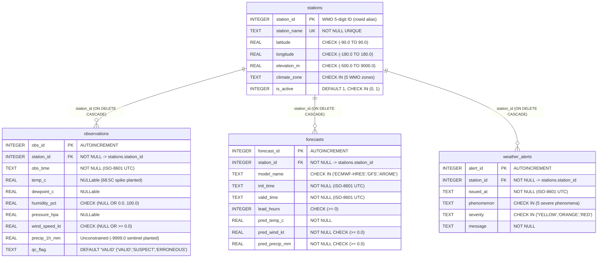
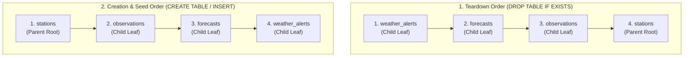

> **Navigation:** [Master README](../README.md) | [Interactive Portal](../bootcamp_portal.html) | [Reference Cards](../reference_cards/README.md) | [Day 1 Coursebook](./day1_master_coursebook.md) | **Seed SQL Walkthrough** | [SQLite CLI & SQL Cheatsheet](./day1_sqlite_and_sql_cheatsheet.md) | [Hardware Sentinels & QC Guide](./day1_hardware_sentinels_and_qc_guide.md) | [Day 2 Coursebook](../day2/day2_master_coursebook.md)

# Complete Architectural & Line-by-Line Course Walkthrough: `weather_ops_seed.sql`

**Source Script:** [`weather_ops_seed.sql`](./weather_ops_seed.sql)  
**Target Database Engine:** SQLite 3.38+ (`day1/weather_ops.db`)  
**Companion Coursebook:** [`day1_master_coursebook.md`](./day1_master_coursebook.md)

> [!IMPORTANT]
> ** Which SQLite `.db` File Does This Document Use?**
> - **100% of the DDL, `INSERT`s, and verification queries in this walkthrough run on `day1/weather_ops.db`** (`stations`, `observations`, `forecasts`, `weather_alerts`).
> - Inside your `sqlite3` terminal (from the `day1/` directory), make sure you have `weather_ops.db` open:
>   ```sql
>   .open weather_ops.db
>   .tables
>   -- Expected: forecasts  observations  stations  weather_alerts
>   ```
> - *(Note: The 250,000-row `raw_telemetry` table lives in the second Day 1 file, `day1/weather_telemetry.db`, generated by [`generate_weather_db.py`](./generate_weather_db.py).)*

---

## 1. Architectural Purpose & Relational Topology

[`weather_ops_seed.sql`](./weather_ops_seed.sql) constructs and populates the foundational operational database (`weather_ops.db`) for a national surface synoptic and Numerical Weather Prediction (NWP) verification system modeled on World Meteorological Organization (WMO) Region I (North Africa / Algeria) surface stations.

Unlike flat CSV or ASCII files that permit arbitrary text corruption, duplicate timestamps, orphan station identifiers, and silent out-of-range measurements, this script establishes a **4-table normalized relational schema** in Third Normal Form (3NF) backed by physical domain `CHECK` constraints, referential integrity (`FOREIGN KEY ... ON DELETE CASCADE`), and composite B-Tree uniqueness guarantees. At the same time, it deliberately plants four real-world meteorological telemetry anomalies into the seed rows so that downstream analytical queries can be tested against missing-sensor dropouts, legacy Fortran hardware sentinels, voltage spikes, and inactive maintenance stations.



---

## 2. Section-by-Section & Line-by-Line Code Walkthrough

### 2.1 File Header, Session Pragma & Topological Table Teardown (Lines 1–13)

```sql
-- ============================================================================
-- DAY 1 BOOTCAMP: SQL FUNDAMENTALS FOR WEATHER FORECAST ENGINEERS (SQLite)
-- File: weather_ops_seed.sql
-- Usage: sqlite3 weather_ops.db < weather_ops_seed.sql
-- ============================================================================

PRAGMA foreign_keys = ON;

DROP TABLE IF EXISTS weather_alerts;
DROP TABLE IF EXISTS forecasts;
DROP TABLE IF EXISTS observations;
DROP TABLE IF EXISTS stations;
```

#### Deep-Dive Architectural Explanation

1. **Standard Input Redirection (`sqlite3 weather_ops.db < weather_ops_seed.sql`):**
   - Invokes the `sqlite3` binary, opens or creates the single-file database `weather_ops.db` in the current working directory, and streams the SQL script over standard input (`stdin`). Each statement terminated by a semicolon (`;`) is parsed, compiled into SQLite Virtual Database Engine (VDBE) bytecode, and executed sequentially.
2. **Why SQLite Disables Foreign Keys by Default (`PRAGMA foreign_keys = ON;`):**
   - Historically, SQLite versions prior to `3.6.19` (released in October 2009) parsed `FOREIGN KEY` syntax in `CREATE TABLE` statements for SQL standard compatibility but did not enforce referential integrity at runtime. To preserve strict backwards compatibility with legacy embedded applications that relied on unvalidated writes or out-of-order table loads, the SQLite C library compiles with `PRAGMA foreign_keys = OFF` as its default state.
   - Crucially, `PRAGMA foreign_keys` is a **connection-scoped runtime flag**, not a persistent database file header property. Even after `weather_ops_seed.sql` finishes creating `weather_ops.db`, every future interactive `sqlite3 weather_ops.db` session or Python `sqlite3.connect('weather_ops.db')` connection starts with `foreign_keys = 0` (`OFF`) unless that connection explicitly executes `PRAGMA foreign_keys = ON;`.
   - You can verify the active enforcement state at any time by running `PRAGMA foreign_keys;`, which returns `1` when active and `0` when inactive.
   - **Understanding the Broader SQLite `PRAGMA` Family (Connection vs. Persistent Scope):** Unlike CLI dot-commands (`.tables`, `.schema`) which only work in the `sqlite3` terminal, `PRAGMA` statements are engine-level SQL directives parsed by `libsqlite3` (working in CLI, Python, and DBeaver):
     - **Integrity & Auditing (`Per-Connection` / Action):** `PRAGMA foreign_keys = ON;` (enforces FK constraints), `PRAGMA foreign_key_check;` (scans tables for existing orphaned FK rows), and `PRAGMA integrity_check;` / `PRAGMA quick_check;` (verifies physical B-Tree pages and constraints).
     - **Journaling & Concurrency (`Persistent` for WAL / `Per-Connection` for others):** `PRAGMA journal_mode = WAL;` (**persists in the `.db` file header** and allows concurrent readers alongside one writer), `PRAGMA synchronous = NORMAL;` (crash-safe in WAL mode without per-commit `fsync` stalls; vs. `OFF` used in disposable bulk loaders like `generate_weather_db.py`), `PRAGMA busy_timeout = 5000;` (waits up to 5s on `SQLITE_BUSY` write locks), and `PRAGMA wal_checkpoint(TRUNCATE);`.
     - **Memory & I/O Performance (`Per-Connection`):** `PRAGMA cache_size = -64000;` (`64 MiB` RAM page cache; or `+100000` pages in `generate_weather_db.py`), `PRAGMA temp_store = MEMORY;` (keeps sort/group/window temp B-Trees in RAM), and `PRAGMA mmap_size = 268435456;`.
     - **Schema Introspection & Optimizer (SQL-Callable Table-Valued Functions):** `PRAGMA table_info('observations');` (or `SELECT * FROM pragma_table_info('observations');`), `PRAGMA index_list('observations');`, `PRAGMA foreign_key_list('observations');`, and `PRAGMA optimize;`. (See [`day1_sqlite_and_sql_cheatsheet.md`](./day1_sqlite_and_sql_cheatsheet.md) §Part I.5 for the full reference matrix).
3. **Child-to-Parent Teardown Order (`DROP TABLE IF EXISTS ...`):**
   - Because `PRAGMA foreign_keys = ON;` is active on Line 7, SQLite enforces referential integrity during DDL teardown operations.
   - `weather_alerts`, `forecasts`, and `observations` are **child tables** that hold foreign key references pointing to `stations(station_id)` (the **parent table**).
   - If the script attempted to execute `DROP TABLE IF EXISTS stations;` first while child rows still existed in `observations`, `forecasts`, or `weather_alerts`, SQLite would guard the parent rows against orphaning or require cascading checks. Dropping the leaf child tables first (`weather_alerts` $\rightarrow$ `forecasts` $\rightarrow$ `observations`) and dropping the root parent table (`stations`) last follows a strict **reverse-topological dependency order**:



---

### 2.2 Table 1: `stations` — WMO Surface Synoptic Station Registry (Lines 14–23)

```sql
-- 1. STATIONS TABLE (WMO Surface Synoptic Stations)
CREATE TABLE stations (
    station_id   INTEGER PRIMARY KEY,               -- WMO 5-digit station identifier
    station_name TEXT    NOT NULL UNIQUE,           -- Official station name
    latitude     REAL    NOT NULL CHECK (latitude BETWEEN -90.0 AND 90.0),
    longitude    REAL    NOT NULL CHECK (longitude BETWEEN -180.0 AND 180.0),
    elevation_m  REAL    NOT NULL CHECK (elevation_m >= -500.0 AND elevation_m <= 9000.0),
    climate_zone TEXT    NOT NULL CHECK (climate_zone IN ('Mediterranean', 'Arid', 'Semi-Arid', 'Highland', 'Maritime')),
    is_active    INTEGER NOT NULL DEFAULT 1 CHECK (is_active IN (0, 1))
);
```

#### Column-by-Column & Constraint Architecture

| Column Name | Declared Type & Affinity | Constraints | Physical & Meteorological Engineering Rationale |
| :--- | :--- | :--- | :--- |
| `station_id` | `INTEGER` | `PRIMARY KEY` | Stores the official 5-digit WMO Region I Block 60 station number (e.g., `60390`). In SQLite, declaring a column as exact `INTEGER PRIMARY KEY` (without `AUTOINCREMENT`) makes `station_id` a direct **alias for SQLite's internal 64-bit signed B-Tree `rowid`**. Instead of storing the table in a separate heap and maintaining a secondary B-Tree index for `station_id`, SQLite clusters the table rows directly inside the primary B-Tree keyed by `station_id`. Point lookups (`WHERE station_id = 60390`) execute in $O(\log N)$ B-Tree traversal steps with zero secondary index indirection. |
| `station_name` | `TEXT` | `NOT NULL UNIQUE` | Official human-readable station designation (e.g., `'Algiers - Dar El Beida'`). `NOT NULL` prevents anonymous station rows; `UNIQUE` automatically creates an internal B-Tree index (`sqlite_autoindex_stations_1`) to prevent two WMO station IDs from registering the exact same name. |
| `latitude` | `REAL` | `NOT NULL CHECK (latitude BETWEEN -90.0 AND 90.0)` | Stored as an 8-byte IEEE 754 floating-point number (`REAL` affinity). The inclusive `BETWEEN -90.0 AND 90.0` constraint enforces physical geographic bounds from the South Pole ($-90^\circ$) to the North Pole ($+90^\circ$), immediately rejecting swapped lat/lon coordinates (e.g., $+135.0^\circ$). |
| `longitude` | `REAL` | `NOT NULL CHECK (longitude BETWEEN -180.0 AND 180.0)` | Stored as an 8-byte IEEE 754 float. Enforces the International Meridian bounds ($-180.0^\circ$ West to $+180.0^\circ$ East). |
| `elevation_m` | `REAL` | `NOT NULL CHECK (elevation_m >= -500.0 AND elevation_m <= 9000.0)` | Station barometer elevation in meters above Mean Sea Level (MSL). The lower bound of `-500.0` accommodates sub-sea-level land depressions (such as the Dead Sea at $-430\text{ m}$ or Chott Melrhir in Algeria at $-40\text{ m}$), while `9000.0` caps elevation just above Mount Everest ($8,848.86\text{ m}$), blocking corrupted telemetry headers such as `99999.0`. |
| `climate_zone` | `TEXT` | `NOT NULL CHECK (climate_zone IN ('Mediterranean', 'Arid', 'Semi-Arid', 'Highland', 'Maritime'))` | Acts as an inline relational enumeration (`ENUM`). Any insert with a typo (e.g., `'Mediteranean'` or `'desert'` in lowercase, since SQL `IN` string comparisons are case-sensitive by default) aborts with `CHECK constraint failed: climate_zone IN (...)`. |
| `is_active` | `INTEGER` | `NOT NULL DEFAULT 1 CHECK (is_active IN (0, 1))` | SQLite does not have a dedicated storage class for booleans; boolean values `TRUE` and `FALSE` are stored as `INTEGER` `1` and `0`. Combining `NOT NULL DEFAULT 1` with `CHECK (is_active IN (0, 1))` guarantees that every station is strictly binary (`1` = operational, `0` = offline/maintenance) and cannot hold arbitrary integers like `2` or `-1`. |

---

### 2.3 Table 2: `observations` — Hourly Synoptic Surface Readings (Lines 25–39)

```sql
-- 2. OBSERVATIONS TABLE (Hourly Synoptic Surface Readings)
CREATE TABLE observations (
    obs_id         INTEGER PRIMARY KEY AUTOINCREMENT,
    station_id     INTEGER NOT NULL,
    obs_time       TEXT    NOT NULL,                -- ISO-8601 UTC: YYYY-MM-DD HH:MM:SS
    temp_c         REAL,                            -- 2m Air Temperature (°C); NULL if sensor offline
    dewpoint_c     REAL,                            -- 2m Dewpoint Temperature (°C)
    humidity_pct   REAL    CHECK (humidity_pct IS NULL OR (humidity_pct >= 0.0 AND humidity_pct <= 100.0)),
    pressure_hpa   REAL,                            -- Mean Sea Level Pressure (hPa)
    wind_speed_kt  REAL    CHECK (wind_speed_kt IS NULL OR wind_speed_kt >= 0.0),
    precip_1h_mm   REAL,                            -- 1h Precipitation (mm) - includes legacy -9999.0 in raw rows for cleaning lab!
    qc_flag        TEXT    NOT NULL DEFAULT 'VALID' CHECK (qc_flag IN ('VALID', 'SUSPECT', 'ERRONEOUS')),
    FOREIGN KEY (station_id) REFERENCES stations(station_id) ON DELETE CASCADE,
    UNIQUE (station_id, obs_time)
);
```

#### Deep-Dive Architectural Explanation

1. **`INTEGER PRIMARY KEY` vs. `INTEGER PRIMARY KEY AUTOINCREMENT` (`obs_id`):**
   - On `stations(station_id)`, we used `INTEGER PRIMARY KEY` because the WMO station ID is an natural external identifier.
   - On `observations(obs_id)`, the script uses `INTEGER PRIMARY KEY AUTOINCREMENT`. While plain `INTEGER PRIMARY KEY` automatically assigns `MAX(rowid) + 1` when `NULL` is inserted, it can reuse a `rowid` if the highest-numbered row is deleted. Adding the `AUTOINCREMENT` keyword instructs SQLite to create and maintain an internal system table named `sqlite_sequence(name, seq)` that tracks the highest historical `obs_id` ever allocated, guaranteeing monotonically increasing, never-reused surrogate keys across the lifetime of the database.
   - *Architectural Tradeoff:* Because `AUTOINCREMENT` must read and update `sqlite_sequence` on every `INSERT`, it incurs extra B-Tree page writes and CPU overhead compared to plain `INTEGER PRIMARY KEY`. In high-frequency telemetry tables where monotonic non-reuse after deletion is not strictly required, plain `INTEGER PRIMARY KEY` is faster.
2. **ISO-8601 UTC Timestamps in `TEXT` (`obs_time`):**
   - SQLite stores dates and timestamps using `TEXT` (ISO-8601 strings), `REAL` (Julian day numbers), or `INTEGER` (Unix epoch seconds).
   - Storing timestamps as fixed-width zero-padded ISO-8601 UTC strings (`'YYYY-MM-DD HH:MM:SS'`, e.g., `'2026-10-05 06:00:00'`) guarantees that **lexicographical byte-order sorting (`ORDER BY obs_time`) is identical to chronological sorting**, while remaining human-readable and compatible with SQLite's built-in date/time functions (`datetime()`, `strftime()`, `julianday()`).
3. **`NOT NULL` vs. `CHECK` vs. `NOT NULL CHECK` & Three-Valued Logic (`3VL`) Inside `CHECK` Constraints:**
   - Look closely at how constraints vary across `stations`, `observations`, and `forecasts`:
     - **Pattern 1 (`NOT NULL` only):** `obs_time TEXT NOT NULL`, `pred_temp_c REAL NOT NULL` — enforces **Presence** (rejects `NULL`), while permitting any value of the column's type.
     - **Pattern 2 (`NOT NULL CHECK (...)`):** `latitude REAL NOT NULL CHECK (latitude BETWEEN -90.0 AND 90.0)`, `pred_wind_kt REAL NOT NULL CHECK (pred_wind_kt >= 0.0)`, `qc_flag TEXT NOT NULL DEFAULT 'VALID' CHECK (...)` — enforces **both Presence and Domain Bounds**.
     - **Pattern 3 (Nullable + `CHECK`):** `humidity_pct REAL CHECK (humidity_pct IS NULL OR (humidity_pct >= 0.0 AND humidity_pct <= 100.0))` and `wind_speed_kt REAL CHECK (wind_speed_kt IS NULL OR wind_speed_kt >= 0.0)` — allows `NULL` when a field sensor drops offline, **but if a reading is present**, enforces physical bounds.
     - **Pattern 4 (Nullable with NO `CHECK`):** `precip_1h_mm REAL`, `temp_c REAL` — raw landing columns that permit `NULL` as well as raw in-band wire sentinels (`-9999.0`) or uncalibrated spikes (`68.5°C`) so they can be audited via `qc_flag` and sanitized with `NULLIF`.
   - **Why `CHECK (col >= 0.0)` Alone NEVER Prevents `NULL`s (The `WHERE` vs. `CHECK` 3VL Asymmetry):**
     - In ANSI SQL, when a column is `NULL`, `NULL >= 0.0` evaluates to **`UNKNOWN`**.
     - **`WHERE` / `HAVING` clauses require `TRUE`** (discarding both `FALSE` and `UNKNOWN`).
     - **`CHECK` constraints only reject `FALSE`** (allowing both `TRUE` **and `UNKNOWN` (`NULL`)**!).
     - Consequently, declaring `latitude REAL CHECK (latitude BETWEEN -90.0 AND 90.0)` *without* `NOT NULL` allows `latitude = NULL` to be inserted! Whenever a column is mandatory *and* range-bounded, you **must** combine `NOT NULL CHECK (...)`.
   - **Why Write `IS NULL OR (...)` on Nullable Sensor Columns (`humidity_pct` and `wind_speed_kt`)?**
     - Although `CHECK (wind_speed_kt >= 0.0)` and `CHECK (wind_speed_kt IS NULL OR wind_speed_kt >= 0.0)` accept the same rows in DDL, writing `IS NULL OR (...)` explicitly converts the `NULL` sensor case from `UNKNOWN` to `TRUE` (`TRUE OR UNKNOWN` $\equiv$ `TRUE`). This documents to every engineer that `NULL` is intentionally valid for offline sensors, and prevents silent row loss if the validation expression is ever copied into a `WHERE` filter or `dbt` quality test.
4. **Why `precip_1h_mm` Intentionally Omits `CHECK (precip_1h_mm >= 0.0)` (Line 35):**
   - Notice the inline comment on Line 35: `-- 1h Precipitation (mm) - includes legacy -9999.0 in raw rows for cleaning lab!`.
   - In legacy meteorological ingestion pipelines, raw landing tables often lack lower-bound `CHECK` constraints so that raw telemetry frames containing hardware diagnostic sentinels (`-9999.0` or `-999.0`) are not rejected before reaching the staging table. Leaving `precip_1h_mm` unconstrained in the Day 1 seed table allows Line 105 (`Constantine - El Khroub` at `2026-10-06 12:00:00`) to insert `-9999.0`, demonstrating why unconstrained raw tables require `NULLIF(precip_1h_mm, -9999.0)` during queries—and why on Day 2 (`weather_ops_pg.sql` Line 45) the production PostgreSQL table enforces `CHECK (precip_1h_mm IS NULL OR precip_1h_mm >= 0.0)` at the database gate.
5. **WMO Quality Control Flag (`qc_flag`):**
   - Defaults to `'VALID'` and restricts values to `'VALID'`, `'SUSPECT'`, or `'ERRONEOUS'`. This mirrors operational WMO Global Data-Processing and Forecasting System (GDPFS) quality flags.
6. **Referential Integrity & Cascading Deletes (`FOREIGN KEY (station_id) REFERENCES stations(station_id) ON DELETE CASCADE`):**
   - Guarantees that no observation can be inserted for a `station_id` that does not exist in `stations`.
   - `ON DELETE CASCADE` instructs SQLite that if a station row in `stations` is ever deleted, all child rows in `observations` matching that `station_id` are automatically deleted within the same atomic transaction, preventing orphaned observation records.
7. **Composite Uniqueness Constraint (`UNIQUE (station_id, obs_time)`):**
   - A single station can record many observations across different hours, and many stations can record observations at the exact same hour, so neither `station_id` nor `obs_time` is unique on its own.
   - Declaring table-level `UNIQUE (station_id, obs_time)` enforces that the **tuple `(station_id, obs_time)`** can appear at most once. Under the hood, SQLite automatically builds a composite B-Tree index (`sqlite_autoindex_observations_1`) over `(station_id, obs_time)`. This both blocks duplicate telemetry packet ingestion (idempotency via `INSERT OR IGNORE` / `ON CONFLICT`) and accelerates queries that filter by `station_id` and `obs_time`.

---

### 2.4 Table 3: `forecasts` — Numerical Weather Prediction (NWP) Output (Lines 41–53)

```sql
-- 3. FORECASTS TABLE (Numerical Weather Prediction - NWP Model Output)
CREATE TABLE forecasts (
    forecast_id    INTEGER PRIMARY KEY AUTOINCREMENT,
    station_id     INTEGER NOT NULL,
    model_name     TEXT    NOT NULL CHECK (model_name IN ('ECMWF-HRES', 'GFS', 'AROME')),
    init_time      TEXT    NOT NULL,                -- Model initialization UTC (e.g., 2026-10-05 00:00:00)
    valid_time     TEXT    NOT NULL,                -- Forecast target valid UTC
    lead_hours     INTEGER NOT NULL CHECK (lead_hours >= 0),
    pred_temp_c    REAL    NOT NULL,
    pred_wind_kt   REAL    NOT NULL CHECK (pred_wind_kt >= 0.0),
    pred_precip_mm REAL    NOT NULL CHECK (pred_precip_mm >= 0.0),
    FOREIGN KEY (station_id) REFERENCES stations(station_id) ON DELETE CASCADE
);
```

#### Deep-Dive Architectural Explanation

1. **Multi-Model NWP Domain (`model_name`):**
   - Restricts `model_name` via `CHECK` to the three primary NWP systems used in Mediterranean and North African operational forecasting:
     - `'ECMWF-HRES'`: European Centre for Medium-Range Weather Forecasts High-Resolution deterministic model ($\approx 9\text{ km}$ horizontal grid spacing).
     - `'GFS'`: NOAA/NCEP Global Forecast System ($\approx 13\text{ km}$ global grid spacing).
     - `'AROME'`: Météo-France / ALADIN consortium Applications of Research to Operations at Mesoscale convective-scale non-hydrostatic model ($\approx 1.3\text{–}2.5\text{ km}$ grid spacing).
2. **NWP Temporal Coordinate Triad (`init_time`, `valid_time`, `lead_hours`):**
   - Every NWP prediction is uniquely identified by *when the supercomputer run was initialized* (`init_time`, e.g., `'2026-10-05 00:00:00'` for the `00Z` synoptic cycle), *how many hours into the future the integration stepped* (`lead_hours`, constrained to `>= 0` so hindcasts cannot accidentally be stored as negative lead hours), and *the target physical timestamp being predicted* (`valid_time = init_time + lead_hours`).
   - During NWP forecast verification, `forecasts.valid_time` is joined directly against `observations.obs_time` (`ON f.station_id = o.station_id AND f.valid_time = o.obs_time`) to compute Forecast Error (Bias), Mean Absolute Error (MAE), and Root Mean Square Error (RMSE).
3. **Strict `NOT NULL` Physical Output (`pred_temp_c`, `pred_wind_kt`, `pred_precip_mm`):**
   - Unlike physical field instruments (`observations`) which suffer hardware dropouts (`NULL`), deterministic NWP grid-point extractions always produce numeric state variables at every grid cell. Thus, `pred_temp_c`, `pred_wind_kt`, and `pred_precip_mm` are all declared `NOT NULL`, with non-negative physical lower bounds (`>= 0.0`) on wind speed and precipitation accumulation.

---

### 2.5 Table 4: `weather_alerts` — Operational Meteorological Warnings (Lines 55–64)

```sql
-- 4. WEATHER ALERTS TABLE (Operational Warnings)
CREATE TABLE weather_alerts (
    alert_id    INTEGER PRIMARY KEY AUTOINCREMENT,
    station_id  INTEGER NOT NULL,
    issued_at   TEXT    NOT NULL,
    phenomenon  TEXT    NOT NULL CHECK (phenomenon IN ('HEATWAVE', 'HIGH_WIND', 'FLASH_FLOOD', 'SANDSTORM', 'FROST')),
    severity    TEXT    NOT NULL CHECK (severity IN ('YELLOW', 'ORANGE', 'RED')),
    message     TEXT    NOT NULL,
    FOREIGN KEY (station_id) REFERENCES stations(station_id) ON DELETE CASCADE
);
```

#### Deep-Dive Architectural Explanation

- Models the operational warning bulletins (Carte de Vigilance Météorologique) issued by forecasters when synoptic observations or NWP forecasts breach hazard thresholds:
  - `phenomenon`: Constrained to the five standardized regional hazard codes (`'HEATWAVE'`, `'HIGH_WIND'`, `'FLASH_FLOOD'`, `'SANDSTORM'`, `'FROST'`).
  - `severity`: Constrained to standard 3-tier WMO MeteoAlarm / Vigilance action levels (`'YELLOW'` = Be Aware, `'ORANGE'` = Be Prepared, `'RED'` = Take Action).
  - `station_id`: Linked via `FOREIGN KEY ... ON DELETE CASCADE` to `stations(station_id)`.

---

### 2.6 Seed Data Block 1: WMO Stations & Anomaly #1 (Lines 66–76)

```sql
-- ============================================================================
-- SEED DATA: WMO STATIONS
-- ============================================================================
INSERT INTO stations (station_id, station_name, latitude, longitude, elevation_m, climate_zone, is_active) VALUES
(60390, 'Algiers - Dar El Beida', 36.6910,  3.2154,   25.0, 'Mediterranean', 1),
(60490, 'Oran - Es Senia',        35.6239, -0.6212,   90.0, 'Mediterranean', 1),
(60419, 'Constantine - El Khroub',36.2760,  6.6203,  694.0, 'Highland',      1),
(60571, 'Bechar - Ouakda',        31.6457, -2.2699,  811.0, 'Arid',          1),
(60680, 'Tamanrasset - Aguenar',  22.8115,  5.4510, 1377.0, 'Arid',          1),
(60531, 'Tlemcen - Zenata',       35.0167, -1.4500,  247.0, 'Semi-Arid',     1),
(60402, 'Bejaia - Soummam',       36.7120,  5.0699,    6.0, 'Mediterranean', 0); -- Station under maintenance (0 observations)
```

#### Complete Station Inventory & Planted Anomaly Analysis

| WMO ID | Official Station Name | Coordinates (`lat`, `lon`) | Elevation | Climate Zone | `is_active` | Operational Role in Curriculum |
| :--- | :--- | :--- | :--- | :--- | :--- | :--- |
| `60390` | `Algiers - Dar El Beida` | `36.6910`, `3.2154` | `25.0 m` | `Mediterranean` | `1` | Clean coastal reference station with full synoptic observations, 9 NWP forecasts, and an `ORANGE` `FLASH_FLOOD` alert. |
| `60490` | `Oran - Es Senia` | `35.6239`, `-0.6212` | `90.0 m` | `Mediterranean` | `1` | Western coastal station containing **Planted Anomaly #2** (`NULL, NULL, NULL` thermohygrometer dropout at `2026-10-06 06:00:00`). |
| `60419` | `Constantine - El Khroub` | `36.2760`, `6.6203` | `694.0 m` | `Highland` | `1` | Tell Atlas highland station containing **Planted Anomaly #3** (`-9999.0` rain-gauge sentinel at `2026-10-06 12:00:00`), 9 NWP forecasts, and a `RED` `FLASH_FLOOD` alert. |
| `60571` | `Bechar - Ouakda` | `31.6457`, `-2.2699` | `811.0 m` | `Arid` | `1` | Northern Saharan gateway station containing **Planted Anomaly #4** (`68.5°C` voltage spike with `qc_flag = 'ERRONEOUS'` at `2026-10-06 12:00:00`), 4 NWP forecasts, and an `ORANGE` `SANDSTORM` alert. |
| `60680` | `Tamanrasset - Aguenar` | `22.8115`, `5.4510` | `1377.0 m` | `Arid` | `1` | Hoggar Mountains high-altitude arid station (`1,377 m` MSL) with extreme diurnal temperature range and a `YELLOW` `HEATWAVE` alert. |
| `60531` | `Tlemcen - Zenata` | `35.0167`, `-1.4500` | `247.0 m` | `Semi-Arid` | `1` | Western interior semi-arid baseline station with 6 clean synoptic observations (`VALID`) and 0 NWP forecasts/alerts. |
| **`60402`** | **`Bejaia - Soummam`** | `36.7120`, `5.0699` | `6.0 m` | `Mediterranean` | **`0`** | **Planted Anomaly #1 (Offline Station with Zero Child Rows):** Seeded with `is_active = 0` and **zero rows** in `observations`, `forecasts`, and `weather_alerts`. |

> [!IMPORTANT]
> **Why Station `60402` (`Bejaia - Soummam`) Has Zero Observations:**
> In relational reporting, joining `stations` to `observations` via `INNER JOIN` silently drops `60402` from the result set because no matching foreign key exists in `observations`. Preserving offline stations in network health audits requires `FROM stations s LEFT JOIN observations o ON s.station_id = o.station_id` paired with `COUNT(o.obs_id)` (which returns `0` for `NULL`-extended outer-join rows) rather than `COUNT(*)` (which falsely returns `1` because it counts the `NULL`-padded station row itself).

---

### 2.7 Seed Data Block 2: Synoptic Observations & Planted Anomalies #2, #3, #4 (Lines 78–129)

```sql
-- ============================================================================
-- SEED DATA: SYNOPTIC OBSERVATIONS (2026-10-05 & 2026-10-06)
-- Includes realistic meteorology, a NULL sensor dropout, and a legacy -9999.0 sentinel value
-- ============================================================================
INSERT INTO observations (station_id, obs_time, temp_c, dewpoint_c, humidity_pct, pressure_hpa, wind_speed_kt, precip_1h_mm, qc_flag) VALUES
-- Algiers (60390)
(60390, '2026-10-05 06:00:00', 19.4, 15.2, 77.0, 1016.2,  8.0,  0.0, 'VALID'),
(60390, '2026-10-05 12:00:00', 27.8, 16.0, 48.0, 1015.0, 14.0,  0.0, 'VALID'),
(60390, '2026-10-05 18:00:00', 23.1, 17.5, 71.0, 1013.8, 19.0,  2.4, 'VALID'),
(60390, '2026-10-06 00:00:00', 18.5, 16.8, 90.0, 1011.5, 28.0, 18.6, 'VALID'),
(60390, '2026-10-06 06:00:00', 17.9, 16.1, 89.0, 1012.0, 22.0,  6.2, 'VALID'),
(60390, '2026-10-06 12:00:00', 24.6, 15.0, 55.0, 1014.4, 11.0,  0.0, 'VALID'),

-- Oran (60490)
(60490, '2026-10-05 06:00:00', 20.1, 16.0, 77.0, 1015.8, 10.0,  0.0, 'VALID'),
(60490, '2026-10-05 12:00:00', 29.5, 14.2, 39.0, 1014.1, 16.0,  0.0, 'VALID'),
(60490, '2026-10-05 18:00:00', 24.8, 16.5, 60.0, 1013.0, 21.0,  0.4, 'VALID'),
(60490, '2026-10-06 00:00:00', 20.2, 15.9, 76.0, 1013.5, 15.0,  1.2, 'VALID'),
(60490, '2026-10-06 06:00:00', NULL, NULL, NULL, 1014.2, 12.0,  0.0, 'SUSPECT'),   -- Thermohygrometer dropout (NULL)
(60490, '2026-10-06 12:00:00', 26.3, 14.8, 49.0, 1015.6, 13.0,  0.0, 'VALID'),

-- Constantine (60419)
(60419, '2026-10-05 06:00:00', 14.2,  9.8, 75.0, 1017.1,  6.0,  0.0, 'VALID'),
(60419, '2026-10-05 12:00:00', 25.0, 10.5, 40.0, 1015.4, 12.0,  0.0, 'VALID'),
(60419, '2026-10-05 18:00:00', 19.6, 12.0, 61.0, 1014.0, 25.0,  8.5, 'VALID'),
(60419, '2026-10-06 00:00:00', 15.1, 13.5, 90.0, 1012.2, 34.0, 24.0, 'VALID'),
(60419, '2026-10-06 06:00:00', 13.8, 12.1, 89.0, 1013.1, 18.0,  4.1, 'VALID'),
(60419, '2026-10-06 12:00:00', 21.4, 11.2, 52.0, 1015.0, 10.0, -9999.0, 'SUSPECT'), -- Legacy -9999.0 rain gauge code!

-- Bechar (60571)
(60571, '2026-10-05 06:00:00', 22.0,  4.5, 32.0, 1013.0, 15.0,  0.0, 'VALID'),
(60571, '2026-10-05 12:00:00', 35.8,  5.2, 15.0, 1011.2, 28.0,  0.0, 'VALID'),
(60571, '2026-10-05 18:00:00', 31.4,  6.0, 20.0, 1010.5, 38.0,  0.0, 'VALID'),
(60571, '2026-10-06 00:00:00', 25.2,  6.8, 31.0, 1011.8, 22.0,  0.0, 'VALID'),
(60571, '2026-10-06 06:00:00', 21.5,  7.1, 39.0, 1012.9, 14.0,  0.0, 'VALID'),
(60571, '2026-10-06 12:00:00', 68.5,  5.0, 10.0, 1012.0, 16.0,  0.0, 'ERRONEOUS'), -- Corrupted temperature spike!

-- Tamanrasset (60680)
(60680, '2026-10-05 06:00:00', 23.5,  2.1, 24.0, 1014.5,  9.0,  0.0, 'VALID'),
(60680, '2026-10-05 12:00:00', 36.9,  3.0, 12.0, 1012.8, 18.0,  0.0, 'VALID'),
(60680, '2026-10-05 18:00:00', 32.1,  3.5, 16.0, 1012.1, 14.0,  0.0, 'VALID'),
(60680, '2026-10-06 00:00:00', 26.0,  4.0, 24.0, 1013.4,  8.0,  0.0, 'VALID'),
(60680, '2026-10-06 06:00:00', 24.1,  3.8, 26.0, 1014.8, 11.0,  0.0, 'VALID'),
(60680, '2026-10-06 12:00:00', 37.4,  2.9, 11.0, 1013.0, 17.0,  0.0, 'VALID'),

-- Tlemcen (60531)
(60531, '2026-10-05 06:00:00', 17.5, 13.0, 75.0, 1016.0,  7.0,  0.0, 'VALID'),
(60531, '2026-10-05 12:00:00', 28.2, 13.5, 40.0, 1014.5, 13.0,  0.0, 'VALID'),
(60531, '2026-10-05 18:00:00', 22.9, 14.8, 60.0, 1013.9, 15.0,  0.0, 'VALID'),
(60531, '2026-10-06 00:00:00', 18.0, 14.2, 78.0, 1014.1, 10.0,  0.5, 'VALID'),
(60531, '2026-10-06 06:00:00', 16.8, 13.6, 81.0, 1014.9,  8.0,  0.0, 'VALID'),
(60531, '2026-10-06 12:00:00', 25.9, 13.0, 45.0, 1015.8, 12.0,  0.0, 'VALID');
```

#### Deep-Dive Synoptic Physics & Planted Anomaly Forensics

The 36 synoptic rows (6 active stations $\times$ 6 six-hourly synoptic cycles from `2026-10-05 06:00:00` to `2026-10-06 12:00:00`) model a classic autumn Mediterranean cold-frontal trough sweeping across northern Algeria on the night of October 5–6, 2026:
- **Frontal Passage Dynamics (`Algiers 60390` & `Constantine 60419`):** Notice how mean sea-level pressure (`pressure_hpa`) at Algiers drops from `1016.2 hPa` (`06:00 UTC` Oct 5) to `1011.5 hPa` (`00:00 UTC` Oct 6) as winds veer and intensify from `8.0 kt` to `28.0 kt`, delivering `18.6 mm` of overnight convective rainfall before pressure rebounds to `1014.4 hPa` by `12:00 UTC` Oct 6. At Constantine (`60419`, elevation `694 m`), orographic lifting intensifies the midnight thunderstorm cell to `34.0 kt` winds and `24.0 mm` of rainfall (`1012.2 hPa`).
- **Pre-Frontal Saharan Pressure Gradient (`Bechar 60571`):** Ahead of the trough at `2026-10-05 18:00:00`, surface heating and a tightened barometric gradient (`1010.5 hPa`) drive `38.0 kt` southwest winds across the arid erg (`humidity_pct = 20.0%`), triggering the `SANDSTORM` alert on Line 170.

Each of the three planted row anomalies tests a specific data engineering failure mode:

| Planted Anomaly | Station & Timestamp | Exact Seeded Values | Physical & SQL Failure Mode Tested |
| :--- | :--- | :--- | :--- |
| **Anomaly #2: Thermohygrometer Dropout (`NULL`)** | **Oran (`60490`)**<br/>`2026-10-06 06:00:00`<br/>*(Line 96)* | `temp_c = NULL`<br/>`dewpoint_c = NULL`<br/>`humidity_pct = NULL`<br/>`pressure_hpa = 1014.2`<br/>`wind_speed_kt = 12.0`<br/>`qc_flag = 'SUSPECT'` | Models a digital bus disconnect on the mast temperature/humidity probe while the barometer and cup anemometer on the main logger board continue reporting normally.<ul><li>**3VL Filter Trap:** `WHERE temp_c = NULL` or `WHERE temp_c != 20.0` evaluates to `UNKNOWN` and misses the row; requires `WHERE temp_c IS NULL`.</li><li>**Scalar Arithmetic Trap:** Computing Dewpoint Depression (`temp_c - dewpoint_c`) yields `NULL` unless wrapped in `COALESCE()` or filtered.</li><li>**Aggregate Behavior:** `AVG(temp_c)` and `COUNT(temp_c)` automatically ignore the `NULL` (dividing by 5 valid rows for Oran instead of 6), whereas `COUNT(*)` counts all 6 rows.</li></ul> |
| **Anomaly #3: Legacy Fortran Rain-Gauge Sentinel (`-9999.0`)** | **Constantine (`60419`)**<br/>`2026-10-06 12:00:00`<br/>*(Line 105)* | `temp_c = 21.4`<br/>`precip_1h_mm = -9999.0`<br/>`qc_flag = 'SUSPECT'` | Models a clogged tipping-bucket reed switch emitting a legacy Fortran fixed-width `F7.1` in-band missing-value code (`-9999.0`).<ul><li>**Catastrophic Aggregation Corruption:** Because `-9999.0` is a valid IEEE 754 `REAL` number (not `NULL`), an unguarded `SUM(precip_1h_mm)` for Constantine computes `0.0 + 0.0 + 8.5 + 24.0 + 4.1 + (-9999.0) = -9962.4 mm` instead of the true storm total of **`36.6 mm`**, and `AVG(precip_1h_mm)` computes **`-1660.4 mm/h`** instead of **`7.32 mm/h`**.</li><li>**Sanitization Pattern:** Requires `AVG(NULLIF(precip_1h_mm, -9999.0))` or `SUM(CASE WHEN precip_1h_mm >= 0.0 THEN precip_1h_mm END)`.</li></ul> |
| **Anomaly #4: Corrupted PRT Voltage Spike (`68.5°C`)** | **Bechar (`60571`)**<br/>`2026-10-06 12:00:00`<br/>*(Line 113)* | `temp_c = 68.5`<br/>`dewpoint_c = 5.0`<br/>`humidity_pct = 10.0`<br/>`qc_flag = 'ERRONEOUS'` | Models an analog-to-digital converter (ADC) transient voltage spike on a Platinum Resistance Thermometer (PRT) producing $+68.5^\circ\text{C}$ (exceeding the WMO world surface air temperature record of $56.7^\circ\text{C}$).<ul><li>**QC Flag Enforcement:** The automated ingestor flagged the row as `qc_flag = 'ERRONEOUS'`, proving why operational queries must always filter `WHERE qc_flag = 'VALID'` (or `temp_c BETWEEN -60.0 AND 60.0`). Without `WHERE qc_flag = 'VALID'`, Bechar's mean temperature jumps from **`27.18°C`** (5 valid rows) to **`34.07°C`** ($+6.89^\circ\text{C}$ warm bias).</li></ul> |

---

### 2.8 Seed Data Block 3: Multi-Model NWP Forecasts (Lines 131–162)

```sql
-- ============================================================================
-- SEED DATA: NWP FORECASTS (Initialized 2026-10-05 00:00:00 UTC)
-- Models: ECMWF-HRES, GFS, AROME
-- ============================================================================
INSERT INTO forecasts (station_id, model_name, init_time, valid_time, lead_hours, pred_temp_c, pred_wind_kt, pred_precip_mm) VALUES
-- Algiers (60390) forecasts
(60390, 'ECMWF-HRES', '2026-10-05 00:00:00', '2026-10-05 12:00:00', 12, 27.5, 15.0,  0.0),
(60390, 'ECMWF-HRES', '2026-10-05 00:00:00', '2026-10-06 00:00:00', 24, 18.8, 26.0, 16.5),
(60390, 'ECMWF-HRES', '2026-10-05 00:00:00', '2026-10-06 12:00:00', 36, 24.2, 12.0,  0.2),
(60390, 'GFS',        '2026-10-05 00:00:00', '2026-10-05 12:00:00', 12, 29.1, 17.0,  0.0),
(60390, 'GFS',        '2026-10-05 00:00:00', '2026-10-06 00:00:00', 24, 19.9, 22.0, 11.0),
(60390, 'GFS',        '2026-10-05 00:00:00', '2026-10-06 12:00:00', 36, 25.8, 14.0,  0.0),
(60390, 'AROME',      '2026-10-05 00:00:00', '2026-10-05 12:00:00', 12, 27.9, 14.0,  0.0),
(60390, 'AROME',      '2026-10-05 00:00:00', '2026-10-06 00:00:00', 24, 18.4, 29.0, 19.2),
(60390, 'AROME',      '2026-10-05 00:00:00', '2026-10-06 12:00:00', 36, 24.5, 11.0,  0.0),

-- Constantine (60419) forecasts
(60419, 'ECMWF-HRES', '2026-10-05 00:00:00', '2026-10-05 12:00:00', 12, 24.8, 13.0,  0.0),
(60419, 'ECMWF-HRES', '2026-10-05 00:00:00', '2026-10-06 00:00:00', 24, 15.5, 31.0, 21.0),
(60419, 'ECMWF-HRES', '2026-10-05 00:00:00', '2026-10-06 12:00:00', 36, 21.0, 11.0,  0.5),
(60419, 'GFS',        '2026-10-05 00:00:00', '2026-10-05 12:00:00', 12, 26.4, 15.0,  0.0),
(60419, 'GFS',        '2026-10-05 00:00:00', '2026-10-06 00:00:00', 24, 16.8, 25.0, 14.5),
(60419, 'GFS',        '2026-10-05 00:00:00', '2026-10-06 12:00:00', 36, 22.9, 13.0,  0.0),
(60419, 'AROME',      '2026-10-05 00:00:00', '2026-10-05 12:00:00', 12, 25.1, 12.0,  0.0),
(60419, 'AROME',      '2026-10-05 00:00:00', '2026-10-06 00:00:00', 24, 15.0, 35.0, 25.4),
(60419, 'AROME',      '2026-10-05 00:00:00', '2026-10-06 12:00:00', 36, 21.3, 10.0,  0.0),

-- Bechar (60571) forecasts
(60571, 'ECMWF-HRES', '2026-10-05 00:00:00', '2026-10-05 12:00:00', 12, 35.5, 27.0,  0.0),
(60571, 'ECMWF-HRES', '2026-10-05 00:00:00', '2026-10-06 00:00:00', 24, 25.0, 21.0,  0.0),
(60571, 'GFS',        '2026-10-05 00:00:00', '2026-10-05 12:00:00', 12, 37.2, 30.0,  0.0),
(60571, 'GFS',        '2026-10-05 00:00:00', '2026-10-06 00:00:00', 24, 26.8, 24.0,  0.0);
```

#### Deep-Dive NWP Verification Design (22 Forecast Rows)

- **Asymmetric Model Coverage by Design:**
  - `Algiers (60390)` and `Constantine (60419)` have 9 forecasts each (3 models $\times$ 3 lead times: `+12h`, `+24h`, `+36h`).
  - `Bechar (60571)` has 4 forecasts (`ECMWF-HRES` and `GFS` at `+12h` and `+24h` only; no `AROME` rows and no `+36h` lead time, reflecting how limited-area mesoscale domains like `AROME` often stop at the northern Saharan boundary).
  - Notice that at `Bechar (60571)`, `lead_hours = 36` (`valid_time = '2026-10-06 12:00:00'`) is intentionally omitted, whereas if a `36h` forecast had been present, joining against Bechar's `2026-10-06 12:00:00` observation without filtering `o.qc_flag = 'VALID'` would evaluate model error against the corrupted `68.5°C` spike!
- **Built-in Model Skill Hierarchy:**
  - When joined against valid observations (`ON f.station_id = o.station_id AND f.valid_time = o.obs_time WHERE o.qc_flag = 'VALID'`), the seeded predictions reproduce realistic NWP verification signatures:
    - **`AROME` (6 verification pairs):** Lowest temperature MAE (**`0.12°C`**) and tightest convective precipitation skill during the midnight squall (`19.2 mm` predicted vs. `18.6 mm` observed at Algiers; `25.4 mm` predicted vs. `24.0 mm` observed at Constantine), reflecting its non-hydrostatic convective-permitting resolution.
    - **`ECMWF-HRES` (8 verification pairs):** Strong synoptic temperature MAE (**`0.30°C`**), slightly smoothing peak convective rainfall (`16.5 mm` vs `18.6 mm` at Algiers).
    - **`GFS` (8 verification pairs):** Exhibits a systematic daytime warm bias (`+1.44°C` mean bias, **`1.44°C`** MAE) and under-predicts midnight frontal precipitation (`11.0 mm` vs. `18.6 mm` at Algiers; `14.5 mm` vs. `24.0 mm` at Constantine).

---

### 2.9 Seed Data Block 4: Operational Weather Alerts (Lines 164–172)

```sql
-- ============================================================================
-- SEED DATA: WEATHER ALERTS
-- ============================================================================
INSERT INTO weather_alerts (station_id, issued_at, phenomenon, severity, message) VALUES
(60390, '2026-10-05 21:00:00', 'FLASH_FLOOD', 'ORANGE', 'Heavy convective rainfall exceeding 15mm/h expected overnight.'),
(60419, '2026-10-05 20:30:00', 'FLASH_FLOOD', 'RED',    'Severe thunderstorm cell approaching Constantine; >20mm/h and 30kt+ gusts.'),
(60571, '2026-10-05 15:00:00', 'SANDSTORM',   'ORANGE', 'Strong SW winds (35-40 kt) reducing visibility below 500m.'),
(60680, '2026-10-05 10:00:00', 'HEATWAVE',    'YELLOW', 'Afternoon temperatures exceeding 36°C at high elevation.');
```

#### Deep-Dive Alert Correlation with Seeded Telemetry

Each of the 4 seeded alerts corresponds directly to a physical event recorded in `observations`:
1. **`60390` (`Algiers`, `2026-10-05 21:00:00`, `FLASH_FLOOD`, `ORANGE`):** Issued 3 hours ahead of the `2026-10-06 00:00:00` deluge (`18.6 mm/h` observed).
2. **`60419` (`Constantine`, `2026-10-05 20:30:00`, `FLASH_FLOOD`, `RED`):** Issued 3.5 hours ahead of the `2026-10-06 00:00:00` severe thunderstorm (`24.0 mm/h` and `34.0 kt` winds observed).
3. **`60571` (`Bechar`, `2026-10-05 15:00:00`, `SANDSTORM`, `ORANGE`):** Issued 3 hours ahead of the `2026-10-05 18:00:00` wind peak (`38.0 kt` observed).
4. **`60680` (`Tamanrasset`, `2026-10-05 10:00:00`, `HEATWAVE`, `YELLOW`):** Issued 2 hours ahead of the `2026-10-05 12:00:00` afternoon maximum (`36.9°C` observed on Oct 5 and `37.4°C` on Oct 6).

---

## 3. Execution & Verification Walkthrough

### 3.1 Building `weather_ops.db` from `weather_ops_seed.sql`

```bash
sqlite3 weather_ops.db < weather_ops_seed.sql
```

### 3.2 Verifying Schema, Row Counts & Planted Anomalies in `sqlite3`

From your Linux/macOS/Windows shell prompt (`$`):
```bash
sqlite3 -header -box weather_ops.db "
PRAGMA foreign_keys = ON;
SELECT 'stations' AS table_name, COUNT(*) AS row_count FROM stations
UNION ALL
SELECT 'observations', COUNT(*) FROM observations
UNION ALL
SELECT 'forecasts', COUNT(*) FROM forecasts
UNION ALL
SELECT 'weather_alerts', COUNT(*) FROM weather_alerts;
"
```

Or if you are already inside the `sqlite3` interactive shell (`sqlite>`):
```sql
-- TARGET FILE: day1/weather_ops.db
-- In sqlite3 CLI, switch first with: .open weather_ops.db
PRAGMA foreign_keys = ON;
SELECT 'stations' AS table_name, COUNT(*) AS row_count FROM stations
UNION ALL
SELECT 'observations', COUNT(*) FROM observations
UNION ALL
SELECT 'forecasts', COUNT(*) FROM forecasts
UNION ALL
SELECT 'weather_alerts', COUNT(*) FROM weather_alerts;
```

#### Expected Terminal Output

```text
┌────────────────┬───────────┐
│   table_name   │ row_count │
├────────────────┼───────────┤
│ stations       │ 7         │
│ observations   │ 36        │
│ forecasts      │ 22        │
│ weather_alerts │ 4         │
└────────────────┴───────────┘
```

### 3.3 Auditing All 4 Planted Anomalies with a Single Diagnostic Query

```sql
-- TARGET FILE: day1/weather_ops.db
-- In sqlite3 CLI, switch first with: .open weather_ops.db
SELECT
    s.station_id,
    s.station_name,
    s.is_active,
    o.obs_time,
    o.temp_c,
    o.precip_1h_mm,
    o.qc_flag
FROM stations s
LEFT JOIN observations o
    ON s.station_id = o.station_id
WHERE s.is_active = 0
   OR o.qc_flag != 'VALID'
ORDER BY s.station_id;
```

#### Expected Terminal Output

```text
┌────────────┬──────────────────────────┬───────────┬─────────────────────┬────────┬──────────────┬───────────┐
│ station_id │       station_name       │ is_active │      obs_time       │ temp_c │ precip_1h_mm │  qc_flag  │
├────────────┼──────────────────────────┼───────────┼─────────────────────┼────────┼──────────────┼───────────┤
│ 60402      │ Bejaia - Soummam         │ 0         │                     │        │              │           │
│ 60419      │ Constantine - El Khroub  │ 1         │ 2026-10-06 12:00:00 │ 21.4   │ -9999.0      │ SUSPECT   │
│ 60490      │ Oran - Es Senia          │ 1         │ 2026-10-06 06:00:00 │        │ 0.0          │ SUSPECT   │
│ 60571      │ Bechar - Ouakda          │ 1         │ 2026-10-06 12:00:00 │ 68.5   │ 0.0          │ ERRONEOUS │
└────────────┴──────────────────────────┴───────────┴─────────────────────┴────────┴──────────────┴───────────┘
```

---

### 3.4 Why `weather_ops_seed.sql` Uses `3NF` Normalization & How Every SQL `JOIN` Recombines It

#### 1. `3NF` Normalization vs. Denormalization in `weather_ops_seed.sql`
Notice how `weather_ops_seed.sql` decomposes our meteorological domain into **4 Third-Normal-Form (`3NF`) tables**:
- **`stations` (Master Entity Table — 7 rows):** Stores `station_name`, `latitude`, `longitude`, `elevation_m`, and `climate_zone` **exactly once per station**.
- **`observations`, `forecasts`, `weather_alerts` (Fact/Event Tables — 62 total rows):** Reference `stations` via a compact integer foreign key (`station_id`).

If we had used an **unnormalized flat table** (`observations_flat`), station **`60402 Bejaia - Soummam`** (`0` observations) could not exist without violating `obs_time NOT NULL` (**Insertion Anomaly**), changing a station's barometer elevation would require updating every historical observation (**Update Anomaly**), and deleting erroneous test readings could wipe out the station's GPS coordinates (**Deletion Anomaly**).

By contrast, in later days of the bootcamp we intentionally **denormalize** when read latency outweighs write flexibility:
- **Day 3 (PostgreSQL Materialized Views):** `nwp.mv_daily_model_verification` pre-joins `forecasts`, `observations`, and `stations` on disk for `< 2 ms` dashboard reads.
- **Day 4 (MongoDB Embedded Arrays):** `radiosonde_soundings.vertical_levels` embeds ~80 pressure levels inside a single BSON document because balloon soundings are immutable and always fetched as a single vertical profile.
- **Day 5 (Apache Parquet Columnar Lakehouse):** Wide denormalized Parquet files compress repeated `'Mediterranean'` strings via **Dictionary Encoding + Run-Length Encoding (RLE)** into a few bytes while eliminating runtime `JOIN`s.
- *(For the complete visual set-theory guide, 4-engine compatibility matrix, and runnable examples of all 7 SQL `JOIN` types on `weather_ops.db`, see **[Day 1 Master Coursebook — §7.3 Complete Taxonomy of SQL JOINs](./day1_master_coursebook.md)**.)*

---

> **Navigation:** [Master README](../README.md) | [Interactive Portal](../bootcamp_portal.html) | [Reference Cards](../reference_cards/README.md) | [Day 1 Coursebook](./day1_master_coursebook.md) | **Seed SQL Walkthrough** | [SQLite CLI & SQL Cheatsheet](./day1_sqlite_and_sql_cheatsheet.md) | [Hardware Sentinels & QC Guide](./day1_hardware_sentinels_and_qc_guide.md) | [Day 2 Coursebook](../day2/day2_master_coursebook.md)
