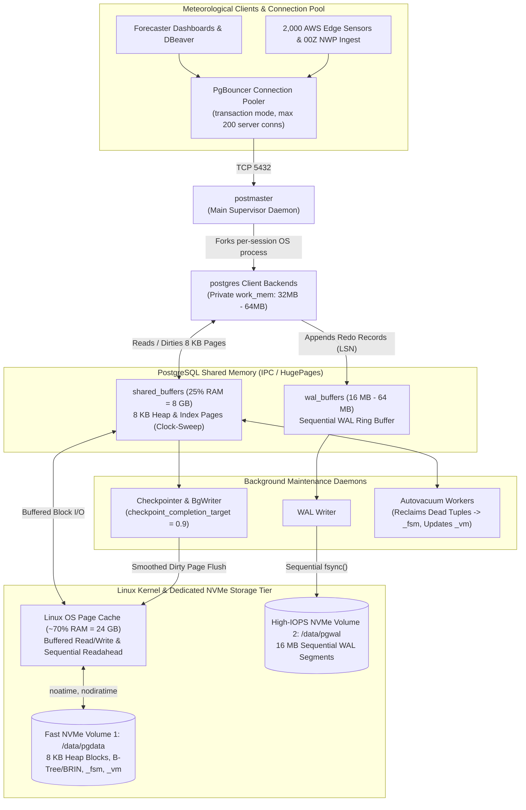
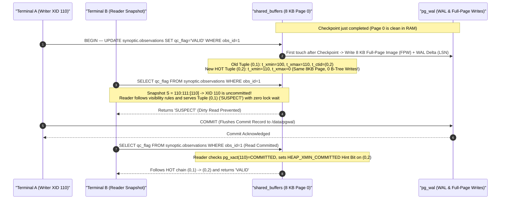

> **Navigation:** [🏠 Master README](../README.md) | [🌐 Interactive Portal](../bootcamp_portal.html) | [📚 Reference Cards](../reference_cards/README.md) | [⏮️ Day 1 Coursebook](../day1/day1_master_coursebook.md) | **Day 2 Coursebook** | [⏭️ Day 3 Coursebook](../day3/day3_master_coursebook.md)

# Weather Forecast Engineering Database Bootcamp — Day 2 Master Coursebook
## PostgreSQL Architecture, Storage Engine Internals, Production Hardening & The Row-Store Bottleneck

**Bootcamp:** Database & NoSQL Engineering (5-Day Intensive)  
**Target Audience:** Weather Forecast & Meteorological Data Engineers, Systems Administrators, Environmental Data Scientists  
**Curriculum Scope:** 5 Core Architectural Modules + 7 Hands-On Forensics Labs  
**Execution Environment:** PostgreSQL 16+ running on Linux/macOS or Docker (`postgres:16`), `psql` CLI + DBeaver  
**Companion Files in `day2/` & `reference_cards/`:**
- [day2_postgres_tuning_and_internals_cheatsheet.md](./day2_postgres_tuning_and_internals_cheatsheet.md) — Complete Installation, `postgresql.conf` Weather Tuning, WAL, Vacuum, Lock Debugging & `EXPLAIN` Reference Card
- [day2_postgres_vs_mysql_mvcc_guide.md](./day2_postgres_vs_mysql_mvcc_guide.md) — Definitive Comparative Guide: PostgreSQL Heap/MVCC vs. MySQL InnoDB Clustered B+Tree/Undo Logs
- [../reference_cards/14_mysql_and_mariadb_innodb_complete_engineering_guide.md](../reference_cards/14_mysql_and_mariadb_innodb_complete_engineering_guide.md) — **Dedicated MySQL 8.0/8.4 & MariaDB Complete Engineering Guide** (InnoDB 16 KB Clustered B+Trees, `MyRocks` LSM-Tree, In-Place MVCC, Change Buffer, Next-Key Locking, GTID/InnoDB Cluster HA, and `my.cnf` production reference)
- [weather_ops_pg.sql](./weather_ops_pg.sql) ([📖 Course Walkthrough](./weather_ops_pg_sql_course_walkthrough.md)) — Multi-schema PostgreSQL DDL (`synoptic`, `nwp`, `alerts`) + `generate_series()` synthetic time-series generator (18,000+ synoptic observations & 9,000+ NWP forecasts) + table-level autovacuum tuning
- [day2_pageinspect_and_storage_lab.sql](./day2_pageinspect_and_storage_lab.sql) ([📖 Course Walkthrough](./day2_pageinspect_and_storage_lab_course_walkthrough.md)) — Standalone Runnable Forensics Lab: Tuple Tetris (`pg_column_size`), `pageinspect` 8KB Block & MVCC Header Inspection, `pgstattuple` Vacuum Lab, and 1,000,000-Row `EXPLAIN (ANALYZE, BUFFERS)` Row-Store Penalty Lab
- [day2_two_terminal_acid_lab.sql](./day2_two_terminal_acid_lab.sql) ([📖 Course Walkthrough](./day2_two_terminal_acid_lab_course_walkthrough.md)) — Standalone Two-Terminal ACID Concurrency, Snapshot Isolation, Row Lock Contention, Deadlock Circular Wait & `pg_blocking_pids()` Lab

---

## 1. Day 2 Objective & Core Philosophy

On Day 1, attendees learned core SQL using **SQLite** (`weather_ops.db`). Today we answer the critical engineering question:
> *"Why can't our national meteorological center just put `weather_ops.db` on a shared network drive for 500 automated weather stations, 3 NWP ingestion pipelines, and 40 forecasters—and why does an untuned default PostgreSQL installation choke when a 00Z ECMWF/GFS dump arrives?"*

**Core Philosophy:** Demystify PostgreSQL as a generic "data box." By the end of Day 2, attendees will master:
1. **Enterprise Deployment, Process & Host Storage Topology:** Installing PostgreSQL, decoupling `$PGDATA` and `pg_wal` across NVMe volumes, tuning Linux kernel parameters (`sysctl.conf`, `noatime`), configuring `postmaster` / `PgBouncer`, enforcing **strict UTC (Zulu time)**, and sizing dual-tier memory (`shared_buffers` vs. Linux OS Page Cache, `effective_cache_size`, `work_mem`, `maintenance_work_mem`).
2. **Physical Storage Engine Internals (8 KB Pages, Tuples, Padding & Strict Meteorological Types):** Multi-schema domain isolation (`synoptic`, `nwp`, `alerts`), strict meteorological data types (`TIMESTAMPTZ` vs. `TIMESTAMP`, `NUMERIC` vs. `REAL`/`DOUBLE PRECISION`, `INTERVAL`), 8 KB Heap Page anatomy (`PageHeaderData`, `ItemIdData` line pointers, `ctid`), the 23-byte `HeapTupleHeaderData`, CPU Byte-Alignment Padding ("Tuple Tetris" saving 8–16 bytes/row), and **TOAST** compression.
3. **Concurrency Control (MVCC), Dead Tuples, Two-Terminal Locking & Vacuum Mechanics:** How `t_xmin`, `t_xmax`, `t_ctid`, Snapshot Visibility (`xmin:xmax:xip_list`), Hint Bits, and Heap-Only Tuples (`HOT`) work; why updating QC flags or deleting old NWP runs creates **dead tuples (bloat)**; `VACUUM` (`_fsm`, `_vm`, XID wraparound freezing) vs. `VACUUM FULL` (`AccessExclusiveLock`) vs. `pg_repack`; and tuning `autovacuum_vacuum_scale_factor` (`0.01` vs. default `0.20`).
4. **Durability, ARIES WAL (`pg_wal`), Checkpoint Smoothing & High-Speed Ingestion (`COPY`):** The ARIES `Steal / No-Force` recovery matrix, 64-bit Log Sequence Numbers ($\text{LSN}$), Torn-Page protection (`full_page_writes = on`), tuning `max_wal_size`, `checkpoint_timeout`, `checkpoint_completion_target = 0.9`, `wal_compression = lz4`/`zstd`, `UNLOGGED` staging tables, `synchronous_commit = off`, and benchmarking `COPY` ($\approx 120,000\text{ rows/sec}$) vs. batched and single-row `INSERT`.
5. **Query Optimizer Pipeline, Cost Math, `EXPLAIN (ANALYZE, BUFFERS)` & The Row-Store Bottleneck:** Deconstructing the PostgreSQL cost model (`seq_page_cost`, `random_page_cost = 1.1`), physical scans (`Seq Scan`, `Index Scan`, `Index Only Scan`, `Bitmap Heap Scan`), physical joins (`Nested Loop`, `Hash Join`, `Merge Join`), parallel workers, composite covering indexes (`INCLUDE`), and proving mathematically why row-store engines suffer a $\approx 9.5\times$ I/O amplification penalty on analytical climate scans.

---

## 2. Five-Module Architectural Outline

```
┌─────────────────┬────────────────────────────────────────────────────────────────────────────┐
│ Module          │ Architectural Focus & Hands-On Forensics Labs                              │
├─────────────────┼────────────────────────────────────────────────────────────────────────────┤
│ Module 1        │ Enterprise Deployment, Process Model, Host Topology & Dual Cache           │
│                 │ • Desktop Default Trap, NVMe Decoupling (/data/pgdata vs /data/pgwal)      │
│                 │ • Linux fstab (noatime) & sysctl.conf (vm.swappiness=1, overcommit=2)      │
│                 │ • postmaster Process Model, PgBouncer, Mandatory UTC Rule                  │
│                 │ • Dual-Tier Memory: shared_buffers (25%) vs Linux OS Page Cache (75%)      │
│                 │ • Lab 1: Verifying Installation, Live Processes, UTC & Memory Hit Ratio    │
├─────────────────┼────────────────────────────────────────────────────────────────────────────┤
│ Module 2        │ Storage Engine Internals — Schemas, Types, 8KB Pages & Padding             │
│                 │ • Logical vs Physical Hierarchy ($PGDATA/base, relfilenode)                │
│                 │ • Multi-Schema Isolation (synoptic, nwp, alerts)                           │
│                 │ • Strict Weather Types: TIMESTAMPTZ vs TIMESTAMP, NUMERIC vs REAL/FLOAT8   │
│                 │ • Unclustered Heap vs Clustered B+Tree, 8KB Page Layout & Line Pointers    │
│                 │ • 23-Byte HeapTupleHeaderData & CPU Byte-Alignment ("Tuple Tetris")        │
│                 │ • TOAST (The Oversized-Attribute Storage Technique)                        │
│                 │ • Lab 2A & 2B: Disk Footprints, ctid, TOAST & pageinspect Tuple Tetris     │
├─────────────────┼────────────────────────────────────────────────────────────────────────────┤
│ Module 3        │ MVCC Internals, Two-Terminal Locking, Dead Tuples & VACUUM                 │
│                 │ • Out-of-Place Tuple Versioning (t_xmin, t_xmax, t_ctid, HOT updates)      │
│                 │ • Snapshot Visibility Formula, Hint Bits & XID Wraparound (2^31)           │
│                 │ • Standard VACUUM (_fsm, _vm) vs VACUUM FULL vs pg_repack                  │
│                 │ • Global & Table-Level Autovacuum Tuning for High-Churn Synoptic Tables    │
│                 │ • Lab 3A & 3B: Two-Terminal Isolation/Locks, pageinspect MVCC & Bloat Lab  │
├─────────────────┼────────────────────────────────────────────────────────────────────────────┤
│ Module 4        │ Write-Ahead Logging (WAL), Checkpoint Smoothing & Bulk COPY                │
│                 │ • ARIES Steal/No-Force Matrix, 64-bit LSN & Torn-Page Defense              │
│                 │ • Surviving 00Z/12Z NWP Spikes: Checkpoint Smoothing & WAL Compression     │
│                 │ • High-Throughput Ingestion: Individual INSERT vs Batched vs COPY Protocol │
│                 │ • Escape Hatches: UNLOGGED Tables & SET LOCAL synchronous_commit = off     │
│                 │ • Lab 4: Tuning Checkpoints, Tracking WAL LSN Diff & Benchmarking \copy    │
├─────────────────┼────────────────────────────────────────────────────────────────────────────┤
│ Module 5        │ Query Optimizer, Cost Math, EXPLAIN BUFFERS & Row-Store Penalty            │
│                 │ • Query Pipeline, Cost Units & NVMe Tuning (random_page_cost = 1.1)        │
│                 │ • 5 Scan Paths, 3 Join Algorithms, Cardinality Skew & 7 Deadly Plan Sins   │
│                 │ • Lab 5A: NWP Forecast Verification Optimization & Covering Index INCLUDE  │
│                 │ • Lab 5B: Mathematical Proof of the 9.48x Row-Store I/O Amplification      │
└─────────────────┴────────────────────────────────────────────────────────────────────────────┘
```

---

## 3. Module 1: Enterprise Deployment, Process Architecture, Host Storage Topology & Dual-Tier Memory

### 3.1 The Desktop Default Trap
Standard installations via package managers (`apt install postgresql`) deploy PostgreSQL with conservative desktop defaults designed to coexist alongside a web browser on a small laptop:
* **$128\text{ MB}$ of `shared_buffers`** (starving hot synoptic tables and B-Tree indexes of RAM).
* **Checkpoints forced every $1\text{ GB}$ of Write-Ahead Log** (`max_wal_size = 1GB`, `checkpoint_timeout = 5min`).
* **Spinning-disk cost assumptions** (`random_page_cost = 4.0`) and disabled I/O concurrency.
* **Tables, indexes, and write logs collocated on a single shared filesystem.**

For an operational meteorological service ingesting thousands of high-frequency sensor packets per second and massive 00Z/12Z NWP model runs (`ECMWF-HRES`, `GFS`, `AROME`), these defaults cause severe checkpoint stalls, disk head thrashing, and connection timeouts during storm events.

### 3.2 Configuration File Anatomy & Mandatory Meteorology Rule #1 (`UTC`)
Every weather DBA and data engineer must know the 3 core cluster paths (queryable via `psql`):
1. **`$PGDATA` (`SHOW data_directory;`):** Where physical 8 KB pages (`base/`) and 16 MB WAL segments (`pg_wal/`) live (e.g., `/var/lib/postgresql/16/main`).
2. **`postgresql.conf` (`SHOW config_file;`):** Server resource, memory, WAL, autovacuum, and query planner configuration.
3. **`pg_hba.conf` (`SHOW hba_file;`):** Host-based authentication controlling which subnets (e.g., synoptic ingest servers, forecaster workstations) can connect via `scram-sha-256`.

> [!IMPORTANT]
> **Mandatory Meteorology Rule #1: Enforce `UTC` (Zulu Time) Globally!**  
> Synoptic observations (`00Z`, `06Z`, `12Z`, `18Z`) and NWP model runs must **never** shift during local daylight saving transitions. Always enforce `timezone = 'UTC'`, `log_timezone = 'UTC'`, and `datestyle = 'iso, ymd'` in `postgresql.conf` (or via `ALTER SYSTEM`).

### 3.3 Storage Decoupling & Linux Filesystem Optimization

```
                         Production Storage Decoupling
 ┌──────────────────────────────────────┐     ┌──────────────────────────────────────┐
 │          Fast NVMe Volume 1          │     │          High-IOPS Volume 2          │
 │              (/data/pgdata)          │     │              (/data/pgwal)           │
 ├──────────────────────────────────────┤     ├──────────────────────────────────────┤
 │ • Table Heaps (8 KB Pages)           │     │ • Write-Ahead Log (WAL) Segments     │
 │ • B-Tree / BRIN / GiST Indexes       │     │ • Sequential 16 MB ring-buffer files │
 │ • Random read/write access patterns  │     │ • Strict, uninterrupted sequential   │
 │ • Managed by Linux OS Page Cache     │     │   append-only I/O stream             │
 └──────────────────────────────────────┘     └──────────────────────────────────────┘
```

1. **Decoupling the Write-Ahead Log (`pg_wal`):**
   - PostgreSQL writes all modifications sequentially to the Write-Ahead Log (`pg_wal`) before flushing dirty pages to the table heap.
   - If `pg_wal` and `$PGDATA/base` reside on the same physical disk, heavy analytical queries reading random 8 KB heap blocks across historical partitions directly interrupt the disk controller's sequential WAL write stream.
   - **Production Rule:** Mount `pg_wal` (via `initdb --waldir=/data/pgwal` or symlink) onto a dedicated high-write-endurance NVMe drive.
2. **Linux Filesystem Mount Flags (`/etc/fstab`):**
   Use **XFS** or **ext4** with explicit mount flags disabling access-time metadata updates:
   ```ini
   # Production /etc/fstab entry
   UUID=xxxx-xxxx-xxxx  /var/lib/postgresql/data  ext4  noatime,nodiratime,errors=remount-ro,data=ordered  0  2
   ```
   * **`noatime, nodiratime`:** Prevents the Linux kernel from issuing a metadata write every time a query reads an 8 KB block. On high-throughput meteorological read workloads, this eliminates up to **$25\%$ of unnecessary disk I/O**.
3. **Linux Kernel & OOM-Killer Protections (`/etc/sysctl.conf`):**
   ```ini
   # 1. Prevent kernel from aggressively swapping shared_buffers out to disk
   vm.swappiness = 1

   # 2. Guard against Linux OOM-Killer terminating the PostgreSQL postmaster process
   vm.overcommit_memory = 2
   vm.overcommit_ratio = 80

   # 3. Allow large IPC shared memory allocation
   kernel.shmmax = 18446744073709551615
   kernel.shmall = 18446744073709551615
   ```

### 3.4 Process-per-Connection Model & Connection Pooling (`PgBouncer`)
* **`postmaster` (Main Supervisor Daemon):** Listens on TCP port `5432` and forks a dedicated OS **`postgres` backend process** for every client connection, alongside background daemons (`checkpointer`, `background writer`, `walwriter`, `autovacuum launcher`, `logical replication launcher`).
* **Why `max_connections` Should Be Kept Moderate (`100`–`200`, Never `5000`):** Each backend process allocates ~5–10 MB of private RAM and increases CPU context switching and shared-memory spinlock contention during Buffer Pool scans. If 2,000 automated weather stations transmit every minute, place **PgBouncer** (in `transaction` pooling mode) in front of PostgreSQL and keep `max_connections = 200`.

#### PostgreSQL 16 Process, Dual-Tier Memory & NVMe Storage Architecture



### 3.5 Dual-Tier Caching Architecture: `shared_buffers` vs. Linux OS Page Cache
Unlike MySQL InnoDB, which uses direct I/O (`O_DIRECT`) to bypass the operating system cache and allocates $70\%\text{–}80\%$ of RAM to its own Buffer Pool, PostgreSQL relies on a **dual-tier caching architecture**:

```
 ┌────────────────────────────────────────────────────────────────────────┐
 │                       Total Host RAM (e.g., 32 GB)                     │
 ├────────────────────────────┬───────────────────────────────────────────┤
 │ PostgreSQL shared_buffers  │ Linux OS Kernel Page Cache + Backend RAM  │
 │ (25% of Total RAM = 8 GB)  │ (70% - 75% of Total RAM = 24 GB)          │
 ├────────────────────────────┼───────────────────────────────────────────┤
 │ • 8 KB blocks in Postgres  │ • Clean/dirty disk page caching           │
 │   internal memory pool     │ • Manages filesystem sequential readahead │
 │ • Managed by clock-sweep   │ • Buffers large temporary analytical sorts│
 │   eviction algorithm       │ • Kernel handles parallel I/O prefetches  │
 └────────────────────────────┴───────────────────────────────────────────┘
```

#### Why Setting `shared_buffers = 80%` Degrades PostgreSQL
Setting `shared_buffers` to $80\%$ of RAM (an InnoDB habit) harms PostgreSQL performance for three reasons:
1. **Double Buffering:** Disk blocks read via standard buffered I/O enter the Linux OS page cache first and are then copied into `shared_buffers`.
2. **Buffer Mapping Lock Contention:** The Linux kernel's page cache operates in kernel space with minimal overhead, whereas managing an oversized `shared_buffers` pool increases clock-sweep and buffer mapping lock contention across PostgreSQL backends.
3. **Sort & Hash Join Deprivation (`work_mem`):** Analytical weather queries (joining `nwp.forecasts` with `synoptic.observations`, computing window functions) allocate **`work_mem` per sort/hash operation**. If `shared_buffers` monopolizes host RAM, queries either trigger the OS OOM-killer or spill to slow temporary disk files.

#### Memory Sizing Rules for a 32 GB RAM Weather Database Server
* **`shared_buffers = 8GB` (~25% of RAM):** Caches hot 8 KB pages of recent synoptic observations and B-Tree indexes (`huge_pages = try` reduces CPU TLB page-table overhead).
* **`effective_cache_size = 24GB` (~75% of RAM):** Does *not* allocate RAM; it is a mathematical hint telling the Query Planner how much combined RAM (`shared_buffers` + Linux OS Page Cache) is available to hold cached pages so it favors Index Scans over full Sequential Scans.
* **`work_mem = 32MB` to `64MB` (Default `4MB`):** Allocated per sort/hash node. Prevents multi-million-row NWP verification `Hash Join` and `GROUP BY` queries from spilling to disk.
* **`maintenance_work_mem = 1GB` to `2GB` (Default `64MB`):** Accelerates `CREATE INDEX`, `VACUUM`, and `ALTER TABLE`.

> [!WARNING]
> **Production Engineering Pitfall — Setting `work_mem = 2GB` Globally in `postgresql.conf`:**  
> Unlike `shared_buffers` (which is a single global pool), **`work_mem` is allocated per sort or hash node, per query, per parallel worker!** If a single complex NWP verification query contains 4 Hash Joins and runs across 4 parallel workers with `max_connections = 100`, setting `work_mem = 2GB` globally allows a burst of queries to request $4 \times 4 \times 2\text{ GB} = 32\text{ GB}$ per connection, immediately invoking the Linux OOM-Killer! Keep global `work_mem` at `32MB–64MB` and boost it selectively inside heavy analytical sessions using `SET LOCAL work_mem = '256MB';`.

### Lab 1 Walkthrough: Verifying Installation, Live Processes, UTC & Memory Tuning
Initialize the `weather_ops` database and load [weather_ops_pg.sql](./weather_ops_pg.sql):

```bash
sudo -u postgres createuser --superuser $USER 2>/dev/null || true
createdb weather_ops
psql -d weather_ops -f weather_ops_pg.sql
```

Connect via `psql -d weather_ops` (or **DBeaver**) to inspect physical cluster paths, verify active background daemons (`checkpointer`, `background writer`, `walwriter`, `autovacuum launcher`) in `pg_stat_activity`, apply non-restart UTC and memory tuning via `ALTER SYSTEM`, and measure the database's **Buffer Cache Hit Ratio** in `pg_stat_database` (target: **> 99%**):

```sql
-- 1. Locate physical cluster and configuration files
SHOW data_directory;
SHOW config_file;
SHOW hba_file;
SHOW timezone;

-- 2. Inspect live client backends & background architecture processes
SELECT
    pid,
    usename,
    application_name,
    backend_type,
    state,
    LEFT(query, 60) AS current_query
FROM pg_stat_activity
WHERE datname = 'weather_ops' OR backend_type != 'client backend'
ORDER BY backend_type, pid;

-- 3. Apply safe non-restart weather tuning via ALTER SYSTEM
ALTER SYSTEM SET timezone = 'UTC';
ALTER SYSTEM SET log_timezone = 'UTC';
ALTER SYSTEM SET work_mem = '32MB';
ALTER SYSTEM SET maintenance_work_mem = '512MB';
SELECT pg_reload_conf();

SHOW timezone;
SHOW work_mem;

-- 4. Check Buffer Cache Hit Ratio (Target for Weather Operations: > 99%)
SELECT
    datname,
    blks_hit,
    blks_read,
    ROUND(100.0 * blks_hit / NULLIF(blks_hit + blks_read, 0), 2) AS cache_hit_ratio_pct
FROM pg_stat_database
WHERE datname = current_database();
```

---

## 4. Module 2: Storage Engine Internals — Schemas, Strict Meteorological Types, 8 KB Pages, Tuples & Padding

### 4.1 Logical vs. Physical Storage Hierarchy & Multi-Schema Isolation
* **Logical Hierarchy:** **Cluster** $\rightarrow$ **Database** (`weather_ops`) $\rightarrow$ **Schemas** (`synoptic`, `nwp`, `alerts`) $\rightarrow$ **Relations** (Tables, Indexes, Sequences, Views).
* **Physical Hierarchy on Disk:**
  - `$PGDATA/base/<database_oid>/<relfilenode>` — Every table and index is stored as a series of files named after its `relfilenode` (automatically split into `1 GB` segments if a table exceeds 1 GB: `<relfilenode>`, `<relfilenode>.1`, `<relfilenode>.2`).
  - Alongside each main table file, PostgreSQL maintains two critical auxiliary forks:
    - **`<relfilenode>_fsm` (Free Space Map):** Tracks how many free bytes exist inside each 8 KB page so future `INSERT`s can reuse space freed by `VACUUM`.
    - **`<relfilenode>_vm` (Visibility Map):** Tracks which 8 KB pages contain exclusively live tuples visible to all transactions (allowing `VACUUM` to skip clean pages and enabling fast **Index-Only Scans**).
* **Why Multi-Schema Isolation Beats Dumping Everything in `public`:**
  In [weather_ops_pg.sql](./weather_ops_pg.sql), we separate operational domains into distinct namespaces:
  - `synoptic.stations` & `synoptic.observations` — Surface Automated Weather Station (AWS) metadata and WMO hourly/sub-hourly observations.
  - `nwp.forecasts` — Numerical Weather Prediction (`ECMWF-HRES`, `GFS`, `AROME`) model runs and lead-time predictions.
  - `alerts.weather_alerts` — Severe weather warnings (`HEATWAVE`, `FLASH_FLOOD`, `SANDSTORM`).
  This enables granular role-based access control (`GRANT USAGE ON SCHEMA synoptic TO ingest_worker;`), clean search paths (`SET search_path TO synoptic, nwp, alerts, public;`), and independent backup/restore operations (`pg_dump -n synoptic`).

### 4.2 Strict Meteorological Data Types & Constraint Black Boxes Demystified

| Domain Concept | Anti-Pattern / Legacy Type | Production PostgreSQL Type | Physical Size | Meteorological Engineering Rationale |
| :--- | :--- | :--- | :--- | :--- |
| **Observation & Model Timestamps** | `TIMESTAMP` (without time zone) or `TEXT` | **`TIMESTAMPTZ`** (`TIMESTAMP WITH TIME ZONE`) | **8 Bytes** | Stored internally as a 64-bit integer of **microseconds since `2000-01-01 00:00:00 UTC`** (range: `4713 BC` to `294,276 AD`). Automatically converts any input offset to UTC on write and formats in session timezone (`UTC`) on read. Never use bare `TIMESTAMP`, which ignores timezones and breaks when regional stations switch DST! |
| **Forecast Lead Time** | Integer hours (`lead_hr INT`) | **`INTERVAL`** + Generated `valid_time` | **16 Bytes** (`INTERVAL`) | Allows native temporal arithmetic (`init_time + lead_interval`) for sub-hourly radar (`INTERVAL '15 minutes'`) or synoptic steps (`INTERVAL '6 hours'`). In `nwp.forecasts`, `valid_time` is computed automatically via `GENERATED ALWAYS AS (...) STORED`. |
| **Calibrated Synoptic & WMO Reporting (`temp_c`, `pressure_hpa`, `latitude`)** | `REAL` / `FLOAT` with binary rounding artifacts (`22.10000038`) | **`NUMERIC(p, s)`** (e.g., `NUMERIC(4,1)`, `NUMERIC(6,1)`, `NUMERIC(7,4)`) | **Variable** (~5–8 Bytes) | Base-10 exact decimal arithmetic. Guarantees zero IEEE-754 floating-point representation drift (`0.1 + 0.2 = 0.3` exactly) for legal WMO bulletins, station coordinates, and precipitation thresholds. |
| **High-Frequency Raw IoT / Sonic Anemometer Streams** | `NUMERIC` (higher CPU overhead in tight math loops) | **`REAL` (`float4`)** or **`DOUBLE PRECISION` (`float8`)** | **4 Bytes** (`REAL`) / **8 Bytes** (`FLOAT8`) | Hardware-accelerated IEEE-754 floating point. Compact fixed 4-byte (`REAL`) or 8-byte (`DOUBLE PRECISION`) width for fast CPU vector aggregations and predictable byte alignment on raw 10Hz telemetry tables. |
| **Surrogate / Distributed Row Identifiers** | `VARCHAR(36)` / `TEXT` UUID (`37 Bytes`) or Random `UUIDv4` (`gen_random_uuid()`) | **`BIGINT GENERATED ALWAYS AS IDENTITY`** (`8B`) or **`UUID` (`UUIDv7` RFC 9562)** (`16B`) | **8 Bytes** (`BIGINT`) / **16 Bytes** (`UUID`) | Centralized ingestion uses sequential `8-byte` `BIGINT`. Distributed offline-first edge stations use time-ordered **`UUIDv7`** (`48-bit` big-endian Unix ms prefix + `74-bit` randomness) stored in PostgreSQL's native `16-byte` binary `UUID` type (`typalign = 'c'`), preventing random `UUIDv4` B-Tree page splits and `pg_wal` Full-Page Write (`FPW`) amplification. |

---

#### Black Box 2A Demystified: `TIMESTAMPTZ` vs. `TIMESTAMP` (Why `TIMESTAMPTZ` Does NOT Store a Timezone on Disk!)

One of the biggest misconceptions in PostgreSQL is assuming that `TIMESTAMP WITH TIME ZONE` (`TIMESTAMPTZ`) stores the input timezone string (like `'+01:00'` or `'Europe/Paris'`) alongside the timestamp on disk, or that it takes more bytes than `TIMESTAMP WITHOUT TIME ZONE` (`TIMESTAMP`).

1. **The Physical Reality Under the Hood:**
   - **Both `TIMESTAMP` and `TIMESTAMPTZ` occupy strictly `8 bytes` (`int64` microseconds since `2000-01-01 00:00:00`).**
   - **`TIMESTAMPTZ` does NOT store the original timezone offset on disk!** Instead, on `INSERT`, PostgreSQL inspects the input string's offset (or the session's `timezone` setting if no offset is provided), **converts the instant to pure UTC microseconds**, and discards the input offset. On `SELECT`, it converts the stored UTC microseconds into the client's current session `timezone` (`SET timezone = 'UTC'`).
   - **`TIMESTAMP` (without time zone) is a "Blind Wall-Clock":** If you insert `'2026-10-05 12:00:00+02'`, bare `TIMESTAMP` **silently throws away the `+02` offset without converting to UTC** and stores `12:00:00` verbatim!

2. **The Asymmetry Matrix: What Happens When an Algerian Station (`+01`) and a Ship in UTC (`+00`) Report Simultaneously?**

| Input Literal Inserted at `12:00 UTC` | Stored in `TIMESTAMPTZ` Column (`8 Bytes`) | Stored in Bare `TIMESTAMP` Column (`8 Bytes`) | Resulting Bug in Bare `TIMESTAMP` |
| :--- | :--- | :--- | :--- |
| Ship at `0°` Meridian: `'2026-10-05 12:00:00+00'` | `2026-10-05 12:00:00 UTC` | `2026-10-05 12:00:00` | Appears 1 hour *earlier* than Algiers even though both occurred at the exact same physical instant! |
| Algiers Station (`+01`): `'2026-10-05 13:00:00+01'` | `2026-10-05 12:00:00 UTC` *(Normalized!)* | `2026-10-05 13:00:00` *(`+01` stripped without conversion!)* | Synoptic `JOIN ON f.valid_time = o.obs_time` **fails by 1 hour**! |
| European Station Across Autumn DST Fallback (`02:30 CEST` $\rightarrow$ `02:30 CET`) | Two distinct UTC microsecond values (`00:30 UTC` and `01:30 UTC`) | **Identical `02:30:00` twice!** | Violates `UNIQUE (station_id, obs_time)` and crashes ingestion during DST fallback! |

3. **The 4-Pattern Temporal Decision Matrix**

| Temporal Type | Physical Size | Timezone-Aware? | When to Use It in Weather Engineering | Example in `weather_ops` |
| :--- | :---: | :---: | :--- | :--- |
| **1. `TIMESTAMPTZ`** | `8 Bytes` (`int64`) | ✅ **Yes** (Normalized to UTC) | **99% of timestamps:** Every physical observation (`obs_time`), NWP model run (`init_time`, `valid_time`), and alert issuance (`issued_at`). | `obs_time TIMESTAMPTZ NOT NULL` |
| **2. `DATE`** | `4 Bytes` (`int32`) | N/A (Calendar day) | Daily climatological aggregations, materialized view keys (`valid_date`), and sensor calibration dates. | `valid_date DATE` in `mv_daily_model_verification` |
| **3. `INTERVAL`** | `16 Bytes` (`months`, `days`, `µs`) | Duration | Forecast lead times (`INTERVAL '6 hours'`), rolling window frames (`RANGE BETWEEN INTERVAL '23 hours' PRECEDING`), and retention policies. | `lead_interval INTERVAL NOT NULL` |
| **4. `TIMESTAMP`** *(without TZ)* | `8 Bytes` (`int64`) | ❌ **No** | **Rarely used directly:** Only inside internal `AT TIME ZONE 'UTC'` immutable expressions or abstract local calendar schedules where UTC instants do not apply. | Intermediate step in `GENERATED ALWAYS AS` |

---

#### Black Box 2B Demystified: `NUMERIC(p, s)` vs. `REAL` / `DOUBLE PRECISION` (Exact Base-10 vs. IEEE-754 Binary Float)

Why did `weather_ops_pg.sql` use `NUMERIC(4,1)` and `NUMERIC(7,4)` on `synoptic.observations` and `synoptic.stations`, while Day 3's 5,000,000-row high-frequency benchmark used `REAL` (`float4`)?

1. **The Binary Floating-Point Trap (`0.1 + 0.2 != 0.3`):**
   - `REAL` (`4-byte float4`, ~6–7 decimal digits precision) and `DOUBLE PRECISION` (`8-byte float8`, ~15–17 decimal digits precision) store numbers in **base-2 (binary) scientific notation** executed directly by the CPU's hardware FPU/SIMD registers.
   - In base-2, simple base-10 fractions like $0.1_{10}$ ($1/10$) have an **infinite repeating binary expansion** ($0.0001100110011\dots_2$).
   - Consequently, in PostgreSQL:
     ```sql
     SELECT (0.1::REAL + 0.2::REAL) = 0.3::REAL;          -- Returns FALSE! (0.30000000447 != 0.30000001192)
     SELECT (0.1::NUMERIC + 0.2::NUMERIC) = 0.3::NUMERIC; -- Returns TRUE!  (Exact base-10000 arithmetic)
     ```
2. **What `(p, s)` Means in `NUMERIC(p, s)`:**
   - **`p` (Precision):** Total number of significant digits stored (both left *and* right of the decimal point).
   - **`s` (Scale):** Number of digits to the **right** of the decimal point.
   - **Maximum Integer Digits Allowed to the Left of the Decimal Point = $p - s$!**
     - Example: `temp_c NUMERIC(4,1)` allows $4 - 1 = 3$ digits before the decimal and $1$ after (`-999.9` to `+999.9`). If a corrupted datalogger tries to insert `-9999.0` (4 digits before the decimal), `NUMERIC(4,1)` rejects it automatically with `ERROR: numeric field overflow`!

3. **The 4-Pattern Numeric Decision Matrix**

| PostgreSQL Numeric Type | Storage Size & Alignment | Exact or Approximate? | CPU Math Speed | When to Use It in Meteorology | Examples in Bootcamp |
| :--- | :--- | :--- | :--- | :--- | :--- |
| **1. `NUMERIC(p, s)`** | Variable (`~5–8 Bytes`, `1B` short `varlena` header) | ✅ **100% Exact Base-10** | Software math (~$3\times\text{–}5\times$ slower than FPU) | Official WMO synoptic archives, legal/contractual weather alerts, station `latitude`/`longitude` (`NUMERIC(7,4)`), and exact equality checks. | `synoptic.observations` (`temp_c NUMERIC(4,1)`, `pressure_hpa NUMERIC(6,1)`) |
| **2. `REAL` (`float4`)** | Fixed **`4 Bytes`** (`4B` alignment) | ⚠️ **Approx.** (~7 decimal digits) | ⚡ **Fastest** (16 ops/cycle in AVX-512) | High-frequency (1Hz–10Hz) raw IoT telemetry, 5M+ row partitioned streams, and Parquet/NetCDF float arrays where `4B` compact width halves RAM/disk vs. `8B`. | Day 3 `raw_telemetry_partitioned` (`temperature REAL`, `wind_speed REAL`) |
| **3. `DOUBLE PRECISION` (`float8`)** | Fixed **`8 Bytes`** (`8B` alignment) | ⚠️ **Approx.** (~15 decimal digits) | ⚡ **Fast Hardware FPU** | Geodesic trigonometry (`ST_Distance`, Haversine `sin`/`cos`), scientific accumulation, and coordinates when PostGIS `GEOGRAPHY` is not used. | Day 2 `day2_pageinspect_and_storage_lab.sql` (`latitude DOUBLE PRECISION`) |
| **4. `SMALLINT` / `INTEGER` / `BIGINT`** | Fixed **`2B` / `4B` / `8B`** | ✅ **100% Exact Integer** | ⚡ **Fastest ALU** | Discrete identifiers (`station_id INTEGER`), compass degrees (`wind_direction SMALLINT` `0–359`), and 64-bit surrogate keys (`obs_id BIGSERIAL` = `BIGINT`). | `wind_direction SMALLINT`, `station_id INTEGER`, `obs_id BIGSERIAL` |

---

#### Black Box 2C Demystified: `PRIMARY KEY` vs. `UNIQUE NOT NULL` vs. Nullable `UNIQUE` (Why `UNIQUE` Allows Multiple `NULL`s!)

Engineers are often surprised to discover that in SQLite, PostgreSQL, DuckDB, and MySQL, declaring a column `UNIQUE` (without `NOT NULL`) **allows you to insert `NULL` thousands of times** without triggering a uniqueness violation!

1. **Why Does `UNIQUE` Allow Multiple `NULL`s?**
   - Under SQL Three-Valued Logic (`3VL`), `NULL = NULL` evaluates to **`UNKNOWN`** (not `TRUE`). Two missing values are not considered "equal" to each other.
   - Therefore, ANSI SQL defines a standard `UNIQUE` constraint as **`NULLS DISTINCT`** (every `NULL` is treated as distinct from every other `NULL`).
2. **How PostgreSQL 15+ Solves This When Needed (`UNIQUE NULLS NOT DISTINCT`):**
   - If you have an optional column (like an external `wigos_id VARCHAR(32)`) where stations without a WIGOS ID are `NULL`, you want **standard `UNIQUE`** (multiple stations can have `NULL`, but no two stations can share the same non-null WIGOS ID).
   - If you instead want **at most one `NULL` row**, PostgreSQL 15+ supports `UNIQUE NULLS NOT DISTINCT (col)`.

| Constraint Pattern | Allows `NULL`? | Max `NULL` Rows Allowed | Automatically Creates B-Tree Index? | Default Target for Foreign Keys & Logical Replication? | When to Use It |
| :--- | :---: | :---: | :---: | :---: | :--- |
| **1. `PRIMARY KEY`** | ❌ **No** (Implicitly forces `NOT NULL`) | `0` | ✅ Yes (`<table>_pkey`) | ✅ **Yes** (1 per table; default `REPLICA IDENTITY`) | The primary row identifier (`station_id`, `obs_id`, or `(obs_time, station_id)`). |
| **2. `UNIQUE NOT NULL`** | ❌ **No** | `0` | ✅ Yes | Candidate key | Secondary natural keys that must always exist and never repeat (`station_name VARCHAR(100) NOT NULL UNIQUE`, `(station_id, obs_time)`). |
| **3. Nullable `UNIQUE`** *(Default `NULLS DISTINCT`)* | ✅ **Yes** | **Unlimited `NULL`s!** | ✅ Yes | No | Optional external identifiers (e.g., `icao_airport_code CHAR(4) UNIQUE`—only airport stations have one; non-airport stations are all `NULL`). |
| **4. `UNIQUE NULLS NOT DISTINCT`** *(PG 15+)* | ✅ **Yes** | **At most `1` `NULL`!** | ✅ Yes | No | When `NULL` represents a singleton default slot that must not be duplicated. |

---

#### Black Box 2D Demystified: Surrogate Primary Keys at Scale — `BIGINT IDENTITY` vs. `UUIDv4` (B-Tree & WAL Killer) vs. `UUIDv7` (RFC 9562 Time-Ordered)

When designing a 500-million-row telemetry table or a distributed network of remote Saharan automatic weather stations (`AWS`) that buffer readings offline during satellite outages and sync later, **what data type should you choose for your surrogate Primary Key?**

##### 1. First Rule of UUIDs in PostgreSQL: Native `UUID` (`16 Bytes`) vs. `VARCHAR(36)` (`37 Bytes`)
Never store a UUID as `VARCHAR(36)`, `CHAR(36)`, or `TEXT`!
- A canonical UUID string like `'01925a6b-9c00-7e42-8a1b-3c4d5e6f7a8b'` is **36 ASCII characters** (`32` hex digits + `4` hyphens), which occupies **`37 bytes` on disk** (`1-byte` short `varlena` header + `36` bytes) and forces slow locale/collation string comparisons.
- PostgreSQL's native **`UUID`** data type strips the hyphens at parse time and stores the raw **128-bit (`16-byte`) binary value** (`typlen = 16` in `pg_type`). Better yet, its alignment in `pg_type` is **`typalign = 'c'` (`1-byte` char alignment)**—meaning a `UUID` column can be placed at *any* byte offset in a tuple without causing a single byte of CPU alignment padding!

##### 2. Why Random `UUIDv4` (`gen_random_uuid()`) Destroys Database Performance Once the B-Tree Exceeds RAM
For years, developers defaulted to **`UUIDv4`** (`gen_random_uuid()` in PostgreSQL), where **122 out of 128 bits are cryptographically random**. While `UUIDv4` guarantees zero collisions across offline edge stations, it is a **physical catastrophe for B-Tree indexes and Write-Ahead Logs (`pg_wal`)** once your index grows larger than `shared_buffers`:

```
  MONOTONIC KEYS (BIGINT IDENTITY or UUIDv7)             RANDOM KEYS (UUIDv4 / gen_random_uuid())
 ┌──────────────────────────────────────────┐          ┌──────────────────────────────────────────┐
 │ New keys are ALWAYS strictly greater     │          │ Every new key lands on a UNIFORMLY       │
 │ than all existing keys:                  │          │ RANDOM leaf page across the entire tree: │
 │                                          │          │                                          │
 │  [Leaf 1] [Leaf 2] [Leaf 3] [Leaf N] ◄───┼── Append │  [Leaf 1]   [Leaf 402]   [Leaf 89,104]   │
 │   100%     100%     100%    In-RAM!      │   ONLY!  │     ▲            ▲             ▲         │
 │                                          │          │     ┴────────────┴─────────────┴─ Random │
 │  • Only 1 rightmost 8 KB page stays hot  │          │  • Every INSERT triggers a disk read     │
 │  • 90–100% B-Tree page density           │          │  • Constant 50/50 Page Splits (~55% fill)│
 │  • Minimal WAL: 1 Full-Page Write (8 KB) │          │  • MASSIVE WAL Full-Page Write (FPW)     │
 │    per checkpoint for the active leaf!   │          │    amplification: 8 KB logged per page!  │
 └──────────────────────────────────────────┘          └──────────────────────────────────────────┘
```

Here are the **four compounding hardware penalties** of `UUIDv4`:
1. **`shared_buffers` Cache Thrashing (Zero Spatial Locality):** With sequential `BIGINT` or time-ordered `UUIDv7`, 100% of new `INSERT`s hit the **single rightmost 8 KB B-Tree leaf page**, which stays pinned in L3 CPU cache / `shared_buffers`. With random `UUIDv4` on a 100 GB index, every single row targets a different random 8 KB leaf page across the entire 12.8-million-page B-Tree, turning fast memory appends into random SSD read/write IOPS.
2. **Chronic 50/50 B-Tree Page Splits & Index Bloat:** Because random inserts arrive in the middle of already-full leaf pages, PostgreSQL must constantly split 8 KB leaf pages in half (`50%` full on the left, `50%` full on the right). Your B-Tree index averages **~55–65% page density** (wasting 35–45% of disk and RAM on empty air inside pages!).
3. **The Hidden Killer — `pg_wal` Full-Page Write (`FPW`) Amplification:** Recall from Section 3.4 that to prevent 4 KB OS torn pages, PostgreSQL's `full_page_writes = on` logs the **entire 8 KB page image** into `pg_wal` the *first time* any page is dirtied after a `CHECKPOINT`.
   - If you insert **1,000 rows** after a checkpoint using **`UUIDv7` or `BIGINT`**, all 1,000 index entries land on **2 or 3 adjacent rightmost leaf pages** $\rightarrow$ PostgreSQL writes only **$2 \times 8\text{ KB} = 16\text{ KB}$** of Full-Page Images to `pg_wal`.
   - If you insert **1,000 rows** after a checkpoint using **`UUIDv4`**, those 1,000 index entries dirty **~1,000 distinct random leaf pages** $\rightarrow$ PostgreSQL is forced to write **$1,000 \times 8\text{ KB} = 8,000\text{ KB}$ ($8\text{ MB}$!)** of Full-Page Images into `pg_wal`! That is a **$500\times$ WAL write amplification penalty** on the index alone!
4. **Even Worse in MySQL InnoDB:** Because PostgreSQL uses an unclustered heap, `UUIDv4` only fragments the *B-Tree index* while heap tuples still append sequentially. In MySQL InnoDB (where the `PRIMARY KEY` *is* the Clustered B+Tree containing the full row), `UUIDv4` splits and fragments the **entire 16 KB table pages**, cutting ingestion throughput by $10\times\text{–}30\times$!

##### 3. The Solution: `UUIDv7` (IETF RFC 9562) — Bit-Level Anatomy
Standardized in **May 2024 (`RFC 9562`)**, **`UUIDv7`** solves the distributed primary key dilemma by placing a **48-bit big-endian Unix Epoch millisecond timestamp (`unix_ts_ms`)** in the most significant bits, followed by a version tag (`0111` = `7`), optional sub-millisecond monotonic counter bits (`rand_a`), variant bits (`10`), and **62 bits of cryptographic randomness (`rand_b`)**:

```
 0                   1                   2                   3
 0 1 2 3 4 5 6 7 8 9 0 1 2 3 4 5 6 7 8 9 0 1 2 3 4 5 6 7 8 9 0 1
+-+-+-+-+-+-+-+-+-+-+-+-+-+-+-+-+-+-+-+-+-+-+-+-+-+-+-+-+-+-+-+-+
|                           unix_ts_ms                          |  Bytes 0..3:  Top 32 bits of 48-bit UTC ms timestamp
+-+-+-+-+-+-+-+-+-+-+-+-+-+-+-+-+-+-+-+-+-+-+-+-+-+-+-+-+-+-+-+-+
|          unix_ts_ms           |  ver  |        rand_a         |  Bytes 4..7:  Low 16 bits of ts_ms + 4b ver (0111=7) + 12b rand_a/counter
+-+-+-+-+-+-+-+-+-+-+-+-+-+-+-+-+-+-+-+-+-+-+-+-+-+-+-+-+-+-+-+-+
|var|                        rand_b                             |  Bytes 8..11: 2b variant (10) + Top 30 bits of 62-bit random payload
+-+-+-+-+-+-+-+-+-+-+-+-+-+-+-+-+-+-+-+-+-+-+-+-+-+-+-+-+-+-+-+-+
|                            rand_b                             |  Bytes 12..15: Low 32 bits of 62-bit random payload
+-+-+-+-+-+-+-+-+-+-+-+-+-+-+-+-+-+-+-+-+-+-+-+-+-+-+-+-+-+-+-+-+
Total = 128 bits (16 Bytes): [48-bit Timestamp (ms)] + [4-bit Ver=7] + [12-bit rand_a] + [2-bit Var] + [62-bit rand_b]
Example UUIDv7: 01925a6b-9c00-7e42-8a1b-3c4d5e6f7a8b
                \___________/ ^
              48-bit UTC ms   Version 7 ('7')
```

- **Why `UUIDv7` Restores B-Tree Locality:** Because the first 6 bytes (`48 bits`) are a big-endian timestamp in milliseconds since `1970-01-01 00:00:00 UTC` (good until the year **10,889 AD**), every newly generated `UUIDv7` sorts **strictly after** all previous milliseconds! All new B-Tree entries append cleanly to the **rightmost leaf page**, eliminating random page splits and `pg_wal` FPW amplification while still allowing 10,000 disconnected Saharan edge dataloggers to generate globally unique IDs offline without coordinating with a central sequence server!

##### 4. Runnable PostgreSQL Implementation (`uuid_generate_v7()` & Extracting the Embedded Timestamp)
- **PostgreSQL 18+** includes a built-in C function **`uuidv7()`** out of the box.
- **PostgreSQL 14–17** can generate RFC 9562 `UUIDv7` at full speed in pure SQL/PLpgSQL with zero external C extensions by stamping the 48-bit millisecond clock (`clock_timestamp()`) and version `'7'` over `gen_random_uuid()`:

```sql
-- 1. Pure-SQL RFC 9562 UUIDv7 Generator for PostgreSQL 14–17 (Zero Extensions Required)
CREATE OR REPLACE FUNCTION public.uuid_generate_v7()
RETURNS uuid
LANGUAGE sql
VOLATILE PARALLEL SAFE
AS $$
    -- Take a 16-byte random UUIDv4, overwrite bytes 0..5 with the 48-bit big-endian Unix ms timestamp,
    -- and set the 4-bit version nibble (top 4 bits of byte 6) to 7 (0111):
    SELECT encode(
        set_bit(
            set_bit(
                overlay(
                    uuid_send(gen_random_uuid())
                    PLACING substring(int8send(floor(extract(epoch FROM clock_timestamp()) * 1000)::bigint) FROM 3)
                    FROM 1 FOR 6
                ),
                52, 1
            ),
            53, 1
        ),
        'hex'
    )::uuid;
$$;

-- 2. Bonus Forensics Function: Extract the Exact UTC Creation Timestamp Hidden Inside Any UUIDv7!
CREATE OR REPLACE FUNCTION public.uuid_v7_to_timestamptz(p_id uuid)
RETURNS timestamptz
LANGUAGE sql
IMMUTABLE PARALLEL SAFE STRICT
AS $$
    SELECT to_timestamp(
        ('x' || lpad( replace(left(p_id::text, 13), '-', ''), 16, '0'))::bit(64)::bigint / 1000.0
    );
$$;

-- Verify monotonic sorting and timestamp extraction:
SELECT
    id,
    public.uuid_v7_to_timestamptz(id) AS embedded_utc_created_at
FROM (
    SELECT public.uuid_generate_v7() AS id
    FROM generate_series(1, 3)
) s;
```

##### 5. The 5-Identifier Surrogate Key Engineering Decision Matrix

| Identifier Strategy | PostgreSQL Declaration | Disk Size | B-Tree Append Locality | Offline Edge Generation? | When to Use It in Weather Engineering |
| :--- | :--- | :---: | :---: | :---: | :--- |
| **1. `BIGINT IDENTITY`** *(SQL Standard replacement for `BIGSERIAL`)* | `BIGINT GENERATED ALWAYS AS IDENTITY` | **`8 Bytes`** (`int8`, `8B` aligned) | ✅ **100% Monotonic** (Fastest B-Tree & smallest FK joins) | ❌ **No** (Requires central DB sequence) | **Default for centralized tables** (`synoptic.observations.obs_id`, `nwp.forecasts`) where the PostgreSQL database assigns the ID at insert time. |
| **2. `UUIDv7` (RFC 9562)** *(Time-ordered 128-bit UUID)* | `UUID DEFAULT uuid_generate_v7()` *(or `uuidv7()` in PG 18+)* | **`16 Bytes`** (`uuid`, `1B` aligned) | ✅ **Monotonic by ms** (Rightmost leaf appends; minimal WAL FPW) | ✅ **Yes** (Zero central coordination) | **Default for distributed / edge-generated IDs:** Offline weather stations, mobile radiosonde units, microservice APIs, or multi-region active-active ingest. |
| **3. `UUIDv4` (RFC 9562)** *(Purely random 128-bit UUID)* | `UUID DEFAULT gen_random_uuid()` | **`16 Bytes`** (`uuid`, `1B` aligned) | ❌ **Worst (Uniformly Random!)** (`500x` WAL FPW amplification & 50/50 page splits) | ✅ **Yes** | **Avoid for indexed Primary Keys on large tables!** Only use for non-indexed security tokens, API keys, or tiny lookup tables ($< 100\text{k}$ rows) that fit permanently in RAM. |
| **4. `ULID`** *(Crockford Base32 48b ts + 80b rand)* | Stored as `UUID` (`16B`) or `CHAR(26)` (`27B`) | **`16B` or `27B`** | ✅ **Monotonic by ms** | ✅ **Yes** | Predecessor to `UUIDv7`. Prefer **`UUIDv7`** in new greenfield PostgreSQL systems because `UUIDv7` is an official IETF standard (`RFC 9562`) supported natively by every database driver's `uuid` type. |
| **5. MongoDB `ObjectId`** *(BSON 12-byte ID)* | N/A *(Day 4 MongoDB `_id`)* | **`12 Bytes`** (`4B` sec + `5B` host/proc + `3B` counter) | ✅ **Monotonic by second** | ✅ **Yes** | Native default `_id` in MongoDB (`weather_nosql`). Note that Day 4 often overrides `_id` with natural string keys (like `'DZ-ONM-2026-10-07-001'`) for idempotent alert upserts. |

### 4.3 Unclustered Heap vs. Clustered B+Tree Storage

To understand PostgreSQL's physical design, compare its storage engine with MySQL InnoDB:

```
       MySQL InnoDB (Clustered Index B+Tree)                    PostgreSQL (Unclustered Heap)
 ┌──────────────────────────────────────────────────┐     ┌──────────────────────────────────────────────────┐
 │ Primary Key Index Tree                           │     │ Heap Disk Blocks (8 KB Pages)                    │
 │               [Root Node]                        │     │ [Block 0: Row 1, Row 8, Row 3]                   │
 │              /           \                       │     │ [Block 1: Row 2, Row 4, Row 9]                   │
 │      [Branch]             [Branch]               │     └──────────────────────────────────────────────────┘
 │      /      \             /      \               │                        ▲
 │ [Leaf 1]   [Leaf 2]   [Leaf 3]   [Leaf 4]        │                        │ (Physical CTID: Block, Offset)
 │ ┌─────────┐                                      │     ┌──────────────────┴───────────────────────────────┐
 │ │PK 1: Data│ <── FULL ROW DATA IS STORED HERE!   │     │ Secondary Index Leaf Page (e.g. obs_time)        │
 │ └─────────┘                                      │     │ [Value: 12:00:00 -> Block 0, Offset 1]           │
 └──────────────────────────────────────────────────┘     └──────────────────────────────────────────────────┘
```

* **MySQL InnoDB:** The table *is* the Primary Key B+Tree (16 KB pages). Leaf nodes contain the full row. Secondary indexes store a copy of the Primary Key value, requiring **two B+Tree lookups** for every secondary index query.
* **PostgreSQL:** Data tuples are appended into unordered **8 KB heap blocks** wherever free space exists. Every row receives a 6-byte physical coordinate called a **`ctid` = `(block_number, line_pointer_index)`**. Every index in PostgreSQL (including the Primary Key) is a direct pointer to the 6-byte `ctid` in the heap (1 hop to fetch the row).

> [!TIP]
> **When MySQL (`InnoDB` / `MyRocks`) Beats PostgreSQL — Dedicated Engineering Reference:**  
> While PostgreSQL (`+ PostGIS`) is our primary relational engine in the live VM labs, **MySQL 8.0/8.4 & MariaDB** remain ubiquitous in external meteorological web portals, IAM registries, and high-churn station heartbeat tables (`station_live_status` updated every 5 seconds via `ON DUPLICATE KEY UPDATE`, where InnoDB's **in-place MVCC via Undo Logs** avoids PostgreSQL heap bloat, and **Clustered Composite PKs `(station_id, obs_time)`** provide contiguous 1-tree range scans). For a complete architectural & operational reference, inspect **[day2_postgres_vs_mysql_mvcc_guide.md](./day2_postgres_vs_mysql_mvcc_guide.md)** and **[Reference Card 14: MySQL 8.0/8.4 & MariaDB Complete Engineering Guide](../reference_cards/14_mysql_and_mariadb_innodb_complete_engineering_guide.md)**.

### 4.4 Inside an 8 KB Heap Page (`block_size = 8192` bytes)

```
 0 bytes ┌─────────────────────────────────────────────────────────────┐
         │ PageHeaderData (24 bytes)                                   │
         │ - pd_lsn: 8B WAL log sequence number of last page change    │
         │ - pd_checksum: 2B block integrity verification              │
         │ - pd_flags: 2B page status flags (e.g. PD_ALL_VISIBLE)      │
         │ - pd_lower: 2B byte offset to start of free space           │
         │ - pd_upper: 2B byte offset to end of free space             │
         │ - pd_special: 2B offset to special space (for indexes)      │
         ├─────────────────────────────────────────────────────────────┤
         │ ItemIdData Array (Line Pointers, 4 bytes each)              │
         │ [Item 1: offset, len] [Item 2: offset, len] [Item 3: ...]   │
pd_lower │ ───┐                                                        │
         │    ▼ (Line pointers grow downward)                          │
         │    ................ FREE SPACE WINDOW ...................   │
         │    (shrinks as new tuples are inserted into the page)       │
pd_upper │ ───┼────────────────────────────────────────────────────────┘
         │    ▲
         │    │ (Tuples grow upward/backward from byte 8192)
         ├────┴────────────────────────────────────────────────────────┐
         │ Heap Tuple 2 (23B Header + Null Bitmap + Aligned Payload)   │
         ├─────────────────────────────────────────────────────────────┤
         │ Heap Tuple 1 (23B Header + Null Bitmap + Aligned Payload)   │
8192 B   └─────────────────────────────────────────────────────────────┘
```

1. **`PageHeaderData` (24 bytes):** Tracks the page's WAL `pd_lsn` (used to enforce the WAL write-ahead invariant), checksum, and free space boundaries (`pd_lower` and `pd_upper`).
2. **`ItemIdData` (Line Pointers, 4 bytes each):** An array of 32-bit structures starting at byte 24 (`lp_off` 15 bits, `lp_flags` 2 bits, `lp_len` 15 bits). Indexes point to `(block_number, line_pointer_number)` (`ctid`), *not* the raw byte offset! This indirection allows `VACUUM` to slide live tuples around inside the 8 KB page to defragment free space without invalidating external B-Tree indexes.
3. **`fillfactor` Storage Parameter:** Defaults to `100` ($100\%$) for heap tables. For **immutable append-only weather telemetry**, keep `fillfactor = 100` to pack maximum tuples per 8 KB page. For **high-update tables** (e.g., live station status or QC flags), setting `fillfactor = 80` reserves $20\%$ free space per page so `UPDATE`s stay inside the same 8 KB block via **HOT (Heap-Only Tuple)** updates!

### 4.5 The 23-Byte Tuple Header (`HeapTupleHeaderData`)

Every individual row in PostgreSQL carries a minimum **23-byte header**, padded to **24 bytes** on 64-bit architectures (plus an optional Null Bitmap if any column is `NULL`):

$$
\text{Tuple Header} = t\_xmin (4\text{B}) + t\_xmax (4\text{B}) + t\_cid (4\text{B}) + t\_ctid (6\text{B}) + t\_infomask2 (2\text{B}) + t\_infomask (2\text{B}) + t\_hoff (1\text{B}) = \mathbf{23\text{ Bytes}}
$$

* **`t_xmin` (4 bytes):** Transaction ID ($\text{XID}$) that inserted the tuple.
* **`t_xmax` (4 bytes):** Transaction ID ($\text{XID}$) that updated or deleted the tuple (`0` if the tuple is currently live and un-updated).
* **`t_cid` (4 bytes):** Command ID within the transaction (0, 1, 2...).
* **`t_ctid` (6 bytes):** Physical `(block, offset)` of this tuple—or, if this tuple was updated, the `(block, offset)` of the **newer tuple version**!
* **`t_infomask2` (2 bytes) & `t_infomask` (2 bytes):** Number of attributes, `HEAP_ONLY_TUPLE` (`HOT`) flags, and **Hint Bits** (`HEAP_XMIN_COMMITTED`, `HEAP_XMAX_INVALID`).
* **`t_hoff` (1 byte):** Byte offset from the start of the tuple header to the start of user data (always a multiple of 8 bytes on 64-bit CPUs, i.e., `24` bytes when no nulls or when the null bitmap fits in the 1-byte spare padding between byte 23 and 24!).

> [!WARNING]
> **The Narrow-Table Metadata Tax:** If an IoT sensor stores `station_id` ($4\text{B}$), `recorded_at` ($8\text{B}$), and `temperature` ($4\text{B}$), the user payload is **$16\text{ bytes}$**, while PostgreSQL adds a **$24\text{ byte}$ tuple header** + **$4\text{ byte}$ line pointer** = **$28\text{ bytes}$ of metadata** ($63.6\%$ of the row's physical footprint!). Never create five separate narrow tables per sensor metric; combine metrics into wide rows per `(station_id, obs_time)` so one 24-byte header is amortized across 10+ atmospheric columns!

### 4.6 CPU Byte-Alignment Padding & "Tuple Tetris" (Saving 8 to 16 Bytes per Row!)

Modern 64-bit CPUs fetch memory in 8-byte words (`MAXALIGN = 8`). To prevent unaligned memory access stalls, PostgreSQL aligns every column's starting offset inside a tuple according to its data type's `typlen` and `typalign` in `pg_type`:
* **8-byte alignment (`typalign = 'd'`):** `BIGINT`, `TIMESTAMPTZ`, `TIMESTAMP`, `DOUBLE PRECISION` — must start at an offset divisible by `8` (`0, 8, 16, 24...`).
* **4-byte alignment (`typalign = 'i'`):** `INTEGER`, `REAL`, `DATE` — must start at an offset divisible by `4` (`0, 4, 8, 12...`).
* **2-byte alignment (`typalign = 's'`):** `SMALLINT` — must start at an offset divisible by `2` (`0, 2, 4...`).
* **1-byte alignment (`typalign = 'c'`):** `BOOLEAN`, `"char"`, and short `VARCHAR`/`NUMERIC` (1-byte header `varlena`) — can start at **any** byte offset.

If a schema designer interleaves 1-byte `BOOLEAN` or 2-byte `SMALLINT` columns with 8-byte `TIMESTAMPTZ` and `DOUBLE PRECISION` columns, PostgreSQL silently inserts **zeroed padding bytes** before every 8-byte or 4-byte column!

```
               "TUPLE TETRIS": UNALIGNED vs. ALIGNED TUPLE MEMORY MAP
               
 A. telemetry_unaligned (56 Bytes Payload + 24B Header = 80 Bytes/Row!)
 Offset: 0      1..7        8..15       16..17   18..23      24..31    32     33..39      40..47     48..51   52..55
        ┌──────┬───────────┬───────────┬────────┬───────────┬─────────┬──────┬───────────┬──────────┬────────┬────────┐
        │is_act│ 7B PAD ❌ │recorded_at│wind_dir│ 6B PAD ❌ │latitude │fault │ 7B PAD ❌ │longitude │station │ temp   │
        │ (1B) │ (Wasted!) │   (8B)    │  (2B)  │ (Wasted!) │  (8B)   │ (1B) │ (Wasted!) │   (8B)   │  (4B)  │  (4B)  │
        └──────┴───────────┴───────────┴────────┴───────────┴─────────┴──────┴───────────┴──────────┴────────┴────────┘
        Total Wasted Internal Padding = 7 + 6 + 7 = 20 Bytes (16 Bytes Net Row Inflation!)

 B. telemetry_aligned (40 Bytes Payload + 24B Header = 64 Bytes/Row! -> Saves 16 Bytes/Row!)
 Offset: 0..7         8..15        16..23       24..27     28..31     32..33     34       35       36..39
        ┌────────────┬────────────┬────────────┬──────────┬──────────┬──────────┬────────┬────────┬──────────┐
        │recorded_at │  latitude  │ longitude  │ station  │   temp   │ wind_dir │ is_act │ fault  │4B Tail   │
        │    (8B)    │    (8B)    │    (8B)    │   (4B)   │   (4B)   │   (2B)   │  (1B)  │  (1B)  │Pad (End) │
        └────────────┴────────────┴────────────┴──────────┴──────────┴──────────┴────────┴────────┴──────────┘
        Zero Internal Gaps! 20% Reduction in Total Table Size, shared_buffers RAM & WAL Volume!
```

#### The Golden Rule of PostgreSQL Column Ordering ("Tuple Tetris")
> **Always order fixed-width columns strictly in descending order of alignment size, placing variable-length columns last:**
> $$\mathbf{8\text{ Bytes}} \ (\texttt{TIMESTAMPTZ, BIGINT, FLOAT8}) \longrightarrow \mathbf{4\text{ Bytes}} \ (\texttt{INT, REAL, DATE}) \longrightarrow \mathbf{2\text{ Bytes}} \ (\texttt{SMALLINT}) \longrightarrow \mathbf{1\text{ Byte}} \ (\texttt{BOOLEAN}) \longrightarrow \textbf{Variable} \ (\texttt{NUMERIC, VARCHAR, TEXT, JSONB})$$

Across **1 billion historical weather observations**, saving 16 bytes per row reclaims **$16\text{ GB}$ of NVMe storage, $16\text{ GB}$ of `shared_buffers` RAM, and $16\text{ GB}$ of WAL bandwidth** without losing a single bit of data!

### 4.7 TOAST (*The Oversized-Attribute Storage Technique*)
PostgreSQL does not allow a single tuple to span across two 8 KB heap pages. What happens when a station stores a 6 KB calibration header (`raw_metadata`) or a multi-kilobyte GeoJSON radar polygon?
* Whenever a tuple's size exceeds **`TOAST_TUPLE_THRESHOLD` ($\approx 2000\text{ bytes}$, or $\frac{1}{4}$ of an 8 KB page)**:
  1. PostgreSQL first **compresses** variable-length attributes in-line using **`pglz`** or **`lz4`** (`default_toast_compression = lz4`).
  2. If the compressed tuple still exceeds ~2 KB, PostgreSQL moves the oversized attribute out-of-line into a companion table (`pg_toast.pg_toast_<relid>`), leaving a tiny **18-byte TOAST pointer** inside the main heap tuple!
* **Meteorological Advantage:** If a query runs `SELECT station_id, station_name FROM synoptic.stations;` and does *not* select `raw_metadata`, PostgreSQL never touches or decompresses the out-of-line TOAST pages!

---

### Lab 2A & 2B: Inspecting Disk Files, `ctid`, TOAST & `pageinspect` Byte Alignment
#### Lab 2A: Inspecting `weather_ops` Physical Files, 8 KB Pages, `ctid` & TOAST
Run these queries in `psql -d weather_ops`:

```sql
-- 1. Inspect table sizes, index sizes, TOAST sizes, and exact 8KB heap page counts
SELECT
    schemaname || '.' || relname                  AS table_name,
    pg_relation_filepath(relid)                   AS disk_filepath,
    pg_size_pretty(pg_relation_size(relid))       AS heap_size,
    pg_size_pretty(pg_indexes_size(relid))        AS index_size,
    pg_size_pretty(pg_total_relation_size(relid)) AS total_size,
    pg_relation_size(relid) / 8192                AS heap_8kb_pages
FROM pg_stat_user_tables
ORDER BY pg_total_relation_size(relid) DESC;

-- 2. Inspect physical (page, slot) coordinates using hidden column 'ctid' on Page 0
SELECT
    ctid,
    obs_id,
    station_id,
    obs_time,
    temp_c,
    qc_flag
FROM synoptic.observations
WHERE ctid < '(1,0)'::tid;

-- 3. Inspect TOAST compression ratio on station 60390 (Algiers - Dar El Beida)
SELECT
    station_id,
    station_name,
    OCTET_LENGTH(raw_metadata)   AS uncompressed_bytes,
    pg_column_size(raw_metadata) AS on_disk_compressed_bytes,
    ROUND(100.0 * (1.0 - pg_column_size(raw_metadata)::NUMERIC / OCTET_LENGTH(raw_metadata)), 1) AS compression_savings_pct
FROM synoptic.stations;
```

#### Lab 2B: Physical Block Forensics & Tuple Tetris with `pageinspect`
Run this lab (also included in [day2_pageinspect_and_storage_lab.sql](./day2_pageinspect_and_storage_lab.sql)) to verify both the **16-byte Tuple Tetris savings** (`80B` vs. `64B`) and the **8-byte `layout_padded` vs. `layout_packed` block inspection** (`48B` vs. `40B`):

```sql
CREATE EXTENSION IF NOT EXISTS pageinspect;

-- 1. 8-Column Tuple Tetris Lab: 80 Bytes vs. 64 Bytes (16 Bytes Saved per Row!)
DROP TABLE IF EXISTS telemetry_unaligned, telemetry_aligned;

CREATE TABLE telemetry_unaligned (
    is_active     BOOLEAN,          -- 1B + 7B PADDING
    recorded_at   TIMESTAMPTZ,      -- 8B
    wind_dir_deg  SMALLINT,         -- 2B + 6B PADDING
    latitude      DOUBLE PRECISION, -- 8B
    sensor_fault  BOOLEAN,          -- 1B + 7B PADDING
    longitude     DOUBLE PRECISION, -- 8B
    station_num   INTEGER,          -- 4B
    temperature   REAL              -- 4B
);

CREATE TABLE telemetry_aligned (
    recorded_at   TIMESTAMPTZ,      -- 8B (offset 0)
    latitude      DOUBLE PRECISION, -- 8B (offset 8)
    longitude     DOUBLE PRECISION, -- 8B (offset 16)
    station_num   INTEGER,          -- 4B (offset 24)
    temperature   REAL,             -- 4B (offset 28)
    wind_dir_deg  SMALLINT,         -- 2B (offset 32)
    is_active     BOOLEAN,          -- 1B (offset 34)
    sensor_fault  BOOLEAN           -- 1B (offset 35 + 4B tail pad)
);

INSERT INTO telemetry_unaligned SELECT true, NOW(), 270::SMALLINT, 36.6910, false, 3.2154, 60390, 22.5 FROM generate_series(1, 10000);
INSERT INTO telemetry_aligned   SELECT NOW(), 36.6910, 3.2154, 60390, 22.5, 270::SMALLINT, true, false FROM generate_series(1, 10000);

(SELECT 'telemetry_unaligned' AS table_name, pg_column_size(t.*) AS bytes_per_row, pg_size_pretty(pg_relation_size('telemetry_unaligned')) AS heap_size FROM telemetry_unaligned t LIMIT 1)
UNION ALL
(SELECT 'telemetry_aligned',                 pg_column_size(t.*),                  pg_size_pretty(pg_relation_size('telemetry_aligned'))   FROM telemetry_aligned t   LIMIT 1);

-- 2. 4-Column Pageinspect Forensics: layout_padded (48B) vs. layout_packed (40B)
DROP TABLE IF EXISTS layout_padded, layout_packed;
CREATE TABLE layout_padded (flag_a BOOLEAN, recorded_at TIMESTAMPTZ, flag_b BOOLEAN, reading_val DOUBLE PRECISION);
CREATE TABLE layout_packed (recorded_at TIMESTAMPTZ, reading_val DOUBLE PRECISION, flag_a BOOLEAN, flag_b BOOLEAN);

INSERT INTO layout_padded SELECT true, NOW(), false, 42.125 FROM generate_series(1, 10000);
INSERT INTO layout_packed SELECT NOW(), 42.125, true, false FROM generate_series(1, 10000);

-- Inspect Block 0 PageHeaderData (24 bytes)
SELECT lsn, checksum, flags, lower AS free_space_start_byte, upper AS free_space_end_byte, special, pagesize
FROM page_header(get_raw_page('layout_padded', 0));

-- Inspect Tuple Physical Lengths on Disk via heap_page_items()
SELECT 'layout_padded' AS table_name, lp, lp_off, lp_flags, lp_len AS physical_bytes_on_disk, t_xmin, t_ctid
FROM heap_page_items(get_raw_page('layout_padded', 0)) LIMIT 3;

SELECT 'layout_packed' AS table_name, lp, lp_off, lp_flags, lp_len AS physical_bytes_on_disk, t_xmin, t_ctid
FROM heap_page_items(get_raw_page('layout_packed', 0)) LIMIT 3;
```

#### Verified Terminal Output (`pageinspect`):
```
┌───────────────┬────┬────────┬──────────┬────────────────────────┬────────┬────────┐
│ table_name    │ lp │ lp_off │ lp_flags │ physical_bytes_on_disk │ t_xmin │ t_ctid │
├───────────────┼────┼────────┼──────────┼────────────────────────┼────────┼────────┤
│ layout_padded │ 1  │ 8136   │ 1        │ 48                     │ 842    │ (0,1)  │
│ layout_padded │ 2  │ 8088   │ 1        │ 48                     │ 842    │ (0,2)  │
│ layout_padded │ 3  │ 8040   │ 1        │ 48                     │ 842    │ (0,3)  │
└───────────────┴────┴────────┴──────────┴────────────────────────┴────────┴────────┘

┌───────────────┬────┬────────┬──────────┬────────────────────────┬────────┬────────┐
│ table_name    │ lp │ lp_off │ lp_flags │ physical_bytes_on_disk │ t_xmin │ t_ctid │
├───────────────┼────┼────────┼──────────┼────────────────────────┼────────┼────────┤
│ layout_packed │ 1  │ 8152   │ 1        │ 40                     │ 843    │ (0,1)  │
│ layout_packed │ 2  │ 8112   │ 1        │ 40                     │ 843    │ (0,2)  │
│ layout_packed │ 3  │ 8072   │ 1        │ 40                     │ 843    │ (0,3)  │
└───────────────┴────┴────────┴──────────┴────────────────────────┴────────┴────────┘
```
* **Key Takeaway:** Observe `lp_off`: tuples grow **backward** from byte `8192` (`8152`, `8112`, `8072`), while line pointers (`lp = 1, 2, 3`) grow **forward** from byte `24`!

> [!TIP]
> **Physical Page Math Verification (`8192 - 40 = 8152`):**  
> In row 1 of `layout_packed` in the `pageinspect` output above (`lp_off = 8152`, `physical_bytes_on_disk = 40`), notice that `8152 + 40 = 8192`—the exact final byte of the 8 KB (`8,192-byte`) page! PostgreSQL stacks physical tuples backward from byte `8192` toward the top of the page, while the 4-byte line pointers (`ItemIdData`) grow forward starting immediately after the 24-byte `PageHeaderData` at byte `24`.

---

## 5. Module 3: Concurrency Control (MVCC), Two-Terminal Locking, Dead Tuples & Vacuum Mechanics

### 5.1 How PostgreSQL MVCC Works Physically (`INSERT`, `DELETE`, `UPDATE`)
In PostgreSQL, **readers never block writers, and writers never block readers**. Instead of overwriting rows in-place, PostgreSQL maintains multiple physical tuple versions inside the 8 KB heap pages:
1. **`INSERT` (by $\text{XID}=100$):** Writes a new tuple at `(0, 1)` with `t_xmin = 100`, `t_xmax = 0`, `t_ctid = (0, 1)`.
2. **`DELETE` (by $\text{XID}=105$):** Does **not** erase bytes from the page! It simply sets `t_xmax = 105` on the existing tuple header.
3. **`UPDATE` (by $\text{XID}=110$):** An `UPDATE` in PostgreSQL is physically a **`DELETE` + `INSERT`**:
   - Marks the old tuple `(0, 1)` obsolete by setting `t_xmax = 110` and updates its `t_ctid` to point to `(0, 2)`.
   - Appends a brand-new tuple version at `(0, 2)` with `t_xmin = 110`, `t_xmax = 0`, `t_ctid = (0, 2)`.

```
                         The PostgreSQL Update Tuple Chain
 ┌─────────────────────────────────────────────────────────────────────────────┐
 │ Block 0, Offset 1 (Tuple 1 - Obsolete / Dead once XID 110 commits)          │
 │ • t_xmin: 100  |  t_xmax: 110  |  t_ctid: (0, 2) ───┐                       │
 │ • Payload: {station_id: 60390, qc_flag: 'SUSPECT'}  │                       │
 └─────────────────────────────────────────────────────┼───────────────────────┘
                                                       │ Version Pointer Chain
                                                       ▼
 ┌─────────────────────────────────────────────────────────────────────────────┐
 │ Block 0, Offset 2 (Tuple 2 - Current Live Row)                              │
 │ • t_xmin: 110  |  t_xmax: 0    |  t_ctid: (0, 2)                            │
 │ • Payload: {station_id: 60390, qc_flag: 'VALID'}                            │
 └─────────────────────────────────────────────────────────────────────────────┘
```

### 5.2 Snapshot Visibility Rules, Hint Bits & HOT Updates
When a query begins (at every statement in `READ COMMITTED`, or at the first statement of the transaction in `REPEATABLE READ`), PostgreSQL takes a **Snapshot** (`pg_current_snapshot()`):

$$
\text{Snapshot } S = \text{xmin} : \text{xmax} : [\text{xip\_list}]
$$

* **`xmin`:** Lowest active (uncommitted) $\text{XID}$. Any transaction with $\text{XID} < \text{xmin}$ is finished.
* **`xmax`:** First unassigned $\text{XID}$. Any transaction with $\text{XID} \ge \text{xmax}$ started in the future and is **invisible**.
* **`xip_list`:** List of concurrently running (uncommitted) $\text{XID}$s between `xmin` and `xmax` (also **invisible**).
* **Hint Bits (`t_infomask`):** The first reader that checks `pg_xact` to see whether `t_xmin` committed or aborted sets the `HEAP_XMIN_COMMITTED` or `HEAP_XMIN_INVALID` bit directly on the 8 KB page so future readers evaluate visibility in $O(1)$ without touching `pg_xact`! (This is why a pure `SELECT` query can report `Buffers: shared dirtied=N` in `EXPLAIN`!)
* **Heap-Only Tuples (`HOT`):** Normally, creating a new tuple version at `(0, 2)` requires inserting new index entries into **every** B-Tree index on the table. However, if the `UPDATE` does **not** modify any indexed column (e.g., updating `qc_flag` when only `station_id` and `obs_time` are indexed) *and* the new tuple fits on the **same 8 KB page**, PostgreSQL creates a **HOT chain** inside the page—requiring **zero index writes**!

#### MVCC Snapshot Visibility, HOT Update Chain & First-Touch Full-Page Write (FPW) Sequence



### 5.3 Standard `VACUUM` vs. `VACUUM FULL` vs. `pg_repack`

```
                    The MVCC Bloat & Vacuuming Spectrum
                    
 ┌─────────────────────────────────────────────────────────────────────────────┐
 │ ACTIVE PRODUCTION HEAP (8 KB Pages containing live and dead tuples)         │
 └──────────────────────┬──────────────────────────────┬───────────────────────┘
                        │                              │
         STANDARD `VACUUM`                             │ `VACUUM FULL`
         (Concurrent Maintenance)                      │ (Destructive Rewrite)
                        ▼                              ▼
 ┌─────────────────────────────────────────┐   ┌─────────────────────────────────────────┐
 │ • Lock: ShareUpdateExclusiveLock        │   │ • Lock: AccessExclusiveLock             │
 │ • Reads & Writes: FULLY ALLOWED         │   │ • Reads & Writes: TOTALLY BLOCKED       │
 │ • Disk Reclamation: REUSES EMPTY SLOTS  │   │ • Disk Reclamation: RETURNS TO LINUX OS │
 │   DOES NOT return disk space to OS!     │   │   Reclaims 100% of dead bloat.          │
 │ • Strategy: Reclaims space within 8 KB  │   │ • Strategy: Rewrites entire table to a  │
 │   pages for future INSERTs via _fsm,    │   │   brand new physical relfilenode and    │
 │   updates _vm & freezes old XIDs.       │   │   requires 2x free disk space!          │
 └─────────────────────────────────────────┘   └─────────────────────────────────────────┘
```

| Dimension | Standard `VACUUM` (and `autovacuum`) | `VACUUM FULL` | `pg_repack` (Online Extension) |
| :--- | :--- | :--- | :--- |
| **Lock Acquired** | `ShareUpdateExclusiveLock` | **`AccessExclusiveLock`** | Brief lock only during final catalog swap (< 50 ms) |
| **Concurrent `SELECT` / `INSERT` / `UPDATE`** | **Allowed** (Zero downtime) | **TOTALLY BLOCKED** | **Allowed** (Captures deltas via trigger log) |
| **Shrinks OS File Size?** | **No** (Marks slots reusable in `_fsm`; only truncates 100% empty tail pages at EOF) | **Yes** (Writes a brand-new compacted `relfilenode` and unlinks the old file) | **Yes** (Swaps shadow table and drops bloated file online) |
| **Extra Disk Space Needed** | $\approx 0\text{ bytes}$ | **$\ge 100\%$ of table + indexes** (Fails if disk > 50% full!) | $\ge 100\%$ of table + indexes |
| **Transaction ID Wraparound Defense** | **Yes** (Freezes tuples older than `vacuum_freeze_min_age` so 32-bit XIDs don't wrap past $2^{31} \approx 2.14\text{B}$) | **Yes** | **Yes** |

### 5.4 Autovacuum Formula & Tuning for High-Churn Weather Tables
PostgreSQL triggers `autovacuum` on a table when dead tuples exceed:

$$
\text{Vacuum Trigger Threshold} = \text{autovacuum\_vacuum\_threshold} + (\text{autovacuum\_vacuum\_scale\_factor} \times \text{reltuples})
$$

* **Why Default Settings Fail at Scale:** By default, `autovacuum_vacuum_scale_factor = 0.20` ($20\%$). On a $50,000,000$-row `synoptic.observations` table, PostgreSQL waits until **10,000,050 dead tuples** accumulate before `autovacuum` wakes up!
* **Weather Engineering Fix:**
  1. Lower global settings in `postgresql.conf`: `autovacuum_vacuum_scale_factor = 0.05` (5%), `autovacuum_analyze_scale_factor = 0.02` (2%), `autovacuum_vacuum_cost_limit = 2000` (10x faster on NVMe).
  2. Apply aggressive **table-level overrides** on `synoptic.observations` (`0.01` = 1%) and `nwp.forecasts` (`0.02` = 2%).
  3. Set **`idle_in_transaction_session_timeout = 60000`** (60 seconds) so a forecaster leaving DBeaver open with an uncommitted transaction cannot pin the global `xmin` horizon and block `VACUUM` across the entire database!

> [!WARNING]
> **Production Engineering Pitfall — Running `VACUUM FULL` on a Full Disk or Live Ingest Table:**  
> Never run `VACUUM FULL synoptic.observations;` on an active operational table to clear dead tuple bloat. `VACUUM FULL` acquires an **`AccessExclusiveLock`** (blocking even plain `SELECT` queries) and writes a complete duplicate copy of the table plus all indexes before unlinking the old `relfilenode`. If a 400 GB NVMe volume has 250 GB used (`62% full`) and you execute `VACUUM FULL` on a 200 GB table, the disk hits `100% full` mid-rewrite and crashes the database! Instead, use standard `VACUUM` + partitioned table `DROP`s (Day 3) or online `pg_repack`.

---

### Lab 3A & 3B Walkthrough: Two-Terminal MVCC/Locking, `pageinspect` Tuple Chains & Bloat Reclamation
> [!TIP]
> **Hands-On Verification Tip — Standalone Two-Terminal ACID Lab Script:**  
> You can also open [day2_two_terminal_acid_lab.sql](./day2_two_terminal_acid_lab.sql) side-by-side in two terminal windows (`Terminal A` and `Terminal B`) to run 4 additional concurrency experiments: (1) Invisible Uncommitted Updates (`ctid` & `xmin`), (2) Exclusive Row Lock Waits + live `pg_blocking_pids()` inspection, (3) Circular Deadlock (`ERROR: 40P01 deadlock detected` after `1000ms`), and (4) `READ COMMITTED` vs. `REPEATABLE READ` snapshot pinning.

```
                      The Two-Terminal Concurrency Mental Model
                      
        TERMINAL A (psql Session 1)                  TERMINAL B (DBeaver / psql Session 2)
     ┌────────────────────────────────────┐       ┌────────────────────────────────────┐
 t1  │ BEGIN;                             │       │ BEGIN;                             │
     │ UPDATE synoptic.stations           │       │                                    │
     │ SET elevation_m = 26.5             │       │                                    │
     │ WHERE station_id = 60390;          │       │                                    │
     ├────────────────────────────────────┤       ├────────────────────────────────────┤
 t2  │ Sees new ctid & elevation_m = 26.5 │       │ SELECT ctid, xmin, xmax, elevation │
     │ Holds Exclusive Row Lock on 60390  │       │ Sees OLD ctid & elevation_m = 25.0!│
     ├────────────────────────────────────┤       ├────────────────────────────────────┤
 t3  │                                    │       │ UPDATE synoptic.stations           │
     │                                    │       │ SET elevation_m = 30.0             │
     │                                    │       │ WHERE station_id = 60390;          │
     │                                    │       │ ──► BLOCKED! (Waits on Row Lock)   │
     ├────────────────────────────────────┤       ├────────────────────────────────────┤
 t4  │ COMMIT; (or ROLLBACK;)             │       │ ──► Instantly unblocks & completes!│
     └────────────────────────────────────┘       └────────────────────────────────────┘
```

```sql
-- ============================================================================
-- PART 1: Two-Window MVCC Isolation & ctid Movement Test
-- ============================================================================
-- In Window A (psql):
SELECT ctid, xmin, xmax, station_id, station_name, elevation_m
FROM synoptic.stations WHERE station_id = 60390;

BEGIN;
SELECT pg_current_xact_id(), pg_current_snapshot();
UPDATE synoptic.stations SET elevation_m = 26.5 WHERE station_id = 60390;

-- Inspect in Window A (sees new ctid and elevation_m = 26.5):
SELECT ctid, xmin, xmax, station_id, station_name, elevation_m
FROM synoptic.stations WHERE station_id = 60390;

-- Meanwhile, run the exact same SELECT in Window B (DBeaver):
-- Window B still sees the OLD ctid and elevation_m = 25.0 with zero lock wait!
-- Now commit in Window A:
COMMIT;

-- ============================================================================
-- PART 2: Inspecting Physical Tuple Chains with pageinspect
-- ============================================================================
CREATE EXTENSION IF NOT EXISTS pageinspect;
DROP TABLE IF EXISTS mvcc_demo;
CREATE TABLE mvcc_demo (id INT PRIMARY KEY, reading REAL);

INSERT INTO mvcc_demo VALUES (1, 19.5);
UPDATE mvcc_demo SET reading = 23.8 WHERE id = 1;

-- Observe both Tuple 1 (dead, t_xmax > 0, t_ctid = (0,2)) and Tuple 2 (live at (0,2)):
SELECT lp, lp_off, lp_len AS bytes, t_xmin, t_xmax, t_ctid, t_infomask
FROM heap_page_items(get_raw_page('mvcc_demo', 0));

-- ============================================================================
-- PART 3: Bulk QC Update Bloat Monitor & VACUUM (VERBOSE, ANALYZE)
-- ============================================================================
UPDATE synoptic.observations
SET qc_flag = 'VALID'
WHERE qc_flag = 'SUSPECT';

-- Check live vs. dead tuple bloat across weather schemas
SELECT
    schemaname || '.' || relname AS table_name,
    n_live_tup,
    n_dead_tup,
    ROUND(100.0 * n_dead_tup / NULLIF(n_live_tup + n_dead_tup, 0), 1) AS dead_tuple_pct,
    last_vacuum,
    last_autovacuum
FROM pg_stat_user_tables
WHERE schemaname IN ('synoptic', 'nwp')
ORDER BY n_dead_tup DESC;

-- Reclaim space inside 8KB pages & update planner histograms
VACUUM (VERBOSE, ANALYZE) synoptic.observations;

-- Verify custom table-level autovacuum settings on observations and forecasts
SELECT relname, reloptions
FROM pg_class
WHERE relname IN ('observations', 'forecasts');
```

---

## 6. Module 4: Write-Ahead Logging (`pg_wal`), Checkpoint Smoothing & High-Speed Bulk Ingestion (`COPY`)

### 6.1 The ARIES Recovery Matrix (`Steal / No-Force`) & The WAL Invariant
Why don't databases just write modified 8 KB pages directly to the table files on every `COMMIT`? Because random 8 KB disk seeks across millions of rows would drop throughput to $< 100\text{ commits/sec}$ and leave corrupted pages on power loss.

```
                       The ARIES Buffer Management Design Matrix
                          
                             CAN THE ENGINE EVICT DIRTY PAGES
                                 OF UNCOMMITTED TRANSACTIONS?
                                     (Steal vs. No-Steal)
                                  NO                      YES
                      ┌───────────────────────┬───────────────────────┐
                   NO │       NO-FORCE        │   NO-FORCE / STEAL    │
                      │      / NO-STEAL       │   (Standard Modern    │
   DOES COMMIT REQUIRE│                       │    RDBMS Engine:      │
    FLUSHING ALL DIRTY│ • No REDO Log needed  │    PostgreSQL, InnoDB,│
        PAGES TO DISK?│ • No UNDO Log needed  │    SQLite WAL)        │
   (Force vs. No-Force│ • Destroys RAM pool   │ • Requires REDO (WAL) │
                      ├───────────────────────┼───────────────────────┤
                  YES │        FORCE          │        FORCE          │
                      │      / NO-STEAL       │       / STEAL         │
                      │ • Extreme disk wait   │ • Extreme disk wait   │
                      │ • High I/O stall      │ • Requires UNDO log   │
                      └───────────────────────┴───────────────────────┘
```

PostgreSQL operates as a **STEAL / NO-FORCE** engine:
* **NO-FORCE:** On `COMMIT`, dirty 8 KB heap pages stay in `shared_buffers` (RAM); only the sequential WAL record must be flushed to `$PGDATA/pg_wal/` (`16 MB` segment files).
* **The Fundamental WAL Invariant ($\text{LSN}$):** Every WAL byte has a 64-bit **Log Sequence Number (`LSN`)**, and every 8 KB page header tracks `pd_lsn`. A dirty 8 KB page in `shared_buffers` **cannot be written to disk** until the WAL record describing its modification is flushed to `pg_wal`:

$$
\text{Disk Write Safe Condition} \iff \text{LSN}_{\text{Page}} \le \text{LSN}_{\text{Flushed\_WAL}}
$$

* **Torn-Page Protection (`full_page_writes = on`):** Because a Linux filesystem block is `4 KB` while a PostgreSQL page is `8 KB`, a power outage mid-write can leave a "torn page" (4 KB new, 4 KB old). With `full_page_writes = on`, the **first modification** to any 8 KB page after a checkpoint writes a complete 8 KB image of that page into `pg_wal`, allowing crash recovery to heal any torn page on reboot.

```
                      PostgreSQL WAL Pipeline Architecture
 ┌───────────────────────────┐
 │ Client: COMMIT            │
 └─────────────┬─────────────┘
               ▼
 ┌───────────────────────────┐     wal_buffers (RAM)
 │ WAL Writer Process        │ <── Buffered in memory (16MB - 64MB ring buffer)
 └─────────────┬─────────────┘
               ▼ (Sequential Write)
 ┌───────────────────────────┐
 │ Disk: pg_wal/00000001...  │ <── Sequential 16 MB ring segment files
 └─────────────┬─────────────┘
               │
               ├─────────────────────────────────────────┐
               ▼                                         ▼
 ┌───────────────────────────┐             ┌───────────────────────────┐
 │ Background Checkpointer   │             │ Replication Engine        │
 │ Flushes dirty 8 KB pages  │             │ WAL Sender streams bytes  │
 │ from shared_buffers to    │             │ to Standby Replicas over  │
 │ PGDATA heap disk blocks   │             │ TCP Socket                │
 └───────────────────────────┘             └───────────────────────────┘
```

### 6.2 Checkpoint Smoothing for 00Z / 12Z NWP Ingestion Spikes
Every 6 or 12 hours, weather centers ingest millions of NWP forecast rows (`ECMWF-HRES`, `GFS`, `AROME`).
* **The Default Checkpoint Stall:** With default `max_wal_size = 1GB` and `checkpoint_timeout = 5min`, a single NWP bulk load consumes 1 GB of WAL in seconds. PostgreSQL forces back-to-back emergency checkpoints, dumping gigabytes of dirty buffers to disk and freezing incoming synoptic station connections.
* **Production Checkpoint Smoothing Profile (`postgresql.conf`):**
  - `max_wal_size = 16GB` to `32GB` & `min_wal_size = 2GB` to `4GB`
  - `checkpoint_timeout = 15min`
  - `checkpoint_completion_target = 0.9` — Spreads dirty 8 KB page writes smoothly over $90\%$ of the checkpoint window ($13.5\text{ minutes}$), eliminating I/O spikes!
  - `wal_compression = lz4` (or `zstd`) — Compresses full-page writes (`full_page_writes`) inside `pg_wal`, cutting WAL disk volume by **$40\%\text{–}60\%$**!
  - `log_checkpoints = on` — Logs every checkpoint's duration and buffers written so engineers can verify checkpoints are triggered by `time` (`checkpoint_timeout`) rather than `wal` (`max_wal_size`).

### 6.3 High-Throughput Ingestion Protocols: Individual `INSERT` vs. Batched `INSERT` vs. `COPY`

| Ingestion Method | Transport & Engine Mechanics | Network Round-Trips per 10k Rows | Typical Ingestion Rate |
| :--- | :--- | :--- | :--- |
| **Individual `INSERT`** (Autocommit) | Parse $\to$ Plan $\to$ Execute $\to$ WAL `fsync()` per row | 10,000 round-trips + 10,000 disk flushes | $\approx 800\text{ rows/sec}$ |
| **Multi-Row Batched `INSERT VALUES`** | Single Parse $\to$ Plan $\to$ 1 WAL `fsync()` per batch | 10 round-trips (batches of 1,000 rows) | $\approx 25,000\text{ rows/sec}$ |
| **PostgreSQL `COPY` (`\copy`) Protocol** | Direct binary/CSV tuple stream into 8 KB heap blocks | Streaming block transfer (1 commit) | **$\approx 120,000+\text{ rows/sec}$** |

> [!IMPORTANT]
> **Production Engineering Pitfall — Server-Side `COPY` vs. Client-Side `\copy` Permission Errors:**  
> Running SQL `COPY synoptic.observations FROM '/path/to/obs.csv'` often triggers `ERROR: must be superuser or have privileges of the pg_read_server_files role` or `No such file or directory`. This happens because SQL `COPY` executes inside the **PostgreSQL server process** looking at the database server's local filesystem, whereas `psql`'s **`\copy`** meta-command streams the file from the **client workstation** over the TCP connection!

### 6.4 Engineering Escape Hatches: `UNLOGGED` Tables & `synchronous_commit = off`

```
                            PostgreSQL Table Logging Tiers
 ┌─────────────────────────────┬───────────────────────────────┬───────────────────────────────┐
 │ Standard Logged Tables      │ UNLOGGED Tables               │ TEMPORARY Tables              │
 ├─────────────────────────────┼───────────────────────────────┼───────────────────────────────┤
 │ • Full WAL generation       │ • Zero WAL written to disk    │ • Zero WAL written to disk    │
 │ • Crash safe & recoverable  │ • NOT crash safe (Truncated   │ • Dropped at session close    │
 │ • Replicated to standbys    │   automatically on OS crash!) │ • Local to single backend     │
 │ • Write latency bound by WAL│ • 3x–5x faster bulk staging   │ • Stored in temp_buffers RAM  │
 └─────────────────────────────┴───────────────────────────────┴───────────────────────────────┘
```

* **`CREATE UNLOGGED TABLE`:** Ideal for transient staging tables (e.g., landing raw decoded GRIB2/BUFR rows before transforming and inserting into `nwp.forecasts`). Bypasses `pg_wal` completely ($3\times\text{–}5\times$ faster), but is automatically truncated if the server crashes cleanly/uncleanly.
* **`SET LOCAL synchronous_commit = off;`:** For high-frequency non-critical automated sensor streams where losing $\le 600\text{ ms}$ ($3 \times \text{wal\_writer\_delay}$) of data during a power outage is acceptable, setting `synchronous_commit = off` inside the ingest transaction returns success as soon as the WAL record reaches `wal_buffers` in RAM—delivering up to **$5\times\text{–}10\times$ higher commit throughput** with **zero risk of database corruption**! (Never disable `synchronous_commit` for `alerts.weather_alerts`!)

---

### Lab 4 Walkthrough: Tuning Checkpoints, Tracking WAL Volume (`LSN`) & Benchmarking `\copy`

```sql
\timing on

-- 1. Tune WAL & Checkpoint parameters for spiky NWP/synoptic loads
ALTER SYSTEM SET max_wal_size = '16GB';
ALTER SYSTEM SET min_wal_size = '2GB';
ALTER SYSTEM SET checkpoint_timeout = '15min';
ALTER SYSTEM SET checkpoint_completion_target = 0.9;
ALTER SYSTEM SET log_checkpoints = 'on';
SELECT pg_reload_conf();

SHOW max_wal_size;
SHOW checkpoint_timeout;
SHOW checkpoint_completion_target;

-- 2. Inspect active WAL LSN and 16MB segment file name
SELECT
    pg_current_wal_lsn()                  AS current_lsn,
    pg_walfile_name(pg_current_wal_lsn()) AS active_16mb_wal_file;

-- 3. Track exact WAL bytes generated during a bulk NWP forecast load
CREATE TEMP TABLE wal_tracker AS SELECT pg_current_wal_lsn() AS start_lsn;

INSERT INTO nwp.forecasts (station_id, model_name, init_time, lead_interval, pred_temp_c, pred_wind_kt, pred_precip_mm)
SELECT
    station_id,
    'AROME',
    obs_time - INTERVAL '6 hours',
    INTERVAL '6 hours',
    temp_c + 0.3,
    wind_speed_kt,
    precip_1h_mm
FROM synoptic.observations
WHERE obs_time >= '2026-10-01 00:00:00+00';

SELECT
    start_lsn,
    pg_current_wal_lsn() AS end_lsn,
    pg_size_pretty(pg_wal_lsn_diff(pg_current_wal_lsn(), start_lsn)) AS wal_bytes_generated
FROM wal_tracker;

-- 4. Benchmark high-speed CSV export & import using \copy
CREATE UNLOGGED TABLE synoptic.observations_staging (LIKE synoptic.observations INCLUDING ALL);
\copy synoptic.observations TO 'observations_export.csv' WITH (FORMAT csv, HEADER true);
\copy synoptic.observations_staging FROM 'observations_export.csv' WITH (FORMAT csv, HEADER true);
DROP TABLE synoptic.observations_staging;
```

---

## 7. Module 5: Query Optimizer Pipeline, Cost Math, `EXPLAIN (ANALYZE, BUFFERS)` & The Row-Store Bottleneck

### 7.1 The Query Optimizer Pipeline & Mathematical Cost Model

```
                            The Relational Engine Pipeline
 ┌─────────────────────────────────────────────────────────────────────────────┐
 │ 1. PARSER           : Validates syntax; builds Abstract Syntax Tree (AST)   │
 └──────────────────────────────────────┬──────────────────────────────────────┘
                                        ▼
 ┌─────────────────────────────────────────────────────────────────────────────┐
 │ 2. ANALYZER/REWRITER: Resolves catalog names (tables, types), expands views │
 └──────────────────────────────────────┬──────────────────────────────────────┘
                                        ▼
 ┌─────────────────────────────────────────────────────────────────────────────┐
 │ 3. COST-BASED OPTIMIZER (CBO) [EXPLAIN]                                     │
 │    • Consults catalog statistics (pg_class.relpages/reltuples, pg_stats)    │
 │    • Evaluates candidate scan & join trees; selects lowest total cost       │
 └──────────────────────────────────────┬──────────────────────────────────────┘
                                        ▼
 ┌─────────────────────────────────────────────────────────────────────────────┐
 │ 4. EXECUTOR [EXPLAIN (ANALYZE, BUFFERS, TIMING)]                            │
 │    • Fetches 8 KB pages from shared_buffers (hit) or OS/Disk (read)         │
 │    • Measures actual elapsed wall-clock time and real row counts            │
 └─────────────────────────────────────────────────────────────────────────────┘
```

#### Deconstructing the Cost Formula (`cost=startup..total`)
Cost in PostgreSQL is **not measured in milliseconds**; it is anchored to a single sequential 8 KB page fetch (`seq_page_cost = 1.0`):

$$
\text{Total Seq Scan Cost} = (P \times \texttt{seq\_page\_cost}) + (N \times \texttt{cpu\_tuple\_cost}) + (N \times \texttt{cpu\_operator\_cost})
$$

For a table with $P = 18,520$ pages (`8 KB` each) and $N = 2,000,000$ rows evaluated against one `WHERE` filter:

$$
\text{Total Cost} = (18,520 \times 1.0) + (2,000,000 \times 0.01) + (2,000,000 \times 0.0025) = 18,520 + 20,000 + 5,000 = \mathbf{43,520.0}
$$

* **Why Default `random_page_cost = 4.0` Sabotages NVMe Servers:** PostgreSQL's default cost model assumes 1990s spinning hard drives where random seeks are $4\times$ slower than sequential reads. On modern NVMe SSDs, setting **`random_page_cost = 1.1`** and **`effective_io_concurrency = 200`** makes the planner accurately favor **Index Scans** and **Bitmap Heap Scans**!

### 7.2 Physical Access Paths, Join Strategies & The 7 Deadly Sins of Execution Plans

```
                      The 5 Physical Access Paths in PostgreSQL
 1. Seq Scan           [══════════════════════════════════════════════] Reads 100% of 8KB blocks
 2. Index Scan         [Index Tree] ──> Random Heap Hop (Block 4, Off 1) ──> Fetch Row
 3. Index Only Scan    [Index Tree] ──> Inspect Visibility Map (_vm) ──> Zero Heap Fetches!
 4. Bitmap Index Scan  [Index Tree] ──> Builds RAM Bitmap ──> Sorted Sequential Heap Read
 5. TID Scan           Direct CTID = '(0,3)' ──> Instant Block Seek (< 0.01 ms)
```

* **Three Physical Join Algorithms:**
  1. **`Nested Loop Join` ($O(M \times \log N)$):** Ideal when the outer input is tiny (e.g., 5 stations) probing an indexed inner table.
  2. **`Hash Join` ($O(M + N)$):** Hashes the smaller inner relation into `work_mem` RAM buckets and streams the outer relation. (Watch out for `Batches: > 1`, which means the hash table exceeded `work_mem` and spilled to disk!).
  3. **`Merge Join` ($O(M + N)$):** Zips two pre-sorted streams (e.g., two time-series tables indexed on `obs_time` / `valid_time`) in a single linear pass with zero memory spills!
* **Correlated Columns & Extended Statistics (`CREATE STATISTICS`):** By default, PostgreSQL assumes columns are independent ($P(A \land B) = P(A) \times P(B)$). In meteorology, `climate_zone = 'Arid'` and `temp_c > 38.0` are strongly correlated; use `CREATE STATISTICS` + `ANALYZE` so the planner doesn't underestimate row counts by $100\times$!

> [!WARNING]
> **Production Engineering Pitfall — Running `EXPLAIN ANALYZE` on Destructive `UPDATE` / `DELETE` Queries:**  
> Unlike bare `EXPLAIN` (which only estimates the plan), **`EXPLAIN ANALYZE` physically executes the SQL statement!** Running `EXPLAIN ANALYZE DELETE FROM synoptic.observations;` will actually delete all rows! Whenever profiling `INSERT`, `UPDATE`, or `DELETE` with `EXPLAIN (ANALYZE, BUFFERS)`, always wrap the statement in a transaction block that rolls back: `BEGIN; EXPLAIN (ANALYZE, BUFFERS) UPDATE ...; ROLLBACK;`.

---

### Lab 5A & 5B Walkthrough (Capstone): Accelerating NWP Forecast Verification & Proving the Row-Store Scan Penalty
#### Lab 5A: NWP Forecast Verification (`weather_ops` Database)
Run in `psql -d weather_ops`:

```sql
-- 1. Tune Planner for modern SSD/NVMe & enable I/O timing
ALTER SYSTEM SET random_page_cost = 1.1;
ALTER SYSTEM SET effective_io_concurrency = 200;
ALTER SYSTEM SET track_io_timing = 'on';
ALTER SYSTEM SET log_min_duration_statement = 1000;
SELECT pg_reload_conf();

-- Inspect Planner Statistics (pg_stats) on synoptic.observations
SELECT attname, null_frac, n_distinct, correlation, most_common_vals, most_common_freqs
FROM pg_stats
WHERE schemaname = 'synoptic' AND tablename = 'observations'
  AND attname IN ('qc_flag', 'station_id', 'temp_c');

-- 2. BEFORE INDEX: Profile NWP Verification Query with EXPLAIN (ANALYZE, BUFFERS, TIMING)
EXPLAIN (ANALYZE, BUFFERS, TIMING)
SELECT
    f.model_name,
    f.valid_time,
    o.temp_c                   AS obs_temp_c,
    f.pred_temp_c              AS fcst_temp_c,
    (f.pred_temp_c - o.temp_c) AS error_c
FROM nwp.forecasts f
INNER JOIN synoptic.observations o
    ON o.station_id = f.station_id
   AND o.obs_time   = f.valid_time
WHERE f.station_id = 60390
  AND f.valid_time BETWEEN '2026-10-01 00:00:00+00' AND '2026-10-06 23:59:59+00';

-- 3. Create Composite Covering Index on nwp.forecasts (station_id, valid_time) INCLUDE (model_name, pred_temp_c)
CREATE INDEX idx_forecasts_station_valid
ON nwp.forecasts (station_id, valid_time)
INCLUDE (model_name, pred_temp_c);

VACUUM ANALYZE nwp.forecasts;

-- 4. AFTER INDEX: Re-run and observe Index Only Scan (Heap Fetches: 0) + dramatic drop in 8KB buffer hits!
EXPLAIN (ANALYZE, BUFFERS, TIMING)
SELECT
    f.model_name,
    f.valid_time,
    o.temp_c                   AS obs_temp_c,
    f.pred_temp_c              AS fcst_temp_c,
    (f.pred_temp_c - o.temp_c) AS error_c
FROM nwp.forecasts f
INNER JOIN synoptic.observations o
    ON o.station_id = f.station_id
   AND o.obs_time   = f.valid_time
WHERE f.station_id = 60390
  AND f.valid_time BETWEEN '2026-10-01 00:00:00+00' AND '2026-10-06 23:59:59+00';
```

#### Lab 5B: Mathematical Proof of the Row-Store Analytical Scan Penalty (2,000,000 Rows)
Why do row-store engines struggle when computing multi-decade climatological aggregations across all stations? Consider running an analytical scan across `2,000,000` weather telemetry rows (see [day2_pageinspect_and_storage_lab.sql](./day2_pageinspect_and_storage_lab.sql)):

```sql
EXPLAIN (ANALYZE, BUFFERS, TIMING)
SELECT 
    station_id, 
    ROUND(AVG(temperature)::numeric, 2) AS mean_temp
FROM raw_telemetry
WHERE temperature > -900.0
GROUP BY station_id;
```

```
HashAggregate  (cost=42150.00..42155.00 rows=50 width=36) (actual time=242.312..242.325 rows=50 loops=1)
  Group Key: station_id
  Buffers: shared hit=18520
  ->  Seq Scan on raw_telemetry  (cost=0.00..32150.00 rows=1999980 width=8) (actual time=0.035..135.410 rows=2000000 loops=1)
        Filter: (temperature > '-900'::numeric)
        Buffers: shared hit=18520
Planning Time: 0.125 ms
Execution Time: 242.410 ms
```

#### The Mathematical Proof of Row-Store I/O Waste:
1. **Total 8 KB Blocks Fetched:** $18,520\text{ blocks}$.
2. **Total Data Transferred from Memory/Disk:**
   $$18,520 \times 8\text{ KB} = 148,160\text{ KB} \approx \mathbf{144.69\text{ MB}}$$
3. **Actual Mathematical Payload Needed to Answer the Query:**
   The query only inspects two columns—`station_id` ($4\text{ bytes}$) and `temperature` ($4\text{ bytes}$)—across $2,000,000$ rows:
   $$2,000,000 \times 8\text{ bytes} = 16,000,000\text{ bytes} \approx \mathbf{15.25\text{ MB}}$$
4. **The Row-Store I/O Amplification Factor:**
   $$\text{I/O Waste Factor} = \frac{144.69\text{ MB}}{15.25\text{ MB}} = \mathbf{9.48\times}$$

> **Architectural Synthesis:**  
> To calculate the mean temperature across 2 million rows, PostgreSQL is forced to read **144.7 MB** of 8 KB heap blocks, even though the calculation mathematically requires only **15.25 MB** of numbers ($9.48\times$ I/O amplification!). Because PostgreSQL is a row-store engine, it cannot fetch only the `temperature` column; it must pull the entire 8 KB page containing timestamps, pressure, wind vectors, rainfall, and 23-byte MVCC headers for every row. On 500 million rows, that single scan pulls **36 GB** through the buffer pool!

---

### 7.3 Advanced Production Performance Engineering: JIT Compilation Traps, Parallel Bulk Index Builds, Prepared Plan Modes & The 10-Layer Master Optimization Matrix

Beyond memory and index selection, senior PostgreSQL DBAs optimize three subtle engine behaviors—**LLVM JIT compilation**, **Parallel Bulk Index Builds**, and **Prepared Statement Plan Caching**—and combine all 10 physical layers into a unified production checklist:

#### 1. The LLVM JIT Compilation Latency Trap (`jit = on` vs. `jit_above_cost`)
PostgreSQL 11+ ships with **Just-In-Time (JIT) expression compilation** (`jit = on` by default). When the planner estimates a query's cost exceeds `jit_above_cost` (default `100,000`), PostgreSQL invokes LLVM at query execution time to compile tuple-deforming and `WHERE` / `AVG()` evaluation loops into native CPU machine code.
- **When JIT Helps:** On a 50-million-row CPU-bound climatological aggregation taking `4,000 ms`, spending `100 ms` on LLVM JIT compilation shaves `800 ms` off CPU tuple evaluation (a net **15%–25% speedup**).
- **When JIT Backfires Catastrophically (The OLTP / Partitioned Query Trap):** On a partitioned table with 36 monthly partitions or a wide `IN (...)` list, the *estimated* planner cost can easily exceed `100,000` even though partition pruning or an index scan finishes the actual data lookup in **`3 ms`**! PostgreSQL then spends **`80 ms–180 ms` compiling LLVM bytecode** for a `3 ms` query—making the query **$30\times\text{–}50\times$ slower**!
- **How to Diagnose & Fix in `EXPLAIN (ANALYZE, BUFFERS)`:**
  Look at the bottom of `EXPLAIN ANALYZE` for the `JIT:` block:
  ```text
  JIT:
    Functions: 34
    Options: Inlining true, Optimization true, Expressions true, Deforming true
    Timing: Generation 4.120 ms, Inlining 18.450 ms, Optimization 62.310 ms, Emission 31.120 ms, Total 116.000 ms
  Execution Time: 119.450 ms   <-- 116 ms of the 119 ms was spent in LLVM JIT compilation!
  ```
  - **Production Fix:** Raise `jit_above_cost = 500000` and `jit_inline_above_cost = 1000000` in `postgresql.conf` so JIT only triggers on genuinely massive analytical queries, or disable JIT inside low-latency FastAPI/dashboard sessions via `SET LOCAL jit = off;`.

#### 2. Fast Bulk Loading: The Drop-Load-Rebuild Pattern & Parallel B-Tree Construction (`max_parallel_maintenance_workers`)
When backfilling 50 million historical WMO synoptic observations into a table:
- **Anti-Pattern (Loading with Secondary Indexes Active):** If 4 secondary B-Tree indexes exist during `COPY`, PostgreSQL must descend and update 4 separate B-Tree structures on every tuple, split leaf pages incrementally, and write gigabytes of index WAL records.
- **Production Pattern ($5\times\text{–}8\times$ Faster):**
  1. **Drop non-unique secondary indexes** before the bulk load (or load into a fresh monthly partition before attaching it via `ALTER TABLE ... ATTACH PARTITION`).
  2. **Stream data via Binary `COPY`** (`120,000+ rows/sec`).
  3. **Build B-Tree indexes in parallel from sorted RAM runs:** When `CREATE INDEX` runs on an already-populated table, PostgreSQL scans the heap in parallel, sorts all keys in `maintenance_work_mem` using parallel worker threads, and builds the entire B-Tree bottom-up in a single sequential pass (with `90%` leaf fillfactor and minimal WAL!):
     ```sql
     -- Boost maintenance RAM and parallel sort workers for instant B-Tree construction:
     SET LOCAL maintenance_work_mem = '2GB';
     SET LOCAL max_parallel_maintenance_workers = 4;

     -- On a live table serving traffic, use CONCURRENTLY so reads/writes are never blocked:
     CREATE INDEX CONCURRENTLY idx_obs_station_time
     ON synoptic.observations (station_id, obs_time DESC)
     INCLUDE (temp_c, pressure_hpa);
     ```

#### 3. Prepared Statements (`PREPARE`) & The "6th Execution" Generic vs. Custom Plan Switch (`plan_cache_mode`)
When your Python daemon uses prepared statements (such as `psycopg` v3 with `prepare_threshold = 5`), how does PostgreSQL decide between a **Custom Plan** (compiled for the exact parameter literal, e.g., `qc_flag = 'ERRONEOUS'`) and a **Generic Plan** (compiled once for placeholder `$1`)?
1. **Executions 1 to 5 (Custom Plans):** For the first 5 executions of a prepared statement, PostgreSQL generates a **Custom Plan** using the actual parameter values (`$1 = 'ERRONEOUS'`) and records the average custom cost.
2. **Execution 6+ (The Switch):** On the **6th execution**, PostgreSQL builds a parameter-agnostic **Generic Plan**. If the Generic Plan's estimated cost is not significantly worse than the average of the first 5 Custom Plans, PostgreSQL freezes and reuses the Generic Plan for all future executions (eliminating planning CPU overhead!).
3. **The Skewed Data Trap & Fix (`plan_cache_mode`):** Suppose your first 5 executions queried `WHERE qc_flag = 'VALID'` ($98\%$ of the table $\rightarrow$ `Seq Scan` is optimal). On execution 6, PostgreSQL locks in the `Seq Scan` as the Generic Plan. On execution 7, a forecaster queries `WHERE qc_flag = 'ERRONEOUS'` ($0.1\%$ of rows)—and instead of using the Partial Index, PostgreSQL executes the cached Generic `Seq Scan` across 100 million rows!
   - **Production Fix for Skewed Columns or Partitioned Queries:** Force custom planning where parameter selectivity varies wildly:
     ```sql
     SET LOCAL plan_cache_mode = 'force_custom_plan';
     ```

#### 4. The Unified 10-Layer PostgreSQL Performance Optimization Master Matrix

| Layer | Optimization Lever | Default / Anti-Pattern | Production Weather Tuning | Typical Speedup / Savings |
| :---: | :--- | :--- | :--- | :--- |
| **1. Hardware & OS** | Separate NVMe for `pg_wal` + `/etc/fstab` + `sysctl` | `$PGDATA` & `pg_wal` on 1 disk; `atime` on; `swappiness=60` | Dedicated `/data/pgwal` NVMe; `noatime,nodiratime`; `vm.swappiness=1`; `huge_pages=try` | **+25% read IOPS**; zero WAL fsync contention |
| **2. Connections** | Transaction Pooler (`PgBouncer`) | `max_connections = 2000` (direct sensor connections) | `max_connections = 200` + **PgBouncer (`pool_mode = transaction`)** | **$3\times\text{–}5\times$ higher TPS** under 2,000-station bursts |
| **3. Memory Pool** | Dual-Tier RAM (`shared_buffers` + `work_mem`) | `shared_buffers = 128MB`, `work_mem = 4MB` (spills to disk) | `shared_buffers = 25% RAM` (`8GB`), `effective_cache_size = 75%` (`24GB`), `work_mem = 32MB–64MB` | **$10\times\text{–}20\times$ faster** `Hash Join` & `GROUP BY` (in-RAM) |
| **4. Tuple Layout** | **"Tuple Tetris"** Column Ordering | Alternating `BOOLEAN` (`1B`) and `BIGINT`/`TIMESTAMPTZ` (`8B`) | Order columns `8B` (`typalign='d'`) $\rightarrow$ `4B` $\rightarrow$ `2B` $\rightarrow$ `1B` (`UUID`, `BOOLEAN`) $\rightarrow$ `varlena` | **Saves 8–21 Bytes/row** (~21 GB per 1B rows!) |
| **5. Primary Keys** | Surrogate Key Locality (`BIGINT` / **`UUIDv7`**) | Random `UUIDv4` (`gen_random_uuid()`) or `VARCHAR(36)` (`37B`) | `BIGINT GENERATED ALWAYS AS IDENTITY` (`8B`) or **RFC 9562 `UUIDv7`** (`16B` native `UUID`) | **Eliminates 50/50 B-Tree splits** & **$500\times$ WAL `FPW` bloat** |
| **6. In-Page Updates** | **`HOT` Updates** & `TOAST` Compression | `fillfactor = 100` on heavily updated tables; `pglz` TOAST | `fillfactor = 80–90` on station status tables (no index on updated cols); `default_toast_compression = lz4` | **$5\times\text{–}10\times$ less index bloat**; $4\times$ faster TOAST decompression |
| **7. WAL & Checkpoints** | Checkpoint Smoothing & WAL Compression | `max_wal_size = 1GB`, `checkpoint_timeout = 5min` | `max_wal_size = 16GB–32GB`, `checkpoint_timeout = 15min`, `checkpoint_completion_target = 0.9`, `wal_compression = lz4` | **Eliminates 00Z/12Z I/O stalls**; cuts WAL volume by **40%–60%** |
| **8. Bulk Ingestion** | Binary `COPY` + Parallel Index Build | Row-by-row `INSERT` with active secondary B-Trees | `psycopg3` Binary **`COPY`** (`UNLOGGED` staging) + `max_parallel_maintenance_workers = 4` | **`800 rows/s` $\rightarrow$ `120,000+ rows/s`** (**$150\times$ speedup!**) |
| **9. Autovacuum** | Per-Table Scale Factor & Cost Limit | `autovacuum_vacuum_scale_factor = 0.20`, `cost_limit = 200` | `autovacuum_vacuum_scale_factor = 0.01–0.05`, `cost_limit = 2000`, `idle_in_transaction_session_timeout = 60s` | Prevents multi-GB dead-tuple table bloat & XID wraparound |
| **10. Planner & Indexes** | NVMe Cost + Partitioning + Covering / `BRIN` | `random_page_cost = 4.0`, monolithic B-Trees, `jit = on` on short queries | `random_page_cost = 1.1`, `effective_io_concurrency = 200`, Monthly Partitions + `BRIN` + `INCLUDE` Covering Indexes + `jit_above_cost = 500000` | **$100\times\text{–}1,800\times$ faster** point/range queries (`Heap Fetches: 0`) |

---

## 8. Bridge to Day 3: Time-Series Partitioning, BRIN Indexes, PostGIS & JSONB

Tomorrow on **Day 3**, we solve these exact time-series and spatial scale challenges in PostgreSQL:
1. **Declarative Time-Series Range Partitioning (`PARTITION BY RANGE (obs_time)`):** Splitting billions of synoptic observations into monthly child tables so partition pruning skips 99% of historical data and dropping old runs (`DETACH` + `DROP`) takes $O(1)$ time with **zero dead tuples and zero `VACUUM` overhead**.
2. **BRIN (Block Range Indexes) vs. B-Tree:** Indexing chronological time-series at **$0.1\%$ of the storage footprint** of a B-Tree.
3. **Window Functions (`LAG`, `LEAD`, `AVG() OVER`) & PostGIS Spatial Queries:** Computing 3-hour pressure tendencies ($\Delta P_{3\text{h}}$), rolling 24-hour rainfall accumulations, and spatial radar polygon containment.
4. **Hybrid `JSONB` + `GIN` Indexing:** Handling polymorphic sensor payloads and bridging to **MongoDB & Distributed NoSQL (Days 4–5)**.

> [!TIP]
> **Next Step — Interactive Tuple Tetris Simulator & Installing PostGIS 3.4 (Day 3)**
> - 🧪 **Test in the Interactive Simulator:** [Switch to Portal Tab 02: PG Tuple Alignment ("Tuple Tetris") Lab](../bootcamp_portal.html#tab-tetris)
> - 📖 **Review the 3 Day 2 SQL Walkthroughs:** [weather_ops_pg](./weather_ops_pg_sql_course_walkthrough.md) | [pageinspect & Storage Lab](./day2_pageinspect_and_storage_lab_course_walkthrough.md) | [Two-Terminal ACID Lab](./day2_two_terminal_acid_lab_course_walkthrough.md)
> - 💿 **Install Day 3 Spatial Extensions From Scratch:** Return to **[VM_BLANK_LAB_FROM_SCRATCH_GUIDE.md (Phase 2B: PostGIS 3.4 & Partitioning)](../VM_BLANK_LAB_FROM_SCRATCH_GUIDE.md)** to install PostGIS 3.4 before starting Day 3!

---

> **Navigation:** [🏠 Master README](../README.md) | [🌐 Interactive Portal](../bootcamp_portal.html) | [💿 Blank VM Lab Guide](../VM_BLANK_LAB_FROM_SCRATCH_GUIDE.md) | [📚 Reference Cards](../reference_cards/README.md) | [⏮️ Day 1 Coursebook](../day1/day1_master_coursebook.md) | **Day 2 Coursebook** | [⏭️ Day 3 Coursebook](../day3/day3_master_coursebook.md)

