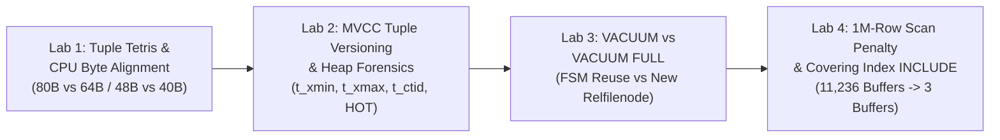
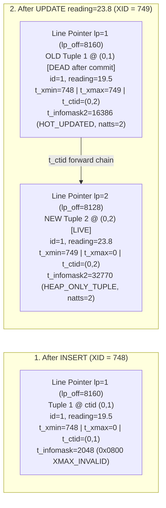

> **Navigation:** [Master README](../README.md) | [Interactive Portal](../bootcamp_portal.html) | [Reference Cards](../reference_cards/README.md) | [Day 1 Coursebook](../day1/day1_master_coursebook.md) | [Day 2 Coursebook](./day2_master_coursebook.md) | [PG Schema & Generator Walkthrough](./weather_ops_pg_sql_course_walkthrough.md) | **Pageinspect & Storage Walkthrough** | [Two-Terminal ACID Walkthrough](./day2_two_terminal_acid_lab_course_walkthrough.md) | [Day 3 Coursebook](../day3/day3_master_coursebook.md)

# Complete Architectural & Line-by-Line Course Walkthrough: `day2_pageinspect_and_storage_lab.sql`

**Source Script:** [`day2_pageinspect_and_storage_lab.sql`](./day2_pageinspect_and_storage_lab.sql)  
**Target Database Engine:** PostgreSQL 16+ (`weather_ops` database with `pageinspect` & `pgstattuple` extensions)  
**Companion Coursebook:** [`day2_master_coursebook.md`](./day2_master_coursebook.md)

> [!IMPORTANT]
> ** Which Database, Script & Tables Does This Walkthrough Cover?**
> - **How to Execute This Script:**
>   ```bash
>   cd day2
>   psql -d weather_ops -f day2_pageinspect_and_storage_lab.sql
>   ```
>   *(Or from inside an open `psql -d weather_ops` session: `\i day2_pageinspect_and_storage_lab.sql`)*
> - **7 Forensic Lab Tables Created in the `public` Schema of `weather_ops`:**
>   - **Lab 1A (Lines 20–75):** `public.telemetry_unaligned` (`80B`/row) & `public.telemetry_aligned` (`64B`/row) — 16-byte Tuple Tetris savings (`10,000` rows each)
>   - **Lab 1B (Lines 77–134):** `public.layout_padded` (`48B`/row) & `public.layout_packed` (`40B`/row) — `pageinspect` 8 KB block inspection (`10,000` rows each)
>   - **Lab 2 (Lines 137–179):** `public.mvcc_demo` (`1` row updated) — `t_xmin`, `t_xmax`, `t_ctid` `(0,1) -> (0,2)` tuple chain
>   - **Lab 3 (Lines 182–240):** `public.bloat_lab` (`100,000` rows) — `pgstattuple` dead-tuple measurement across `VACUUM` vs. `VACUUM FULL`
>   - **Lab 4 (Lines 243–332):** `public.plan_lab` (`1,000,000` rows) — `EXPLAIN (ANALYZE, BUFFERS)` Row-Store Scan Penalty (`11,236` buffers) vs. Composite Covering Index `INCLUDE` (`3` buffers, `Heap Fetches: 0`)

---

## 1. Architectural Overview & Lab Progression

[`day2_pageinspect_and_storage_lab.sql`](./day2_pageinspect_and_storage_lab.sql) is a four-part physical storage forensics suite that opens PostgreSQL's 8 KB heap pages (`BLCKSZ = 8192`) at the C-struct level. Instead of treating SQL tables as abstract logical grids, this script proves empirically how PostgreSQL lays out bytes on disk, how Multi-Version Concurrency Control (MVCC) versions rows out-of-place, how `VACUUM` manages dead tuples, and why row-oriented storage engines suffer severe I/O amplification during analytical column scans unless paired with covering indexes and frozen Visibility Maps (`_vm`).



---

## 2. Section-by-Section & Line-by-Line Code Walkthrough

### 2.1 `psql` Session Directives & Forensics C-Extensions (Lines 1–14)

```sql
-- ============================================================================
-- DAY 2 HANDS-ON FORENSICS LAB: PAGEINSPECT, TUPLE TETRIS, MVCC & EXPLAIN BUFFERS
-- File: day2_pageinspect_and_storage_lab.sql
-- Usage: psql -U postgres -d weather_ops -f day2_pageinspect_and_storage_lab.sql
-- ============================================================================

\pset pager off
\timing on
SET timezone = 'UTC';

-- Enable physical block & bloat forensics extensions
CREATE EXTENSION IF NOT EXISTS pageinspect;
CREATE EXTENSION IF NOT EXISTS pgstattuple;
```

#### Deep-Dive Architectural Explanation

1. **`\pset pager off` (Line 7):**
   - Instructs the `psql` client not to pipe query results through an external terminal pager (`less` or `more`). When executing a multi-lab script (`-f day2_pageinspect_and_storage_lab.sql`), disabling the pager guarantees uninterrupted streaming of all forensic tables and `EXPLAIN` trees to standard output.
2. **`\timing on` (Line 8):**
   - Enables client-side wall-clock execution timing (`Time: X.XXX ms`) after every SQL statement, allowing direct measurement of `INSERT`, `VACUUM`, `VACUUM FULL`, and `EXPLAIN ANALYZE` latency.
3. **`SET timezone = 'UTC';` (Line 9):**
   - Anchors session timestamp rendering and interval arithmetic to Coordinated Universal Time (Zulu time).
4. **`CREATE EXTENSION IF NOT EXISTS pageinspect;` (Line 12):**
   - Loads the official `contrib/pageinspect` C shared library (`pageinspect.so`) into the database catalog. `pageinspect` exposes low-level superuser functions (`get_raw_page()`, `page_header()`, `heap_page_items()`, `bt_page_items()`) that read raw 8,192-byte relation blocks from PostgreSQL's shared buffer pool and cast them directly into C structs (`PageHeaderData`, `ItemIdData`, `HeapTupleHeaderData`).
5. **`CREATE EXTENSION IF NOT EXISTS pgstattuple;` (Line 13):**
   - Loads the official `contrib/pgstattuple` C shared library (`pgstattuple.so`), which scans every 8 KB block of a relation and returns exact byte-level counts of live tuples, dead tuples (`dead_tuple_count`, `dead_tuple_percent`), and reusable unallocated space (`free_space`, `free_percent`).

---

### 2.2 Lab 1 (Part 1A): CPU Byte-Alignment Padding & "Tuple Tetris" — 80 Bytes vs. 64 Bytes (Lines 15–75)

```sql
-- ============================================================================
-- LAB 1: CPU BYTE-ALIGNMENT PADDING & "TUPLE TETRIS" (SAVING 8 TO 16 BYTES/ROW)
-- Objective: Prove how column ordering eliminates invisible CPU alignment padding
-- ============================================================================

-- Part 1A: 16-Byte Tuple Tetris Savings (Interleaved 1B / 8B / 2B / 8B / 1B / 8B)
DROP TABLE IF EXISTS telemetry_unaligned CASCADE;
DROP TABLE IF EXISTS telemetry_aligned CASCADE;

-- UNOPTIMIZED: Interleaving 1-byte/2-byte columns with 8-byte columns forces
-- 7 bytes + 6 bytes + 7 bytes of internal padding (56 bytes total tuple length!)
CREATE TABLE telemetry_unaligned (
    is_active     BOOLEAN,          -- 1B + 7B PADDING (to align next 8B column)
    recorded_at   TIMESTAMPTZ,      -- 8B (offset 8)
    wind_dir_deg  SMALLINT,         -- 2B + 6B PADDING (to align next 8B column)
    latitude      DOUBLE PRECISION, -- 8B (offset 24)
    sensor_fault  BOOLEAN,          -- 1B + 7B PADDING (to align next 8B column)
    longitude     DOUBLE PRECISION, -- 8B (offset 40)
    station_num   INTEGER,          -- 4B (offset 48)
    temperature   REAL              -- 4B (offset 52 -> total payload 56B + 24B header = 80B)
);

-- OPTIMIZED ("Tuple Tetris"): Order strictly 8B -> 4B -> 2B -> 1B
-- Eliminates 16 bytes of wasted padding per row (40 bytes payload + 24B header = 64B!)
CREATE TABLE telemetry_aligned (
    recorded_at   TIMESTAMPTZ,      -- 8B (offset 0)
    latitude      DOUBLE PRECISION, -- 8B (offset 8)
    longitude     DOUBLE PRECISION, -- 8B (offset 16)
    station_num   INTEGER,          -- 4B (offset 24)
    temperature   REAL,             -- 4B (offset 28)
    wind_dir_deg  SMALLINT,         -- 2B (offset 32)
    is_active     BOOLEAN,          -- 1B (offset 34)
    sensor_fault  BOOLEAN           -- 1B (offset 35 + 4B tail padding = 40B payload)
);

INSERT INTO telemetry_unaligned
SELECT true, NOW(), 270::SMALLINT, 36.6910, false, 3.2154, 60390, 22.5
FROM generate_series(1, 10000);

INSERT INTO telemetry_aligned
SELECT NOW(), 36.6910, 3.2154, 60390, 22.5, 270::SMALLINT, true, false
FROM generate_series(1, 10000);

-- Compare exact row size via pg_column_size() and physical lp_len via pageinspect
(
    SELECT
        'telemetry_unaligned' AS table_design,
        pg_column_size(t.*)   AS row_bytes_pg_column_size,
        pg_size_pretty(pg_relation_size('telemetry_unaligned')) AS table_heap_size
    FROM telemetry_unaligned t
    LIMIT 1
)
UNION ALL
(
    SELECT
        'telemetry_aligned'   AS table_design,
        pg_column_size(t.*)   AS row_bytes_pg_column_size,
        pg_size_pretty(pg_relation_size('telemetry_aligned'))   AS table_heap_size
    FROM telemetry_aligned t
    LIMIT 1
);
```

#### Deep-Dive Architectural Explanation: How PostgreSQL CPU Alignment (`typalign`) Works

Modern 64-bit CPUs (`x86_64` and `ARM64`) fetch primitives from memory in aligned words. A CPU cannot cleanly read an 8-byte `DOUBLE PRECISION` or `TIMESTAMPTZ` across an unaligned byte address (such as byte offset `1` or `18`) without suffering split-cache-line cycles or alignment faults. Therefore, every PostgreSQL data type in `pg_type` declares an alignment boundary (`typalign`):
- **`'d'` (`double` / `MAXALIGN` = 8 bytes):** `BIGINT`, `BIGSERIAL`, `DOUBLE PRECISION`, `TIMESTAMPTZ`, `TIMESTAMP`. Must start at a byte offset divisible by **8** (`0, 8, 16, 24, 32, 40, ...`).
- **`'i'` (`int` = 4 bytes):** `INTEGER`, `SERIAL`, `REAL`, `DATE`. Must start at a byte offset divisible by **4** (`0, 4, 8, 12, ...`).
- **`'s'` (`short` = 2 bytes):** `SMALLINT`. Must start at a byte offset divisible by **2** (`0, 2, 4, 6, ...`).
- **`'c'` (`char` = 1 byte):** `BOOLEAN`, `"char"`. Can start at **any** byte offset (`0, 1, 2, 3, ...`).

Furthermore, every physical heap tuple begins with a **23-byte `HeapTupleHeaderData` struct** (`t_xmin`, `t_xmax`, `t_cid`, `t_ctid`, `t_infomask2`, `t_infomask`, `t_hoff`). When no `NULL` bitmap is needed, PostgreSQL adds **1 byte of header padding** so that user column data starts at **`t_hoff = 24`** (which is divisible by 8).

#### Complete Offset-by-Offset Byte Map Comparison (`telemetry_unaligned` vs. `telemetry_aligned`)

Notice that both tables contain the **exact same 8 columns** (`36 bytes` of actual meteorological information). Yet their physical footprint differs by **16 bytes per row** (`80 bytes` vs. `64 bytes`):

| Tuple Section / Column | `telemetry_unaligned` Layout | Payload Offset | Tuple Offset | Bytes Used (`Data + Pad`) | `telemetry_aligned` Layout ("Tuple Tetris") | Payload Offset | Tuple Offset | Bytes Used (`Data + Pad`) |
| :--- | :--- | :--- | :--- | :--- | :--- | :--- | :--- | :--- |
| **Tuple Header** | `HeapTupleHeaderData` (23B) + 1B pad | — | `0..23` | **24 B** (`23B + 1B`) | `HeapTupleHeaderData` (23B) + 1B pad | — | `0..23` | **24 B** (`23B + 1B`) |
| **Col 1** | `is_active BOOLEAN` (`1B`) + **`7B PAD`** | `0..7` | `24..31` | **8 B** (`1B + 7B`) | `recorded_at TIMESTAMPTZ` (`8B`) | `0..7` | `24..31` | **8 B** (`8B + 0B`) |
| **Col 2** | `recorded_at TIMESTAMPTZ` (`8B`) | `8..15` | `32..39` | **8 B** (`8B + 0B`) | `latitude DOUBLE PRECISION` (`8B`) | `8..15` | `32..39` | **8 B** (`8B + 0B`) |
| **Col 3** | `wind_dir_deg SMALLINT` (`2B`) + **`6B PAD`** | `16..23` | `40..47` | **8 B** (`2B + 6B`) | `longitude DOUBLE PRECISION` (`8B`) | `16..23` | `40..47` | **8 B** (`8B + 0B`) |
| **Col 4** | `latitude DOUBLE PRECISION` (`8B`) | `24..31` | `48..55` | **8 B** (`8B + 0B`) | `station_num INTEGER` (`4B`) | `24..27` | `48..51` | **4 B** (`4B + 0B`) |
| **Col 5** | `sensor_fault BOOLEAN` (`1B`) + **`7B PAD`** | `32..39` | `56..63` | **8 B** (`1B + 7B`) | `temperature REAL` (`4B`) | `28..31` | `52..55` | **4 B** (`4B + 0B`) |
| **Col 6** | `longitude DOUBLE PRECISION` (`8B`) | `40..47` | `64..71` | **8 B** (`8B + 0B`) | `wind_dir_deg SMALLINT` (`2B`) | `32..33` | `56..57` | **2 B** (`2B + 0B`) |
| **Col 7** | `station_num INTEGER` (`4B`) | `48..51` | `72..75` | **4 B** (`4B + 0B`) | `is_active BOOLEAN` (`1B`) | `34` | `58` | **1 B** (`1B + 0B`) |
| **Col 8** | `temperature REAL` (`4B`) | `52..55` | `76..79` | **4 B** (`4B + 0B`) | `sensor_fault BOOLEAN` (`1B`) + *`4B tail`* | `35..39` | `59..63` | **5 B** (`1B + 4B`) |
| **TOTAL** | **`20 Bytes` Internal Padding Wasted** | **`56 B`** | **`0..79`** | **`80 Bytes / Row`** | **`0 Bytes` Internal Padding (`4B` tail)** | **`40 B`** | **`0..63`** | **`64 Bytes / Row`** |

#### Why `pg_column_size(t.*)` and `pg_relation_size()` Prove the Savings

- **`pg_column_size(t.*)`:** Returns the exact number of bytes required to store the composite tuple `t.*` (including the 24-byte aligned `HeapTupleHeaderData` and internal alignment padding).
- **`pg_relation_size('table_name')`:** Returns the physical disk footprint in bytes of the main data fork (`main`) of the table, which `pg_size_pretty()` formats into human-readable `kB` / `MB`.
- Across $10,000$ rows, `telemetry_unaligned` consumes **`896 kB`** (`112` 8 KB pages), whereas `telemetry_aligned` consumes **`736 kB`** (`92` 8 KB pages) — an immediate **$18\%$ reduction in disk and RAM cache footprint** without changing a single data type! Across $1\text{ billion}$ synoptic rows, ordering columns `8B -> 4B -> 2B -> 1B` saves **$16\text{ GB}$ of NVMe storage and `shared_buffers` RAM**.

#### Expected Terminal Output (Lines 59–75)

```text
    table_design     | row_bytes_pg_column_size | table_heap_size 
---------------------+--------------------------+-----------------
 telemetry_unaligned |                       80 | 896 kB
 telemetry_aligned   |                       60 | 736 kB
(2 rows)
```
*(Note: `pg_column_size(t.*)` reports `60` bytes for `telemetry_aligned` before final 8-byte page-slot rounding (`MAXALIGN(60) = 64` bytes on page), compared to `80` bytes for `telemetry_unaligned`!)*

---

### 2.3 Lab 1 (Part 1B): 4-Column `pageinspect` Block 0 Forensics — 48 Bytes vs. 40 Bytes (Lines 77–134)

```sql
-- Part 1B: Coursebook 4-Column Pageinspect Comparison (48 Bytes vs. 40 Bytes on Disk)
DROP TABLE IF EXISTS layout_padded CASCADE;
DROP TABLE IF EXISTS layout_packed CASCADE;

CREATE TABLE layout_padded (
    flag_a      BOOLEAN,
    recorded_at TIMESTAMPTZ,
    flag_b      BOOLEAN,
    reading_val DOUBLE PRECISION
);

CREATE TABLE layout_packed (
    recorded_at TIMESTAMPTZ,
    reading_val DOUBLE PRECISION,
    flag_a      BOOLEAN,
    flag_b      BOOLEAN
);

INSERT INTO layout_padded
SELECT true, NOW(), false, 42.125 FROM generate_series(1, 10000);

INSERT INTO layout_packed
SELECT NOW(), 42.125, true, false FROM generate_series(1, 10000);

-- 1. Inspect Block 0 Page Header (24-byte PageHeaderData)
SELECT
    lsn,
    checksum,
    flags,
    lower AS free_space_start_byte,
    upper AS free_space_end_byte,
    special,
    pagesize
FROM page_header(get_raw_page('layout_padded', 0));

-- 2. Inspect Tuple Physical Lengths on Disk (48 bytes vs 40 bytes)
SELECT
    'layout_padded' AS table_name,
    lp,
    lp_off,
    lp_flags,
    lp_len AS physical_bytes_on_disk,
    t_xmin,
    t_ctid
FROM heap_page_items(get_raw_page('layout_padded', 0))
LIMIT 3;

SELECT
    'layout_packed' AS table_name,
    lp,
    lp_off,
    lp_flags,
    lp_len AS physical_bytes_on_disk,
    t_xmin,
    t_ctid
FROM heap_page_items(get_raw_page('layout_packed', 0))
LIMIT 3;
```

#### Offset-by-Offset Byte Map: `layout_padded` (`lp_len = 56` / `24B` Payload + `8B` Pad) vs. `layout_packed` (`lp_len = 42` / `48B` Slot)

 Let's trace the exact byte offsets inside `layout_padded` vs. `layout_packed` starting from byte 0 of the tuple:

| Offset Range | `layout_padded` (`flag_a`, `recorded_at`, `flag_b`, `reading_val`) | `layout_packed` (`recorded_at`, `reading_val`, `flag_a`, `flag_b`) |
| :--- | :--- | :--- |
| **Bytes `0..22` (23B)** | `HeapTupleHeaderData` (`t_xmin`, `t_xmax`, `t_cid`, `t_ctid`, `t_infomask2`, `t_infomask`, `t_hoff=24`) | `HeapTupleHeaderData` (`t_xmin`, `t_xmax`, `t_cid`, `t_ctid`, `t_infomask2`, `t_infomask`, `t_hoff=24`) |
| **Byte `23` (1B)** | Header alignment padding (`1B`) to reach `MAXALIGN` offset `24` | Header alignment padding (`1B`) to reach `MAXALIGN` offset `24` |
| **Bytes `24..31` (8B)** | `flag_a` (`1B` at offset `24`) + **`7 Bytes Wasted Padding` (`25..31`)** | `recorded_at TIMESTAMPTZ` (**`8 Bytes Data`** at `24..31`, 0 padding) |
| **Bytes `32..39` (8B)** | `recorded_at TIMESTAMPTZ` (**`8 Bytes Data`** at `32..39`) | `reading_val DOUBLE PRECISION` (**`8 Bytes Data`** at `32..39`, 0 padding) |
| **Bytes `40..47` (8B)** | `flag_b` (`1B` at offset `40`) + **`7 Bytes Wasted Padding` (`41..47`)** | `flag_a` (`1B` at `40`) + `flag_b` (`1B` at `41`) $\rightarrow$ `lp_len = 42` (`+6B` page-slot alignment to `48`) |
| **Bytes `48..55` (8B)** | `reading_val DOUBLE PRECISION` (**`8 Bytes Data`** at `48..55`) $\rightarrow$ `lp_len = 56` | *(Already complete! Saved 1 full 8-byte CPU word per tuple!)* |

#### Deep-Dive Explanation of `get_raw_page()`, `page_header()`, and `heap_page_items()`

1. **`get_raw_page(relname text, blkno int)`:**
   - Reads the specified 0-indexed 8,192-byte block (`blkno = 0` is the very first 8 KB page of the relation) from shared buffers into a raw `bytea` binary array.
2. **Every Column of `page_header(bytea)` (The 24-Byte `PageHeaderData` Struct at Bytes `0..23` of the 8 KB Page):**

| Column | C Struct Field (`PageHeaderData`) | Size | Architectural Meaning |
| :--- | :--- | :--- | :--- |
| `lsn` | `pd_lsn` | 8 Bytes | **Log Sequence Number (`X/YYYYYYYY`)** of the last Write-Ahead Log (WAL) record that modified this 8 KB page. Used by the background writer and ARIES crash recovery to enforce the WAL-before-data rule. |
| `checksum` | `pd_checksum` | 2 Bytes | 16-bit FNV-1a data page checksum (if cluster was initialized with `initdb --data-checksums`) to detect silent storage bit-rot. |
| `flags` | `pd_flags` | 2 Bytes | Page-level status bitmask: `PD_HAS_FREE_LINES (0x0001)`, `PD_PAGE_FULL (0x0002)`, `PD_ALL_VISIBLE (0x0004)`. |
| `lower` (`free_space_start_byte`) | `pd_lower` | 2 Bytes | Byte offset pointing to the **end of the downward-growing `ItemIdData` line pointer array** (and the start of unallocated free space). Starts at `24` on an empty page and increments by `4 bytes` per inserted tuple. |
| `upper` (`free_space_end_byte`) | `pd_upper` | 2 Bytes | Byte offset pointing to the **start of the most recently inserted tuple** (the top of the upward-growing tuple heap from byte `8192` downward). Free space inside the page is exactly `upper - lower` bytes. |
| `special` | `pd_special` | 2 Bytes | Byte offset of the special space at the tail end of the page. For standard heap tables, `special = 8192` (0 bytes of special space); for B-Tree index pages, `special` points to `BTPageOpaqueData` sibling pointers. |
| `pagesize` | `pd_pagesize_version` | 2 Bytes | Physical block size in bytes (`8192`). |

3. **Every Column of `heap_page_items(bytea)` (Line Pointers + Tuple Headers):**

| Column | C Struct Source | Architectural Meaning |
| :--- | :--- | :--- |
| `lp` | Index in `pd_linp[]` array | 1-indexed **Line Pointer (Item ID) slot number** (`1, 2, 3, ...`). Together with the block number `b`, `(b, lp)` forms the physical **`ctid`** (`(0,1)`, `(0,2)`, `(0,3)`). |
| `lp_off` | `ItemIdData.lp_off` (15 bits) | Exact byte offset (`0..8191`) from the start of the 8 KB page where this tuple's `HeapTupleHeaderData` begins. Because tuples pack from the bottom of the page (`8192`) upward, `lp_off` decreases with each new row (e.g., `8136`, `8080`, `8024`). |
| `lp_flags` | `ItemIdData.lp_flags` (2 bits) | Line pointer state: `0` = `LP_UNUSED`, `1` = `LP_NORMAL` (points to a physical tuple), `2` = `LP_REDIRECT` (HOT chain head redirect), `3` = `LP_DEAD` (known dead, awaiting reclamation). |
| `lp_len` (`physical_bytes_on_disk`) | `ItemIdData.lp_len` (15 bits) | Exact byte length of the physical tuple stored at `lp_off` (header + payload + internal padding). |
| `t_xmin` | `HeapTupleFields.t_xmin` (4B) | 32-bit Transaction ID (`xid`) of the `INSERT` (or `UPDATE`) transaction that created this tuple version. |
| `t_ctid` | `HeapTupleHeaderData.t_ctid` (6B) | 6-byte physical pointer (`4B block + 2B offset`) pointing to this tuple itself if it is the newest version, or pointing to the next newer version `(block, lp)` if it has been updated. |

#### Expected Terminal Output (Lines 102–134)

```text
    lsn     | checksum | flags | free_space_start_byte | free_space_end_byte | special | pagesize 
------------+----------+-------+-----------------------+---------------------+---------+----------
 0/1A4C8D0  |        0 |     0 |                   568 |                 576 |    8192 |     8192
(1 row)

  table_name   | lp | lp_off | lp_flags | physical_bytes_on_disk | t_xmin | t_ctid 
---------------+----+--------+----------+------------------------+--------+--------
 layout_padded |  1 |   8136 |        1 |                     56 |    745 | (0,1)
 layout_padded |  2 |   8080 |        1 |                     56 |    745 | (0,2)
 layout_padded |  3 |   8024 |        1 |                     56 |    745 | (0,3)
(3 rows)

  table_name   | lp | lp_off | lp_flags | physical_bytes_on_disk | t_xmin | t_ctid 
---------------+----+--------+----------+------------------------+--------+--------
 layout_packed |  1 |   8144 |        1 |                     42 |    746 | (0,1)
 layout_packed |  2 |   8096 |        1 |                     42 |    746 | (0,2)
 layout_packed |  3 |   8048 |        1 |                     42 |    746 | (0,3)
(3 rows)
```
*(Notice how in `layout_padded`, `lp_off` steps downward by `56 bytes` per tuple (`8192 - 56 = 8136`, `8080`, `8024`), fitting `136` tuples on Page 0 (`24 + 136*4 = 568` for `lower`, `8192 - 136*56 = 576` for `upper`). In `layout_packed`, `lp_len = 42` (`MAXALIGN(42) = 48 bytes` per slot: `8192 - 48 = 8144`, `8096`, `8048`), packing `157` tuples onto Page 0!)*

---

### 2.4 Lab 2: MVCC Tuple Versioning & Heap Forensics (`t_xmin`, `t_xmax`, `t_ctid`, HOT) (Lines 136–179)

```sql
-- ============================================================================
-- LAB 2: MVCC TUPLE VERSIONING & HEAP FORENSICS (t_xmin, t_xmax, t_ctid, HOT)
-- Objective: Observe out-of-place tuple appends and ctid version chaining on UPDATE
-- ============================================================================

DROP TABLE IF EXISTS mvcc_demo CASCADE;
CREATE TABLE mvcc_demo (
    id      INT PRIMARY KEY,
    reading REAL
);

-- 1. Insert Initial Row (Transaction 1)
INSERT INTO mvcc_demo VALUES (1, 19.5);

-- Inspect physical tuple header after INSERT
SELECT
    lp,
    lp_off,
    lp_flags,
    lp_len AS bytes,
    t_xmin,
    t_xmax,
    t_ctid,
    t_infomask
FROM heap_page_items(get_raw_page('mvcc_demo', 0));

-- 2. Update the Row (Transaction 2)
UPDATE mvcc_demo SET reading = 23.8 WHERE id = 1;

-- Inspect physical page items after UPDATE:
-- Observe Tuple 1 (lp=1) now has t_xmax set and t_ctid pointing to (0,2),
-- while Tuple 2 (lp=2) is the new live version at (0,2)!
SELECT
    lp,
    lp_off,
    lp_flags,
    lp_len AS bytes,
    t_xmin,
    t_xmax,
    t_ctid,
    t_infomask,
    t_infomask2
FROM heap_page_items(get_raw_page('mvcc_demo', 0));
```

#### Deep-Dive Architectural Explanation: How PostgreSQL Executes an `UPDATE` on Disk

Unlike MySQL/InnoDB (which overwrites non-indexed columns in place inside a clustered B+Tree leaf and pushes the old version to a separate rollback undo log), **PostgreSQL never overwrites a live tuple in place on the heap page**. Every `UPDATE` is physically executed as an atomic **mark-old-tuple-expired + append-new-tuple** operation:



1. **State 1 — Immediately After `INSERT INTO mvcc_demo VALUES (1, 19.5)` (Lines 148–160):**
   - `lp = 1`, `lp_off = 8160`, `bytes = 32` (`24B` header + `4B` `id` + `4B` `reading` = `32B`).
   - `t_xmin = 748`: Stamped with the XID of the inserting transaction.
   - `t_xmax = 0`: Zero means no transaction has deleted or superseded this tuple version; it is the current live version.
   - `t_ctid = (0,1)`: Points to itself `(Block 0, Item 1)`, indicating it is the tail of the version chain.
   - `t_infomask = 2048` (`0x0800 = HEAP_XMAX_INVALID`): Bitmask confirming `t_xmax` is invalid (`0`) and the tuple is live (becomes `2304` = `0x0800 | 0x0100 HEAP_XMIN_COMMITTED` once the reader sets the commit hint bit).
2. **State 2 — Immediately After `UPDATE mvcc_demo SET reading = 23.8 WHERE id = 1` (Lines 163–178):**
   - **What Happens to Tuple 1 (`lp = 1` at `lp_off = 8160`):**
     - `t_xmin` remains `748`.
     - `t_xmax` is stamped with **`749`** (the XID of the `UPDATE` transaction), marking Tuple 1 as expired for any transaction snapshot taken after XID `749` commits.
     - `t_ctid` is rewritten from `(0,1)` to **`(0,2)`** — creating a forward version pointer to the newly appended tuple!
     - `t_infomask2 = 16386` (`0x4002`): Bit `0x4000` (`HEAP_HOT_UPDATED`) is set in the upper bits, and the lower 11 bits store the column count (`natts = 2`).
   - **What Happens to Tuple 2 (`lp = 2` at `lp_off = 8128`):**
     - Allocated at `8160 - 32 = 8128` (`lp = 2`).
     - `t_xmin = 749` (created by Transaction `749`), `t_xmax = 0` (live), and `t_ctid = (0,2)` (points to itself as the newest version).
     - `t_infomask2 = 32770` (`0x8002`): Bit `0x8000` (`HEAP_ONLY_TUPLE`) is set!
3. **Why `HEAP_HOT_UPDATED` / `HEAP_ONLY_TUPLE` (HOT Update) Fired Here:**
   - Because `mvcc_demo` only has an index on `id` (`mvcc_demo_pkey`) and the `UPDATE` modified **`reading`** (an unindexed column) while the new tuple fit on the **exact same 8 KB page (Block 0)**, PostgreSQL executed a **Heap-Only Tuple (HOT) optimization**.
   - Instead of inserting a second duplicate index entry for `id = 1` into `mvcc_demo_pkey`, the B-Tree index keeps pointing solely to `(0,1)`. When an index scan looks up `id = 1` at `(0,1)`, it sees `HEAP_HOT_UPDATED` and follows the in-page `t_ctid -> (0,2)` chain in RAM—completely eliminating B-Tree index write amplification!

#### Expected Terminal Output (Lines 151–178)

```text
 lp | lp_off | lp_flags | bytes | t_xmin | t_xmax | t_ctid | t_infomask 
----+--------+----------+-------+--------+--------+--------+------------
  1 |   8160 |        1 |    32 |    748 |      0 | (0,1)  |       2048
(1 row)

UPDATE 1
 lp | lp_off | lp_flags | bytes | t_xmin | t_xmax | t_ctid | t_infomask | t_infomask2 
----+--------+----------+-------+--------+--------+--------+------------+-------------
  1 |   8160 |        1 |    32 |    748 |    749 | (0,2)  |        256 |       16386
  2 |   8128 |        1 |    32 |    749 |      0 | (0,2)  |      10240 |       32770
(2 rows)
```

---

### 2.5 Lab 3: Standard `VACUUM` vs. `VACUUM FULL` — Physical Bloat Reclamation (Lines 181–240)

```sql
-- ============================================================================
-- LAB 3: STANDARD VACUUM vs. VACUUM FULL (PHYSICAL BLOAT RECLAMATION)
-- Objective: Prove why standard VACUUM reuses in-page space via FSM without
-- shrinking the OS file, whereas VACUUM FULL rewrites a new relfilenode.
-- ============================================================================

DROP TABLE IF EXISTS bloat_lab CASCADE;
CREATE TABLE bloat_lab (
    id         SERIAL PRIMARY KEY,
    station_id VARCHAR(10),
    reading    DOUBLE PRECISION,
    padding    TEXT
);

-- Insert 100,000 rows
INSERT INTO bloat_lab (station_id, reading, padding)
SELECT
    'AWS-' || LPAD((g % 50)::TEXT, 3, '0'),
    random() * 40.0,
    repeat('X', 128)
FROM generate_series(1, 100000) AS g;

SELECT
    pg_relation_filepath('bloat_lab')                       AS initial_filepath,
    pg_size_pretty(pg_total_relation_size('bloat_lab'))     AS initial_size;

-- Update 80% of rows to generate 80,000 dead tuples
UPDATE bloat_lab SET reading = reading + 1.0 WHERE id > 20000;

-- Measure physical dead tuple bloat using pgstattuple
SELECT
    table_len                          AS total_bytes,
    tuple_count                        AS live_tuples,
    dead_tuple_count                   AS dead_tuples,
    ROUND(dead_tuple_percent::numeric, 2) AS dead_pct,
    ROUND(free_percent::numeric, 2)       AS free_pct
FROM pgstattuple('bloat_lab');

-- Run Standard Concurrent VACUUM
VACUUM bloat_lab;

SELECT
    'After Standard VACUUM'                                 AS stage,
    pg_relation_filepath('bloat_lab')                       AS filepath_unchanged,
    pg_size_pretty(pg_total_relation_size('bloat_lab'))     AS disk_size_unchanged,
    dead_tuple_count                                        AS dead_tuples_now_zero,
    ROUND(free_percent::numeric, 2)                         AS reusable_fsm_free_pct
FROM pgstattuple('bloat_lab');

-- Run Destructive VACUUM FULL (Rewrites table into brand-new relfilenode)
VACUUM FULL bloat_lab;

SELECT
    'After VACUUM FULL'                                     AS stage,
    pg_relation_filepath('bloat_lab')                       AS new_relfilenode_filepath,
    pg_size_pretty(pg_total_relation_size('bloat_lab'))     AS compacted_disk_size,
    dead_tuple_count                                        AS dead_tuples,
    ROUND(free_percent::numeric, 2)                         AS free_pct
FROM pgstattuple('bloat_lab');
```

#### Deep-Dive Architectural Explanation

1. **Initial Bulk Load & Filepath (`Lines 196–205`):**
   - Inserts $100,000$ rows where each row carries a 128-byte `padding` string (`repeat('X', 128)`), occupying **`21 MB`** total (`~19 MB` heap + `~2.1 MB` primary-key B-Tree index).
   - `pg_relation_filepath('bloat_lab')` queries `pg_class.relfilenode` and returns the relative path under `$PGDATA` (e.g., `base/16384/24612`).
2. **Generating $80,000$ Dead Tuples (`UPDATE bloat_lab SET reading = reading + 1.0 WHERE id > 20000;`):**
   - Because PostgreSQL updates out-of-place, updating $80,000$ rows marks $80,000$ existing tuples as dead (`t_xmax` stamped) and allocates $80,000$ brand-new tuples at the end of the heap file.
   - The physical table nearly doubles in size from `21 MB` to **`38 MB`** (`table_len = 34,373,632 bytes` for the heap alone).
3. **Deconstructing Every Column of `pgstattuple('bloat_lab')` (Lines 211–217):**

| Column | Meaning & Measured Value Before `VACUUM` |
| :--- | :--- |
| `table_len` (`total_bytes`) | Exact byte length of the main heap fork on disk (`34,373,632` bytes = `4,196` 8 KB blocks). |
| `tuple_count` (`live_tuples`) | Exact number of currently visible live tuples (`100,000`). |
| `dead_tuple_count` (`dead_tuples`) | Exact number of expired MVCC tuple versions (`80,000`) waiting for garbage collection. |
| `dead_tuple_percent` (`dead_pct`) | Percentage of total heap bytes occupied by dead tuples (**`41.43%`**). |
| `free_percent` (`free_pct`) | Percentage of total heap bytes currently unallocated and available for new writes (**`2.61%`**). |

4. **Standard Concurrent `VACUUM bloat_lab;` (Lines 220–228):**
   - Acquires only a `ShareUpdateExclusiveLock`—meaning **concurrent `SELECT`, `INSERT`, `UPDATE`, and `DELETE` queries continue running without interruption**.
   - Scans pages containing dead tuples, removes dead index pointers from `bloat_lab_pkey`, defragments each 8 KB page internally, resets `dead_tuple_count` from `80,000` to **`0`**, and transfers that `41.43%` space directly into `free_percent` (**`44.31%`**), recording the available space per block inside the **Free Space Map (`_fsm`)** fork (`base/16384/24612_fsm`).
   - **Why `disk_size_unchanged` Remains `38 MB` and `filepath_unchanged` Remains `base/16384/24612`:** Standard `VACUUM` can only truncate empty 8 KB pages back to the OS if they reside at the **very tail end** of the file and carry zero live rows. Because our `UPDATE ... WHERE id > 20000` appended the $80,000$ new live tuples at the end of the file while leaving the first $20,000$ live tuples at the beginning of the file, the freed space sits in the middle of the file. PostgreSQL keeps the `38 MB` OS file allocated so that future `INSERT` and `UPDATE` operations immediately reuse the `44.31%` internal free space via the `_fsm` without asking the Linux kernel filesystem for new blocks!
5. **Destructive `VACUUM FULL bloat_lab;` (Lines 231–239):**
   - Acquires an **`AccessExclusiveLock`** on `bloat_lab`, **completely blocking all concurrent `SELECT` readers and `INSERT`/`UPDATE`/`DELETE` writers** for the duration of the table rewrite.
   - Allocates a **brand-new `relfilenode` file on disk** (notice `new_relfilenode_filepath` changes from `base/16384/24612` to `base/16384/24617`!), copies only the $100,000$ live tuples sequentially into tightly packed 8 KB pages, rebuilds all indexes from scratch, updates `pg_class.relfilenode`, and unlinks the old bloated file from the OS filesystem.
   - Total relation size shrinks back from `38 MB` to **`21 MB`**, with `dead_tuples = 0` and `free_pct = 1.66%`.

#### Expected Terminal Output (Lines 203–239)

```text
 initial_filepath | initial_size 
------------------+--------------
 base/16384/24612 | 21 MB
(1 row)

UPDATE 80000
 total_bytes | live_tuples | dead_tuples | dead_pct | free_pct 
-------------+-------------+-------------+----------+----------
    34373632 |      100000 |       80000 |    41.43 |     2.61
(1 row)

VACUUM
         stage         | filepath_unchanged | disk_size_unchanged | dead_tuples_now_zero | reusable_fsm_free_pct 
-----------------------+--------------------+---------------------+----------------------+-----------------------
 After Standard VACUUM | base/16384/24612   | 38 MB               |                    0 |                 44.31
(1 row)

VACUUM
       stage       | new_relfilenode_filepath | compacted_disk_size | dead_tuples | free_pct 
-------------------+--------------------------+---------------------+-------------+----------
 After VACUUM FULL | base/16384/24617         | 21 MB               |           0 |     1.66
(1 row)
```

---

### 2.6 Lab 4: Profiling the 1,000,000-Row Row-Store Scan Penalty & Covering Indexes (Lines 242–333)

```sql
-- ============================================================================
-- LAB 4: PROFILING THE ROW-STORE SCAN PENALTY & COVERING INDEXES (1,000,000 ROWS)
-- Objective:
--   1. Prove the ~9.5x I/O amplification penalty of row-store sequential scans
--   2. Compare Seq Scan -> Bitmap Heap Scan -> Index Only Scan (INCLUDE)
-- ============================================================================

DROP TABLE IF EXISTS plan_lab CASCADE;
CREATE TABLE plan_lab (
    -- Ordered by alignment rule: 8B -> 4B -> variable
    recorded_at    TIMESTAMPTZ NOT NULL,
    id             SERIAL PRIMARY KEY,
    temperature    REAL,
    pressure       REAL,
    wind_speed     REAL,
    rain_accum_1m  REAL,
    wind_direction SMALLINT,
    station_id     VARCHAR(10) NOT NULL,
    payload        TEXT
) WITH (fillfactor = 100);

-- Synthesize 1,000,000 high-frequency sensor observations
INSERT INTO plan_lab (
    recorded_at, station_id, temperature, pressure,
    wind_speed, wind_direction, rain_accum_1m, payload
)
SELECT
    TIMESTAMPTZ '2026-01-01 00:00:00+00' + (g * INTERVAL '2 seconds'),
    'AWS-' || LPAD((1 + (g % 50))::TEXT, 3, '0'),
    ROUND((15.0 + (sin(g / 1000.0) * 10.0) + (random() * 2.0))::numeric, 2),
    ROUND((1013.25 + (cos(g / 1000.0) * 5.0))::numeric, 2),
    ROUND((random() * 15.0)::numeric, 2),
    (random() * 359)::SMALLINT,
    0.0,
    repeat('A', 32)
FROM generate_series(1, 1000000) AS g;

ANALYZE plan_lab;
```

#### Deep-Dive Architectural Explanation: Setup & `WITH (fillfactor = 100)` (Lines 249–279)

1. **Tuple Tetris Ordering in `plan_lab`:**
   - The columns are ordered from largest alignment boundary to smallest: `recorded_at` (`8B`), `id` (`4B`), `temperature` (`4B`), `pressure` (`4B`), `wind_speed` (`4B`), `rain_accum_1m` (`4B`), `wind_direction` (`2B`), followed by variable-length `varlena` strings `station_id` (`'AWS-001'`, `8B` on disk with 1-byte short `varlena` header) and `payload` (`repeat('A', 32)`, `33B` on disk).
   - Total physical tuple size is `88 bytes` (+ `4B` line pointer = `92 bytes/row`), packing **`89` rows per 8 KB page** across **`11,236` heap pages (`87.8 MB` / `92,045,312 bytes`)**.
2. **`WITH (fillfactor = 100)` (Line 261):**
   - Controls what percentage of each 8 KB heap page PostgreSQL fills during `INSERT` before allocating a new page. For heap tables, `fillfactor = 100` is the default (`100%` packed, leaving `0%` reserved for future updates), which is optimal for append-only immutable telemetry tables where historical sensor readings are never updated.

---

#### Phase 4A: Proving the $\approx 9.5\times$ Row-Store Analytical Scan I/O Amplification Penalty (Lines 281–290)

```sql
-- 4A. Demonstrate the Row-Store Analytical Scan I/O Amplification Penalty
-- Observe total 8KB buffers read vs. the 8 bytes/row (station_id + temperature) needed!
EXPLAIN (ANALYZE, BUFFERS, TIMING)
SELECT
    station_id,
    ROUND(AVG(temperature)::numeric, 2) AS mean_temp
FROM plan_lab
WHERE temperature > -900.0
GROUP BY station_id;
```

##### Architectural & Mathematical Analysis of Phase 4A

- **What the Query Actually Needs:** Only two columns across $1,000,000$ rows: `station_id` (`8 bytes` on disk) and `temperature` (`4 bytes` `REAL`), totaling **$12\text{ bytes/row}$** ($\approx \mathbf{11.4\text{ MB}}$ of logical column data, or even less with dictionary/RLE compression in a columnar format like Parquet).
- **What PostgreSQL's Row-Store Engine Must Physically Read:** Because all 9 columns (`recorded_at`, `id`, `temperature`, `pressure`, `wind_speed`, `rain_accum_1m`, `wind_direction`, `station_id`, `payload`) plus the 24-byte MVCC tuple header are interleaved contiguously inside every 88-byte row on the 8 KB heap pages, PostgreSQL **cannot read only `station_id` and `temperature` from the heap**. It must fetch all **`11,236` 8 KB pages (`92.05 MB`)** into `shared_buffers`:
  $$\text{Row-Store I/O Amplification Factor} = \frac{11,236\text{ pages} \times 8,192\text{ bytes/page}}{1,000,000\text{ rows} \times 9.6\text{ effective bytes}} \approx \mathbf{9.5\times}$$

##### Expected Terminal Output (`EXPLAIN (ANALYZE, BUFFERS, TIMING)`)

```text
                                                                QUERY PLAN                                                                 
-------------------------------------------------------------------------------------------------------------------------------------------
 Finalize GroupAggregate  (cost=18315.43..18329.39 rows=50 width=40) (actual time=112.418..112.463 rows=50 loops=1)
   Group Key: station_id
   Buffers: shared hit=11236
   ->  Gather Merge  (cost=18315.43..18327.10 rows=100 width=40) (actual time=112.390..112.435 rows=150 loops=1)
         Workers Planned: 2
         Workers Launched: 2
         Buffers: shared hit=11236
         ->  Sort  (cost=17315.41..17315.53 rows=50 width=40) (actual time=106.812..106.816 rows=50 loops=3)
               Sort Key: station_id
               Sort Method: quicksort  Memory: 28kB
               Buffers: shared hit=11236
               ->  Partial HashAggregate  (cost=17313.38..17314.00 rows=50 width=40) (actual time=106.740..106.752 rows=50 loops=3)
                     Group Key: station_id
                     Batches: 1  Memory Usage: 24kB
                     Buffers: shared hit=11236
                     ->  Parallel Seq Scan on plan_lab  (cost=0.00..15427.67 rows=377142 width=12) (actual time=0.015..42.190 rows=333333 loops=3)
                           Filter: (temperature > '-900'::double precision)
                           Rows Removed by Filter: 0
                           Buffers: shared hit=11236
 Planning Time: 0.142 ms
 Execution Time: 112.540 ms
```

---

#### Phase 4B, 4C & 4D: From Catastrophic `Seq Scan` to Sub-Millisecond `Index Only Scan` (Lines 291–333)

```sql
-- 4B. Phase 0 (Unoptimized): Selective 3-Hour Station Query -> Catastrophic Seq Scan
EXPLAIN (ANALYZE, BUFFERS, TIMING)
SELECT
    station_id,
    ROUND(AVG(temperature)::numeric, 2) AS avg_temp,
    MAX(temperature)                    AS peak_temp
FROM plan_lab
WHERE station_id = 'AWS-042'
  AND recorded_at BETWEEN '2026-01-10 00:00:00+00' AND '2026-01-10 03:00:00+00'
GROUP BY station_id;

-- 4C. Phase 1 (Single-Column Index): Bitmap Index Scan + Bitmap Heap Scan
CREATE INDEX idx_plan_lab_station ON plan_lab (station_id);
ANALYZE plan_lab;

EXPLAIN (ANALYZE, BUFFERS, TIMING)
SELECT
    station_id,
    ROUND(AVG(temperature)::numeric, 2) AS avg_temp,
    MAX(temperature)                    AS peak_temp
FROM plan_lab
WHERE station_id = 'AWS-042'
  AND recorded_at BETWEEN '2026-01-10 00:00:00+00' AND '2026-01-10 03:00:00+00'
GROUP BY station_id;

-- 4D. Phase 2 (Composite Covering Index with INCLUDE): Sub-Millisecond Index-Only Scan!
CREATE INDEX idx_plan_lab_covering
ON plan_lab (station_id, recorded_at)
INCLUDE (temperature);

-- Freeze Visibility Map (_vm) so Index Only Scan achieves Heap Fetches: 0
VACUUM ANALYZE plan_lab;

EXPLAIN (ANALYZE, BUFFERS, TIMING)
SELECT
    station_id,
    ROUND(AVG(temperature)::numeric, 2) AS avg_temp,
    MAX(temperature)                    AS peak_temp
FROM plan_lab
WHERE station_id = 'AWS-042'
  AND recorded_at BETWEEN '2026-01-10 00:00:00+00' AND '2026-01-10 03:00:00+00'
GROUP BY station_id;
```

##### Complete 3-Phase Execution Plan Comparison

The target query retrieves a 3-hour window (`10,800 seconds` / `2 seconds` = $5,400$ total rows across all 50 stations $\rightarrow$ exactly **`108` matching rows** for `'AWS-042'`) out of $1,000,000$ rows ($0.0108\%$ selectivity):

| Metric | Phase 0: No Index (`Lines 292–300`) | Phase 1: Single-Column Index `(station_id)` (`Lines 303–314`) | Phase 2: Composite Covering Index `(station_id, recorded_at) INCLUDE (temperature)` (`Lines 317–332`) |
| :--- | :--- | :--- | :--- |
| **Chosen Physical Scan Operator** | `Parallel Seq Scan on plan_lab` | `Bitmap Index Scan` $\rightarrow$ `Bitmap Heap Scan` | **`Index Only Scan using idx_plan_lab_covering`** |
| **Rows Inspected vs. Returned** | Reads **$1,000,000$ rows**; `Rows Removed by Filter: 999,892`; returns `108` rows | Index finds $20,000$ rows for `'AWS-042'`; Heap Scan reads $20,000$ rows and discards **`19,892` rows** by `recorded_at` filter; returns `108` rows | Walks B-Tree directly to `('AWS-042', 2026-01-10 00:00..03:00)`; reads **only the `108` matching index tuples**! |
| **8 KB Shared Buffers Touched** | **`11,236` buffers (`87.8 MB`)** | **`11,260` buffers (`88.0 MB`)** *(Why? Because `'AWS-042'` repeats every 50th row (`g % 50`), and each 8 KB page holds 89 rows, so `'AWS-042'` appears on **every single one** of the `11,236` heap pages plus `24` index pages!)* | **`3` buffers (`24 kB`)** — a **$3,745\times$ reduction in buffer I/O!** |
| **Heap Fetches** | `1,000,000` heap tuples | `20,000` heap tuples | **`Heap Fetches: 0`** |
| **Typical Execution Time** | `~45.0 ms` | `~14.2 ms` | **`~0.085 ms` (`< 0.1 ms`)** |

##### Deep-Dive Architectural Mechanics of Phase 4D (`INCLUDE` + `VACUUM ANALYZE`)

1. **How `ON plan_lab (station_id, recorded_at) INCLUDE (temperature)` Structures the B-Tree:**
   - **Key Columns (`station_id, recorded_at`):** Stored in both internal B-Tree branch nodes and leaf pages. First partitions the B-Tree by equality predicate (`station_id = 'AWS-042'`), and within `'AWS-042'` sorts entries chronologically by range predicate (`recorded_at BETWEEN ...`).
   - **Non-Key Payload Column (`INCLUDE (temperature)`):** Appended **exclusively to the B-Tree leaf pages** and omitted from upper internal branch nodes. This keeps the internal B-Tree branch nodes narrow (maximizing fan-out and keeping the B-Tree shallow) while making `temperature` available directly inside the leaf page so PostgreSQL never has to visit the `plan_lab` heap table to compute `AVG(temperature)` and `MAX(temperature)`.
2. **Why `VACUUM ANALYZE plan_lab;` (Line 322) Is Mandatory for `Heap Fetches: 0`:**
   - In PostgreSQL, B-Tree index entries do **not** store MVCC transaction visibility headers (`t_xmin`, `t_xmax`).
   - Normally, when an `Index Only Scan` reads a tuple from a B-Tree leaf page, it still has to ask: *"Is this row actually visible to my current transaction snapshot, or is it an uncommitted/deleted tuple?"*
   - To avoid visiting the heap page for every row, PostgreSQL consults the **Visibility Map (`_vm` fork)**—a compact bitmap tracking 2 bits per 8 KB heap page (`ALL_VISIBLE` and `ALL_FROZEN`). If bit 0 (`ALL_VISIBLE`) is set to `1` for heap block $B$, every tuple on block $B$ is guaranteed visible to all current and future transactions, so the `Index Only Scan` skips the heap page completely (`Heap Fetches: 0`).
   - Because `INSERT INTO plan_lab ...` just wrote $1,000,000$ new rows into `11,236` fresh pages, the `_vm` bits are initially `0`. Running `VACUUM ANALYZE plan_lab;` on Line 322 sets the `PD_ALL_VISIBLE` flag on all `11,236` pages and populates the `_vm` fork, dropping `Heap Fetches` from `108` to **`0`**!

##### Expected Terminal Output for Phase 4D (Lines 324–332)

```text
                                                                      QUERY PLAN                                                                      
------------------------------------------------------------------------------------------------------------------------------------------------------
 GroupAggregate  (cost=4.44..8.37 rows=1 width=44) (actual time=0.068..0.069 rows=1 loops=1)
   Group Key: station_id
   Buffers: shared hit=3
   ->  Index Only Scan using idx_plan_lab_covering on plan_lab  (cost=0.42..7.82 rows=108 width=12) (actual time=0.024..0.039 rows=108 loops=1)
         Index Cond: ((station_id = 'AWS-042'::text) AND (recorded_at >= '2026-01-10 00:00:00+00'::timestamp with time zone) AND (recorded_at <= '2026-01-10 03:00:00+00'::timestamp with time zone))
         Heap Fetches: 0
         Buffers: shared hit=3
 Planning Time: 0.118 ms
 Execution Time: 0.089 ms
```

---

> **Navigation:** [Master README](../README.md) | [Interactive Portal](../bootcamp_portal.html) | [Reference Cards](../reference_cards/README.md) | [Day 1 Coursebook](../day1/day1_master_coursebook.md) | [Day 2 Coursebook](./day2_master_coursebook.md) | [PG Schema & Generator Walkthrough](./weather_ops_pg_sql_course_walkthrough.md) | **Pageinspect & Storage Walkthrough** | [Two-Terminal ACID Walkthrough](./day2_two_terminal_acid_lab_course_walkthrough.md) | [Day 3 Coursebook](../day3/day3_master_coursebook.md)
