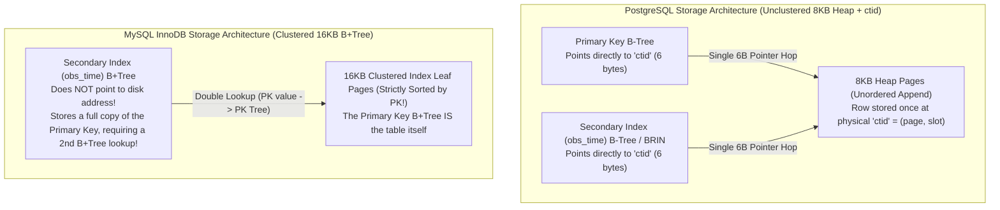

> **Navigation:** [🏠 Master README](../README.md) | [🌐 Interactive Portal](../bootcamp_portal.html) | [📚 Reference Cards](../reference_cards/README.md) | [🐬 Reference Card 14: Complete MySQL & MariaDB Guide](../reference_cards/14_mysql_and_mariadb_innodb_complete_engineering_guide.md) | [⏮️ Day 1 Coursebook](../day1/day1_master_coursebook.md) | [📘 Day 2 Coursebook](day2_master_coursebook.md) | [⏭️ Day 3 Coursebook](../day3/day3_master_coursebook.md)

# Definitive Comparative Architecture Guide: PostgreSQL (Heap/MVCC) vs. MySQL InnoDB (Clustered B+Tree/Undo Logs) for Meteorological Workloads

**Target Audience:** Weather Forecast & Meteorological Data Engineers, Database Architects  
**Companion to:** [day2_master_coursebook.md](./day2_master_coursebook.md) | [day2_postgres_tuning_and_internals_cheatsheet.md](./day2_postgres_tuning_and_internals_cheatsheet.md) | **[Reference Card 14: MySQL 8.0/8.4 & MariaDB Complete Engineering Guide](../reference_cards/14_mysql_and_mariadb_innodb_complete_engineering_guide.md)**

---

## 1. Executive Summary: Why Meteorology Standardizes on PostgreSQL Over MySQL

While **MySQL (InnoDB)** is widely deployed for simple web CRUD applications (session stores, e-commerce carts), **PostgreSQL** is the overwhelming standard across **meteorology, climate science, aerospace, and geospatial engineering** (WMO, NOAA, ECMWF, Météo-France) for **six core architectural reasons**:

1. **Geospatial Supremacy (`PostGIS`):** PostGIS is the global GIS standard. MySQL's spatial support lacks rasters (`postgis_raster` for GRIB/NetCDF grids), 3D atmospheric topologies, and full PROJ coordinate transformations.
2. **Parallel Query Execution & Analytical Joins:** PostgreSQL executes heavy climatological aggregations (`AVG`, `MIN`, `MAX`), `Hash Join`s, and `Merge Join`s across **multiple CPU cores in parallel**. MySQL (Community) executes analytical queries on **only 1 CPU core** and lacks Sort-Merge Joins entirely!
3. **Time-Series Indexing (`BRIN`, Partial Indexes, `GIN`, `GiST`):** PostgreSQL's **BRIN (Block Range Index)** indexes 100M chronological weather observations in ~100 KB of RAM, and **Partial Indexes** (`WHERE qc_flag != 'VALID'`) index only the $2\%$ suspect rows. MySQL only offers B+Trees (plus basic R-Trees/Fulltext), requiring multi-gigabyte indexes on time-series tables.
4. **Historical & Future Timestamp Range (`TIMESTAMPTZ` vs. The 2038/1970 Cliff):** MySQL's `TIMESTAMP` type is a 32-bit Unix epoch that **cannot store dates before `1970-01-01`** and **overflows on `2038-01-19 03:14:07 UTC`** (making it impossible to store 1950s historical WMO climatology or post-2038 climate projections in a UTC-aware `TIMESTAMP` column!). And MySQL's `DATETIME` ignores time zones completely. PostgreSQL's 8-byte `TIMESTAMPTZ` spans **`4713 BC` to `294,276 AD`** at microsecond UTC precision.
5. **Unclustered Heap Storage vs. Clustered Index B+Tree:** PostgreSQL's 8 KB Heap layout makes multi-index time-series + station queries fast and compact (`ctid` is always 6 bytes). MySQL InnoDB's Index-Organized Table (Clustered Primary Key) bloats every secondary index leaf node with a full copy of the Primary Key and requires a double B+Tree lookup.
6. **Transactional DDL & Partitioned Foreign Keys:** In PostgreSQL, `BEGIN; ALTER TABLE ...; ROLLBACK;` is $100\%$ atomic and reversible, and partitioned tables support Foreign Keys. In MySQL, any `ALTER TABLE` or `CREATE INDEX` **implicitly commits** your open transaction, and **Foreign Keys are completely prohibited on partitioned tables**!

---

## 2. Cross-Engine Storage Architecture Matrix (PostgreSQL vs. MySQL InnoDB vs. MyISAM vs. SQLite)

| Architectural Feature | PostgreSQL (16+) | MySQL InnoDB (8.0+) | MySQL MyISAM (Legacy) | SQLite (3.38+) |
| :--- | :--- | :--- | :--- | :--- |
| **Physical Storage Paradigm** | **Unclustered Heap** (8 KB heap blocks + 6-byte `ctid` pointers) | **Clustered Index B+Tree** (Index-Organized Table; the PK *is* the table) | Unclustered Heap (`.MYD`) + Index file (`.MYI`) | B-Tree File (Clustered on 64-bit `ROWID` or `WITHOUT ROWID`) |
| **Default Page Block Size** | **$8\text{ KB}$** (`8192` bytes) | **$16\text{ KB}$** (`16384` bytes) | Variable / Record-based | **$4\text{ KB}$** (`512B`–`64KB`) |
| **MVCC Implementation** | **Out-of-Place Tuple Versions** in Heap (`t_xmin`, `t_xmax`, `t_ctid`) + **`VACUUM`** | **In-Place Page Mutation** + reverse deltas in **Undo Tablespace** (`DB_TRX_ID`, `DB_ROLL_PTR`) + **Purge Threads** | **None** (Non-transactional; table-level read/write locks) | Rollback Journal (locks readers) or **WAL Mode** (multi-reader, single-writer) |
| **Primary Key Lookup** | PK B-Tree lookup $\to$ 6-byte `ctid` $\to$ 1 Heap page fetch | Direct traversal to Clustered B+Tree leaf page (contains full row) | `.MYI` B-Tree lookup $\to$ byte offset seek in `.MYD` | Direct traversal to `ROWID` B-Tree leaf page |
| **Secondary Index Lookup** | Secondary Index $\to$ **6-byte `ctid`** $\to$ 1 Heap page fetch (or **0** if `Index Only Scan` via `_vm`!) | **Double B+Tree Lookup:** Secondary B+Tree $\to$ **Primary Key value** $\to$ Clustered PK B+Tree traversal | `.MYI` B-Tree $\to$ direct byte offset in `.MYD` | Secondary B-Tree $\to$ `ROWID` $\to$ Main Table B-Tree |
| **RAM Caching Strategy** | **Dual-Tier:** `shared_buffers` ($25\%$) + Linux OS Page Cache ($75\%$) | **Single-Tier:** `innodb_buffer_pool_size` ($70\%\text{–}80\%$) via `O_DIRECT` (bypasses OS cache) | OS Page Cache for `.MYD`; `key_buffer_size` for `.MYI` | In-process page cache + OS Page Cache |
| **Crash Recovery & Torn-Page Protection** | Monolithic WAL (`pg_wal/`) + **`full_page_writes = on`** | Circular Redo Log (`ib_logfile`) + **Doublewrite Buffer** + Undo Log | **None!** Power loss corrupts `.MYI` indexes; requires manual `REPAIR TABLE` / `myisamchk` | `.db-journal` or `.db-wal` frames |

---

## 3. Deep Physical Comparison: Unclustered Heap vs. Clustered B+Tree



```
       MySQL InnoDB (Clustered Index B+Tree)                    PostgreSQL (Unclustered Heap)
 ┌──────────────────────────────────────────────────┐     ┌──────────────────────────────────────────────────┐
 │ Primary Key Index Tree (16 KB Pages)             │     │ Heap Disk Blocks (8 KB Pages)                    │
 │               [Root Node]                        │     │ [Block 0: Row 1, Row 8, Row 3]                   │
 │              /           \                       │     │ [Block 1: Row 2, Row 4, Row 9]                   │
 │      [Branch]             [Branch]               │     └──────────────────────────────────────────────────┘
 │      /      \             /      \               │                        ▲
 │ [Leaf 1]   [Leaf 2]   [Leaf 3]   [Leaf 4]        │                        │ (Physical CTID: Block, Offset)
 │ ┌─────────┐                                      │     ┌──────────────────┴───────────────────────────────┐
 │ │PK 1: Data│ <── FULL ROW DATA IS STORED HERE!   │     │ Secondary Index Leaf Page (e.g. obs_time)        │
 │ │PK 2: Data│                                     │     │ [Value: 12:00:00 -> Block 0, Offset 1]           │
 │ └─────────┘                                      │     │ [Value: 12:01:00 -> Block 1, Offset 2]           │
 └──────────────────────────────────────────────────┘     └──────────────────────────────────────────────────┘
```

### 3.1 Three Critical Consequences for Weather Engineering
1. **Secondary Index Bloat & Double-Lookup Penalty in InnoDB:**
   - Suppose a meteorological table uses a natural composite Primary Key `(station_id, obs_time, model_name)` (26 bytes). In MySQL InnoDB, **every single secondary index leaf entry stores a full 26-byte copy of `(station_id, obs_time, model_name)`**, and reading via a secondary index requires traversing **two B+Trees** (Secondary B+Tree $\to$ Clustered PK B+Tree).
   - In PostgreSQL, every secondary index stores only the **6-byte `ctid`** and jumps directly to the 8 KB heap block in **1 hop**.
2. **The Out-of-Order Primary Key Page-Split Trap in InnoDB (and B-Tree / `pg_wal` FPW Bloat in PostgreSQL):**
   - Because InnoDB physically sorts rows inside 16 KB leaf pages by Primary Key, inserting out-of-order Primary Keys (e.g., late-arriving synoptic bulletins with a composite PK `(obs_time, station_id)`, or random `UUIDv4` keys) forces InnoDB to split interior 16 KB pages in half, moving $50\%$ of the rows and fragmenting disk space down to $\approx 50\%$ page fill!
   - In PostgreSQL, heap inserts always append fast to the end of the file or the first available `_fsm` slot regardless of Primary Key order—**however**, a random `UUIDv4` Primary Key still splits PostgreSQL's 8 KB B-Tree index pages and triggers **$500\times$ `pg_wal` Full-Page Write (`FPW`) amplification**! In both engines, always use sequential `BIGINT IDENTITY` or time-ordered **IETF RFC 9562 `UUIDv7`** (see [Day 2 Coursebook — Black Box 2D](./day2_master_coursebook.md)).
3. **Read Amplification on Point Queries:**
   - PostgreSQL fetches **8 KB** pages; InnoDB fetches **16 KB** pages (twice the I/O size per random read).

---

## 4. Deep MVCC Internals: Out-of-Place Heap Tuples (PostgreSQL) vs. In-Place + Undo Logs (MySQL InnoDB)

Both engines guarantee that **readers never block writers, and writers never block readers**, and both prevent Phantom Reads at `REPEATABLE READ` (PostgreSQL via Snapshot Isolation; InnoDB via Read Views for plain `SELECT`s and **Next-Key Gap Locks** for `SELECT ... FOR UPDATE`). However, their physical MVCC mechanisms are exact opposites:

```
                    The Fundamental Architectural Divide of MVCC
                    
   A. PostgreSQL: Out-of-Place Heap Versions        B. MySQL InnoDB: In-Place + Undo Log
   
   ┌──────────────────────────────────────────┐    ┌──────────────────────────────────────────┐
   │ 8 KB Table Heap Block                    │    │ 16 KB Clustered Index Leaf Page          │
   │ ┌──────────────────────────────────────┐ │    │ ┌──────────────────────────────────────┐ │
   │ │ Tuple v1: [xmin=100, xmax=102] (Dead)│ │    │ │ Active Row: [TRX_ID=102, ROLL_PTR──┐]│ │
   │ ├──────────────────────────────────────┤ │    │ └────────────────────────────────────┼─┘ │
   │ │ Tuple v2: [xmin=102, xmax=0]   (Live)│ │    └──────────────────────────────────────┼───┘
   │ └──────────────────────────────────────┘ │                                           │
   └──────────────────────────────────────────┘                                           ▼
      • Heap acts as the version store.               ┌──────────────────────────────────────┐
      • Requires `VACUUM` to clean dead rows.         │ Undo Tablespace (Rollback Segment)   │
      • Old versions read directly from heap.         │ ┌──────────────────────────────────┐ │
      • Instant O(1) ROLLBACK!                        │ │ Undo Delta v1 (Past state of row)│ │
                                                      │ └──────────────────────────────────┘ │
                                                      └──────────────────────────────────────┘
                                                         • Leaf page always holds latest data.
                                                         • Purge threads reclaim undo pages.
                                                         • Old versions reconstructed in RAM.
                                                         • Slow O(N) ROLLBACK on large updates!
```

### 4.1 PostgreSQL MVCC Tuple Header (`HeapTupleHeaderData` — 23 Bytes, Padded to 24 Bytes)

```
 0 bytes ┌─────────────────────────────────────────────────────────────┐
         │ t_xmin (4 bytes): Transaction ID that INSERTED this tuple   │
         ├─────────────────────────────────────────────────────────────┤
         │ t_xmax (4 bytes): Transaction ID that DELETED/UPDATED it    │
         │                   (0 if tuple is currently live and unmuted)│
         ├─────────────────────────────────────────────────────────────┤
         │ t_cid  (4 bytes): Command ID within inserting transaction   │
         ├─────────────────────────────────────────────────────────────┤
         │ t_ctid (6 bytes): Physical (Block, Offset) pointer          │
         │                   • Points to ITSELF if latest version      │
         │                   • Points to NEXT tuple if updated!        │
         ├─────────────────────────────────────────────────────────────┤
         │ t_infomask2 (2 bytes): Number of attributes + HOT flags     │
         ├─────────────────────────────────────────────────────────────┤
         │ t_infomask  (2 bytes): Commit status Hint Bits:             │
         │   • HEAP_XMIN_COMMITTED   • HEAP_XMIN_INVALID (aborted)     │
         │   • HEAP_XMAX_COMMITTED   • HEAP_XMAX_INVALID               │
         ├─────────────────────────────────────────────────────────────┤
         │ t_hoff (1 byte): Byte offset to user data payload (24B)     │
 24 B    ├─────────────────────────────────────────────────────────────┤
         │ USER DATA PAYLOAD (station_id, obs_time, temp_c...)         │
         └─────────────────────────────────────────────────────────────┘
```

#### PostgreSQL Snapshot Visibility Evaluation ($S = \text{xmin} : \text{xmax} : [\text{xip\_list}]$)
```
Is tuple (t_xmin, t_xmax) visible to Snapshot S?
 1. If t_xmin was aborted                  ──> INVISIBLE (Rolled-back insert)
 2. If t_xmin >= S.xmax                    ──> INVISIBLE (Inserted after our snapshot)
 3. If t_xmin in S.xip_list                ──> INVISIBLE (In-flight uncommitted insert)
 4. If t_xmin committed and (t_xmax = 0)   ──> VISIBLE   (Live, un-updated tuple)
 5. If t_xmin committed and t_xmax > 0:
      • If t_xmax was aborted              ──> VISIBLE   (Delete/update rolled back)
      • If t_xmax >= S.xmax                ──> VISIBLE   (Deleted after our snapshot)
      • If t_xmax in S.xip_list            ──> VISIBLE   (Delete currently in-flight)
      • If t_xmax committed (< S.xmin)     ──> INVISIBLE (Deleted before our snapshot)
```

### 4.2 MySQL InnoDB MVCC Architecture (19-Byte Hidden Header + Undo Log Chain)
Every clustered index row in InnoDB contains three hidden system fields:
1. **`DB_TRX_ID` (6 bytes / 48-bit):** Transaction ID that last inserted or updated the row in-place.
2. **`DB_ROLL_PTR` (7 bytes):** Rollback pointer to the **Undo Log record** in the Undo Tablespace containing the pre-update delta.
3. **`DB_ROW_ID` (6 bytes):** Hidden monotonic row ID generated if the table has no explicit Primary Key.

```
                      MySQL InnoDB MVCC Internal Architecture
                      
 ┌─────────────────────────────────────────────────────────────────────────────┐
 │ 16 KB CLUSTERED INDEX LEAF PAGE (ibdata / .ibd)                             │
 │ Current In-Place Row:                                                       │
 │ ┌────────────┬──────────────────┬─────────────────┬───────────────────────┐ │
 │ │ PK: 60390  │ DB_TRX_ID = 110  │ DB_ROLL_PTR ──┐ │ Temp: 22.1°C (Latest) │ │
 │ └────────────┴──────────────────┴───────────────┼─┴───────────────────────┘ │
 └─────────────────────────────────────────────────┼───────────────────────────┘
                                                   │
                   Traverses Rollback Pointer Chain│ (Backward in time)
                                                   ▼
 ┌─────────────────────────────────────────────────────────────────────────────┐
 │ UNDO TABLESPACE (Rollback Segments in RAM Buffer Pool / Disk)               │
 │ ┌─────────────────────────────────────────────────────────────────────────┐ │
 │ │ Undo Log Record 2: [TRX_ID = 105, DB_ROLL_PTR ──┐, Delta: Temp = 20.4] │ │
 │ └─────────────────────────────────────────────────┼───────────────────────┘ │
 │                                                   ▼                         │
 │ ┌─────────────────────────────────────────────────────────────────────────┐ │
 │ │ Undo Log Record 1: [TRX_ID = 100, DB_ROLL_PTR = 0, Delta: Temp = 18.5]  │ │
 │ └─────────────────────────────────────────────────────────────────────────┘ │
 └─────────────────────────────────────────────────────────────────────────────┘
```

### 4.3 Head-to-Head MVCC Trade-Off Matrix

| MVCC Dimension | PostgreSQL (Heap Version Store) | MySQL InnoDB (In-Place + Undo Log) | Operational Consequence for Meteorology |
| :--- | :--- | :--- | :--- |
| **What Happens on `UPDATE`?** | Marks old tuple's `t_xmax` and appends a **new tuple** at a new `ctid`. | Overwrites the 16 KB leaf row **in-place** and writes old values to the **Undo Log**. | Postgres bloats heap pages on heavy updates; MySQL inflates the Undo Tablespace. |
| **Secondary Index Update Cost** | Must update all indexes unless **HOT (Heap-Only Tuple)** applies (unindexed column + fits on same 8 KB page). | **Zero secondary index writes** if only non-indexed columns (`temp_c`, `qc_flag`) changed! | In Postgres, set `fillfactor = 80`–`90` on high-update tables to maximize HOT updates! |
| **Reading Historical Snapshots** | **Fast:** Reads old tuples directly from 8 KB heap pages. | **Slower under write churn:** Must follow `DB_ROLL_PTR` chain into Undo Logs and reconstruct old rows in RAM. | Long analytical verification queries running alongside ingestion are much faster in PostgreSQL. |
| **Transaction `ROLLBACK` Speed** | **Instant ($O(1)$) even for 10M updated rows!** Simply marks the XID aborted in `pg_xact`. | **Very slow ($O(N)$) for large transactions!** Must walk the Undo Log and physically copy 10M old rows back into 16 KB B+Tree pages! | Aborting a failed 5M-row NWP batch in MySQL can stall the server for minutes; in Postgres it takes $< 1\text{ ms}$. |
| **Garbage Collection** | **`VACUUM` / `autovacuum`** scans dirty heap pages (`_vm`) and updates `_fsm`. | **Purge Threads** walk the Undo **History List** (`trx_rseg_history_len`). | Both fail catastrophically if a client leaves an `"idle in transaction"` connection open for hours! |
| **XID Wraparound Limit** | 32-bit XIDs require periodic `VACUUM FREEZE` before $2^{31}$ ($\approx 2.14\text{B}$) transactions. | 48-bit `DB_TRX_ID` does not wrap around. | Never disable `autovacuum` in PostgreSQL. |

```
                  PostgreSQL Standard Update vs. HOT (Heap-Only Tuples)
                  
   A. Standard Update (Non-HOT)                  B. HOT Update (Heap-Only Tuple)
   
   Index: idx_station (Key: 60390)               Index: idx_station (Key: 60390)
   ┌────────────────────────────────┐            ┌────────────────────────────────┐
   │ Points to (Block 0, Offset 1)  │            │ Points to (Block 0, Offset 1)  │
   │ Points to (Block 0, Offset 2)  │ <── Bloat! └────────────────┬───────────────┘
   └────────────────────────────────┘                             │ (Unchanged index pointer!)
                                                                  ▼
   Table Heap:                                   Table Heap:
   • Tuple 1 (0,1): [temp=18.5, xmax=102]        • Line Pointer 1 (lp1) ──> lp2 (HOT Redirect)
   • Tuple 2 (0,2): [temp=22.1, xmin=102]        • Tuple 2 (0,2): [temp=22.1, xmin=102]
```

---

## 5. Query Optimizer, Indexing, Data Types & SQL Dialect Comparison

### 5.1 Query Optimizer, Joins & Indexing Capabilities

| Feature | PostgreSQL 16+ | MySQL 8.0 / 8.4 (InnoDB) | Winner for Meteorology |
| :--- | :--- | :--- | :--- |
| **Join Algorithms** | • **Nested Loop Join**<br>• **Hash Join**<br>• **Merge Join** (zips pre-sorted time-series in $O(M+N)$ with zero RAM spill!) | • **Nested Loop Join**<br>• **Hash Join** *(added in 8.0.18)*<br>• ❌ **No Sort-Merge Join!** | **PostgreSQL** (`Merge Join` on time-sorted observations & forecasts is unmatched). |
| **Parallel Query Execution** | ✅ **Full Multi-Core Parallelism:** Parallel Seq Scan, Parallel Index Scan, Parallel Hash Join, Parallel Aggregate (`AVG`/`SUM` across 8+ cores). | ❌ **Single-Threaded:** Normal analytical `SELECT ... JOIN ... GROUP BY` queries execute on **only 1 CPU core**! | **PostgreSQL** ($4\times\text{–}16\times$ faster on multi-month climatology). |
| **Index Access Methods** | • **B-Tree**<br>• **BRIN** (Block Range — $99.9\%$ smaller for time-series!)<br>• **GiST** (PostGIS spatial & temporal ranges)<br>• **GIN** (`JSONB` & arrays)<br>• **Hash** & **SP-GiST** | • **B+Tree**<br>• **R-Tree** (2D spatial)<br>• **Fulltext**<br>• ❌ **No BRIN Index!**<br>• ❌ **No GIN Index!** | **PostgreSQL** (`BRIN` + `GiST` + `GIN` are essential for weather data). |
| **Partial Indexes (`WHERE`)** | ✅ **Native:** `CREATE INDEX ... WHERE qc_flag != 'VALID';` (indexes only the $2\%$ suspect rows). | ❌ **Not Supported!** Must index $100\%$ of rows in the table. | **PostgreSQL** |
| **Covering Indexes (`INCLUDE`)** | ✅ **Native:** `CREATE INDEX ON tbl (station_id, obs_time) INCLUDE (temp_c);` (keeps payload out of upper B-Tree branch nodes). | Must append payload columns directly into the B+Tree key itself, bloating branch nodes. | **PostgreSQL** |

### 5.2 Data Types, Partitioning & SQL Dialect Matrix (PostgreSQL vs. MySQL vs. SQLite)

| Feature / Task | PostgreSQL (16+) | MySQL (8.0+) | SQLite (3.38+) | Why It Matters to Weather Engineers |
| :--- | :--- | :--- | :--- | :--- |
| **UTC Timestamp Type & Range** | **`TIMESTAMPTZ`**<br>• 8 bytes (microseconds)<br>• **`4713 BC` to `294,276 AD`**<br>• Always UTC internally | **`TIMESTAMP`** (UTC, but **only `1970` to `2038-01-19`**!) vs. **`DATETIME(6)`** (`1000`–`9999`, **ignores timezones**!) | `TEXT` (ISO-8601) or `INTEGER` (Unix epoch) | **Dealbreaker in MySQL:** Cannot store pre-1970 historical WMO observations or post-2038 climate models in a timezone-aware `TIMESTAMP` column! |
| **Native `INTERVAL` Column Type** | ✅ First-class `INTERVAL` type (`lead_interval INTERVAL`) | ❌ Expression keyword only; cannot create an `INTERVAL` column | ❌ None | PostgreSQL stores NWP forecast lead times (`INTERVAL '36 hours'`) natively. |
| **Materialized Views** | ✅ `CREATE MATERIALIZED VIEW` + `REFRESH ... CONCURRENTLY` | ❌ **Not Supported!** Requires manual summary tables & triggers | ❌ Not Supported | Effortless pre-aggregated NWP verification dashboards in PostgreSQL. |
| **Partitioned Tables + Foreign Keys** | ✅ Declarative `RANGE`/`LIST`/`HASH` partitioning **with full Foreign Key support** | ❌ **Foreign Keys are completely prohibited on partitioned tables in MySQL!** | ❌ No native declarative partitioning | Partitioning `observations` in MySQL destroys referential integrity to `stations`! |
| **Transactional DDL** | ✅ `BEGIN; ALTER TABLE ...; ROLLBACK;` is $100\%$ atomic | ❌ Every DDL statement forces an **implicit `COMMIT`**! | ✅ Transactional DDL | Safe, atomic schema migrations in PostgreSQL. |
| **Conditional Aggregation** | `COUNT(*) FILTER (WHERE temp_c > 35)` | `SUM(CASE WHEN temp_c > 35 THEN 1 ELSE 0 END)` | `COUNT(*) FILTER (WHERE temp_c > 35)` | Cleaner, faster multi-threshold climatology SQL. |
| **Idempotent `UPSERT`** | `INSERT ... ON CONFLICT (station_id, obs_time) DO UPDATE SET ... WHERE ... RETURNING *;` | `INSERT ... ON DUPLICATE KEY UPDATE ...` (no `WHERE` guard on update) | `INSERT ... ON CONFLICT(...) DO UPDATE SET ... WHERE ...` | PostgreSQL's `WHERE` guard avoids creating dead tuples when an identical synoptic bulletin is re-transmitted! |
| **Identifier Quoting & Concat** | `"station_id"` and `'A' \|\| 'B'` (ANSI SQL) | `` `station_id` `` and `CONCAT('A', 'B')` | `"station_id"` and `'A' \|\| 'B'` | PostgreSQL follows strict ANSI SQL standards. |

### 5.3 Replication, High Availability & Failover Mechanics (PostgreSQL vs. MySQL InnoDB)

> [!IMPORTANT]
> **Black Box Demystified: Why PostgreSQL Has 1 Log (`pg_wal`) While MySQL Has 2 Logs (`InnoDB Redo` + `Server binlog`) & 3 Replication Threads**
> - **PostgreSQL Streaming Replication:** Uses a **single physical log (`pg_wal`)** for *both* crash recovery and replication. The Primary's `walsender` streams raw 8 KB page changes over TCP to the Standby's `walreceiver`, which writes directly to `pg_wal/` and replays them via the Startup process.
> - **MySQL / MariaDB Replication:** Because MySQL supports pluggable storage engines (`InnoDB`, `MyRocks`, `MEMORY`), the **`InnoDB Redo Log` (`#ib_redo*`) is strictly local and is NEVER sent to replicas**! Instead, the MySQL Server Layer maintains a separate logical/row **`Binary Log` (`binlog` / `mysql-bin.00000X`)**, coordinated with InnoDB on every `COMMIT` via an **Internal XA Two-Phase Commit (`2PC`)** (`innodb_flush_log_at_trx_commit = 1` + `sync_binlog = 1`).
> - See **[Reference Card 14 — Section 9](../reference_cards/14_mysql_and_mariadb_innodb_complete_engineering_guide.md#9-high-availability-gtid-replication-mysql-innodb-cluster-group-replication--proxysql)** for the full step-by-step `2PC` diagram, `binlog_format` matrix, and 3-engine comparison!

| Replication / HA Dimension | PostgreSQL 16 (`Streaming Replication` + `Patroni`) | MySQL 8.0 / 8.4 (`GTID` + `Semi-Sync` / `InnoDB Cluster`) | Architectural Impact on Weather Operations |
| :--- | :--- | :--- | :--- |
| **Log Shipped to Replicas** | **Physical WAL (`pg_wal`)** — exact 8 KB page byte offsets (`LSN`). | **Server Binary Log (`binlog_format = ROW`)** — logical before/after row images identified by **`GTID`** (`server_uuid:tx_id`). | PostgreSQL Standby is a byte-for-byte physical clone; MySQL Replica re-executes row events against its own InnoDB B+Trees. |
| **Replica Thread Pipeline & Buffer** | **2 Processes:** `walreceiver` (writes directly to `pg_wal`) $\rightarrow$ `startup` redo process. | **3 Threads + `Relay Log`:** Primary `Binlog Dump Thread` $\rightarrow$ Replica `I/O Thread` $\rightarrow$ **`Relay Log` (`relay-bin.00000X`)** $\rightarrow$ `SQL Coordinator` + **`WRITESET` Parallel Worker Threads** (`replica_parallel_workers = 8`). | MySQL's `Relay Log` decouples network capture from B+Tree replay; `WRITESET` parallel workers prevent single-threaded replica lag. |
| **Zero Data Loss (`RPO = 0`) Mode** | `synchronous_commit = on` (or `remote_apply`) | **Lossless Semi-Sync** (`rpl_semi_sync_source_wait_point = AFTER_SYNC`, which waits for Replica `Relay Log` ACK *before* InnoDB commits and releases locks!) or **InnoDB Cluster Paxos**. | Legacy MySQL `AFTER_COMMIT` allowed phantom reads on the Primary before crash; `AFTER_SYNC` guarantees true lossless failover. |
| **Automatic Failover & Split-Brain Fencing** | **External Orchestrator Required:** **Patroni + 3-node `etcd` (Raft) + `/dev/watchdog` + `HAProxy`**. | **Choice of External (`Orchestrator` + `ProxySQL`) OR Built-In (`MySQL InnoDB Cluster` Paxos Group Replication + `MySQL Router`)** with **`super_read_only = ON`** fencing. | On MySQL Replicas, always set **both** `read_only = ON` and **`super_read_only = ON`** so even `root` scripts cannot inject errant `GTID`s! |

---

## 6. If You Must Operate MySQL InnoDB: Production Tuning & Diagnostics Reference

When interfacing with legacy MySQL weather systems, apply these critical InnoDB configurations (`my.cnf`) and diagnostic queries:

### 6.1 Critical MySQL InnoDB Configuration (`my.cnf` for 32 GB RAM Server)
```ini
[mysqld]
# 1. Enforce Strict SQL Mode (Prevent '0000-00-00' zero-dates & silent truncation!)
sql_mode = 'STRICT_TRANS_TABLES,NO_ZERO_DATE,NO_ZERO_IN_DATE,ERROR_FOR_DIVISION_BY_ZERO,NO_ENGINE_SUBSTITUTION'
default_time_zone = '+00:00'          # Enforce UTC globally

# 2. Single-Tier Memory Management: Bypass OS cache using O_DIRECT
innodb_buffer_pool_size = 24G         # 70-80% of RAM on dedicated MySQL server
innodb_buffer_pool_instances = 8      # Split pool to reduce mutex contention
innodb_flush_method = O_DIRECT        # Prevent double-buffering with Linux page cache

# 3. Crash Safety & Torn-Page Protection (16KB page vs 4KB sector)
innodb_doublewrite = 1                # Mandatory torn-page protection
innodb_redo_log_capacity = 16G        # MySQL 8.0.30+ dynamic Redo Log capacity
innodb_flush_log_at_trx_commit = 1    # 1 = strict ACID; 2 = OS flush on commit, 1s disk sync

# 4. Storage & NVMe IOPS
innodb_file_per_table = 1             # Dedicated .ibd file per table
innodb_io_capacity = 2000
innodb_io_capacity_max = 4000
```

### 6.2 MySQL InnoDB Forensics & MVCC History List Length (HLL) Queries
> *Note: The diagnostic queries below are **MySQL 8.0 / 8.4 (`mysql` CLI) reference commands** for engineers operating external MySQL/InnoDB weather systems (do not run `SHOW ENGINE INNODB STATUS` inside PostgreSQL `psql`!).*
```sql
-- 📂 TARGET ENGINE: MySQL 8.0 / 8.4 CLI (mysql -u root -p weather_ops) — Reference Only

-- 1. Check InnoDB Engine Status (Buffer Pool, Semaphores, Undo History)
SHOW ENGINE INNODB STATUS\G

-- 2. Monitor MVCC History List Length (HLL) — MySQL's Equivalent of Unvacuumed Bloat!
-- (Should stay < 1,000; if > 100,000, an open transaction is blocking Undo Purge!)
SELECT NAME, COUNT
FROM information_schema.INNODB_METRICS
WHERE NAME = 'trx_rseg_history_len';

-- 3. Spot Long-Running / Stuck InnoDB Transactions & Lock Waits
SELECT
    trx_id,
    trx_state,
    trx_started,
    TIMESTAMPDIFF(SECOND, trx_started, NOW()) AS duration_sec,
    trx_rows_modified,
    trx_query
FROM information_schema.INNODB_TRX
ORDER BY trx_started ASC;

-- 4. Profile Execution Plans in MySQL 8.0+ (Equivalent to PG's EXPLAIN (ANALYZE, BUFFERS) on observations)
EXPLAIN FORMAT=TREE
SELECT station_id, AVG(temp_c)
FROM observations
WHERE obs_time >= '2026-10-01 00:00:00'
GROUP BY station_id;
```

### 6.3 Side-by-Side Performance Tuning Translator: PostgreSQL (`postgresql.conf`) vs. MySQL InnoDB (`my.cnf`)

For full details on MySQL 8.0/8.4 performance engineering (Buffer Pool warmup dumps, `AHI` latch contention, `Dual-1` Group Commit, Parallel DDL, Optimizer Histograms, and Invisible Indexes), see **[Reference Card 14 — Section 10.3 & 10.4](../reference_cards/14_mysql_and_mariadb_innodb_complete_engineering_guide.md#103-advanced-mysql-80--84-performance-engineering-7-high-impact-production-optimizations)**.

| Performance Subsystem | PostgreSQL 16+ (`postgresql.conf` / SQL) | MySQL 8.0 / 8.4 InnoDB (`my.cnf` / SQL) | Key Architectural Difference |
| :--- | :--- | :--- | :--- |
| **1. Primary Page Cache Allocation** | `shared_buffers = 8GB` (**~25% RAM**; relies on Linux OS Page Cache for remaining 75%) | `innodb_buffer_pool_size = 24G` (**~75% RAM**) + `innodb_flush_method = O_DIRECT` | PostgreSQL uses Dual-Tier caching; InnoDB bypasses OS cache via `O_DIRECT` and splits pool into `innodb_buffer_pool_instances = 8`. |
| **2. Cache Warmup After Restart** | `pg_prewarm` extension (`autoprewarm`) + OS Page Cache survives service restart | `innodb_buffer_pool_dump_at_shutdown = ON` + `innodb_buffer_pool_load_at_startup = ON` | Built into InnoDB: dumps 8-byte `(space_id, page_no)` list to `ib_buffer_pool` and pre-fetches pages on startup. |
| **3. Per-Query Sort & Hash RAM** | `work_mem = 32MB–64MB` (per sort/hash node) | `sort_buffer_size = 4M` + `join_buffer_size = 8M` + `tmp_table_size = 64M` | Both allocate per operation/session—never set to multi-GB globally or concurrent queries will trigger OS OOM! |
| **4. WAL / Redo Log Sizing** | `max_wal_size = 16GB`, `checkpoint_timeout = 15min`, `checkpoint_completion_target = 0.9` | `innodb_redo_log_capacity = 16G` *(8.0.30+)*, `innodb_log_buffer_size = 64M`, `innodb_io_capacity_max = 10000` | Smooths dirty page flushing across 00Z/12Z NWP bulk forecast loads without I/O stalls. |
| **5. Torn-Page Protection** | `full_page_writes = on` + `wal_compression = lz4` (logs 8 KB image in `pg_wal` after checkpoint) | `innodb_doublewrite = ON` (writes 16 KB pages to Doublewrite Buffer before `.ibd` flush) | Random `UUIDv4` causes $500\times$ `FPW` WAL bloat in PG and 50/50 Clustered PK splits in MySQL—use **`BIGINT`** or **RFC 9562 `UUIDv7`** in both! |
| **6. Fast Relaxed Commit Mode** | `SET LOCAL synchronous_commit = off;` (or `commit_delay` group commit) | `innodb_flush_log_at_trx_commit = 2` (or keep `= 1` with `binlog_group_commit_sync_delay = 100` $\mu\text{s}$!) | MySQL's `binlog_group_commit_sync_delay = 100` batches concurrent `Dual-1` (`RPO=0`) commits into a single NVMe `fsync()`. |
| **7. Fastest Bulk Ingestion & Parallel Index Build** | Binary `COPY ... FROM STDIN` + `maintenance_work_mem = 2GB` + `max_parallel_maintenance_workers = 4` | Pre-sorted `LOAD DATA INFILE` + `innodb_ddl_threads = 4` + `innodb_ddl_buffer_size = 1G` | Both engines build B-Tree indexes $4\times\text{–}8\times$ faster when sorting keys in parallel RAM buffers after bulk load. |
| **8. MVCC Garbage Collection & Defragmentation** | Autovacuum (`autovacuum_vacuum_scale_factor = 0.01`, `cost_limit = 2000`) + `pg_repack` | Background Purge (`innodb_purge_threads = 4`) + `ALTER TABLE ... ENGINE=InnoDB, ALGORITHM=INPLACE, LOCK=NONE` | PostgreSQL cleans dead heap tuples via `VACUUM`; InnoDB purges Undo Logs and defragments 16 KB B+Trees via Online DDL. |
| **9. Optimizer Column Histograms** | Automatic on **all columns** during `ANALYZE` (`default_statistics_target = 100`) + `CREATE STATISTICS` | **Opt-in only!** Must run `ANALYZE TABLE tbl UPDATE HISTOGRAM ON col1, col2 WITH 100 BUCKETS;` | Without explicit `UPDATE HISTOGRAM`, MySQL has zero value-distribution histograms on non-indexed columns! |
| **10. Safe Index Testing & Removal** | Check `pg_stat_user_indexes.idx_scan = 0` $\rightarrow$ `DROP INDEX CONCURRENTLY` | **`ALTER TABLE tbl ALTER INDEX idx INVISIBLE;`** $\rightarrow$ verify no latency spike $\rightarrow$ `DROP INDEX` | MySQL 8.0+ **Invisible Indexes** let you hide an index from the CBO in $1\text{ ms}$ and flip it back to `VISIBLE` instantly if needed! |

---

## 7. Summary Cheat Card for Bootcamp Q&A

If an attendee asks: *"In one sentence, when does MySQL InnoDB win, and why do meteorological engineering teams choose PostgreSQL?"*

1. **MySQL (InnoDB)** is optimized for **simple, single-row Primary Key lookups and in-place scalar updates** (`SELECT * FROM users WHERE user_id = 42`) where the Clustered PK B+Tree avoids a heap lookup and Undo Logs avoid table heap bloat.
2. **PostgreSQL** is optimized for **scientific and meteorological data engineering**: full-range UTC timestamps (`4713 BC`–`294,276 AD`), native `INTERVAL`s, `PostGIS` rasters/polygons, multi-core parallel analytical SQL (`Parallel Hash/Merge Joins`), `BRIN`/Partial/`GIN` indexing, partitioned tables with Foreign Keys, and instant $O(1)$ transaction rollbacks.

---

> **Navigation:** [🏠 Master README](../README.md) | [🌐 Interactive Portal](../bootcamp_portal.html) | [📚 Reference Cards](../reference_cards/README.md) | [⏮️ Day 1 Coursebook](../day1/day1_master_coursebook.md) | [📘 Day 2 Coursebook](day2_master_coursebook.md) | [⏭️ Day 3 Coursebook](../day3/day3_master_coursebook.md)


