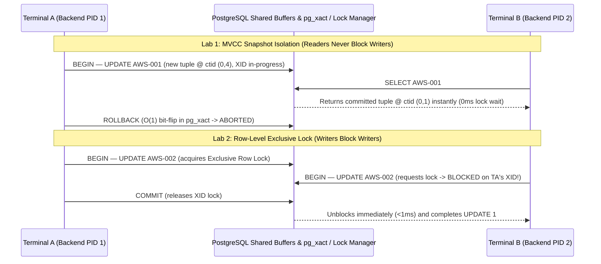
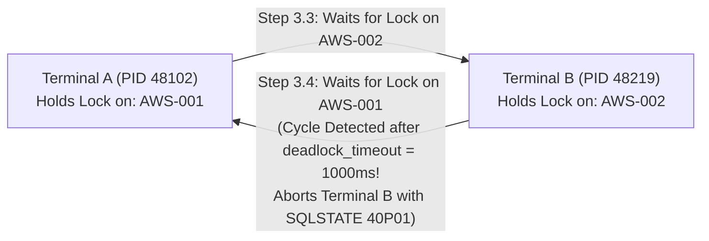

> **Navigation:** [Master README](../README.md) | [Interactive Portal](../bootcamp_portal.html) | [Reference Cards](../reference_cards/README.md) | [Day 1 Coursebook](../day1/day1_master_coursebook.md) | [Day 2 Coursebook](./day2_master_coursebook.md) | [PG Schema & Generator Walkthrough](./weather_ops_pg_sql_course_walkthrough.md) | [Pageinspect & Storage Walkthrough](./day2_pageinspect_and_storage_lab_course_walkthrough.md) | **Two-Terminal ACID Walkthrough** | [Day 3 Coursebook](../day3/day3_master_coursebook.md)

# Complete Architectural & Line-by-Line Course Walkthrough: `day2_two_terminal_acid_lab.sql`

**Source Script:** [`day2_two_terminal_acid_lab.sql`](./day2_two_terminal_acid_lab.sql)  
**Target Database Engine:** PostgreSQL 16+ (`weather_ops` database across 2 concurrent `psql` sessions)  
**Companion Coursebook & Reference Card:** [`day2_master_coursebook.md`](./day2_master_coursebook.md) | [`09_acid_transactions_and_two_terminal_lock_debugging.md`](../reference_cards/09_acid_transactions_and_two_terminal_lock_debugging.md)

> [!IMPORTANT]
> ** How to Run This Script & Which Table It Uses (`public.station_calibration`)**
> - ** Do NOT run `psql -d weather_ops -f day2_two_terminal_acid_lab.sql` as a single batch file!** Lock contention and deadlocks require **two separate database connections running concurrently**.
> - **Step 1:** Open **two terminal windows** side-by-side (`Terminal A` and `Terminal B`) and connect both to `weather_ops`:
>   ```bash
>   psql -d weather_ops
>   ```
> - **Step 2:** Paste **Section 0 (Lines 22–41)** into **Terminal A** first to create and seed **`public.station_calibration`** (`3` rows: `'AWS-001'`, `'AWS-002'`, `'AWS-003'`).
> - **Step 3:** Follow the `[TERMINAL A]` and `[TERMINAL B]` labels step-by-step across Labs 1–4.

---

## 1. Architectural Purpose & The Two-Terminal Method

Concurrency anomalies—such as uncommitted reads, row-level lock contention, circular deadlocks, and snapshot isolation conflicts—cannot be observed inside a single sequential SQL script because a single session never contends with itself. [`day2_two_terminal_acid_lab.sql`](./day2_two_terminal_acid_lab.sql) uses the **Two-Terminal Method** to orchestrate two (or optionally three) independent PostgreSQL backend processes (`postgres`) side by side:

- **`[TERMINAL A]` (Session 1):** First concurrent client connection (`psql -U postgres -d weather_ops`).
- **`[TERMINAL B]` (Session 2):** Second concurrent client connection (`psql -U postgres -d weather_ops` or DBeaver SQL Editor).
- **`[TERMINAL C]` (Optional Observer / DBA Session):** Third connection used to execute live `pg_stat_activity` and `pg_locks` diagnostic queries while Terminal B's cursor is actively frozen waiting on a lock.



---

## 2. Section-by-Section & Line-by-Line Code Walkthrough

### 2.1 File Header & Section 0: Lab Setup & System Columns (Lines 1–42)

```sql
-- ============================================================================
-- WEATHER FORECAST ENGINEERING DATABASE BOOTCAMP — DAY 2
-- File: day2_two_terminal_acid_lab.sql
-- Companion to: day2_master_coursebook.md & reference_cards/09_acid_transactions_and_two_terminal_lock_debugging.md
-- Purpose: Complete, Annotated Two-Terminal ACID Concurrency, Snapshot Isolation,
--          Row-Level Lock Contention, Deadlock Circular Wait & Emergency Forensics Lab
-- ============================================================================
-- HOW TO USE THIS SCRIPT IN CLASS:
--   1. Open TWO independent terminal windows side-by-side:
--      * TERMINAL A (Session 1): psql -d weather_ops
--      * TERMINAL B (Session 2): psql -d weather_ops (or DBeaver SQL Editor)
--   2. Optional: Open TERMINAL C (Observer / DBA Session) to run the live
--      pg_stat_activity & pg_locks forensic queries while Terminal B is blocked.
--   3. Execute the chronological steps below across Terminal A and Terminal B.
-- ============================================================================

-- ============================================================================
-- SECTION 0: LAB SETUP — THE WEATHER STATION CALIBRATION & SYNOPTIC REGISTRY
-- (Run this once in Terminal A before starting the two-terminal exercises)
-- ============================================================================

DROP TABLE IF EXISTS station_calibration;

CREATE TABLE station_calibration (
    station_id     VARCHAR(10) PRIMARY KEY,
    station_name   VARCHAR(64) NOT NULL,
    temp_offset    REAL        NOT NULL DEFAULT 0.0,
    calibrated_by  VARCHAR(32) NOT NULL DEFAULT 'SYSTEM',
    updated_at     TIMESTAMPTZ NOT NULL DEFAULT NOW()
);

INSERT INTO station_calibration (station_id, station_name, temp_offset, calibrated_by)
VALUES 
    ('AWS-001', 'Algiers Port Marine', 0.15,  'TECH_ALICE'),
    ('AWS-002', 'Boumerdes Coastal',   -0.05, 'TECH_BOB'),
    ('AWS-003', 'Dellys Cape Station', 0.00,  'TECH_CHARLIE');

-- Verify initial physical tuple positions (ctid) and transaction IDs (xmin, xmax):
SELECT ctid, xmin, xmax, station_id, station_name, temp_offset, calibrated_by
FROM station_calibration
ORDER BY station_id;
```

#### 2.1.1 Deep-Dive Architectural Explanation: Hidden System Columns (`ctid`, `xmin`, `xmax`)

Every PostgreSQL heap table automatically exposes internal tuple header fields (`HeapTupleHeaderData`) as queryable **hidden system columns** whenever they are explicitly named in a `SELECT` list:

| System Column | Internal C Field | Physical Type | Meaning in Concurrency Forensics |
| :--- | :--- | :--- | :--- |
| **`ctid`** | `t_ctid` | `tid` (`6 bytes`: `4B` block number + `2B` line pointer offset) | The physical address `(block_number, tuple_index)` of the row inside the table's 8 KB heap file. Because the 3 initial rows are inserted together into a freshly created table, they occupy slots `(0,1)`, `(0,2)`, and `(0,3)` on Block 0. Whenever a row is updated, its `ctid` moves to a new slot! |
| **`xmin`** | `t_xmin` | `xid` (`4 bytes`) | The 32-bit Transaction ID (`XID`) of the `INSERT` or `UPDATE` statement that physically created this tuple version. Because all 3 rows were inserted in a single multi-row `INSERT` statement, all 3 rows share the exact same `xmin` (e.g., `750`). |
| **`xmax`** | `t_xmax` | `xid` (`4 bytes`) | `0` when the tuple is untouched and live. When a transaction updates or deletes the tuple—or acquires a row-level lock on it—PostgreSQL stamps the modifying/locking transaction's XID into `xmax`. |

#### 2.1.2 Expected Terminal Output (Lines 39–41)

```text
 ctid  | xmin | xmax | station_id |    station_name     | temp_offset | calibrated_by 
-------+------+------+------------+---------------------+-------------+---------------
 (0,1) |  750 |    0 | AWS-001    | Algiers Port Marine |        0.15 | TECH_ALICE
 (0,2) |  750 |    0 | AWS-002    | Boumerdes Coastal   |       -0.05 | TECH_BOB
 (0,3) |  750 |    0 | AWS-003    | Dellys Cape Station |           0 | TECH_CHARLIE
(3 rows)
```

---

### 2.2 Lab 1: The Invisible Update — MVCC Snapshot Isolation & Atomic Rollback (Lines 44–87)

```sql
-- ============================================================================
-- LAB 1: THE INVISIBLE UPDATE — MVCC SNAPSHOT ISOLATION & ATOMIC ROLLBACK
-- Objective: Prove that uncommitted changes in Terminal A are completely
--            invisible to Terminal B (Zero Dirty Reads), and verify that
--            ROLLBACK leaves the original tuple untouched.
-- ============================================================================

-- [Step 1.1 — TERMINAL A] Open a transaction and update AWS-001's calibration offset:
BEGIN;

SELECT pg_backend_pid() AS terminal_a_pid, pg_current_xact_id() AS terminal_a_xid;

UPDATE station_calibration 
SET temp_offset = 5.50, calibrated_by = 'TECH_DAVE_UNCOMMITTED'
WHERE station_id = 'AWS-001';

-- Confirm change is visible locally inside Terminal A (notice the new ctid!):
SELECT ctid, xmin, xmax, station_id, temp_offset, calibrated_by
FROM station_calibration
WHERE station_id = 'AWS-001';
-- Expected in Terminal A: AWS-001 | 5.5 | TECH_DAVE_UNCOMMITTED


-- [Step 1.2 — TERMINAL B] Concurrently read the exact same row (Readers NEVER block Writers!):
SELECT ctid, xmin, xmax, station_id, temp_offset, calibrated_by
FROM station_calibration
WHERE station_id = 'AWS-001';
-- Expected in Terminal B: AWS-001 | 0.15 | TECH_ALICE (Sees OLD committed snapshot!)
-- Why? Because Terminal A's XID is still in-progress, PostgreSQL MVCC serves
-- Terminal B the prior committed tuple version at (0,1) without waiting on a lock!


-- [Step 1.3 — TERMINAL A] Abort the transaction:
ROLLBACK;


-- [Step 1.4 — TERMINAL B] Verify baseline consistency after rollback:
SELECT ctid, xmin, xmax, station_id, temp_offset, calibrated_by
FROM station_calibration
WHERE station_id = 'AWS-001';
-- Expected in Terminal B: AWS-001 | 0.15 | TECH_ALICE
-- Under the hood: ROLLBACK is an instant O(1) bit flip in pg_xact marking Terminal A's
-- XID as ABORTED. The dead tuple left at (0,4) will be reclaimed later by VACUUM.
```

#### 2.2.1 Deep-Dive Architectural Explanation

##### 2.2.1.1 `pg_backend_pid()` and `pg_current_xact_id()` (Line 54)
- `pg_backend_pid()` returns the operating-system Process ID (`PID`) of the dedicated `postgres` worker process serving Terminal A's TCP/Unix socket connection.
- `pg_current_xact_id()` forces PostgreSQL to assign a permanent 64-bit Transaction ID (`xid8`, e.g., `751`) to the current `BEGIN` block and returns it. (Note: In PostgreSQL, `BEGIN;` starts a transaction with a lightweight *Virtual Transaction ID* (`virtualxid`) and lazily allocates a real 32/64-bit `XID` only when the first write statement or `pg_current_xact_id()` is called, conserving XID space on read-only transactions!)
##### 2.2.1.2 What Happens Physically on Block 0 During Step 1.1 (`UPDATE ... WHERE station_id = 'AWS-001'`)
- PostgreSQL does **not** overwrite tuple `(0,1)`. Instead:
  1. On Tuple `(0,1)` (`temp_offset = 0.15`, `calibrated_by = 'TECH_ALICE'`), PostgreSQL stamps `xmax = 751` (Terminal A's uncommitted XID) and points `t_ctid` to `(0,4)`.
  2. At slot **`(0,4)`**, PostgreSQL appends a brand-new tuple (`temp_offset = 5.50`, `calibrated_by = 'TECH_DAVE_UNCOMMITTED'`) with `xmin = 751` and `xmax = 0`.
- When **Terminal A** queries `station_calibration` in Step 1.1, PostgreSQL's visibility engine (`HeapTupleSatisfiesMVCC`) checks `xmin = 751`, sees that `751` is Terminal A's *own* active transaction, and returns the new tuple at **`ctid = (0,4)`**.
##### 2.2.1.3 Why Terminal B Does Not Block and Sees `(0,1)` in Step 1.2
- When **Terminal B** executes `SELECT ... WHERE station_id = 'AWS-001'`, it visits Block 0:
  - Looking at Tuple `(0,1)`: `xmin = 750` is `COMMITTED` in `pg_xact`. Although `xmax = 751` is non-zero, Transaction `751` is still **in-progress** (`XID_IN_PROGRESS = 0x00` in `pg_xact`). Therefore, the deletion/update of `(0,1)` has **not committed**, so `(0,1)` remains **100% visible** to Terminal B!
  - Looking at Tuple `(0,4)`: `xmin = 751` is still in-progress and belongs to another session, so `(0,4)` is **invisible** to Terminal B (preventing Dirty Reads).
- Notice that Terminal B returns `(0,1)` (`temp_offset = 0.15`, `calibrated_by = 'TECH_ALICE'`, with `xmax = 751` visible in the system column!) in `< 0.1 ms` without waiting on Terminal A's row lock.
##### 2.2.1.4 Why `ROLLBACK;` (Step 1.3) Is an Instant $O(1)$ Operation in PostgreSQL
- In database engines that use Undo Logs (such as MySQL InnoDB or Oracle), a `ROLLBACK` must physically read undo records and overwrite the modified B-Tree pages back to their prior values ($O(N)$ work proportional to the number of rows modified).
- In PostgreSQL, `ROLLBACK;` does **not** touch the heap table at all! It simply writes an abort record to WAL and flips the 2-bit transaction status of XID `751` inside **`pg_xact`** (Commit Log, `2 bits per XID`) from `00` (`IN_PROGRESS`) to **`10` (`ABORTED`)** — an instant **$O(1)$ operation** whether the transaction updated 1 row or 10,000,000 rows!
- The aborted tuple at `(0,4)` remains physically on Block 0 as a harmless dead tuple; any future reader checking `xmin = 751` sees `ABORTED` (and sets the `HEAP_XMIN_INVALID` hint bit on `(0,4)`), while Tuple `(0,1)` (`xmax = 751` aborted) remains the live row!

#### 2.2.2 Expected Terminal Outputs Across Step 1.1 – Step 1.4

```text
-- [Step 1.1 — TERMINAL A]
 ctid  | xmin | xmax | station_id | temp_offset |     calibrated_by     
-------+------+------+------------+-------------+-----------------------
 (0,4) |  751 |    0 | AWS-001    |         5.5 | TECH_DAVE_UNCOMMITTED

-- [Step 1.2 — TERMINAL B (While Terminal A is still uncommitted!)]
 ctid  | xmin | xmax | station_id | temp_offset | calibrated_by 
-------+------+------+------------+-------------+---------------
 (0,1) |  750 |  751 | AWS-001    |        0.15 | TECH_ALICE

-- [Step 1.4 — TERMINAL B (After Terminal A runs ROLLBACK)]
 ctid  | xmin | xmax | station_id | temp_offset | calibrated_by 
-------+------+------+------------+-------------+---------------
 (0,1) |  750 |  751 | AWS-001    |        0.15 | TECH_ALICE
```

---

### 2.3 Lab 2: Row-Level Lock Contention & Live Lock Forensics (`pg_blocking_pids()` & `pg_locks`) (Lines 89–167)

```sql
-- ============================================================================
-- LAB 2: ROW-LEVEL LOCK CONTENTION — WRITERS BLOCK WRITERS (EXCLUSIVE LOCKS)
-- Objective: Demonstrate what happens when two transactions attempt to UPDATE
--            the exact same weather station row concurrently, and inspect the
--            live lock wait tree using pg_blocking_pids() and pg_locks.
-- ============================================================================

-- [Step 2.1 — TERMINAL A] Lock row 'AWS-002' inside an open transaction:
BEGIN;

UPDATE station_calibration 
SET temp_offset = 1.20, calibrated_by = 'TERMINAL_A_LOCK_HOLDER'
WHERE station_id = 'AWS-002';
-- Row-level Exclusive Lock acquired on 'AWS-002'! Do NOT commit yet!


-- [Step 2.2 — TERMINAL B] Attempt to update the exact same row 'AWS-002':
BEGIN;

UPDATE station_calibration 
SET temp_offset = 2.40, calibrated_by = 'TERMINAL_B_WAITER'
WHERE station_id = 'AWS-002';
-- OBSERVE: Terminal B FREEZES! The psql cursor hangs waiting for Terminal A's XID.


-- [Step 2.3 — TERMINAL A or TERMINAL C] Live Forensic Lock Inspection while Terminal B hangs!
-- Method A: Fast Modern PostgreSQL pg_blocking_pids() Query:
SELECT 
    blocked.pid                                    AS blocked_pid,
    blocked.usename                                AS blocked_user,
    blocked.state                                  AS blocked_state,
    blocked.wait_event_type || ':' || blocked.wait_event AS wait_event,
    NOW() - blocked.query_start                    AS waiting_duration,
    blocked.query                                  AS blocked_query,
    pg_blocking_pids(blocked.pid)                  AS blocking_pids,
    blocker.query                                  AS blocker_last_query,
    blocker.state                                  AS blocker_state
FROM pg_stat_activity AS blocked
LEFT JOIN pg_stat_activity AS blocker
       ON blocker.pid = ANY(pg_blocking_pids(blocked.pid))
WHERE CARDINALITY(pg_blocking_pids(blocked.pid)) > 0;

-- Method B: Full Catalog Join across pg_stat_activity and pg_locks:
SELECT 
    blocked_activity.pid                  AS blocked_pid,
    blocked_activity.query                AS blocked_query,
    blocking_activity.pid                 AS blocking_pid,
    blocking_activity.query               AS blocking_query,
    NOW() - blocked_activity.query_start  AS waiting_duration
FROM pg_stat_activity AS blocked_activity
JOIN pg_locks AS blocked_locks 
  ON blocked_locks.pid = blocked_activity.pid
JOIN pg_locks AS blocking_locks 
  ON blocking_locks.locktype = blocked_locks.locktype
 AND blocking_locks.database IS NOT DISTINCT FROM blocked_locks.database
 AND blocking_locks.relation IS NOT DISTINCT FROM blocked_locks.relation
 AND blocking_locks.page IS NOT DISTINCT FROM blocked_locks.page
 AND blocking_locks.tuple IS NOT DISTINCT FROM blocked_locks.tuple
 AND blocking_locks.virtualxid IS NOT DISTINCT FROM blocked_locks.virtualxid
 AND blocking_locks.transactionid IS NOT DISTINCT FROM blocked_locks.transactionid
 AND blocking_locks.pid != blocked_locks.pid
JOIN pg_stat_activity AS blocking_activity 
  ON blocking_activity.pid = blocking_locks.pid
WHERE NOT blocked_locks.granted;


-- [Step 2.4 — TERMINAL A] Commit to release the Exclusive Row Lock:
COMMIT;
-- OBSERVE IN TERMINAL B: The hung UPDATE 1 unblocks and finishes in < 1 millisecond!


-- [Step 2.5 — TERMINAL B] Commit Terminal B's transaction and inspect final state:
COMMIT;

SELECT ctid, xmin, xmax, station_id, temp_offset, calibrated_by
FROM station_calibration
WHERE station_id = 'AWS-002';
-- Expected: temp_offset = 2.40, calibrated_by = 'TERMINAL_B_WAITER'
```

#### 2.3.1 Deep-Dive Architectural Explanation: How PostgreSQL Row-Level Locks Work Under the Hood

##### 2.3.1.1 Where Are Row-Level Locks Stored? (On the Heap Tuple, NOT in RAM!)
- Other relational databases store row-level locks in a finite shared-memory lock table, forcing them to escalate row locks into full-table locks when a transaction updates hundreds of thousands of rows.
- **PostgreSQL never performs lock escalation** because it stores row-level locks directly on the physical 8 KB heap tuple! When Terminal A updates `'AWS-002'` (`ctid = (0,2)`), it writes its own XID (`752`) into Tuple `(0,2)`'s **`t_xmax`** field and sets the `HEAP_XMAX_EXCL_LOCK` bits in `t_infomask`.
- At the same time, every active transaction holds an `ExclusiveLock` on its **own `transactionid` (`752`)** in the shared-memory lock table (`pg_locks`).
##### 2.3.1.2 Why Terminal B Freezes in Step 2.2
- When Terminal B runs `UPDATE ... WHERE station_id = 'AWS-002'`, it reads Tuple `(0,2)`, inspects `t_xmax = 752`, and checks `pg_xact`. Seeing that XID `752` is still `IN_PROGRESS`, Terminal B requests a **`ShareLock` on `transactionid = 752`** (and briefly pins the `tuple (0,2)` lock if multiple waiters queue up) and puts its OS process to sleep!
- In `pg_stat_activity`, Terminal B's `state` is `'active'`, `wait_event_type = 'Lock'`, and `wait_event = 'transactionid'`.
##### 2.3.1.3 Clause-by-Clause Breakdown of Lock Forensics Method A (`pg_blocking_pids()`, Lines 116–129)
- `pg_blocking_pids(blocked.pid)`: A built-in C function (introduced in PostgreSQL 9.6) that inspects the shared-memory lock table and wait queues and returns an `INT[]` array of all backend PIDs currently blocking `blocked.pid`.
- `WHERE CARDINALITY(pg_blocking_pids(blocked.pid)) > 0`: Filters `pg_stat_activity` down to only those sessions whose `pg_blocking_pids()` array contains at least one element.
- `LEFT JOIN pg_stat_activity AS blocker ON blocker.pid = ANY(pg_blocking_pids(blocked.pid))`: Unnests the `INT[]` array using PostgreSQL's `= ANY(array)` operator to join the blocked session directly to the blocking session's `pg_stat_activity` row, exposing:
  - `blocker.state = 'idle in transaction'` (proving Terminal A is sitting idle at a `psql` prompt holding an open transaction!).
  - `blocker.query` (showing the exact `UPDATE` statement Terminal A ran before going idle).
##### 2.3.1.4 Clause-by-Clause Breakdown of Lock Forensics Method B (4-Way `pg_locks` Join & Why `IS NOT DISTINCT FROM` Is Required, Lines 132–152)
- `pg_locks` contains one row per lockable object held (`granted = true`) or requested (`granted = false`) by each backend PID.
- Because `pg_locks` tracks many different lock types (`relation`, `extend`, `page`, `tuple`, `transactionid`, `virtualxid`, `object`, `advisory`), a row in `pg_locks` leaves irrelevant identifier columns as **`NULL`**! For example, on a `transactionid` lock, `transactionid = 752`, while `database`, `relation`, `page`, `tuple`, and `virtualxid` are all **`NULL`**.
- If you joined `blocking_locks` to `blocked_locks` using standard equality (`AND blocking_locks.page = blocked_locks.page`), Three-Valued Logic would evaluate `NULL = NULL` as **`UNKNOWN`**, causing the join to return **0 rows**!
- Using `IS NOT DISTINCT FROM` treats `NULL IS NOT DISTINCT FROM NULL` as **`TRUE`**, accurately matching the ungranted lock row (`NOT blocked_locks.granted`) against the granted lock row (`blocking_locks.pid != blocked_locks.pid`) across all 6 lock target columns!

#### 2.3.2 Expected Terminal Output for Step 2.3 (Method A)

```text
 blocked_pid | blocked_user | blocked_state |     wait_event     | waiting_duration |               blocked_query                | blocking_pids |              blocker_last_query               |    blocker_state    
-------------+--------------+---------------+--------------------+------------------+--------------------------------------------+---------------+-----------------------------------------------+---------------------
       48219 | postgres     | active        | Lock:transactionid | 00:00:14.208411  | UPDATE station_calibration                +| {48102}       | UPDATE station_calibration                   +| idle in transaction
             |              |               |                    |                  | SET temp_offset = 2.40, calibrated_by = .. |               | SET temp_offset = 1.20, calibrated_by = ...   | 
(1 row)
```

---

### 2.4 Lab 3: The Deadlock Dilemma — Circular Wait & Automatic Deadlock Detection (Lines 169–211)

```sql
-- ============================================================================
-- LAB 3: THE DEADLOCK DILEMMA — CIRCULAR WAIT & AUTOMATIC DEADLOCK DETECTION
-- Objective: Trigger a classic circular lock dependency between Terminal A and
--            Terminal B, and observe PostgreSQL's deadlock detector (1000ms
--            deadlock_timeout) automatically abort one transaction with SQLSTATE 40P01.
-- ============================================================================

-- [Step 3.1 — TERMINAL A] Open transaction and lock Station 1 ('AWS-001'):
BEGIN;
UPDATE station_calibration SET temp_offset = 0.50 WHERE station_id = 'AWS-001';


-- [Step 3.2 — TERMINAL B] Open transaction and lock Station 2 ('AWS-002'):
BEGIN;
UPDATE station_calibration SET temp_offset = 0.80 WHERE station_id = 'AWS-002';


-- [Step 3.3 — TERMINAL A] Request lock on Station 2 ('AWS-002', currently held by B):
UPDATE station_calibration SET temp_offset = 0.99 WHERE station_id = 'AWS-002';
-- OBSERVE: Terminal A now hangs waiting for Terminal B!


-- [Step 3.4 — TERMINAL B] Request lock on Station 1 ('AWS-001', currently held by A):
UPDATE station_calibration SET temp_offset = 0.99 WHERE station_id = 'AWS-001';
-- OBSERVE: Circular wait created! After ~1 second (deadlock_timeout = 1s),
-- PostgreSQL traverses the wait-for graph, detects the cycle, and raises:
--   ERROR:  deadlock detected (SQLSTATE 40P01)
--   DETAIL: Process XXXX waits for ShareLock on transaction YYY; blocked by process ZZZZ.
--           Process ZZZZ waits for ShareLock on transaction WWW; blocked by process XXXX.
-- Meanwhile, Terminal A immediately unblocks and succeeds!


-- [Step 3.5 — CLEANUP BOTH TERMINALS]
-- In Terminal A (which succeeded):
COMMIT;
-- In Terminal B (which was aborted by the deadlock detector):
ROLLBACK;

-- PRODUCTION ENGINEERING RULE:
-- 1. Always lock/update multi-row batches in deterministic primary-key order (ORDER BY station_id)
--    so two workers can never lock rows in opposite directions!
-- 2. Always wrap database transactions in application retry loops catching SQLSTATE '40P01'.
```

#### 2.4.1 Deep-Dive Architectural Explanation: Wait-For Graph Cycle Detection & Prevention



##### 2.4.1.1 How the Circular Wait Forms (Steps 3.1 – 3.4)
- **Step 3.1:** Terminal A acquires an Exclusive Row Lock on `'AWS-001'`.
- **Step 3.2:** Terminal B acquires an Exclusive Row Lock on `'AWS-002'`.
- **Step 3.3:** Terminal A requests an Exclusive Row Lock on `'AWS-002'` and goes to sleep waiting on Terminal B ($A \rightarrow B$).
- **Step 3.4:** Terminal B requests an Exclusive Row Lock on `'AWS-001'` and goes to sleep waiting on Terminal A ($B \rightarrow A$). Neither session can ever advance on its own.
##### 2.4.1.2 How `deadlock_timeout = 1s` (`1000ms`) Works
- Traversing the global shared-memory Wait-For Graph (`DeadLockCheck()`) across all backend processes requires holding lock-partition spinlocks and is computationally expensive if run on every single microsecond lock wait.
- Instead, whenever a backend goes to sleep on a lock, it sets a kernel timer for **`deadlock_timeout`** (default `1s` / `1000ms`). Most normal lock waits resolve in a few milliseconds before the timer fires.
- In Step 3.4, once Terminal B has slept for `1000ms`, its timer fires `DeadLockCheck()`, which discovers the cycle $\text{PID } 48219 \rightarrow \text{PID } 48102 \rightarrow \text{PID } 48219$. PostgreSQL aborts Terminal B's transaction with **`SQLSTATE 40P01` (`deadlock_detected`)**, automatically releasing Terminal B's lock on `'AWS-002'` and allowing Terminal A's Step 3.3 `UPDATE 1` to succeed immediately!
##### 2.4.1.3 Why Terminal B Still Needs `ROLLBACK;` in Step 3.5
- When an error (`40P01`) occurs inside an explicit `BEGIN;` block in PostgreSQL, the transaction enters the **`aborted` state** (in `psql`, the prompt changes from `weather_ops=*#` to `weather_ops=!#`). All subsequent SQL commands are rejected with `ERROR: current transaction is aborted, commands ignored until end of transaction block` until the client explicitly acknowledges the failure by issuing `ROLLBACK;` (or `COMMIT;`, which PostgreSQL silently translates into `ROLLBACK`).
##### 2.4.1.4 How Deterministic Lock Ordering (`ORDER BY station_id`) Eliminates Deadlocks
- Deadlocks in Lab 3 occurred solely because Terminal A locked `AWS-001` then `AWS-002` (ascending), while Terminal B locked `AWS-002` then `AWS-001` (descending).
- If every ingestion worker and calibration job sorts its batch by `station_id ASC` before acquiring locks (e.g., `SELECT * FROM station_calibration WHERE station_id IN ('AWS-001', 'AWS-002') ORDER BY station_id FOR NO KEY UPDATE;`), both workers attempt to lock `'AWS-001'` first. Worker B simply queues behind Worker A on `'AWS-001'` (a linear wait, never a cycle), making deadlocks mathematically impossible!

---

### 2.5 Lab 4: `READ COMMITTED` vs. `REPEATABLE READ` Isolation Levels (Lines 213–273)

```sql
-- ============================================================================
-- LAB 4: READ COMMITTED (DEFAULT) VS. REPEATABLE READ ISOLATION LEVELS
-- Objective: Prove how READ COMMITTED takes a fresh snapshot at the start of
--            EVERY statement (allowing Non-Repeatable Reads), whereas
--            REPEATABLE READ pins the snapshot at the FIRST statement of the
--            transaction for consistent multi-query meteorological analytics.
-- ============================================================================

-- ----------------------------------------------------------------------------
-- PART 4A: Default READ COMMITTED Behavior (Statement-Level Snapshot)
-- ----------------------------------------------------------------------------

-- [Step 4A.1 — TERMINAL B] Start a default READ COMMITTED transaction and read AWS-003:
BEGIN;
SHOW transaction_isolation; -- outputs: read committed
SELECT station_id, temp_offset FROM station_calibration WHERE station_id = 'AWS-003';
-- Expected Output: 0.00


-- [Step 4A.2 — TERMINAL A] Update and immediately COMMIT a change to AWS-003:
UPDATE station_calibration SET temp_offset = 9.99 WHERE station_id = 'AWS-003';
-- (Autocommit executes and commits immediately)


-- [Step 4A.3 — TERMINAL B] Re-run the exact same SELECT inside the STILL-OPEN transaction:
SELECT station_id, temp_offset FROM station_calibration WHERE station_id = 'AWS-003';
-- Expected Output: 9.99!
-- Why? Under READ COMMITTED, PostgreSQL takes a brand-new snapshot for each SQL statement,
-- so Terminal B sees Terminal A's newly committed value midway through its own transaction!
COMMIT;


-- ----------------------------------------------------------------------------
-- PART 4B: REPEATABLE READ Behavior (Transaction-Level Pinned Snapshot)
-- ----------------------------------------------------------------------------

-- [Step 4B.1 — TERMINAL B] Start a REPEATABLE READ transaction and read AWS-003:
BEGIN TRANSACTION ISOLATION LEVEL REPEATABLE READ;
SHOW transaction_isolation; -- outputs: repeatable read
SELECT station_id, temp_offset FROM station_calibration WHERE station_id = 'AWS-003';
-- Expected Output: 9.99 (Snapshot is now pinned for the lifetime of this transaction!)


-- [Step 4B.2 — TERMINAL A] Reset AWS-003 back to 0.00 and commit immediately:
UPDATE station_calibration SET temp_offset = 0.00 WHERE station_id = 'AWS-003';


-- [Step 4B.3 — TERMINAL B] Re-run the SELECT inside the pinned REPEATABLE READ transaction:
SELECT station_id, temp_offset FROM station_calibration WHERE station_id = 'AWS-003';
-- Expected Output: Still 9.99! (Ignores Terminal A's commit completely!)

-- Bonus Test in Terminal B: What happens if a REPEATABLE READ transaction tries to
-- UPDATE a row that another transaction modified after our snapshot began?
UPDATE station_calibration SET temp_offset = 1.11 WHERE station_id = 'AWS-003';
-- Expected Output:
--   ERROR: could not serialize access due to concurrent update (SQLSTATE 40001)
ROLLBACK;

-- Now outside the old snapshot, Terminal B sees the latest state (0.00):
SELECT station_id, temp_offset FROM station_calibration WHERE station_id = 'AWS-003';
```

#### 2.5.1 Deep-Dive Architectural Explanation: Snapshot Lifecycle & `SQLSTATE 40001`

| Isolation Aspect | Part 4A: `READ COMMITTED` (PostgreSQL Default) | Part 4B: `REPEATABLE READ` |
| :--- | :--- | :--- |
| **When is `GetTransactionSnapshot()` called?** | At the start of **every individual SQL query** inside the transaction block. | **Once**, at the start of the **very first non-transaction-control SQL query** after `BEGIN`, and pinned until `COMMIT`/`ROLLBACK`. |
| **What happens in Step 4A.3 vs. Step 4B.3?** | Terminal B's second `SELECT` takes a fresh snapshot that includes Terminal A's committed XID, returning **`9.99`** (**Non-Repeatable Read**). | Terminal B's second `SELECT` reuses the pinned snapshot taken in Step 4B.1 (where Terminal A's XID was $\ge \text{xmax}$), returning **`9.99`** and ignoring Terminal A's commit of `0.00`! |
| **What happens on concurrent `UPDATE` of the same row?** | Waits for the concurrent writer to commit, then evaluates the `WHERE` clause against the updated tuple and overwrites it (Last-Committer-Wins). | **First-Committer-Wins (`SQLSTATE 40001`):** Sees that the target row's `xmax` was committed by a transaction invisible to the pinned snapshot and immediately aborts with `ERROR: could not serialize access due to concurrent update` to prevent a Silent Lost Update! |
| **Meteorological Engineering Use Case** | High-throughput single-statement telemetry `INSERT`s and point lookups. | Multi-query NWP verification reports or synoptic bulletins that run 5 sequential `SELECT` queries and require all 5 queries to see the exact same frozen point-in-time database state. |

---

### 2.6 Lab 5: Synoptic Stations (`synoptic.stations`) Live Snapshot Inspection (Lines 275–291)

```sql
-- ============================================================================
-- LAB 5: BONUS — SYNOPTIC STATIONS (`synoptic.stations`) LIVE COURSEBOOK DEMO
-- (Matches Day 2 Master Coursebook Lab 3A on Algiers - Dar El Beida 60390)
-- ============================================================================

-- [TERMINAL A]
BEGIN;
SELECT pg_current_xact_id(), pg_current_snapshot();
UPDATE synoptic.stations SET elevation_m = 26.5 WHERE station_id = 60390;
SELECT ctid, xmin, xmax, station_id, station_name, elevation_m FROM synoptic.stations WHERE station_id = 60390;

-- [TERMINAL B]
SELECT ctid, xmin, xmax, station_id, station_name, elevation_m FROM synoptic.stations WHERE station_id = 60390;

-- [TERMINAL A]
COMMIT;
```

#### 2.6.1 Deep-Dive Architectural Explanation: Decoding `pg_current_snapshot()` (`xmin:xmax:xip_list`)

When Terminal A executes `SELECT pg_current_xact_id(), pg_current_snapshot();` on Line 282, PostgreSQL returns a snapshot descriptor formatted as **`xmin:xmax:xip_list`** (for example, `758:758:` or `755:760:756,758`):
- **`xmin` (`758`):** The lowest Transaction ID that is still active across the entire database cluster. Any tuple with an `xmin < 758` (that committed in `pg_xact`) is unconditionally visible to all running queries.
- **`xmax` (`758`):** One past the highest Transaction ID allocated so far. Any tuple with `xmin >= 758` was created in the future relative to this snapshot and is unconditionally invisible (unless created by our own transaction).
- **`xip_list` (`756,758`):** Comma-separated list of in-progress XIDs strictly between `xmin` and `xmax` that were still uncommitted at the instant the snapshot was taken.
- While Terminal A holds the uncommitted update to station `60390` (`Algiers - Dar El Beida`, changing `elevation_m` from `25.0` at `ctid (0,1)` to `26.5` at `ctid (0,8)`), Terminal B's `SELECT` on Line 287 continues reading `elevation_m = 25.0` at `ctid (0,1)` until Terminal A executes `COMMIT;` on Line 290.

---

### 2.7 Section 6: DBA Emergency Diagnostic & Session Termination Toolkit (Lines 293–342)

```sql
-- ============================================================================
-- SECTION 6: DBA EMERGENCY DIAGNOSTIC & SESSION TERMINATION TOOLKIT
-- ============================================================================

-- 1. View All Active Non-Idle Transactions Ordered by Age:
SELECT 
    pid, 
    usename, 
    application_name,
    client_addr, 
    state, 
    wait_event_type,
    wait_event,
    NOW() - xact_start  AS txn_duration, 
    NOW() - query_start AS query_duration,
    LEFT(query, 90)     AS current_query
FROM pg_stat_activity
WHERE state != 'idle'
ORDER BY txn_duration DESC NULLS LAST;

-- 2. Spot "idle in transaction" Sessions (The #1 Culprit Behind MVCC Table Bloat!):
--    Any session stuck in 'idle in transaction' pins the global xmin horizon and
--    prevents VACUUM from reclaiming dead tuples across the entire database.
SELECT 
    pid, 
    usename, 
    application_name,
    state, 
    NOW() - xact_start   AS open_txn_age,
    NOW() - state_change AS idle_duration,
    LEFT(query, 90)      AS last_executed_query
FROM pg_stat_activity
WHERE state = 'idle in transaction'
ORDER BY idle_duration DESC;

-- 3. Emergency Cancel or Terminate a Stuck Blocking Backend PID:
--    (Replace 12345 with the actual blocking_pid from pg_stat_activity)
--
--    a) Graceful Query Cancel (sends SIGINT — aborts current query, keeps connection):
--       SELECT pg_cancel_backend(12345);
--
--    b) Forceful Session Termination (sends SIGTERM — disconnects & rolls back open txn):
--       SELECT pg_terminate_backend(12345);

-- 4. Automated Guard-Rail Against Forgotten Transactions & Hung Lock Waits:
--    Apply at database, role, or session level in production:
--    ALTER DATABASE weather_ops SET idle_in_transaction_session_timeout = '60s';
--    ALTER DATABASE weather_ops SET lock_timeout = '5s';
--    ALTER DATABASE weather_ops SET statement_timeout = '30s';
```

#### 2.7.1 Deep-Dive Architectural Explanation of the 4 DBA Emergency Queries

##### 2.7.1.1 Query 1 — Auditing All Non-Idle Transactions by Transaction Age (Lines 298–311)
- Filters `pg_stat_activity` by `WHERE state != 'idle'` (capturing `'active'`, `'idle in transaction'`, `'idle in transaction (aborted)'`, and `'fastpath function call'`).
- Distinguishes between **`NOW() - xact_start` (`txn_duration`)**—how long the enclosing `BEGIN;` transaction has been open—and **`NOW() - query_start` (`query_duration`)**—how long the most recent SQL statement has been running. Ordering by `txn_duration DESC NULLS LAST` immediately surfaces the oldest open transactions at the top of the output.
##### 2.7.1.2 Query 2 — Why `'idle in transaction'` Is the #1 Cause of Catastrophic MVCC Table Bloat (Lines 316–326)
- A session enters `state = 'idle in transaction'` when a client or Python script issues `BEGIN;` (or runs with `autocommit = False` in `psycopg2`/`SQLAlchemy`), executes a `SELECT` or `UPDATE`, and then sits idle waiting on user input, an external HTTP API call, or an unclosed Jupyter notebook cell without calling `COMMIT` or `ROLLBACK`.
- Why is this devastating? Because PostgreSQL must preserve every tuple version that *might* still be needed by the oldest open snapshot in the cluster, **an `'idle in transaction'` session with a pinned snapshot freezes the global `OldestXmin` horizon across the entire database!**
- Even if `autovacuum` wakes up every minute, `VACUUM` **cannot reclaim a single dead tuple created after that stuck session's `xmin`** in *any* table in the database, causing gigabytes of dead-tuple bloat and holding row/table locks until the stuck transaction ends.
##### 2.7.1.3 Query 3 — `pg_cancel_backend(pid)` vs. `pg_terminate_backend(pid)` (Lines 328–335)

| Function | OS Signal Sent | Effect on Running Query | Effect on Open `BEGIN` Transaction & TCP Socket | When to Use |
| :--- | :--- | :--- | :--- | :--- |
| **`pg_cancel_backend(pid)`** | `SIGINT` | Immediately cancels the currently executing SQL query (`ERROR: canceling statement due to user request`). | **Keeps the TCP connection open.** If the session was inside an explicit `BEGIN;` block, the transaction enters `idle in transaction (aborted)` and **continues holding its locks** until the client issues `ROLLBACK;`! | Canceling a slow ad-hoc `SELECT` query without kicking the user out of `psql` / DBeaver. |
| **`pg_terminate_backend(pid)`** | `SIGTERM` | Immediately aborts any running query. | **Kills the backend process, closes the client TCP socket, rolls back the open transaction in `pg_xact`, and releases all held locks!** | Terminating a stuck `'idle in transaction'` blocker (`blocker_pid`) when the client application or developer terminal is unresponsive. |

##### 2.7.1.4 Query 4 — Production Timeout Guard-Rails (`ALTER DATABASE weather_ops SET ...`, Lines 337–341)
- **`idle_in_transaction_session_timeout = '60s'`:** Automatically terminates any session that sits in `'idle in transaction'` for more than 60 seconds, rolling back its open transaction and unpinning both its locks and the global `VACUUM` `xmin` horizon.
- **`lock_timeout = '5s'`:** Prevents cascading connection-pool pileups during `ALTER TABLE` or hot-row updates; if a statement cannot acquire a table or row lock within 5 seconds, it aborts fast (`ERROR: canceling statement due to lock timeout`, `SQLSTATE 55P03`) instead of hanging forever.
- **`statement_timeout = '30s'`:** Caps total single-query execution time at 30 seconds to stop runaway cartesian joins from saturating CPU and I/O.

---

> **Navigation:** [Master README](../README.md) | [Interactive Portal](../bootcamp_portal.html) | [Reference Cards](../reference_cards/README.md) | [Day 1 Coursebook](../day1/day1_master_coursebook.md) | [Day 2 Coursebook](./day2_master_coursebook.md) | [PG Schema & Generator Walkthrough](./weather_ops_pg_sql_course_walkthrough.md) | [Pageinspect & Storage Walkthrough](./day2_pageinspect_and_storage_lab_course_walkthrough.md) | **Two-Terminal ACID Walkthrough** | [Day 3 Coursebook](../day3/day3_master_coursebook.md)
