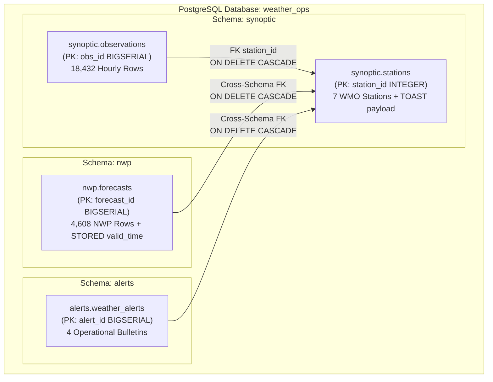
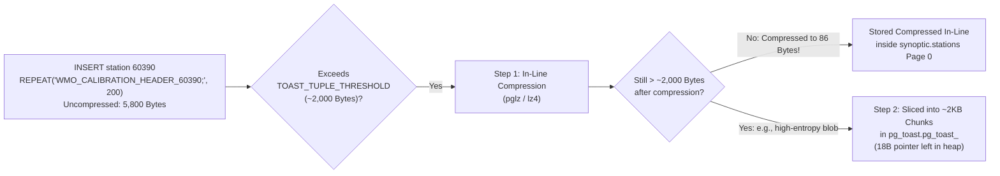

> **Navigation:** [Master README](../README.md) | [Interactive Portal](../bootcamp_portal.html) | [Reference Cards](../reference_cards/README.md) | [Day 1 Coursebook](../day1/day1_master_coursebook.md) | [Day 2 Coursebook](./day2_master_coursebook.md) | **PG Schema & Generator Walkthrough** | [Pageinspect & Storage Walkthrough](./day2_pageinspect_and_storage_lab_course_walkthrough.md) | [Two-Terminal ACID Walkthrough](./day2_two_terminal_acid_lab_course_walkthrough.md) | [Day 3 Coursebook](../day3/day3_master_coursebook.md)

# Complete Architectural & Line-by-Line Course Walkthrough: `weather_ops_pg.sql`

**Source Script:** [`weather_ops_pg.sql`](./weather_ops_pg.sql)  
**Target Database Engine:** PostgreSQL 16+ (`weather_ops` database)  
**Companion Coursebook:** [`day2_master_coursebook.md`](./day2_master_coursebook.md)

> [!IMPORTANT]
> ** Which Database, Script, Schemas & Tables Does This Walkthrough Cover?**
> - **How to Execute This Script:**
>   ```bash
>   cd day2
>   createdb weather_ops 2>/dev/null || true
>   psql -d weather_ops -f weather_ops_pg.sql
>   ```
>   *(Or from inside an open `psql -d weather_ops` session: `\i weather_ops_pg.sql`)*
> - **Schemas & Tables Created by `weather_ops_pg.sql`:**
>   - `synoptic.stations` (`7` WMO stations + TOAST `raw_metadata` on station `60390`)
>   - `synoptic.observations` (`18,432` hourly observations)
>   - `nwp.forecasts` (`4,608` NWP forecast rows across `ECMWF-HRES`, `GFS`, `AROME`)
>   - `alerts.weather_alerts` (`4` operational severe weather alerts)
> - **Schema `search_path` Reminder:** `SET search_path TO synoptic, nwp, alerts, public;` on Line 21 applies to the script session. When opening a new interactive `psql -d weather_ops` window, either write schema-qualified table names (`synoptic.observations`, `nwp.forecasts`) or persist the path once via `ALTER DATABASE weather_ops SET search_path TO synoptic, nwp, alerts, public;`.

---

## 1. Architectural Purpose & Multi-Schema Topology

[`weather_ops_pg.sql`](./weather_ops_pg.sql) upgrades the Day 1 embedded SQLite prototype (`weather_ops.db`) into a production-grade, multi-schema PostgreSQL 16+ database (`weather_ops`). It demonstrates six foundational PostgreSQL engineering patterns:

1. **Multi-Schema Domain Isolation (`synoptic`, `nwp`, `alerts`):** Segregating operational domains into dedicated PostgreSQL namespaces (`pg_namespace`) rather than dumping all objects into the default `public` schema.
2. **Strict Static Data Typing:** Replacing SQLite's dynamic type affinities (`TEXT`, `REAL`, `INTEGER`) with exact base-10 fixed-point arithmetic (`NUMERIC(p,s)`), 8-byte UTC microsecond timestamps (`TIMESTAMPTZ`), calendar-aware durations (`INTERVAL`), and 64-bit sequence-backed primary keys (`BIGSERIAL`).
3. **TOAST (`The Oversized-Attribute Storage Technique`) Triggering:** Planting a $5,800\text{-byte}$ calibration header string on station `60390` to cross PostgreSQL's `TOAST_TUPLE_THRESHOLD` ($\approx 2\text{ KB}$) and trigger automatic out-of-line compression/chunking.
4. **Immutable Stored Generated Columns (`GENERATED ALWAYS AS ... STORED`):** Automatically materializing forecast valid timestamps (`valid_time`) from `init_time + lead_interval` using explicit UTC time-zone anchoring.
5. **Vectorized Synthetic Time-Series Generation (`generate_series()`):** Synthesizing $18,432$ hourly synoptic observations (128 days $\times$ 24 hours $\times$ 6 active stations) and $4,608$ multi-model NWP forecasts using deterministic trigonometric physics (latitudinal lapse rates, 24-hour diurnal solar cycles, and 3-day barometric Rossby waves).
6. **Per-Table Autovacuum Storage Parameters:** Overriding PostgreSQL's sluggish `20%` default dead-tuple scale factor (`autovacuum_vacuum_scale_factor = 0.20`) down to `1%` (`0.01`) and `2%` (`0.02`) on high-churn telemetry tables.



---

## 2. Section-by-Section & Line-by-Line Code Walkthrough

### 2.1 Multi-Schema Architecture, UTC Enforcement & Search Path (Lines 1–21)

```sql
-- ============================================================================
-- DAY 2 BOOTCAMP: POSTGRESQL ARCHITECTURE & INTERNALS FOR WEATHER ENGINEERS
-- File: weather_ops_pg.sql
-- Usage: psql -U postgres -d weather_ops -f weather_ops_pg.sql
-- ============================================================================

-- 1. MULTI-SCHEMA ARCHITECTURE (Separating domains instead of dumping in 'public')
DROP SCHEMA IF EXISTS alerts CASCADE;
DROP SCHEMA IF EXISTS nwp CASCADE;
DROP SCHEMA IF EXISTS synoptic CASCADE;

CREATE SCHEMA synoptic;
CREATE SCHEMA nwp;
CREATE SCHEMA alerts;

-- Enforce mandatory meteorological UTC timezone & ISO-8601 date formatting
SET timezone = 'UTC';
SET datestyle = 'iso, ymd';

-- Set default search path for convenience
SET search_path TO synoptic, nwp, alerts, public;
```

#### 2.1.1 Deep-Dive Architectural Explanation

##### 2.1.1.1 Why Multi-Schema Isolation Beats Dumping Everything in `public`
- In SQLite, an entire `.db` file represents a single flat namespace (`main`). In PostgreSQL, a single database cluster can host multiple databases, and each database (`weather_ops`) contains logical **schemas** (cataloged in `pg_catalog.pg_namespace`).
- Separating `synoptic` (surface sensor observations), `nwp` (supercomputer grid-point forecasts), and `alerts` (civil warning bulletins) into distinct schemas provides three critical production advantages:
  1. **Role-Based Access Control (RBAC):** A station ingestion service account can be granted `USAGE, INSERT` exclusively on `SCHEMA synoptic` without having permission to overwrite `nwp.forecasts` or issue false `alerts.weather_alerts`.
  2. **Namespace Hygiene:** Prevents table and index name collisions across teams and allows logical grouping in GUI tools (`DBeaver`, `pgAdmin`) and `\dn` / `\dt *.*` CLI inspections.
  3. **Targeted Backup & Restore:** `pg_dump --schema=synoptic weather_ops` allows backing up or restoring individual operational domains independently.
##### 2.1.1.2 `DROP SCHEMA IF EXISTS ... CASCADE` (Lines 8–10)
- Unlike SQLite where every child table must be manually dropped in strict leaf-to-root order, PostgreSQL's `CASCADE` modifier traverses `pg_depend` (the internal object dependency graph) and automatically drops all contained tables, views, sequences, indexes, and cross-schema foreign-key constraints belonging to that schema in a single atomic DDL transaction.
- Dropping `alerts` and `nwp` before `synoptic` cleanly removes the child schemas before dropping the parent `synoptic` schema.
##### 2.1.1.3 Mandatory Zulu Time & ISO-8601 Formatting (`SET timezone = 'UTC'`, `SET datestyle = 'iso, ymd'`)
- World Meteorological Organization (WMO) synoptic standards require all surface observations and NWP model cycles (`00Z`, `06Z`, `12Z`, `18Z`) to be referenced strictly in **Coordinated Universal Time (`UTC`)**.
- While PostgreSQL physically stores `TIMESTAMPTZ` values on disk in UTC, it converts them to the session's active `timezone` setting upon display and when evaluating timezone-dependent functions like `EXTRACT(HOUR FROM obs_time)` or `TO_CHAR()`. Setting `SET timezone = 'UTC';` ensures that `EXTRACT(HOUR FROM o.obs_time) IN (0, 12)` on Line 140 filters exact `00:00 UTC` and `12:00 UTC` synoptic cycles regardless of the host OS timezone on the developer's laptop or server.
- `SET datestyle = 'iso, ymd';` enforces unambiguous `YYYY-MM-DD HH:MI:SS+00` output and `Year-Month-Day` input parsing.
##### 2.1.1.4 Schema Resolution Order (`SET search_path TO synoptic, nwp, alerts, public;`)
- When a query references an unqualified table name (e.g., `SELECT * FROM stations;`), PostgreSQL walks the `search_path` list from left to right (`synoptic` $\rightarrow$ `nwp` $\rightarrow$ `alerts` $\rightarrow$ `public`) until it finds a matching relation in `pg_class`. Keeping `public` last ensures that installed C extensions (like `pageinspect`, `pgstattuple`, or `postgis`) remain accessible without cluttering the meteorological schemas.

---

### 2.2 Table 1: `synoptic.stations` — Strict Types & TOAST Payload Column (Lines 23–33)

```sql
-- 2. SYNOPTIC STATIONS TABLE (Strict PostgreSQL Types)
CREATE TABLE synoptic.stations (
    station_id   INTEGER PRIMARY KEY,               -- WMO 5-digit station ID
    station_name VARCHAR(100) NOT NULL UNIQUE,
    latitude     NUMERIC(7,4) NOT NULL CHECK (latitude BETWEEN -90.0 AND 90.0),
    longitude    NUMERIC(7,4) NOT NULL CHECK (longitude BETWEEN -180.0 AND 180.0),
    elevation_m  NUMERIC(6,1) NOT NULL CHECK (elevation_m BETWEEN -500.0 AND 9000.0),
    climate_zone VARCHAR(30)  NOT NULL CHECK (climate_zone IN ('Mediterranean', 'Arid', 'Semi-Arid', 'Highland', 'Maritime')),
    is_active    BOOLEAN      NOT NULL DEFAULT TRUE,
    raw_metadata TEXT                               -- Used to demonstrate TOAST storage for large payloads
);
```

#### 2.2.1 SQLite Dynamic Affinity vs. PostgreSQL Strict Static Typing

| Column | Day 1 SQLite (`weather_ops_seed.sql`) | Day 2 PostgreSQL (`weather_ops_pg.sql`) | Physical Storage & Precision Upgrade |
| :--- | :--- | :--- | :--- |
| `station_id` | `INTEGER PRIMARY KEY` (`rowid` alias) | `INTEGER PRIMARY KEY` (`4-byte signed int4`) | In PostgreSQL, heap tables are **not** clustered by primary key; rows reside in an append-only 8 KB Heap file accompanied by a separate B-Tree index (`stations_pkey`). `INTEGER` occupies exactly 4 bytes (`-2,147,483,648` to `+2,147,483,647`). |
| `station_name` | `TEXT NOT NULL UNIQUE` | `VARCHAR(100) NOT NULL UNIQUE` | Enforces a hard character-length ceiling of 100 Unicode characters (`varlena` header + UTF-8 bytes) so runaway string buffers cannot bloat the station directory. |
| `latitude`, `longitude` | `REAL` (8-byte IEEE 754 binary float) | `NUMERIC(7,4)` (Exact base-10 decimal: 7 total digits, 4 after decimal point, up to `±999.9999`) | Binary floats (`REAL`/`DOUBLE PRECISION`) cannot represent `36.6910` or `0.1` exactly in base-2 (`0.1 + 0.2 = 0.30000000000000004`), causing subtle equality and spatial bounding-box bugs. `NUMERIC(7,4)` stores exact base-10000 digits with zero binary rounding error, providing $\approx 11\text{ m}$ coordinate precision. |
| `elevation_m` | `REAL` | `NUMERIC(6,1)` | Exact tenth-of-a-meter barometric elevation up to `±99999.9 m`. |
| `is_active` | `INTEGER NOT NULL DEFAULT 1 CHECK (is_active IN (0, 1))` | `BOOLEAN NOT NULL DEFAULT TRUE` | Native 1-byte SQL `BOOLEAN` type supporting true boolean predicates (`WHERE s.is_active = TRUE` or `WHERE s.is_active`) without requiring an integer `CHECK (0, 1)` workaround. |
| `raw_metadata` | *(Not present)* | `TEXT` | Variable-length `varlena` column with `EXTENDED` storage strategy (compress first, then move out-of-line to `pg_toast` if tuple exceeds `~2 KB`). |

---

### 2.3 Table 2: `synoptic.observations` — `BIGSERIAL` & `TIMESTAMPTZ` (Lines 35–49)

```sql
-- 3. SYNOPTIC OBSERVATIONS TABLE (Using native TIMESTAMPTZ and NUMERIC)
CREATE TABLE synoptic.observations (
    obs_id         BIGSERIAL PRIMARY KEY,
    station_id     INTEGER      NOT NULL REFERENCES synoptic.stations(station_id) ON DELETE CASCADE,
    obs_time       TIMESTAMPTZ  NOT NULL,
    temp_c         NUMERIC(4,1),
    dewpoint_c     NUMERIC(4,1),
    humidity_pct   NUMERIC(4,1) CHECK (humidity_pct IS NULL OR (humidity_pct BETWEEN 0.0 AND 100.0)),
    pressure_hpa   NUMERIC(6,1),
    wind_speed_kt  NUMERIC(4,1) CHECK (wind_speed_kt IS NULL OR wind_speed_kt >= 0.0),
    precip_1h_mm   NUMERIC(5,1) CHECK (precip_1h_mm IS NULL OR precip_1h_mm >= 0.0),
    qc_flag        VARCHAR(15)  NOT NULL DEFAULT 'VALID' CHECK (qc_flag IN ('VALID', 'SUSPECT', 'ERRONEOUS')),
    raw_metar      TEXT,                            -- Optional raw METAR string
    UNIQUE (station_id, obs_time)
);
```

#### 2.3.1 Deep-Dive Architectural Explanation

##### 2.3.1.1 Why `BIGSERIAL PRIMARY KEY` Instead of `SERIAL` (`INTEGER`)
- `SERIAL` creates a 32-bit signed `INTEGER` backed by a sequence, which overflows at $2^{31} - 1 = 2,147,483,647$ rows. A national network of $5,000$ automated weather stations reporting every minute generates $2.628 \times 10^9$ rows per year, exhausting a 32-bit `SERIAL` key in less than 10 months!
- `BIGSERIAL` expands the column to an 8-byte signed `BIGINT` (`int8`) backed by a 64-bit sequence (`observations_obs_id_seq`), supporting up to $9,223,372,036,854,775,807$ ($9.22 \times 10^{18}$) observations without integer wraparound.
- Unlike SQLite's `AUTOINCREMENT` (which locks the single `sqlite_sequence` B-Tree page on every write), PostgreSQL sequences use lock-free in-memory caching (`nextval('synoptic.observations_obs_id_seq')`) so dozens of concurrent ingestion workers can allocate `obs_id` values simultaneously without blocking each other.
##### 2.3.1.2 How `TIMESTAMPTZ` Works Physically (`obs_time`)
- In SQLite, `'2026-10-05 06:00:00'` was stored as 19 ASCII characters (`19 bytes` of `TEXT`).
- In PostgreSQL, `TIMESTAMPTZ` (`timestamp with time zone`) occupies **strictly 8 bytes** (`int64`), representing the number of microseconds elapsed since the PostgreSQL epoch (`2000-01-01 00:00:00 UTC`).
- Upon `INSERT`, PostgreSQL parses any input ISO-8601 string and its offset (e.g., `'2026-06-01 00:00:00+00'` or `'2026-06-01 01:00:00+01'`), converts it to UTC microseconds, and stores the pure 8-byte integer. It does **not** store the input timezone string on disk. This makes chronological range scans (`WHERE obs_time BETWEEN ...`), `INTERVAL` arithmetic, and B-Tree comparisons fast 64-bit integer operations.
##### 2.3.1.3 Production Gate Against `-9999.0` Sentinels & `NOT NULL` vs. `CHECK` (`precip_1h_mm NUMERIC(5,1) CHECK (...)`)
- Notice Line 45: `precip_1h_mm NUMERIC(5,1) CHECK (precip_1h_mm IS NULL OR precip_1h_mm >= 0.0)`.
- Both constraints now block the Day 1 `-9999.0` Fortran rain-gauge sentinel at the database boundary:
  1. `CHECK (precip_1h_mm IS NULL OR precip_1h_mm >= 0.0)` rejects any negative value immediately (`FALSE`), while allowing `NULL` when a rain gauge is offline.
  2. Even without the `CHECK` constraint, `NUMERIC(5,1)` allows at most $5 - 1 = 4$ digits to the left of the decimal point, blocking 5-digit `-99999.0` overflows.
- **Why `synoptic.observations` uses `CHECK (col IS NULL OR ...)` while `nwp.forecasts` uses `NOT NULL CHECK (col >= 0.0)`:**
  - In SQL Three-Valued Logic (`3VL`), a `CHECK` constraint only rejects `FALSE` and **silently allows `UNKNOWN` (`NULL`)**.
  - Therefore, on `synoptic.stations` (`latitude`, `longitude`, `elevation_m`) and `nwp.forecasts` (`pred_wind_kt`, `pred_precip_mm`), where `NULL` is physically invalid, we **must** combine `NOT NULL CHECK (...)`—because `CHECK (...)` alone would allow `NULL`s!
  - On `synoptic.observations` (`humidity_pct`, `wind_speed_kt`, `precip_1h_mm`), where an offline sensor legitimately reports `NULL`, we omit `NOT NULL` and write `CHECK (col IS NULL OR (...))` so the nullable physical contract is explicit and portable to `WHERE` clauses.

---

### 2.4 Table 3: `nwp.forecasts` — `INTERVAL` & Immutable Stored Generated Columns (Lines 51–62)

```sql
-- 4. NWP FORECASTS TABLE (In 'nwp' schema, using INTERVAL for lead time)
CREATE TABLE nwp.forecasts (
    forecast_id    BIGSERIAL PRIMARY KEY,
    station_id     INTEGER      NOT NULL REFERENCES synoptic.stations(station_id) ON DELETE CASCADE,
    model_name     VARCHAR(20)  NOT NULL CHECK (model_name IN ('ECMWF-HRES', 'GFS', 'AROME')),
    init_time      TIMESTAMPTZ  NOT NULL,
    lead_interval  INTERVAL     NOT NULL,
    valid_time     TIMESTAMPTZ  GENERATED ALWAYS AS (((init_time AT TIME ZONE 'UTC') + lead_interval) AT TIME ZONE 'UTC') STORED,
    pred_temp_c    NUMERIC(4,1) NOT NULL,
    pred_wind_kt   NUMERIC(4,1) NOT NULL CHECK (pred_wind_kt >= 0.0),
    pred_precip_mm NUMERIC(5,1) NOT NULL CHECK (pred_precip_mm >= 0.0)
);
```

#### 2.4.1 Deep-Dive Architectural Explanation: Why `valid_time` Uses Double `AT TIME ZONE 'UTC'`

Look closely at Line 58:
```sql
valid_time TIMESTAMPTZ GENERATED ALWAYS AS (((init_time AT TIME ZONE 'UTC') + lead_interval) AT TIME ZONE 'UTC') STORED
```
##### 2.4.1.1 Why Use a Stored Generated Column (`GENERATED ALWAYS AS (...) STORED`)?
- In Day 1 SQLite, `forecasts` required the ingestion pipeline to manually calculate and insert both `init_time`, `lead_hours`, and `valid_time`. If a buggy script inserted `init_time = '2026-10-05 00:00:00'`, `lead_hours = 12`, and `valid_time = '2026-10-06 00:00:00'` (`+24h` instead of `+12h`), the database silently accepted the inconsistent temporal triad.
- By declaring `valid_time` as `GENERATED ALWAYS AS (...) STORED`, PostgreSQL computes `valid_time` automatically whenever a row is inserted or updated and persists the resulting 8-byte `TIMESTAMPTZ` on disk (allowing it to be indexed and joined directly against `synoptic.observations.obs_time` with zero runtime recomputation). Direct manual inserts into `valid_time` are forbidden.
##### 2.4.1.2 Why `init_time + lead_interval` Alone Fails with `ERROR: generation expression is not immutable`
- PostgreSQL requires every expression inside a `GENERATED ALWAYS AS (...) STORED` column (and every functional index) to be marked **`IMMUTABLE`** in `pg_proc`—meaning the expression must always produce the exact same result for the same inputs, regardless of session configuration (`SET timezone = ...`).
- In PostgreSQL's type system, adding an `INTERVAL` to a `TIMESTAMPTZ` (`timestamptz_pl_interval`) is classified as **`STABLE`** (not `IMMUTABLE`)! Why? Because a PostgreSQL `INTERVAL` consists of three distinct internal components (`months`, `days`, `microseconds` — 16 bytes total). If an interval contains `'1 day'` or `'1 month'` and the session's `timezone` uses Daylight Saving Time (e.g., `'Europe/Paris'`), adding `'1 day'` across a DST transition adds either 23 hours or 25 hours depending on the active `timezone` GUC!
- To make the timestamp addition mathematically **`IMMUTABLE`**:
  1. `(init_time AT TIME ZONE 'UTC')` invokes `timezone('UTC'::text, init_time::timestamptz)`, an **`IMMUTABLE`** function (since the timezone `'UTC'` is a constant literal) that strips the session timezone context and returns a timezone-naive `TIMESTAMP WITHOUT TIME ZONE` anchored at UTC.
  2. `+ lead_interval` invokes `timestamp_pl_interval(timestamp, interval)`, which is strictly **`IMMUTABLE`** because arithmetic on `TIMESTAMP WITHOUT TIME ZONE` never consults session DST tables.
  3. `(...) AT TIME ZONE 'UTC'` invokes `timezone('UTC'::text, timestamp)`—also **`IMMUTABLE`**—re-tagging the resulting UTC `TIMESTAMP` back into a `TIMESTAMPTZ`.

---

### 2.5 Table 4: `alerts.weather_alerts` (Lines 64–72)

```sql
-- 5. WEATHER ALERTS TABLE (In 'alerts' schema)
CREATE TABLE alerts.weather_alerts (
    alert_id    BIGSERIAL PRIMARY KEY,
    station_id  INTEGER     NOT NULL REFERENCES synoptic.stations(station_id) ON DELETE CASCADE,
    issued_at   TIMESTAMPTZ NOT NULL DEFAULT NOW(),
    phenomenon  VARCHAR(30) NOT NULL CHECK (phenomenon IN ('HEATWAVE', 'HIGH_WIND', 'FLASH_FLOOD', 'SANDSTORM', 'FROST')),
    severity    VARCHAR(15) NOT NULL CHECK (severity IN ('YELLOW', 'ORANGE', 'RED')),
    message     TEXT        NOT NULL
);
```

#### 2.5.1 Deep-Dive Architectural Explanation

- **Cross-Schema Foreign Key (`REFERENCES synoptic.stations(station_id) ON DELETE CASCADE`):** Demonstrates how a table in the `alerts` schema enforces referential integrity against a parent table in the `synoptic` schema.
- **`DEFAULT NOW()` on `issued_at`:** Automatically stamps the current transaction start timestamp (`transaction_timestamp()`) in UTC microseconds whenever an alert is inserted without an explicit `issued_at` value.

---

### 2.6 Seed Data: WMO Stations, TOAST Compression & Weather Alerts (Lines 74–94)

```sql
-- ============================================================================
-- SEED DATA: WMO STATIONS
-- ============================================================================
INSERT INTO synoptic.stations (station_id, station_name, latitude, longitude, elevation_m, climate_zone, is_active, raw_metadata) VALUES
(60390, 'Algiers - Dar El Beida',  36.6910,  3.2154,   25.0, 'Mediterranean', TRUE,  REPEAT('WMO_CALIBRATION_HEADER_60390;', 200)),
(60490, 'Oran - Es Senia',         35.6239, -0.6212,   90.0, 'Mediterranean', TRUE,  'Standard synoptic AWS'),
(60419, 'Constantine - El Khroub', 36.2760,  6.6203,  694.0, 'Highland',      TRUE,  'Highland synoptic AWS'),
(60571, 'Bechar - Ouakda',         31.6457, -2.2699,  811.0, 'Arid',          TRUE,  'Desert synoptic AWS'),
(60680, 'Tamanrasset - Aguenar',   22.8115,  5.4510, 1377.0, 'Arid',          TRUE,  'High altitude desert AWS'),
(60531, 'Tlemcen - Zenata',        35.0167, -1.4500,  247.0, 'Semi-Arid',     TRUE,  'Semi-arid AWS'),
(60402, 'Bejaia - Soummam',        36.7120,  5.0699,    6.0, 'Mediterranean', FALSE, 'Coastal AWS under maintenance');

-- ============================================================================
-- SEED DATA: WEATHER ALERTS
-- ============================================================================
INSERT INTO alerts.weather_alerts (station_id, issued_at, phenomenon, severity, message) VALUES
(60390, '2026-10-05 21:00:00+00', 'FLASH_FLOOD', 'ORANGE', 'Heavy convective rainfall exceeding 15mm/h expected overnight.'),
(60419, '2026-10-05 20:30:00+00', 'FLASH_FLOOD', 'RED',    'Severe thunderstorm cell approaching Constantine; >20mm/h and 30kt+ gusts.'),
(60571, '2026-10-05 15:00:00+00', 'SANDSTORM',   'ORANGE', 'Strong SW winds (35-40 kt) reducing visibility below 500m.'),
(60680, '2026-10-05 10:00:00+00', 'HEATWAVE',    'YELLOW', 'Afternoon temperatures exceeding 36°C at high elevation.');
```

#### 2.6.1 Deep-Dive Architectural Explanation: How Station `60390` Triggers PostgreSQL TOAST

##### 2.6.1.1 The 8 KB Heap Page Boundary & `TOAST_TUPLE_THRESHOLD`
- PostgreSQL stores all heap rows inside fixed **$8,192\text{-byte}$ (8 KB) pages** and forbids a single physical tuple from spanning across two 8 KB pages.
- Furthermore, to ensure that at least 4 tuples can fit on every heap page, PostgreSQL defines `TOAST_TUPLE_THRESHOLD` at approximately **$\frac{1}{4}$ of a page ($\approx 2,000\text{ bytes}$)**.
##### 2.6.1.2 Evaluating `REPEAT('WMO_CALIBRATION_HEADER_60390;', 200)` on Line 78
- The string `'WMO_CALIBRATION_HEADER_60390;'` is **$29\text{ bytes}$** long.
- Repeating it 200 times produces an uncompressed string of:
  $$\text{Uncompressed Payload Size} = 29\text{ bytes} \times 200 = 5,800\text{ bytes}$$
- Because $5,800\text{ bytes} > 2,000\text{ bytes}$ (`TOAST_TUPLE_THRESHOLD`), the PostgreSQL storage engine automatically invokes **TOAST (`The Oversized-Attribute Storage Technique`)** before writing the tuple to Page 0 of `synoptic.stations`:
  - **Step 1 (In-Line Compression):** Because `TEXT` defaults to storage strategy `EXTENDED`, PostgreSQL first compresses the $5,800\text{-byte}$ repeating string using its internal `pglz` (or `lz4`) compressor. Because the string is highly repetitive, `pglz` shrinks the $5,800\text{ bytes}$ down to **`86 bytes`** on disk (`pg_column_size(raw_metadata) = 86` vs `OCTET_LENGTH(raw_metadata) = 5800` — a **$98.5\%$ compression ratio**!).
  - **Step 2 (Out-of-Line `pg_toast` Chunking for Larger Uncompressible Payloads):** If the compressed attribute still exceeded `TOAST_TUPLE_TARGET` ($\approx 2,000\text{ bytes}$), PostgreSQL would slice the payload into $\approx 2,000\text{-byte}$ chunks (`chunk_id`, `chunk_seq`, `chunk_data`), store them in the companion `pg_toast.pg_toast_<oid>` table, and leave only an **18-byte TOAST pointer** inside the main `synoptic.stations` heap tuple.
  - **Performance Payoff:** Queries that scan `SELECT station_id, station_name FROM synoptic.stations` never decompress or fetch `raw_metadata`.



---

### 2.7 Vectorized Synthetic Synoptic Weather Generator (Lines 96–121)

```sql
-- ============================================================================
-- SEED DATA: GENERATE 15,000+ REALISTIC HOURLY SYNOPTIC OBSERVATIONS
-- Uses PostgreSQL generate_series() to populate enough 8KB pages for
-- MVCC, VACUUM, WAL, and EXPLAIN (ANALYZE, BUFFERS) architecture labs!
-- ============================================================================
INSERT INTO synoptic.observations (
    station_id, obs_time, temp_c, dewpoint_c, humidity_pct,
    pressure_hpa, wind_speed_kt, precip_1h_mm, qc_flag, raw_metar
)
SELECT
    s.station_id,
    ts AS obs_time,
    ROUND((22.0 + (s.latitude - 30.0) * -0.5 + 6.0 * SIN(EXTRACT(EPOCH FROM ts) / 86400.0 * 2 * PI()) + (RANDOM() * 2.0 - 1.0))::NUMERIC, 1) AS temp_c,
    ROUND((12.0 + (RANDOM() * 3.0 - 1.5))::NUMERIC, 1) AS dewpoint_c,
    ROUND((45.0 + (RANDOM() * 40.0))::NUMERIC, 1)      AS humidity_pct,
    ROUND((1013.2 + 5.0 * COS(EXTRACT(EPOCH FROM ts) / 259200.0) + (RANDOM() * 1.5))::NUMERIC, 1) AS pressure_hpa,
    ROUND((8.0 + (RANDOM() * 20.0))::NUMERIC, 1)       AS wind_speed_kt,
    CASE WHEN RANDOM() > 0.88 THEN ROUND((RANDOM() * 12.0)::NUMERIC, 1) ELSE 0.0 END AS precip_1h_mm,
    CASE WHEN RANDOM() > 0.96 THEN 'SUSPECT' ELSE 'VALID' END AS qc_flag,
    'METAR DAAG ' || TO_CHAR(ts, 'DDHH24MI') || 'Z AUTO 28012KT 9999 FEW030'
FROM synoptic.stations s
CROSS JOIN generate_series(
    '2026-06-01 00:00:00+00'::TIMESTAMPTZ,
    '2026-10-06 23:00:00+00'::TIMESTAMPTZ,
    INTERVAL '1 hour'
) AS ts
WHERE s.is_active = TRUE;
```

#### 2.7.1 Complete Mathematical & Physical Breakdown of the `generate_series()` Query

##### 2.7.1.1 Row Cardinality Calculation ($18,432\text{ Rows}$)
- `FROM synoptic.stations s WHERE s.is_active = TRUE`: Filters the 7 stations down to the **6 active stations** (`60390`, `60490`, `60419`, `60571`, `60680`, `60531`), leaving inactive station `60402` (`Bejaia - Soummam`) with 0 observations.
- `CROSS JOIN generate_series('2026-06-01 00:00:00+00'::TIMESTAMPTZ, '2026-10-06 23:00:00+00'::TIMESTAMPTZ, INTERVAL '1 hour') AS ts`: Generates an inclusive hourly timestamp grid spanning June (30 days) + July (31 days) + August (31 days) + September (30 days) + October 1–6 (6 days) = **$128\text{ days}$**:
  $$N_{\text{hours}} = 128\text{ days} \times 24\text{ hours/day} = 3,072\text{ timestamps per station}$$
  $$N_{\text{total\_observations}} = 6\text{ active stations} \times 3,072\text{ hours} = 18,432\text{ rows}$$
##### 2.7.1.2 Temperature Synthesis Equation (`temp_c`, Line 107)
$$T(s, t) = \text{ROUND}\!\left(22.0 + \underbrace{(s.\text{latitude} - 30.0) \times (-0.5)}_{\text{Latitudinal Meridional Gradient}} + \underbrace{6.0 \times \sin\!\left(\frac{\text{epoch}(t)}{86400.0} \times 2\pi\right)}_{\text{24-Hour Diurnal Solar Cycle}} + \underbrace{(\text{RANDOM}() \times 2.0 - 1.0)}_{\text{Turbulent Micro-Fluctuation}},\ 1\right)$$
- **Baseline Temperature ($22.0^\circ\text{C}$):** Reference mean temperature at $30.0^\circ\text{N}$ latitude.
- **Latitudinal Gradient (`(s.latitude - 30.0) * -0.5`):** Applies a meridional cooling rate of $-0.5^\circ\text{C}$ per degree of latitude northward:
  - For `Tamanrasset (60680)` at $22.8115^\circ\text{N}$: $(22.8115 - 30.0) \times (-0.5) = +3.59^\circ\text{C}$ warmer baseline ($25.59^\circ\text{C}$).
  - For `Algiers (60390)` at $36.6910^\circ\text{N}$: $(36.6910 - 30.0) \times (-0.5) = -3.35^\circ\text{C}$ cooler baseline ($18.65^\circ\text{C}$).
- **24-Hour Diurnal Solar Harmonic (`6.0 * SIN(EXTRACT(EPOCH FROM ts) / 86400.0 * 2 * PI())`):**
  - `EXTRACT(EPOCH FROM ts)` returns Unix seconds since `1970-01-01 00:00:00 UTC`.
  - Dividing by $86,400.0\text{ seconds/day}$ and multiplying by $2\pi\text{ radians}$ creates a smooth sinusoidal wave that completes exactly one $2\pi$ period every 24 hours, oscillating with an amplitude of $\pm 6.0^\circ\text{C}$ ($12.0^\circ\text{C}$ daily peak-to-trough swing).
- **Stochastic Eddies (`RANDOM() * 2.0 - 1.0`):** Injects uniform white noise in $[-1.0^\circ\text{C}, +1.0^\circ\text{C}]$.
- **Explicit Cast (`::NUMERIC`):** Because `SIN()` and `RANDOM()` return `DOUBLE PRECISION` (`float8`), PostgreSQL's two-argument `ROUND(numeric, int)` function requires an explicit `::NUMERIC` cast.
##### 2.7.1.3 Barometric Pressure Rossby Wave Equation (`pressure_hpa`, Line 110)
$$P(t) = \text{ROUND}\!\left(1013.2 + 5.0 \times \cos\!\left(\frac{\text{epoch}(t)}{259200.0}\right) + (\text{RANDOM}() \times 1.5),\ 1\right)$$
- Centers pressure on standard mean sea-level pressure ($1013.2\text{ hPa}$).
- Divides Unix epoch seconds by $259,200.0\text{ seconds}$ ($3\text{ days} = 72\text{ hours} \times 3,600\text{ s/h}$) inside `COS(...)` with a $\pm 5.0\text{ hPa}$ amplitude, simulating multi-day synoptic high- and low-pressure Rossby wave passages across the Mediterranean basin (full $2\pi$ period $= 2\pi \times 3\text{ days} \approx 18.85\text{ days}$).
##### 2.7.1.4 Intermittent Precipitation & Quality Control Probabilities (Lines 112–113)
- `CASE WHEN RANDOM() > 0.88 THEN ROUND((RANDOM() * 12.0)::NUMERIC, 1) ELSE 0.0 END`: Models zero-inflated semi-arid/Mediterranean rainfall where $88\%$ of hours are dry (`0.0 mm`) and $12\%$ of hours record measurable precipitation between `0.0 mm` and `12.0 mm`.
- `CASE WHEN RANDOM() > 0.96 THEN 'SUSPECT' ELSE 'VALID' END`: Flags $\approx 4\%$ of observations as `'SUSPECT'` and $\approx 96\%$ as `'VALID'`.
##### 2.7.1.5 Dynamic ICAO METAR String Construction (`raw_metar`, Line 114)
- `'METAR DAAG ' || TO_CHAR(ts, 'DDHH24MI') || 'Z AUTO 28012KT 9999 FEW030'` formats each timestamp `ts` into the standard 6-digit ICAO day-hour-minute Zulu group (`DDHH24MIZ`, e.g., `'METAR DAAG 010000Z AUTO 28012KT 9999 FEW030'`).

---

### 2.8 Multi-Model NWP Forecast Generator (Lines 124–140)

```sql
-- ============================================================================
-- SEED DATA: GENERATE NWP FORECASTS FOR VERIFICATION & PLANNER LABS
-- ============================================================================
INSERT INTO nwp.forecasts (
    station_id, model_name, init_time, lead_interval,
    pred_temp_c, pred_wind_kt, pred_precip_mm
)
SELECT
    o.station_id,
    m.model_name,
    o.obs_time - INTERVAL '12 hours' AS init_time,
    INTERVAL '12 hours'              AS lead_interval,
    ROUND((o.temp_c + (RANDOM() * 2.4 - 1.0))::NUMERIC, 1)       AS pred_temp_c,
    ROUND(GREATEST(0.0, o.wind_speed_kt + (RANDOM() * 4.0 - 2.0))::NUMERIC, 1) AS pred_wind_kt,
    o.precip_1h_mm                                               AS pred_precip_mm
FROM synoptic.observations o
CROSS JOIN (VALUES ('ECMWF-HRES'), ('GFS'), ('AROME')) AS m(model_name)
WHERE EXTRACT(HOUR FROM o.obs_time) IN (0, 12);
```

#### 2.8.1 Deep-Dive Architectural Explanation

##### 2.8.1.1 Filtering Main Synoptic Cycles (`WHERE EXTRACT(HOUR FROM o.obs_time) IN (0, 12)`)
- Operational global NWP centers initialize their primary deterministic runs at `00:00 UTC` (`00Z`) and `12:00 UTC` (`12Z`). Filtering `EXTRACT(HOUR FROM o.obs_time) IN (0, 12)` selects 2 timestamps per day across 128 days for 6 stations ($128 \times 2 \times 6 = 1,536$ target valid observations).
##### 2.8.1.2 In-Memory Relation Construction (`CROSS JOIN (VALUES ('ECMWF-HRES'), ('GFS'), ('AROME')) AS m(model_name)`)
- Uses an inline SQL `VALUES` table expression aliased as `m(model_name)` to fan out each of the $1,536$ synoptic observations across all 3 NWP models, generating **$1,536 \times 3 = 4,608\text{ forecast rows}$** in a single set-based `INSERT ... SELECT` statement.
##### 2.8.1.3 Automatic Evaluation of `valid_time`
- Notice that `valid_time` is **not** listed in the `INSERT INTO nwp.forecasts (...)` column list!
- Instead, the query inserts `init_time = o.obs_time - INTERVAL '12 hours'` and `lead_interval = INTERVAL '12 hours'`. PostgreSQL's `GENERATED ALWAYS AS (((init_time AT TIME ZONE 'UTC') + lead_interval) AT TIME ZONE 'UTC') STORED` engine automatically computes `valid_time = o.obs_time` on every row.
##### 2.8.1.4 Physical Clamping with `GREATEST(0.0, ...)` (Line 136)
- Perturbing `o.wind_speed_kt + (RANDOM() * 4.0 - 2.0)` could theoretically produce a negative number if `o.wind_speed_kt` were below `2.0 kt`, which would violate `CHECK (pred_wind_kt >= 0.0)`. Wrapping the expression in `GREATEST(0.0, ...)` clamps the lower bound at `0.0 kt`.

---

### 2.9 Table-Level Autovacuum Tuning & Planner Statistics (Lines 142–160)

```sql
-- ============================================================================
-- TABLE-LEVEL AUTOVACUUM TUNING FOR HIGH-CHURN METEOROLOGICAL TABLES
-- Prevents dead tuple bloat from frequent QC updates & rolling NWP purges
-- ============================================================================
ALTER TABLE synoptic.observations SET (
    autovacuum_vacuum_scale_factor  = 0.01,
    autovacuum_vacuum_threshold     = 1000,
    autovacuum_analyze_scale_factor = 0.005
);

ALTER TABLE nwp.forecasts SET (
    autovacuum_vacuum_scale_factor  = 0.02,
    autovacuum_vacuum_threshold     = 1000,
    autovacuum_analyze_scale_factor = 0.01
);

-- Refresh planner statistics
ANALYZE;
```

#### 2.9.1 Deep-Dive Architectural Explanation: Autovacuum Threshold Math

##### 2.9.1.1 Why PostgreSQL's Default Autovacuum Settings Fail on Large Telemetry Tables
- Under PostgreSQL's Multi-Version Concurrency Control (MVCC), every `UPDATE` (such as flagging `'SUSPECT'` rows during post-ingestion quality control) and every `DELETE` (such as purging expired NWP runs) leaves behind a physical **dead tuple** on the 8 KB heap page until `VACUUM` reclaims it.
- PostgreSQL triggers an automatic `VACUUM` or `ANALYZE` on a table when the number of dead/modified tuples ($N_{\text{dead}}$ or $N_{\text{mod}}$) tracked in `pg_stat_user_tables` exceeds the linear threshold formula:
  $$\text{Vacuum Trigger Threshold} = \text{autovacuum\_vacuum\_threshold} + \left(\text{autovacuum\_vacuum\_scale\_factor} \times N_{\text{live\_tuples}}\right)$$
  $$\text{Analyze Trigger Threshold} = \text{autovacuum\_analyze\_threshold} + \left(\text{autovacuum\_analyze\_scale\_factor} \times N_{\text{live\_tuples}}\right)$$
- By default in `postgresql.conf`, `autovacuum_vacuum_threshold = 50`, `autovacuum_vacuum_scale_factor = 0.20` ($20\%$), and `autovacuum_analyze_scale_factor = 0.10` ($10\%$). On a production `synoptic.observations` table with $100,000,000$ rows, a $20\%$ scale factor waits until **$20,000,050\text{ dead tuples}$** accumulate before launching a single autovacuum worker—causing gigabytes of heap bloat and stale query plans!
##### 2.9.1.2 Comparing Default vs. Tuned Autovacuum Triggers (`ALTER TABLE ... SET (...)`)
- `ALTER TABLE ... SET (...)` persists per-table `reloptions` directly inside `pg_class.reloptions`, overriding global `postgresql.conf` defaults specifically for `synoptic.observations` and `nwp.forecasts`:

| Table & Parameter | Global Default | `weather_ops_pg.sql` Setting | Trigger Point at $18,432$ Rows (Seed Size) | Trigger Point at $10,000,000$ Rows (Production Scale) |
| :--- | :--- | :--- | :--- | :--- |
| **`synoptic.observations` Vacuum** | `50 + 0.20 * N` | `1000 + 0.01 * N` (`1%`) | $1,000 + 184 = \mathbf{1,184\text{ dead rows}}$ | $1,000 + 100,000 = \mathbf{101,000\text{ dead rows}}$ *(vs. $2,000,050$ default!)* |
| **`synoptic.observations` Analyze** | `50 + 0.10 * N` | `50 + 0.005 * N` (`0.5%`) | $50 + 92 = \mathbf{142\text{ modified rows}}$ | $50 + 50,000 = \mathbf{50,050\text{ modified rows}}$ *(vs. $1,000,050$ default!)* |
| **`nwp.forecasts` Vacuum** | `50 + 0.20 * N` | `1000 + 0.02 * N` (`2%`) | $1,000 + 92 = \mathbf{1,092\text{ dead rows}}$ | $1,000 + 200,000 = \mathbf{201,000\text{ dead rows}}$ |
| **`nwp.forecasts` Analyze** | `50 + 0.10 * N` | `50 + 0.01 * N` (`1%`) | $50 + 46 = \mathbf{96\text{ modified rows}}$ | $50 + 100,000 = \mathbf{100,050\text{ modified rows}}$ |

##### 2.9.1.3 Why `ANALYZE;` Runs Immediately at the End of the Script (Line 159)
- Bulk-loading $18,432$ observations and $4,608$ forecasts via `INSERT INTO ... SELECT` populates heap pages immediately, but the background `autovacuum` daemon wakes up asynchronously (every `autovacuum_naptime = 1min`).
- Running `ANALYZE;` synchronously samples every table in the database, updates `pg_class.reltuples` and `pg_class.relpages`, and populates `pg_statistic` (exposed via the `pg_stats` view) with accurate column histograms, null fractions (`null_frac`), distinct counts (`n_distinct`), and Most Common Values (`most_common_vals`) so that immediate `EXPLAIN (ANALYZE, BUFFERS)` labs produce accurate cardinality estimates.

---

## 3. Execution & Verification Walkthrough

### 3.1 Executing `weather_ops_pg.sql` via `psql`

```bash
psql -U postgres -d weather_ops -f weather_ops_pg.sql
```

#### 3.1.1 Expected Terminal Output

```text
DROP SCHEMA
DROP SCHEMA
DROP SCHEMA
CREATE SCHEMA
CREATE SCHEMA
CREATE SCHEMA
SET
SET
SET
CREATE TABLE
CREATE TABLE
CREATE TABLE
CREATE TABLE
INSERT 0 7
INSERT 0 4
INSERT 0 18432
INSERT 0 4608
ALTER TABLE
ALTER TABLE
ANALYZE
```

### 3.2 Verifying Multi-Schema Relations, TOAST Compression & `reloptions`

```sql
SELECT
    n.nspname                                       AS schema_name,
    c.relname                                       AS table_name,
    c.reltuples::BIGINT                             AS estimated_rows,
    c.relpages                                      AS heap_8kb_pages,
    pg_size_pretty(pg_total_relation_size(c.oid))   AS total_size_with_indexes,
    c.reloptions                                    AS custom_autovacuum_tuning
FROM pg_class c
JOIN pg_namespace n ON n.oid = c.relnamespace
WHERE n.nspname IN ('synoptic', 'nwp', 'alerts')
  AND c.relkind = 'r'
ORDER BY n.nspname, c.relname;
```

#### 3.2.1 Expected Diagnostic Output

```text
 schema_name |   table_name   | estimated_rows | heap_8kb_pages | total_size_with_indexes |                                       custom_autovacuum_tuning                                       
-------------+----------------+----------------+----------------+-------------------------+------------------------------------------------------------------------------------------------------
 alerts      | weather_alerts |              4 |              1 | 24 kB                   | 
 nwp         | forecasts      |           4608 |             45 | 512 kB                  | {autovacuum_vacuum_scale_factor=0.02,autovacuum_vacuum_threshold=1000,autovacuum_analyze_scale_factor=0.01}
 synoptic    | observations   |          18432 |            298 | 3488 kB                 | {autovacuum_vacuum_scale_factor=0.01,autovacuum_vacuum_threshold=1000,autovacuum_analyze_scale_factor=0.005}
 synoptic    | stations       |              7 |              1 | 48 kB                   | 
(4 rows)
```

### 3.3 Verifying TOAST Compression on Station `60390` (`Algiers - Dar El Beida`)

```sql
SELECT
    station_id,
    station_name,
    OCTET_LENGTH(raw_metadata)   AS logical_uncompressed_bytes,
    pg_column_size(raw_metadata) AS physical_compressed_bytes_on_disk
FROM synoptic.stations
ORDER BY station_id;
```

#### 3.3.1 Expected Diagnostic Output

```text
 station_id |       station_name       | logical_uncompressed_bytes | physical_compressed_bytes_on_disk 
------------+--------------------------+----------------------------+-----------------------------------
      60390 | Algiers - Dar El Beida   |                       5800 |                                86
      60402 | Bejaia - Soummam         |                         29 |                                30
      60419 | Constantine - El Khroub  |                         21 |                                22
      60490 | Oran - Es Senia          |                         21 |                                22
      60531 | Tlemcen - Zenata         |                         13 |                                14
      60571 | Bechar - Ouakda          |                         19 |                                20
      60680 | Tamanrasset - Aguenar    |                         24 |                                25
(7 rows)
```

---

> **Navigation:** [Master README](../README.md) | [Interactive Portal](../bootcamp_portal.html) | [Reference Cards](../reference_cards/README.md) | [Day 1 Coursebook](../day1/day1_master_coursebook.md) | [Day 2 Coursebook](./day2_master_coursebook.md) | **PG Schema & Generator Walkthrough** | [Pageinspect & Storage Walkthrough](./day2_pageinspect_and_storage_lab_course_walkthrough.md) | [Two-Terminal ACID Walkthrough](./day2_two_terminal_acid_lab_course_walkthrough.md) | [Day 3 Coursebook](../day3/day3_master_coursebook.md)
