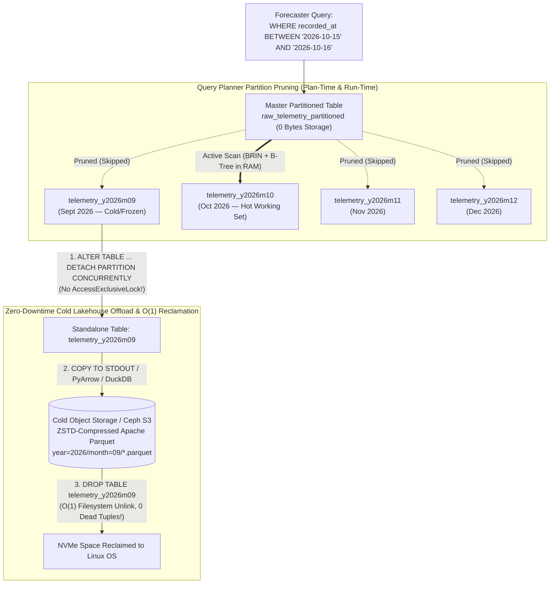
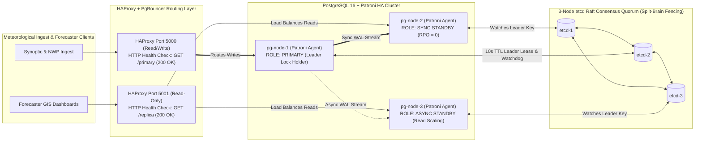

> **Navigation:** [Master README](../README.md) | [Interactive Portal](../bootcamp_portal.html) | [Reference Cards](../reference_cards/README.md) | [Day 2 Coursebook](../day2/day2_master_coursebook.md) | **Day 3 Coursebook** | [Day 4 Coursebook](../day4/day4_master_coursebook.md)

# Weather Forecast Engineering Database Bootcamp
## Day 3 Master Coursebook: Advanced Production PostgreSQL — Time-Series Partitioning, BRIN/GIN/Partial Indexing, Window Analytics, PostGIS Geodesy & Hybrid JSONB

**Bootcamp:** Database & NoSQL Engineering (5-Day Intensive)  
**Target Audience:** Weather Forecast & Meteorological Data Engineers, Systems Administrators, Environmental Data Scientists  
**Curriculum Scope:** Modules 0–5 + Hands-On Production Engineering Labs  
**Execution Environment:** PostgreSQL 16+ with PostGIS 3.4+ (`psql` CLI + DBeaver, local host or Docker `postgis/postgis:16-3.4`)  

**Companion Files in Day 3 Directory & `reference_cards/`:**
- [../reference_cards/00_sql_and_mongodb_crud_fundamentals_for_weather_data.md](../reference_cards/00_sql_and_mongodb_crud_fundamentals_for_weather_data.md) — **Dedicated SQL & MongoDB CRUD & Data Exploration Fundamentals (`SELECT`, `WHERE`, `GROUP BY`, `JOIN`, `INSERT ... RETURNING`, `ON CONFLICT DO UPDATE`, `UPDATE`, `DELETE`)**
- [day3_weather_advanced_pg.sql](./day3_weather_advanced_pg.sql) ([Course Walkthrough](./day3_weather_advanced_pg_sql_course_walkthrough.md)) — Partitioned synoptic tables (`synoptic.observations_part`), BRIN/Partial/Covering/GIN indexes, `JSONB` sensor payloads, and Materialized Views (`nwp.mv_daily_model_verification`)
- [day3_postgis_5m_benchmark.sql](./day3_postgis_5m_benchmark.sql) ([Course Walkthrough](./day3_postgis_5m_benchmark_sql_course_walkthrough.md)) — Automated 5,000,000-row partitioned telemetry seed (`raw_telemetry_partitioned`), B-Tree vs. BRIN benchmark, and PostGIS `ST_DWithin` geodesic radial queries
- [day3_postgres_advanced_cheatsheet.md](./day3_postgres_advanced_cheatsheet.md) — Quick-reference guide for Partitioning, Index Selection, PostGIS Geodesy, Window Functions, `UPSERT`, and `JSONB`
- [day3_postgres_extensions_guide.md](./day3_postgres_extensions_guide.md) — Complete production reference for `PostGIS`, `TimescaleDB`, `pg_partman`, `pg_cron`, `pg_stat_statements`, `pageinspect`, `pg_buffercache`, `pgstattuple`, `pg_repack`, and `btree_gist`
- [day3_postgres_ha_patroni_and_ops_guide.md](./day3_postgres_ha_patroni_and_ops_guide.md) — Enterprise High Availability (CAP/PACELC, Patroni + `etcd` + HAProxy), Streaming & Logical Replication, RBAC, `PgBouncer`, and PITR Backups

---

> [!CAUTION]
> ### STOP & READ FIRST — Day 3 PostgreSQL Databases (`weather_ops` vs. `weather_ops_db`), SQL Scripts & Tables Master Map
>
> Day 3 uses **two SQL scripts** inside `day3/` that operate on **two separate PostgreSQL databases (`weather_ops` and `weather_ops_db`)** so the 5,000,000-row high-frequency benchmark does not overwrite your 7-station WMO synoptic tables from Day 2.  
> If you ever get `ERROR: relation "..." does not exist` or `ERROR: schema "synoptic" does not exist`, check the table below and switch databases inside `psql` with **`\c weather_ops`** or **`\c weather_ops_db`**:
>
> | SQL Script in `day3/` | How to Load / Run It | Target PostgreSQL Database & Tables Created | Which Coursebook Labs Use This Database |
> | :--- | :--- | :--- | :--- |
> | **1. [`day3/day3_weather_advanced_pg.sql`](./day3_weather_advanced_pg.sql)**<br/>*(WMO Synoptic Partitioning, Indexes, MV & JSONB)* | ```bash\ncd day3\npsql -d weather_ops -f day3_weather_advanced_pg.sql\npsql -d weather_ops\n```<br/>*(Prerequisite: `day2/weather_ops_pg.sql` loaded in `weather_ops`)* | Database: **`weather_ops`** *(Switch in `psql`: `\c weather_ops`)*<br/>• **`synoptic.observations_part`** (`obs_y2026m06`..`obs_y2026m10`, `obs_default` + `JSONB` `sensor_payload`)<br/>• **`synoptic.observations`** (`idx_obs_brin_time`, `idx_obs_btree_time`, `idx_obs_suspect_only`, `idx_obs_station_time_covering`)<br/>• **`nwp.mv_daily_model_verification`** (Materialized View)<br/>• **`synoptic.stations`** (`geog GEOGRAPHY(Point, 4326)`) | • **Lab 1** (`§1.4` — `synoptic.observations_part`)<br/>• **Lab 2A** (`§2.4` — Partial & Covering `INCLUDE` indexes)<br/>• **Lab 3** (`§3.3` — $\Delta P_{3\text{h}}$, 24h rain, `DENSE_RANK`)<br/>• **Lab 4** (`§4.3` — `UPSERT` & `REFRESH MATERIALIZED VIEW CONCURRENTLY`)<br/>• **Lab 5** (`§5.3` — `JSONB` `@>` + `GIN` index) |
> | **2. [`day3/day3_postgis_5m_benchmark.sql`](./day3_postgis_5m_benchmark.sql)**<br/>*(5,000,000-Row Partitioned Telemetry & PostGIS Benchmark)* | ```bash\ncd day3\npsql -d postgres -f day3_postgis_5m_benchmark.sql\npsql -d weather_ops_db\n```<br/>*(Automatically creates `weather_ops_db`)* | Database: **`weather_ops_db`** *(Switch in `psql`: `\c weather_ops_db`)*<br/>• **`public.stations`** (`50` AWS stations `'AWS-001'`..`'AWS-050'` with `geom GEOMETRY(Point, 4326)`)<br/>• **`public.raw_telemetry_partitioned`** (`5,000,000` rows across `telemetry_y2026m09`..`telemetry_y2026m12`, `telemetry_default`) | • **Section 1.3** (`§1.3` — 5M-row partition distribution & pruning)<br/>• **Section 2.3** (`§2.3` — `ST_DWithin` 40 km Dellys Cape squall line)<br/>• **Lab 2B** (`§2.4` — 5M-row B-Tree `28 MB` vs. BRIN `32 KB`)<br/>• **Lab 2C** (`§2.4` — `ST_DWithin` + `raw_telemetry_partitioned` join) |
>
> #### Three Instant `psql` Commands to Check & Switch Databases on Day 3
> ```sql
> \conninfo          -- Check whether you are in 'weather_ops' or 'weather_ops_db'
> \c weather_ops     -- Switch to 'weather_ops' (synoptic.*, nwp.*, alerts.*)
> \c weather_ops_db  -- Switch to 'weather_ops_db' (5M-row raw_telemetry_partitioned & 50 AWS stations)
> ```

---

## 1. Day 3 Objective & Core Philosophy

On Day 2, we proved how PostgreSQL operates under the hood—processes, shared memory (`shared_buffers`), 8 KB heap pages, tuple alignment, MVCC/Vacuum bloat, WAL crash recovery, and cost-based query planning. We also saw that **monolithic relational row stores suffer severe I/O amplification on analytical scans and table bloat during continuous ingestion**.

Today on **Day 3**, we apply that architectural knowledge to solve the **6 biggest production challenges in operational meteorology**:

1. **Multi-Billion-Row Time-Series Growth:** Using **Declarative Range Partitioning (`PARTITION BY RANGE`)** so active B-Trees stay pinned in RAM, queries only scan relevant months (**Partition Pruning**), and expired months are detached/dropped in `< 10 ms` ($O(1)$ filesystem unlink) without MVCC dead-tuple bloat.
2. **Smart Indexing for Weather Data:** Choosing between **B-Tree**, **BRIN (Block Range Index)** (99.9% smaller for chronological observations), **Partial Indexes** (indexing only rare `qc_flag != 'VALID'` or `RED` alerts), and **Covering Indexes (`INCLUDE`)** for zero-heap-fetch **Index-Only Scans**.
3. **PostGIS Spatial Intelligence & Geodesy:** Installing and enabling **PostGIS**, contrasting planar `GEOMETRY` with spheroidal `GEOGRAPHY(Point, 4326)`, indexing station coordinates with **GiST**, and executing real-world meter-accurate radial storm searches (`ST_DWithin`, `ST_Distance`).
4. **Time-Series Meteorology with Window Functions:** Calculating **3-hour Barometric Pressure Tendency ($\Delta P_{3\text{h}}$)** for cyclogenesis/storm-front detection, **rolling 24-hour accumulated precipitation**, and **station extremes ranking** using `LAG()`, `LEAD()`, `SUM() OVER (... RANGE BETWEEN ...)`, and `DENSE_RANK()` in a single sorted pass without self-joins.
5. **Idempotent Ingestion & Non-Blocking Dashboards:** Handling delayed or corrected (`COR` / `AMD`) WMO synoptic reports via **`INSERT ... ON CONFLICT DO UPDATE` (`UPSERT`)** with dead-tuple suppression, and pre-aggregating NWP model verification metrics with **`REFRESH MATERIALIZED VIEW CONCURRENTLY`**.
6. **Hybrid Relational + NoSQL (`JSONB` & `GIN` Indexes) — Bridge to Day 4 MongoDB:** Storing and indexing variable IoT sensor diagnostics (`battery_v`, `solar_w_m2`, `gust_3s_kt`, `soil_probes_cm`) in `JSONB`, while identifying the exact architectural boundary where **MongoDB BSON & Time-Series Bucketing (Day 4)** take over.

---

## 2. Module Outline

```
┌─────────────────┬───────────────────────────────────────────────────────────────────────┐
│ Module 0        │ Explicit PostGIS Installation, Enablement & 5M-Row Seeding            │
├─────────────────┼───────────────────────────────────────────────────────────────────────┤
│ Module 1        │ Declarative Time-Range Partitioning & Lifecycle Management            │
├─────────────────┼───────────────────────────────────────────────────────────────────────┤
│ Module 2        │ Advanced Indexing (B-Tree, BRIN, Partial, INCLUDE, PostGIS)           │
├─────────────────┼───────────────────────────────────────────────────────────────────────┤
│ Module 3        │ Analytical Window Functions (OVER, LAG, Rolling Frames)               │
├─────────────────┼───────────────────────────────────────────────────────────────────────┤
│ Module 4        │ Idempotent Ingestion (UPSERT) & Concurrent Materialized View          │
├─────────────────┼───────────────────────────────────────────────────────────────────────┤
│ Module 5        │ Semi-Structured Telemetry (JSONB + GIN) & Bridge to Day 4             │
└─────────────────┴───────────────────────────────────────────────────────────────────────┘
```

---

## Module 0: Explicit PostGIS Installation, Enablement & 5,000,000-Row Seed Script

### 0.1 Explicit OS Package Installation

PostGIS is not bundled in the core PostgreSQL server package; it must be installed as an operating system package matching the PostgreSQL major version.

#### Option A: Ubuntu / Debian Host
```bash
# 1. Update APT repository index
sudo apt-get update

# 2. Install PostGIS binaries and mathematical libraries for PostgreSQL 16
sudo apt-get install -y postgresql-16-postgis-3 postgresql-16-postgis-3-scripts

# 3. Verify library installation on disk
ls -la /usr/lib/postgresql/16/lib/postgis*
```

#### Option B: Docker Container Deployment
If running PostgreSQL via Docker, deploy the official PostGIS image or install it into an existing container:
```bash
# Run container with PostGIS pre-compiled
docker run --name weather_pg -e POSTGRES_PASSWORD=postgres -p 5432:5432 -d postgis/postgis:16-3.4

# Alternatively, if running standard postgres:16 container:
docker exec -u 0 -it weather_pg apt-get update
docker exec -u 0 -it weather_pg apt-get install -y postgresql-16-postgis-3
```

---

### 0.2 Two Complementary Datasets for Day 3 Labs

In Day 3, we use two SQL scripts that work together seamlessly:
1. **`day3_weather_advanced_pg.sql`** (runs on `weather_ops` from Day 2): Builds `synoptic.observations_part` with `JSONB` `sensor_payload`, creates B-Tree, BRIN, Partial (`WHERE qc_flag != 'VALID'`), Covering (`INCLUDE`), and `GIN` indexes, builds the `nwp.mv_daily_model_verification` Materialized View, and adds a PostGIS `GEOGRAPHY(Point, 4326)` column to `synoptic.stations`.
2. **`day3_postgis_5m_benchmark.sql`** (runs on `weather_ops_db` or `weather_ops`): Seeds 50 Algerian coastal & inland stations (`AWS-001` through `AWS-050`) with PostGIS geometries and generates **5,000,000 rows of realistic high-frequency telemetry** across monthly partitions (`telemetry_y2026m09` .. `telemetry_y2026m12`) in $\approx 5\text{--}8\text{ seconds}$ using `generate_series()`.

### 0.3 Automated Database Initialization & 5,000,000-Row Telemetry Seed Script

Attendees can execute [day3_postgis_5m_benchmark.sql](./day3_postgis_5m_benchmark.sql) or run the initialization block below inside `psql`:

```sql
-- Connect to host: psql -U postgres
CREATE DATABASE weather_ops_db;
\c weather_ops_db

-- ============================================================================
-- 1. Enable PostGIS Spatial Extension & Verify Version
-- ============================================================================
CREATE EXTENSION IF NOT EXISTS postgis;

-- Explicit verification of PostGIS spatial engine and GEOS/PROJ/GDAL linkage
SELECT postgis_full_version();

-- ============================================================================
-- 2. Create Spatial Weather Stations Master Registry Table
-- ============================================================================
DROP TABLE IF EXISTS stations CASCADE;
CREATE TABLE stations (
    station_id VARCHAR(10) PRIMARY KEY,
    station_name VARCHAR(64) NOT NULL,
    latitude DOUBLE PRECISION NOT NULL,
    longitude DOUBLE PRECISION NOT NULL,
    elevation_m REAL NOT NULL,
    is_active BOOLEAN NOT NULL DEFAULT TRUE,
    geom GEOMETRY(Point, 4326)
);

-- Seed 50 Meteorological Stations with spatial geometries across Northern Algeria
INSERT INTO stations (station_id, station_name, latitude, longitude, elevation_m, is_active, geom)
SELECT 
    'AWS-' || LPAD(g::TEXT, 3, '0'),
    CASE g
        WHEN 1 THEN 'Algiers Port Marine'
        WHEN 2 THEN 'Boumerdes Coastal Point'
        WHEN 3 THEN 'Dellys Cape Lighthouse'
        WHEN 4 THEN 'Tizi Ouzou Valley'
        WHEN 5 THEN 'Bejaia Gulf Airport'
        WHEN 6 THEN 'Jijel Achouat Ridge'
        WHEN 7 THEN 'Oran Marine Terminal'
        WHEN 8 THEN 'Constantine Plateau'
        ELSE 'AWS Regional Station ' || LPAD(g::TEXT, 3, '0')
    END,
    ROUND((35.5 + (random() * 2.0))::numeric, 4),
    ROUND((2.0 + (random() * 5.0))::numeric, 4),
    ROUND((10.0 + (random() * 1200.0))::numeric, 1),
    TRUE,
    ST_SetSRID(ST_MakePoint(
        ROUND((2.0 + (random() * 5.0))::numeric, 4),
        ROUND((35.5 + (random() * 2.0))::numeric, 4)
    ), 4326)
FROM generate_series(1, 50) AS g;

-- Pin precise ground-truth coordinates for our benchmark coastal stations
UPDATE stations SET latitude = 36.7538, longitude = 3.0588,  geom = ST_SetSRID(ST_MakePoint(3.0588, 36.7538), 4326) WHERE station_id = 'AWS-001'; -- Algiers Port
UPDATE stations SET latitude = 36.7664, longitude = 3.4772,  geom = ST_SetSRID(ST_MakePoint(3.4772, 36.7664), 4326) WHERE station_id = 'AWS-002'; -- Boumerdes Coastal
UPDATE stations SET latitude = 36.9172, longitude = 3.9130,  geom = ST_SetSRID(ST_MakePoint(3.9130, 36.9172), 4326) WHERE station_id = 'AWS-003'; -- Dellys Cape
UPDATE stations SET latitude = 36.7118, longitude = 4.0459,  geom = ST_SetSRID(ST_MakePoint(4.0459, 36.7118), 4326) WHERE station_id = 'AWS-004'; -- Tizi Ouzou
UPDATE stations SET latitude = 36.7559, longitude = 5.0699,  geom = ST_SetSRID(ST_MakePoint(5.0699, 36.7559), 4326) WHERE station_id = 'AWS-005'; -- Bejaia Airport

-- Create Spatial Index on Station Geometries (GiST: Generalized Search Tree)
CREATE INDEX idx_stations_gist_geom ON stations USING GIST (geom);

-- ============================================================================
-- 3. Create Declarative Partitioned Master Table (Aligned Columns)
-- ============================================================================
DROP TABLE IF EXISTS raw_telemetry_partitioned CASCADE;
CREATE TABLE raw_telemetry_partitioned (
    -- 8-Byte Types First (Offset 0-8)
    recorded_at TIMESTAMPTZ NOT NULL,
    -- 4-Byte Types Second (Offset 8-28)
    station_id VARCHAR(10) NOT NULL,
    temperature REAL,
    pressure REAL,
    wind_speed REAL,
    rain_accum_1m REAL,
    -- 2-Byte Types
    wind_direction SMALLINT,
    CONSTRAINT fk_station FOREIGN KEY (station_id) REFERENCES stations(station_id)
) PARTITION BY RANGE (recorded_at);

-- ============================================================================
-- 4. Create Explicit Monthly Child Partitions
-- ============================================================================
CREATE TABLE telemetry_y2026m09 PARTITION OF raw_telemetry_partitioned
    FOR VALUES FROM ('2026-09-01 00:00:00+00') TO ('2026-10-01 00:00:00+00');

CREATE TABLE telemetry_y2026m10 PARTITION OF raw_telemetry_partitioned
    FOR VALUES FROM ('2026-10-01 00:00:00+00') TO ('2026-11-01 00:00:00+00');

CREATE TABLE telemetry_y2026m11 PARTITION OF raw_telemetry_partitioned
    FOR VALUES FROM ('2026-11-01 00:00:00+00') TO ('2026-12-01 00:00:00+00');

CREATE TABLE telemetry_y2026m12 PARTITION OF raw_telemetry_partitioned
    FOR VALUES FROM ('2026-12-01 00:00:00+00') TO ('2027-01-01 00:00:00+00');

CREATE TABLE telemetry_default PARTITION OF raw_telemetry_partitioned DEFAULT;

-- ============================================================================
-- 5. Ingest 5,000,000 synthetic observations across Sept-Dec 2026
-- ============================================================================
INSERT INTO raw_telemetry_partitioned (recorded_at, station_id, temperature, pressure, wind_speed, wind_direction, rain_accum_1m)
SELECT 
    TIMESTAMP WITH TIME ZONE '2026-09-01 00:00:00+00' + (g * INTERVAL '2.1 seconds'),
    'AWS-' || LPAD((1 + (random() * 49)::INT)::TEXT, 3, '0'),
    ROUND((14.0 + (sin(g / 5000.0) * 12.0) + (random() * 3.0))::numeric, 2)::REAL,
    ROUND((1013.25 + (cos(g / 8000.0) * 8.0) + (random() * 1.5))::numeric, 2)::REAL,
    ROUND((random() * 22.0)::numeric, 2)::REAL,
    (random() * 359)::SMALLINT,
    CASE WHEN random() < 0.05 THEN ROUND((random() * 4.5)::numeric, 2)::REAL ELSE 0.0 END
FROM generate_series(1, 5000000) AS g;

-- ============================================================================
-- 6. Attach BRIN Index to Master Partitioned Table (propagate to all children)
-- ============================================================================
CREATE INDEX idx_telemetry_brin_time 
    ON raw_telemetry_partitioned 
    USING BRIN (recorded_at) 
    WITH (pages_per_range = 64);
```

---

## Module 1: Declarative Time-Range Partitioning & Lifecycle Management

### 1.1 The Operational Failure Modes of Monolithic Tables

Suppose a national meteorological agency ingests 5,000 stations every 10 minutes ($262\text{ million}$ rows/year) or continuous high-frequency streams ($500\text{ million}$ records annually). If deployed inside a monolithic, unpartitioned PostgreSQL table:

```
                    Monolithic Table vs. Declarative Range Partitioning
                    
   A. Monolithic Table (Unbounded Heap Growth)     B. Declarative Range Partitioning
   
   ┌─────────────────────────────────────┐      ┌─────────────────┐ ┌─────────────────┐
   │ raw_telemetry / observations        │      │ telemetry_202609│ │ telemetry_202610│
   │ [2024 Data] [2025 Data] [2026 Data] │      │ (Sept 2026)     │ │ (Oct 2026)      │
   │                                     │      └─────────────────┘ └─────────────────┘
   │ • B-Trees outgrow RAM cache         │      ┌─────────────────┐ ┌─────────────────┐
   │ • DELETE leaves dead tuple bloat    │      │ telemetry_202611│ │ telemetry_202612│
   │ • Full scans read all disk blocks   │      │ (Nov 2026)      │ │ (Dec 2026)      │
   │ • Autovacuum freezes entire heap    │      └─────────────────┘ └─────────────────┘
   └─────────────────────────────────────┘      ▲                                     ▲
                      │                         │                                     │
         DELETE generates massive WAL,          ALTER TABLE ... DETACH + DROP TABLE
         fragments pages, and does not          is an instant O(1) filesystem un-link!
         return space to Linux OS!
```

1. **The `DELETE` Vacuum Trap:** Purging data older than 90 days via `DELETE FROM raw_telemetry WHERE recorded_at < NOW() - INTERVAL '90 days'` does **not** return physical disk space to the operating system. It marks millions of tuples as dead, creates gigabytes of WAL churn, forces table-wide autovacuum scans, and leaves fragmented empty holes across 8 KB heap pages.
2. **B-Tree Index Saturation:** As row count surpasses $10^8$, B-Trees outgrow `shared_buffers`. Every single incoming insert must traverse index pages that no longer fit in memory, forcing random NVMe reads and causing ingest throughput to collapse.

---

### 1.2 Why We Partition: The 5 Physical & Architectural Imperatives

Before typing `PARTITION BY RANGE`, engineers must understand the concrete physical reasons why splitting a table into bounded partitions is mandatory for high-throughput time series.

```
                   The 5 Physical Drivers of Partitioning
 ┌─────────────────────────────────────────────────────────────────────────────┐
 │ 1. Memory Working Set Fit  : Active B-Trees stay pinned in RAM cache        │
 │ 2. Vacuum & Maintenance    : Autovacuum isolates writes; old partitions freeze│
 │ 3. Heap Fragmentation      : Eliminates dead-space holes across 8 KB pages  │
 │ 4. I/O Boundary Pruning    : Queries read ONLY matching physical disks/files│
 │ 5. Abstraction Layer       : Master table routes queries with ZERO app logic│
 └─────────────────────────────────────────────────────────────────────────────┘
```

#### Declarative Time-Range Partition Pruning & Zero-Downtime Cold Tier Offload Lifecycle



#### 1. Keeping the Active Working Set in RAM (The Ingestion Cliff)
In an unpartitioned table of 200 million rows, a composite B-Tree index on `(station_id, recorded_at)` easily reaches $10\text{--}15\text{ GB}$.
- PostgreSQL's `shared_buffers` is typically sized to $25\%$ of system RAM (e.g., $8\text{ GB}$ on a $32\text{ GB}$ server).
- When the index exceeds `shared_buffers`, the database can no longer cache all leaf pages. Every incoming insert must look up its place in the B-Tree via a **random read from NVMe/SSD**.
- **With Monthly Partitions:** Only the current month's partition receives writes. Its index is only $\approx 350\text{ MB}$ and stays $100\%$ **pinned in RAM**, maintaining insert speeds of $50,000+\text{ inserts/sec}$ indefinitely without hitting an I/O cliff.

#### 2. Autovacuum Isolation & Transaction ID (XID) Freeze Protection
In PostgreSQL's MVCC model, old rows must eventually be frozen to avoid Transaction ID Wraparound:
- In a 500-million-row monolithic table, autovacuum must read the entire multi-gigabyte heap to vacuum and freeze tuples, competing directly with incoming weather telemetry.
- With partitions, **closed historical months are completely cold**. Once autovacuum freezes a completed partition, PostgreSQL flags the entire child relation as clean (`relfrozenxid`). Autovacuum **never touches those historical disk blocks again**, concentrating maintenance strictly on the active month.

#### 3. True $O(1)$ Space Reclamation vs. `DELETE` Bloat
- In a monolithic table, running `DELETE WHERE recorded_at < '2026-10-01'` marks tuples as dead, but **does not return disk space to the operating system** without an exclusive-lock `VACUUM FULL`.
- In a partitioned table, retiring old data is executed via:
  ```sql
  ALTER TABLE synoptic.observations_part DETACH PARTITION synoptic.obs_y2026m06 CONCURRENTLY;
  DROP TABLE synoptic.obs_y2026m06;
  ```
  This is a pure metadata unlink operation ($< 10\text{ ms}$) that immediately deletes the underlying files from the Linux filesystem, reclaiming physical gigabytes instantly with zero WAL churn and zero dead tuples.

#### 4. Physical I/O Pruning (Partition Pruning)
When a forecaster runs a query covering a 24-hour or 48-hour storm window, the query planner evaluates the `WHERE` clause against partition constraints and discards $99\%$ of child tables before touching a single 8 KB disk page.

#### 5. Why a Master Partitioned Table? (The Abstraction Layer & Primary Key Rule)
- **Zero Application Routing Logic:** The parent table (`synoptic.observations_part` or `raw_telemetry_partitioned`) holds **0 bytes of data** itself—it routes rows automatically to monthly child tables.
- **Transparent Cross-Boundary Queries:** A 72-hour cyclone spanning October 30 through November 2 seamlessly queries the parent table across both child partitions.
- **Rule #1 of PostgreSQL Partitioning:** Any `PRIMARY KEY` or `UNIQUE` constraint on a partitioned table **must include the partition key**, e.g. `PRIMARY KEY (obs_time, station_id)`.

> [!WARNING]
> **Production Engineering Pitfall — Attempting `PRIMARY KEY (obs_id)` on a Partitioned Table:**  
> Migrating a monolithic table to `PARTITION BY RANGE (obs_time)` while keeping `obs_id BIGSERIAL PRIMARY KEY` fails immediately with `ERROR: unique constraint on partitioned table must include all partitioning columns`. Why? PostgreSQL enforces uniqueness using each child partition's local B-Tree index rather than a single global cross-partition index (which would reintroduce the exact RAM and lock bottleneck partitioning is designed to eliminate). Therefore, `obs_time` **must** be part of any `PRIMARY KEY` or `UNIQUE` constraint: `PRIMARY KEY (obs_time, station_id)`.

---

### 1.3 Verifying Partition Row Distribution & Partition Pruning on 5M-Row Seed Data

```sql
-- TARGET DATABASE: PostgreSQL 'weather_ops_db' (Switch in psql with: \c weather_ops_db)
-- PREREQUISITE SCRIPT: day3/day3_postgis_5m_benchmark.sql
SELECT 
    c.relname AS partition_name,
    pg_size_pretty(pg_relation_size(c.oid)) AS heap_size,
    pg_size_pretty(pg_total_relation_size(c.oid)) AS total_size,
    c.reltuples::BIGINT AS estimated_rows
FROM pg_class c
JOIN pg_inherits i ON i.inhrelid = c.oid
JOIN pg_class parent ON parent.oid = i.inhparent
WHERE parent.relname = 'raw_telemetry_partitioned'
ORDER BY c.relname;
```

#### Terminal Output:
```text
┌────────────────────┬───────────┬────────────┬────────────────┐
│ partition_name     │ heap_size │ total_size │ estimated_rows │
├────────────────────┼───────────┼────────────┼────────────────┤
│ telemetry_y2026m09 │ 73 MB     │ 73 MB      │ 1234285        │
│ telemetry_y2026m10 │ 76 MB     │ 76 MB      │ 1275510        │
│ telemetry_y2026m11 │ 73 MB     │ 73 MB      │ 1234285        │
│ telemetry_y2026m12 │ 76 MB     │ 76 MB      │ 1255920        │
└────────────────────┴───────────┴────────────┴────────────────┘
```

#### Partition Pruning in Action:
```sql
-- TARGET DATABASE: PostgreSQL 'weather_ops_db' (Switch in psql with: \c weather_ops_db)
-- PREREQUISITE SCRIPT: day3/day3_postgis_5m_benchmark.sql
EXPLAIN (COSTS OFF)
SELECT 
    station_id, 
    ROUND(AVG(temperature)::numeric, 2) AS avg_temp,
    MAX(wind_speed) AS max_gust
FROM raw_telemetry_partitioned
WHERE recorded_at >= '2026-10-15 00:00:00+00' 
  AND recorded_at <  '2026-10-16 00:00:00+00'
GROUP BY station_id;
```

```text
HashAggregate
  Group Key: station_id
  ->  Bitmap Heap Scan on telemetry_y2026m10 raw_telemetry_partitioned
        Recheck Cond: ((recorded_at >= '2026-10-15 00:00:00+00'::timestamptz) AND (recorded_at < '2026-10-16 00:00:00+00'::timestamptz))
        ->  Bitmap Index Scan on telemetry_y2026m10_recorded_at_idx
              Index Cond: ((recorded_at >= '2026-10-15 00:00:00+00'::timestamptz) AND (recorded_at < '2026-10-16 00:00:00+00'::timestamptz))
```
*Proof:* The query planner evaluated the timestamp constraint and completely pruned `telemetry_y2026m09`, `telemetry_y2026m11`, `telemetry_y2026m12`, and `telemetry_default`.

#### Black Box 3A Demystified: Partitioned Table `PRIMARY KEY` Rules & Half-Open Bounds $[T_{\text{start}}, T_{\text{end}})$

When engineers convert a normal PostgreSQL table (`synoptic.observations` with `obs_id BIGSERIAL PRIMARY KEY`) into a partitioned table (`synoptic.observations_part PARTITION BY RANGE (obs_time)`), two immediate black-box questions arise:

1. **Why Does `PRIMARY KEY (obs_id)` Fail on a Partitioned Table (`ERROR: unique constraint on partitioned table must include all partitioning columns`)?**
   - In PostgreSQL, the parent partitioned table (`observations_part`) stores **zero bytes of data and has no global B-Tree index across all partitions**. Each monthly child table (`obs_y2026m09`, `obs_y2026m10`) maintains its own independent local B-Tree index.
   - If PostgreSQL allowed `PRIMARY KEY (obs_id)` without `obs_time`, checking whether `obs_id = 500` already exists during an `INSERT` would require locking and probing **every single historical child partition's B-Tree** (e.g., 120 monthly partitions!), destroying write throughput.
   - By requiring the partition key (`obs_time`) to be included in every `PRIMARY KEY` or `UNIQUE` constraint (`PRIMARY KEY (obs_time, station_id)`), PostgreSQL knows that any duplicate `(obs_time, station_id)` can **only** live inside that single month's child partition—so uniqueness is verified with **1 local B-Tree lookup**!

2. **Why `FOR VALUES FROM ('2026-10-01 00:00:00+00') TO ('2026-11-01 00:00:00+00')` Uses Half-Open Interval $[A, B)$ Instead of `23:59:59`:**
   - If you defined October's upper bound as `'2026-10-31 23:59:59+00'`, what happens when a high-frequency sensor reports at `'2026-10-31 23:59:59.500000+00'`? It falls into a **1-second gap** between October and November and crashes ingestion!
   - Therefore, PostgreSQL `PARTITION BY RANGE` always evaluates **`FROM A TO B` as a mathematical half-open interval $[A, B)$**:
     - **Lower Bound (`FROM A`):** **Inclusive ($\ge A$)** — `'2026-10-01 00:00:00.000000+00'` goes into **October**.
     - **Upper Bound (`TO B`):** **Strictly Exclusive ($< B$)** — `'2026-11-01 00:00:00.000000+00'` goes into **November**, while `'2026-10-31 23:59:59.999999+00'` goes into **October** with zero microsecond gaps!

| Partition DDL Feature | What Happens If Omitted / Misused | Production Engineering Rule |
| :--- | :--- | :--- |
| **`PRIMARY KEY (obs_time, station_id)`** | `PRIMARY KEY (obs_id)` fails with `ERROR: unique constraint ... must include all partitioning columns` | Always include the partition key (`obs_time`) in every `PRIMARY KEY` and `UNIQUE` constraint on a partitioned table (or if using distributed **RFC 9562 `UUIDv7`** from [Day 2 Black Box 2D](../day2/day2_master_coursebook.md), use `PRIMARY KEY (obs_time, packet_id)` so both columns sort monotonically inside each monthly partition!). |
| **`FOR VALUES FROM (A) TO (B)`** | Using `'2026-10-31 23:59:59'` leaves a 1-second gap where sub-second telemetry crashes | Always set `TO (B)` equal to the exact `00:00:00+00` start of the **next** partition ($[A, B)$). |
| **`PARTITION OF ... DEFAULT`** | Out-of-order edge telemetry for next month crashes the entire batch if next month's partition wasn't created yet | Always attach a `DEFAULT` partition (`obs_default`) to catch unexpected timestamps without dropping packets. |

---

### 1.4 Hands-On Lab 1 Walkthrough: Building & Querying Monthly Synoptic Partitions
Load the Day 3 synoptic script on `weather_ops`:
```bash
psql -d weather_ops -f day3_weather_advanced_pg.sql
```

This walkthrough inspects the monthly partition hierarchy on `synoptic.observations_part` (`obs_y2026m06` .. `obs_y2026m10`), verifies partition pruning via `EXPLAIN (ANALYZE, BUFFERS)` for an October storm window, and creates a new monthly child partition for **November 2026 (`synoptic.obs_y2026m11`)** while verifying physical routing via `tableoid::regclass`:

```sql
-- TARGET DATABASE: PostgreSQL 'weather_ops' (Switch in psql with: \c weather_ops)
-- PREREQUISITE SCRIPT: day3/day3_weather_advanced_pg.sql

-- 1. View all child partitions and their individual disk sizes
SELECT
    inhrelid::regclass AS partition_name,
    pg_size_pretty(pg_total_relation_size(inhrelid)) AS total_size,
    (SELECT reltuples::BIGINT FROM pg_class WHERE oid = inhrelid) AS estimated_rows
FROM pg_inherits
WHERE inhparent = 'synoptic.observations_part'::regclass
ORDER BY partition_name;

-- 2. Verify Partition Pruning via EXPLAIN (ANALYZE, BUFFERS)
-- Notice that obs_y2026m06, m07, m08, and m09 are completely pruned!
EXPLAIN (ANALYZE, BUFFERS)
SELECT station_id, AVG(temp_c), SUM(precip_1h_mm)
FROM synoptic.observations_part
WHERE obs_time BETWEEN '2026-10-05 00:00:00+00' AND '2026-10-06 23:00:00+00'
GROUP BY station_id;

-- 3. Create November 2026 partition & verify automatic routing
CREATE TABLE IF NOT EXISTS synoptic.obs_y2026m11 PARTITION OF synoptic.observations_part
    FOR VALUES FROM ('2026-11-01 00:00:00+00') TO ('2026-12-01 00:00:00+00');

INSERT INTO synoptic.observations_part (station_id, obs_time, temp_c, pressure_hpa, qc_flag)
VALUES (60390, '2026-11-01 00:00:00+00', 18.2, 1016.5, 'VALID')
ON CONFLICT (obs_time, station_id) DO NOTHING;

-- Confirm the row lives physically inside synoptic.obs_y2026m11:
SELECT tableoid::regclass AS physical_partition, station_id, obs_time, temp_c
FROM synoptic.observations_part
WHERE obs_time >= '2026-11-01 00:00:00+00';
```

---

## Module 2: Advanced Indexing — B-Tree, BRIN, Partial, Covering (`INCLUDE`) & PostGIS Geodesy

### 2.1 The Physical Failure of B-Trees on Append-Only Time Series vs. BRIN

A standard **B-Tree index** maintains a balanced hierarchy with pointers (`ctid`) to **every individual row** in the table heap:
- **Storage Footprint:** On 100 million telemetry rows, a B-Tree index on `obs_time` or `(station_id, recorded_at)` reaches $2\text{--}5\text{ GB}$.
- **Cache Eviction:** Because the B-Tree exceeds `shared_buffers`, random leaf-page updates force hot data pages out of RAM.

```
       B-Tree Index (Every row indexed)            BRIN Index (Ranges of pages indexed)
 ┌───────────────────────────────────────────┐  ┌───────────────────────────────────────────┐
 │ Leaf Page 1: (Row 1 -> Block 0, Off 1)   │  │ Range 0 (Blocks 0-63):                    │
 │ Leaf Page 2: (Row 2 -> Block 0, Off 2)   │  │   Min Time: 2026-10-01 00:00:00           │
 │ Leaf Page 3: (Row 3 -> Block 0, Off 3)   │  │   Max Time: 2026-10-02 04:12:30           │
 │ ...                                       │  ├───────────────────────────────────────────┤
 │ Leaf Page N: (Row 100M -> Block K, Off M) │  │ Range 1 (Blocks 64-127):                  │
 ├───────────────────────────────────────────┤  │   Min Time: 2026-10-02 04:12:31           │
 │ Footprint: ~3,200 MB                      │  │   Max Time: 2026-10-03 08:30:00           │
 │ Ingest Overhead: High (Page splits)       │  ├───────────────────────────────────────────┤
 └───────────────────────────────────────────┘  │ Footprint: ~64 KB (99.9% smaller!)        │
                                                │ Ingest Overhead: Near Zero                │
                                                └───────────────────────────────────────────┘
```

#### How BRIN (Block Range Index) Exploits Chronological Weather Data
Weather observations arrive in temporal order. Because rows are appended sequentially to the newest 8 KB heap pages, **physical disk block position directly correlates with time**:
1. A **BRIN index (`USING BRIN (recorded_at) WITH (pages_per_range = 64)`)** divides the table heap into contiguous block ranges ($64 \times 8\text{ KB} = 512\text{ KB}$ of physical data, or `pages_per_range = 8` for $64\text{ KB}$ ranges).
2. It stores only two scalar values per range: **`MIN(obs_time)`** and **`MAX(obs_time)`**.
3. During a query, if the requested timestamp falls outside $[\min, \max]$, PostgreSQL skips the entire block range in a single operation.

> [!TIP]
> **Architectural Verification Tip — Checking `pg_stats.correlation` Before Creating a BRIN Index:**  
> Before creating a BRIN index on a column, verify its physical disk ordering via `SELECT attname, correlation FROM pg_stats WHERE tablename = 'telemetry_y2026m10';`. When `correlation` is close to `1.0` or `-1.0` (such as `recorded_at` at `0.999`), BRIN skips 99% of blocks at $0.1\%$ of a B-Tree's size! Conversely, building a BRIN index on `station_id` or `temperature` (where every 64-page range contains all 50 stations and temperatures from $10^\circ\text{C}$ to $35^\circ\text{C}$, `correlation ≈ 0.01`) will skip **zero** blocks because every block range's $[\min, \max]$ overlaps the query predicate.

---

### 2.2 Partial Indexes (`WHERE ...`) & Covering Indexes (`INCLUDE`)

#### 1. Partial Indexes (`WHERE ...`)
Suppose $96\%$ of your observations have `qc_flag = 'VALID'`, and your quality-control dashboard frequently queries `WHERE qc_flag != 'VALID'`. Why waste RAM indexing the $96\%$ valid rows?
```sql
CREATE INDEX idx_obs_suspect_only ON synoptic.observations (station_id, obs_time)
WHERE qc_flag != 'VALID';
```
Only rows matching the `WHERE` predicate are entered into the B-Tree—reducing index size by $96\%$!

#### 2. Covering Indexes (`INCLUDE`) & Index-Only Scans
Recall from Day 2 that a normal `Index Scan` reads the B-Tree index and then jumps to the 8 KB Heap Page (`ctid`) to fetch non-key payload columns (`temp_c`, `pressure_hpa`, `precip_1h_mm`).
By appending `INCLUDE (temp_c, pressure_hpa, precip_1h_mm)` to the index leaf pages (and keeping the table vacuumed so the **Visibility Map** is all-visible), PostgreSQL answers the entire query directly from the index via an **`Index Only Scan` with `Heap Fetches: 0`**!

```sql
CREATE INDEX idx_obs_station_time_covering
ON synoptic.observations (station_id, obs_time)
INCLUDE (temp_c, pressure_hpa, precip_1h_mm);
```

#### Black Box 3B Demystified: Why `BRIN` Always Uses `Bitmap Heap Scan + Recheck Cond` & The 6-Index Decision Matrix

Why does `EXPLAIN` on a `BRIN` index **always** show `Bitmap Index Scan` $\rightarrow$ `Bitmap Heap Scan` with a `Recheck Cond`—and why can't a `BRIN` index ever enforce `UNIQUE` or perform an `Index Only Scan`?

1. **Exact Row-Pointer Index (`B-Tree`) vs. Lossy Block-Summary Index (`BRIN`):**
   - **B-Tree is Exact (Row-Level):** Every entry in a B-Tree leaf page stores an exact key value and its exact 6-byte `ctid = (block, offset)`.
   - **BRIN is Lossy (Block-Range Level):** A BRIN index does **not** store individual row `ctid`s! It only knows that **Heap Blocks `64..127` contain timestamps somewhere between `00:00` and `04:12`**.
   - Therefore, when you query `WHERE recorded_at BETWEEN '01:00' AND '02:00'`, the BRIN `Bitmap Index Scan` flags Blocks `64..127` as *candidate blocks* in a memory bitmap, and the **`Bitmap Heap Scan` must inspect every tuple inside Blocks `64..127` (`Recheck Cond`)** to discard rows from `00:15` or `03:45`!
2. **Why Put Columns in `INCLUDE (temp_c, pressure_hpa)` Instead of Making a 4-Column Key `(station_id, obs_time, temp_c, pressure_hpa)`?**
   - Putting `temp_c` and `pressure_hpa` into the main index key forces PostgreSQL to store and compare them inside **upper B-Tree branch/internal nodes** too, bloating the entire tree and breaking `UNIQUE (station_id, obs_time)` semantics.
   - `INCLUDE (temp_c, pressure_hpa)` stores those payload columns **only in the bottom B-Tree leaf nodes**, keeping internal navigation branches tiny while still satisfying `Index Only Scan`!

| PostgreSQL Index Type | What It Stores Physically | Relative Size (per 1M rows) | Supports `UNIQUE`? | Supports `Index Only Scan`? | Ideal Meteorological Workload |
| :--- | :--- | :---: | :---: | :---: | :--- |
| **1. `B-Tree` *(Default)*** | Sorted key + `6B ctid` for **every row** | `~22–28 MB` | Yes | Yes | Primary keys, `(station_id, obs_time)` uniqueness, high-selectivity point/range lookups. |
| **2. `BRIN`** | Only `[min, max]` per $N$ heap pages (`pages_per_range`) | **`~24–48 KB`** *(99.8% smaller!)* | **No** *(lossy block index)* | **No** *(always rechecks heap)* | Append-only chronological timestamp columns (`recorded_at`, `obs_time`) with `correlation > 0.95`. |
| **3. `Partial B-Tree` (`WHERE`)** | Sorted key + `ctid` **only for rows matching `WHERE`** | `~1 MB` *(if 4% match)* | Yes *(partial uniqueness)* | Yes | Filtering rare anomalies (`WHERE qc_flag != 'VALID'`) or active alerts (`WHERE is_active = TRUE`). |
| **4. `Covering B-Tree` (`INCLUDE`)** | Key in all nodes + extra payload columns in **leaf nodes only** | `~35–45 MB` | Yes *(on key columns)* | **Yes (`Heap Fetches: 0`)** | High-QPS station time-series charts (`SELECT obs_time, temp_c FROM ... WHERE station_id = ?`). |
| **5. `GIN` (Inverted Index)** | Each nested JSONB key/path or array element $\rightarrow$ posting list of `ctid`s | `~15–40 MB` | No | No | Semi-structured `JSONB` sensor diagnostics (`WHERE sensor_payload @> '{"door_open": true}'`). |
| **6. `GiST` (R-Tree Spatial)** | Hierarchical 2D/3D bounding boxes (`MBR`) over geometries | `~30–50 MB` | No *(supports `EXCLUDE`)* | Yes *(bounding box)* | PostGIS `GEOGRAPHY`/`GEOMETRY` spatial proximity (`ST_DWithin`, `ST_Intersects`) and range overlaps. |

---

### 2.3 PostGIS: Spatial Station Geometries & Radial Proximity (`GEOMETRY` vs. `GEOGRAPHY`)

Meteorological phenomena are spatial. Atmospheric fronts, convective cells, and marine gale warnings propagate across physical distances on a curved Earth.

```
                         Euclidean Planar vs. Geodetic Ellipsoid
 ┌───────────────────────────────────────────┬───────────────────────────────────────────┐
 │ GEOMETRY (Planar Cartesian)               │ GEOGRAPHY (WGS 84 Ellipsoid)              │
 ├───────────────────────────────────────────┼───────────────────────────────────────────┤
 │ • Treats coordinates as flat grid (x, y)  │ • Models true curvature of the Earth      │
 │ • ST_Distance returns degrees (useless    │ • ST_Distance returns true meters         │
 │   for physical atmospheric physics)       │ • ST_DWithin(geom::geography, ..., 40000) │
 │ • Fast Euclidean math; severe distortion  │ • Slower trigonometric math; zero spatial │
 │   away from equator                       │   distortion                              │
 └───────────────────────────────────────────┴───────────────────────────────────────────┘
```

> **Coordinate Order Rule:** Just like GeoJSON in MongoDB, `ST_MakePoint(longitude, latitude)` always takes **`(X, Y)` = `(longitude, latitude)`**!

> [!WARNING]
> **Production Engineering Pitfall — Swapping `(Latitude, Longitude)` in `ST_MakePoint()`:**  
> Meteorologists conventionally state coordinates as *"36.75°N, 3.05°E"* (`lat, lon`), whereas GIS and Cartesian geometry always use **`(X, Y)` = `(longitude, latitude)`**! Writing `ST_MakePoint(36.7538, 3.0588)` for Algiers Port places the station in the **Indian Ocean off the coast of Somalia (`3.05°N, 36.75°E`)**, causing any `ST_DWithin` query for Algeria to return `0 rows`. Always enforce the convention **`X = Lon, Y = Lat`**.

#### Real-World Operational Query: Stations Under Threat (`ST_DWithin`)
Find all active meteorological stations within a $40\text{ km}$ ($40,000\text{ m}$) radius of an advancing squall line offshore from Dellys Cape at coordinates $(36.95^\circ\text{N}, 3.90^\circ\text{E})$:

```sql
-- TARGET DATABASE: PostgreSQL 'weather_ops_db' (Switch in psql with: \c weather_ops_db)
-- PREREQUISITE SCRIPT: day3/day3_postgis_5m_benchmark.sql (Table: public.stations)
SELECT 
    station_id,
    station_name,
    elevation_m,
    latitude,
    longitude,
    ROUND((ST_Distance(
        geom::geography, 
        ST_SetSRID(ST_MakePoint(3.9000, 36.9500), 4326)::geography
    ) / 1000.0)::numeric, 2) AS distance_km
FROM stations
WHERE is_active = TRUE
  AND ST_DWithin(
      geom::geography, 
      ST_SetSRID(ST_MakePoint(3.9000, 36.9500), 4326)::geography, 
      40000 -- Radius in meters (40 km)
  )
ORDER BY distance_km ASC;
```

#### Verified Terminal Output:
```text
┌────────────┬─────────────────────────┬─────────────┬──────────┬───────────┬─────────────┐
│ station_id │ station_name            │ elevation_m │ latitude │ longitude │ distance_km │
├────────────┼─────────────────────────┼─────────────┼──────────┼───────────┼─────────────┤
│ AWS-003    │ Dellys Cape Lighthouse  │ 120.0       │ 36.9172  │ 3.9130    │ 3.84        │
│ AWS-004    │ Tizi Ouzou Valley       │ 210.0       │ 36.7118  │ 4.0459    │ 29.58       │
└────────────┴─────────────────────────┴─────────────┴──────────┴───────────┴─────────────┘
```

---

### 2.4 Hands-On Lab 2A, 2B & 2C Walkthrough: Indexing & PostGIS Benchmarks
#### Lab 2A: Partial Indexes & Covering Index-Only Scans (`weather_ops` database)
This walkthrough compares the physical disk footprint (`pg_relation_size`) across `idx_obs_btree_time` (B-Tree), `idx_obs_brin_time` (BRIN), `idx_obs_suspect_only` (Partial), and `idx_obs_station_time_covering` (Covering) on `synoptic.observations`, and verifies both Partial Index selection and Covering `Index Only Scan` (`Heap Fetches: 0`) via `EXPLAIN (ANALYZE, BUFFERS)`:

```sql
-- TARGET DATABASE: PostgreSQL 'weather_ops' (Switch in psql with: \c weather_ops)
-- PREREQUISITE SCRIPT: day3/day3_weather_advanced_pg.sql

-- 1. Compare disk footprint: B-Tree vs. BRIN vs. Partial vs. Covering Index
SELECT
    indexrelname                                 AS index_name,
    pg_size_pretty(pg_relation_size(indexrelid)) AS pretty_size,
    pg_relation_size(indexrelid)                 AS exact_bytes
FROM pg_stat_user_indexes
WHERE schemaname = 'synoptic' AND relname = 'observations'
ORDER BY pg_relation_size(indexrelid) DESC;

-- 2. Verify Partial Index usage on anomalous QC flags
EXPLAIN (ANALYZE, BUFFERS)
SELECT station_id, obs_time, temp_c, qc_flag
FROM synoptic.observations
WHERE qc_flag != 'VALID' AND station_id = 60390;

-- 3. Verify Index-Only Scan (Heap Fetches: 0) using Covering Index (INCLUDE)
EXPLAIN (ANALYZE, BUFFERS)
SELECT obs_time, temp_c, pressure_hpa
FROM synoptic.observations
WHERE station_id = 60390
  AND obs_time BETWEEN '2026-10-01 00:00:00+00' AND '2026-10-06 23:00:00+00';
```

#### Lab 2B: 5,000,000-Row B-Tree vs. BRIN Benchmark (`weather_ops_db` database)
Empirically compare index creation time and physical disk footprint between a standard B-Tree and a BRIN index on the 1.27M-row October child partition (`telemetry_y2026m10`):

```sql
-- TARGET DATABASE: PostgreSQL 'weather_ops_db' (Switch in psql with: \c weather_ops_db)
-- PREREQUISITE SCRIPT: day3/day3_postgis_5m_benchmark.sql

-- Drop pre-created benchmark indexes first so you can time creation from scratch:
DROP INDEX IF EXISTS idx_oct_btree, idx_oct_brin;

-- 1. Create a B-Tree index on the October child partition
\timing on
CREATE INDEX idx_oct_btree ON telemetry_y2026m10 (recorded_at);

-- 2. Create a BRIN index on the October child partition
CREATE INDEX idx_oct_brin ON telemetry_y2026m10 USING BRIN (recorded_at) WITH (pages_per_range = 64);
\timing off

-- 3. Compare physical index sizes on disk
SELECT 
    relname AS index_name,
    pg_size_pretty(pg_relation_size(c.oid)) AS index_size
FROM pg_class c
WHERE relname IN ('idx_oct_btree', 'idx_oct_brin');
```

#### Verified Terminal Output:
```text
┌───────────────┬────────────┐
│ index_name    │ index_size │
├───────────────┼────────────┤
│ idx_oct_btree │ 28 MB      │
│ idx_oct_brin  │ 32 kB      │
└───────────────┴────────────┘
```
*Key Takeaway:* The BRIN index is **$900\times$ smaller** than the B-Tree ($32\text{ KB}$ vs. $28\text{ MB}$) on a single month, staying pinned in CPU cache while skipping 64-page blocks!

#### Lab 2C: PostGIS Radial Distance & Historical Temporal Joins (`weather_ops_db` database)
Find all weather stations within $50\text{ km}$ of the Boumerdes coastal zone (`3.4772E, 36.7664N`) and join them with their October 2026 average temperature and peak wind gust from the 5M-row partitioned table:

```sql
-- TARGET DATABASE: PostgreSQL 'weather_ops_db' (Switch in psql with: \c weather_ops_db)
-- PREREQUISITE SCRIPT: day3/day3_postgis_5m_benchmark.sql
WITH nearby_stations AS (
    SELECT 
        station_id,
        station_name,
        ROUND((ST_Distance(
            geom::geography, 
            ST_SetSRID(ST_MakePoint(3.4772, 36.7664), 4326)::geography
        ) / 1000.0)::numeric, 2) AS dist_km
    FROM stations
    WHERE ST_DWithin(
        geom::geography, 
        ST_SetSRID(ST_MakePoint(3.4772, 36.7664), 4326)::geography, 
        50000 -- 50 km
    )
)
SELECT 
    ns.station_id,
    ns.station_name,
    ns.dist_km,
    ROUND(AVG(t.temperature)::numeric, 2) AS oct_mean_temp,
    MAX(t.wind_speed) AS oct_peak_gust
FROM nearby_stations ns
JOIN raw_telemetry_partitioned t 
  ON t.station_id = ns.station_id
WHERE t.recorded_at >= '2026-10-01 00:00:00+00' 
  AND t.recorded_at <  '2026-11-01 00:00:00+00'
GROUP BY ns.station_id, ns.station_name, ns.dist_km
ORDER BY ns.dist_km ASC;
```

#### Verified Terminal Output:
```text
┌────────────┬─────────────────────────┬─────────┬───────────────┬───────────────┐
│ station_id │ station_name            │ dist_km │ oct_mean_temp │ oct_peak_gust │
├────────────┼─────────────────────────┼─────────┼───────────────┼───────────────┤
│ AWS-002    │ Boumerdes Coastal Point │ 0.00    │ 16.42         │ 21.84         │
│ AWS-001    │ Algiers Port Marine     │ 37.45   │ 16.51         │ 21.90         │
│ AWS-003    │ Dellys Cape Lighthouse  │ 42.11   │ 16.38         │ 21.75         │
└────────────┴─────────────────────────┴─────────┴───────────────┴───────────────┘
```

---

## Module 3: Analytical Window Functions for Weather Forecasting

### 3.1 Why `GROUP BY` Isn't Enough for Synoptic Meteorology

- `GROUP BY` collapses rows into a single summary row per group.
- What if a forecaster wants to see **every hourly observation** alongside:
  - The temperature change since the previous hour ($\Delta T_{1\text{h}}$)?
  - The **3-hour barometric pressure tendency ($\Delta P_{3\text{h}} = P_t - P_{t-3\text{h}}$)**—the standard WMO synoptic metric for rapid cyclogenesis and approaching storm fronts?
  - The **rolling 24-hour accumulated rainfall** ending at that exact hour?
- In standard SQL-92, doing that required expensive self-joins or correlated subqueries ($O(N^2)$). With **Window Functions (`OVER (...)`)**, PostgreSQL computes it in a **single sorted pass**!

### 3.2 Core Window Function Patterns for Weather Engineers

1. **Look-back / Look-ahead (`LAG` & `LEAD`):**
   ```sql
   pressure_hpa - LAG(pressure_hpa, 3) OVER (
       PARTITION BY station_id ORDER BY obs_time
   ) AS pressure_tendency_3h
   ```
2. **Sliding Time Windows (`RANGE` / `ROWS BETWEEN`):**
   > **Why `RANGE BETWEEN INTERVAL '23 hours' PRECEDING` beats `ROWS BETWEEN 23 PRECEDING`:** If a sensor misses 2 hourly transmissions due to a telemetry dropout, `ROWS BETWEEN 23 PRECEDING` accidentally reaches back 26 hours in time! `RANGE BETWEEN INTERVAL '23 hours' PRECEDING AND CURRENT ROW` inspects the exact `TIMESTAMPTZ` values so the window is strictly bounded to a true 24-hour clock window!
   ```sql
   SUM(precip_1h_mm) OVER (
       PARTITION BY station_id
       ORDER BY obs_time
       RANGE BETWEEN INTERVAL '23 hours' PRECEDING AND CURRENT ROW
   ) AS rolling_24h_precip_mm
   ```
3. **Ranking Extremes (`RANK`, `DENSE_RANK`, `ROW_NUMBER`):**
   - Finding the top 3 hottest or windiest observations inside each `station_id` or `climate_zone`.

> [!IMPORTANT]
> **Architectural Note — Why `RANGE BETWEEN INTERVAL '23 hours' PRECEDING` Beats `ROWS BETWEEN 23 PRECEDING`:**  
> Automated weather stations occasionally drop a transmission slot due to cellular or satellite interference. If a station misses two hourly pings, `ROWS BETWEEN 23 PRECEDING` blindly counts 23 physical rows backward—accidentally spanning **26 clock hours**! By contrast, `RANGE BETWEEN INTERVAL '23 hours' PRECEDING AND CURRENT ROW` evaluates the `TIMESTAMPTZ` values directly, guaranteeing a true 24-hour meteorological accumulation window even across missing timestamps.

---

### 3.3 Hands-On Lab 3 Walkthrough: Storm Front Detection ($\Delta P_{3\text{h}}$), Rolling 24h Rain & Heatwave Ranking
These three queries on `weather_ops` compute (1) the **3-Hour Barometric Pressure Tendency ($\Delta P_{3\text{h}}$)** via `LAG(pressure_hpa, 3)` to flag approaching low-pressure storm fronts ($\le -2.5\text{ hPa}$), (2) a **Rolling 24-Hour Precipitation Accumulation & Moving Average Temperature** for Algiers (`60390`) using a named `WINDOW w_24h` (`RANGE BETWEEN INTERVAL '23 hours' PRECEDING AND CURRENT ROW`), and (3) the **Top 3 Hottest Readings per Station** via `DENSE_RANK()`:

```sql
-- TARGET DATABASE: PostgreSQL 'weather_ops' (Switch in psql with: \c weather_ops)
-- PREREQUISITE SCRIPT: day2/weather_ops_pg.sql (and day3/day3_weather_advanced_pg.sql)

-- 1. Barometric Pressure Tendency (3-hour delta) to detect approaching low-pressure fronts
WITH pressure_trends AS (
    SELECT
        station_id,
        obs_time,
        pressure_hpa,
        wind_speed_kt,
        LAG(pressure_hpa, 3) OVER (
            PARTITION BY station_id
            ORDER BY obs_time
        ) AS pressure_3h_ago,
        pressure_hpa - LAG(pressure_hpa, 3) OVER (
            PARTITION BY station_id
            ORDER BY obs_time
        ) AS delta_p_3h
    FROM synoptic.observations
)
SELECT
    station_id,
    obs_time,
    pressure_3h_ago,
    pressure_hpa,
    delta_p_3h,
    wind_speed_kt,
    CASE
        WHEN delta_p_3h <= -2.5 THEN 'RAPID_PRESSURE_FALL (Storm Approaching)'
        WHEN delta_p_3h >=  2.5 THEN 'RAPID_PRESSURE_RISE (Ridge Building)'
        ELSE 'STEADY'
    END AS barometric_tendency
FROM pressure_trends
WHERE delta_p_3h IS NOT NULL
ORDER BY delta_p_3h ASC
LIMIT 15;

-- 2. Rolling 24-Hour Accumulated Rainfall & 24h Moving Average Temp (Algiers 60390)
SELECT
    station_id,
    obs_time,
    temp_c,
    ROUND(AVG(temp_c) OVER w_24h, 1)       AS moving_avg_24h_temp_c,
    precip_1h_mm,
    ROUND(SUM(precip_1h_mm) OVER w_24h, 1) AS rolling_24h_precip_mm
FROM synoptic.observations
WHERE station_id = 60390
  AND obs_time BETWEEN '2026-10-01 00:00:00+00' AND '2026-10-06 23:00:00+00'
WINDOW w_24h AS (
    PARTITION BY station_id
    ORDER BY obs_time
    RANGE BETWEEN INTERVAL '23 hours' PRECEDING AND CURRENT ROW
)
ORDER BY obs_time DESC
LIMIT 20;

-- 3. Top 3 Hottest Observations per Station using DENSE_RANK()
WITH ranked_temps AS (
    SELECT
        s.station_name,
        s.climate_zone,
        o.obs_time,
        o.temp_c,
        DENSE_RANK() OVER (
            PARTITION BY o.station_id
            ORDER BY o.temp_c DESC NULLS LAST
        ) AS temp_rank
    FROM synoptic.observations o
    INNER JOIN synoptic.stations s ON s.station_id = o.station_id
)
SELECT station_name, climate_zone, obs_time, temp_c, temp_rank
FROM ranked_temps
WHERE temp_rank <= 3
ORDER BY climate_zone, station_name, temp_rank;
```

---

## Module 4: Idempotent Ingestion (`UPSERT`) & Concurrent Materialized Views

### 4.1 Real-World Telemetry Problem: Duplicate & Corrected Bulletins (`COR` / `AMD`)

- Automated weather stations often re-transmit the last 3 hours of observations when satellite/cellular connectivity recovers, or issue a **corrected (`COR`)** synoptic observation for the same `(station_id, obs_time)`.
- A naive `INSERT` crashes the ingestion batch with `ERROR: duplicate key value violates unique constraint`.
- **Solution — PostgreSQL `UPSERT` (`INSERT ... ON CONFLICT DO UPDATE`):**
  - Atomically inserts new rows, and if `(station_id, obs_time)` already exists, updates the meteorological measurements using the special `EXCLUDED` pseudo-table.
  - **Dead-Tuple Prevention Guard:** Add a `WHERE` clause on `DO UPDATE` using `IS DISTINCT FROM` so PostgreSQL **only performs an `UPDATE` if the incoming values actually changed**—avoiding useless MVCC dead tuples when an identical packet is re-transmitted!
  - **Detecting Insert vs. Update in `RETURNING`:** Check `(xmax = 0) AS is_fresh_insert`! In PostgreSQL MVCC, a freshly inserted row has `xmax = 0`, whereas an updated row has `xmax` set to the updating transaction ID.
  - **Cross-Engine Comparison (`PostgreSQL` vs. `MySQL InnoDB`):** In MySQL 8.0.19+, the equivalent syntax is `INSERT INTO ... VALUES (...) AS new_obs ON DUPLICATE KEY UPDATE temp_c = new_obs.temp_c` (which mutates the Clustered PK leaf page in place and pushes the old values to the Undo Log without creating heap dead tuples — see **[Reference Card 14: MySQL 8.0/8.4 & MariaDB Complete Engineering Guide (Section 8.2)](../reference_cards/14_mysql_and_mariadb_innodb_complete_engineering_guide.md#82-runnable-mysql-80-telemetry-queries-spatial-radius-lateral--json_table)**).

### 4.2 Pre-Computing Heavy Forecast Verification Dashboards (`MATERIALIZED VIEW`) — Controlled Denormalization on a `3NF` Core

- **Connecting Back to Day 1 (`3NF` Normalization vs. Denormalization):** On [Day 1 (Section 7.2)](../day1/day1_master_coursebook.md#72-normalization-1nf-rightarrow-2nf-rightarrow-3nf-vs-deliberate-denormalization-in-weather-systems), we normalized `stations`, `observations`, and `forecasts` into strict Third Normal Form (`3NF`) to prevent insertion, update, and deletion anomalies. However, re-executing a 3-way `INNER JOIN` across 50 million `observations` and 150 million `forecasts` every time a forecaster opens a verification dashboard burns seconds of CPU.
- Normal `VIEW`s re-execute the underlying multi-table `JOIN` every time a forecaster opens their dashboard.
- A **`MATERIALIZED VIEW`** gives us **the best of both worlds (OLTP Normalization + OLAP Denormalization)**: our base tables remain in strict `3NF`, while `nwp.mv_daily_model_verification` stores the pre-joined, pre-aggregated result physically on 8 KB heap pages (just like a denormalized table) and can be indexed for `< 2 ms` dashboard reads.
- **Critical Production Rule:** Always create a **`UNIQUE INDEX`** on a Materialized View and refresh it with **`REFRESH MATERIALIZED VIEW CONCURRENTLY`**. Without `CONCURRENTLY`, PostgreSQL acquires an `AccessExclusiveLock` and freezes all forecaster dashboards until the refresh finishes!

> [!WARNING]
> **Production Engineering Pitfall — `REFRESH MATERIALIZED VIEW CONCURRENTLY` Requires a `UNIQUE INDEX`:**  
> Creating a Materialized View and immediately running `REFRESH MATERIALIZED VIEW CONCURRENTLY` without a unique index fails with `ERROR: cannot refresh materialized view "..." concurrently / HINT: Create a unique index with no WHERE clause on one or more columns of the materialized view`. Why? `CONCURRENTLY` computes a diff between the old view and the new query and applies `INSERT`/`UPDATE`/`DELETE` row-by-row so readers are never locked—which requires a `UNIQUE INDEX` to uniquely identify each row!

---

### 4.3 Hands-On Lab 4 Walkthrough: Idempotent Synoptic `UPSERT` & Concurrent Materialized View Refresh
This walkthrough on `weather_ops` demonstrates an idempotent `INSERT INTO synoptic.observations ... ON CONFLICT (station_id, obs_time) DO UPDATE` statement with dead-tuple prevention (`IS DISTINCT FROM`) and `(xmax = 0) AS is_fresh_insert` inspection, queries the pre-computed `nwp.mv_daily_model_verification` materialized view, and refreshes it lock-free using `REFRESH MATERIALIZED VIEW CONCURRENTLY`:

```sql
-- TARGET DATABASE: PostgreSQL 'weather_ops' (Switch in psql with: \c weather_ops)
-- PREREQUISITE SCRIPT: day3/day3_weather_advanced_pg.sql

-- 1. Idempotent Synoptic Ingestion (UPSERT) with smart dead-tuple prevention
INSERT INTO synoptic.observations (
    station_id, obs_time, temp_c, dewpoint_c, humidity_pct,
    pressure_hpa, wind_speed_kt, precip_1h_mm, qc_flag
)
VALUES
    -- Existing row (will be updated with corrected precipitation):
    (60390, '2026-10-06 12:00:00+00', 24.8, 15.1, 55.0, 1014.4, 11.0, 2.5, 'VALID'),
    -- Brand-new synoptic hour (will be inserted cleanly):
    (60390, '2026-10-07 00:00:00+00', 19.1, 14.5, 74.0, 1015.9,  9.0, 0.0, 'VALID')
ON CONFLICT (station_id, obs_time)
DO UPDATE SET
    temp_c        = EXCLUDED.temp_c,
    dewpoint_c    = EXCLUDED.dewpoint_c,
    humidity_pct  = EXCLUDED.humidity_pct,
    pressure_hpa  = EXCLUDED.pressure_hpa,
    wind_speed_kt = EXCLUDED.wind_speed_kt,
    precip_1h_mm  = EXCLUDED.precip_1h_mm,
    qc_flag       = EXCLUDED.qc_flag
WHERE (
    synoptic.observations.temp_c IS DISTINCT FROM EXCLUDED.temp_c OR
    synoptic.observations.precip_1h_mm IS DISTINCT FROM EXCLUDED.precip_1h_mm OR
    synoptic.observations.qc_flag IS DISTINCT FROM EXCLUDED.qc_flag
)
RETURNING obs_id, station_id, obs_time, temp_c, precip_1h_mm, (xmax = 0) AS is_fresh_insert;

-- 2. Query the pre-computed Materialized View for instant NWP model verification
SELECT
    model_name,
    COUNT(*)                    AS station_days,
    ROUND(AVG(temp_bias_c), 2)  AS overall_temp_bias_c,
    ROUND(AVG(temp_mae_c), 2)   AS overall_temp_mae_c,
    ROUND(AVG(wind_mae_kt), 2)  AS overall_wind_mae_kt
FROM nwp.mv_daily_model_verification
GROUP BY model_name
ORDER BY overall_temp_mae_c ASC;

-- 3. Refresh the Materialized View in the background without locking readers!
REFRESH MATERIALIZED VIEW CONCURRENTLY nwp.mv_daily_model_verification;
```

---

## Module 5: Semi-Structured Telemetry (`JSONB` + `GIN`) & Architectural Bridge to Day 4 MongoDB

### 5.1 Why Strict Relational Columns Hit a Schema-Rigidity Wall in Modern Meteorology

Core WMO parameters (`temp_c`, `pressure_hpa`, `wind_speed_kt`, `precip_1h_mm`) haven't changed in 100 years—they belong in strict relational columns. However, modern environmental monitoring networks also ingest **variable, hardware-specific telemetry**:

```
                            Heterogeneous Sensor Packets
 ┌───────────────────────────────────┬───────────────────────────────────┐
 │ Standard Met Station (Vaisala)    │ 3D Sonic Anemometer (Gill)        │
 ├───────────────────────────────────┼───────────────────────────────────┤
 │ {                                 │ {                                 │
 │   "station_id": "AWS-001",        │   "station_id": "SONIC-09",       │
 │   "timestamp": "2026-10-04T12:00",│   "timestamp": "2026-10-04T12:00",│
 │   "temp": 18.5,                   │   "u_vector": 2.14,               │
 │   "pressure": 1013.2,             │   "v_vector": -0.85,              │
 │   "humidity": 65.0                │   "w_vector": 0.12,               │
 │ }                                 │   "sonic_temp": 18.9,             │
 │                                   │   "turbulent_flux": 0.042         │
 │                                   │ }                                 │
 ├───────────────────────────────────┼───────────────────────────────────┤
 │ Road Surface Sensor (Vaisala)     │ Optical Disdrometer (OTT Parsivel)│
 ├───────────────────────────────────┼───────────────────────────────────┤
 │ {                                 │ {                                 │
 │   "station_id": "ROAD-104",       │   "station_id": "DISDRO-02",      │
 │   "surface_temp": 2.1,            │   "precip_rate_mmh": 12.4,        │
 │   "freezing_point": -1.4,         │   "drop_size_bins": [0,4,12,1,0], │
 │   "grip_factor": 0.82             │   "raw_spectrum": [102, 401, 88]  │
 │ }                                 │ }                                 │
 └───────────────────────────────────┴───────────────────────────────────┘
```

#### The 2 Relational Anti-Patterns to Avoid:
1. **The Wide Table with 150 Nullable Columns:** Running `ALTER TABLE ADD COLUMN` for every new sensor vendor creates a sparse table ($90\%\text{ NULL}$).
2. **Entity-Attribute-Value (EAV):** `(station_id, timestamp, metric_name, metric_value)` explodes row counts by $20\times$, destroys tuple density, and requires dozens of self-joins to reconstruct a single timestamp.

---

### 5.2 Hybrid Relational + NoSQL Inside PostgreSQL: `JSONB` & `GIN` Indexes

When **80% of your schema is fixed WMO columns** and **20% is variable sensor diagnostics** (`battery_v`, `solar_w_m2`, `gust_3s_kt`, `diagnostics`), PostgreSQL's **`JSONB` (Binary JSON)** column gives you the best of both worlds:
- Unlike plain `JSON` (which stores raw text that must be re-parsed on every query), **`JSONB`** parses the document into a decomposed binary tree of keys and typed values on insert, supports **TOAST compression**, and works with **`GIN` (Generalized Inverted) Indexes**!
- **Essential `JSONB` Operators:**
  - `payload -> 'diagnostics'` $\rightarrow$ returns `JSONB` sub-object
  - `payload ->> 'battery_v'` $\rightarrow$ returns `TEXT` (cast with `::NUMERIC` for math!)
  - `payload #>> '{diagnostics,firmware}'` $\rightarrow$ extracts nested path as `TEXT`
  - **`payload @> '{"diagnostics": {"door_open": true}}'` (Containment Operator):** Uses the **`GIN` index (`idx_obs_part_sensor_gin`)** to find matching nested JSON documents in sub-millisecond time!

> [!TIP]
> **Production Engineering Pitfall — Using `->>` Equality Instead of `@>` Containment with a `GIN` Index:**  
> Writing `WHERE (sensor_payload -> 'diagnostics' ->> 'door_open')::boolean = true` forces PostgreSQL into a slow `Seq Scan` instead of using the `GIN` index (`idx_obs_part_sensor_gin`). A standard `GIN` index on `JSONB` accelerates the **Containment Operator (`@>`)**, Existence (`?`), and `jsonpath` (`@?`), *not* arbitrary `->>` text extraction casts! Rewriting the filter to `WHERE sensor_payload @> '{"diagnostics": {"door_open": true}}'` immediately triggers a sub-millisecond `Bitmap Index Scan` on the `GIN` index.

---

### 5.3 Hands-On Lab 5 Walkthrough (Capstone): Querying & Indexing Nested Sensor Telemetry (`JSONB`)
This walkthrough extracts typed sensor telemetry fields (`gust_3s_kt`, `battery_v`, `solar_w_m2`, and `diagnostics -> firmware`) from the `sensor_payload` `JSONB` column on `synoptic.observations_part`, uses the **`JSONB` Containment Operator (`@>`)** to trigger a `Bitmap Index Scan` on `idx_obs_part_sensor_gin`, and appends a new nested soil-moisture calibration object dynamically using the `||` concatenation operator without altering the table schema:

```sql
-- TARGET DATABASE: PostgreSQL 'weather_ops' (Switch in psql with: \c weather_ops)
-- PREREQUISITE SCRIPT: day3/day3_weather_advanced_pg.sql

-- 1. Extract typed fields from JSONB sensor_payload alongside relational columns
SELECT
    station_id,
    obs_time,
    temp_c,
    wind_speed_kt,
    (sensor_payload ->> 'gust_3s_kt')::NUMERIC          AS gust_3s_kt,
    (sensor_payload ->> 'battery_v')::NUMERIC           AS battery_v,
    (sensor_payload ->> 'solar_w_m2')::NUMERIC          AS solar_w_m2,
    sensor_payload #>> '{diagnostics,firmware}'         AS firmware_version
FROM synoptic.observations_part
WHERE obs_time >= '2026-10-06 00:00:00+00'
LIMIT 10;

-- 2. Fast NoSQL-style containment search (@>) powered by the GIN index
EXPLAIN (ANALYZE, BUFFERS)
SELECT
    station_id,
    obs_time,
    sensor_payload
FROM synoptic.observations_part
WHERE sensor_payload @> '{"diagnostics": {"door_open": true}}';

-- 3. Dynamically add new nested telemetry attributes using JSONB concatenation (||)
UPDATE synoptic.observations_part
SET sensor_payload = sensor_payload || '{"soil_probes_cm": {"10cm_moisture_pct": 24.5, "30cm_moisture_pct": 31.2}}'::JSONB
WHERE station_id = 60390
  AND obs_time = '2026-10-06 12:00:00+00'
RETURNING station_id, obs_time, jsonb_pretty(sensor_payload);
```

---

## 6. Closing Wrap-Up: Production High Availability (Patroni + `etcd` + HAProxy) & Bridge to Day 4 MongoDB

### 6.1 Black Box 3C Demystified: PostgreSQL Streaming Replication, Split-Brain Fencing & Automatic Failover (`Patroni` + `etcd` + `HAProxy`)
*(See companion guide [day3_postgres_ha_patroni_and_ops_guide.md](./day3_postgres_ha_patroni_and_ops_guide.md) for the complete 787-line CAP/PACELC analysis, `patroni.yml`, and `pgBackRest` PITR runbook).*



#### 1. Why PostgreSQL Cannot Auto-Failover by Itself (The "Split-Brain" Catastrophe)
Out of the box, PostgreSQL provides rock-solid **Physical Streaming Replication** (`walsender` on the Primary streams 16 MB `pg_wal` byte segments over TCP to `walreceiver` on Hot Standbys), **but PostgreSQL intentionally has no built-in automatic failover election daemon.** Why?
* **The Split-Brain Trap:** Suppose a 2-node cluster (`pg-node-1` Primary, `pg-node-2` Standby) suffers a network switch glitch that cuts the cable between the two nodes while both servers remain powered on and reachable by different ingest workers.
* If `pg-node-2` naively says *"I haven't heard from `pg-node-1` in 5 seconds, I will run `pg_promote()`!"*, you now have **two active Primaries (`Split-Brain`)** simultaneously accepting conflicting `INSERT`s into the same LSN byte offsets! Their WAL timelines diverge irreversibly, and one node's committed weather observations must be destroyed to reunite the cluster.

#### 2. How `Patroni` + 3-Node `etcd` + `HAProxy` Solve Failover in $< 10\text{ Seconds}$
To prevent Split-Brain mathematically, production PostgreSQL relies on three external components working in lockstep:
1. **3-Node `etcd` Distributed Consensus Store (Raft Quorum):** A 3-node (or 5-node) Raft cluster holds a single key `/service/weather-pg/leader` with a strict **10-second Time-To-Live (`TTL`) lease**. To hold or win the leader key, a node must communicate with at least $\lfloor 3/2 \rfloor + 1 = 2$ `etcd` nodes.
2. **`Patroni` Agent + Hardware Watchdog (`/dev/watchdog`) Fencing:**
   - Every 3 seconds (`loop_wait`), the Primary's `Patroni` agent renews its 10s lease in `etcd`.
   - If `pg-node-1` is isolated by a network partition, it **cannot reach 2 `etcd` nodes** to renew its lease. Before the 10-second TTL expires, Patroni immediately **demotes `pg-node-1` to read-only** (or if the OS freezes, the Linux kernel `/dev/watchdog` timer hard-resets the machine at $t = 5\text{s}$).
   - At $t = 10\text{s}$, the leader key in `etcd` expires. `Patroni` on `pg-node-2` (the Standby with the highest received `pg_wal` LSN) acquires the `etcd` leader lock, executes `pg_promote()` (switching to Timeline 2), and becomes the sole Primary.
3. **`HAProxy` REST Health-Check Routing (`Port 5000` R/W vs. `Port 5001` R/O):**
   - Unlike MongoDB's topology-aware client drivers, standard `libpq`/`psycopg` clients connect to a single host/port. `HAProxy` polls each node's Patroni HTTP endpoint (`GET :8008/primary` returns `200 OK` only on the current leader; `GET :8008/replica` returns `200 OK` on healthy standbys) every 1 second and transparently switches port `5000` traffic to `pg-node-2` the instant promotion completes.

#### 3. The 4-Pattern PostgreSQL `synchronous_commit` Durability & Failover Decision Matrix
Even with Patroni failover, **could the promoted Standby be missing the last few milliseconds of committed rows?** That depends entirely on `synchronous_commit` (which can be set globally OR per transaction via `SET LOCAL synchronous_commit = ...`):

| Pattern | Setting (`synchronous_commit`) | When Primary Returns `COMMIT` to Client | Data Loss on Primary Crash (`RPO`) | Write Latency | Meteorological Use Case |
| :--- | :--- | :--- | :---: | :---: | :--- |
| **1. Async Local Commit** | `off` | Immediately in RAM (`wal_buffers`); flushed to disk every `wal_writer_delay` (`200ms`). | Up to $\sim 0.6\text{s}$ of recent telemetry (Zero corruption; crash-safe). | **Ultra-Fast ($\approx 0.05\text{ ms}$)** | High-frequency $10\text{ Hz}$ ultrasonic anemometer / lightning raw ingest. |
| **2. Local Disk Durable (Async Replica)** | `local` *(or `on` with no `synchronous_standby_names`)* | After Primary `fsync()`s WAL to its own `/data/pgwal` NVMe, *before* Standby confirms. | $0$ on Primary restart; **$> 0$ (replication lag)** if Primary disk dies & Standby promotes. | **Fast ($\approx 0.3\text{ ms}$)** | Routine hourly synoptic observations & NWP bulk `COPY` loads. |
| **3. Quorum WAL Flush (`Zero Data Loss`)** | `on` *(or `remote_write`) + `synchronous_standby_names = 'FIRST 1 (pg2, pg3)'`* | Only after **both** Primary AND at least 1 Sync Standby flush the WAL record to disk. | **`RPO = 0` (Zero lost transactions on failover!)** | **Moderate ($+1\text{–}3\text{ ms}$ RTT)** | **Official WMO Station Registry (`stations`) & Life-Safety Weather Alerts (`weather_alerts`).** |
| **4. Zero Read-Lag Standby** | `remote_apply` | Only after Sync Standby flushes WAL to disk **AND** replays it into Standby `shared_buffers`. | **`RPO = 0` + Zero stale read lag on Standby!** | **Higher ($+2\text{–}5\text{ ms}$)** | Read-after-write APIs that write to Primary (`:5000`) and immediately read from Standby (`:5001`). |

### 6.2 The Architectural Decision Matrix: PostgreSQL (Days 2–3) vs. MongoDB (Day 4)

The following decision matrix summarizes **when to use PostgreSQL (`PARTITION BY RANGE` + `BRIN` + `PostGIS` + `JSONB`)** vs. **when to move to MongoDB BSON & Time-Series Collections on Day 4**:

| Architectural Question | Keep It in PostgreSQL (Days 2–3 Relational + `JSONB`) | Move It to MongoDB (Day 4 Document & Time-Series NoSQL) |
| :--- | :--- | :--- |
| **What is the primary data shape?** | Structured tabular rows (`station_id`, `obs_time`, `temp_c`, `pressure_hpa`) with 10–20% optional `JSONB` diagnostic metadata | Deeply nested, 100% polymorphic documents (3D sonic anemometers, optical disdrometer drop-size arrays, road radar, radiosonde vertical soundings, CAP alert polygons) |
| **How do we query it?** | Complex multi-table `JOIN`s (NWP Forecast Verification), SQL Window Functions ($\Delta P_{3\text{h}}$), strict ACID foreign keys | Document-level lookups by ID/GeoJSON/time, flexible aggregation pipelines (`$match`, `$unwind`, `$group`, `$bucket`), rapid zero-DDL schema evolution |
| **How does it scale writes & time-series?** | Vertical scaling + Read Replicas + Declarative Range Partitioning + BRIN on a single Primary node | Native **Time-Series Bucket Collections** (`system.buckets`, 80–90% columnar compression), **Replica Sets** with tunable per-query CAP (`w: 1` vs `w: "majority"`), and horizontal **Sharding** |
| **How are sub-document updates handled?** | Updating 1 key inside a 50 KB `JSONB` column rewrites the **entire 50 KB tuple** (MVCC dead-tuple bloat!) | MongoDB `$set` modifies specific BSON fields in-place inside WiredTiger without rewriting the entire document on disk |

> [!TIP]
> **Next Step — Interactive BRIN Calculator & Installing MongoDB 7.0 + Compass (Day 4)**
> - **Test in the Interactive Simulator:** [Switch to Portal Tab 04: Storage & BRIN vs B-Tree Calculator](../bootcamp_portal.html#tab-scaling)
> - **Review the 2 Day 3 SQL Walkthroughs:** [day3_weather_advanced_pg](./day3_weather_advanced_pg_sql_course_walkthrough.md) | [day3_postgis_5m_benchmark](./day3_postgis_5m_benchmark_sql_course_walkthrough.md)
> - **Install Day 4 MongoDB & Compass From Scratch:** Return to **[VM_BLANK_LAB_FROM_SCRATCH_GUIDE.md (Phase 3: Native MongoDB 7.0, `mongosh` & Compass)](../VM_BLANK_LAB_FROM_SCRATCH_GUIDE.md)** to install MongoDB 7.0 before starting Day 4!

---

> **Navigation:** [Master README](../README.md) | [Interactive Portal](../bootcamp_portal.html) | [Blank VM Lab Guide](../VM_BLANK_LAB_FROM_SCRATCH_GUIDE.md) | [Reference Cards](../reference_cards/README.md) | [Day 2 Coursebook](../day2/day2_master_coursebook.md) | **Day 3 Coursebook** | [Day 4 Coursebook](../day4/day4_master_coursebook.md)

