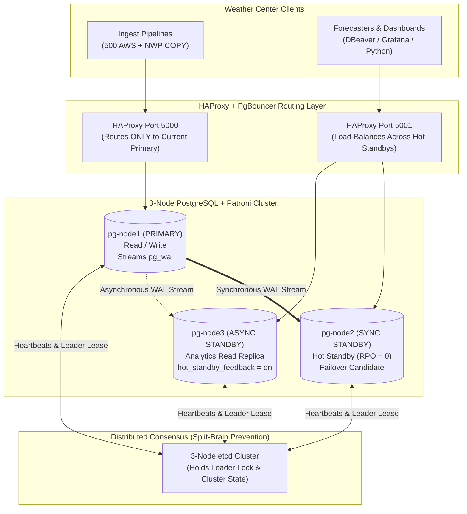

> **Navigation:** [Master README](../README.md) | [Interactive Portal](../bootcamp_portal.html) | [Reference Cards](../reference_cards/README.md) | [Day 2 Coursebook](../day2/day2_master_coursebook.md) | [Day 3 Coursebook](day3_master_coursebook.md) | [Day 4 Coursebook](../day4/day4_master_coursebook.md)

# PostgreSQL High Availability (HA), CAP/PACELC Architecture & Production Operations Guide

**Target Audience:** Weather Forecast & Meteorological Data Engineers, Database Administrators, Site Reliability Engineers  
**Bootcamp Context:** Designing, deploying, securing, pooling, and backing up 24/7 multi-node PostgreSQL clusters with **CAP/PACELC Theory**, **Streaming & Logical Replication**, **`Patroni` + `etcd` Raft Consensus**, **`HAProxy`**, **`PgBouncer`**, **RBAC**, and **PITR Backups**  
**Companion to:** [day3_master_coursebook.md](./day3_master_coursebook.md) | [Reference Card 14: MySQL GTID, InnoDB Cluster (Paxos) & ProxySQL HA](../reference_cards/14_mysql_and_mariadb_innodb_complete_engineering_guide.md#9-high-availability-gtid-replication-mysql-innodb-cluster-group-replication--proxysql)

---

## Executive Summary

A standalone PostgreSQL database represents a Single Point of Failure (SPOF). For a national weather service or environmental agency responsible for 24/7 aviation advisories, marine gale warnings, and severe storm radar tracking, database downtime directly threatens public safety.

However, scaling a relational engine across multiple servers introduces the fundamental constraints of **distributed systems theory**. This comprehensive guide covers both the **Distributed HA Architecture** and **Day-to-Day Production Operations**:

1. **The Distributed Foundations (CAP & PACELC):** How network partitions dictate physical operational limits between Consistency (`CP`) and Availability (`AP`) in weather networks.
2. **Physical Streaming vs. Logical Replication:** Step-by-step setup of Primary $\rightarrow$ Standby replication, Replication Slots, `hot_standby_feedback`, and selective table publication (`alerts.weather_alerts`).
3. **Why Native Replication $\neq$ HA (Split-Brain):** How network splits corrupt relational timelines and how **`Patroni` + `etcd` (Raft Quorum) + `HAProxy`** eliminate split-brain with automated failover and `pg_rewind`.
4. **Complete Multi-Node Docker Compose Blueprint & CAP Failure Labs:** Production configuration files (`haproxy.cfg`, `patroni.yml`, `docker-compose.yml`) and hands-on fault-injection labs.
5. **Production Operations Runbook (RBAC, `PgBouncer`, Backups & Emergency 3:00 AM Troubleshooting):** Least-privilege roles, multiplexing 5,000 station connections over 40 backends via `PgBouncer`, parallel `pg_dump` / `pg_basebackup` Point-in-Time Recovery (PITR), and killing lock blockers.

---

## 1. The Distributed Systems Dilemma: CAP & PACELC in Weather Networks

Before deploying cluster software, engineers must confront the physical laws of distributed networks.

```
                                  The CAP Theorem
                       ┌─────────────────────────────────────┐
                       │        Network Partition (P)        │
                       │ (Fiber cut, tower outage, lightning)│
                       └──────────────────┬──────────────────┘
                                          │
                     ┌────────────────────┴────────────────────┐
                     ▼                                         ▼
         Consistency Priority (CP)                 Availability Priority (AP)
         • Rejects writes if replicas cannot       • Accepts writes locally at edge/node
           reach absolute quorum consensus         • Replicas return stale data to dashboards
         • Guarantees ZERO data loss (RPO = 0)     • Risk of data divergence or timeline fork
         • System halts during severe network split• System stays online; requires reconciliation
```

### 1.1 The CAP Theorem Unpacked

Formulated by Eric Brewer and proven by Gilbert and Lynch, the CAP theorem states that a distributed data store can guarantee at most **two out of three** properties simultaneously:

* **Consistency ($C$):** Every read receives the most recent write or an error. All nodes see the exact same data at the exact same physical moment.
* **Availability ($A$):** Every non-failing node returns a successful (non-error) response to every request—without guaranteeing that it contains the most recent write.
* **Partition Tolerance ($P$):** The system continues to operate despite an arbitrary number of messages being dropped or delayed by the network between nodes.

#### The Physical Reality of Partition Tolerance ($P$)
In real-world meteorological infrastructure—involving remote mountain radar stations, offshore buoys, microwave relays, and cellular modems—**network partitions ($P$) are unavoidable**. Therefore, distributed systems architecture is not a choice between $C$, $A$, and $P$. **You must choose how the system behaves when a partition ($P$) occurs:**

$$
\text{System Reality} = P \implies (C \lor A)
$$

### 1.2 The PACELC Theorem Extension

Daniel Abadi expanded CAP to capture the trade-offs that govern systems during **normal operating conditions** (when no partition exists):

$$
\mathbf{P} \text{artition} \implies (\mathbf{A} \text{vailability} \lor \mathbf{C} \text{onsistency}) \quad \mathbf{E} \text{lse} \implies (\mathbf{L} \text{atency} \lor \mathbf{C} \text{onsistency})
$$

* **If there is a Partition ($P$):** How do you trade off Availability ($A$) vs. Consistency ($C$)?
* **Else ($E$, normal operation):** How do you trade off Latency ($L$) vs. Consistency ($C$)?

### 1.3 Meteorological Scenarios: The Operational Spectrum

| Meteorological Domain | CAP Choice | PACELC Profile | Failure Tolerance & Engineering Policy |
| :--- | :--- | :--- | :--- |
| **Severe Flash Flood & Tornado Alerts** | **CP** | **PC / EC** | **Absolute Consistency (`RPO = 0`).** If a secondary node is partitioned, it must never serve stale alert cancellations. A primary node must not confirm an evacuation order until synchronous storage acknowledges it. Latency is sacrificed for integrity. |
| **High-Frequency Ingest (AWS Sensor Pings)** | **AP** | **PA / EL** | **Maximum Availability & Low Latency.** 50,000 pings/sec must not stall because a standby node is lagging. Write locally (`synchronous_commit = local`), stream asynchronously, and never block sensor ingestion. |
| **National Radar Composite Mosaic & Forecaster Analytics** | **AP** | **PA / EL** | **Low Latency Reads.** Forecaster dashboards and web maps need immediate responses ($L$) from Read Replicas. Serving an observation or radar sweep that is 2 seconds old is vastly preferable to stalling live ingestion ($A$). |

---

## 2. Multi-Node PostgreSQL HA Topology & Replication Engines

In operational meteorology, a production cluster uses **3 PostgreSQL Nodes + `Patroni` (Cluster Manager) + `etcd` (Distributed Consensus) + `HAProxy` / `PgBouncer` (Traffic & Connection Routing)**:

- **Node 1 (`pg-node1` — Primary — Read/Write):** Receives all live automated weather station (AWS) observations, `00Z`/`12Z` NWP forecast `COPY` loads, and CAP severe weather alert writes.
- **Node 2 (`pg-node2` — Synchronous Standby — Zero Data Loss Failover Target):** Receives `pg_wal` stream in real time (`RPO = 0`). If Node 1 dies during a severe storm, `Patroni` promotes Node 2 to Primary in **< 10 seconds**!
- **Node 3 (`pg-node3` — Asynchronous Hot Standby — Forecaster & Analytics Read Replica):** Serves heavy forecaster DBeaver queries, `PostGIS` map rendering, and climatology aggregations so analytical reads **never slow down live telemetry ingestion on Node 1**!



### 2.1 Physical Streaming Replication vs. Logical Replication

PostgreSQL provides two built-in replication engines. Weather centers often use **both**:

| Feature | Physical Streaming Replication | Logical Replication (`PUBLICATION` / `SUBSCRIPTION`) |
| :--- | :--- | :--- |
| **How It Works** | Ships raw **8 KB page byte changes** (`pg_wal`) block-for-block from Primary to Standby. | Decodes WAL into logical row operations (`INSERT`, `UPDATE`, `DELETE`) for specific tables. |
| **Scope** | Entire PostgreSQL cluster (all databases, schemas, and tables are identical). | **Selective tables** (e.g., replicate *only* `alerts.weather_alerts` to a public DMZ web database!). |
| **Writes on Standby?** | Standby is strictly **Read-Only** (`pg_is_in_recovery() = true`). | Subscriber is a normal writable database (can have its own extra tables/indexes). |
| **PostgreSQL Versions** | Must be the **exact same major version** (e.g., PG 16 $\rightarrow$ PG 16) and OS architecture. | Can replicate **across major versions** (e.g., PG 14 $\rightarrow$ PG 16 for zero-downtime upgrades!). |
| **DDL Replication** | Automatic (`CREATE TABLE`, `ADD PARTITION`, `CREATE INDEX` replicate automatically!). | DDL does not replicate automatically (must apply schema changes manually). |
| **Primary Weather Use Case** | **High Availability (HA) failover & Read Replicas for forecasters.** | **Publishing live CAP alerts to external web portals & zero-downtime version upgrades.** |

---

## 3. Why Native Replication Is Not HA (And How Patroni + etcd Solve Split-Brain)

```
                    The Native Streaming Replication Flow
 ┌───────────────────────────┐                     ┌───────────────────────────┐
 │   Primary Node (Read/Write)│                     │  Standby Node (Read-Only) │
 ├───────────────────────────┤                     ├───────────────────────────┤
 │ 1. Client issues INSERT   │                     │                           │
 │ 2. WAL written to disk    │                     │                           │
 │ 3. WAL sender process     │ ──── TCP Stream ──> │ 4. WAL receiver process   │
 │    pushes WAL records     │                     │ 5. Startup process applies│
 │                           │                     │    WAL to 8 KB heap pages │
 └───────────────────────────┘                     └───────────────────────────┘
```

### 3.1 Asynchronous vs. Synchronous Commit Modes
1. **Asynchronous Mode (`synchronous_commit = off` or `local`):**
   - Primary writes transaction to local WAL and immediately returns `COMMIT` to client.
   - **CAP Profile:** Prioritizes **Availability ($A > C$)**.
   - **Risk:** **Data Loss ($\text{RPO} > 0$)** if the Primary suffers power loss before buffered WAL reaches the Standby.
2. **Synchronous Mode (`synchronous_commit = on` or `remote_apply`):**
   - Primary blocks client `COMMIT` until the Standby confirms WAL write (`remote_write`/`on`) or memory replay (`remote_apply`).
   - **CAP Profile:** Prioritizes **Consistency ($C > A$, $\text{RPO} = 0$)**.
   - **Risk:** **Write Stall ($\text{Availability} = 0$)** if the network link to the synchronous standby drops and no other standby is available in `synchronous_standby_names`.

### 3.2 The Nightmare of Relational Split-Brain

What happens in a naive 2-node cluster when the heartbeat link between Node 1 (Primary) and Node 2 (Standby) breaks, while both nodes remain reachable by ingestion clients?

```
                     The Split-Brain Catastrophe
 ┌───────────────────────┐                     ┌───────────────────────┐
 │ Node 1 (Old Primary)  │                     │  Node 2 (New Primary) │
 ├───────────────────────┤                     ├───────────────────────┤
 │ Network partition cuts│ <=== NETWORK SEVER==> Automates failover;   │
 │ heartbeat. Thinks it  │                     │ thinks Node 1 died.   │
 │ is still the master.  │                     │ Promotes itself.      │
 ├───────────────────────┤                     ├───────────────────────┤
 │ INGEST A:             │                     │ INGEST B:             │
 │ Accepts station pings │                     │ Accepts radar updates │
 │ Timeline 1 progresses │                     │ Timeline 2 diverges!  │
 └───────────────────────┘                     └───────────────────────┘
```

Both nodes write different tuples to the same 8 KB page addresses on divergent timelines (**Timeline 1** vs. **Timeline 2**), corrupting the cluster!

### 3.3 How `etcd` (Raft Quorum) + `Patroni` + `HAProxy` Prevent Split-Brain

```
                       Production PostgreSQL HA Topology
                     ┌────────────────────────────────┐
                     │   Applications / Ingest APIs   │
                     └───────────────┬────────────────┘
                                     │
                                     ▼
                     ┌────────────────────────────────┐
                     │    Load Balancer / Proxy       │
                     │    (HAProxy / PgBouncer)       │
                     │  Port 5000: R/W Master         │
                     │  Port 5001: Read-Only Replicas │
                     └───────┬────────────────┬───────┘
                             │                │
            ┌────────────────┘                └────────────────┐
            ▼                                                  ▼
 ┌───────────────────────┐                          ┌───────────────────────┐
 │ Host 1: DB-Primary    │                          │ Host 2: DB-Standby    │
 │ ┌───────────────────┐ │                          │ ┌───────────────────┐ │
 │ │ PostgreSQL 16     │ │ <── Physical Stream ───> │ │ PostgreSQL 16     │ │
 │ └─────────▲─────────┘ │                          │ └─────────▲─────────┘ │
 │           │           │                          │           │           │
 │ ┌─────────┴─────────┐ │                          │ ┌─────────┴─────────┐ │
 │ │ Patroni Agent     │ │                          │ │ Patroni Agent     │ │
 │ └─────────▲─────────┘ │                          │ └─────────▲─────────┘ │
 └───────────┼───────────┘                          └───────────┼───────────┘
             │                                                  │
             └───────────────┐                  ┌───────────────┘
                             ▼                  ▼
               ┌───────────────────────────────────────────────┐
               │     Distributed Consensus Store (DCS)         │
               │             etcd Cluster                      │
               │   (3 or 5 Nodes: Enforces Raft Quorum)        │
               │   [Node 1]      [Node 2]      [Node 3]        │
               └───────────────────────────────────────────────┘
```

1. **Distributed Consensus Store (`etcd`):** Maintains an odd number of nodes ($2N+1 = 3\text{ or }5$) enforcing **Raft Quorum**:
   $$\text{Quorum Majority} = \left\lfloor \frac{N}{2} \right\rfloor + 1$$
   A split network cannot form two quorums; only the partition with $\ge 2$ of 3 `etcd` nodes can hold or grant the `leader` lock.
2. **Cluster Orchestrator (`Patroni`):** Renews the Primary lease in `etcd` (`ttl: 30s`). If `pg-node1` loses contact with the `etcd` majority, Patroni immediately **fences/demotes `pg-node1` to read-only** (`SIGTERM`/watchdog) before `pg-node2` is promoted to **Timeline 2**. When `pg-node1` recovers, Patroni runs **`pg_rewind`** to automatically heal its timeline and rejoin it as a Standby!
3. **Dynamic Router (`HAProxy`):** Probes Patroni's REST API (`GET /primary` and `GET /replica` on port `8008`) every 2–3 seconds so port `5000` **always** routes strictly to the current Leader and port `5001` load-balances across healthy Standbys.

---

## 4. Step-by-Step: Native Physical Streaming & Logical Replication Setup

Even when using Patroni, every database engineer must know how raw PostgreSQL replication works under the hood.

### 4.1 Step 1: Configure the Primary Node (`pg-node1` — `10.20.1.11`)

1. **In `postgresql.conf` on Primary:**
   ```ini
   listen_addresses = '*'
   wal_level = replica                  # Required for physical streaming (use 'logical' if also using Logical Replication)
   max_wal_senders = 10                 # Max concurrent standby replication streams
   max_replication_slots = 10           # Prevents Primary from deleting WAL still needed by a Standby!
   wal_keep_size = 4GB                  # Safety buffer of WAL retained on Primary
   max_slot_wal_keep_size = 50GB        # Safety guardrail (PG 13+): prevents a dead standby slot from filling Primary disk 100%!
   hot_standby = on                     # Allows read-only queries when a node is a Standby

   # OPTIONAL: Enable Synchronous Replication so commits wait for pg-node2:
   # synchronous_commit = on
   # synchronous_standby_names = 'FIRST 1 (pg_node2)'
   ```

2. **Create Dedicated Replication User & Physical Replication Slot in `psql` on Primary:**
   ```sql
   CREATE ROLE replicator WITH REPLICATION LOGIN PASSWORD 'ReplSecretPassword!';
   SELECT pg_create_physical_replication_slot('slot_pg_node2');
   ```

3. **Allow Standby IPs in `pg_hba.conf` on Primary (`SELECT pg_reload_conf();`):**
   ```text
   # TYPE   DATABASE      USER          ADDRESS          METHOD
   host     replication   replicator    10.20.1.12/32    scram-sha-256
   host     replication   replicator    10.20.1.13/32    scram-sha-256
   ```

### 4.2 Step 2: Bootstrap the Standby Node (`pg-node2` — `10.20.1.12`)

```bash
sudo systemctl stop postgresql
sudo rm -rf /var/lib/postgresql/16/main/*

# Clone Primary data directory, create standby.signal (-R), and bind to replication slot (-S):
sudo -u postgres pg_basebackup \
  -h 10.20.1.11 \
  -U replicator \
  -D /var/lib/postgresql/16/main \
  -Fp -Xs -P -R \
  -S slot_pg_node2 \
  -C
```
> **What did the `-R` flag do?**
> 1. Created `/var/lib/postgresql/16/main/standby.signal` (tells PostgreSQL 12+ to start in **Hot Standby recovery mode**).
> 2. Wrote `primary_conninfo` and `primary_slot_name = 'slot_pg_node2'` into `postgresql.auto.conf`.

### 4.3 Crucial Standby Tuning for Forecaster Read Replicas (`hot_standby_feedback`)
When a forecaster runs a 3-minute climatology query on a Read Replica (`pg-node3`), if `autovacuum` on the Primary cleans up dead tuples on `synoptic.observations` and ships that cleanup via WAL, the Read Replica cancels the forecaster's query after 30 seconds with `ERROR: canceling statement due to conflict with recovery`.
**Fix in `postgresql.conf` on Read Replicas:**
```ini
hot_standby = on
hot_standby_feedback = on               # Tells the Primary NOT to vacuum rows currently being read by a query on this Standby!
max_standby_streaming_delay = 300s      # Allow up to 5 minutes for long analytical queries before applying conflicting WAL
```

### 4.4 Monitoring Replication Lag & Inactive Slots
```sql
-- 1. ON PRIMARY: Inspect connected standbys & byte/time lag
SELECT
    client_addr,
    application_name                                                   AS standby_node,
    state,                                                             -- Should be 'streaming'
    sync_state,                                                        -- 'sync', 'async', or 'potential'
    pg_size_pretty(pg_wal_lsn_diff(pg_current_wal_lsn(), sent_lsn))    AS network_lag_bytes,
    pg_size_pretty(pg_wal_lsn_diff(pg_current_wal_lsn(), write_lsn))   AS disk_write_lag_bytes,
    pg_size_pretty(pg_wal_lsn_diff(pg_current_wal_lsn(), replay_lsn))  AS replay_lag_bytes,
    replay_lag                                                         AS replay_lag_time
FROM pg_stat_replication;

-- 2. ON ANY NODE: Check if node is Primary or Standby
SELECT
    pg_is_in_recovery() AS is_standby_replica,
    CASE WHEN pg_is_in_recovery() THEN 'READ-ONLY HOT STANDBY' ELSE 'READ-WRITE PRIMARY' END AS node_role,
    pg_last_wal_receive_lsn() AS last_received_lsn,
    pg_last_wal_replay_lsn()  AS last_replayed_lsn,
    NOW() - pg_last_xact_replay_timestamp() AS replication_delay_seconds;

-- 3. ON PRIMARY: Check for disconnected replication slots (active = false) retaining WAL
SELECT
    slot_name,
    slot_type,
    active,
    pg_size_pretty(pg_wal_lsn_diff(pg_current_wal_lsn(), restart_lsn)) AS retained_wal_size
FROM pg_replication_slots;
```

### 4.5 Logical Replication Recipe: Syncing `alerts.weather_alerts` to a Public Web DB
```sql
-- ON INTERNAL PRIMARY (weather_ops — requires wal_level = logical):
CREATE PUBLICATION pub_public_weather_alerts
FOR TABLE alerts.weather_alerts;

-- ON EXTERNAL PUBLIC DATABASE (web-pg — after creating matching table structure):
CREATE SUBSCRIPTION sub_public_weather_alerts
CONNECTION 'host=10.20.1.11 port=5432 dbname=weather_ops user=replicator password=ReplSecretPassword!'
PUBLICATION pub_public_weather_alerts;
```

---

## 5. Production Patroni + etcd + HAProxy Deployment Blueprint (Docker Compose)

### 5.1 Directory Structure
```text
postgres-ha/
├── docker-compose.yml
├── haproxy/
│   └── haproxy.cfg
└── patroni/
    └── patroni.yml
```

### 5.2 HAProxy Configuration (`haproxy/haproxy.cfg`)
```ini
global
    maxconn 4096
    log stdout local0 notice

defaults
    log     global
    mode    tcp
    timeout connect 5s
    timeout client  30m
    timeout server  30m

# Web Dashboard for Cluster Status
listen stats
    mode http
    bind *:7000
    stats enable
    stats uri /
    stats refresh 5s

# Port 5000: Routes Strictly to Primary (Read/Write)
frontend pg_cluster_primary_front
    bind *:5000
    default_backend pg_cluster_primary_back

backend pg_cluster_primary_back
    mode tcp
    option httpchk GET /primary
    http-check expect status 200
    default-server inter 3s fall 3 rise 2 on-marked-down shutdown-sessions
    server pg_node1 pg_node1:5432 maxconn 200 check port 8008
    server pg_node2 pg_node2:5432 maxconn 200 check port 8008

# Port 5001: Load Balances Analytical Scans Across Standbys (Read-Only)
frontend pg_cluster_standby_front
    bind *:5001
    default_backend pg_cluster_standby_back

backend pg_cluster_standby_back
    mode tcp
    balance roundrobin
    option httpchk GET /replica
    http-check expect status 200
    default-server inter 3s fall 3 rise 2
    server pg_node1 pg_node1:5432 maxconn 200 check port 8008
    server pg_node2 pg_node2:5432 maxconn 200 check port 8008
```

### 5.3 Patroni Configuration (`patroni/patroni.yml`)
```yaml
scope: weather-cluster
namespace: /service

# 1. Distributed Consensus Store Parameters
etcd3:
  hosts:
    - etcd1:2379
    - etcd2:2379
    - etcd3:2379

# 2. Cluster Health & Failover Timings
ttl: 30                          # Primary lease validity (seconds)
loop_wait: 10                    # How often Patroni checks etcd
retry_timeout: 10                # Network request retry grace window
maximum_lag_on_failover: 1048576 # 1 MB maximum WAL lag allowed for auto-promotion

# 3. REST API for HAProxy Health Checks
restapi:
  listen: 0.0.0.0:8008
  connect_address: 0.0.0.0:8008

# 4. PostgreSQL Configuration & Hardening
bootstrap:
  dcs:
    ttl: 30
    loop_wait: 10
    retry_timeout: 10
    maximum_lag_on_failover: 1048576
    synchronous_mode: false      # Set true for strict zero-data-loss CP mode
    postgresql:
      use_pg_rewind: true
      use_slots: true
      parameters:
        shared_buffers: 512MB
        wal_level: replica
        max_wal_senders: 10
        max_replication_slots: 10
        hot_standby: "on"
        wal_keep_size: 1024MB
        checkpoint_completion_target: 0.9
        max_wal_size: 4GB
        wal_compression: zstd

  initdb:
    - encoding: UTF8
    - data-checksums

  pg_hba:
    - host replication replicator 0.0.0.0/0 md5
    - host all all 0.0.0.0/0 md5

postgresql:
  listen: 0.0.0.0:5432
  connect_address: 0.0.0.0:5432
  data_dir: /var/lib/postgresql/data
  bin_dir: /usr/lib/postgresql/16/bin
  pgpass: /tmp/pgpass
  authentication:
    replication:
      username: replicator
      password: ReplicatorSecurePassword123!
    superuser:
      username: postgres
      password: PostgresRootPassword123!
```

### 5.4 Master Orchestrator (`docker-compose.yml`)
```yaml
version: '3.8'

networks:
  weather_ha_net:
    driver: bridge

services:
  etcd1:
    image: quay.io/coreos/etcd:v3.5.11
    container_name: etcd1
    environment:
      - ETCD_NAME=etcd1
      - ETCD_INITIAL_ADVERTISE_PEER_URLS=http://etcd1:2380
      - ETCD_LISTEN_PEER_URLS=http://0.0.0.0:2380
      - ETCD_LISTEN_CLIENT_URLS=http://0.0.0.0:2379
      - ETCD_ADVERTISE_CLIENT_URLS=http://etcd1:2379
      - ETCD_INITIAL_CLUSTER_TOKEN=etcd-weather-cluster
      - ETCD_INITIAL_CLUSTER=etcd1=http://etcd1:2380,etcd2=http://etcd2:2380,etcd3=http://etcd3:2380
      - ETCD_INITIAL_CLUSTER_STATE=new
    networks:
      - weather_ha_net

  etcd2:
    image: quay.io/coreos/etcd:v3.5.11
    container_name: etcd2
    environment:
      - ETCD_NAME=etcd2
      - ETCD_INITIAL_ADVERTISE_PEER_URLS=http://etcd2:2380
      - ETCD_LISTEN_PEER_URLS=http://0.0.0.0:2380
      - ETCD_LISTEN_CLIENT_URLS=http://0.0.0.0:2379
      - ETCD_ADVERTISE_CLIENT_URLS=http://etcd2:2379
      - ETCD_INITIAL_CLUSTER_TOKEN=etcd-weather-cluster
      - ETCD_INITIAL_CLUSTER=etcd1=http://etcd1:2380,etcd2=http://etcd2:2380,etcd3=http://etcd3:2380
      - ETCD_INITIAL_CLUSTER_STATE=new
    networks:
      - weather_ha_net

  etcd3:
    image: quay.io/coreos/etcd:v3.5.11
    container_name: etcd3
    environment:
      - ETCD_NAME=etcd3
      - ETCD_INITIAL_ADVERTISE_PEER_URLS=http://etcd3:2380
      - ETCD_LISTEN_PEER_URLS=http://0.0.0.0:2380
      - ETCD_LISTEN_CLIENT_URLS=http://0.0.0.0:2379
      - ETCD_ADVERTISE_CLIENT_URLS=http://etcd3:2379
      - ETCD_INITIAL_CLUSTER_TOKEN=etcd-weather-cluster
      - ETCD_INITIAL_CLUSTER=etcd1=http://etcd1:2380,etcd2=http://etcd2:2380,etcd3=http://etcd3:2380
      - ETCD_INITIAL_CLUSTER_STATE=new
    networks:
      - weather_ha_net

  pg_node1:
    image: ghcr.io/zalando/patroni:v3.2.0
    container_name: pg_node1
    hostname: pg_node1
    environment:
      - PATRONI_NAME=pg_node1
      - PATRONI_CONFIGURATION_FILE=/etc/patroni/patroni.yml
      - PATRONI_RESTAPI_CONNECT_ADDRESS=pg_node1:8008
      - PATRONI_POSTGRESQL_CONNECT_ADDRESS=pg_node1:5432
    volumes:
      - ./patroni/patroni.yml:/etc/patroni/patroni.yml:ro
    depends_on:
      - etcd1
      - etcd2
      - etcd3
    networks:
      - weather_ha_net

  pg_node2:
    image: ghcr.io/zalando/patroni:v3.2.0
    container_name: pg_node2
    hostname: pg_node2
    environment:
      - PATRONI_NAME=pg_node2
      - PATRONI_CONFIGURATION_FILE=/etc/patroni/patroni.yml
      - PATRONI_RESTAPI_CONNECT_ADDRESS=pg_node2:8008
      - PATRONI_POSTGRESQL_CONNECT_ADDRESS=pg_node2:5432
    volumes:
      - ./patroni/patroni.yml:/etc/patroni/patroni.yml:ro
    depends_on:
      - etcd1
      - etcd2
      - etcd3
    networks:
      - weather_ha_net

  haproxy:
    image: haproxy:2.8-alpine
    container_name: haproxy
    volumes:
      - ./haproxy/haproxy.cfg:/usr/local/etc/haproxy/haproxy.cfg:ro
    ports:
      - "5000:5000"   # Read/Write Entrypoint (Primary)
      - "5001:5001"   # Read-Only Entrypoint (Standby Pool)
      - "7000:7000"   # Monitoring Dashboard
    depends_on:
      - pg_node1
      - pg_node2
    networks:
      - weather_ha_net
```

### 5.5 Essential `patronictl` Multi-Node Administration Commands
```bash
# 1. View live cluster topology, roles, timeline (TL), and replication lag across all nodes:
patronictl -c /etc/patroni/patroni.yml list

# 2. Planned Zero-Downtime Switchover (e.g., to patch Linux kernel on pg_node1):
patronictl -c /etc/patroni/patroni.yml switchover --master pg_node1 --candidate pg_node2

# 3. Emergency Manual Failover:
patronictl -c /etc/patroni/patroni.yml failover

# 4. Reinitialize a corrupted or lagging Replica node from the current Leader:
patronictl -c /etc/patroni/patroni.yml reinit weather-cluster pg_node2

# 5. Apply a cluster-wide postgresql.conf change across ALL nodes simultaneously:
patronictl -c /etc/patroni/patroni.yml edit-config
patronictl -c /etc/patroni/patroni.yml reload weather-cluster
```

---

## 6. Hands-On CAP Failure Labs: Simulating Real-World Disasters

### Lab 1: Simulating Sudden Primary Power Loss (Automated Failover & `pg_rewind`)
1. Boot the stack (`docker compose up -d`) and verify `etcd` health (`docker exec -it etcd1 etcdctl endpoint health --cluster`).
2. Create an advisory table and insert a row via HAProxy Primary Port `5000`:
   ```bash
   PGPASSWORD='PostgresRootPassword123!' psql -h localhost -p 5000 -U postgres -d postgres -c "
   CREATE TABLE active_advisories (
       id SERIAL PRIMARY KEY,
       zone_code VARCHAR(10) NOT NULL,
       warning_type VARCHAR(64) NOT NULL,
       issued_at TIMESTAMPTZ DEFAULT NOW()
   );
   INSERT INTO active_advisories (zone_code, warning_type) VALUES ('DZ-15', 'TORNADO_VORTEX_SIGNATURE');
   "
   ```
3. Force-kill the Leader container (`docker stop pg_node1`) and watch `pg_node2` promote to `Leader` on **Timeline 2 (`TL = 2`)**:
   ```bash
   docker exec -it pg_node2 patronictl -c /etc/patroni/patroni.yml list
   ```
4. Verify HAProxy Port `5000` automatically routes new writes to `pg_node2`:
   ```bash
   PGPASSWORD='PostgresRootPassword123!' psql -h localhost -p 5000 -U postgres -d postgres -c "
   INSERT INTO active_advisories (zone_code, warning_type) VALUES ('DZ-16', 'FLASH_FLOOD_EMERGENCY');
   SELECT inet_server_addr(), pg_is_in_recovery();
   "
   ```
5. Start the old primary (`docker start pg_node1`) and observe Patroni execute **`pg_rewind`** to heal `pg_node1` onto Timeline 2 as a Standby replica!

### Lab 2: Simulating the CAP Write Stall (Network Isolation Under Synchronous CP Mode)
1. Enable strict synchronous replication (`CP` mode):
   ```bash
   docker exec -it pg_node2 patronictl -c /etc/patroni/patroni.yml edit-config --set synchronous_mode=true
   ```
2. Sever the standby from the network (`docker network disconnect postgres-ha_weather_ha_net pg_node1`).
3. Attempt to `INSERT` an urgent warning on Port `5000`—observe that the terminal **hangs** because you mandated strict Consistency ($C$) during a Partition ($P$), reducing Availability ($A$) to zero until the standby reconnects (`docker network connect postgres-ha_weather_ha_net pg_node1`)!

---

## 7. Production Security, Connection Pooling (`PgBouncer`) & PITR Backup Runbook

### 7.1 Role-Based Access Control (RBAC): Forecasters vs. Ingest Scripts
In a national weather center, **never let automated station ingest scripts or forecaster DBeaver sessions connect as `postgres` superuser**! Create 3 distinct roles:
1. **`weather_admin`**: Owns the schemas (`synoptic`, `nwp`, `alerts`) and runs DDL migrations.
2. **`station_ingest_svc`**: Can **only** `INSERT` and `UPDATE` (`UPSERT`) into `synoptic.observations`, `synoptic.observations_part`, and `nwp.forecasts` (cannot `DROP` or `DELETE`!).
3. **`forecaster_ro`**: Read-only (`SELECT`) access across all tables and views, with a **`60s` statement timeout** so a runaway cross-join never starves the server.

```sql
-- 1. Create the 3 operational roles
CREATE ROLE weather_admin WITH LOGIN PASSWORD 'StrongAdminPassword!';
CREATE ROLE station_ingest_svc WITH LOGIN PASSWORD 'StrongIngestPassword!';
CREATE ROLE forecaster_ro WITH LOGIN PASSWORD 'StrongForecasterPassword!';

-- 2. Grant schema usage
GRANT USAGE ON SCHEMA synoptic, nwp, alerts TO station_ingest_svc, forecaster_ro;

-- 3. Configure Read-Only Role (Forecasters & Data Scientists)
GRANT SELECT ON ALL TABLES IN SCHEMA synoptic, nwp, alerts TO forecaster_ro;
-- Ensure any future monthly partitions or tables created by weather_admin are automatically readable!
ALTER DEFAULT PRIVILEGES IN SCHEMA synoptic, nwp, alerts
    GRANT SELECT ON TABLES TO forecaster_ro;

-- 4. Configure Least-Privilege Ingestion Service Role (Automated Stations & NWP Loaders)
GRANT SELECT, INSERT, UPDATE ON synoptic.observations, synoptic.observations_part TO station_ingest_svc;
GRANT SELECT, INSERT, UPDATE ON nwp.forecasts TO station_ingest_svc;
GRANT USAGE, SELECT ON ALL SEQUENCES IN SCHEMA synoptic, nwp TO station_ingest_svc;

-- 5. Protect Forecaster Queries from Accidentally Running for 6 Hours!
ALTER ROLE forecaster_ro SET statement_timeout = '60s';
```

---

### 7.2 Connection Pooling with `PgBouncer` (Handling 5,000+ Weather Stations)
As covered on Day 2, opening 5,000 direct TCP connections to PostgreSQL spawns 5,000 OS processes and exhausts RAM. **`PgBouncer`** sits on port `6432` and multiplexes thousands of station connections over a small pool of **40 real PostgreSQL backend processes**!

#### `/etc/pgbouncer/pgbouncer.ini` (Production Weather Template)
```ini
[databases]
weather_ops = host=127.0.0.1 port=5432 dbname=weather_ops

[pgbouncer]
listen_addr = *
listen_port = 6432
auth_type = scram-sha-256
auth_file = /etc/pgbouncer/userlist.txt

# TRANSACTION POOLING: Assigns a PostgreSQL backend process ONLY while a transaction
# (BEGIN ... COMMIT) is actively running, then immediately releases it to the next station!
pool_mode = transaction

max_client_conn = 5000          # Up to 5,000 automated weather stations can stay connected!
default_pool_size = 40          # Uses only 40 actual PostgreSQL backend processes on the server!
reserve_pool_size = 10
```

---

### 7.3 PostgreSQL Backup & Point-in-Time Recovery (PITR) Runbook

#### 1. Logical Backups (`pg_dump` & `pg_restore` — Best for Specific Schemas or Detached Partitions)
Always use **Directory (`-Fd`) or Custom Format (`-Fc`)** instead of plain `.sql` text: it is **compressed automatically**, supports **parallel multi-core dump/restore (`-j 4`)**, and lets you restore a single table or detached monthly partition!

```bash
# 1. Parallel compressed backup of the entire weather_ops database (zero table locks!):
pg_dump -U postgres -d weather_ops -Fd -j 4 -Z 6 -f /backups/weather_ops_dir_20261007

# 2. Backup ONLY a single detached monthly partition before dropping it from disk:
pg_dump -U postgres -d weather_ops -Fc -t synoptic.obs_y2026m06 -f /backups/obs_y2026m06.dump

# 3. Restore in parallel across 4 CPU cores:
pg_restore -U postgres -d weather_ops -j 4 /backups/obs_y2026m06.dump
```

#### 2. Physical Base Backups & Point-in-Time Recovery (`pg_basebackup` / `pgBackRest`)
For databases $> 100\text{ GB}$, logical `pg_dump` is too slow to restore during an emergency. Physical backups copy the raw 8 KB heap pages + archive the `pg_wal` stream so you can recover to the **exact second before an accidental `DROP TABLE`**!

```bash
# Take a live compressed physical base backup with WAL streaming:
pg_basebackup -U postgres -D /backups/base_20261007 -Ft -z -Xs -P
```

---

### 7.4 Emergency Operational Troubleshooting (3:00 AM On-Call Sheet)

#### Find & Kill a Runaway Query or Lock Blocker in PostgreSQL
```sql
-- 1. Find any query running longer than 30 seconds or blocking another process:
SELECT
    pid,
    usename,
    application_name,
    state,
    NOW() - query_start AS duration,
    wait_event_type,
    pg_blocking_pids(pid) AS blocked_by_pids,
    LEFT(query, 80) AS query
FROM pg_stat_activity
WHERE state != 'idle'
ORDER BY duration DESC;

-- 2. Gracefully cancel the query running on PID 12345 (leaves connection alive):
SELECT pg_cancel_backend(12345);

-- 3. Force-terminate a stuck backend process & roll back its transaction:
SELECT pg_terminate_backend(12345);
```

---

## 8. Summary Checklist & High Availability Sizing Matrix

```
                            High Availability Sizing Matrix
 ┌─────────────────────────────┬───────────────────────────────┬───────────────────────────────┐
 │ Metric / Configuration      │ Asynchronous Mode (AP Focus)  │ Synchronous Mode (CP Focus)   │
 ├─────────────────────────────┼───────────────────────────────┼───────────────────────────────┤
 │ Recovery Point Objective    │ RPO > 0 (Milliseconds of WAL  │ RPO = 0 (Strict Zero Data     │
 │ (RPO - Acceptable Data Loss)│ may be lost on primary crash) │ Loss; mathematically verified)│
 ├─────────────────────────────┼───────────────────────────────┼───────────────────────────────┤
 │ Recovery Time Objective     │ RTO ≈ 10 to 30 Seconds        │ RTO ≈ 10 to 30 Seconds        │
 │ (RTO - Automated Failover)  │ (Automatic Raft Promotion)    │ (Automatic Raft Promotion)    │
 ├─────────────────────────────┼───────────────────────────────┼───────────────────────────────┤
 │ Ingestion Write Latency     │ Ultra-Low (Local Disk I/O)    │ Network Round-Trip Bound      │
 │ (P99 Transaction Speed)     │ (~0.5 ms on NVMe)             │ (+ ping time to standby node) │
 ├─────────────────────────────┼───────────────────────────────┼───────────────────────────────┤
 │ Partition Tolerance Behavior│ Primary continues ingesting;  │ Primary STALLS all writes     │
 │ (Standby Severed by Storm)  │ Standby lags until link returns│ until standby link returns   │
 ├─────────────────────────────┼───────────────────────────────┼───────────────────────────────┤
 │ Ideal Weather Workload      │ • Raw IoT AWS Telemetry       │ • Evacuation / Disaster Alerts│
 │                             │ • Radar sweeps & Sat mosaics  │ • Station Registry & Calib    │
 └─────────────────────────────┴───────────────────────────────┴───────────────────────────────┘
```

```
================================================================================
          POSTGRESQL HIGH AVAILABILITY, SECURITY & OPS REFERENCE CARD
================================================================================
 1. Native Replication ≠ HA  : Replication moves bytes; it does not elect leaders.
 2. Split-Brain Prevention   : NEVER automate failover with 2 nodes alone.
                               Always mandate an odd-quorum DCS (etcd/Raft: 2N+1).
 3. CAP Hard Reality         : In a network split (P), you MUST pick C or A.
                               - Alert Dispatchers: Pick C (synchronous_mode: true).
                               - Bulk Sensor Ingestion: Pick A (synchronous_mode: false).
 4. Dynamic Query Routing    : Use HAProxy with Patroni HTTP checks on port 8008:
                               - Port 5000 -> GET /primary  (Primary R/W)
                               - Port 5001 -> GET /replica  (Standby Read Pool)
 5. Fast Timeline Healing    : Always enable use_pg_rewind: true in patroni.yml
                               and max_slot_wal_keep_size = 50GB in postgresql.conf.
 6. Pool & Lock Down Access  : Place PgBouncer (pool_mode = transaction) in front
                               of PostgreSQL and enforce RBAC + statement_timeout.
================================================================================
```

---

> **Navigation:** [Master README](../README.md) | [Interactive Portal](../bootcamp_portal.html) | [Reference Cards](../reference_cards/README.md) | [Day 2 Coursebook](../day2/day2_master_coursebook.md) | [Day 3 Coursebook](day3_master_coursebook.md) | [Day 4 Coursebook](../day4/day4_master_coursebook.md)

