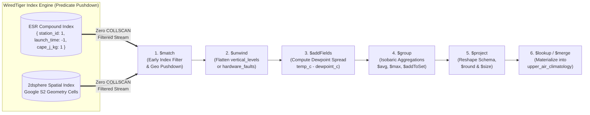
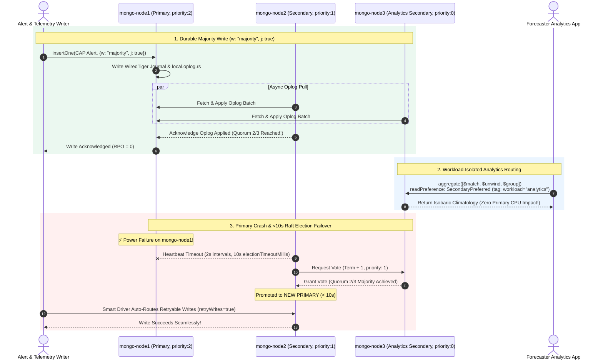
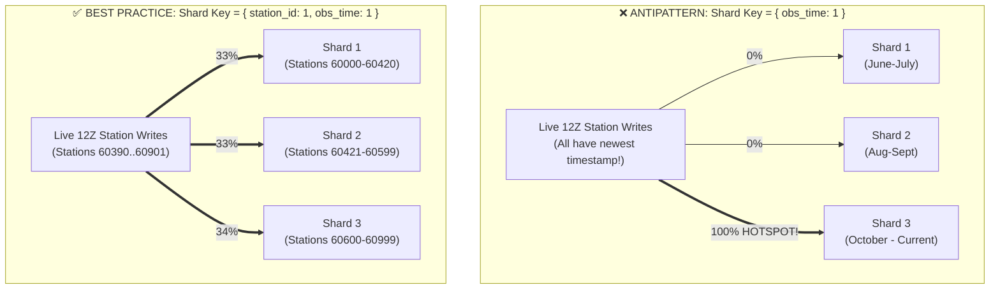

> **Navigation:** [🏠 Master README](../README.md) | [🌐 Interactive Portal](../bootcamp_portal.html) | [⬅️ Day 3: PostgreSQL Scaling](../day3/day3_master_coursebook.md) | [➡️ Day 5: Analytical OLAP & Lakehouse](../day5/day5_part1_olap_duckdb_parquet_and_gridded_data_coursebook.md) | [📚 Reference Cards](../reference_cards/README.md)

# Weather Forecast Engineering Database Bootcamp
# Day 4 Master Coursebook: MongoDB & Polymorphic Telemetry Engineering (Soup-to-Nuts Edition)

**Bootcamp:** Database, NoSQL & High-Throughput Telemetry Engineering (5-Day Intensive — Unified Best-of-Both Edition)  
**Target Audience:** Weather Forecast & Meteorological Data Engineers, Environmental Systems Architects  
**Curriculum Scope:** 5 Comprehensive Technical Modules + 7 Hands-On Production Labs  
**Execution Environment:** MongoDB 7.0+ (`mongod` & `mongosh` CLI + MongoDB Compass / VS Code MongoDB Extension)  
**Companion Files in `day4/`:**
- [day4_weather_ops_mongo.js](./day4_weather_ops_mongo.js) ([📖 Course Walkthrough](./day4_weather_ops_mongo_js_course_walkthrough.md)) — Seed script creating `stations` (with `$jsonSchema`), `radiosonde_soundings` (vertical pressure level arrays), `synoptic_timeseries` (native Time-Series + 90-day TTL collection), and `cap_alerts`
- [day4_weather_ops_mongo_advanced.js](./day4_weather_ops_mongo_advanced.js) ([📖 Course Walkthrough](./day4_weather_ops_mongo_advanced_js_course_walkthrough.md)) — Seed script creating `2dsphere` geospatial indexes, `storm_polygons` (GeoJSON radar cells), ESR compound indexes (`idx_sonde_esr`), and upper-air aggregation summaries
- [day4_mongo_50k_polymorphic_benchmark.js](./day4_mongo_50k_polymorphic_benchmark.js) ([📖 Course Walkthrough](./day4_mongo_50k_polymorphic_benchmark_js_course_walkthrough.md)) — 50,000-document polymorphic telemetry generator across 4 sensor classes, Manual Bucket Pattern upsert engine, and `$unwind` hardware fault diagnostics
- [day4_mongodb_complete_cheatsheet.md](./day4_mongodb_complete_cheatsheet.md) — Complete CLI, SQL-to-MQL Translator, Aggregation Pipeline, `2dsphere`, and `ESR` Cheatsheet
- [day4_mongodb_architecture_ha_and_sharding_guide.md](./day4_mongodb_architecture_ha_and_sharding_guide.md) — Deep-dive reference card on BSON binary encoding, WiredTiger internals, 3-node Replica Set failover, Tunable CAP/PACELC, GridFS, and Sharded Clusters

---

## Course & Session Overview

In Days 1–3, we engineered relational databases from edge SQLite buffers to enterprise PostgreSQL clusters optimized with **Declarative Range Partitioning**, **BRIN indexes**, **PostGIS geodesy**, and **`JSONB`**. Today on **Day 4**, we cross the bridge into **native NoSQL & Polymorphic Telemetry Engineering with MongoDB** and answer:

> *"When does a relational schema become a physical bottleneck for heterogeneous meteorological networks, and how do we model, validate, bucket, aggregate, spatially index, and horizontally shard millions of nested weather documents in MongoDB?"*

By the end of Day 4, attendees will master:
1. **The Schema-Rigidity Wall, `$jsonSchema` Governance & BSON/WiredTiger Internals:** Why heterogeneous sensor networks (3D sonic anemometers, optical disdrometers, coastal wave buoys, road-surface radars) break relational tuple density; how BSON binary length-prefixes and WiredTiger `zstd` compression work; and how `$jsonSchema` enforces strict WMO metadata rules without sacrificing polymorphism.
2. **Upper-Air Radiosonde Vertical Soundings & High-Frequency Time-Series Bucketing:** Modeling bounded 1-to-Many atmospheric profiles (`vertical_levels` arrays), querying nested arrays safely with **`$elemMatch`**, performing atomic in-place updates (`$set`, `$max`, `$addToSet`, `$push`, positional `$`), and comparing **Native Time-Series Collections (`system.buckets.*` + TTL)** against the **Manual Bucket Pattern**.
3. **Multi-Stage Aggregation Pipelines & Hardware Fault Diagnostics:** Building UNIX-style analytical pipelines (`$match` $\rightarrow$ `$unwind` $\rightarrow$ `$addFields` $\rightarrow$ `$group` $\rightarrow$ `$project` $\rightarrow$ `$lookup` $\rightarrow$ `$merge`) for upper-air isobaric climatology, wet-road grip safety, and fleet-wide `$unwind` sensor fault diagnostics across 50,000 polymorphic payloads.
4. **Geospatial Meteorology (`2dsphere`) & The `ESR` Indexing Rule:** Executing spherical Earth queries (`$geoNear`, `$geoWithin`, `$geoIntersects`) on GeoJSON storm polygons, eliminating blocking in-memory sorts using the **ESR (Equality, Sort, Range)** compound indexing rule, and diagnosing execution plans via `.explain("executionStats")`.
5. **Distributed MongoDB in Production (Replica Sets, Tunable CAP, GridFS & Sharding):** Operating a 3-node Replica Set (`rs_meteo`) with workload-isolated analytics secondaries, tuning per-operation CAP/PACELC durability (`w: "majority", j: true` vs. `w: 1`), evaluating **GridFS vs. S3/MinIO** for radar/satellite blobs, and designing **Compound Shard Keys** that eliminate monotonic timestamp hotspots.

---

## Module Outline

```text
┌─────────────────┬──────────────────────────────────────────────────────────────────────────┐
│ Module 1        │ The Schema-Rigidity Wall, $jsonSchema & BSON/WiredTiger Engine           │
├─────────────────┼──────────────────────────────────────────────────────────────────────────┤
│ Module 2        │ Radiosonde Soundings, $elemMatch, Atomic Updates & Bucketing             │
├─────────────────┼──────────────────────────────────────────────────────────────────────────┤
│ Module 3        │ Multi-Stage Aggregation Pipelines & 50k Fault Diagnostics                │
├─────────────────┼──────────────────────────────────────────────────────────────────────────┤
│ Module 4        │ Geospatial Meteorology (2dsphere) & The ESR Indexing Rule                │
├─────────────────┼──────────────────────────────────────────────────────────────────────────┤
│ Module 5        │ Distributed Production MongoDB — Replica Sets, CAP & Sharding            │
└─────────────────┴──────────────────────────────────────────────────────────────────────────┘
```

---

## Module 1: The Schema-Rigidity Wall, Polymorphic Station Metadata (`$jsonSchema`) & BSON / WiredTiger Internals

### 1.1 The Schema-Rigidity Wall in Modern Meteorological Telemetry

Relational databases require a uniform, predefined tabular schema. In PostgreSQL, you design the **tables first** and normalize data so nothing repeats. However, modern environmental monitoring networks are deeply heterogeneous:

```text
                            Heterogeneous Sensor Packets
 ┌───────────────────────────────────┬───────────────────────────────────┐
 │ Standard Met Station (Vaisala)    │ 3D Sonic Anemometer (Gill)        │
 ├───────────────────────────────────┼───────────────────────────────────┤
 │ {                                 │ {                                 │
 │   "station_id": "AWS-001",        │   "station_id": "SONIC-09",       │
 │   "timestamp": "2026-10-04T12:00",│   "timestamp": "2026-10-04T12:00",│
 │   "temp": 18.5,                   │   "u_vector": 2.14,               │
 │   "pressure": 1013.2,             │   "v_vector": -0.85,              │
 │   "humidity": 65.0                │   "w_vector": 0.12,               │
 │ }                                 │   "sonic_temp": 18.9,             │
 │                                   │   "turbulent_flux": 0.042         │
 │                                   │ }                                 │
 ├───────────────────────────────────┼───────────────────────────────────┤
 │ Road Surface Sensor (Vaisala)     │ Optical Disdrometer (OTT Parsivel)│
 ├───────────────────────────────────┼───────────────────────────────────┤
 │ {                                 │ {                                 │
 │   "station_id": "ROAD-104",       │   "station_id": "DISDRO-02",      │
 │   "surface_temp": 2.1,            │   "precip_rate_mmh": 12.4,        │
 │   "freezing_point": -1.4,         │   "drop_size_bins": [0,4,12,1,0], │
 │   "grip_factor": 0.82             │   "raw_spectrum": [102, 401, 88]  │
 │ }                                 │ }                                 │
 └───────────────────────────────────┴───────────────────────────────────┘
```

#### Why Relational Anti-Patterns Fail on Polymorphic Sensor Networks:
1. **The Wide Table with 150 Nullable Columns:** Altering DDL (`ALTER TABLE ... ADD COLUMN`) for every new instrument type (buoys, soil probes, dust lasers, disdrometers). The table becomes sparse ($90\%\text{ NULL}$), wasting null-bitmap headers and degrading CPU cache efficiency.
2. **Entity-Attribute-Value (EAV):** Storing `(station_id, timestamp, metric_name, metric_value)` generates billions of narrow rows, destroys tuple density (repeating the 23-byte PostgreSQL heap tuple header for every single scalar metric!), and requires 10-way self-joins to reconstruct a single timestamped observation.
3. **Normalized Multi-Table Snowflakes for Upper-Air Profiles:** Splitting a single radiosonde weather balloon launch into `launches`, `launch_pressure_levels`, and `launch_qc_steps` forces a 3-table `JOIN` every time a forecaster pulls a Skew-T log-P vertical sounding.
4. **Heavy Mutations on PostgreSQL `JSONB`:** While `JSONB` is awesome for optional attributes inside an otherwise relational table, updating a single nested attribute inside a large `JSONB` column rewrites the entire PostgreSQL tuple (and TOAST chunks), triggering MVCC dead-tuple bloat and WAL write amplification.

#### The Document Paradigm: Data Accessed Together Is Stored Together
In MongoDB, a single self-contained **Document** encapsulates its own keys, data types, nested sub-documents, and bounded arrays in one contiguous binary block. Reading an entire radiosonde balloon launch with all 50 vertical pressure levels—or storing a marine buoy alongside an agro-soil station—is a single key lookup with zero `JOIN`s.

#### Terminology Bridge for SQL Engineers:

| PostgreSQL (Days 2–3) | MongoDB (Day 4) |
| :--- | :--- |
| Database (`weather_ops`) | Database (`weather_nosql` / `weather_telemetry_db`) |
| Table (`synoptic.stations`) | Collection (`db.stations`) |
| Row / Tuple (`ctid`) | Document (BSON up to 16 MB) |
| Column | Field / Key |
| `PRIMARY KEY` | `_id` (Indexed automatically; uses `ObjectId` or natural key like WMO `60390`) |
| `JOIN` | Embedded Sub-Document / Array (or `$lookup` stage) |
| `PARTITION BY RANGE (obs_time)` | Native **Time-Series Collection** (`system.buckets`) + Horizontal Sharding |

---

### 1.2 Under the Hood: BSON vs. JSON & The WiredTiger Storage Engine

While developers write queries in JSON syntax, `mongod` compiles, stores, and indexes documents in **BSON (Binary JSON)**.

```text
 ┌─────────────────────────────────────────────────────────────────────────────┐
 │                                JSON vs. BSON                                │
 ├──────────────────────────────┬──────────────────────────────────────────────┤
 │ Textual JSON                 │ Binary BSON (Physical On-Disk Format)        │
 ├──────────────────────────────┼──────────────────────────────────────────────┤
 │ • Human readable (ASCII/UTF8)│ • Machine readable (typed binary payload)     │
 │ • Slow parsing & traversal   │ • Traversed via length prefixes in O(1)      │
 │ • No native Binary / Date    │ • Explicit types: ISODate (64-bit UTC ms),   │
 │ • Numbers lack precision     │   Int32, Int64, Double, Decimal128, ObjectId │
 │ • Space-heavy text numbers   │ • Fixed 8-byte IEEE 754 floats               │
 └──────────────────────────────┴──────────────────────────────────────────────┘
```

1. **$O(1)$ Field Skipping via Length Prefixes:** Plain text JSON must be parsed character-by-character from the start of the string. BSON embeds byte-length prefixes at the start of every document, sub-document, and array, allowing MongoDB to jump directly to the 10th field without parsing the first 9.
2. **Rich Native Meteorological Types:**
   - `ISODate("2026-10-06T00:00:00Z")` — 64-bit UTC millisecond integer (always UTC!).
   - `Int32`, `Int64 (Long)`, `Double` (8-byte IEEE 754 float), `Decimal128`, and `BinData`.
3. **The 16 MB Document Limit & Field Name Duplication Tax:**
   - Every BSON document has a hard physical ceiling of **16 MB** to protect RAM and network buffers.
   - Because every BSON document stores its own field names on disk, repeating `"temperature_celsius"` 100 million times would waste space without block compression or bucketing.

#### WiredTiger Memory Hierarchy, Compression & Checkpoints

```text
                         WiredTiger Memory & Storage Architecture
 ┌─────────────────────────────────────────────────────────────────────────────┐
 │                               Total Host RAM                                │
 ├─────────────────────────────────────────────┬───────────────────────────────┤
 │ WiredTiger Internal Cache                   │ Linux OS Kernel Page Cache    │
 │ 50% of (Total RAM - 1 GB)                   │ Remaining ~50% of Host RAM    │
 ├─────────────────────────────────────────────┼───────────────────────────────┤
 │ • Uncompressed in-memory B-Tree pages       │ • Compressed disk page cache  │
 │ • Active dirty blocks awaiting checkpoint   │ • Zero-copy read buffer       │
 │ • Hazard pointers for lock-free read access │ • File system write-back      │
 └─────────────────────────────────────────────┴───────────────────────────────┘
                                       │
                                       ▼ Checkpoint (Every 60s or 2 GB dirty)
 ┌─────────────────────────────────────────────────────────────────────────────┐
 │ Storage Drive (NVMe / SSD)                                                  │
 │ ┌─────────────────────────┐  ┌────────────────────────────────────────────┐ │
 │ │ WiredTigerLog (Journal) │  │ collection-*.wt (Data Files)               │ │
 │ │ Append-only sequential  │  │ Compressed via Snappy (default) or Zstd    │ │
 │ └─────────────────────────┘  └────────────────────────────────────────────┘ │
 └─────────────────────────────────────────────────────────────────────────────┘
```

* **Memory Sizing Rule:** WiredTiger Cache defaults to **`50% of (Total RAM - 1 GB)`** (e.g., $15.5\text{ GB}$ on a $32\text{ GB}$ host). Why not $100\%$? Because WiredTiger keeps *uncompressed* B-Tree pages in its internal cache while relying on the Linux OS kernel page cache (the remaining $50\%$ of RAM) to cache *compressed* on-disk blocks and feed aggregation pipelines.
* **In-Place Updates & `zstd` Block Compression:** Unlike PostgreSQL (which creates a brand-new tuple copy on every `UPDATE`), WiredTiger modifies documents in place in its in-memory B-Tree and flushes compressed blocks to disk every **60 seconds** (Checkpoints), protected between checkpoints by the sequential **Write-Ahead Journal (`WiredTigerLog`)**. Configuring `zstd` block compression shrinks repetitive weather telemetry by **$60\text{–}80\%$** on disk.

---

### 1.3 Schema Governance with `$jsonSchema` & GeoJSON Coordinate Order

"Schema-flexible" in MongoDB does **not** mean "Wild West." In production meteorological databases, we enforce **Schema Governance (`$jsonSchema`)** at the collection level:
* **Mandatory Core Attributes:** Every station in `db.stations` *must* declare `_id` (integer WMO ID), `station_name`, `station_type` (from an approved enum), `is_active`, and a valid GeoJSON `location`.
* **Polymorphic Optional Attributes:** Once the core contract is satisfied, a marine buoy (`60901`) can freely include `buoy_specs: { hull_type: "3m_Discus", mooring_depth_m: 120 }`, while an agricultural station (`60419`) includes `soil_depths_cm: [10, 30, 50, 100]`.

> [!IMPORTANT]
> **The Golden GeoJSON Coordinate Order Rule (`[longitude, latitude]`):**  
> In everyday conversation, meteorologists say *"Latitude, Longitude"* (`36.69, 3.21`).  
> In **GeoJSON (both MongoDB `2dsphere` and PostGIS `ST_MakePoint`)**, coordinates are **ALWAYS `[X, Y]` = `[longitude, latitude]`** (`[3.2154, 36.6910]`)! Reversing them places Algiers in the Indian Ocean.

---

### 1.4 Lab 1: Loading `weather_nosql`, Exploring BSON Internals & Testing `$jsonSchema` Guardrails
Load [day4_weather_ops_mongo.js](./day4_weather_ops_mongo.js) into MongoDB:

```bash
mongosh weather_nosql day4_weather_ops_mongo.js
mongosh weather_nosql
```

#### Lab 1 Walkthrough & Verification:
1. **Inspect Collections & Storage Engine Statistics:** Run `show dbs`, `show collections`, and `db.stats()` to inspect the `weather_nosql` database and its 4 collections (`stations`, `radiosonde_soundings`, `synoptic_timeseries`, `cap_alerts`).
2. **Compare Polymorphic Documents & Measure BSON Binary Size:** Fetch station `60390` (Algiers Upper-Air), `60901` (Algiers Bay Marine Buoy #1), and `60419` (Constantine Agro-Soil). Compare their polymorphic fields (`buoy_specs` vs. `soil_depths_cm`) and verify the exact BSON binary size in bytes of a radiosonde launch document using `Object.bsonsize()`.
3. **Inspect `$jsonSchema` Validation Rules:** Inspect the active `$jsonSchema` validator on `db.stations` using `db.getCollectionInfos({ name: "stations" })`.
4. **Verify Schema Guardrails Against Invalid Payloads:** Attempt to insert an invalid station document (missing `location` and using an unapproved `station_type: "WEATHER_BALLOON"`) and observe how MongoDB rejects the write at the storage engine boundary.
5. **Insert a Valid Polymorphic Station Document:** Insert **Setif - Ain Arnat (`_id: 60445`)** as a `"SURFACE_AWS"` station at GeoJSON `[5.3244, 36.1781]`, including a custom nested `icing_sensor: { heated_anemometer: true, power_watts: 150 }` object.

```javascript
// 1. Inspect database and collections
show collections;
db.stats();

// 2. Compare polymorphic station documents in the same collection
db.stations.findOne({ _id: 60390 }); // Upper-air radiosonde station
db.stations.findOne({ _id: 60901 }); // Coastal marine buoy with buoy_specs
db.stations.findOne({ _id: 60419 }); // Agro-soil station with soil_depths_cm

// Measure exact BSON binary size in bytes of a complex radiosonde launch document
const sampleSonde = db.radiosonde_soundings.findOne({ station_id: 60390 });
print("BSON Document Size (Bytes):", Object.bsonsize(sampleSonde));

// 3. Inspect the active $jsonSchema validator on 'stations'
db.getCollectionInfos({ name: "stations" })[0].options.validator;

// 4. Test schema protection: This MUST fail because station_type is not in enum and location is missing!
try {
  db.stations.insertOne({
    _id: 60999,
    station_name: "Invalid Test Station",
    station_type: "WEATHER_BALLOON",
    is_active: true
  });
} catch (err) {
  print("Expected Validation Error Caught:", err.message);
}

// 5. Insert valid station 60445 (Setif) with custom winter icing_sensor metadata
db.stations.insertOne({
  _id: 60445,
  station_name: "Setif - Ain Arnat",
  station_type: "SURFACE_AWS",
  climate_zone: "Highland",
  elevation_m: 1038.0,
  is_active: true,
  location: { type: "Point", coordinates: [5.3244, 36.1781] }, // [lon, lat]
  sensors: ["PT100_THERM", "HEATED_ULTRASONIC_WIND", "SNOW_DEPTH_LASER"],
  icing_sensor: { heated_anemometer: true, power_watts: 150, deice_threshold_c: 1.5 }
});
```

---

## Module 2: Upper-Air Radiosonde Vertical Soundings, Atomic Updates & High-Frequency Time-Series Bucketing

### 2.1 Embedding vs. Referencing: Modeling Radiosonde Vertical Soundings

The #1 design question in MongoDB is: **When do we embed an array of sub-documents inside a parent document, and when do we separate them into another collection?**

* **When to Embed (Bounded 1-to-Many Relationships):**
  - *Meteorological Example:* `radiosonde_soundings`. An upper-air weather balloon launch takes ~90 minutes from surface release to stratosphere burst ($\approx 32\text{ km}$) and records 20–100 standard and significant pressure levels (`1000 hPa`, `850 hPa`, `700 hPa`, `500 hPa`, `300 hPa`).
  - Those vertical levels belong exclusively to that single balloon launch, are always retrieved together to plot a Skew-T diagram, and **never grow unboundedly after the balloon bursts**. Embedding `vertical_levels: [ ... ]` inside the launch document is **10x faster and cleaner** than joining multiple relational tables!
* **When NOT to Embed (Avoid Unbounded Arrays!):**
  - **Antipattern:** Never create one `station` document for Algiers (`60390`) and `$push` every hourly surface observation into an array `observations: [ ... ]` for 10 years! That array grows forever, causes constant document reallocation in WiredTiger, and eventually crashes into the **16 MB BSON limit**. Instead, store continuous streams in a dedicated time-series or bucketed collection referencing `station_id: 60390`.

---

### 2.2 Querying Nested Documents & The #1 Array Trap (`$elemMatch`)

1. **Querying Polymorphic Fields with `$exists` & Dot Notation:**
   - Because only marine buoys emit `marine_telemetry` and only agro stations emit `soil_profile`, filter sensor classes with `{ "marine_telemetry.sig_wave_height_m": { $exists: true, $gte: 3.0 } }`.
   - Always enclose dotted nested paths in quotes: `db.synoptic_timeseries.find({ "diagnostics.door_open": true })`.
2. **The #1 Array Query Trap in MongoDB: Why You Need `$elemMatch`!**
   - Suppose a forecaster asks: *"Find all radiosonde launches where the **500 hPa level** had a wind speed **`>= 60 kt`**."*
   - **WRONG Query (Cross-Element False Positive):**
     ```javascript
     db.radiosonde_soundings.find({
       "vertical_levels.pressure_hpa": 500,
       "vertical_levels.wind_speed_kt": { $gte: 60 }
     })
     ```
     *Why does this fail?* Because it matches if **any** element in the array has `pressure_hpa == 500` AND **any other** element in the same balloon launch (such as the `300 hPa` upper-tropospheric jet stream!) has `wind_speed_kt >= 60`!
   - **CORRECT Query (`$elemMatch`):** Forces **all** specified conditions to be satisfied by the **exact same array element**:
     ```javascript
     db.radiosonde_soundings.find({
       vertical_levels: {
         $elemMatch: { pressure_hpa: 500, wind_speed_kt: { $gte: 60 } }
       }
     })
     ```

> [!WARNING]
> **Production Pitfall (Cross-Element Array False Positives):**  
> Never query multi-attribute conditions on an array of objects (like `vertical_levels` or `sensor_calibrations`) using plain dot notation without **`$elemMatch`**. Without `$elemMatch`, MongoDB evaluates each predicate independently across *all* array elements—causing a sounding with calm `15 kt` winds at `850 hPa` to trigger a false severe-turbulence alert simply because its `200 hPa` tropopause level had `90 kt` jet-stream winds!

---

### 2.3 Atomic Document Updates (`$set`, `$max`, `$push`, `$addToSet`, Positional `$`) & Idempotent Upserts

In MongoDB, `updateOne(filter, updateOperators, options)` mutates targeted fields atomically in WiredTiger without rewriting unrelated arrays or generating PostgreSQL-style dead-tuple bloat:
- **`$set` / `$inc`:** Updates specific nested paths (e.g., `"calibration.pressure_offset_hpa": -0.2`) or increments counters (`sample_count: 1`).
- **`$max` / `$min`:** Updates the field **only if the incoming value is strictly greater (or smaller) than the existing value**.
  - *Meteorological Use Case:* During an active severe storm alert (`cap_alerts`), every arriving gust observation runs `{ $max: { max_observed_gust_kt: newGust } }`. If `newGust` is lower than the existing peak, MongoDB does nothing!
- **`$push` vs. `$addToSet`:**
  - `$push`: Appends an object to an array (e.g., appending a forecaster bulletin note to `cap_alerts.updates` or a QC step to `qc_audit_log`).
  - `$addToSet`: Appends to an array **only if the element is not already present** (e.g., adding station `60402` to `affected_stations` idempotently without duplicates).
- **Positional `$` Operator (`"vertical_levels.$.dewpoint_c"`):** Updates the exact array element matched in the query filter without knowing its numeric array index!
- **Idempotent Upserts (`{ upsert: true }`):** Updates the document if matched, or inserts a new document if no match exists (the MongoDB equivalent of PostgreSQL `INSERT ... ON CONFLICT DO UPDATE`).

---

### 2.4 High-Frequency Time-Series Ingestion: Native Time-Series Collections vs. The Manual Bucket Pattern

In high-frequency meteorological ingestion (e.g., $10\text{ Hz}$ ultrasonic anemometers or nationwide 1-minute AWS streams), storing **one flat document per observation** wastes disk and RAM due to repeating field names (`"temperature"`, `"pressure"`), 16-byte internal record headers, and `_id` B-Tree index entries on every ping.

MongoDB provides two powerful architectural patterns to solve this:

#### Pattern A: The Manual Bucket Pattern (Pre-Aggregated Array Buckets)
Using atomic upserts (`$push`, `$inc`, `$min`, `$max`, `$setOnInsert`), we group 1 hour of readings (up to 3,600 1-second samples) for a given station into a single document containing pre-computed `summary` statistics:

```json
{
  "_id": "AWS-001_2026-10-04_H12",
  "station_id": "AWS-001",
  "bucket_start": "2026-10-04T12:00:00Z",
  "bucket_end": "2026-10-04T12:59:59Z",
  "sample_count": 3600,
  "summary": { "min_w": 0.2, "max_w": 18.4, "sum_w": 14200.5 },
  "measurements": [
    { "sec": 0, "w": 4.1, "temp": 18.2 },
    { "sec": 1, "w": 4.6, "temp": 18.2 }
  ]
}
```
* **Advantage:** Reduces document and `_id` index count by **$3,600\times$**, while `summary.min_w` and `summary.max_w` allow instant hourly extremum checks without scanning the array!

#### Pattern B: Native Time-Series Collections (`system.buckets.*` + Automated TTL)
Introduced in MongoDB 5.0+, Native Time-Series Collections automate columnar bucketing transparently under the hood:

```javascript
db.createCollection("synoptic_timeseries", {
  timeseries: {
    timeField: "obs_time",
    metaField: "station_meta",
    granularity: "hours" // "seconds" (1h span) | "minutes" (24h span) | "hours" (30d span)
  },
  expireAfterSeconds: 7776000 // Automatically purge raw data older than 90 days!
});
```

* **How Native Time-Series Collections Work Internally:**
  1. Your application inserts normal individual observation documents (`db.synoptic_timeseries.insertMany([...])`).
  2. Under the hood, WiredTiger intercepts the writes and packs observations sharing the same `metaField` (`station_meta.station_id: 60390`) into an internal **Columnar Bucket Collection (`system.buckets.synoptic_timeseries`)**.
  3. Each physical bucket stores **`control.min` and `control.max` headers** for every metric (acting just like PostgreSQL's **BRIN index** from Day 3!) and compresses metric arrays (`data.temp_c`, `data.pressure_hpa`) using Delta-of-Delta, Run-Length Encoding (RLE), and `zstd`—achieving **$80\text{–}90\%$ storage savings**!
  4. **Zero-Maintenance Retention (`expireAfterSeconds`):** A background TTL thread automatically drops expired buckets once `control.max.obs_time` passes the 90-day retention threshold—zero `DELETE` bloat!

> [!TIP]
> **Architectural Verification Tip (Peeking Inside `system.buckets.*`):**  
> Run `db.system.buckets.synoptic_timeseries.findOne()` in `mongosh` to inspect the raw physical storage layout! Observing how 100 logical telemetry documents collapse into a single compressed columnar BSON bucket with `control.min` and `control.max` zone-map headers illustrates the direct architectural parallel to PostgreSQL BRIN indexes from Day 3.

---

### 2.5 Lab 2: `$elemMatch` Upper-Air Queries, Live CAP Storm Updates & Peeking Inside `system.buckets`
#### Lab 2 Walkthrough & Verification:
1. **Polymorphic & Diagnostic Queries:**
   - Query `db.synoptic_timeseries` to find any observation containing either `soil_profile` OR `marine_telemetry` (`$or` + `$exists: true`).
   - Query `db.synoptic_timeseries` using dot notation to find stations where `diagnostics.battery_v < 12.5` OR `diagnostics.door_open == true`.
2. **The Upper-Air `$elemMatch` Trap vs. Fix:**
   - Run the naive query on `db.radiosonde_soundings` looking for `"vertical_levels.pressure_hpa": 500` and `"vertical_levels.wind_speed_kt": { $gte: 60 }`. Observe how it returns **2 soundings** (including the 12Z sounding where 500 hPa only had 42 kt winds, because its 300 hPa level had 68 kt winds!).
   - Fix the query using **`$elemMatch`** and positional projection (`"vertical_levels.$": 1`) so it returns **only** the `2026-10-06T00:00:00Z` Algiers sounding where the `500 hPa` level itself had `64 kt` winds!
3. **Atomic CAP Storm Alert Update & Positional Array Fix:**
   - In a single atomic `updateOne` on `db.cap_alerts` (`_id: "DZ-ONM-2026-10-05-001"`), use **`$max`** to raise `max_observed_gust_kt` to `43.5`, **`$addToSet`** to add Bejaia (`60402`) to `affected_stations`, and **`$push`** to append an audit note to `updates`.
   - Use the positional `$` operator (`"vertical_levels.$.dewpoint_c"`) on Tamanrasset's `12Z` sounding (`station_id: 60680`) to correct the `700 hPa` dewpoint from `-8.4` to `-7.9`.
4. **Peek Inside `system.buckets.synoptic_timeseries`:**
   - Compare `db.synoptic_timeseries.find({ "station_meta.station_id": 60390 })` (3 logical documents) against `db.system.buckets.synoptic_timeseries.findOne({ "meta.station_id": 60390 })` (1 physical columnar bucket with `control.min` and `control.max` headers!).

```javascript
// 1a. Find specialized Agro-Soil or Marine Buoy observations using $or and $exists
db.synoptic_timeseries.find(
  {
    $or: [
      { soil_profile: { $exists: true } },
      { marine_telemetry: { $exists: true } }
    ]
  },
  { _id: 0, obs_time: 1, "station_meta.station_id": 1, temp_c: 1, soil_profile: 1, marine_telemetry: 1 }
);

// 1b. Find stations with low battery (< 12.5V) or open enclosure doors using Dot Notation
db.synoptic_timeseries.find(
  {
    $or: [
      { "diagnostics.battery_v": { $lt: 12.5 } },
      { "diagnostics.door_open": true }
    ]
  },
  { _id: 0, obs_time: 1, "station_meta.station_id": 1, diagnostics: 1 }
);

// 2a. THE TRAP (Matches across different array elements - falsely returns 2 soundings!):
db.radiosonde_soundings.find(
  {
    "vertical_levels.pressure_hpa": 500,
    "vertical_levels.wind_speed_kt": { $gte: 60 }
  },
  { _id: 0, station_name: 1, launch_time: 1, vertical_levels: 1 }
);

// 2b. THE FIX ($elemMatch ensures the 500 hPa level ITSELF has wind_speed_kt >= 60):
db.radiosonde_soundings.find(
  {
    vertical_levels: {
      $elemMatch: {
        pressure_hpa: 500,
        wind_speed_kt: { $gte: 60 }
      }
    }
  },
  {
    _id: 0,
    station_name: 1,
    launch_time: 1,
    cape_j_kg: 1,
    "vertical_levels.$": 1 // Projects ONLY the matching 500 hPa level!
  }
);

// 3a. Single atomic update on an active CAP storm alert using $max, $addToSet, and $push
db.cap_alerts.updateOne(
  { _id: "DZ-ONM-2026-10-05-001" },
  {
    $max: { max_observed_gust_kt: 43.5 },
    $addToSet: { affected_stations: 60402 },
    $push: {
      updates: {
        updated_at: ISODate("2026-10-06T01:15:00Z"),
        forecaster: "Duty Forecaster A",
        note: "Extended RED Flash Flood warning to Bejaia (60402); 43.5 kt gust recorded."
      }
    }
  }
);
db.cap_alerts.findOne({ _id: "DZ-ONM-2026-10-05-001" });

// 3b. Positional Array Update ($): Fix the 700 hPa dewpoint on Tamanrasset's 12Z sounding
db.radiosonde_soundings.updateOne(
  {
    station_id: 60680,
    launch_time: ISODate("2026-10-06T12:00:00Z"),
    "vertical_levels.pressure_hpa": 700
  },
  {
    $set: { "vertical_levels.$.dewpoint_c": -7.9 },
    $push: {
      qc_audit_log: {
        checked_at: new Date(),
        step: "MANUAL_HUMIDITY_CORRECTION",
        status: "CORRECTED_700HPA"
      }
    }
  }
);

// 4. Peek under the hood at the physical WiredTiger columnar bucket!
db.system.buckets.synoptic_timeseries.findOne({ "meta.station_id": 60390 });
print("Logical Observations:", db.synoptic_timeseries.countDocuments());
print("Physical Columnar Buckets on Disk:", db.system.buckets.synoptic_timeseries.countDocuments());
```

---

## Module 3: Multi-Stage Aggregation Pipelines, Upper-Air Climatology & 50,000-Document Fault Diagnostics

### 3.1 How the MongoDB Aggregation Framework Works (Unix Pipe Mental Model)

Think of `db.collection.aggregate([ stage1, stage2, stage3 ])` like a Linux shell pipeline (`cat data | grep ... | sort ...`), where documents flow through a deterministic sequence of transformation stages:

```text
  [Raw Collection]
         │
         ▼
  ┌──────────────┐
  │ 1. $match    │ ──► Filters documents early using B-Tree/Time-Series indexes (SQL WHERE)
  └──────┬───────┘
         ▼
  ┌──────────────┐
  │ 2. $unwind   │ ──► Deconstructs an array field (vertical_levels / hardware_faults)
  └──────┬───────┘     so each array element becomes an individual pipeline document!
         ▼
  ┌──────────────┐
  │ 3. $addFields│ ──► Computes derived physics (e.g., dewpoint spread = temp_c - dewpoint_c)
  └──────┬───────┘
         ▼
  ┌──────────────┐
  │ 4. $group    │ ──► Aggregates by _id key using $avg, $min, $max, $sum, $addToSet (GROUP BY)
  └──────┬───────┘
         ▼
  ┌──────────────┐
  │ 5. $project  │ ──► Reshapes output schema, rounds floats ($round), computes array $size
  └──────┬───────┘
         ▼
  ┌──────────────┐
  │ 6. $lookup / │ ──► Left Outer Join ($lookup) or materializes into a target collection ($merge)
  │    $merge    │
  └──────────────┘
```

* **Performance Rule #1:** Always place **`$match` as the very first stage** in your pipeline so MongoDB can push the filter down into the index engine and avoid feeding unnecessary documents into `$unwind` or `$group`.



> [!IMPORTANT]
> **Production Pitfall (Placing `$unwind` Before `$match`):**  
> If you place `$unwind: "$vertical_levels"` *before* `$match: { station_id: 60390 }`, MongoDB cannot use the `idx_sonde_esr` B-Tree index! Instead, it performs a full `COLLSCAN`, explodes 50,000 radiosonde documents into 2,500,000 in-memory level documents, and only filters them afterward. Always filter with `$match` (or `$geoNear`) at Stage 1!

---

### 3.2 Lab 3: Upper-Air Isobaric Climatology (`$unwind` + `$merge`) & Cross-Collection `$lookup`
First load the advanced operational script [day4_weather_ops_mongo_advanced.js](./day4_weather_ops_mongo_advanced.js):

```bash
mongosh weather_nosql day4_weather_ops_mongo_advanced.js
mongosh weather_nosql
```

#### Lab 3 Walkthrough & Verification:
1. **Unwind Radiosonde Vertical Levels (`$unwind` + `$addFields` + `$group` + `$merge`):**
   - Build an aggregation pipeline on `db.radiosonde_soundings` that unwinds `$vertical_levels`, calculates the **dewpoint spread (`temp_c - dewpoint_c`)** at each pressure level (a critical indicator of cloud base saturation vs. dry Saharan air layers!), groups by isobaric surface (`$vertical_levels.pressure_hpa`), and computes `avg_height_m`, `avg_temp_c`, `avg_dewpoint_spread_c`, and `max_wind_kt`.
   - Materialize the output into a collection named `upper_air_climatology` using **`$merge`**.
2. **Enrich Time-Series Telemetry with Station Coordinates (`$lookup`):**
   - Run an aggregation on `db.synoptic_timeseries` that filters for wind speeds `>= 25 kt` (`$match`), joins with `db.stations` (`$lookup` on `localField: "station_meta.station_id"`, `foreignField: "_id"`), and outputs the station's full name, elevation, and GeoJSON coordinates alongside the wind observation.

```javascript
// 1. Unwind upper-air soundings, compute isobaric stats, and materialize via $merge
db.radiosonde_soundings.aggregate([
  { $unwind: "$vertical_levels" },
  {
    $addFields: {
      "vertical_levels.dewpoint_spread_c": {
        $subtract: ["$vertical_levels.temp_c", "$vertical_levels.dewpoint_c"]
      }
    }
  },
  {
    $group: {
      _id: "$vertical_levels.pressure_hpa",
      soundings_count:       { $sum: 1 },
      avg_height_m:          { $avg: "$vertical_levels.height_m" },
      avg_temp_c:            { $avg: "$vertical_levels.temp_c" },
      avg_dewpoint_spread_c: { $avg: "$vertical_levels.dewpoint_spread_c" },
      max_wind_kt:           { $max: "$vertical_levels.wind_speed_kt" }
    }
  },
  {
    $project: {
      _id: 0,
      pressure_hpa:          "$_id",
      soundings_count:       1,
      avg_height_m:          { $round: ["$avg_height_m", 0] },
      avg_temp_c:            { $round: ["$avg_temp_c", 1] },
      avg_dewpoint_spread_c: { $round: ["$avg_dewpoint_spread_c", 1] },
      max_wind_kt:           1
    }
  },
  { $sort: { pressure_hpa: -1 } },
  {
    $merge: {
      into: "upper_air_climatology",
      on: "pressure_hpa",
      whenMatched: "replace",
      whenNotMatched: "insert"
    }
  }
]);

// Verify the materialized collection:
db.upper_air_climatology.find().sort({ pressure_hpa: -1 });

// 2. Join high-wind synoptic observations with station metadata using $lookup
db.synoptic_timeseries.aggregate([
  { $match: { wind_speed_kt: { $gte: 25.0 } } },
  {
    $lookup: {
      from: "stations",
      localField: "station_meta.station_id",
      foreignField: "_id",
      as: "station_details"
    }
  },
  { $unwind: "$station_details" },
  {
    $project: {
      _id: 0,
      obs_time: 1,
      station_id: "$station_meta.station_id",
      station_name: "$station_details.station_name",
      elevation_m: "$station_details.elevation_m",
      coordinates: "$station_details.location.coordinates",
      wind_speed_kt: 1,
      precip_1h_mm: 1
    }
  },
  { $sort: { wind_speed_kt: -1 } }
]);
```

---

### 3.3 Lab 4: 50,000-Document Polymorphic Telemetry Benchmark, Road Safety Analytics & `$unwind` Hardware Fault Diagnostics
Now let's test MongoDB at production scale! Run [day4_mongo_50k_polymorphic_benchmark.js](./day4_mongo_50k_polymorphic_benchmark.js), which generates **50,000 polymorphic telemetry documents** across 50 stations (`AWS-001` to `AWS-050`) and 4 distinct instrument types (`METAR_STANDARD`, `ULTRASONIC_3D`, `PRESENT_WEATHER_OPTICAL`, `ROAD_SURFACE_RADAR`) into both a standard BSON collection (`sensor_payloads`) and a native Time-Series collection (`weather_stream`):

```bash
mongosh "mongodb://localhost:27017/weather_telemetry_db" day4_mongo_50k_polymorphic_benchmark.js
mongosh "mongodb://localhost:27017/weather_telemetry_db"
```

#### Lab 4 Walkthrough & Verification:
1. **Cross-Instrument Anomaly Query:** Query `db.sensor_payloads` to find observations where optical disdrometers report reduced visibility (`visibility_meters < 1000`) OR 3D ultrasonic anemometers report severe boundary-layer turbulence (`turbulent_kinetic_energy > 0.35`).
2. **Wet-Road Grip Safety Aggregation:** Aggregate all `ROAD_SURFACE_RADAR` payloads where `water_film_height_mm > 0.5`, grouped by `metadata.region`, calculating the number of distinct reporting stations (`$addToSet` + `$size`), `avg_grip_factor`, and `min_road_temp`.
3. **Fleet-Wide `$unwind` Hardware Fault Diagnostics:** Using `$match` $\rightarrow$ `$unwind: "$hardware_faults"` $\rightarrow$ `$group`, rank the top hardware fault codes (`ERR_BATTERY_UNDERVOLT`, `WARN_OPTICAL_LENS_DUST`, etc.) by region and count how many unique stations are affected.
4. **Physical Storage Compression Audit:** Compare the on-disk `storageSize` of `db.sensor_payloads` (standard collection) vs. `db.weather_stream` (columnar time-series buckets).

```javascript
use weather_telemetry_db;

// 1. Polymorphic Multi-Sensor Anomaly Filter
db.sensor_payloads.find(
  {
    $or: [
      { visibility_meters: { $lt: 1000 } },
      { turbulent_kinetic_energy: { $gt: 0.35 } }
    ]
  },
  {
    _id: 0,
    "metadata.station_id": 1,
    "metadata.sensor_type": 1,
    visibility_meters: 1,
    turbulent_kinetic_energy: 1,
    timestamp: 1
  }
).limit(5);

// 2. Road Safety & Reduced Grip Aggregation Pipeline
db.sensor_payloads.aggregate([
  {
    $match: {
      "metadata.sensor_type": "ROAD_SURFACE_RADAR",
      water_film_height_mm: { $gt: 0.5 }
    }
  },
  {
    $group: {
      _id: "$metadata.region",
      stations_reporting: { $addToSet: "$metadata.station_id" },
      avg_grip_factor: { $avg: "$grip_factor" },
      min_road_temp: { $min: "$surface_temp" },
      sample_count: { $sum: 1 }
    }
  },
  {
    $project: {
      _id: 1,
      total_stations: { $size: "$stations_reporting" },
      avg_grip_factor: { $round: ["$avg_grip_factor", 2] },
      min_road_temp: { $round: ["$min_road_temp", 2] },
      sample_count: 1
    }
  }
]);

// 3. $unwind Hardware Fault Diagnostics across 50,000 sensor payloads
db.sensor_payloads.aggregate([
  { $match: { hardware_faults: { $exists: true, $not: { $size: 0 } } } },
  { $unwind: "$hardware_faults" },
  {
    $group: {
      _id: { region: "$metadata.region", fault_code: "$hardware_faults" },
      occurrences: { $sum: 1 },
      affected_stations: { $addToSet: "$metadata.station_id" },
      latest_occurrence: { $max: "$timestamp" }
    }
  },
  {
    $project: {
      _id: 0,
      region: "$_id.region",
      fault_code: "$_id.fault_code",
      occurrences: 1,
      affected_station_count: { $size: "$affected_stations" },
      latest_occurrence: 1
    }
  },
  { $sort: { occurrences: -1 } },
  { $limit: 10 }
]);

// 4. Physical Storage Compression Audit
const stdStats = db.sensor_payloads.stats();
const tsStats = db.weather_stream.stats();
print(`Standard BSON Storage Size       : ${(stdStats.storageSize / (1024 * 1024)).toFixed(2)} MB`);
print(`Time-Series Buckets Storage Size : ${(tsStats.storageSize / (1024 * 1024)).toFixed(2)} MB`);
print(`Columnar Compression Ratio       : ${(stdStats.storageSize / tsStats.storageSize).toFixed(2)}x savings!`);
```

---

## Module 4: Geospatial Meteorology in MongoDB (`2dsphere` Indexes) & The `ESR` Compound Indexing Rule

### 4.1 Spherical Earth Geometry Out-of-the-Box (`2dsphere` Indexes & GeoJSON)

Whereas PostgreSQL requires installing the external `PostGIS` extension (`CREATE EXTENSION postgis;`), MongoDB ships natively with spherical Earth geometry (**WGS84 datum**) and **`2dsphere` indexes** (backed by Google S2 spherical geometry cells).

#### Three Core GeoJSON Shapes Used in Meteorology:
1. **`Point`**: Weather station or marine buoy location `{ type: "Point", coordinates: [lon, lat] }`.
2. **`LineString`**: Tropical cyclone track, squall line front, or radiosonde GPS drift trajectory.
3. **`Polygon`**: Radar storm cell footprint (`db.storm_polygons`), hydrological catchment basin, or CAP warning zone.
   - *Crucial Rule:* The first and last `[lon, lat]` coordinate pair in a GeoJSON `Polygon` ring **must be identical** to close the polygon loop!

#### The Top 3 Geospatial Operators in MongoDB:
- **`$geoNear` (Aggregation Stage) / `$nearSphere` (Query):** Finds all stations within `maxDistance` meters of a point on Earth's sphere, sorted automatically from nearest to farthest, and computes exact geodetic distance in meters or kilometers (`distanceMultiplier: 0.001`).
- **`$geoWithin`:** Finds all `Point` stations located inside a severe weather `Polygon` (`$geometry`).
- **`$geoIntersects`:** Finds all active storm polygons or warning zones that intersect a given airport point, highway, or flight corridor.

---

### 4.2 Indexing Strategy: The `ESR` (Equality, Sort, Range) Rule & `explain("executionStats")`

#### Reading `explain("executionStats")` (MongoDB's Equivalent of `EXPLAIN ANALYZE`)
Compare key execution plan metrics directly with PostgreSQL:

| Metric / Stage | PostgreSQL (`EXPLAIN ANALYZE`) | MongoDB (`explain("executionStats")`) |
| :--- | :--- | :--- |
| Full Table / Collection Scan | `Seq Scan` | `COLLSCAN` |
| B-Tree Index Scan | `Index Scan` | `IXSCAN` $\rightarrow$ `FETCH` |
| Index-Only Covered Scan | `Index Only Scan (Heap Fetches: 0)` | `PROJECTION_COVERED` (`totalDocsExamined: 0`) |
| In-Memory Sort (Slow / Risky!) | `Sort (Sort Method: external merge)` | `SORT` stage (aborts query if > 100 MB RAM unless indexed!) |

* **The Golden Efficiency Ratio:** In `executionStats`, compare **`nReturned`** (documents returned to client) against **`totalKeysExamined`** and **`totalDocsExamined`**.
  - Ideal query: `nReturned == totalKeysExamined == totalDocsExamined` (or `totalDocsExamined == 0` for a Covered Query!).
  - Unindexed / poorly indexed query: `totalDocsExamined: 50000`, `nReturned: 5`!

#### How to Order Fields in a Compound Index: The `ESR` Rule!
When creating a multi-field B-Tree index in MongoDB, the order of keys in `createIndex({ ... })` determines whether MongoDB can satisfy both the sort order and the range filter without a blocking in-memory `SORT` stage. Always order keys by **E $\rightarrow$ S $\rightarrow$ R**:

```text
 ┌─────────────────────────────────────────────────────────────────────────────┐
 │                THE ESR COMPOUND INDEXING RULE (E -> S -> R)                 │
 ├──────────────────┬──────────────────────────────────────────────────────────┤
 │ 1. E (Equality)  │ Exact-match fields first: { station_id: 1 }              │
 │                  │ Narrows traversal to a single contiguous B-Tree prefix.  │
 ├──────────────────┼──────────────────────────────────────────────────────────┤
 │ 2. S (Sort)      │ Sort-order fields second: { launch_time: -1 }            │
 │                  │ Keys are already pre-sorted on disk! Eliminates blocking │
 │                  │ 100 MB in-memory SORT stage.                             │
 ├──────────────────┼──────────────────────────────────────────────────────────┤
 │ 3. R (Range)     │ Inequality filters last:  { cape_j_kg: 1 } ($gte: 200)   │
 │                  │ Evaluates range condition without breaking sort order!   │
 └──────────────────┴──────────────────────────────────────────────────────────┘
```

#### Multikey Indexes (Indexing Arrays)
When you create an index on an array field like `db.radiosonde_soundings.createIndex({ "vertical_levels.pressure_hpa": 1 })` or `db.cap_alerts.createIndex({ affected_stations: 1 })`, MongoDB automatically creates a **Multikey Index** with an index entry for every element of the array (analogous to PostgreSQL's `GIN` index).

---

### 4.3 Lab 5: Radar Storm Polygon Containment (`2dsphere`) & Diagnosing `ESR` Execution Plans
Switch back to the `weather_nosql` database (`use weather_nosql;`):

#### Lab 5 Walkthrough & Verification:
1. **Proximity Search (`$geoNear`):** A Mediterranean waterspout/mesocyclone is spotted offshore near Algiers at `[3.30, 36.80]`. Use the **`$geoNear`** aggregation stage on `db.stations` to find all active stations/buoys within **250 km** (`250000` meters), returning each station's name, type, and exact distance in **kilometers** (`distanceMultiplier: 0.001`).
2. **Radar Polygon Containment (`$geoWithin`):**
   - Fetch the GeoJSON `footprint` polygon of `"CELL-MED-20261006-A"` (`Mediterranean Convective System Alpha`) from `db.storm_polygons`.
   - Query `db.stations` using **`$geoWithin`** (`location: { $geoWithin: { $geometry: medStorm.footprint } }`) to list every weather station currently underneath that severe convective storm cell!
3. **Reverse Lookup (`$geoIntersects`):** Given the coordinate of Constantine Airport (`[6.6203, 36.2760]`), query `db.storm_polygons` using **`$geoIntersects`** to check which active storm cell polygon currently covers that coordinate!
4. **Verify the `ESR` Compound Index Plan:**
   - Run `.explain("executionStats")` on `db.radiosonde_soundings.find({ station_id: 60390, cape_j_kg: { $gte: 200 } }).sort({ launch_time: -1 })`.
   - Verify that `winningPlan` uses `IXSCAN` on `idx_sonde_esr` with **zero `SORT` stage**.
5. **Before vs. After Multikey Index:** Run `.explain("executionStats")` on `db.cap_alerts.find({ affected_stations: 60419 })` before and after creating `db.cap_alerts.createIndex({ affected_stations: 1 })`.

```javascript
use weather_nosql;

// 1. Find all weather stations/buoys within 250 km of offshore mesocyclone [3.30, 36.80]
db.stations.aggregate([
  {
    $geoNear: {
      near: { type: "Point", coordinates: [3.30, 36.80] },
      distanceField: "distance_km",
      maxDistance: 250000,          // 250,000 meters = 250 km
      distanceMultiplier: 0.001,    // Convert meters to kilometers
      spherical: true
    }
  },
  {
    $project: {
      _id: 1,
      station_name: 1,
      station_type: 1,
      distance_km: { $round: ["$distance_km", 1] }
    }
  }
]);

// 2. Find all stations inside the 'CELL-MED-20261006-A' radar storm footprint ($geoWithin)
const medStorm = db.storm_polygons.findOne({ _id: "CELL-MED-20261006-A" });

db.stations.find(
  {
    location: {
      $geoWithin: {
        $geometry: medStorm.footprint
      }
    }
  },
  { _id: 1, station_name: 1, station_type: 1, climate_zone: 1 }
);

// 3. Reverse check: Which storm polygon currently covers Constantine [6.6203, 36.2760]? ($geoIntersects)
db.storm_polygons.find(
  {
    footprint: {
      $geoIntersects: {
        $geometry: { type: "Point", coordinates: [6.6203, 36.2760] }
      }
    }
  },
  { _id: 1, storm_name: 1, max_reflectivity_dbz: 1, vil_kg_m2: 1 }
);

// 4. Inspect ESR Compound Index execution plan on radiosonde_soundings
const statsESR = db.radiosonde_soundings
  .find({ station_id: 60390, cape_j_kg: { $gte: 200 } })
  .sort({ launch_time: -1 })
  .explain("executionStats");

printjson(statsESR.queryPlanner.winningPlan);
print("nReturned:", statsESR.executionStats.nReturned);
print("totalKeysExamined:", statsESR.executionStats.totalKeysExamined);
print("totalDocsExamined:", statsESR.executionStats.totalDocsExamined);

// 5. Before vs. After Multikey Index on cap_alerts.affected_stations
print("=== Before Multikey Index (Expect COLLSCAN) ===");
printjson(db.cap_alerts.find({ affected_stations: 60419 }).explain("executionStats").queryPlanner.winningPlan);

db.cap_alerts.createIndex({ affected_stations: 1 });

print("=== After Multikey Index (Expect IXSCAN) ===");
printjson(db.cap_alerts.find({ affected_stations: 60419 }).explain("executionStats").queryPlanner.winningPlan);
```

---

## Module 5: Distributed MongoDB in Production — Replica Sets, Tunable CAP/PACELC, GridFS & Horizontal Sharding

### 5.1 High Availability via 3-Node Replica Sets & The Oplog (`local.oplog.rs`)

A production MongoDB deployment is never a single node; it is a **3-node Replica Set** (1 **Primary** + 2 **Secondaries**) with built-in Raft-derived election consensus:

```text
                           3-Node Replica Set Topology
                     ┌────────────────────────────────┐
                     │          Primary (R/W)         │
                     │  Holds lease, writes to oplog  │
                     └───────┬────────────────┬───────┘
                             │                │
            Oplog Sync Stream│                │Oplog Sync Stream
                             ▼                ▼
                ┌──────────────────┐    ┌──────────────────┐
                │ Secondary 1 (RO) │    │ Secondary 2 (RO) │
                │ Replays oplog    │    │ Replays oplog    │
                └──────────────────┘    └──────────────────┘
```

* **Idempotent Oplog Replication:** All writes go to the **Primary**, which records idempotent mutations in a capped collection called the **Oplog (`local.oplog.rs`)**. Secondaries asynchronously pull and apply Oplog batches.
* **Automatic Failover (< 10 Seconds):** Nodes exchange heartbeats every **2 seconds**. If the Primary loses power during a severe storm event, the remaining two Secondaries form a majority quorum ($\lfloor 3/2 \rfloor + 1 = 2$ votes) and elect a new Primary within `electionTimeoutMillis` (10 seconds). Smart MongoDB client drivers (`replicaSet=rs_meteo&retryWrites=true`) automatically route writes to the new Primary without requiring external `HAProxy` load balancers!
* **Dedicated Analytics Node (`priority: 0`, Tag Sets):** By configuring the 3rd node with `priority: 0` (cannot become Primary) and `tags: { workload: "analytics" }`, forecasters can route heavy upper-air aggregation pipelines to `mongo-node3` (`readPreference: "secondaryPreferred"`) with zero CPU/cache impact on live ingestion!



> [!TIP]
> **Operational Chaos Engineering Verification (Live Primary Failover):**  
> With Stack A (`docker-compose.ha-replicaset.yml`) running, monitor `rs.status()` while executing `docker stop weather-mongo-node1`. Within 8–10 seconds, `mongo-node2` wins the Raft election and becomes `PRIMARY`, while `mongo-node3` (`priority: 0`) stays `SECONDARY` serving analytics!

---

### 5.2 Tunable CAP / PACELC: Write Concerns, Read Concerns & The Rollback Hazard

Unlike PostgreSQL (where synchronous replication is typically configured globally), MongoDB allows tuning the **CAP / PACELC consistency vs. latency trade-off per operation**:

```text
                        MongoDB Tunable Consistency
                        
       WRITE CONCERNS (w)                          READ CONCERNS (rc)
 ┌─────────────────────────────┐             ┌─────────────────────────────┐
 │ w: 1                        │             │ "local" / "available"       │
 │ Acknowledged by Primary only│             │ Returns local node memory   │
 │ (High throughput, RPO > 0)  │             │ (Fastest, risk of dirty read│
 ├─────────────────────────────┤             ├─────────────────────────────┤
 │ w: "majority"               │             │ "majority"                  │
 │ Acknowledged by quorum nodes│             │ Returns data committed by   │
 │ (ACID Durability, RPO = 0)  │             │ a majority of replicas      │
 ├─────────────────────────────┤             ├─────────────────────────────┤
 │ j: true                     │             │ "linearizable"              │
 │ Flushed to on-disk journal  │             │ Strict serializability      │
 └─────────────────────────────┘             └─────────────────────────────┘
```

* **The Rollback Hazard of `w: 1`:** If a Primary acknowledges a write with `w: 1` and immediately crashes before Secondaries pull that Oplog entry, the newly elected Primary will not have that document. When the old Primary recovers, it **rolls back** its uncommitted `w: 1` writes into a local `rollback/` BSON file!
* **Meteorological Policy Mapping:**
  1. **Life-Safety CAP Storm Alerts (`cap_alerts`) & Station Registry (`stations`) [CP]:** Mandatory `{ w: "majority", j: true }` + `readConcern: "linearizable"`. Guarantees zero rollbacks on failover.
  2. **High-Frequency $1\text{ Hz}$ Sonic Wind / Disdrometer Stream (`weather_stream`) [AP]:** `{ w: 1, j: false }` + `readConcern: "local"`. Maximizes ingestion throughput.

---

### 5.3 Binary Blobs & Rasters: GridFS vs. Dedicated Object Storage (S3 / MinIO)

When storing binary meteorological files that exceed the **16 MB BSON limit** (Doppler radar sweeps, Meteosat satellite imagery, GRIB2/NetCDF outputs):
* **MongoDB GridFS** splits files into **255 KB chunks** across `fs.files` (metadata) and `fs.chunks` (binary payloads indexed by `{ files_id: 1, n: 1 }`).
* **Architectural Rule of Thumb:**
  - Use **GridFS** only for small-to-medium operational blobs ($< 50\text{ MB}$, such as individual station calibration certificates or single radar elevation sweeps) where unified database backup is desired.
  - Use **Dedicated Object Storage (S3 / MinIO / Ceph)** for multi-gigabyte NWP model outputs (GRIB2, NetCDF, Zarr) and store **only the searchable metadata + S3 URI inside MongoDB**. Streaming gigabytes of raster bytes through GridFS pollutes the WiredTiger RAM cache and evicts hot B-Tree indexes!

---

### 5.4 Horizontal Write Scaling via Sharding — And the #1 Weather Sharding Trap!

When a telemetry collection exceeds 10–20 TB or outgrows the write IOPS of a single Primary node, MongoDB partitions data horizontally across multiple Replica Sets (**Shards**) behind stateless **`mongos`** query routers.

```text
                              The Shard Key Spectrum
 ┌─────────────────────────────┬─────────────────────────────┬─────────────────────────────┐
 │ Strategy A: Monotonic Key   │ Strategy B: Hashed Key      │ Strategy C: Compound Key    │
 │ { obs_time: 1 }             │ { station_id: "hashed" }    │ { station_id: 1, obs_time:1}│
 ├─────────────────────────────┼─────────────────────────────┼─────────────────────────────┤
 │ • ALL writes hit ONE shard  │ • Writes evenly distributed │ • Writes split across IDs   │
 │ • Hotspot write cliff       │ • Range scans hit ALL shards│ • Targeted station+time scan│
 │ • Zero ingest concurrency   │   (Scatter-gather query tax)│ • Scalable & localized      │
 └─────────────────────────────┴─────────────────────────────┴─────────────────────────────┘
```



1. **Trap 1 — Monotonic Timestamp Shard Key (`{ obs_time: 1 }`):** Every live observation has the current timestamp ($T_{\text{now}}$), routing **100% of cluster writes to the single highest chunk on a single Shard** (**Hotspot Antipattern**)!
2. **Trap 2 — Low-Cardinality Shard Key (`{ station_type: 1 }`):** With only 4 enum values, chunks cannot be split past 64 MB, creating immovable **Jumbo Chunks**.
3. **The Production Solution — Compound Shard Key (`{ "station_meta.station_id": 1, obs_time: 1 }`):** Leading with high-cardinality `station_id` spreads live writes across all shards simultaneously while keeping each station's time-series contiguous for targeted range queries!

*(For full multi-node Replica Set deployment configs, PyMongo Tag-Set routing code, and `sh.*` sharding commands, see [day4_mongodb_architecture_ha_and_sharding_guide.md](./day4_mongodb_architecture_ha_and_sharding_guide.md)).*

---

### 5.5 Lab 6: Tunable CAP Write Concerns, WiredTiger Cache Forensics & Sharded Cluster Design
#### Lab 6 Walkthrough & Architectural Reference:
1. **Enforce CP Durability on a Life-Safety Alert:** Insert a Red Severe Weather Alert (`_id: "DZ-ONM-2026-10-06-003"`) into `db.cap_alerts` using explicit journaled majority Write Concern (`{ writeConcern: { w: "majority", j: true, wtimeout: 5000 } }`).
2. **Inspect WiredTiger Cache & Concurrency Tickets:** Query `db.serverStatus().wiredTiger.cache` and `db.serverStatus().wiredTiger.concurrentTransactions` in `mongosh` to inspect maximum cache bytes, dirty bytes currently in RAM, and available read/write tickets.
3. **Production Shard Key Patterns (`sh.shardCollection`):**
   Compare the optimal compound shard keys for three meteorological workloads (`synoptic_timeseries`, `radiosonde_soundings`, and `radar_volumetric_scans` with only 8 Doppler radar sites nationwide) so that every collection avoids both **monotonic write hotspots** and **Jumbo Chunks** while supporting targeted station + time-window queries:

```javascript
use weather_nosql;

// 1. Insert critical severe weather alert with strict journaled majority Write Concern (CP)
db.cap_alerts.insertOne(
  {
    _id: "DZ-ONM-2026-10-06-003",
    issued_at: new Date(),
    expires_at: new Date(Date.now() + 6 * 3600 * 1000),
    phenomenon: "HIGH_WIND",
    severity: "RED",
    certainty: "OBSERVED",
    affected_stations: [60390, 60901],
    max_observed_gust_kt: 52.0,
    headline: "Offshore gale force winds exceeding 50 kt impacting Algiers Bay",
    updates: []
  },
  {
    writeConcern: { w: "majority", j: true, wtimeout: 5000 }
  }
);

// 2. Inspect WiredTiger internal cache & ticket health
const wtCache = db.serverStatus().wiredTiger.cache;
print("Max Cache Configured (MB):", (wtCache["maximum bytes configured"] / 1024 / 1024).toFixed(1));
print("Current Cache Used (MB)  :", (wtCache["bytes currently in the cache"] / 1024 / 1024).toFixed(2));
print("Tracked Dirty Bytes (MB) :", (wtCache["tracked dirty bytes in the cache"] / 1024 / 1024).toFixed(2));
printjson(db.serverStatus().wiredTiger.concurrentTransactions);

// 3. Optimal Shard Key Reference Patterns (Executed on mongos in a Sharded Cluster):
// A) synoptic_timeseries:
//    sh.shardCollection("weather_nosql.synoptic_timeseries", { "station_meta.station_id": 1, obs_time: 1 });
//    Rationale: High-cardinality station_id distributes live ingestion across all shards; obs_time keeps each station's time-series contiguous on disk.
//
// B) radiosonde_soundings:
//    sh.shardCollection("weather_nosql.radiosonde_soundings", { station_id: 1, launch_time: 1 });
//    Rationale: Forecasters query upper-air soundings by station_id + launch_time window (Targeted Single-Shard Routing).
//
// C) radar_volumetric_scans (Only 8 radar sites -> compound prefix + time prevents Jumbo Chunks!):
//    sh.shardCollection("weather_nosql.radar_volumetric_scans", { radar_site_id: 1, scan_time: 1 });
//    Rationale: A single-field { radar_site_id: 1 } key with only 8 distinct values would trap all scans for a site in an unsplittable Jumbo Chunk. Appending scan_time: 1 allows MongoDB to split chunks along the time axis as each radar site's archive grows.
```

---

## 6. Summary Cheat Sheet & The Bridge to Day 5 (Columnar OLAP, DuckDB, Parquet & Polyglot Capstone)

```text
================================================================================
            DAY 4 MONGODB & POLYMORPHIC TELEMETRY MASTER TAKEAWAYS
================================================================================
 1. Document Modeling   : Embed bounded 1-to-Many arrays (radiosonde vertical_levels).
                          NEVER embed unbounded time-series arrays (16 MB BSON limit!).
 2. $jsonSchema & Geo   : Enforce mandatory WMO fields via $jsonSchema while keeping
                          sensor payloads polymorphic. GeoJSON is ALWAYS [lon, lat]!
 3. Array Queries       : Always use $elemMatch when filtering multiple attributes
                          of the same array element (e.g., 500 hPa AND wind >= 60 kt).
 4. Time-Series Buckets : Use Native Time-Series Collections (system.buckets + TTL) or
                          the Manual Bucket Pattern to shrink storage by 80-90%.
 5. ESR Indexing Rule   : Order compound indexes by Equality -> Sort -> Range to
                          eliminate blocking 100 MB in-memory SORT stages.
 6. Tunable CAP & Shard : Use { w: "majority", j: true } for severe alerts (CP).
                          Shard on { station_id: 1, obs_time: 1 }, NEVER { obs_time: 1 }!
================================================================================
```

> [!TIP]
> **Next Step — Review Day 4 Walkthroughs & Install DuckDB / Python `venv` / Docker (Day 5)**
> - 📖 **Review the 3 Day 4 MongoDB Walkthroughs:** [day4_weather_ops_mongo](./day4_weather_ops_mongo_js_course_walkthrough.md) | [day4_weather_ops_mongo_advanced](./day4_weather_ops_mongo_advanced_js_course_walkthrough.md) | [day4_mongo_50k_polymorphic_benchmark](./day4_mongo_50k_polymorphic_benchmark_js_course_walkthrough.md)
> - 💿 **Install Day 5 OLAP & Lakehouse Stack From Scratch:** Return to **[VM_BLANK_LAB_FROM_SCRATCH_GUIDE.md (Phase 4: DuckDB CLI, Python 3.12 `venv`, Mosquitto & Docker)](../VM_BLANK_LAB_FROM_SCRATCH_GUIDE.md)** to install the Day 5 tools before starting the Lakehouse & Capstone labs!

---

> **Navigation:** [🏠 Master README](../README.md) | [🌐 Interactive Portal](../bootcamp_portal.html) | [💿 Blank VM Lab Guide](../VM_BLANK_LAB_FROM_SCRATCH_GUIDE.md) | [⬅️ Day 3: PostgreSQL Scaling](../day3/day3_master_coursebook.md) | [➡️ Day 5: Analytical OLAP & Lakehouse](../day5/day5_part1_olap_duckdb_parquet_and_gridded_data_coursebook.md) | [📚 Reference Cards](../reference_cards/README.md)
