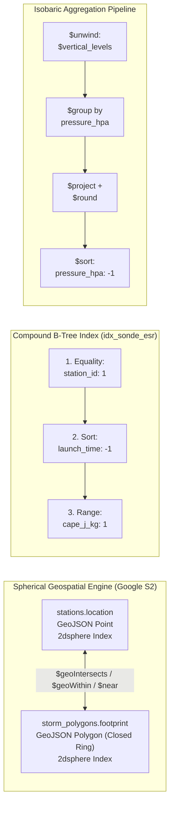
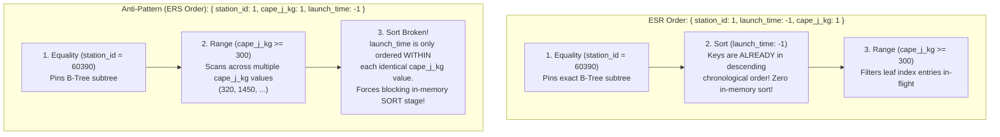

# Day 4 Course Walkthrough: `day4_weather_ops_mongo_advanced.js` — MongoDB Aggregations, Geospatial (`2dsphere`), ESR Indexing & Upper-Air Analytics

[Home](../README.md) | [Portal](../bootcamp_portal.html) | [Day 4 Coursebook](./day4_master_coursebook.md) | [Blank VM Lab Guide](../VM_BLANK_LAB_FROM_SCRATCH_GUIDE.md) | [Original Script](./day4_weather_ops_mongo_advanced.js) | [Seed Script Walkthrough](./day4_weather_ops_mongo_js_course_walkthrough.md) | [50K Benchmark Walkthrough](./day4_mongo_50k_polymorphic_benchmark_js_course_walkthrough.md)

---

## 1. Architectural Overview

[`day4_weather_ops_mongo_advanced.js`](./day4_weather_ops_mongo_advanced.js) builds directly upon the `weather_nosql` database seeded by [`day4_weather_ops_mongo.js`](./day4_weather_ops_mongo.js). Once polymorphic station documents, upper-air radiosonde soundings, and time-series observations are ingested, an operational weather forecasting platform must answer three classes of low-latency analytical queries:

1. **Spherical Geospatial Containment & Proximity (`2dsphere`):** Which ground stations (`stations.location`) lie directly inside the path of an approaching severe thunderstorm polygon or Saharan dust front (`storm_polygons.footprint`), or within a 100 km radar radius of a coastal coordinate?
2. **High-Selectivity Compound Lookups (The ESR Indexing Rule):** How do we retrieve the latest radiosonde soundings for a specific station ordered chronologically and filtered by convective instability (`cape_j_kg > 1000`) in sub-millisecond time without triggering a blocking 100 MB in-memory `SORT` stage?
3. **Vertical Atmospheric Aggregation Pipelines (`$unwind` $\rightarrow$ `$group` $\rightarrow$ `$project` $\rightarrow$ `$sort`):** How do we unpack embedded `vertical_levels` arrays across multiple upper-air balloon flights to compute mandatory isobaric surface climatologies (`1000 hPa`, `850 hPa`, `700 hPa`, `500 hPa`, `300 hPa`)?



---

## 2. Header, Database Context & Idempotent Teardown (Lines 1–12)

### 2.1 Code Block

```javascript
// ============================================================================
// DAY 4 BOOTCAMP: MONGODB AGGREGATIONS, GEOSPATIAL (2DSPHERE), INDEXING & SHARDING
// File: day4_weather_ops_mongo_advanced.js
// Prerequisite: Run after day4_weather_ops_mongo.js
// Usage: mongosh weather_nosql day4_weather_ops_mongo_advanced.js
// ============================================================================

db = db.getSiblingDB("weather_nosql");

db.storm_polygons.drop();
db.upper_air_climatology.drop();
```

### 2.2 Line-by-Line Technical Breakdown

* **Lines 1–6 (Header & Prerequisite Contract):**
  * Specifies that [`day4_weather_ops_mongo.js`](./day4_weather_ops_mongo.js) must be executed first so that `db.stations` (6 documents) and `db.radiosonde_soundings` (3 documents) exist in `weather_nosql`.
* **Line 8 (`db = db.getSiblingDB("weather_nosql");`):**
  * Binds the global `db` reference to `weather_nosql` inside the `mongosh` JavaScript runtime.
* **Lines 10–11 (`db.storm_polygons.drop();` and `db.upper_air_climatology.drop();`):**
  * Drops `storm_polygons` (seeded in Section 2 of this script) and `upper_air_climatology` (used when persisting materialized aggregation views via `$out` or `$merge` during interactive labs) while preserving the base collections (`stations`, `radiosonde_soundings`, `synoptic_timeseries`, `cap_alerts`) created by the foundational script.

---

## 3. Section 1: `2dsphere` Geospatial Index on `stations.location` (Lines 13–15)

### 3.1 Code Block

```javascript
print("=== 1. Creating 2dsphere Geospatial Index on stations.location ===");
db.stations.createIndex({ location: "2dsphere" });
```

### 3.2 Deep-Dive Architectural Explanation

* **What `db.stations.createIndex({ location: "2dsphere" })` Builds:**
  * Unlike a legacy `2d` planar index (which assumes a flat Euclidean grid and introduces severe distance distortion as latitude increases away from the equator), a **`2dsphere`** index models the Earth as an **oblate spheroid** using the **WGS-84** datum (equatorial radius $\approx 6,378.137\text{ km}$).
  * Internally, MongoDB projects each station's GeoJSON `Point` (`[longitude, latitude]`) onto hierarchical spherical quadrangles using the **Google S2 Geometry Library**. Each S2 cell is identified by a 64-bit integer token stored as keys inside a standard WiredTiger B-Tree index.
* **Geospatial Operators Unlocked by This Index:**
  * **`$near` / `$nearSphere`:** Returns weather stations sorted from nearest to farthest around a target coordinate with `$maxDistance` in meters (using geodesic great-circle / ellipsoidal arcs).
  * **`$geoWithin`:** Finds all stations whose `location` falls completely inside a bounding `$geometry` `Polygon` or `$centerSphere`.
  * **`$geoIntersects`:** Evaluates topological intersection between station points and severe weather warning footprints.
* **Idempotency of `createIndex()`:**
  * If `{ location: "2dsphere" }` already exists on `db.stations` with identical specifications, MongoDB treats `createIndex()` as a fast no-op and returns `{ numIndexesBefore: 2, numIndexesAfter: 2, note: "all indexes already exist", ok: 1 }`.

---

## 4. Section 2: `storm_polygons` Collection & GeoJSON Closed-Ring Rules (Lines 16–58)

### 4.1 Code Block

```javascript
print("=== 2. Creating 'storm_polygons' Collection with GeoJSON Warning Polygons ===");
db.storm_polygons.insertMany([
  {
    _id: "CELL-MED-20261006-A",
    storm_name: "Mediterranean Convective System Alpha",
    detected_at: ISODate("2026-10-06T00:00:00Z"),
    max_reflectivity_dbz: 58.5,
    vil_kg_m2: 42.0, // Vertically Integrated Liquid (Hail indicator)
    motion_vector: { direction_deg: 245, speed_kt: 22 },
    // GeoJSON Polygon enclosing Northern Central/Eastern Algeria (Algiers, Bejaia, Setif, Constantine)
    footprint: {
      type: "Polygon",
      coordinates: [[
        [2.50, 35.80],
        [7.20, 35.80],
        [7.20, 37.10],
        [2.50, 37.10],
        [2.50, 35.80] // First and last coordinate MUST match to close a GeoJSON ring!
      ]]
    }
  },
  {
    _id: "CELL-SAH-20261005-B",
    storm_name: "Western Erg Haboob Dust Front",
    detected_at: ISODate("2026-10-05T18:00:00Z"),
    max_reflectivity_dbz: 32.0,
    aerosol_optical_depth: 2.8,
    motion_vector: { direction_deg: 210, speed_kt: 35 },
    footprint: {
      type: "Polygon",
      coordinates: [[
        [-3.50, 30.50],
        [-1.00, 30.50],
        [-1.00, 32.50],
        [-3.50, 32.50],
        [-3.50, 30.50]
      ]]
    }
  }
]);

db.storm_polygons.createIndex({ footprint: "2dsphere" });
```

### 4.2 Deep-Dive Architectural Explanation

#### 4.2.1 Meteorological & Physical Telemetry of the Two Storm Cells
The `storm_polygons` collection models radar- and satellite-tracked mesoscale weather hazards whose physical attributes differ by phenomenon (polymorphism):

| Storm `_id` | `storm_name` | `detected_at` | Specialized Physical Attributes | Motion Vector | Enclosed WMO Stations |
| :--- | :--- | :--- | :--- | :--- | :--- |
| **`CELL-MED-20261006-A`** | Mediterranean Convective System Alpha | `2026-10-06T00:00:00Z` | `max_reflectivity_dbz: 58.5` (intense radar echo $>55\text{ dBZ}$ indicating heavy rain/hail core) and **`vil_kg_m2: 42.0`** (*Vertically Integrated Liquid* in $\text{kg/m}^2$—values $>35\text{ kg/m}^2$ in Mediterranean storms indicate severe hail core aloft). | `{ direction_deg: 245, speed_kt: 22 }` (WSW flow at $22\text{ kt}$) | **Algiers (`60390`)**, **Constantine (`60419`)**, and **Algiers Bay Buoy (`60901`)** all fall inside `[2.50..7.20°E, 35.80..37.10°N]`. |
| **`CELL-SAH-20261005-B`** | Western Erg Haboob Dust Front | `2026-10-05T18:00:00Z` | Moderate radar echo (`max_reflectivity_dbz: 32.0` from airborne sand grains) paired with **`aerosol_optical_depth: 2.8`** (satellite $550\text{ nm}$ AOD; values $>2.0$ indicate an opaque dust wall obscuring solar radiation). | `{ direction_deg: 210, speed_kt: 35 }` (fast SSW outflow boundary at $35\text{ kt}$) | **Bechar (`60571`)** at `[-2.2699, 31.6457]` falls directly inside `[-3.50..-1.00°W, 30.50..32.50°N]`. |

#### 4.2.2 The GeoJSON Polygon Ring Closure Rule & Triple-Bracket Array Nesting (Lines 26–35 & 44–53)
Look closely at the structure of `footprint.coordinates`:

```javascript
footprint: {
  type: "Polygon",
  coordinates: [[        // <-- Outer array: list of linear rings (Exterior ring first, optional interior holes after)
    [2.50, 35.80],       // <-- Vertex 1: Southwest corner [lon, lat]
    [7.20, 35.80],       // <-- Vertex 2: Southeast corner [lon, lat]
    [7.20, 37.10],       // <-- Vertex 3: Northeast corner [lon, lat]
    [2.50, 37.10],       // <-- Vertex 4: Northwest corner [lon, lat]
    [2.50, 35.80]        // <-- Vertex 5: MUST exactly equal Vertex 1 to close the linear ring!
  ]]
}
```

* **Why Triple Square Brackets `[[ [lon, lat], ... ]]`?**
  * In RFC 7946 GeoJSON, a `Polygon` is not simply an array of points; it is an **array of LinearRing coordinate arrays** (`coordinates[ringIndex][vertexIndex][coordIndex]`).
  * `coordinates[0]` is always the **exterior bounding ring**. If a storm polygon has an eye or an inner calm exclusion zone, `coordinates[1..n]` define interior "hole" rings. Failing to wrap the vertex array in the outer ring array (`coordinates: [ [lon, lat], ... ]`) causes MongoDB to interpret the coordinates as a `LineString` and fail `2dsphere` indexing with `Can't extract geo keys`.
* **Why Must the First and Last Vertex Match Exactly (`[2.50, 35.80]` == `[2.50, 35.80]`)?**
  * A planar or spherical LinearRing must form a topologically closed loop of at least **4 coordinate pairs** (3 distinct vertices for a triangle + 1 closing vertex, or 4 distinct vertices for a bounding box + 1 closing vertex = 5 pairs).
  * If Vertex 5 is omitted or differs by even $10^{-7}$ degrees from Vertex 1, `db.storm_polygons.createIndex({ footprint: "2dsphere" })` (Line 57) throws:
    `MongoServerError: Can't extract geo keys: ... Loop is not closed`.
* **Geodesic Edges & Counter-Clockwise Winding Order:**
  * Notice the vertex progression: Southwest (`[2.50, 35.80]`) $\rightarrow$ Southeast (`[7.20, 35.80]`) $\rightarrow$ Northeast (`[7.20, 37.10]`) $\rightarrow$ Northwest (`[2.50, 37.10]`) $\rightarrow$ Southwest (`[2.50, 35.80]`). This follows the **Right-Hand Rule** (counter-clockwise exterior ring winding order), ensuring the interior of the polygon is the regional area over Algeria rather than the complement of the entire globe.
* **Line 57 (`db.storm_polygons.createIndex({ footprint: "2dsphere" });`):**
  * Decomposes each polygon's interior area into a covering set of S2 spherical cells at varying resolutions and indexes those cell IDs in the B-Tree. When a query runs `$geoIntersects` between `storm_polygons.footprint` and `stations.location`, MongoDB performs a fast B-Tree intersection on the S2 cell IDs before running exact spherical point-in-polygon math on candidate matches.

---

## 5. Section 3: `idx_sonde_esr` — The ESR Compound Indexing Rule (Lines 59–63)

### 5.1 Code Block

```javascript
print("=== 3. Creating Compound Index Following the ESR (Equality, Sort, Range) Rule ===");
db.radiosonde_soundings.createIndex(
  { station_id: 1, launch_time: -1, cape_j_kg: 1 },
  { name: "idx_sonde_esr" }
);
```

### 5.2 Deep-Dive Architectural Explanation: Why Key Order in a Compound B-Tree Index Matters

Consider a severe-weather forecasting query that asks:
> *"Find all radiosonde launches for Algiers (`station_id: 60390`) where convective energy exceeds `cape_j_kg >= 300`, sorted from newest to oldest (`launch_time: -1`)."*

```javascript
db.radiosonde_soundings.find({
  station_id: 60390,          // E — Equality predicate
  cape_j_kg: { $gte: 300 }    // R — Range predicate
}).sort({
  launch_time: -1             // S — Sort predicate
});
```

Why does `idx_sonde_esr` order the index keys as `{ station_id: 1, launch_time: -1, cape_j_kg: 1 }` (**E $\rightarrow$ S $\rightarrow$ R**) instead of `{ station_id: 1, cape_j_kg: 1, launch_time: -1 }` (**E $\rightarrow$ R $\rightarrow$ S**)?



#### 5.2.1 First Key — Equality (`station_id: 1`)
* An exact equality match (`station_id: 60390`) narrows the B-Tree search space to a single contiguous prefix of index entries for station `60390`.
#### 5.2.2 Second Key — Sort (`launch_time: -1`)
* Within the `station_id: 60390` subtree, all index entries are physically ordered by `launch_time` descending (`2026-10-06T12:00:00Z` followed by `2026-10-06T00:00:00Z`).
* Because the B-Tree traversal visits keys in the exact order requested by `.sort({ launch_time: -1 })`, the MongoDB query planner satisfies the sort directly from the index (`IXSCAN` without a blocking `SORT` stage).
* In MongoDB, a blocking in-memory `SORT` stage is capped at **100 MB of RAM** (`QueryExceededMemoryLimitNoDiskUseAllowed`) unless `allowDiskUse: true` spills temporary sort files to disk. Putting the **Sort** key before the **Range** key eliminates the in-memory sort entirely!
#### 5.2.3 Third Key — Range (`cape_j_kg: 1`)
 * As the index scan walks `station_id: 60390` in descending `launch_time` order, it evaluates `cape_j_kg >= 300` directly against the index key (`cape_j_kg: 1`) before fetching the full BSON document from WiredTiger storage (`FETCH`).
* **Index Prefix Bonus:**
* Because B-Tree compound indexes support **left-prefix queries**, `idx_sonde_esr` also accelerates:
  * `{ station_id: 60390 }` (Prefix `{ station_id: 1 }`)
  * `{ station_id: 60390 }` sorted or filtered by `launch_time` (Prefix `{ station_id: 1, launch_time: -1 }`)

---

## 6. Section 4: Isobaric Pressure Surface Aggregation Pipeline (Lines 65–91)

### 6.1 Code Block

```javascript
print("=== 4. Running Sample Aggregation Pipeline: Isobaric Pressure Surface Summary ===");
var levelSummary = db.radiosonde_soundings.aggregate([
  { $unwind: "$vertical_levels" },
  {
    $group: {
      _id: "$vertical_levels.pressure_hpa",
      soundings_count: { $sum: 1 },
      avg_height_m:    { $avg: "$vertical_levels.height_m" },
      avg_temp_c:      { $avg: "$vertical_levels.temp_c" },
      max_wind_kt:     { $max: "$vertical_levels.wind_speed_kt" }
    }
  },
  {
    $project: {
      _id: 0,
      pressure_hpa: "$_id",
      soundings_count: 1,
      avg_height_m: { $round: ["$avg_height_m", 0] },
      avg_temp_c:   { $round: ["$avg_temp_c", 1] },
      max_wind_kt:  1
    }
  },
  { $sort: { pressure_hpa: -1 } }
]).toArray();

printjson(levelSummary);
print("=== Day 4 Advanced MongoDB Setup Complete! ===");
```

### 6.2 Stage-by-Stage Aggregation Pipeline Breakdown

#### 6.2.1 Stage 1: `{ $unwind: "$vertical_levels" }` (Line 67)
* **Input:** 3 parent sounding documents in `db.radiosonde_soundings` (Algiers `00Z` with 5 levels, Algiers `12Z` with 5 levels, and Tamanrasset `12Z` with 4 levels).
* **Transformation:** Deconstructs the embedded `vertical_levels` array in each document, emitting a separate stream document for every array element (`5 + 5 + 4 = 14` intermediate documents). In each emitted document, the array `vertical_levels: [...]` is replaced by a single sub-document `vertical_levels: { pressure_hpa: 850, height_m: 1480, temp_c: 11.2, ... }`.

#### 6.2.2 Stage 2: `{ $group: { ... } }` (Lines 68–75)
* **Input:** 14 unwound level documents.
* **Grouping Key (`_id: "$vertical_levels.pressure_hpa"`):** Partitions the 14 documents into 5 distinct mandatory isobaric surface buckets (`1000`, `850`, `700`, `500`, and `300` hPa).
* **Accumulator Operators:**
  * `soundings_count: { $sum: 1 }`: Counts how many balloon flights reported each pressure level (`2` flights for `1000 hPa` because high-altitude Tamanrasset starts at `850 hPa`; `3` flights for `850`, `700`, `500`, and `300 hPa`).
  * `avg_height_m: { $avg: "$vertical_levels.height_m" }`: Computes the mean geopotential height (in meters) of each pressure surface across all reporting stations.
  * `avg_temp_c: { $avg: "$vertical_levels.temp_c" }`: Computes the mean ambient temperature (in °C) at each pressure surface, illustrating the environmental lapse rate from $+21.5^\circ\text{C}$ at `1000 hPa` down to $-38.4^\circ\text{C}$ at `300 hPa`.
  * `max_wind_kt: { $max: "$vertical_levels.wind_speed_kt" }`: Extracts the peak wind speed (in knots) observed at each altitude, peaking at `95 kt` at the `300 hPa` jet stream core.

#### 6.2.3 Stage 3: `{ $project: { ... } }` (Lines 77–85)
* **Reshaping & Precision Formatting:**
  * `_id: 0` & `pressure_hpa: "$_id"`: Suppresses the default `_id` key and aliases it to the self-documenting field name `pressure_hpa`.
  * `soundings_count: 1` & `max_wind_kt: 1`: Passes these integer/numeric fields through unchanged.
  * `avg_height_m: { $round: ["$avg_height_m", 0] }`: Rounds the floating-point mean geopotential height (e.g., `1511.6666...` at `850 hPa`) to the nearest whole meter (`1512`).
  * `avg_temp_c: { $round: ["$avg_temp_c", 1] }`: Rounds the mean temperature (e.g., `19.5666...` at `850 hPa`) to 1 decimal place (`19.6`), matching WMO meteorological reporting precision ($0.1^\circ\text{C}$).

#### 6.2.4 Stage 4: `{ $sort: { pressure_hpa: -1 } }` & `.toArray()` (Lines 87–90)
* **`{ $sort: { pressure_hpa: -1 } }`:** Orders the 5 output documents in descending pressure order (`1000 hPa` $\rightarrow$ `850 hPa` $\rightarrow$ `700 hPa` $\rightarrow$ `500 hPa` $\rightarrow$ `300 hPa`), which corresponds physically to **ascending altitude** from sea level (`123 m`) up to the tropopause (`9533 m`).
* **`.toArray()` & `printjson(levelSummary)`:** Drains the server-side aggregation cursor into a JavaScript array in `mongosh` and formats the resulting BSON documents to stdout.

---

## 7. Expected Terminal Output

Executing `mongosh weather_nosql day4_weather_ops_mongo_advanced.js` produces the following exact terminal output:

```text
=== 1. Creating 2dsphere Geospatial Index on stations.location ===
=== 2. Creating 'storm_polygons' Collection with GeoJSON Warning Polygons ===
=== 3. Creating Compound Index Following the ESR (Equality, Sort, Range) Rule ===
=== 4. Running Sample Aggregation Pipeline: Isobaric Pressure Surface Summary ===
[
  {
    soundings_count: 2,
     max_wind_kt: 24,
    pressure_hpa: 1000,
    avg_height_m: 123,
    avg_temp_c: 21.5
  },
  {
    soundings_count: 3,
    max_wind_kt: 38,
    pressure_hpa: 850,
    avg_height_m: 1512,
    avg_temp_c: 19.6
  },
  {
    soundings_count: 3,
    max_wind_kt: 46,
    pressure_hpa: 700,
    avg_height_m: 3143,
    avg_temp_c: 7.8
  },
  {
    soundings_count: 3,
    max_wind_kt: 64,
    pressure_hpa: 500,
    avg_height_m: 5777,
    avg_temp_c: -12.8
  },
  {
    soundings_count: 3,
    max_wind_kt: 95,
    pressure_hpa: 300,
    avg_height_m: 9533,
    avg_temp_c: -38.4
  }
]
=== Day 4 Advanced MongoDB Setup Complete! ===
```

### 7.1 Mathematical Verification of the Aggregated Output

| `pressure_hpa` | `soundings_count` | Raw Heights ($\text{m}$) $\rightarrow$ `avg_height_m` | Raw Temps ($^\circ\text{C}$) $\rightarrow$ `avg_temp_c` | Raw Wind Speeds ($\text{kt}$) $\rightarrow$ `max_wind_kt` |
| :--- | :--- | :--- | :--- | :--- |
| **`1000`** | `2` (Algiers 00Z & 12Z) | $(110 + 135) / 2 = 122.5 \rightarrow \mathbf{123}$ | $(18.5 + 24.4) / 2 = 21.45 \rightarrow \mathbf{21.5}$ | $\max(24, 12) = \mathbf{24}$ |
| **`850`** | `3` (All 3 flights) | $(1480 + 1515 + 1540) / 3 = 1511.67 \rightarrow \mathbf{1512}$ | $(11.2 + 13.0 + 34.5) / 3 = 19.57 \rightarrow \mathbf{19.6}$ | $\max(38, 18, 16) = \mathbf{38}$ |
| **`700`** | `3` (All 3 flights) | $(3090 + 3130 + 3210) / 3 = 3143.33 \rightarrow \mathbf{3143}$ | $(1.4 + 3.8 + 18.2) / 3 = 7.80 \rightarrow \mathbf{7.8}$ | $\max(46, 25, 22) = \mathbf{46}$ |
| **`500`** | `3` (All 3 flights) | $(5680 + 5760 + 5890) / 3 = 5776.67 \rightarrow \mathbf{5777}$ | $(-16.8 - 14.2 - 7.5) / 3 = -12.83 \rightarrow \mathbf{-12.8}$ | $\max(64, 42, 35) = \mathbf{64}$ |
| **`300`** | `3` (All 3 flights) | $(9380 + 9510 + 9710) / 3 = 9533.33 \rightarrow \mathbf{9533}$ | $(-42.5 - 39.8 - 33.0) / 3 = -38.43 \rightarrow \mathbf{-38.4}$ | $\max(95, 68, 58) = \mathbf{95}$ |

---

[Home](../README.md) | [Portal](../bootcamp_portal.html) | [Day 4 Coursebook](./day4_master_coursebook.md) | [Blank VM Lab Guide](../VM_BLANK_LAB_FROM_SCRATCH_GUIDE.md) | [Original Script](./day4_weather_ops_mongo_advanced.js) | [Seed Script Walkthrough](./day4_weather_ops_mongo_js_course_walkthrough.md) | [50K Benchmark Walkthrough](./day4_mongo_50k_polymorphic_benchmark_js_course_walkthrough.md)
