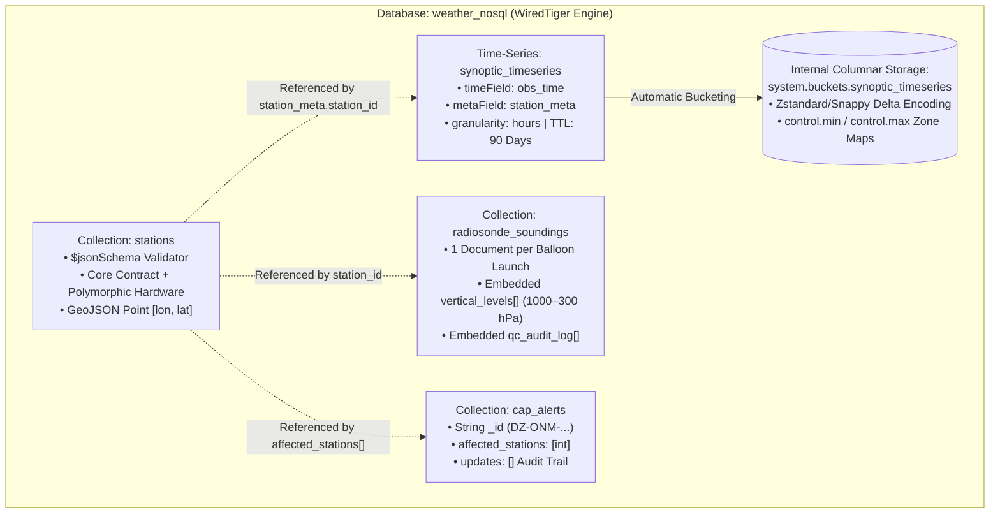

# Day 4 Course Walkthrough: `day4_weather_ops_mongo.js` — MongoDB & NoSQL Fundamentals for Weather Forecast Engineers

[Home](../README.md) | [Portal](../bootcamp_portal.html) | [Day 4 Coursebook](./day4_master_coursebook.md) | [Blank VM Lab Guide](../VM_BLANK_LAB_FROM_SCRATCH_GUIDE.md) | [Original Script](./day4_weather_ops_mongo.js) | [Advanced Script Walkthrough](./day4_weather_ops_mongo_advanced_js_course_walkthrough.md) | [50K Benchmark Walkthrough](./day4_mongo_50k_polymorphic_benchmark_js_course_walkthrough.md)

---

## 1. Architectural Overview

[`day4_weather_ops_mongo.js`](./day4_weather_ops_mongo.js) is the foundational MongoDB operational seed script (`mongosh`) for the **`weather_nosql`** database. In national meteorological centers, observation networks are inherently heterogeneous: surface synoptic stations, coastal marine buoys, agricultural soil-profile probes, arid dust monitors, and upper-air radiosonde balloon sites all emit distinct telemetry structures that evolve rapidly as new sensor hardware is deployed.

Forcing all of these instruments into a single rigid relational table results in either wide, sparse schemas filled with `NULL` columns or complex Entity-Attribute-Value (EAV) tables that require multi-way self-joins. Conversely, abandoning schema governance entirely creates an unvalidated data swamp where malformed coordinates or missing station identifiers break downstream ingestion pipelines.

This script demonstrates how MongoDB resolves this tension using four distinct document design patterns:

1. **Polymorphic Metadata with Physical `$jsonSchema` Validation (`stations`):** Enforces a strict core contract (`_id`, `station_name`, `station_type`, `location`, `is_active`) at the WiredTiger storage engine boundary while allowing specialized hardware sub-documents (`calibration`, `soil_depths_cm`, `buoy_specs`, `dust_storm_threshold_ug_m3`) to coexist without `ALTER TABLE` migrations.
2. **Bounded Embedded Document Arrays (`radiosonde_soundings`):** Models upper-air weather balloon launches (`Vaisala RS41`) where each launch document embeds its entire vertical atmospheric profile (`vertical_levels` from `1000 hPa` to `300 hPa`) alongside convective indices (`cape_j_kg`, `k_index`) and quality-control audit trails (`qc_audit_log`), achieving single-seek disk locality and zero-join reads.
3. **Native MongoDB 5.0+ Time-Series Collections (`synoptic_timeseries`):** Configures automatic columnar bucketing (`system.buckets.synoptic_timeseries`) partitioned by `metaField: "station_meta"` and ordered by `timeField: "obs_time"` with `granularity: "hours"`, paired with automatic 90-day Time-To-Live (`expireAfterSeconds: 7776000`) lifecycle management.
4. **Common Alerting Protocol Bulletins (`cap_alerts`):** Stores life-safety severe weather warnings (`FLASH_FLOOD`, `SANDSTORM`) with string natural primary keys (`_id`), station reference arrays (`affected_stations`), and mutable revision logs (`updates`).



---

## 2. Header, Database Initialization & Idempotent Teardown (Lines 1–14)

### 2.1 Code Block

```javascript
// ============================================================================
// DAY 4 BOOTCAMP: MONGODB & NOSQL FUNDAMENTALS FOR WEATHER FORECAST ENGINEERS
// File: day4_weather_ops_mongo.js
// Usage: mongosh weather_nosql day4_weather_ops_mongo.js
// ============================================================================

db = db.getSiblingDB("weather_nosql");

// Clean slate for repeatable labs
db.stations.drop();
db.radiosonde_soundings.drop();
db.cap_alerts.drop();
db.synoptic_timeseries.drop();
```

### 2.2 Line-by-Line Technical Breakdown

* **Lines 1–5 (Header & CLI Invocation Contract):**
  * Documents the execution command: `mongosh weather_nosql day4_weather_ops_mongo.js`.
  * Unlike SQL scripts executed via `psql -f`, `mongosh` scripts execute inside a full V8 JavaScript runtime embedded in the MongoDB Shell. Every statement is valid JavaScript interacting with the global `db` cursor and BSON wrapper constructors (`ISODate()`, `NumberInt()`, etc.).
* **Line 7 (`db = db.getSiblingDB("weather_nosql");`):**
  * Explicitly switches the active database context to `"weather_nosql"` using `db.getSiblingDB()`.
  * Why use `db.getSiblingDB()` instead of the interactive shell helper `use weather_nosql`? Because `use <db>` is a syntactic macro parsed only by the interactive REPL prompt; it is **invalid JavaScript syntax** inside a standalone `.js` file loaded via `mongosh` or `load()`. Assigning `db = db.getSiblingDB("weather_nosql")` guarantees that even if an engineer invokes `mongosh day4_weather_ops_mongo.js` without specifying the target database on the command line (defaulting to the `test` database), all subsequent operations deterministically target `weather_nosql`.
* **Lines 9–13 (`// Clean slate for repeatable labs` & `.drop()` Calls):**
  * Calls `.drop()` on `db.stations`, `db.radiosonde_soundings`, `db.cap_alerts`, and `db.synoptic_timeseries`.
  * **Idempotency Guarantee:** In MongoDB, calling `db.createCollection()` on an existing collection throws a `NamespaceExists` error (Error Code `48`), and calling `insertMany()` with explicit `_id` values (`60390`, `"DZ-ONM-2026-10-05-001"`) on an already-populated collection throws a `E11000 duplicate key error`.
  * Calling `.drop()` removes the collection data files, associated B-Tree indexes, `$jsonSchema` validators, and—in the case of `synoptic_timeseries`—both the logical Time-Series view and the underlying physical `system.buckets.synoptic_timeseries` collection. If a collection does not yet exist, `.drop()` safely returns `false` without raising an exception.

---

## 3. Section 1: `stations` Collection with `$jsonSchema` Physical Validation (Lines 15–111)

### 3.1 Creating the Collection and Enforcing the `$jsonSchema` Validator (Lines 15–42)

```javascript
print("=== 1. Creating 'stations' Collection with $jsonSchema Physical Validation ===");
db.createCollection("stations", {
  validator: {
    $jsonSchema: {
      bsonType: "object",
      required: ["_id", "station_name", "station_type", "location", "is_active"],
      properties: {
        _id: { bsonType: "int", description: "WMO 5-digit station ID" },
        station_name: { bsonType: "string" },
        station_type: { enum: ["SURFACE_AWS", "COASTAL_BUOY", "UPPER_AIR_RADIOSONDE", "AGRO_SOIL"] },
        is_active: { bsonType: "bool" },
        location: {
          bsonType: "object",
          required: ["type", "coordinates"],
          properties: {
            type: { enum: ["Point"] },
            coordinates: {
              bsonType: "array",
              minItems: 2,
              maxItems: 2,
              description: "GeoJSON [longitude, latitude] order!"
            }
          }
        }
      }
    }
  }
});
```

#### 3.1.1 Deep-Dive Architectural Explanation

* **Line 15 (`print(...)`):** Outputs a section banner to standard output so pipeline logs clearly demarcate collection creation.
* **Lines 16–18 (`db.createCollection("stations", { validator: { $jsonSchema: { ... } } })`):**
  * While MongoDB collections can be created implicitly on first insert, calling `db.createCollection()` explicitly attaches a server-side `$jsonSchema` validator to the collection catalog metadata.
  * By default, MongoDB sets `validationLevel: "strict"` (validating all inserts and updates) and `validationAction: "error"` (rejecting any non-conforming write with BSON Error Code `121: Document failed validation` before it ever reaches the WiredTiger write-ahead journal).
* **Line 19 (`bsonType: "object"`):**
  * Declares that the root BSON entity must be a document object (BSON Type `0x03`).
* **Line 20 (`required: ["_id", "station_name", "station_type", "location", "is_active"]`):**
  * Enforces the **Minimum Viable Station Contract**. Every weather station document—regardless of whether it is a Sahara dust sensor or a Mediterranean wave buoy—must contain these 5 top-level keys. Any insert omitting one of these keys is immediately rejected.
  * Notice that `additionalProperties` is **not** set to `false`. This is the core architectural mechanism of **Governed Polymorphism**: the 5 core fields are strictly enforced, while extra instrument-specific fields (`sensors`, `calibration`, `soil_depths_cm`, `buoy_specs`) are freely permitted without schema migration.
* **Line 22 (`_id: { bsonType: "int", description: "WMO 5-digit station ID" }`):**
  * Overrides MongoDB's default 12-byte `ObjectId` generator by requiring the primary key `_id` to be a numeric integer representing the 5-digit World Meteorological Organization (WMO) station identifier (e.g., `60390` for Algiers, `60680` for Tamanrasset).
  * Using the natural WMO integer identifier as `_id` maps directly onto the mandatory unique `_id_` B-Tree index, eliminating the need for a secondary unique index on `wmo_id` and saving 12 bytes per document header.
  * Note on `mongosh` numeric literals: In JavaScript, numeric literals like `60390` are IEEE 754 64-bit floats (`double`), which `mongosh` serializes as BSON `double` unless matched by numeric type rules or wrapped in `NumberInt()`. In MongoDB's `$jsonSchema` validator implementation inside `mongosh`, whole-number literals or integer-compatible numbers should be watched carefully in strict environments, or `bsonType: ["int", "double", "long"]` / `NumberInt()` can be used when clients send 64-bit floats.
* **Line 23 (`station_name: { bsonType: "string" }`):**
  * Requires `station_name` to be a UTF-8 BSON string (BSON Type `0x02`).
* **Line 24 (`station_type: { enum: ["SURFACE_AWS", "COASTAL_BUOY", "UPPER_AIR_RADIOSONDE", "AGRO_SOIL"] }`):**
  * Restricts `station_type` to a closed enumeration of four valid operational network classifications, preventing typos like `"AWS"` or `"surface_aws"` from fragmenting downstream `$group` aggregations.
* **Line 25 (`is_active: { bsonType: "bool" }`):**
  * Enforces a true BSON boolean (`true` or `false`, BSON Type `0x08`), preventing string `"true"` or integer `1` flags.
* **Lines 26–38 (`location` Nested GeoJSON `Point` Validation):**
  * Validates the nested `location` sub-document (`bsonType: "object"`) so that a `2dsphere` geospatial index can safely be built on `stations.location` without failing on malformed geometry:
    * `required: ["type", "coordinates"]`: Both standard RFC 7946 GeoJSON keys must be present.
    * `type: { enum: ["Point"] }`: Restricts station locations to zero-dimensional point geometries (case-sensitive `"Point"`).
    * `coordinates: { bsonType: "array", minItems: 2, maxItems: 2, description: "GeoJSON [longitude, latitude] order!" }`: Requires an exact 2-element coordinate tuple `[longitude, latitude]`.
    * **Critical Engineering Rule (Inline Comment on Line 35):** GeoJSON and MongoDB `2dsphere` indexes strictly mandate **`[longitude, latitude]`** order ($X, Y$ Cartesian order: East/West $-180^\circ \dots +180^\circ$ first, North/South $-90^\circ \dots +90^\circ$ second). Reversing `[lat, lon]` places Mediterranean stations in the Indian Ocean or triggers out-of-bounds latitude errors if longitude exceeds $\pm 90^\circ$.

---

### 3.2 Seeding the 6 Polymorphic Weather Station Documents (Lines 44–111)

```javascript
// Seed Polymorphic Weather Stations (AWS, Coastal Buoy, Agro Station, Upper-Air Station)
db.stations.insertMany([
  {
    _id: 60390,
    station_name: "Algiers - Dar El Beida",
    station_type: "UPPER_AIR_RADIOSONDE",
    climate_zone: "Mediterranean",
    elevation_m: 25.0,
    is_active: true,
    location: { type: "Point", coordinates: [3.2154, 36.6910] }, // [lon, lat]!
    sensors: ["PT100_THERM", "CAP_HYGRO", "ULTRASONIC_WIND", "VAISALA_RS41_SONDE"],
    calibration: { last_calibrated: ISODate("2026-09-01T00:00:00Z"), technician: "M. Benali", pressure_offset_hpa: -0.1 }
  },
  {
    _id: 60490,
    station_name: "Oran - Es Senia",
    station_type: "SURFACE_AWS",
    climate_zone: "Mediterranean",
    elevation_m: 90.0,
    is_active: true,
    location: { type: "Point", coordinates: [-0.6212, 35.6239] },
    sensors: ["PT100_THERM", "CAP_HYGRO", "TIPPING_BUCKET_RAIN"],
    calibration: { last_calibrated: ISODate("2026-08-15T00:00:00Z"), technician: "A. Mansouri", pressure_offset_hpa: 0.0 }
  },
  {
    _id: 60419,
    station_name: "Constantine - El Khroub",
    station_type: "AGRO_SOIL",
    climate_zone: "Highland",
    elevation_m: 694.0,
    is_active: true,
    location: { type: "Point", coordinates: [6.6203, 36.2760] },
    sensors: ["PT100_THERM", "SOIL_MOISTURE_ARRAY", "LEAF_WETNESS"],
    soil_depths_cm: [10, 30, 50, 100],
    calibration: { last_calibrated: ISODate("2026-07-20T00:00:00Z"), technician: "K. Toumi" }
  },
  {
    _id: 60571,
    station_name: "Bechar - Ouakda",
    station_type: "SURFACE_AWS",
    climate_zone: "Arid",
    elevation_m: 811.0,
    is_active: true,
    location: { type: "Point", coordinates: [-2.2699, 31.6457] },
    sensors: ["PT100_THERM", "DUST_PARTICLE_LASER", "SOLAR_PYRANOMETER"],
    dust_storm_threshold_ug_m3: 500
  },
  {
    _id: 60680,
    station_name: "Tamanrasset - Aguenar",
    station_type: "UPPER_AIR_RADIOSONDE",
    climate_zone: "Arid",
    elevation_m: 1377.0,
    is_active: true,
    location: { type: "Point", coordinates: [5.4510, 22.8115] },
    sensors: ["PT100_THERM", "ULTRASONIC_WIND", "VAISALA_RS41_SONDE", "GCR_RADIATION"]
  },
  {
    _id: 60901,
    station_name: "Algiers Bay Marine Buoy #1",
    station_type: "COASTAL_BUOY",
    climate_zone: "Maritime",
    elevation_m: 0.0,
    is_active: true,
    location: { type: "Point", coordinates: [3.3500, 36.8500] },
    buoy_specs: { hull_type: "3m_Discus", mooring_depth_m: 120, wave_sensor: "Accelerometer_3D" }
  }
]);
```

#### 3.2.1 Polymorphic Station Architecture Comparison

All 6 documents satisfy the 5-field `$jsonSchema` contract (`_id`, `station_name`, `station_type`, `location`, `is_active`) plus `climate_zone` and `elevation_m`, while tailoring their remaining fields to the physical reality of each site:

| WMO `_id` | Station Name | `station_type` | Coordinates `[lon, lat]` | Specialized Polymorphic Fields & Sub-Documents |
| :--- | :--- | :--- | :--- | :--- |
| **`60390`** | Algiers - Dar El Beida | `UPPER_AIR_RADIOSONDE` | `[3.2154, 36.6910]` | `sensors` array (`VAISALA_RS41_SONDE`), `calibration` sub-document with `pressure_offset_hpa: -0.1` and `ISODate("2026-09-01T00:00:00Z")`. |
| **`60490`** | Oran - Es Senia | `SURFACE_AWS` | `[-0.6212, 35.6239]` | `sensors` array (`TIPPING_BUCKET_RAIN`), `calibration` sub-document (`technician: "A. Mansouri"`, `pressure_offset_hpa: 0.0`). |
| **`60419`** | Constantine - El Khroub | `AGRO_SOIL` | `[6.6203, 36.2760]` | `soil_depths_cm: [10, 30, 50, 100]` (vertical probe depths in centimeters), `sensors` (`SOIL_MOISTURE_ARRAY`, `LEAF_WETNESS`), and a `calibration` sub-document **without** `pressure_offset_hpa` (demonstrating sub-document polymorphism). |
| **`60571`** | Bechar - Ouakda | `SURFACE_AWS` | `[-2.2699, 31.6457]` | `dust_storm_threshold_ug_m3: 500` (local alarm threshold in $\mu\text{g/m}^3$ for laser nephelometer `DUST_PARTICLE_LASER`); no `calibration` sub-document. |
| **`60680`** | Tamanrasset - Aguenar | `UPPER_AIR_RADIOSONDE` | `[5.4510, 22.8115]` | High-altitude desert observatory (`elevation_m: 1377.0`) equipped with `GCR_RADIATION` (Global Cloud / Cosmic Ray Radiation) and `VAISALA_RS41_SONDE`. |
| **`60901`** | Algiers Bay Marine Buoy #1 | `COASTAL_BUOY` | `[3.3500, 36.8500]` | Omits `sensors` array entirely; embeds `buoy_specs: { hull_type: "3m_Discus", mooring_depth_m: 120, wave_sensor: "Accelerometer_3D" }`. |

* **BSON Date Handling (`ISODate("2026-09-01T00:00:00Z")`):**
  * `ISODate()` constructs a native 64-bit BSON `Date` integer (BSON Type `0x09`) representing milliseconds since the Unix epoch (`1970-01-01T00:00:00Z`), enabling fast chronological range comparisons and date-math operators rather than slow lexicographical string parsing.

---

## 4. Section 2: `radiosonde_soundings` — Bounded Embedded Document Arrays (Lines 113–170)

### 4.1 Code Block

```javascript
print("=== 2. Creating 'radiosonde_soundings' (Nested Vertical Atmospheric Profiles) ===");
// Demonstrates WHY Document Model shines: each balloon launch has an array of vertical pressure levels!
db.radiosonde_soundings.insertMany([
  {
    station_id: 60390,
    station_name: "Algiers - Dar El Beida",
    launch_time: ISODate("2026-10-06T00:00:00Z"),
    sonde_serial: "RS41-V294810",
    burst_altitude_m: 31420,
    cape_j_kg: 1450, // High convective available potential energy (Thunderstorm risk!)
    k_index: 34,
    vertical_levels: [
      { pressure_hpa: 1000, height_m: 110,   temp_c: 18.5, dewpoint_c: 16.8, wind_dir_deg: 280, wind_speed_kt: 24 },
      { pressure_hpa: 850,  height_m: 1480,  temp_c: 11.2, dewpoint_c: 9.5,  wind_dir_deg: 295, wind_speed_kt: 38 },
      { pressure_hpa: 700,  height_m: 3090,  temp_c: 1.4,  dewpoint_c: -1.2, wind_dir_deg: 300, wind_speed_kt: 46 },
      { pressure_hpa: 500,  height_m: 5680,  temp_c: -16.8,dewpoint_c: -24.0,wind_dir_deg: 310, wind_speed_kt: 64 },
      { pressure_hpa: 300,  height_m: 9380,  temp_c: -42.5,dewpoint_c: -55.0,wind_dir_deg: 315, wind_speed_kt: 95 }
    ],
    qc_audit_log: [
      { checked_at: ISODate("2026-10-06T01:45:00Z"), step: "AUTO_GROSS_LIMIT", status: "PASSED" }
    ]
  },
  {
    station_id: 60390,
    station_name: "Algiers - Dar El Beida",
    launch_time: ISODate("2026-10-06T12:00:00Z"),
    sonde_serial: "RS41-V294855",
    burst_altitude_m: 32100,
    cape_j_kg: 320,
    k_index: 18,
    vertical_levels: [
      { pressure_hpa: 1000, height_m: 135,   temp_c: 24.4, dewpoint_c: 14.9, wind_dir_deg: 320, wind_speed_kt: 12 },
      { pressure_hpa: 850,  height_m: 1515,  temp_c: 13.0, dewpoint_c: 4.2,  wind_dir_deg: 330, wind_speed_kt: 18 },
      { pressure_hpa: 700,  height_m: 3130,  temp_c: 3.8,  dewpoint_c: -12.0,wind_dir_deg: 335, wind_speed_kt: 25 },
      { pressure_hpa: 500,  height_m: 5760,  temp_c: -14.2,dewpoint_c: -32.0,wind_dir_deg: 340, wind_speed_kt: 42 },
      { pressure_hpa: 300,  height_m: 9510,  temp_c: -39.8,dewpoint_c: -58.0,wind_dir_deg: 345, wind_speed_kt: 68 }
    ],
    qc_audit_log: [
      { checked_at: ISODate("2026-10-06T13:40:00Z"), step: "AUTO_GROSS_LIMIT", status: "PASSED" }
    ]
  },
  {
    station_id: 60680,
    station_name: "Tamanrasset - Aguenar",
    launch_time: ISODate("2026-10-06T12:00:00Z"),
    sonde_serial: "RS41-V299102",
    burst_altitude_m: 28900,
    cape_j_kg: 80,
    k_index: 10,
    vertical_levels: [
      { pressure_hpa: 850,  height_m: 1540,  temp_c: 34.5, dewpoint_c: 2.1,  wind_dir_deg: 180, wind_speed_kt: 16 },
      { pressure_hpa: 700,  height_m: 3210,  temp_c: 18.2, dewpoint_c: -8.4, wind_dir_deg: 210, wind_speed_kt: 22 },
      { pressure_hpa: 500,  height_m: 5890,  temp_c: -7.5, dewpoint_c: -29.0,wind_dir_deg: 245, wind_speed_kt: 35 },
      { pressure_hpa: 300,  height_m: 9710,  temp_c: -33.0,dewpoint_c: -52.0,wind_dir_deg: 260, wind_speed_kt: 58 }
    ],
    qc_audit_log: []
  }
]);
```

### 4.2 Deep-Dive Architectural Explanation

#### 4.2.1 Why Radiosonde Soundings Are the Textbook Use Case for Embedded Document Arrays
In a relational database (3NF), modeling an upper-air weather balloon flight requires three separate tables:
1. `soundings` (flight header: `sounding_id`, `station_id`, `launch_time`, `sonde_serial`, `burst_altitude_m`, `cape_j_kg`, `k_index`)
2. `sounding_levels` (1-to-many child rows: `sounding_id`, `pressure_hpa`, `height_m`, `temp_c`, `dewpoint_c`, `wind_dir_deg`, `wind_speed_kt`)
3. `sounding_qc_logs` (1-to-many child rows: `sounding_id`, `checked_at`, `step`, `status`)

Every time a thermodynamic Skew-T Log-P plotting tool requests a flight profile, a relational engine must execute a multi-table `JOIN` across separate B-Tree indexes and scattered heap pages.

In MongoDB, **"Data that is accessed together should be stored together."** Because a balloon flight's mandatory and significant pressure levels are **bounded** (typically 5 to 150 levels per flight, occupying a few kilobytes—less than 0.1% of MongoDB's 16 MB BSON document limit) and are **immutable** once the balloon bursts in the stratosphere (`burst_altitude_m: 31420`), embedding `vertical_levels` and `qc_audit_log` directly inside the parent launch document guarantees:
* **Single-Seek Physical Locality:** The entire atmospheric profile from surface (`1000 hPa`) to the upper-tropospheric jet stream (`300 hPa`) resides in a single contiguous BSON byte buffer on disk.
* **Atomic Document Ingestion:** The flight header, all vertical pressure levels, and initial QC results are written atomically in a single document write without multi-table transaction lock overhead.

#### 4.2.2 Meteorological & Physical Field Breakdown across the 3 Seeded Soundings
* **Flight Header & Thermodynamic Instability Metrics:**
  * `station_id` & `station_name`: Denormalizes `station_name` alongside `station_id` (`60390` Algiers and `60680` Tamanrasset) so forecast displays do not need a `$lookup` join against `stations` just to render the station title.
  * `launch_time`: Synoptic upper-air release times (`00:00 UTC` and `12:00 UTC` on `2026-10-06`).
  * `sonde_serial`: Hardware serial identifier for the Vaisala RS41 radiosonde transmitter (`"RS41-V294810"`, `"RS41-V294855"`, `"RS41-V299102"`).
  * `burst_altitude_m`: Latex balloon burst altitude in meters above mean sea level (`31420 m`, `32100 m`, `28900 m` in the middle stratosphere).
  * `cape_j_kg` (Convective Available Potential Energy in $\text{J/kg}$):
    * **Sounding 1 (Algiers `00:00Z`):** `cape_j_kg: 1450` and `k_index: 34` — indicates strong buoyant instability and high thunderstorm/flash-flood risk as a cold trough (`-16.8°C` at `500 hPa`, `95 kt` jet at `300 hPa`) overrides warm, moist Mediterranean surface air (`temp_c: 18.5`, `dewpoint_c: 16.8` at `1000 hPa`).
    * **Sounding 2 (Algiers `12:00Z`):** `cape_j_kg: 320` and `k_index: 18` — post-frontal stabilization after the trough axis passes (`500 hPa` warms to `-14.2°C`, `700 hPa` dewpoint drops sharply to `-12.0°C`).
    * **Sounding 3 (Tamanrasset `12:00Z`):** `cape_j_kg: 80` and `k_index: 10` — bone-dry Saharan atmosphere (`temp_c: 34.5`, `dewpoint_c: 2.1` at `850 hPa`, a $32.4^\circ\text{C}$ dewpoint depression).
* **Embedded `vertical_levels` Array:**
  * Notice a subtle physical detail in **Sounding 3 (Tamanrasset `60680`, Lines 162–167)**: its `vertical_levels` array contains only **4 elements** (`850`, `700`, `500`, `300 hPa`) and **omits the `1000 hPa` surface level**! Why? Because Tamanrasset sits at an elevation of **`1377.0 m`**, where ambient surface atmospheric pressure is already near `860 hPa`—meaning the `1000 hPa` isobaric surface is physically underground. Embedded arrays handle variable-length vertical profiles naturally.
* **Embedded `qc_audit_log` Array:**
  * Tracks automated quality-control steps (`{ checked_at: ISODate(...), step: "AUTO_GROSS_LIMIT", status: "PASSED" }`) on the two Algiers soundings, while initializing as an empty array (`qc_audit_log: []`) on the newly received Tamanrasset sounding awaiting verification.

---

## 5. Section 3: `synoptic_timeseries` — Native MongoDB 5.0+ Time-Series Collection (Lines 172–228)

### 5.1 Creating the Time-Series Collection with Columnar Bucketing & TTL (Lines 172–181)

```javascript
print("=== 3. Creating Native MongoDB Time-Series Collection ('synoptic_timeseries') ===");
// MongoDB 5.0+ Native Time-Series Collection with automatic columnar bucketing & 90-day TTL expiration
db.createCollection("synoptic_timeseries", {
  timeseries: {
    timeField: "obs_time",
    metaField: "station_meta",
    granularity: "hours"
  },
  expireAfterSeconds: 7776000 // Automatically expire raw telemetry older than 90 days!
});
```

#### 5.1.1 Deep-Dive Architectural Explanation

* **Why Native Time-Series Collections Exist:**
  * In a standard BSON collection, inserting 100 million weather observations stores 100 million independent BSON documents, repeating field names (`temp_c`, `pressure_hpa`, `wind_speed_kt`) in every record and adding 100 million entries to every B-Tree index.
  * When `timeseries: { ... }` is passed to `db.createCollection()`, MongoDB creates an internal backing collection named **`system.buckets.synoptic_timeseries`** and exposes `synoptic_timeseries` as a writable, non-materialized view on top of those buckets.
* **Parameter Breakdown:**
  1. **`timeField: "obs_time"`:**
     * Designates the mandatory BSON `Date` field (`ISODate`) that orders measurements chronologically inside each bucket.
  2. **`metaField: "station_meta"`:**
     * Designates the sub-document containing rarely changing dimensional metadata that identifies the data source (`{ station_id, station_type, climate_zone }`).
     * WiredTiger uses `station_meta` as the **partition key for bucketing**: observations that share an identical `station_meta` sub-document are packed together into the same physical bucket document. Conversely, never place rapidly changing measurements (such as `temp_c` or `battery_v`) inside `metaField`, or MongoDB will be forced to allocate a brand-new bucket on every reading!
  3. **`granularity: "hours"`:**
     * Informs WiredTiger of the expected ingestion cadence so it can size the internal bucket time span appropriately:
       * `"seconds"` (default): Up to **1 hour** per bucket (ideal for 1 Hz sonic anemometers).
       * `"minutes"`: Up to **24 hours** per bucket (ideal for 5–15 minute AWS reports).
       * **`"hours"`**: Up to **30 days** per bucket (ideal for 3-hourly or 6-hourly WMO synoptic observations like those seeded here at `18:00Z`, `00:00Z`, and `06:00Z`).
  4. **`expireAfterSeconds: 7776000`:**
     * $7,776,000\text{ seconds} = 90\text{ days} \times 86,400\text{ seconds/day}$.
     * Configures automated Time-To-Live (TTL) expiration. Once a bucket's maximum timestamp (`control.max.obs_time`) is older than 90 days, MongoDB's background TTL monitor drops the entire expired bucket atomically without expensive per-document random B-Tree deletions.

#### 5.1.2 How WiredTiger Packs `system.buckets.synoptic_timeseries` Under the Hood

When the 3 observations for **Algiers AWS (`60390`)** are inserted, WiredTiger packs them into a single internal columnar bucket document structured conceptually like this:

```javascript
// Internal representation inside db.system.buckets.synoptic_timeseries
{
  _id: ObjectId("67018280..."),
  control: {
    version: 2, // Compressed columnar format (MongoDB 5.2+ / 6.0+ / 7.0+)
    min: {
      obs_time: ISODate("2026-10-05T18:00:00Z"),
      temp_c: 17.9, dewpoint_c: 16.1, pressure_hpa: 1011.5, wind_speed_kt: 19.0, precip_1h_mm: 2.4,
      diagnostics: { battery_v: 12.4, door_open: false, firmware: "v4.2.1" }
    },
    max: {
      obs_time: ISODate("2026-10-06T06:00:00Z"),
      temp_c: 23.1, dewpoint_c: 17.5, pressure_hpa: 1013.8, wind_speed_kt: 28.0, precip_1h_mm: 18.6,
      diagnostics: { battery_v: 13.2, door_open: true, firmware: "v4.2.1" }
    }
  },
  meta: { station_id: 60390, station_type: "UPPER_AIR_RADIOSONDE", climate_zone: "Mediterranean" },
  data: {
    // Columnar arrays compressed with delta, run-length (RLE), and Zstandard encoding:
    obs_time:      [ISODate("2026-10-05T18:00:00Z"), ISODate("2026-10-06T00:00:00Z"), ISODate("2026-10-06T06:00:00Z")],
    temp_c:        [23.1, 18.5, 17.9],
    pressure_hpa:  [1013.8, 1011.5, 1012.0],
    precip_1h_mm:  [2.4, 18.6, 6.2]
    // ...
  }
}
```

* **`control.min` and `control.max` Zone Maps:** Every bucket header stores the exact minimum and maximum value of every telemetry field inside that bucket. If an analytical query filters for `precip_1h_mm: { $gt: 50.0 }`, MongoDB inspects `control.max.precip_1h_mm` (`18.6`) and skips decompressing the entire `data` payload!

---

### 5.2 Seeding 6 Polymorphic Synoptic Observations (Lines 183–228)

```javascript
// Seed Polymorphic Synoptic & Buoy & Agro Telemetry into Time-Series Collection
db.synoptic_timeseries.insertMany([
  // Algiers AWS (60390)
  {
    obs_time: ISODate("2026-10-05T18:00:00Z"),
    station_meta: { station_id: 60390, station_type: "UPPER_AIR_RADIOSONDE", climate_zone: "Mediterranean" },
    temp_c: 23.1, dewpoint_c: 17.5, pressure_hpa: 1013.8, wind_speed_kt: 19.0, precip_1h_mm: 2.4,
    diagnostics: { battery_v: 13.2, door_open: false, firmware: "v4.2.1" }
  },
  {
    obs_time: ISODate("2026-10-06T00:00:00Z"),
    station_meta: { station_id: 60390, station_type: "UPPER_AIR_RADIOSONDE", climate_zone: "Mediterranean" },
    temp_c: 18.5, dewpoint_c: 16.8, pressure_hpa: 1011.5, wind_speed_kt: 28.0, precip_1h_mm: 18.6,
    diagnostics: { battery_v: 12.6, door_open: false, firmware: "v4.2.1" }
  },
  {
    obs_time: ISODate("2026-10-06T06:00:00Z"),
    station_meta: { station_id: 60390, station_type: "UPPER_AIR_RADIOSONDE", climate_zone: "Mediterranean" },
    temp_c: 17.9, dewpoint_c: 16.1, pressure_hpa: 1012.0, wind_speed_kt: 22.0, precip_1h_mm: 6.2,
    diagnostics: { battery_v: 12.4, door_open: true, firmware: "v4.2.1" }
  },
  // Constantine Agro-Soil Station (60419) — Notice extra soil_profile sub-document!
  {
    obs_time: ISODate("2026-10-06T00:00:00Z"),
    station_meta: { station_id: 60419, station_type: "AGRO_SOIL", climate_zone: "Highland" },
    temp_c: 15.1, dewpoint_c: 13.5, pressure_hpa: 1012.2, wind_speed_kt: 34.0, precip_1h_mm: 24.0,
    soil_profile: { temp_10cm_c: 16.4, moisture_10cm_pct: 38.5, moisture_30cm_pct: 29.0, leaf_wetness_idx: 9.2 },
    diagnostics: { battery_v: 12.1, door_open: false, firmware: "v3.9.0" }
  },
  // Algiers Bay Marine Buoy (60901) — Notice extra marine_telemetry sub-document!
  {
    obs_time: ISODate("2026-10-06T00:00:00Z"),
    station_meta: { station_id: 60901, station_type: "COASTAL_BUOY", climate_zone: "Maritime" },
    temp_c: 20.4, pressure_hpa: 1011.2, wind_speed_kt: 31.0,
    marine_telemetry: { sea_surface_temp_c: 22.8, sig_wave_height_m: 3.4, peak_wave_period_s: 8.5, salinity_psu: 37.6 },
    diagnostics: { battery_v: 11.7, solar_charging: false }
  },
  // Bechar Arid Dust Station (60571)
  {
    obs_time: ISODate("2026-10-05T18:00:00Z"),
    station_meta: { station_id: 60571, station_type: "SURFACE_AWS", climate_zone: "Arid" },
    temp_c: 31.4, dewpoint_c: 6.0, pressure_hpa: 1010.5, wind_speed_kt: 38.0, precip_1h_mm: 0.0,
    aerosol_telemetry: { pm10_ug_m3: 840, pm25_ug_m3: 195, visibility_m: 400 },
    diagnostics: { battery_v: 13.4, door_open: false, firmware: "v3.9.0" }
  }
]);
```

#### 5.2.1 Polymorphic Time-Series Payload Breakdown

Because Time-Series buckets are partitioned by `station_meta`, each station class only creates columnar streams inside its own bucket for the fields it actually emits:

##### 5.2.1.1 Algiers AWS (`station_id: 60390`, Lines 185–203)
* 3 consecutive 6-hourly observations (`18:00Z`, `00:00Z`, `06:00Z`) share the exact same `station_meta` and therefore pack into **1 single bucket** in `system.buckets.synoptic_timeseries`.
* Captures a frontal passage: pressure falls from `1013.8 hPa` to `1011.5 hPa` at `00:00Z` with heavy convective rainfall (`precip_1h_mm: 18.6`, `wind_speed_kt: 28.0`), while `diagnostics.battery_v` drains overnight from `13.2 V` to `12.4 V` and a technician opens the logger enclosure door at `06:00Z` (`door_open: true`).
##### 5.2.1.2 Constantine Agro-Soil Station (`station_id: 60419`, Lines 204–211)
* Adds the `soil_profile` sub-document (`{ temp_10cm_c: 16.4, moisture_10cm_pct: 38.5, moisture_30cm_pct: 29.0, leaf_wetness_idx: 9.2 }`) alongside intense rainfall (`precip_1h_mm: 24.0`, `wind_speed_kt: 34.0`).
##### 5.2.1.3 Algiers Bay Marine Buoy (`station_id: 60901`, Lines 212–219)
* Omits `dewpoint_c` and `precip_1h_mm` (wave buoys rarely carry optical rain gauges due to sea spray contamination) and embeds `marine_telemetry: { sea_surface_temp_c: 22.8, sig_wave_height_m: 3.4, peak_wave_period_s: 8.5, salinity_psu: 37.6 }`.
* Also customizes `diagnostics: { battery_v: 11.7, solar_charging: false }` (replacing `door_open` and `firmware` with marine solar charging telemetry).
##### 5.2.1.4 Bechar Arid Dust Station (`station_id: 60571`, Lines 220–227)
* Embeds `aerosol_telemetry: { pm10_ug_m3: 840, pm25_ug_m3: 195, visibility_m: 400 }`, capturing a severe Saharan dust event where coarse particulate matter (`pm10_ug_m3: 840`) exceeds the station's `dust_storm_threshold_ug_m3: 500` threshold and drops horizontal visibility to `400 m` under `38.0 kt` winds.

---

## 6. Section 4: `cap_alerts` — Common Alerting Protocol Bulletins (Lines 230–258)

### 6.1 Code Block

```javascript
print("=== 4. Creating 'cap_alerts' (Common Alerting Protocol Nested Bulletins) ===");
db.cap_alerts.insertMany([
  {
    _id: "DZ-ONM-2026-10-05-001",
    issued_at: ISODate("2026-10-05T20:30:00Z"),
    expires_at: ISODate("2026-10-06T12:00:00Z"),
    phenomenon: "FLASH_FLOOD",
    severity: "RED",
    certainty: "OBSERVED",
    affected_stations: [60390, 60419],
    max_observed_gust_kt: 34.0,
    headline: "Severe convective thunderstorm cell producing >20mm/h rainfall",
    updates: []
  },
  {
    _id: "DZ-ONM-2026-10-05-002",
    issued_at: ISODate("2026-10-05T15:00:00Z"),
    expires_at: ISODate("2026-10-06T06:00:00Z"),
    phenomenon: "SANDSTORM",
    severity: "ORANGE",
    certainty: "LIKELY",
    affected_stations: [60571],
    max_observed_gust_kt: 38.0,
    headline: "Strong SW winds raising dense dust and reducing visibility <500m",
    updates: []
  }
]);

print("=== Day 4 MongoDB 'weather_nosql' Seed Complete! ===");
```

### 6.2 Deep-Dive Architectural Explanation

* **Natural String Primary Key (`_id: "DZ-ONM-2026-10-05-001"`):**
  * Follows WMO / ITU-T X.1303 Common Alerting Protocol (CAP) bulletin numbering conventions (`<ISO-Country>-<Issuing-Authority>-<Date>-<Sequence>`, here Algeria's *Office National de la Météorologie* `DZ-ONM`). Storing this immutable identifier in `_id` guarantees idempotency across message-broker retries.
* **Validity Window (`issued_at` & `expires_at`):**
  * Stored as BSON `ISODate` timestamps so live operations dashboards can query active bulletins via `{ issued_at: { $lte: new Date() }, expires_at: { $gt: new Date() } }`.
* **CAP Classification Triad (`phenomenon`, `severity`, `certainty`):**
  * **Bulletin 1 (`DZ-ONM-2026-10-05-001`):** `phenomenon: "FLASH_FLOOD"`, `severity: "RED"` (highest civil-protection threat level), `certainty: "OBSERVED"` (triggered by the `18.6 mm/h` and `24.0 mm/h` rainfall rates observed at stations `60390` and `60419`), with `max_observed_gust_kt: 34.0`.
  * **Bulletin 2 (`DZ-ONM-2026-10-05-002`):** `phenomenon: "SANDSTORM"`, `severity: "ORANGE"`, `certainty: "LIKELY"` (triggered at Bechar `60571` where `pm10_ug_m3` reached `840` and visibility fell to `400 m` under `max_observed_gust_kt: 38.0`).
* **Many-to-Many Reference Array (`affected_stations: [60390, 60419]`):**
  * Instead of a relational junction table (`alert_stations`), MongoDB stores the WMO IDs of impacted stations directly in an array. Indexing `affected_stations` creates a **Multikey Index** that allows instant lookup of all alerts affecting a specific station (`db.cap_alerts.find({ affected_stations: 60390 })`) or joining station metadata via `$lookup`.
* **Mutable Audit Trail Array (`updates: []`):**
  * Initialized as an empty array ready to accept atomic `$push` operations (e.g., when a forecaster upgrades `severity` from `"ORANGE"` to `"RED"` or extends `expires_at`) while simultaneously incrementing a metric via `$max: { max_observed_gust_kt: newGust }`.

---

## 7. Expected Terminal Output & Verification

Running the script via `mongosh weather_nosql day4_weather_ops_mongo.js` produces the following console output:

```text
=== 1. Creating 'stations' Collection with $jsonSchema Physical Validation ===
=== 2. Creating 'radiosonde_soundings' (Nested Vertical Atmospheric Profiles) ===
=== 3. Creating Native MongoDB Time-Series Collection ('synoptic_timeseries') ===
=== 4. Creating 'cap_alerts' (Common Alerting Protocol Nested Bulletins) ===
=== Day 4 MongoDB 'weather_nosql' Seed Complete! ===
```

### 7.1 Post-Seed Verification Queries (`mongosh`)

```javascript
// Verify collection counts and internal Time-Series bucket compression
db.stations.countDocuments();                        // Returns: 6
db.radiosonde_soundings.countDocuments();            // Returns: 3
db.synoptic_timeseries.countDocuments();             // Returns: 6 (logical measurements)
db.system.buckets.synoptic_timeseries.countDocuments(); // Returns: 4 (1 bucket per unique station_meta!)
db.cap_alerts.countDocuments();                      // Returns: 2
```

Notice that `db.synoptic_timeseries.countDocuments()` returns **`6`** logical observations, whereas `db.system.buckets.synoptic_timeseries.countDocuments()` returns only **`4`** physical bucket documents on disk—confirming that all 3 chronological observations from Algiers (`60390`) were automatically packed into a single columnar bucket!

---

[Home](../README.md) | [Portal](../bootcamp_portal.html) | [Day 4 Coursebook](./day4_master_coursebook.md) | [Blank VM Lab Guide](../VM_BLANK_LAB_FROM_SCRATCH_GUIDE.md) | [Original Script](./day4_weather_ops_mongo.js) | [Advanced Script Walkthrough](./day4_weather_ops_mongo_advanced_js_course_walkthrough.md) | [50K Benchmark Walkthrough](./day4_mongo_50k_polymorphic_benchmark_js_course_walkthrough.md)
