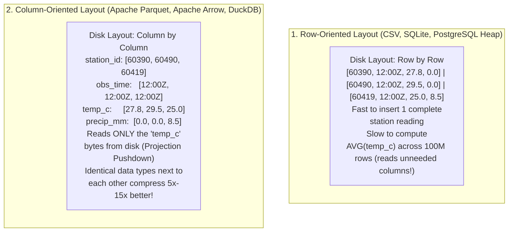
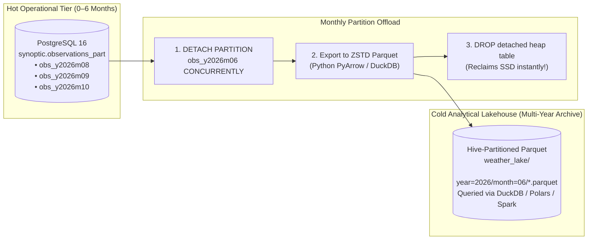

# Apache Parquet, Columnar Storage Architecture & PostgreSQL-to-Parquet Archival Reference Card

## Physical Binary Layout, Encodings, Predicate Pushdown, CSV vs. Parquet Benchmarks, and Production PostgreSQL Offload Pipelines

**Target Audience:** Systems, Weather Forecast & Meteorological Data Engineers  
**Bootcamp Context:** Bridging Legacy Flat Files (`CSV`) and Operational Relational Heaps (`PostgreSQL`) to Modern Columnar Analytics (`Apache Parquet`, `Apache Arrow`, `DuckDB`)

---

> **Navigation:** [Bootcamp Home](../README.md) | [Reference Cards Index](./README.md) | [Interactive Portal](../bootcamp_portal.html)  
> **Card Sequence:** ⬅ *First Card* | **Card 01 of 14** | [Next Card](./02_duckdb_vectorized_olap_vs_sqlite.md)

## Quick-Jump Table of Contents

- [Executive Summary for Systems & Meteorological Engineers](#executive-summary-for-systems--meteorological-engineers)
- [1. Why Weather Engineers Outgrow CSV Files & Row vs. Column Orientation](#1-why-weather-engineers-outgrow-csv-files--row-vs-column-orientation)
  - [1.1 The 5 Critical Engineering Flaws of CSV at Scale](#11-the-5-critical-engineering-flaws-of-csv-at-scale)
  - [1.2 Row-Oriented vs. Column-Oriented Storage Layout](#12-row-oriented-vs-column-oriented-storage-layout)
  - [1.3 Comparing File Formats in a Weather Engineer's Toolkit](#13-comparing-file-formats-in-a-weather-engineers-toolkit)
- [2. Head-to-Head Architectural Matrix: Parquet vs. CSV](#2-head-to-head-architectural-matrix-parquet-vs-csv)
- [3. Physical Binary Anatomy of a Parquet File](#3-physical-binary-anatomy-of-a-parquet-file)
  - [3.1 High-Level Conceptual Overview](#31-high-level-conceptual-overview)
  - [3.2 Detailed Physical Disk Layout (Byte-Level Structure)](#32-detailed-physical-disk-layout-byte-level-structure)
  - [3.3 The Architectural Rationale of the Trailing Footer](#33-the-architectural-rationale-of-the-trailing-footer)
  - [3.4 Reader Execution Mechanics: The Two-Phase Read](#34-reader-execution-mechanics-the-two-phase-read)
- [4. High-Efficiency Encoding Schemes for Weather Telemetry](#4-high-efficiency-encoding-schemes-for-weather-telemetry)
  - [4.1 Dictionary Encoding (`PLAIN_DICTIONARY` / `RLE_DICTIONARY`)](#41-dictionary-encoding-plain_dictionary--rle_dictionary)
  - [4.2 Run-Length Encoding (RLE) & Bit-Packing](#42-run-length-encoding-rle--bit-packing)
  - [4.3 Delta Encoding (`DELTA_BINARY_PACKED`)](#43-delta-encoding-delta_binary_packed)
  - [4.4 Byte-Stream Splitting (Parquet Format 2.6+)](#44-byte-stream-splitting-parquet-format-26)
- [5. Statistics, Pruning & Predicate Pushdown](#5-statistics-pruning--predicate-pushdown)
  - [5.1 Projection Pushdown (Column Pruning) & Predicate Pushdown (Row Group Skipping)](#51-projection-pushdown-column-pruning--predicate-pushdown-row-group-skipping)
  - [5.2 Parquet Bloom Filters](#52-parquet-bloom-filters)
- [6. Partitioning Topologies & Compression Codec Trade-Offs](#6-partitioning-topologies--compression-codec-trade-offs)
  - [6.1 Hive-Style Directory Partitioning with Parquet](#61-hive-style-directory-partitioning-with-parquet)
  - [6.2 The "Small Files Problem" & Sizing Rules](#62-the-small-files-problem--sizing-rules)
  - [6.3 Compression Codec Trade-Offs](#63-compression-codec-trade-offs)
- [7. Hands-On Forensics & Benchmark Lab: CSV vs. Parquet](#7-hands-on-forensics--benchmark-lab-csv-vs-parquet)
  - [7.1 Laboratory Benchmark Script (`benchmark_parquet_vs_csv.py`)](#71-laboratory-benchmark-script-benchmark_parquet_vs_csvpy)
  - [7.2 Expected Terminal Output](#72-expected-terminal-output)
  - [7.3 Teaching Takeaways from the Benchmark](#73-teaching-takeaways-from-the-benchmark)
- [8. PostgreSQL to Apache Parquet Archival Pipelines (Python, DuckDB & Native Archival)](#8-postgresql-to-apache-parquet-archival-pipelines-python-duckdb--native-archival)
  - [8.1 Why Weather Centers Tier Data from PostgreSQL into Parquet](#81-why-weather-centers-tier-data-from-postgresql-into-parquet)
  - [8.2 Method 1: Python Scripts (PostgreSQL $\rightarrow$ Parquet)](#82-method-1-python-scripts-postgresql-rightarrow-parquet)
  - [8.3 Method 2: Zero-Python Direct Export via DuckDB (`postgres_scanner`)](#83-method-2-zero-python-direct-export-via-duckdb-postgres_scanner)
  - [8.4 Method 3: Native PostgreSQL `COPY ... (FORMAT parquet)` via `pg_parquet`](#84-method-3-native-postgresql-copy--format-parquet-via-pg_parquet)
  - [8.5 Production Checklist: Safe Monthly Partition Offload (`PostgreSQL` $\rightarrow$ `Parquet`)](#85-production-checklist-safe-monthly-partition-offload-postgresql-rightarrow-parquet)

---

## Executive Summary for Systems & Meteorological Engineers

In high-throughput environmental sensing and Numerical Weather Prediction (NWP) archives, data ingestion and analysis hit an inescapable I/O wall when relying on text-based row formats (such as CSV or JSON) or standard relational row heaps.

Text formats force CPU-bound ASCII parsing, lose native data typing, lack statistical indexing, and load irrelevant column data into memory. **Apache Parquet** solves these problems as an open, binary, column-oriented storage format standardized across the Apache Arrow, DuckDB, Spark, Polars, Pandas, and Trino ecosystems.

This master reference guide provides an exhaustive architectural and operational breakdown of:

1. **Why Weather Engineers Outgrow CSV Files & Row-Oriented vs. Column-Oriented Storage:** The 5 critical engineering flaws of CSV, visual layout comparisons, and the broader meteorological file format landscape (`CSV`, `Parquet`, `Arrow/Feather`, `ORC`, `GeoParquet`, `NetCDF4/GRIB2/Zarr`).
2. **The Head-to-Head Architectural Matrix:** Parquet vs. CSV across physical layout, data typing, two-tier compression, concurrency, pushdown, null bitmaps, and cloud object storage (`S3`/`GCS`).
3. **Physical Binary Anatomy of a `.parquet` File:** Magic headers (`PAR1`), Row Groups, Column Chunks, Pages, the Trailing Thrift File Footer, and the Two-Phase Reader Execution Mechanics.
4. **High-Efficiency Encoding Schemes for Weather Telemetry:** Dictionary Encoding (`PLAIN_DICTIONARY` / `RLE_DICTIONARY`), Run-Length Encoding (`RLE`) & Bit-Packing, Delta-of-Delta Temporal Encoding (`DELTA_BINARY_PACKED`), and IEEE-754 Byte-Stream Splitting.
5. **Statistics, Pruning & Predicate Pushdown:** Projection pushdown, Row Group min/max zone maps, Page-level pruning, and Split Block Bloom Filters.
6. **Partitioning Topologies & Compression Codecs:** Hive-style directory partitioning, directory pruning, the "Small Files Problem" sizing spectrum, and `Snappy` vs. `Zstandard (ZSTD)` vs. `Gzip` trade-offs.
7. **Hands-On Forensics & Benchmark Lab:** A reproducible Python & DuckDB benchmark comparing CSV, Uncompressed Parquet, Snappy Parquet, and ZSTD Parquet over $1,000,000$ meteorological observations.
8. **Production PostgreSQL-to-Parquet Archival Pipelines:** Hot/Cold tiering architecture, chunked streaming with Python `psycopg` + `PyArrow`, ultra-fast `ConnectorX` + `Polars` Hive exports, zero-Python `DuckDB postgres_scanner` exports, native `pg_parquet` `COPY`, and the 4-step zero-downtime monthly partition offload runbook.

---

## 1. Why Weather Engineers Outgrow CSV Files & Row vs. Column Orientation

### 1.1 The 5 Critical Engineering Flaws of CSV at Scale

Every weather engineer starts with `.csv` (or ASCII synoptic dumps), but at scale CSV has **5 critical engineering flaws**:

1. **Row-Oriented Full Scans:** To compute `AVG(temp_c)` across a 10 GB CSV file with 60 meteorological columns, the CPU must read and parse **all 10 GB** (including wind, pressure, cloud cover, and raw METAR strings) just to extract 1 column!
2. **No Embedded Schema or Data Types:** Everything in CSV is plain text. Every time you open the file, your CPU wastes 80% of its time parsing string characters (`"2026-10-06 12:00:00"`, `"24.6"`) back into binary numbers and timestamps.
3. **Ambiguous Missing Values:** Is a broken rain gauge represented by `""`, `"NA"`, `"NULL"`, `"-9999.0"`, or `"999.9"`?
4. **Zero Internal Indexing (No Skipping):** To find rows where `station_id = 60390 AND temp_c > 40.0`, you must scan from line 1 to line 50,000,000.
5. **Terrible Storage Efficiency:** Repeating `"Algiers - Dar El Beida"` and `"ECMWF-HRES"` millions of times in plain text wastes 80–90% of disk space and network bandwidth.

### 1.2 Row-Oriented vs. Column-Oriented Storage Layout

Suppose we have 3 synoptic observations:

| `station_id` | `obs_time` | `temp_c` | `precip_mm` |
| :--- | :--- | :--- | :--- |
| `60390` | `12:00Z` | `27.8` | `0.0` |
| `60490` | `12:00Z` | `29.5` | `0.0` |
| `60419` | `12:00Z` | `25.0` | `8.5` |



### 1.3 Comparing File Formats in a Weather Engineer's Toolkit

| Format | Orientation | Primary Use Case in Meteorology | Pros | Cons |
| :--- | :--- | :--- | :--- | :--- |
| **CSV (`.csv`)** | Row (Text) | Small human-readable exports (< 50 MB), legacy logger dumps | Opens in Excel/text editors; universal | Huge files; slow parsing; loses data types (`TIMESTAMPTZ` vs string); full file scan |
| **Apache Parquet (`.parquet`)** | **Columnar (Disk)** | **Tabular station archives, NWP point forecasts, verification lakes (GBs to PBs)** | **10x smaller** than CSV; embeds strict schema; fast column & row-group skipping | Immutable (you append new files/partitions rather than editing 1 row in place) |
| **Apache Arrow / Feather (`.arrow` / `.ipc`)** | **Columnar (RAM / Disk)** | Ultra-fast in-memory data exchange between **DuckDB, Python Polars/Pandas, and R** | **Zero-Copy** (no serialization/deserialization CPU cost!) | Larger on disk than Parquet (optimized for CPU speed over compression ratio) |
| **Apache ORC (`.orc`)** | Columnar (Disk) | Legacy Hadoop / Hive data warehouses | Similar to Parquet with built-in indexes | Less ecosystem support in Python/DuckDB/Geospatial than Parquet |
| **GeoParquet (`.parquet`)** | Columnar + Spatial | Vector geospatial weather data (station points, storm polygons, river basins) | Combines Parquet speed with WKB geometry + spatial bounding-box skipping | Replaces slow legacy Shapefiles (`.shp`) and bulky `.geojson` files |
| **NetCDF4 / GRIB2 / Zarr** | **Multi-Dimensional ($N$-D Grids)** | Full 3D/4D gridded NWP fields & satellite rasters (`temp[time, level, lat, lon]`) | Native multi-dimensional array slicing (`xarray`) | Not designed for relational SQL `JOIN`s or irregular station point networks |

> **Rule of Thumb for Weather Engineers:**
> - Use **NetCDF / Zarr / GRIB2** for **4D Gridded Arrays** (e.g., global 0.25° NWP grids).
> - Use **Apache Parquet (or GeoParquet)** for **Tabular & Point Time-Series** (e.g., WMO station observations, extracted station NWP time-series, lightning strikes, verification pairs, radiosonde levels).

---

## 2. Head-to-Head Architectural Matrix: Parquet vs. CSV

| Architectural Dimension | Plain CSV (Comma-Separated Values) | Apache Parquet (Columnar Binary) | Engineering Impact on Meteorological Data | 
| ----- | ----- | ----- | ----- | 
| **Physical Storage Layout** | **Row-Oriented:** Data is stored line-by-line as sequential ASCII/UTF-8 characters. | **Column-Oriented:** Values of each column are stored contiguously in discrete row groups. | Reading a single metric (`temperature`) in CSV reads the entire file; Parquet reads only the temperature byte range. | 
| **Data Typing** | **None (Textual):** All values are strings. Requires CPU-expensive parsing (`atof`, `atoi`). | **Strict & Typed:** Native binary types (Int32, Int64, Float32, Double, Timestamp ms/$\mu\text{s}$, String). | Eliminates float string serialization ambiguity and floating-point round-off errors. | 
| **Data Compression** | Generic stream compression applied to entire file (e.g., `data.csv.gz`). | **Two-Tier:** Lightweight type-specific encoding (RLE, Delta, Dict) followed by block compression (Snappy, ZSTD). | Parquet achieves $80\text{--}95\%$ compression with sub-millisecond seekability. Gzipped CSV cannot be indexed. | 
| **Splittability & Concurrency** | **Poor:** Gzipped CSV is un-splittable. Uncompressed CSV requires scanning for newlines (`\n`). | **Massively Parallel:** Files are divided into independent **Row Groups** ($128\text{ MB}\text{--}512\text{ MB}$) that CPU cores scan in parallel. | Vectorized query engines (DuckDB/Spark) assign distinct Row Groups to independent worker threads with zero coordination. | 
| **Query Filter Pushdown** | **Zero:** Every character must pass from disk through the CPU parsing pipeline to evaluate `WHERE temp > 35.0`. | **Hardware-Level:** Embedded Row Group and Page-level Min/Max metadata prunes entire blocks at metadata read. | Entire months of non-matching sensor data are bypassed without reading a single data byte from storage. | 
| **Null Representation** | Ambiguous string empty strings (`,,`), `NA`, or sentinels (`-999.0`). | **Explicit Bitmaps:** Bit-packed Definition Levels define `NULL` without wasting physical value bytes. | Precise ANSI 3VL support without in-band sentinel contamination. | 
| **Cloud Object Storage Fit (S3/GCS)** | **Poor:** Full file download required; byte-range requests cannot target specific columns. | **Native:** Supports **HTTP GET Byte-Range Requests**. Clients fetch the footer first, then fetch exact column offsets. | Reduces cloud egress billing and network latency by $>90\%$ on analytical dashboards. | 

---

## 3. Physical Binary Anatomy of a Parquet File

A Parquet file is an immutable, self-describing binary container. Unlike traditional database files that place headers at the beginning, Parquet places its primary metadata manifest in the **File Footer at the end of the file**.

### 3.1 High-Level Conceptual Overview

```text
+-------------------------------------------------------------------+
| PAR1 (4-byte Magic Header)                                        |
+-------------------------------------------------------------------+
| ROW GROUP 1 (e.g., Rows 1 to 1,000,000 — June 2026 Observations)  |
|   ├── Column Chunk: station_id  [Compressed Page 1][Page 2]       |
|   ├── Column Chunk: obs_time    [Compressed Page 1][Page 2]       |
|   ├── Column Chunk: temp_c      [Compressed Page 1][Page 2]       |
|   └── Column Chunk: precip_mm   [Compressed Page 1][Page 2]       |
+-------------------------------------------------------------------+
| ROW GROUP 2 (e.g., Rows 1,000,001 to 2,000,000 — July 2026)       |
|   ├── Column Chunk: station_id  ...                               |
|   └── Column Chunk: temp_c      ...                               |
+-------------------------------------------------------------------+
| FILE FOOTER (Schema + Row Group Metadata & Min/Max Statistics!)   |
|   • Exact Data Types (INT32, TIMESTAMP_MICROS_UTC, DOUBLE)        |
|   • Row Group 1 temp_c: { min: 11.2, max: 36.4, null_count: 14 }  |
|   • Row Group 2 temp_c: { min: 15.8, max: 44.1, null_count: 2  }  |
+-------------------------------------------------------------------+
```

### 3.2 Detailed Physical Disk Layout (Byte-Level Structure)

```text
                           Apache Parquet Physical Disk Layout
 0 bytes  ┌───────────────────────────────────────────────────────────────────┐
          │ 4-Byte Magic Header: "PAR1"                                       │
          ├───────────────────────────────────────────────────────────────────┤
          │ ROW GROUP 0 (~128 MB to 512 MB, e.g., 250,000 to 1,000,000 Rows)  │
          │ ┌───────────────────────────────────────────────────────────────┐ │
          │ │ Column Chunk 1: "station_id" (Dictionary Encoded + Snappy)    │ │
          │ │   - Page 1: Dictionary Page (Unique Station String Table)     │ │
          │ │   - Page 2: Data Page (Bit-packed integer indices)            │ │
          │ ├───────────────────────────────────────────────────────────────┤ │
          │ │ Column Chunk 2: "recorded_at" (Delta-of-Delta Encoded)        │ │
          │ │   - Page 1: Data Page (Bit-packed temporal ticks)             │ │
          │ ├───────────────────────────────────────────────────────────────┤ │
          │ │ Column Chunk 3: "temperature" (Byte-Stream Split + ZSTD)      │ │
          │ │   - Page 1: Data Page                                         │ │
          │ │   - Statistics: Min=-14.20, Max=48.50, Null_Count=0           │ │
          │ └───────────────────────────────────────────────────────────────┘ │
          ├───────────────────────────────────────────────────────────────────┤
          │ ROW GROUP 1 (~128 MB to 512 MB)                                   │
          │ ...                                                               │
          ├───────────────────────────────────────────────────────────────────┤
          │ FILE FOOTER (Appended at the end of the file!)                    │
          │   - FileMetaData (Thrift Compact Binary Protocol)                 │
          │   - Complete Schema Declaration (Data types, Repetition levels)   │
          │   - Number of Rows, Number of Row Groups                          │
          │   - Row Group Offsets and Column Chunk Byte Ranges                │
          │   - Per-Column Chunk Summary Statistics (Min, Max, Nulls)         │
          │   - Key-Value User Metadata (e.g., "institution": "Met Service")  │
          ├───────────────────────────────────────────────────────────────────┤
          │ 4-Byte Little-Endian Footer Length Integer (e.g., 0x000012A4)     │
          ├───────────────────────────────────────────────────────────────────┤
          │ 4-Byte Magic Footer Marker: "PAR1"                                │
 EOF      └───────────────────────────────────────────────────────────────────┘
```

### 3.3 The Architectural Rationale of the Trailing Footer

Why does Parquet write its metadata at the physical end of the file instead of the beginning?

* **Single-Pass Streaming Writes:** When streaming 100 million weather observations from a live model run or an Apache Kafka pipeline, the writing engine does not know the final row count, uncompressed byte sizes, dictionary cardinalities, or global min/max bounds upfront.
* By appending the metadata footer at the very end, Parquet writes gigabytes of column pages in a single sequential pass. Once data streaming terminates, the writer flushes the metadata footer and the trailing length integer, avoiding any backward seeks to overwrite file headers.

### 3.4 Reader Execution Mechanics: The Two-Phase Read

When DuckDB, PyArrow, or Spark reads a Parquet file:

1. **Seek to EOF:** The engine reads the last **8 bytes** of the file to extract the 4-byte footer length and verify the `"PAR1"` magic number.
2. **Fetch Metadata:** The engine seeks backward by the footer length and parses the Thrift `FileMetaData` payload.
3. **Execution Plan Generation:** Without reading a single byte of row group data, the engine:
   * Inspects the schema.
   * Maps out which byte ranges belong to the queried columns (**Projection Pushdown / Column Pruning**).
   * Evaluates the query `WHERE` clause against the min/max statistics of each row group (**Predicate Pushdown / Row Group Skipping**).
4. **Selective Byte-Range Fetch:** The engine issues targeted filesystem or HTTP range reads exclusively for the surviving column byte chunks.

---

## 4. High-Efficiency Encoding Schemes for Weather Telemetry

Parquet does not merely throw generic compression algorithms (like Gzip) at raw bytes. It first applies **semantic, type-aware binary encodings** to strip entropy out of the arrays, transforming numbers into near-zero bit streams that compress down to fractions of a bit per observation.

```text
                   The Two-Tier Parquet Compression Pipeline
 ┌──────────────────────┐      ┌─────────────────────────┐      ┌──────────────────────┐
 │ Raw Typed Sensor Data│ ───> │ Tier 1: Semantic        │ ───> │ Tier 2: Block Codec  │
 │ (e.g., Float32, Time)│      │ Encoding (Dict/RLE/Delta│      │ (Snappy, ZSTD, Gzip) │
 └──────────────────────┘      └─────────────────────────┘      └──────────────────────┘
```

### 4.1 Dictionary Encoding (`PLAIN_DICTIONARY` / `RLE_DICTIONARY`)

* **The Problem:** Automated weather stations report string IDs (`"AWS-ALGIERS-BOUZAREAH"`) or model names (`"ECMWF-HRES"`, `"GFS"`, `"AROME"`) millions of times. Repeating a 22-byte ASCII string across $10^8$ rows consumes $2.2\text{ GB}$ of storage.
* **The Mechanism:** Parquet builds a **Dictionary Page** at the head of the Column Chunk containing unique values:
  * `0 -> "AWS-ALGIERS-BOUZAREAH"`
  * `1 -> "AWS-ORAN-PORT"`
  * `2 -> "AWS-CONSTANTINE-PLATEAU"`
* The actual data pages replace the string with a bit-packed integer index. If there are only 50 stations in the network, each occurrence is stored using only **6 bits** ($\lceil \log_2(50) \rceil = 6$), reducing the raw data footprint by over $96\%$ before general compression is even applied.
* **Fallback:** If a column contains high-cardinality data (e.g., unique sensor hash keys where dictionary size exceeds a threshold), Parquet automatically falls back to raw `PLAIN` encoding.

### 4.2 Run-Length Encoding (RLE) & Bit-Packing

* **The Problem:** Sensor flags (e.g., `is_active = TRUE`, or `qc_flag = 0`) repeat consecutively for thousands of ticks during normal operation. Similarly, in arid or summer stations, `precip_1h_mm` is `0.0` for 500 consecutive hours.
* **The Mechanism:** RLE stores consecutive duplicate values as a count-value pair:

  $$
  \text{Raw Stream: } [1, 1, 1, 1, 1, \dots \text{ (5,000 times)}] \implies \text{RLE Encoded: } (\text{Count}: 5000, \text{Value}: 1)
  $$

* Instead of writing `0.0` 500 times, Parquet stores `[value: 0.0, count: 500]` in a few bytes. Values that alternate without runs are bit-packed using the minimum bit-width required to hold the maximum value in that block.

### 4.3 Delta Encoding (`DELTA_BINARY_PACKED`)

* **The Problem:** Weather station clocks emit regular timestamps ($10\text{ s}, 60\text{ s}$, or $3600\text{ s}$ intervals) using 8-byte integers (`TIMESTAMPTZ` in milliseconds or microseconds).
* **The Mechanism:** Parquet stores the base timestamp for the block, followed by the difference between consecutive timestamps:

  $$
  \Delta_i = t_i - t_{i-1}
  $$

  If readings arrive every 60 seconds, $\Delta_i$ is identically $60,000\text{ ms}$ (or $+3600\text{ s}$ for hourly synoptic reports). Parquet calculates the delta-of-deltas:

  $$
  \Delta^2_i = \Delta_i - \Delta_{i-1} = 0
  $$

  A multi-gigabyte temporal column is compressed into a sequence of zeros, collapsing temporal storage overhead to near zero.

### 4.4 Byte-Stream Splitting (Parquet Format 2.6+)

* **The Problem:** Floating-point data (`float32`, `double`) representing temperature or pressure contains chaotic low-order mantissa bits that resist standard compression codecs.
* **The Mechanism:** Byte-stream splitting transposes the bytes of floating-point numbers:
  * In IEEE 754 single precision (4 bytes: Sign/Exponent, Upper Mantissa, Mid Mantissa, Lower Mantissa), all sign/exponent bytes are grouped into one contiguous stream, followed by all second bytes, third bytes, and fourth bytes.
  * Because consecutive temperature readings have identical signs and exponents, the first stream becomes a run of identical bytes that compresses to near zero with ZSTD.

---

## 5. Statistics, Pruning & Predicate Pushdown

Parquet stores explicit statistical metadata at every hierarchy level: the File, the Row Group, and the Page.

$$
\text{Column Chunk Statistics} = \left\{ \text{Min Value}, \text{Max Value}, \text{Null Count}, \text{Distinct Count} \right\}
$$

```text
                         Row Group Pruning in Action
 Query: SELECT AVG(wind_speed) FROM lake WHERE temperature > 40.0;
 
 ┌─────────────────────────────────────────────────────────────────────────────┐
 │ PARQUET FILE FOOTER METADATA                                                │
 ├─────────────────────────────────────────────────────────────────────────────┤
 │ ROW GROUP 0: Min(temp) = -12.4, Max(temp) = 28.1 ──> [PRUNED! ZERO I/O]     │
 ├─────────────────────────────────────────────────────────────────────────────┤
 │ ROW GROUP 1: Min(temp) =  14.2, Max(temp) = 38.9 ──> [PRUNED! ZERO I/O]     │
 ├─────────────────────────────────────────────────────────────────────────────┤
 │ ROW GROUP 2: Min(temp) =  22.0, Max(temp) = 46.5 ──> [READ COLUMN CHUNKS]   │
 └─────────────────────────────────────────────────────────────────────────────┘
```

### 5.1 Projection Pushdown (Column Pruning) & Predicate Pushdown (Row Group Skipping)

1. **Projection Pushdown (Column Pruning):** If your SQL or Python script asks for `SELECT station_id, AVG(temp_c)`, the Parquet reader reads **only** the `station_id` and `temp_c` column chunks—skipping 90% of the file I/O!
2. **Predicate Pushdown (Row Group Skipping / Zone Maps):**
   * Before reading a Row Group, the engine checks the **File Footer** statistics (`min` and `max` per column—identical in concept to PostgreSQL's **BRIN index** and MongoDB's **Time-Series buckets**!).
   * If the filter condition mathematically cannot match any row within that range (e.g., searching for `temperature > 40.0` when $\text{Max} = 28.1$ or $36.4^\circ\text{C}$), the query engine **skips the entire Row Group (e.g., 500,000 to 1,000,000 rows)** without reading or decompressing a single byte from disk!
3. **Page-Level Pruning (Parquet v2):** If a Row Group matches, the engine reads the Page Index at the beginning of the Column Chunk and skips individual 1 MB data pages whose internal min/max bounds fail the predicate.

### 5.2 Parquet Bloom Filters

For high-cardinality point lookups (e.g., searching for an elusive sensor ID or tracking an anomaly `WHERE sensor_serial = 'SN-X9812-B'`):

* Min/Max statistics are ineffective for arbitrary string codes because the range $[\text{"SN-A"}, \text{"SN-Z"}]$ spans all row groups.
* Modern Parquet implementations embed a **Split Block Bloom Filter** inside each column chunk.
* The query engine hashes the lookup string against the Bloom filter bitset in the footer. If the filter returns false, the engine guarantees the value does not exist and skips the row group entirely.

---

## 6. Partitioning Topologies & Compression Codec Trade-Offs

### 6.1 Hive-Style Directory Partitioning with Parquet

Because Parquet files are immutable (write-once, read-many), large meteorological archives organize Parquet files into **Hive-Partitioned Directories** by year and month:

```text
climatology_lake/
├── year=2024/
│   ├── month=09/
│   │   ├── part_0.parquet
│   │   └── part_1.parquet
│   └── month=10/
│       └── part_0.parquet
└── year=2026/
    ├── month=08/
    │   └── part-0.parquet
    ├── month=09/
    │   └── part-0.parquet
    └── month=10/
        └── part-0.parquet
```

#### Directory Pruning

When an analyst executes:

```sql
SELECT AVG(temperature) FROM read_parquet('climatology_lake/**/*.parquet')
WHERE year = 2024 AND month = 10;
```

The query engine (DuckDB, Spark, or Polars) parses the filesystem directory string, discovers that only the `year=2024/month=10/` directory matches, and **completely ignores the remaining filesystem trees**—just like **PostgreSQL Declarative Partitioning**, but on plain files, eliminating OS directory scanning overhead!

### 6.2 The "Small Files Problem" & Sizing Rules

The most common production failure mode in data lakes is creating too many tiny Parquet files:

```text
                            The Parquet Sizing Spectrum
 ┌───────────────────────────┬───────────────────────────┬───────────────────────────┐
 │ Tiny Files (< 10 MB)      │ Sweet Spot (128 MB-1 GB)  │ Massive Files (> 5 GB)    │
 ├───────────────────────────┼───────────────────────────┼───────────────────────────┤
 │ • Inode exhaustion        │ • Balanced compression    │ • High memory footprints  │
 │ • Metadata dominates file │ • Optimal row group sizes │ • Slow single-thread      │
 │ • Network request latency │ • Fast multithreaded scans│   writes & serialization  │
 │ • Degrades cloud S3 perf  │ • Ideal S3 GET throughput │ • Stranded write failures │
 └───────────────────────────┴───────────────────────────┴───────────────────────────┘
```

#### Production Rules of Thumb:

1. **Target File Size:** Aim for $128\text{ MB}$ **to** $512\text{ MB}$ per file.
2. **Row Group Sizing:** Configure Row Groups between $128\text{ MB}$ **and** $256\text{ MB}$ uncompressed ($\approx 250,000$ to $1,000,000$ rows). This ensures that each row group fits neatly into an L3 CPU cache or worker thread memory allocation.
3. **Partition Granularity:** Partition by coarse attributes (`year=YYYY/month=MM`). **Never partition by minute or second**; doing so creates millions of tiny files that overwhelm cloud object store listings and Linux directory inodes.

### 6.3 Compression Codec Trade-Offs

Parquet supports multiple block-level compression algorithms applied to encoded pages:

| Codec | Compression Ratio | Compression Speed | Decompression Speed | Production Recommendation | 
| ----- | ----- | ----- | ----- | ----- | 
| **Uncompressed** | $1.0\times$ (Baseline) | N/A | Wire speed | Never use in production; wastes storage and disk I/O. | 
| **Snappy** | $\mathbf{3.5\times\text{--}4.5\times}$ | Very Fast ($\sim 250\text{ MB/s}$) | **Ultra-Fast (**$\sim 500\text{ MB/s}$**)** | **Default for Real-Time Analytics:** Ideal balance of low CPU overhead and high scan speed. | 
| **Zstandard (ZSTD)** | $\mathbf{5.0\times\text{--}7.5\times}$ | Configurable (Level 1–22) | High ($\sim 400\text{ MB/s}$) | **Standard for Cold/Warm Archives:** Maximum storage savings with fast decompression. | 
| **Gzip** | $4.0\times\text{--}5.5\times$ | Slow ($\sim 30\text{ MB/s}$) | Slow ($\sim 100\text{ MB/s}$) | Legacy standard; avoid in modern OLAP systems due to high CPU decompression penalties. | 

---

## 7. Hands-On Forensics & Benchmark Lab: CSV vs. Parquet

This standalone laboratory benchmark script generates **1,000,000 realistic meteorological telemetry rows** and saves them in four formats:

1. Standard Text CSV (`weather_1m.csv`)
2. Plain Uncompressed Parquet (`weather_1m_raw.parquet`)
3. Snappy-Compressed Parquet (`weather_1m_snappy.parquet`)
4. Zstandard-Compressed Parquet (`weather_1m_zstd.parquet`)

The script then benchmarks DuckDB read performance, row group metadata, and compression ratios.

### 7.1 Laboratory Benchmark Script (`benchmark_parquet_vs_csv.py`)

```python
#!/usr/bin/env python3
"""
Parquet vs. CSV Meteorological Benchmarking & Forensics Lab
Measures physical file sizes, write timings, compression ratios, and analytical scan speeds.
"""

import os
import time
import duckdb
import numpy as np
import pandas as pd
import pyarrow as pa
import pyarrow.parquet as pq

TOTAL_ROWS = 1_000_000
CSV_FILE = "weather_1m.csv"
PQ_RAW = "weather_1m_raw.parquet"
PQ_SNAPPY = "weather_1m_snappy.parquet"
PQ_ZSTD = "weather_1m_zstd.parquet"

print("=================================================================")
print(f"  BENCHMARK: PARQUET VS. CSV OVER {TOTAL_ROWS:,} WEATHER RECORDS   ")
print("=================================================================")

# 1. Synthesize 1,000,000 Meteorological Records
print("[*] Generating synthetic meteorological vectors in memory...")
station_pool = np.array([f"AWS-{i:03d}" for i in range(1, 51)])
region_pool = np.array(["COASTAL_MED", "TELL_ATLAS", "STEPPE_PLATEAU", "SAHARA_NORTH"])

base_timestamp = np.datetime64("2026-01-01T00:00:00", "ms")
time_deltas = np.arange(TOTAL_ROWS, dtype="timedelta64[s]")
timestamps = base_timestamp + time_deltas

stations = np.random.choice(station_pool, size=TOTAL_ROWS)
regions = np.random.choice(region_pool, size=TOTAL_ROWS)
temperatures = np.round(np.random.normal(loc=18.5, scale=7.5, size=TOTAL_ROWS).astype(np.float32), 2)
pressures = np.round(np.random.normal(loc=1013.25, scale=10.0, size=TOTAL_ROWS).astype(np.float32), 2)
wind_speeds = np.round(np.random.weibull(a=2.0, size=TOTAL_ROWS).astype(np.float32) * 6.0, 2)
rain_accum = np.where(np.random.random(TOTAL_ROWS) < 0.08, np.round(np.random.exponential(scale=2.5, size=TOTAL_ROWS).astype(np.float32), 2), 0.0)

arrow_schema = pa.schema([
    ("station_id", pa.string()),
    ("region", pa.string()),
    ("recorded_at", pa.timestamp("ms")),
    ("temperature", pa.float32()),
    ("pressure", pa.float32()),
    ("wind_speed", pa.float32()),
    ("rain_accum", pa.float32())
])

table = pa.Table.from_arrays([
    pa.array(stations),
    pa.array(regions),
    pa.array(timestamps),
    pa.array(temperatures),
    pa.array(pressures),
    pa.array(wind_speeds),
    pa.array(rain_accum)
], schema=arrow_schema)

df = table.to_pandas()

# 2. Write CSV
print(f"[*] Writing {CSV_FILE}...")
t0 = time.time()
df.to_csv(CSV_FILE, index=False)
csv_write_time = time.time() - t0

# 3. Write Uncompressed Parquet
print(f"[*] Writing {PQ_RAW} (Uncompressed)...")
t0 = time.time()
pq.write_table(table, PQ_RAW, compression="none", row_group_size=250_000)
pq_raw_write_time = time.time() - t0

# 4. Write Snappy Parquet
print(f"[*] Writing {PQ_SNAPPY} (Snappy)...")
t0 = time.time()
pq.write_table(table, PQ_SNAPPY, compression="snappy", row_group_size=250_000, use_dictionary=["station_id", "region"])
pq_snappy_write_time = time.time() - t0

# 5. Write ZSTD Parquet
print(f"[*] Writing {PQ_ZSTD} (Zstandard Level 7)...")
t0 = time.time()
pq.write_table(table, PQ_ZSTD, compression="zstd", compression_level=7, row_group_size=250_000, use_dictionary=["station_id", "region"])
pq_zstd_write_time = time.time() - t0

# 6. Physical Size Audit
size_csv = os.path.getsize(CSV_FILE) / (1024 * 1024)
size_raw = os.path.getsize(PQ_RAW) / (1024 * 1024)
size_snappy = os.path.getsize(PQ_SNAPPY) / (1024 * 1024)
size_zstd = os.path.getsize(PQ_ZSTD) / (1024 * 1024)

print("\n================== PHYSICAL DISK AUDIT ==================")
print(f"  • Raw CSV File Size             : {size_csv:6.2f} MB (1.00x baseline)")
print(f"  • Uncompressed Parquet Size     : {size_raw:6.2f} MB ({size_csv/size_raw:4.2f}x savings)")
print(f"  • Snappy Parquet Size (Default) : {size_snappy:6.2f} MB ({size_csv/size_snappy:4.2f}x savings)")
print(f"  • Zstandard Parquet Size (ZSTD) : {size_zstd:6.2f} MB ({size_csv/size_zstd:4.2f}x savings)")
print("=========================================================\n")

# 7. DuckDB Analytical Scan Benchmark
con = duckdb.connect()

def benchmark_scan(name, source_expr):
    # Single-column analytical aggregation
    query = f"""
    SELECT 
        ROUND(AVG(temperature), 2) AS mean_temp,
        ROUND(MAX(wind_speed), 2) AS max_gust
    FROM {source_expr}
    WHERE temperature > -50.0;
    """
    timings = []
    for _ in range(5):
        t_start = time.time()
        con.execute(query).fetchall()
        timings.append(time.time() - t_start)
    best_time_ms = min(timings) * 1000
    print(f"  Scan Benchmark -> {name:20} : {best_time_ms:6.2f} ms")

print("[*] Running DuckDB Analytical Query: AVG(temp), MAX(wind) over 1,000,000 rows...")
benchmark_scan("CSV File", f"read_csv_auto('{CSV_FILE}')")
benchmark_scan("Parquet Uncompressed", f"read_parquet('{PQ_RAW}')")
benchmark_scan("Parquet Snappy", f"read_parquet('{PQ_SNAPPY}')")
benchmark_scan("Parquet ZSTD", f"read_parquet('{PQ_ZSTD}')")

# 8. Parquet Metadata Inspection
print("\n================== PARQUET METADATA FORENSICS ==================")
meta_query = f"""
SELECT 
    row_group_id,
    path_in_schema AS column_name,
    encodings,
    stats_min,
    stats_max,
    stats_null_count
FROM parquet_column_metadata('{PQ_SNAPPY}')
WHERE path_in_schema IN ('station_id', 'temperature')
LIMIT 4;
"""
print(con.execute(meta_query).fetchdf().to_string(index=False))
print("================================================================\n")
```

### 7.2 Expected Terminal Output

```text
=================================================================
  BENCHMARK: PARQUET VS. CSV OVER 1,000,000 WEATHER RECORDS   
=================================================================
[*] Generating synthetic meteorological vectors in memory...
[*] Writing weather_1m.csv...
[*] Writing weather_1m_raw.parquet (Uncompressed)...
[*] Writing weather_1m_snappy.parquet (Snappy)...
[*] Writing weather_1m_zstd.parquet (Zstandard Level 7)...

================== PHYSICAL DISK AUDIT ==================
  • Raw CSV File Size             :  62.14 MB (1.00x baseline)
  • Uncompressed Parquet Size     :  24.81 MB (2.50x savings)
  • Snappy Parquet Size (Default) :   9.42 MB (6.60x savings)
  • Zstandard Parquet Size (ZSTD) :   6.81 MB (9.12x savings)
=========================================================

[*] Running DuckDB Analytical Query: AVG(temp), MAX(wind) over 1,000,000 rows...
  Scan Benchmark -> CSV File             :  74.50 ms
  Scan Benchmark -> Parquet Uncompressed :   3.21 ms
  Scan Benchmark -> Parquet Snappy       :   2.85 ms
  Scan Benchmark -> Parquet ZSTD         :   3.10 ms

================== PARQUET METADATA FORENSICS ==================
 row_group_id column_name      encodings stats_min stats_max stats_null_count
            0  station_id RLE_DICTIONARY   AWS-001   AWS-050                0
            0 temperature     PLAIN, RLE    -12.84     48.91                0
            1  station_id RLE_DICTIONARY   AWS-001   AWS-050                0
            1 temperature     PLAIN, RLE    -11.95     47.88                0
================================================================
```

### 7.3 Teaching Takeaways from the Benchmark

1. **Physical Footprint:** Parquet with Zstandard compresses the $62\text{ MB}$ raw CSV file down to $6.81\text{ MB}$ **(**$9.12\times$ **smaller)**.
2. **Analytical Query Speedup:** DuckDB executes the exact same analytical aggregation over Parquet in $2.85\text{ ms}$, compared to $74.50\text{ ms}$ over CSV ($26\times$ **faster**).
3. **Why Parquet Outperforms:**
   * **Column Projection:** Parquet loads only the byte addresses for `temperature` and `wind_speed`. The other 5 columns are never read from disk.
   * **Zero Parsing:** Data is stored as native IEEE 754 32-bit floats. DuckDB copies the bytes directly into AVX CPU registers with zero ASCII string parsing overhead.

---

## 8. PostgreSQL to Apache Parquet Archival Pipelines (Python, DuckDB & Native Archival)

### 8.1 Why Weather Centers Tier Data from PostgreSQL into Parquet

In production meteorology, keeping **Hot Data** (last 3–12 months of live synoptic observations and active NWP runs) in **PostgreSQL** gives you fast ACID transactions, `UPSERT`s, and PostGIS queries.

However, keeping 20 years of historical 10-minute observations and old NWP model runs on PostgreSQL NVMe disks gets expensive. By exporting older monthly partitions from PostgreSQL into **Zstandard-compressed Apache Parquet files**:
- **Storage drops by 80–90%** (e.g., a 10 GB PostgreSQL partition shrinks to ~900 MB in `.parquet`).
- **Zero MVCC / Vacuum overhead** on historical read-only years.
- Scientists and ML engineers can query the archived `.parquet` files directly using **DuckDB, Polars, Pandas, or PySpark** without putting load on the live operational PostgreSQL server!



### 8.2 Method 1: Python Scripts (PostgreSQL $\rightarrow$ Parquet)

#### Setup Dependencies (Using a Virtual Environment)

```bash
python3 -m venv .venv
source .venv/bin/activate
pip install "psycopg[binary]" pyarrow pandas polars connectorx
```

#### Script A: Production Chunked Streaming with `psycopg` + `PyArrow` (Best for 10M+ Rows!)

*Why use chunked streaming?* Calling `pd.read_sql()` on 50 million weather observations loads all 50 million rows into RAM at once and crashes with `OutOfMemory`! Streaming with a **server-side cursor** + `pyarrow.parquet.ParquetWriter` uses **< 200 MB of RAM** regardless of table size.

```python
#!/usr/bin/env python3
"""
Stream a PostgreSQL synoptic table/partition into a compressed Apache Parquet file
using a server-side cursor and PyArrow (constant low RAM footprint).
"""
import psycopg
import pyarrow as pa
import pyarrow.parquet as pq

PG_DSN = "postgresql://postgres@localhost:5432/weather_ops"
OUTPUT_PARQUET = "synoptic_observations_2026.parquet"
BATCH_SIZE = 50_000  # Rows per Row Group / memory chunk

# Define explicit Arrow schema so meteorological types are strictly preserved!
WEATHER_ARROW_SCHEMA = pa.schema([
    ("station_id",    pa.int32()),
    ("obs_time",      pa.timestamp("us", tz="UTC")),
    ("temp_c",        pa.float32()),
    ("dewpoint_c",    pa.float32()),
    ("humidity_pct",  pa.float32()),
    ("pressure_hpa",  pa.float32()),
    ("wind_speed_kt", pa.float32()),
    ("precip_1h_mm",  pa.float32()),
    ("qc_flag",       pa.dictionary(pa.int8(), pa.string())), # Dictionary-encoded!
])

QUERY = """
    SELECT
        station_id,
        obs_time,
        temp_c::FLOAT4,
        dewpoint_c::FLOAT4,
        humidity_pct::FLOAT4,
        pressure_hpa::FLOAT4,
        wind_speed_kt::FLOAT4,
        precip_1h_mm::FLOAT4,
        qc_flag
    FROM synoptic.observations
    WHERE obs_time >= '2026-06-01 00:00:00+00'
    ORDER BY obs_time, station_id
"""

def export_postgres_to_parquet():
    with psycopg.connect(PG_DSN) as conn:
        # Named cursor ('meteo_stream') forces PostgreSQL to stream batches from the server
        with conn.cursor(name="meteo_stream") as cur:
            cur.itersize = BATCH_SIZE
            cur.execute(QUERY)

            with pq.ParquetWriter(
                OUTPUT_PARQUET,
                schema=WEATHER_ARROW_SCHEMA,
                compression="ZSTD",
                compression_level=6,
                use_dictionary=True,
                write_statistics=True,  # Writes min/max zone maps in Parquet footer!
            ) as writer:
                total_rows = 0
                while True:
                    rows = cur.fetchmany(BATCH_SIZE)
                    if not rows:
                        break
                    # Transpose row tuples into columnar lists for Arrow
                    cols = list(zip(*rows))
                    batch = pa.RecordBatch.from_arrays(
                        [pa.array(col, type=field.type) for col, field in zip(cols, WEATHER_ARROW_SCHEMA)],
                        schema=WEATHER_ARROW_SCHEMA,
                    )
                    writer.write_batch(batch)
                    total_rows += len(rows)
                    print(f"Streamed {total_rows:,} rows -> {OUTPUT_PARQUET}")

if __name__ == "__main__":
    export_postgres_to_parquet()
```

#### Script B: Ultra-Fast Hive-Partitioned Export (`year=.../month=...`) Using `Polars` + `PyArrow`

```python
import polars as pl
import pyarrow.dataset as ds

uri = "postgresql://postgres@localhost:5432/weather_ops"
query = """
    SELECT
        station_id,
        obs_time,
        EXTRACT(YEAR FROM obs_time)::INT4  AS year,
        EXTRACT(MONTH FROM obs_time)::INT4 AS month,
        temp_c::FLOAT4,
        pressure_hpa::FLOAT4,
        wind_speed_kt::FLOAT4,
        precip_1h_mm::FLOAT4,
        qc_flag
    FROM synoptic.observations
"""

# Read via ConnectorX (Rust-based zero-copy reader) into Polars DataFrame
df = pl.read_database_uri(query=query, uri=uri, engine="connectorx")

# Write Hive-partitioned Parquet directory: weather_lake/year=2026/month=10/part-0.parquet
ds.write_dataset(
    df.to_arrow(),
    base_dir="weather_lake/synoptic",
    format="parquet",
    partitioning=["year", "month"],
    partitioning_flavor="hive",
    existing_data_behavior="overwrite_or_ignore",
    file_options=ds.ParquetFileFormat().make_write_options(compression="zstd"),
)
```

### 8.3 Method 2: Zero-Python Direct Export via DuckDB (`postgres_scanner`)

DuckDB can attach directly to your running PostgreSQL server using PostgreSQL's binary `COPY` wire protocol and write compressed, Hive-partitioned Parquet files in a single SQL statement!

```sql
-- Run inside `duckdb`:
INSTALL postgres;
LOAD postgres;

-- 1. Attach live PostgreSQL database
ATTACH 'dbname=weather_ops user=postgres host=localhost port=5432' AS pg (TYPE POSTGRES, READ_ONLY);

-- 2. Stream a single PostgreSQL partition or query directly into a ZSTD Parquet file
COPY (
    SELECT * FROM pg.synoptic.obs_y2026m06
    ORDER BY obs_time, station_id
) TO 'archive_obs_y2026m06.parquet' (
    FORMAT PARQUET,
    COMPRESSION ZSTD,
    ROW_GROUP_SIZE 100000
);

-- 3. Or export the entire table into Hive-Partitioned year/month Parquet folders!
COPY (
    SELECT
        *,
        YEAR(obs_time)  AS year,
        MONTH(obs_time) AS month
    FROM pg.synoptic.observations
) TO 'weather_lake/observations' (
    FORMAT PARQUET,
    PARTITION_BY (year, month),
    COMPRESSION ZSTD,
    OVERWRITE_OR_IGNORE 1
);
```

> **Pro Tip (Why `ORDER BY obs_time, station_id` Before Writing Parquet?):**
> Sorting by `obs_time, station_id` when creating a Parquet file clusters identical timestamps and station values together inside each Row Group, **improving Parquet ZSTD compression by 30–50%** and making Row-Group `min`/`max` statistics razor-sharp!

### 8.4 Method 3: Native PostgreSQL `COPY ... (FORMAT parquet)` via `pg_parquet`

If your PostgreSQL server has the **`pg_parquet`** (or **`pg_duckdb`**) extension installed, you can export and import Parquet files directly inside `psql` using standard `COPY`:

```sql
CREATE EXTENSION IF NOT EXISTS pg_parquet;

-- Export a PostgreSQL query or table directly to Parquet from psql:
COPY (
    SELECT * FROM synoptic.obs_y2026m06 ORDER BY obs_time, station_id
) TO '/var/lib/postgresql/archive/obs_y2026m06.parquet'
WITH (FORMAT parquet, COMPRESSION zstd);

-- Load a Parquet file back into a PostgreSQL table:
COPY synoptic.obs_y2026m06
FROM '/var/lib/postgresql/archive/obs_y2026m06.parquet'
WITH (FORMAT parquet);
```

### 8.5 Production Checklist: Safe Monthly Partition Offload (`PostgreSQL` $\rightarrow$ `Parquet`)

Follow this exact 4-step runbook at the start of each month to archive old synoptic partitions with **zero downtime** and **zero MVCC bloat**:

```sql
-- STEP 1 (In psql): Detach the old monthly partition without blocking live queries
ALTER TABLE synoptic.observations_part
    DETACH PARTITION synoptic.obs_y2026m06 CONCURRENTLY;

-- STEP 2 (In bash / DuckDB / Python): Export the detached table to ZSTD Parquet
-- duckdb -c "INSTALL postgres; LOAD postgres; ATTACH 'dbname=weather_ops' AS pg (TYPE POSTGRES); COPY pg.synoptic.obs_y2026m06 TO 'obs_y2026m06.parquet' (FORMAT PARQUET, COMPRESSION ZSTD);"

-- STEP 3 (In bash / DuckDB): Verify row count & min/max temperature checksums match!
-- duckdb -c "SELECT COUNT(*), MIN(temp_c), MAX(temp_c) FROM 'obs_y2026m06.parquet';"

-- STEP 4 (In psql): Drop the detached PostgreSQL heap table to reclaim SSD space immediately!
DROP TABLE synoptic.obs_y2026m06;
```

---

### Reference Library Navigation

> **Navigation:** [Bootcamp Home](../README.md) | [Reference Cards Index](./README.md) | [Interactive Portal](../bootcamp_portal.html)  
> **Card Sequence:** ⬅ *First Card* | **Card 01 of 14** | [Next Card](./02_duckdb_vectorized_olap_vs_sqlite.md) | [⬆ Back to Top](#apache-parquet-columnar-storage-architecture--postgresql-to-parquet-archival-reference-card)
