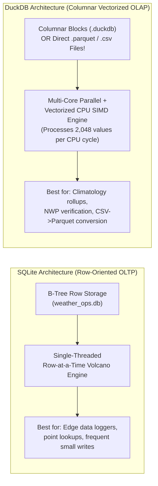

# DuckDB Vectorized OLAP Architecture vs. SQLite Row OLTP Reference Card

## In-Process Execution Mechanics, SIMD Vectorization, Zero-Copy Arrow Interchange, Cloud Lakehouse Analytics, and the 4-Engine Decision Matrix

**Target Audience:** Systems, Weather Forecast & Meteorological Data Engineers  
**Bootcamp Context:** Columnar Analytics (OLAP) vs. Row Transactions (OLTP) for Meteorological Engineering

---

> **Navigation:** [Bootcamp Home](../README.md) | [Reference Cards Index](./README.md) | [Interactive Portal](../bootcamp_portal.html)  
> **Card Sequence:** [⬅ Previous Card](./01_apache_parquet_and_columnar_architecture.md) | **Card 02 of 14** | [Next Card](./03_hive_partitioning_and_lakehouse_compaction.md)

## Quick-Jump Table of Contents

- [Executive Summary for Systems & Meteorological Engineers](#executive-summary-for-systems--meteorological-engineers)
- [1. Head-to-Head Comparison Matrices](#1-head-to-head-comparison-matrices)
  - [1.1 SQLite (`sqlite3`) vs. DuckDB (`duckdb`) for Weather Engineers](#11-sqlite-sqlite3-vs-duckdb-duckdb-for-weather-engineers)
  - [1.2 Architectural Engine Comparison: DuckDB vs. PostgreSQL vs. SQLite vs. Spark](#12-architectural-engine-comparison-duckdb-vs-postgresql-vs-sqlite-vs-spark)
- [2. The Vectorized Execution Engine](#2-the-vectorized-execution-engine)
  - [2.1 The Volcano Iterator Problem](#21-the-volcano-iterator-problem)
  - [2.2 Vectorized Chunk Execution (Morsel-Driven)](#22-vectorized-chunk-execution-morsel-driven)
- [3. Zero-Copy Memory Interchange: The Arrow Bridge](#3-zero-copy-memory-interchange-the-arrow-bridge)
  - [3.1 Eliminating the Serialization Tax](#31-eliminating-the-serialization-tax)
- [4. Installing & Starting DuckDB](#4-installing--starting-duckdb)
  - [Quick Install (Linux CLI & Python)](#quick-install-linux-cli--python)
- [5. Querying External Data Lakes, Cloud Object Storage & DuckDB's 6 Superpowers](#5-querying-external-data-lakes-cloud-object-storage--duckdbs-6-superpowers)
  - [5.1 Superpower 1: Query `.csv`, `.parquet`, and Remote S3/MinIO Directly with SQL (Zero Import!)](#51-superpower-1-query-csv-parquet-and-remote-s3minio-directly-with-sql-zero-import)
  - [5.2 Superpower 2: Direct File-to-File Downsampling & CSV-to-Parquet Conversion in 1 Line](#52-superpower-2-direct-file-to-file-downsampling--csv-to-parquet-conversion-in-1-line)
  - [5.3 Superpower 3: Attach & Query SQLite (`weather_ops.db`) and Live PostgreSQL Databases Directly!](#53-superpower-3-attach--query-sqlite-weather_opsdb-and-live-postgresql-databases-directly)
  - [5.4 Superpower 4: Instant Dataset Profiling with `DESCRIBE` and `SUMMARIZE`](#54-superpower-4-instant-dataset-profiling-with-describe-and-summarize)
  - [5.5 Superpower 5: Peek Inside Parquet Row-Group Metadata & Statistics](#55-superpower-5-peek-inside-parquet-row-group-metadata--statistics)
  - [5.6 Superpower 6: Built-In Meteorological Time-Series SQL (`ASOF JOIN` & `time_bucket`)](#56-superpower-6-built-in-meteorological-time-series-sql-asof-join--time_bucket)
- [6. Performance Tuning & Diagnostic Directives](#6-performance-tuning--diagnostic-directives)
  - [6.1 Critical Production Configuration Parameters](#61-critical-production-configuration-parameters)
  - [6.2 Query Profiling: `EXPLAIN ANALYZE`](#62-query-profiling-explain-analyze)
- [7. Ultimate 5-Engine Decision Matrix & Operational Checklist](#7-ultimate-5-engine-decision-matrix--operational-checklist)
  - [7.1 Ultimate Decision Matrix: SQLite vs. DuckDB vs. PostgreSQL vs. MySQL vs. MongoDB](#71-ultimate-decision-matrix-sqlite-vs-duckdb-vs-postgresql-vs-mysql-vs-mongodb)
  - [7.2 Summary Checklist: DuckDB Operational Rules](#72-summary-checklist-duckdb-operational-rules)

---

## Executive Summary for Systems & Meteorological Engineers

Traditional relational database engines (**PostgreSQL**, **MySQL**, **SQLite**) are architected for **Online Transaction Processing (OLTP)**: short, high-concurrency transactions that fetch or modify individual rows. When applied to analytical queries across tens of millions of meteorological observations, row-store tuple iterators thrash CPU instruction caches, waste memory bus bandwidth, and bottleneck execution.

Distributed analytical engines (such as **Apache Spark** or **Trino**) solve analytical scalability but introduce massive operational complexity: JVM memory tuning, cluster networking, worker coordination, and serialization overhead.

**DuckDB** solves this dilemma as an open-source, **in-process analytical database engine** ("The SQLite for Analytics / OLAP"). Both **SQLite** and **DuckDB** are **serverless, zero-dependency, single-file embedded SQL databases** that run directly inside your terminal or application process (Python, C++, R, Rust) without installing a background server daemon. Yet they are built for **opposite workloads**:

* **SQLite is an OLTP (Online Transaction Processing) Row Store:**
  * Designed to insert, update, or look up **individual rows** instantly (e.g., logging 1 station reading on a field logger, updating 1 configuration setting).
* **DuckDB is an OLAP (Online Analytical Processing) Columnar Engine:**
  * Designed to scan, aggregate (`AVG`, `MIN`, `MAX`, `SUM`), and `JOIN` **tens of millions of meteorological rows** across **Parquet** and **CSV** files at blinding speed using a **SIMD-vectorized execution engine**, **zero-copy Apache Arrow memory interchange**, and **morsel-driven multi-core parallelism**!



---

## 1. Head-to-Head Comparison Matrices

### 1.1 SQLite (`sqlite3`) vs. DuckDB (`duckdb`) for Weather Engineers

| Feature / Dimension | SQLite (`sqlite3`) | DuckDB (`duckdb`) |
| :--- | :--- | :--- |
| **Workload Type** | **OLTP** (Transactional row reads/writes) | **OLAP** (Heavy analytical scans, aggregations, joins) |
| **Storage Layout** | **Row-oriented** B-Tree pages (4 KB pages on disk) | **Column-oriented** compressed row-groups (like Parquet!) |
| **CPU Execution** | **Single-threaded** (1 CPU core per query), row-by-row | **Multi-threaded** (uses all CPU cores automatically), vectorized batches (`2048` values) |
| **Data Types** | Loose dynamic typing (`TEXT` for timestamps, `REAL`, `INTEGER`) | **Strict rich types** (like PostgreSQL!): `TIMESTAMPTZ`, `INTERVAL`, `DECIMAL`, `STRUCT`, `LIST` |
| **Querying External Files** | Must `.import` CSV into a table first; cannot read `.parquet` natively | **Zero-Copy Direct Querying** of `.csv`, `.parquet`, `.json`, and even S3/HTTP URLs without importing! |
| **Aggregating 50M Synoptic Rows** | Takes ~15–30 seconds (reads every column of every row on 1 core) | Takes **~0.2–0.5 seconds** (reads only needed columns across all CPU cores!) |
| **High-Frequency Single-Row Updates** | **Excellent** (fast B-Tree point updates) | **Not recommended** (optimized for bulk appends/scans, not single-row `UPDATE` churn) |

### 1.2 Architectural Engine Comparison: DuckDB vs. PostgreSQL vs. SQLite vs. Spark

| Dimension | DuckDB | PostgreSQL 16 | SQLite 3 | Apache Spark | 
| ----- | ----- | ----- | ----- | ----- | 
| **Primary Workload** | **OLAP** (Analytics, aggregations, scans) | **OLTP** (Transactions, relational constraints) | **OLTP / Edge** (Embedded operational store) | **Distributed OLAP** (Multi-terabyte/petabyte big data) | 
| **Architecture** | **In-Process Library** (Zero daemon, zero network) | Client-Server Daemon (Socket connection tax) | **In-Process Library** (Zero daemon, zero network) | Distributed Cluster (Driver + JVM Executors) | 
| **Physical Storage Layout** | **Columnar** (Contiguous arrays per column) | **Row-Store Heap** (8 KB unclustered blocks) | **Row-Store B-Tree** (4 KB pages on disk) | Columnar (Parquet/ORC) or In-Memory RDD | 
| **Execution Model** | **Vectorized Execution** (2,048-tuple SIMD vectors) | **Volcano Iterator** (Tuple-at-a-time `.next()`) | **Volcano Iterator** (Tuple-at-a-time opcode loop) | Whole-Stage Code Generation (Tungsten JVM) | 
| **Zero-Copy Memory** | **Native** (Apache Arrow C Data Interface) | None (Requires byte serialization / copy) | None (Copies into internal byte arrays) | None (Copies through JVM JNI boundary) | 
| **Direct External Reads** | **Native** (Reads Parquet/CSV/S3 with zero ingest) | Requires `COPY` or Foreign Data Wrappers | Requires virtual table extensions | Native (DataFrame API reads file sources) | 
| **Memory Footprint** | Configurable (`memory_limit = '16GB'`) | Sized via `shared_buffers` ($25\%$ of RAM) | Minimal ($\approx 2\text{ MB}$ to $64\text{ MB}$) | High ($8\text{ GB}\text{--}64\text{ GB}$ per JVM worker) | 

---

## 2. The Vectorized Execution Engine

### 2.1 The Volcano Iterator Problem

Traditional relational systems process queries using the **Volcano Iterator Model**:

$$
\text{Scan} \xrightarrow{\text{NextTuple()}} \text{Filter} \xrightarrow{\text{NextTuple()}} \text{Project} \xrightarrow{\text{NextTuple()}} \text{Aggregate}
$$

* To aggregate 100,000,000 weather observations, the CPU executes **400,000,000 indirect virtual function calls**.
* The CPU instruction cache is invalidated as the CPU continuously switches instructions between operators for every individual row.

### 2.2 Vectorized Chunk Execution (Morsel-Driven)

DuckDB inverts this paradigm by processing **Data Chunks** consisting of vectors containing up to **2,048 values** contiguously arranged in memory:

```text
                      The DuckDB Vector Execution Model
 ┌─────────────────────────────────────────────────────────────────────────────┐
 │ Vector Pipeline: 2,048 Contiguous Float32 Temperature Values in RAM         │
 │ [ 18.2, 19.4, 21.0, 22.4, 17.9, 16.5, 23.1, ... 2048 values ]              │
 └──────────────────────────────────────┬──────────────────────────────────────┘
                                        │ Direct Register Load
                                        ▼
 ┌─────────────────────────────────────────────────────────────────────────────┐
 │ Hardware SIMD Vector Register (AVX-512 / AVX-256)                           │
 │ Evaluates 16 mathematical operations in a SINGLE CPU clock cycle!           │
 └──────────────────────────────────────┬──────────────────────────────────────┘
                                        │
                                        ▼
 ┌─────────────────────────────────────────────────────────────────────────────┐
 │ Bitmask Validity Vector (Null Mask)                                         │
 │ [ 1, 1, 1, 1, 1, 1, 1, ... ] (Compact 64-bit word validity bitset)          │
 └─────────────────────────────────────────────────────────────────────────────┘
```

* **SIMD Alignment:** Because 2,048 floating-point numbers are packed contiguously with no row headers or padding, the compiler maps calculations directly to **AVX-256 or AVX-512 SIMD instructions**.
* **Lock-Free Morsel Scheduling:** Work is partitioned into independent "morsels" ($\approx 100,000$ rows) and dispatched across available CPU cores with lock-free work-stealing queues, achieving near-linear multi-core CPU scaling.

---

## 3. Zero-Copy Memory Interchange: The Arrow Bridge

One of DuckDB’s most significant architectural advantages is its implementation of the **Apache Arrow C Data Interface**.

```text
                   Zero-Copy Memory Interchange Pipeline
 ┌──────────────────────────────────────┐     ┌──────────────────────────────────────┐
 │ Python Process Memory                │     │ DuckDB Vectorized SQL Engine         │
 │ (Pandas / Polars / PyArrow Table)    │     │                                      │
 ├──────────────────────────────────────┤     ├──────────────────────────────────────┤
 │ Raw Memory Buffer:                   │ ──> │ Reads pointer directly!              │
 │ Ptr: 0x7ffd91a4                      │     │ ZERO memory copy                     │
 │ Format: IEEE 754 Float32 Array       │     │ ZERO network socket serialization    │
 └──────────────────────────────────────┘     └──────────────────────────────────────┘
```

### 3.1 Eliminating the Serialization Tax

* In traditional architectures, querying an in-memory Pandas or Polars DataFrame requires converting rows to strings, sending them across a TCP socket, and deserializing them on the database server.
* DuckDB inspects the memory pointer of the Arrow table and executes vectorized SQL queries **directly against existing RAM addresses**.

---

## 4. Installing & Starting DuckDB

### Quick Install (Linux CLI & Python)

```bash
# 1. Install standalone DuckDB CLI binary (single executable file!)
curl https://install.duckdb.org | sh

# 2. Or install inside Python / Conda / Virtualenv
pip install duckdb

# 3. Launch DuckDB in-memory (or pass a filename like 'weather_analytics.duckdb')
duckdb
```

---

## 5. Querying External Data Lakes, Cloud Object Storage & DuckDB's 6 Superpowers

DuckDB acts as a federated query engine over disparate file formats, relational databases, and remote cloud storage services:

```text
                           DuckDB Unified Query Hub
                               ┌─────────────────┐
                               │ DuckDB In-Proc  │
                               └────────┬────────┘
                                        │
      ┌──────────────────┬──────────────┴──────────────┬──────────────────┐
      ▼                  ▼                             ▼                  ▼
┌───────────┐      ┌───────────┐                 ┌───────────┐      ┌───────────┐
│ Local     │      │ Remote S3 │                 │ SQLite /  │      │ In-Memory │
│ Parquet   │      │ MinIO     │                 │ Postgres  │      │ Arrow /   │
│ Lakehouse │      │ GRIB/Zarr │                 │ Databases │      │ Polars    │
└───────────┘      └───────────┘                 └───────────┘      └───────────┘
```

### 5.1 Superpower 1: Query `.csv`, `.parquet`, and Remote S3/MinIO Directly with SQL (Zero Import!)

In DuckDB, a file path (or wildcard glob `*.parquet`) goes **directly inside the `FROM` clause**:

```sql
-- Query a CSV file directly (DuckDB auto-detects header, delimiter, and TIMESTAMPTZ types!):
SELECT
    station_id,
    COUNT(*)               AS obs_count,
    ROUND(AVG(temp_c), 2)  AS mean_temp_c,
    MAX(wind_speed_kt)     AS peak_gust_kt
FROM 'observations_export.csv'
GROUP BY station_id
ORDER BY mean_temp_c DESC;

-- Query an entire directory of monthly Parquet files in one shot:
SELECT station_id, AVG(temp_c)
FROM 'weather_lake/synoptic_observations/year=2026/month=*/*.parquet'
WHERE temp_c > 35.0
GROUP BY station_id;
```

#### Remote S3 / MinIO Configuration (`httpfs` Extension)

To query telemetry stored inside an S3 bucket or on-premise MinIO / Ceph RGW server:

```sql
-- 1. Install and load remote HTTP/S3 extension
INSTALL httpfs;
LOAD httpfs;

-- 2. Configure endpoint credentials
SET s3_endpoint = 'minio.local:9000';
SET s3_access_key_id = 'minioadmin';
SET s3_secret_access_key = 'minioadmin';
SET s3_use_ssl = false;
SET s3_url_style = 'path';

-- 3. Query remote Parquet files directly via HTTP Range Requests
SELECT 
    station_id,
    ROUND(AVG(temperature), 2) AS mean_temp
FROM read_parquet('s3://weather-lake/year=2026/month=10/*.parquet')
GROUP BY station_id;
```

#### Geospatial Analytics (`spatial` Extension)

DuckDB also supports vector geospatial analytics via its built-in `spatial` extension (`INSTALL spatial; LOAD spatial;`), enabling `ST_Point`, `ST_Within`, `ST_Distance`, and direct reads of **GeoParquet**, Shapefiles, and GeoJSON files!

### 5.2 Superpower 2: Direct File-to-File Downsampling & CSV-to-Parquet Conversion in 1 Line

Never write slow Python loops to convert CSVs to Parquet again. DuckDB converts gigabytes of synoptic CSVs per second:

```sql
-- 1. Convert a single CSV into a Zstandard-compressed Parquet file:
COPY (
    SELECT * FROM read_csv_auto('observations_export.csv', nullstr = ['-9999.0', 'NA', ''])
) TO 'observations.parquet' (FORMAT PARQUET, COMPRESSION ZSTD);

-- 2. Export directly into Hive-Partitioned Parquet folders (by year & month)!
COPY (
    SELECT
        *,
        YEAR(obs_time)  AS year,
        MONTH(obs_time) AS month
    FROM 'observations.parquet'
) TO 'weather_lake/synoptic_part' (
    FORMAT PARQUET,
    PARTITION_BY (year, month),
    COMPRESSION ZSTD,
    OVERWRITE_OR_IGNORE 1
);

-- 3. Full Cleaning & Downsampling Pipeline from Raw CSV to Hive-Partitioned Lake:
COPY (
    SELECT 
        station_id,
        recorded_at::TIMESTAMPTZ AS recorded_at,
        ROUND(temperature::FLOAT, 2) AS temperature,
        ROUND(wind_speed::FLOAT, 2) AS wind_speed,
        strftime(recorded_at::TIMESTAMPTZ, '%Y')::INT AS year,
        strftime(recorded_at::TIMESTAMPTZ, '%m')::INT AS month
    FROM read_csv_auto('raw_telemetry_dump.csv')
    WHERE temperature BETWEEN -60.0 AND 60.0
) TO 'compacted_lake' (
    FORMAT PARQUET,
    PARTITION_BY (year, month),
    COMPRESSION ZSTD,
    ROW_GROUP_SIZE 250000
);
```

### 5.3 Superpower 3: Attach & Query SQLite (`weather_ops.db`) and Live PostgreSQL Databases Directly!

DuckDB can attach a **SQLite** database (or a live **PostgreSQL** database via `INSTALL postgres; LOAD postgres;`) and join it with a local **Parquet** file in the same query:

```sql
-- Load the built-in SQLite extension and attach Day 1's weather_ops.db
INSTALL sqlite;
LOAD sqlite;

ATTACH 'weather_ops.db' AS day1_sqlite (TYPE SQLITE);

-- Query SQLite tables using DuckDB's analytical engine & export straight to Parquet!
COPY (
    SELECT
        s.station_name,
        s.climate_zone,
        o.obs_time::TIMESTAMPTZ AS obs_time,
        NULLIF(o.temp_c, 68.5)  AS temp_c,
        NULLIF(o.precip_1h_mm, -9999.0) AS precip_1h_mm
    FROM day1_sqlite.observations o
    JOIN day1_sqlite.stations s USING (station_id)
) TO 'cleaned_synoptic.parquet' (FORMAT PARQUET, COMPRESSION ZSTD);
```

### 5.4 Superpower 4: Instant Dataset Profiling with `DESCRIBE` and `SUMMARIZE`

When a colleague hands you a mystery meteorological CSV or Parquet file, run **`SUMMARIZE`** to get min, max, mean, standard deviation, quartiles (`q25`, `q50`, `q75`), and **`null_percentage`** for every column in one command!

```sql
-- 1. Inspect auto-detected column types:
DESCRIBE SELECT * FROM 'cleaned_synoptic.parquet';

-- 2. Compute complete statistical profile & missing-data audit across all columns:
SUMMARIZE SELECT * FROM 'cleaned_synoptic.parquet';
```

### 5.5 Superpower 5: Peek Inside Parquet Row-Group Metadata & Statistics

Want to verify how Parquet stores `min` and `max` statistics per column chunk (just like PostgreSQL BRIN indexes)?

```sql
-- Inspect internal Parquet column chunks, compression ratios, and min/max zone maps!
SELECT
    row_group_id,
    path_in_schema      AS column_name,
    type                AS physical_type,
    compression,
    num_values,
    total_uncompressed_size,
    total_compressed_size,
    stats_min_value,
    stats_max_value
FROM parquet_metadata('cleaned_synoptic.parquet');
```

### 5.6 Superpower 6: Built-In Meteorological Time-Series SQL (`ASOF JOIN` & `time_bucket`)

In weather engineering, sensors rarely report at the exact same second (e.g., a weather balloon or radar scan is at `12:04:18Z`, while the surface station logged at `12:00:00Z`).
- Standard SQL `INNER JOIN ON a.time = b.time` fails when timestamps differ by a few seconds.
- DuckDB has a native **`ASOF JOIN`** that automatically matches each event to the **closest preceding (or nearest) timestamp**!

```sql
-- 1. Downsample high-frequency observations into 3-hour synoptic buckets:
SELECT
    station_name,
    time_bucket(INTERVAL '3 hours', obs_time) AS bucket_3h,
    ROUND(AVG(temp_c), 1)                     AS mean_temp_c,
    SUM(precip_1h_mm)                         AS rain_3h_mm
FROM 'cleaned_synoptic.parquet'
GROUP BY station_name, bucket_3h
ORDER BY bucket_3h;

-- 2. ASOF JOIN: Match a storm alert issued at 20:30Z to the latest station observation AT OR BEFORE 20:30Z!
SELECT
    a.station_id,
    a.phenomenon,
    a.issued_at::TIMESTAMPTZ AS alert_time,
    o.obs_time::TIMESTAMPTZ  AS closest_prior_obs_time,
    o.temp_c,
    o.wind_speed_kt
FROM day1_sqlite.weather_alerts a
ASOF JOIN day1_sqlite.observations o
    ON a.station_id = o.station_id
   AND a.issued_at::TIMESTAMPTZ >= o.obs_time::TIMESTAMPTZ;

-- 3. Align asynchronous weather station pings with high-frequency radar reflectivity records:
SELECT 
    s.station_id,
    s.recorded_at,
    s.temperature,
    r.radar_reflectivity_dbz
FROM telemetry_stream s
ASOF LEFT JOIN radar_scans r
    ON s.station_id = r.station_id
   AND s.recorded_at >= r.scan_time;
```

---

## 6. Performance Tuning & Diagnostic Directives

### 6.1 Critical Production Configuration Parameters

| Parameter | Default | Production Tuning Recommendation | Purpose | 
| ----- | ----- | ----- | ----- | 
| `threads` | Physical CPU count | Set to physical cores (e.g., `SET threads=16;`) | Controls intra-query worker thread parallelism. | 
| `memory_limit` | $80\%$ of Host RAM | Bound explicitly (e.g., `SET memory_limit='24GB';`) | Prevents out-of-memory kernel termination (OOM). | 
| `max_temp_directory_size` | Disk capacity | Set limit (e.g., `SET max_temp_directory_size='100GB';`) | Caps disk spillover during massive external sorts/joins. | 
| `preserve_insertion_order` | `true` | **`SET preserve_insertion_order=false;`** | **Critical optimization:** Disables row order preservation during scans, speeding up aggregations by $>20\%$. | 

### 6.2 Query Profiling: `EXPLAIN ANALYZE`

DuckDB provides high-resolution physical execution plans:

```sql
EXPLAIN ANALYZE
SELECT 
    region,
    ROUND(AVG(temperature), 2) AS avg_temp
FROM read_parquet('climatology_lake/**/*.parquet')
WHERE temperature > 35.0
GROUP BY region;
```

#### Reading the Execution Plan:

* **`SEQ_SCAN` (Parquet):** Inspect `Filters` and `EC` (Estimated Cardinality). Verify whether Predicate Pushdown successfully pruned row groups.
* **`PERFECT_HASH_GROUP_BY`:** Indicates DuckDB executed hash aggregation in CPU registers without spilling to hash tables.
* **`Timing`:** Microsecond-level timings allocated per operator chunk.

---

## 7. Ultimate 5-Engine Decision Matrix & Operational Checklist

### 7.1 Ultimate Decision Matrix: SQLite vs. DuckDB vs. PostgreSQL vs. MySQL vs. MongoDB

| Question | SQLite 3 | DuckDB | PostgreSQL 16 (`+ PostGIS`) | MySQL 8.0/8.4 (`InnoDB` / `MyRocks`) | MongoDB 7.0 (`WiredTiger`) |
| :--- | :--- | :--- | :--- | :--- | :--- |
| **Is there a server daemon?** | No (Single file `.db`) | No (Single file `.duckdb` or `.parquet`) | Yes (`postgres` process model) | Yes (`mysqld` multi-threaded daemon) | Yes (`mongod` replica set / sharded cluster) |
| **Storage orientation** | Row-oriented (`rowid` B-Tree) | **Column-oriented** (Row Groups + SIMD) | Row-oriented Unclustered `8 KB` Heap (+ `BRIN`/`JSONB`) | Row-oriented **Clustered `16 KB` PK B+Tree** (or `MyRocks` LSM-Tree) | Document BSON (+ Columnar Time-Series buckets) |
| **Normalization vs. Denormalization** | **Strict `3NF`** (`stations` $\leftrightarrow$ `observations`) | **Deliberate Denormalization** (Wide Parquet + Dictionary/RLE encoding) | **`3NF` Core** + Denormalized `MATERIALIZED VIEW` / `INCLUDE` Covering Indexes | **`3NF` Core** + Clustered Composite PK `(station_id, obs_time)` | **Deliberate Embedding** (bounded `vertical_levels` arrays) + Bucketing |
| **SQL `JOIN` Support** | `<3.39`: `INNER`/`LEFT`/`CROSS` only; `3.39+`: adds `RIGHT` & `FULL OUTER` | All 7 SQL `JOIN`s + `LATERAL` + `ASOF JOIN` | All 7 SQL `JOIN`s + `LATERAL` (Nested Loop, Hash, Merge) | `INNER`, `LEFT`, `RIGHT`, `CROSS`, `LATERAL` (**No native `FULL OUTER JOIN`** or Merge Join) | `$lookup` (avoid in hot paths via embedding) |
| **Best for...** | **Local transactional apps & edge weather station buffers** | **Local fast analytics on Parquet/CSV files & data science notebooks** | **Shared multi-user relational DB, PostGIS geodesy, WMO archives & NWP verification** | **High-churn in-place `UPDATE` heartbeat tables (`station_live_status`), web portals & PK range scans ([Card 14](./14_mysql_and_mariadb_innodb_complete_engineering_guide.md))** | **Shared multi-user polymorphic telemetry, radiosonde arrays & GeoJSON alerts** |

### 7.2 Summary Checklist: DuckDB Operational Rules

```text
================================================================================
                    DUCKDB OPERATIONAL REFERENCE CARD
================================================================================
 1. Workload Scope      : Use DuckDB for analytical aggregations, historical scans,
                          and data lake querying. Do NOT use for high-concurrency OLTP.
 2. In-Process Speed    : Eliminates client-server networking; shares memory with
                          Python/Polars/Arrow via zero-copy buffer pointers.
 3. External-First      : Run SQL directly over Parquet, CSV, or S3 buckets without
                          importing tables into internal database files first.
 4. Insertion Order     : Always run SET preserve_insertion_order=false; before
                          large analytical queries to maximize parallel throughput.
 5. Vector Efficiency   : Processes data in 2,048-tuple chunks using hardware SIMD
                          registers, bypassing the Volcano iterator penalty.
================================================================================
```

---

### Reference Library Navigation

> **Navigation:** [Bootcamp Home](../README.md) | [Reference Cards Index](./README.md) | [Interactive Portal](../bootcamp_portal.html)  
> **Card Sequence:** [⬅ Previous Card](./01_apache_parquet_and_columnar_architecture.md) | **Card 02 of 14** | [Next Card](./03_hive_partitioning_and_lakehouse_compaction.md) | [⬆ Back to Top](#duckdb-vectorized-olap-architecture-vs-sqlite-row-oltp-reference-card)
