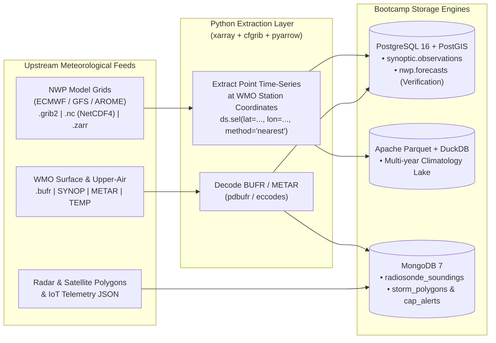

# Meteorological Binary Storage, Gridded Formats (`COG`, `Zarr`, `NetCDF4`, `GRIB2`), `BUFR` & Raster Lakehouse Architecture Reference Card

## Engineering Sovereign Geospatial Archives: Cloud-Optimized GeoTIFFs (COG), Zarr, Kerchunk, STAC Catalogs, PostGIS, On-Premises Ceph Object Gateway (RGW), NWP Point Extraction (`xarray`/`cfgrib`), and WMO `BUFR` Decoding (`pdbufr`)

**Target Audience:** Systems, Weather Forecast & Meteorological Data Engineers  
**Bootcamp Context:** How to architect sovereign petabyte-scale raster/grid archives (`COG`, `Zarr`, `Kerchunk`, `STAC + PostGIS`, `Ceph RGW`, `TiTiler`) and extract station/point data from NWP gridded files (`GRIB2` / `NetCDF4`) and WMO bulletins (`BUFR` / `METAR`) into **PostgreSQL**, **Apache Parquet**, and **MongoDB**

---

> **Navigation:** [🏠 Bootcamp Home](../README.md) | [📚 Reference Cards Index](./README.md) | [🌐 Interactive Portal](../bootcamp_portal.html)  
> **Card Sequence:** [⬅️ Previous Card](./03_hive_partitioning_and_lakehouse_compaction.md) | **Card 04 of 14** | [Next Card ➡️](./05_ceph_distributed_storage_and_proxmox_ve_architecture.md)

## 🧭 Quick-Jump Table of Contents

- [Executive Summary for Meteorological Systems Engineers](#executive-summary-for-meteorological-systems-engineers)
- [1. The Weather Data Ecosystem: Grids vs. Tables vs. Documents](#1-the-weather-data-ecosystem-grids-vs-tables-vs-documents)
- [2. The Database BLOB Anti-Pattern vs. Decoupled Object Storage](#2-the-database-blob-anti-pattern-vs-decoupled-object-storage)
  - [2.1 Why Relational Databases Fail on Binary Rasters](#21-why-relational-databases-fail-on-binary-rasters)
  - [2.2 The Production Paradigm: Separation of Concerns](#22-the-production-paradigm-separation-of-concerns)
- [3. Cloud-Native Geospatial Formats: COG, Zarr & Kerchunk](#3-cloud-native-geospatial-formats-cog-zarr--kerchunk)
  - [3.1 Cloud Optimized GeoTIFF (COG) Internals](#31-cloud-optimized-geotiff-cog-internals)
  - [3.2 Zarr: The Cloud-Native Multidimensional Array Architecture](#32-zarr-the-cloud-native-multidimensional-array-architecture)
  - [3.3 Kerchunk: Virtualizing Legacy GRIB2 and NetCDF4 Without Rewriting](#33-kerchunk-virtualizing-legacy-grib2-and-netcdf4-without-rewriting)
- [4. Automated Binary Ingestion, Conversion & Database Extraction Pipelines](#4-automated-binary-ingestion-conversion--database-extraction-pipelines)
  - [4.1 Satellite Ingestion: Raw XRIT / HRIT to Cloud-Optimized GeoTIFF (`COG`)](#41-satellite-ingestion-raw-xrit--hrit-to-cloud-optimized-geotiff-cog)
  - [4.2 Doppler Radar Volumes to Zarr Chunk Stores](#42-doppler-radar-volumes-to-zarr-chunk-stores)
  - [4.3 Extracting `GRIB2` / `NetCDF4` NWP Station Point Forecasts into PostgreSQL & Parquet](#43-extracting-grib2--netcdf4-nwp-station-point-forecasts-into-postgresql--parquet)
  - [4.4 Decoding WMO `BUFR` Upper-Air Soundings into MongoDB](#44-decoding-wmo-bufr-upper-air-soundings-into-mongodb)
- [5. The STAC Catalog & PostGIS Spatial Metadata Tier](#5-the-stac-catalog--postgis-spatial-metadata-tier)
  - [5.1 Production PostGIS STAC Schema DDL](#51-production-postgis-stac-schema-ddl)
  - [5.2 High-Speed Spatial Discovery Query (Assets Over Storm Center)](#52-high-speed-spatial-discovery-query-assets-over-storm-center)
- [6. High-Impact Storage Reduction: Slashing Petabyte Raster Footprints by 50% to 75%](#6-high-impact-storage-reduction-slashing-petabyte-raster-footprints-by-50-to-75)
  - [6.1 Strategy A: The Infrastructure Trick — Ceph Erasure Coding ($k=4, m=2$)](#61-strategy-a-the-infrastructure-trick--ceph-erasure-coding-k4-m2)
  - [6.2 Strategy B: The Raster Encoding Trick — Precision Compaction & Bit-Rounding](#62-strategy-b-the-raster-encoding-trick--precision-compaction--bit-rounding)
  - [6.3 On-Premises Ceph Storage Tiering & Lifecycle Management](#63-on-premises-ceph-storage-tiering--lifecycle-management)
- [7. Dynamic Serving Tier: Direct HTTP Byte-Range Visualization](#7-dynamic-serving-tier-direct-http-byte-range-visualization)
  - [7.1 Stream Sub-Windows via Python Rasterio & GDAL `/vsis3/`](#71-stream-sub-windows-via-python-rasterio--gdal-vsis3)
  - [7.2 Vectorized Climatological Scans via DuckDB `httpfs`](#72-vectorized-climatological-scans-via-duckdb-httpfs)
- [8. Hands-On Forensics & Benchmark Lab: COG Generation & Range Reads](#8-hands-on-forensics--benchmark-lab-cog-generation--range-reads)
  - [8.1 Lab Script (`satellite_cog_benchmark.py`)](#81-lab-script-satellite_cog_benchmarkpy)
  - [8.2 Terminal Output & Benchmark Analysis](#82-terminal-output--benchmark-analysis)
- [9. Master Binary Format Selection Matrix & Engineering Checklist](#9-master-binary-format-selection-matrix--engineering-checklist)
  - [9.1 Master Binary Format Selection Matrix](#91-master-binary-format-selection-matrix)
  - [9.2 Summary Checklist: Meteorological Binary Engineering Rules](#92-summary-checklist-meteorological-binary-engineering-rules)

---

## Executive Summary for Meteorological Systems Engineers

Operational weather services process a continuous influx of unstructured binary data and multidimensional arrays alongside discrete tabular station observations:

* **Geostationary Satellite Imagery:** Full-disk multispectral scans every 10–15 minutes (e.g., Meteosat Second/Third Generation SEVIRI/FCI, GOES-R ABI) generating $50\text{ MB to } 500\text{ MB}$ per multi-band scan ($50\text{ GB to } 200\text{ GB}$ daily).
* **Doppler Radar Volume Sweeps:** Radial polar scans (reflectivity $Z$, radial velocity $V$, dual-pol differential reflectivity $Z_{DR}$, correlation coefficient $\rho_{HV}$) acquired every 5 minutes per radar site ($10\text{ MB to } 50\text{ MB}$ per volume sweep).
* **Polar-Orbiting Satellite Swaths:** High-resolution spatial swaths (Sentinel-2/3, NOAA-20/21 VIIRS, MetOp) measuring land surface temperature, sea surface temperature, and atmospheric soundings.
* **Numerical Weather Prediction (NWP) Gridded Rasters:** High-resolution deterministic runs (e.g., ECMWF-HRES, AROME, WRF, GFS) producing multi-gigabyte `GRIB2` / `NetCDF4` model outputs multiple times per day.
* **WMO Binary Observation Bulletins (`BUFR`):** Hierarchical self-describing surface (`SYNOP`) and vertical upper-air radiosonde soundings (`TEMP`).

Storing large binary objects (BLOBs) directly inside relational databases (`BYTEA` in PostgreSQL) or document stores (`GridFS` in MongoDB) introduces severe failure modes: buffer cache eviction, massive write amplification, unmanageable backup sizes (`pg_dump` freezes), and saturated database network sockets.

Furthermore, national security mandates, sovereign data borders, and air-gapped telemetry feeds (e.g., localized EUMETCast DVB-S2 satellite dishes, C-band Doppler radar feeds) prevent reliance on commercial public cloud storage (AWS, Azure, GCP). Concurrently, standalone MinIO deployments have introduced operational and licensing challenges (AGPLv3 paywalls, deprecated cluster management features).

This master reference guide details:
1. **The Weather Data Ecosystem (Grids vs. Tables vs. Documents):** When to keep data as gridded files vs. when to extract point/station subsets into **PostgreSQL**, **Apache Parquet**, and **MongoDB**.
2. **The Database BLOB Anti-Pattern vs. Decoupled Object Storage:** Why relational/document databases fail on binary rasters and how to decouple **Ceph Object Gateway (RADOS Gateway / RGW)** from **PostgreSQL 16 + PostGIS 3.4**.
3. **Cloud-Native Geospatial Formats (`COG`, `Zarr`, `Kerchunk`):** Byte-level layout of Cloud-Optimized GeoTIFFs, multidimensional Zarr chunk hierarchies, and zero-copy Kerchunk virtualization of legacy `GRIB2`/`NetCDF4` archives.
4. **Automated Binary Ingestion & Extraction Pipelines:**
   * Satellite `XRIT`/`HRIT` $\rightarrow$ `COG` (`rasterio`)
   * Doppler Radar Volumes $\rightarrow$ `Zarr` (`zarr` + `Blosc/Zstd`)
   * NWP `GRIB2`/`NetCDF4` Station Point Extraction $\rightarrow$ `PostgreSQL` (`COPY`) & `Parquet` (`xarray` + `cfgrib` + `psycopg`)
   * WMO `BUFR` Upper-Air Soundings $\rightarrow$ `MongoDB` (`pdbufr` + `pymongo`)
5. **The STAC Catalog & PostGIS Spatial Metadata Tier:** Production DDL (`stac_collections`, `stac_items`, `stac_assets`) and sub-2ms PostGIS spatial intersection queries.
6. **High-Impact Storage Reduction (Slashing Petabyte Footprints by 50% to 75%):** Combining Ceph Reed-Solomon Erasure Coding ($k=4, m=2$) with Scaled 16-Bit Integer Quantization (`Int16` / `UInt16`), TIFF Predictor 3, and S3 Lifecycle Tiering.
7. **Dynamic Serving Tier & Benchmark Lab:** `TiTiler` dynamic tile serving, GDAL `/vsis3/` sub-window streaming, DuckDB `httpfs` STAC lake queries, and a reproducible Python `COG` vs. Striped GeoTIFF benchmark.

---

## 1. The Weather Data Ecosystem: Grids vs. Tables vs. Documents

A common mistake in weather data engineering is trying to force **every** meteorological dataset into a single format. Here is how operational weather centers separate **Gridded Fields** from **Point / Station Databases**:



| Format | Structure | Best Kept As... | Extract to PostgreSQL / Parquet / MongoDB When... |
| :--- | :--- | :--- | :--- |
| **`GRIB2` (`.grib2`)** | 2D horizontal message slices compressed with WMO bit-packing | Object/File storage for full map rendering (`ecCodes` / `cfgrib` / `Kerchunk`) | Extracting point forecasts (`nwp.forecasts`) at specific WMO stations or cities for verification (`JOIN` with `observations`) and dashboards! |
| **`NetCDF4` (`.nc`)** | HDF5-based 4D multidimensional arrays `(time, level, lat, lon)` | Local/HPC array storage (`xarray`) | Slicing station time-series or regional averages into **Parquet** / **PostgreSQL** for fast SQL analytics. |
| **`Zarr` (`.zarr`)** | Cloud-native chunked $N$-D arrays | S3 / GCS / Ceph RGW object storage for ML weather models (GraphCast, FourCastNet) & radar volumes | Exporting regional boundary statistics or verification tables into **DuckDB / Parquet**. |
| **`COG` (`.tif`)** | Cloud-Optimized GeoTIFF with internal 2D tiles & overview mipmaps | Ceph RGW / S3 object storage for instant HTTP byte-range map rendering (`TiTiler`) | Indexing bounding-box footprints, acquisition times, and S3 URIs in **PostgreSQL + PostGIS (`STAC` catalog)**. |
| **`BUFR` (`.bufr`)** | WMO binary hierarchical self-describing observation format | Raw archival backup | Decoding immediately via `pdbufr` into **PostgreSQL** (surface SYNOP) or **MongoDB** (nested upper-air TEMP radiosonde profiles!). |

---

## 2. The Database BLOB Anti-Pattern vs. Decoupled Object Storage

### 2.1 Why Relational Databases Fail on Binary Rasters

```text
                  The Database BLOB Anti-Pattern (The Cache Killer)
 ┌─────────────────────────────────────────────────────────────────────────────┐
 │ Host Server Memory (e.g., 64 GB RAM)                                        │
 ├─────────────────────────────────────────────┬───────────────────────────────┤
 │ PostgreSQL shared_buffers / WiredTiger Cache│ Linux OS Kernel Page Cache    │
 │ (Dedicated to B-Trees & Relational Tuples)  │ (Filesystem buffer)           │
 └──────────────────────┬──────────────────────┴───────────────────────────────┘
                        │
                        ▼ 250 MB Satellite Image streamed via SELECT / GridFS
 ┌─────────────────────────────────────────────────────────────────────────────┐
 │ CRITICAL BUFFER DISPLACEMENT (Cache Thrashing):                             │
 │ • Reading a 250 MB satellite image flushes thousands of hot 8 KB pages      │
 │   belonging to operational B-Tree indexes and station lookup tables!        │
 │ • Autovacuum and WAL logging must track hundreds of megabytes of binary raw.│
 │ • Database client connections block while deserializing multi-MB chunks.    │
 └─────────────────────────────────────────────────────────────────────────────┘
```

| Dimension | In-Database BLOB (`BYTEA` / Large Objects) | MongoDB `GridFS` (255 KB Chunks) | Decoupled On-Prem Ceph RGW (S3 API) |
| :--- | :--- | :--- | :--- |
| **Max Object Size** | $1\text{ GB}$ (hard PostgreSQL field limit) | $16\text{ MB}$ per doc (split across chunks) | $5\text{ TB}$ per single object |
| **Buffer Cache Impact** | **Severe:** Evicts hot relational index pages | **Severe:** Pollutes WiredTiger working memory | **Zero:** Object traffic completely bypasses database RAM |
| **Network Bottleneck** | Proxied through database socket pool | Proxied through `mongos` / `mongod` | **Direct Streaming:** Direct HTTP GET byte ranges from client |
| **Backup Impact** | `pg_dump` inflates to tens of terabytes | `mongodump` dumps full raw binaries | Databases backup metadata in seconds; files replicated via Ceph |
| **Access Granularity** | All-or-nothing (full byte array fetch) | Sequential chunk read from `fs.chunks` | **Arbitrary HTTP Byte-Range requests** ($O(1)$ sub-region seek) |

### 2.2 The Production Paradigm: Separation of Concerns

```text
                     Decoupled Storage & Metadata Architecture
                     
  SATELLITE DOWNLINK / RADAR RADIALS
                  │
                  ▼ Automated Ingest Worker (Python / Rust / C++)
  ┌───────────────────────────────────────────────────────────────┐
  │ 1. Convert to Cloud-Native Binary Format (COG / Zarr)         │
  │ 2. Compute Spatiotemporal Footprint (WGS 84 Polygon, Time)    │
  └───────────────┬───────────────────────────────┬───────────────┘
                  │                               │
                  │ Upload Binary Stream (S3 API) │ Write Spatial Metadata (SQL)
                  ▼                               ▼
  ┌───────────────────────────────┐   ┌───────────────────────────────────────────┐
  │ Ceph Object Gateway (RGW)     │   │ PostgreSQL 16 + PostGIS 3.4 (STAC Catalog)│
  │ Active-Active S3 REST API     │   ├───────────────────────────────────────────┤
  ├───────────────────────────────┤   │ Table: stac_items                         │
  │ Bucket: 'satellite-raw'       │   │  • item_id: 'MSG4-SEVIRI-20261004T1200'   │
  │  └── seviri/2026/10/04/       │   │  • datetime: '2026-10-04 12:00:00+00'     │
  │       └── ir_108.tif (COG)    │   │  • footprint: GEOMETRY(Polygon, 4326)     │
  │ Bucket: 'radar-mosaics'       │   │  • s3_uri: 's3://satellite-raw/...tif'   │
  │  └── c-band/2026/10/04/...zarr│   │  • bands: '["IR_108", "VIS_06", "WV_62"]' │
  └───────────────┬───────────────┘   └─────────────────────┬─────────────────────┘
                  │                                         │
                  │ Targeted HTTP Range GET (< 10 ms)       │ Spatial Intersection Search (< 2 ms)
                  │ Over local 10/25 GbE network            │ (ST_Intersects / ST_DWithin)
                  ▼                                         ▼
  ┌───────────────────────────────────────────────────────────────────────────────┐
  │ Client Application / Forecast Dashboard (Direct Cloud-Native Access)          │
  └───────────────────────────────────────────────────────────────────────────────┘
```

---

## 3. Cloud-Native Geospatial Formats: COG, Zarr & Kerchunk

Traditional binary raster formats (standard GeoTIFF, monolithic NetCDF4, GRIB2) require reading the entire file from the beginning or downloading the whole multi-hundred-megabyte object to extract a small geographical region (e.g., zooming into Algiers Port on a full-disk satellite image).

Cloud-Native Geospatial formats eliminate full-file downloads using **HTTP Range Requests** (`Range: bytes=start-end`).

### 3.1 Cloud Optimized GeoTIFF (COG) Internals

A **Cloud Optimized GeoTIFF (COG)** is a backwards-compatible TIFF file structured so that web applications, GIS servers, and analytical engines can stream arbitrary spatial sub-windows without downloading unnecessary pixels.

```text
                    Cloud Optimized GeoTIFF (COG) Binary Layout
 0 bytes  ┌───────────────────────────────────────────────────────────────────┐
          │ Standard TIFF Header (Endianness, Magic Number 42, Offset)        │
          ├───────────────────────────────────────────────────────────────────┤
          │ Image File Directory (IFD 0): Full Resolution Metadata            │
          │  - Tile Offsets, Tile Byte Counts, GeoKeyDirectoryTag, CRS       │
          ├───────────────────────────────────────────────────────────────────┤
          │ Image File Directory (IFD 1): Overview 1 (1:2 Downsampled)        │
          ├───────────────────────────────────────────────────────────────────┤
          │ Image File Directory (IFD 2): Overview 2 (1:4 Downsampled)        │
          ├───────────────────────────────────────────────────────────────────┤
          │ Image File Directory (IFD 3): Overview 3 (1:8 Downsampled)        │
          ├───────────────────────────────────────────────────────────────────┤
          │ Internal Tiles (Full Resolution: e.g., 256x256 or 512x512 blocks) │
          │ [ Tile (0,0) ] [ Tile (0,1) ] [ Tile (0,2) ] ...                  │
          ├───────────────────────────────────────────────────────────────────┤
          │ Internal Overview Tiles (Downsampled mipmaps for low zoom levels) │
          │ [ Ov4 Tile (0,0) ] [ Ov4 Tile (0,1) ] ...                         │
 EOF      └───────────────────────────────────────────────────────────────────┘
```

#### The Mechanical Innovations of COG:
1. **Internal Tiling (Not Striping):**
   * Standard GeoTIFFs organize pixels in horizontal *strips* across the entire image width. Fetching a $100 \times 100$ pixel window at the center of a $10,000 \times 10,000$ image requires reading 100 complete full-width strips.
   * COGs break pixels into independent square **Tiles** (typically $256 \times 256$ or $512 \times 512$ pixels). Fetching a sub-window requires fetching only the 4 to 9 tiles covering that exact spatial bounding box.
2. **Internal Decimated Overviews (Mipmaps):**
   * Pre-calculated, downsampled representations ($2\times, 4\times, 8\times, 16\times$) are embedded directly within the file.
   * When an interactive forecast map renders a low-zoom view of an entire continent, it reads only the small Overview tiles ($\approx 1\text{ MB}$) rather than the massive 200 MB full-resolution grid.
3. **HTTP Range GET Mechanics:**
   * Step 1: Client issues an HTTP `Range: bytes=0-16384` request to fetch the TIFF header and IFDs.
   * Step 2: Client calculates the exact byte offsets of the target tiles.
   * Step 3: Client issues targeted HTTP Range GETs for those exact byte positions, rendering the target region in under **10 milliseconds** over a local network.

### 3.2 Zarr: The Cloud-Native Multidimensional Array Architecture

For multi-dimensional, multi-parameter continua (e.g., 4D NWP models, Doppler radar polar volumes, ensemble climate simulations), **Zarr** is the cloud and lakehouse standard.

```text
                             Zarr Cloud Directory Tree
 s3://weather-lake/radar_volume_20261004T1200.zarr/
 ├── .zgroup                     (Root JSON group metadata)
 ├── reflectivity/
 │   ├── .zarray                 (Chunk shape: [1, 10, 360, 1000], Codec: Blosc/Zstd)
 │   ├── .zattrs                 (Units: "dBZ", Long Name: "Equivalent Reflectivity")
 │   ├── 0.0.0.0                 (Binary chunk: Time 0, Tilt 0, Azimuth 0..179, Range 0..499)
 │   ├── 0.0.0.1                 (Binary chunk: Time 0, Tilt 0, Azimuth 0..179, Range 500..999)
 │   ├── 0.0.1.0                 (Binary chunk: Time 0, Tilt 0, Azimuth 180..359, Range 0..499)
 │   └── 0.1.0.0                 (Binary chunk: Time 0, Tilt 1, Azimuth 0..179, Range 0..499)
 └── velocity/
     ├── .zarray                 (Chunk shape & compression descriptor)
     └── 0.0.0.0                 (Binary chunk for Doppler Radial Velocity)
```

#### Why Zarr Outperforms HDF5 and NetCDF4 in Object Storage:
* **True Object Decoupling:** In monolithic NetCDF4/HDF5, all data and metadata reside in a single file. Parallel access over HTTP requires complex file locks or multi-range requests.
* In Zarr, every single multidimensional chunk is an **individual, independent object key in S3** (`reflectivity/0.0.0.0`).
* **Zero Locking:** Hundreds of parallel worker threads (e.g., via Dask or Celery) can download and process hundreds of distinct spatial/temporal chunks concurrently with zero race conditions or file-system locking bottlenecks.

### 3.3 Kerchunk: Virtualizing Legacy GRIB2 and NetCDF4 Without Rewriting

Meteorological centers archive petabytes of legacy **GRIB2** and **NetCDF4** files. Re-encoding petabytes into Zarr or COG is computationally expensive and duplicates physical storage investment.

**Kerchunk (Virtual iosp)** extracts the byte offsets of existing binary files and builds an in-memory virtual Zarr manifest:

```text
                            The Kerchunk Virtual Mapping
 ┌─────────────────────────────────────────────────────────────────────────────┐
 │ Monolithic GRIB2 / NetCDF4 Archive on S3: 'nwp_run_20261004.grib2' (4 GB)   │
 │   [ GRIB Message 1: 500 hPa Temp ] [ GRIB Message 2: 850 hPa Wind ] ...     │
 └──────────────────────────────────────▲──────────────────────────────────────┘
                                        │
             Targeted Byte Ranges: (Offset: 4194304, Length: 2097152)
                                        │
 ┌──────────────────────────────────────┴──────────────────────────────────────┐
 │ Kerchunk Reference Manifest JSON (< 50 KB): 'nwp_run_reference.json'        │
 │ {                                                                           │
 │   "version": 1,                                                             │
 │   "refs": {                                                                 │
 │     "t_500/.zarray": "{\"shape\": [721, 1440], \"dtype\": \"<f4\", ...}",  │
 │     "t_500/0.0": ["s3://nwp-archive/run.grib2", 4194304, 2097152]          │
 │   }                                                                         │
 │ }                                                                           │
 └─────────────────────────────────────────────────────────────────────────────┘
```

* **Zero Data Duplication:** The massive 4 GB GRIB2 file remains untouched in Ceph object storage.
* Applications load the lightweight JSON reference file using `xarray` and `fsspec`, viewing the legacy GRIB2 file as an instant, cloud-native virtual Zarr array with direct byte-range seekability.

---

## 4. Automated Binary Ingestion, Conversion & Database Extraction Pipelines

### 4.1 Satellite Ingestion: Raw XRIT / HRIT to Cloud-Optimized GeoTIFF (`COG`)

Automated weather pipelines receiving raw satellite streams (e.g., EUMETCast DVB-S2 receiving Meteosat SEVIRI L1.5 data) must automatically convert raw radiances into Cloud-Optimized GeoTIFFs:

```python
#!/usr/bin/env python3
"""
Automated Satellite Pipeline: Converting Raw Bands to COG for Ceph Storage
"""
import numpy as np
import rasterio
from rasterio.transform import from_bounds
from rasterio.enums import Resampling

def convert_raw_band_to_cog(raw_radiance_matrix: np.ndarray, output_cog_path: str):
    """
    Writes a 2D float32 brightness temperature array to a Cloud Optimized GeoTIFF
    with internal 256x256 tiling, float horizontal differencing predictors,
    and 4 decimated overview mipmaps.
    """
    height, width = raw_radiance_matrix.shape
    # Spatial bounds: Northern Africa & Western Mediterranean
    west, south, east, north = -2.0, 32.0, 10.0, 40.0
    transform = from_bounds(west, south, east, north, width, height)
    
    profile = {
        "driver": "GTiff",
        "height": height,
        "width": width,
        "count": 1,
        "dtype": rasterio.float32,
        "crs": "EPSG:4326",
        "transform": transform,
        "tiled": True,
        "blockxsize": 256,
        "blockysize": 256,
        "compress": "deflate",
        "predictor": 3,       # Floating-point horizontal differencing predictor
        "interleave": "band"
    }

    with rasterio.open(output_cog_path, "w", **profile) as dst:
        dst.write(raw_radiance_matrix.astype(np.float32), 1)
        # Generate decimated overviews for multi-scale zooming
        dst.build_overviews([2, 4, 8, 16], Resampling.average)
        dst.update_tags(ns="rio_overview", resampling="average")

    print(f"[+] Successfully materialized COG: {output_cog_path}")
```

### 4.2 Doppler Radar Volumes to Zarr Chunk Stores

When a C-band or S-band Doppler radar completes a 5-minute volume sweep across multiple antenna tilts, write the radial coordinates directly into a Zarr chunk hierarchy:

```python
import zarr
import numcodecs
import numpy as np

def write_radar_volume_to_zarr(zarr_store_path: str, sweep_data: np.ndarray):
    """
    Stores 4D Doppler Radar arrays [Time, Tilt, Azimuth, Range] into Zarr
    using Zstandard compression and bit-shuffling.
    """
    root = zarr.open_group(zarr_store_path, mode="w")
    compressor = numcodecs.Blosc(cname="zstd", clevel=5, shuffle=numcodecs.Blosc.SHUFFLE)
    
    # Chunk shape: 1 time step, 1 tilt, 360 azimuth rays, 500 range gates
    z_reflectivity = root.create_dataset(
        "reflectivity",
        data=sweep_data,
        chunks=(1, 1, 360, 500),
        compressor=compressor,
        dtype="float32"
    )
    z_reflectivity.attrs["units"] = "dBZ"
    z_reflectivity.attrs["long_name"] = "Equivalent Radar Reflectivity Factor"
    print(f"[+] Radar sweep written to Zarr: {zarr_store_path}")
```

### 4.3 Extracting `GRIB2` / `NetCDF4` NWP Station Point Forecasts into PostgreSQL & Parquet

When an `ECMWF-HRES` or `GFS` `.grib2` / `.nc` file lands on your server, use **`xarray` + `cfgrib`** to interpolate/extract the model's prediction at your WMO station coordinates and bulk-load it into **`nwp.forecasts` (PostgreSQL)** via `COPY` or write it to **Parquet**:

```bash
# Install meteorological extraction stack in your virtual environment:
pip install xarray cfgrib netCDF4 pyarrow psycopg[binary] pandas
```

```python
#!/usr/bin/env python3
"""
Extract NWP point forecasts at WMO station coordinates from a NetCDF4 or GRIB2 file
and stream them directly into PostgreSQL (nwp.forecasts) and Apache Parquet!
"""
import io
import xarray as xr
import pandas as pd
import psycopg

# 1. WMO Station coordinates (could also be queried from synoptic.stations!)
STATIONS = [
    {"station_id": 60390, "lat": 36.6910, "lon": 3.2154},  # Algiers
    {"station_id": 60490, "lat": 35.6239, "lon": -0.6212}, # Oran
    {"station_id": 60419, "lat": 36.2760, "lon": 6.6203},  # Constantine
    {"station_id": 60571, "lat": 31.6457, "lon": -2.2699}, # Bechar
    {"station_id": 60680, "lat": 22.8115, "lon": 5.4510},  # Tamanrasset
]

def extract_nwp_grid_to_stations(nc_or_grib_path: str, model_name: str = "ECMWF-HRES"):
    # For GRIB2: xr.open_dataset(path, engine="cfgrib")
    # For NetCDF4: xr.open_dataset(path, engine="netcdf4")
    ds = xr.open_dataset(nc_or_grib_path)

    station_dfs = []
    for st in STATIONS:
        # Select nearest NWP grid cell to the WMO station's (lat, lon)
        pt = ds.sel(latitude=st["lat"], longitude=st["lon"], method="nearest")
        df = pt[["t2m", "u10", "v10", "tp"]].to_dataframe().reset_index()

        # Unit conversions from standard NWP SI units to meteorological operational units:
        # Kelvin -> Celsius, m/s wind components -> knots, meters precip -> mm
        df["station_id"]     = st["station_id"]
        df["model_name"]     = model_name
        df["init_time"]      = pd.to_datetime(df["time"], utc=True)
        df["lead_interval"]  = df["step"].apply(lambda s: f"{int(s.total_seconds() // 3600)} hours")
        df["pred_temp_c"]    = (df["t2m"] - 273.15).round(1)
        df["pred_wind_kt"]   = (((df["u10"]**2 + df["v10"]**2)**0.5) * 1.94384).round(1)
        df["pred_precip_mm"] = (df["tp"] * 1000.0).round(1)

        station_dfs.append(df[[
            "station_id", "model_name", "init_time", "lead_interval",
            "pred_temp_c", "pred_wind_kt", "pred_precip_mm"
        ]])

    final_df = pd.concat(station_dfs, ignore_index=True)

    # A) Save directly to compressed Apache Parquet for DuckDB analytics!
    final_df.to_parquet("extracted_nwp_station_forecasts.parquet", compression="zstd", index=False)

    # B) Bulk-stream into PostgreSQL nwp.forecasts using high-speed COPY!
    csv_buffer = io.StringIO()
    final_df.to_csv(csv_buffer, index=False, header=False)
    csv_buffer.seek(0)

    with psycopg.connect("postgresql://postgres@localhost:5432/weather_ops") as conn:
        with conn.cursor() as cur:
            with cur.copy(
                "COPY nwp.forecasts (station_id, model_name, init_time, lead_interval, "
                "pred_temp_c, pred_wind_kt, pred_precip_mm) FROM STDIN WITH (FORMAT csv)"
            ) as copy:
                copy.write(csv_buffer.read())
        conn.commit()
```

### 4.4 Decoding WMO `BUFR` Upper-Air Soundings into MongoDB

WMO upper-air radiosonde soundings (`TEMP` / `BUFR`) contain variable numbers of vertical pressure levels per balloon launch—making **MongoDB (`db.radiosonde_soundings`)** the natural target:

```python
#!/usr/bin/env python3
"""
Decode a WMO Upper-Air Radiosonde BUFR file using ECMWF's 'pdbufr'
and insert the nested vertical profile document directly into MongoDB!
"""
import pandas as pd
import pdbufr
from pymongo import MongoClient

def ingest_bufr_sounding_to_mongodb(bufr_path: str):
    # Extract vertical sounding levels from WMO BUFR message into a DataFrame
    df = pdbufr.read_bufr(
        bufr_path,
        columns=(
            "WMO_station_id", "typicalDate", "typicalTime",
            "pressure", "geopotentialHeight", "airTemperature",
            "dewpointTemperature", "windDirection", "windSpeed"
        )
    )

    # Group flat BUFR levels into a single self-contained MongoDB Radiosonde Document!
    client = MongoClient("mongodb://localhost:27017/")
    db = client["weather_nosql"]

    for (station_id, date_str, time_str), group in df.groupby(["WMO_station_id", "typicalDate", "typicalTime"]):
        levels = []
        for _, row in group.iterrows():
            if pd.notna(row["pressure"]):
                levels.append({
                    "pressure_hpa":  round(row["pressure"] / 100.0, 1),          # Pa -> hPa
                    "height_m":      round(float(row["geopotentialHeight"]), 0),
                    "temp_c":        round(float(row["airTemperature"]) - 273.15, 1),
                    "dewpoint_c":    round(float(row["dewpointTemperature"]) - 273.15, 1),
                    "wind_dir_deg":  int(row["windDirection"]),
                    "wind_speed_kt": round(float(row["windSpeed"]) * 1.94384, 1) # m/s -> knots
                })

        doc = {
            "station_id": int(station_id),
            "launch_time": pd.to_datetime(f"{date_str}T{time_str}Z", utc=True).to_pydatetime(),
            "vertical_levels": sorted(levels, key=lambda x: x["pressure_hpa"], reverse=True),
            "qc_audit_log": [{"step": "BUFR_DECODE", "status": "PASSED"}]
        }

        # Idempotent Upsert into MongoDB by (station_id, launch_time)
        db.radiosonde_soundings.update_one(
            {"station_id": doc["station_id"], "launch_time": doc["launch_time"]},
            {"$set": doc},
            upsert=True
        )
```

---

## 5. The STAC Catalog & PostGIS Spatial Metadata Tier

While binary rasters reside in Ceph Object Storage, discovery, temporal filtering, and spatial intersection searches must execute in **PostgreSQL 16 + PostGIS 3.4** using the standardized **STAC (SpatioTemporal Asset Catalog)** specification.

```text
                           The STAC Catalog Hierarchy
 ┌─────────────────────────────────────────────────────────────────────────────┐
 │ STAC Collection: 'meteosat-msg4-seviri-l1b'                                 │
 ├─────────────────────────────────────────────────────────────────────────────┤
 │ STAC Item: 'MSG4-SEVIRI-20261004T1200' (Atomic Observation at a Timestamp)  │
 │  • Spatial Footprint: Polygon((-25 20, 25 20, 25 50, -25 50, -25 20))       │
 │  • Temporal Instant : '2026-10-04 12:00:00+00'                              │
 │  • Metadata Properties: Sun elevation, cloud cover, sensor operational mode │
 │  • Assets (The Binary Files in Ceph S3!):                                   │
 │      ├── Asset 'IR_108': {"href": "s3://sat/2026/10/04/ir108.tif", ...}     │
 │      ├── Asset 'WV_062': {"href": "s3://sat/2026/10/04/wv062.tif", ...}     │
 │      └── Asset 'RGB_NAT': {"href": "s3://sat/2026/10/04/nat_color.tif", ...}│
 └─────────────────────────────────────────────────────────────────────────────┘
```

### 5.1 Production PostGIS STAC Schema DDL

```sql
-- Enable PostGIS extension
CREATE EXTENSION IF NOT EXISTS postgis;

-- 1. STAC Collections Registry
CREATE TABLE stac_collections (
    collection_id VARCHAR(64) PRIMARY KEY,
    title VARCHAR(255) NOT NULL,
    description TEXT,
    license VARCHAR(32) DEFAULT 'proprietary',
    spatial_extent GEOMETRY(Polygon, 4326) NOT NULL,
    temporal_start TIMESTAMPTZ NOT NULL,
    temporal_end TIMESTAMPTZ
);

-- 2. STAC Items (Atomic Observation Footprints)
CREATE TABLE stac_items (
    item_id VARCHAR(128) PRIMARY KEY,
    collection_id VARCHAR(64) NOT NULL REFERENCES stac_collections(collection_id),
    recorded_at TIMESTAMPTZ NOT NULL,
    footprint GEOMETRY(Polygon, 4326) NOT NULL,
    properties JSONB NOT NULL DEFAULT '{}'::jsonb
);

-- Spatiotemporal & JSONB Indexes
CREATE INDEX idx_stac_items_footprint ON stac_items USING GIST (footprint);
CREATE INDEX idx_stac_items_time ON stac_items (recorded_at DESC);
CREATE INDEX idx_stac_items_props ON stac_items USING GIN (properties);

-- 3. STAC Assets (Pointers to Physical Binary Objects in Ceph S3)
CREATE TABLE stac_assets (
    asset_id BIGSERIAL PRIMARY KEY,
    item_id VARCHAR(128) NOT NULL REFERENCES stac_items(item_id) ON DELETE CASCADE,
    asset_name VARCHAR(32) NOT NULL, -- e.g., 'IR_108', 'RADAR_REFLECTIVITY', 'GEO_TIFF'
    s3_uri TEXT NOT NULL,            -- e.g., 's3://satellite-archive/seviri/2026/10/04/msg4_ir108.tif'
    mime_type VARCHAR(64) NOT NULL,  -- e.g., 'image/tiff; application=geotiff; profile=cloud-optimized'
    byte_size BIGINT NOT NULL,
    checksum_sha256 VARCHAR(64)
);

CREATE INDEX idx_stac_assets_item ON stac_assets (item_id);
```

### 5.2 High-Speed Spatial Discovery Query (Assets Over Storm Center)

When severe convective storms approach Dellys Cape, find all cloud-optimized satellite infrared assets acquired within the past 45 minutes intersecting the marine warning bounding box:

```sql
SELECT 
    i.item_id,
    i.recorded_at,
    a.asset_name,
    a.s3_uri,
    ROUND((a.byte_size / 1024.0 / 1024.0)::numeric, 2) AS size_mb,
    ST_AsGeoJSON(i.footprint) AS footprint_geojson
FROM stac_items i
JOIN stac_assets a ON a.item_id = i.item_id
WHERE i.collection_id = 'meteosat-msg4-seviri-l1b'
  AND a.asset_name = 'IR_108'
  AND i.recorded_at >= NOW() - INTERVAL '45 minutes'
  AND ST_Intersects(
      i.footprint,
      ST_MakeEnvelope(3.40, 36.60, 4.20, 37.20, 4326) -- Dellys Marine Warning Box
  )
ORDER BY i.recorded_at DESC;
```
*Execution latency:* $< 2\text{ ms}$ *via PostGIS GiST index and B-Tree temporal traversal, returning exact S3 HTTP URLs ready for sub-window byte-range extraction.*

---

## 6. High-Impact Storage Reduction: Slashing Petabyte Raster Footprints by 50% to 75%

National weather archives ingest petabytes of multispectral imagery and NWP model runs. Running naive storage strategies either bankrupts the hardware budget or forces premature deletion of valuable scientific data. 

To solve this, modern meteorological storage engineering applies **two complementary reduction strategies**: one at the **Hardware Infrastructure Tier (Ceph)**, and one at the **Binary Raster Encoding Tier**.

```text
                The Two-Tier 75% Total Storage Reduction Pipeline
                
 ┌─────────────────────────────────────────────────────────────────────────────┐
 │ 1. RAW METEOROLOGICAL FLOAT32 ARRAY (e.g. 100 TB of Satellite Imagery)      │
 └──────────────────────────────────────┬──────────────────────────────────────┘
                                        │
                                        │ STRATEGY A: RASTER ENCODING OPTIMIZATION
                                        │ • Scale Float32 -> Int16 / Float16 (50% reduction!)
                                        │ • Float Differencing Predictor 3 + Deflate/Zstandard
                                        ▼
 ┌─────────────────────────────────────────────────────────────────────────────┐
 │ 2. COMPACTED GEOSPATIAL PAYLOAD: 50 TB (50% direct byte reduction!)         │
 └──────────────────────────────────────┬──────────────────────────────────────┘
                                        │
                                        │ STRATEGY B: CEPH ERASURE CODING (k=4, m=2)
                                        │ • Overcomes 3x Replication (200% overhead -> 150 TB)
                                        │ • Jerasure Reed-Solomon: Only 50% overhead -> 75 TB!
                                        ▼
 ┌─────────────────────────────────────────────────────────────────────────────┐
 │ 3. PHYSICAL DISK PURCHASED: 75 TB (vs. 300 TB under classical 3x replication│
 │    TOTAL HARDWARE INVESTMENT REDUCED BY 75% WITH ZERO DATA LOSS!            │
 └─────────────────────────────────────────────────────────────────────────────┘
```

### 6.1 Strategy A: The Infrastructure Trick — Ceph Erasure Coding ($k=4, m=2$)

Under classical enterprise storage guidelines, storage clusters deploy **$3\times$ Replication** to guarantee durability ($1\text{ primary copy} + 2\text{ mirror copies}$):

$$
\text{Storage Overhead}_{3\times} = 3.0 \times \text{Raw Data} \implies \mathbf{200\%\text{ Overhead (Usable Capacity: } 33.3\%)}
$$

* **The Problem:** Storing $100\text{ TB}$ of satellite rasters requires procuring **$300\text{ TB}$ of raw enterprise hard drives**.

**The Erasure Coding Trick:** Instead of copying complete files, Ceph breaks an object into $k$ data chunks and computes $m$ parity chunks using Reed-Solomon coding:

$$
\text{Storage Overhead}_{\text{EC}} = \frac{k + m}{k} \times \text{Raw Data}
$$

$$
\text{Usable Capacity \%} = \frac{k}{k + m} \times 100
$$

```text
                   Erasure Coding: Reed-Solomon (k=4, m=2)
 ┌─────────────────────────────────────────────────────────────────────────────┐
 │ Meteorological Raster File: "MSG4-SEVIRI-CHANNEL-IR108.tif" (120 MB)        │
 └──────────────────────────────────────┬──────────────────────────────────────┘
                                        │ Jerasure Reed-Solomon Plugin
                                        ▼
   DATA CHUNKS (k = 4)                             PARITY CHUNKS (m = 2)
 ┌─────────────┬─────────────┬─────────────┬─────────────┐ ┌─────────────┬─────────────┐
 │ Chunk D1    │ Chunk D2    │ Chunk D3    │ Chunk D4    │ │ Parity P1   │ Parity P2   │
 │ (30 MB)     │ (30 MB)     │ (30 MB)     │ (30 MB)     │ │ (30 MB)     │ (30 MB)     │
 └──────┬──────┴──────┬──────┴──────┬──────┴──────┬──────┘ └──────┬──────┴──────┬──────┘
        │             │             │             │               │             │
        ▼             ▼             ▼             ▼               ▼             ▼
     OSD 101       OSD 102       OSD 103       OSD 104         OSD 105       OSD 106
     (Node 1)      (Node 2)      (Node 3)      (Node 4)        (Node 5)      (Node 1)
```

* **Configuration:** $k=4, m=2$ (tolerates the catastrophic physical loss of any **2 OSDs or 2 entire server chassis simultaneously**).
* **Storage Footprint:**
  
  $$\text{Overhead} = \frac{4 + 2}{4} = 1.50 \implies \mathbf{50\%\text{ Storage Overhead (Usable Capacity: } 66.7\%)}$$

* **The Result:** Storing $100\text{ TB}$ of satellite data requires purchasing only **$150\text{ TB}$ of physical disk instead of $300\text{ TB}$—a flat $50\%$ reduction in physical hardware investment**.

### 6.2 Strategy B: The Raster Encoding Trick — Precision Compaction & Bit-Rounding

Most raw satellite radiometers and numerical forecast models output floating-point values formatted as standard IEEE 754 32-bit floats (`Float32`, consuming 4 physical bytes per pixel). 

However, physical atmospheric instruments cannot measure with 23 bits of mantissa precision. The least significant bits are pure stochastic instrument noise that resists compression codecs (entropy remains high).

#### 1. Scaled 16-Bit Integer Quantization (Direct 50% Byte Reduction)
Convert floating-point temperatures to scaled 16-bit integers with a fixed physical offset:

```python
# Convert 32-bit float Kelvin temperature (200K - 330K) to 16-bit unsigned integer
# Scale: 0.01 Kelvin (10 millikelvin precision - surpasses all satellite radiometers!)
uint16_data = np.round((float32_kelvin - 150.0) * 100.0).astype(np.uint16)
```
* **Impact:** Cuts the uncompressed raw byte footprint from $4\text{ bytes}$ down to $2\text{ bytes}$ per pixel—**cutting the object size in half ($50\%$ savings)** before compression even runs.
* Software like GDAL, QGIS, and Xarray restores the physical value transparently on-the-fly via metadata tags:
  $$\text{Kelvin} = (\text{Pixel} \times 0.01) + 150.0$$

#### 2. Floating-Point Horizontal Differencing (TIFF Predictor 3)
If 32-bit floats must be preserved, use **Predictor 3** in your Cloud-Optimized GeoTIFF profile:
* IEEE 754 floats transpose sign, exponent, and mantissa bytes across separate contiguous arrays.
* Because adjacent pixels share identical exponents and signs, Deflate/Zstandard compresses the stream by an additional **$40\%\text{ to } 60\%$** compared to standard GeoTIFF compression.

### 6.3 On-Premises Ceph Storage Tiering & Lifecycle Management

Combine hot NVMe storage for real-time ingest with cold Erasure-Coded HDDs for multi-year retention using automated Ceph S3 lifecycle transition rules:

```text
                     On-Premises Ceph Storage Tiering
 ┌─────────────────────────────────────────────────────────────────────────────┐
 │ TIER 1: HOT METADATA & RECENT RASTERS (0 to 14 Days)                        │
 │  • Media: Enterprise PCIe NVMe SSDs                                         │
 │  • Ceph Pool: 3x Replicated (`default.rgw.buckets.index` & `meteo-hot-nvme`) │
 │  • SLA: Sub-5ms seek latency for interactive radar sweeps & COG headers     │
 └──────────────────────────────────────┬──────────────────────────────────────┘
                                        │ S3 Lifecycle Transition Rule (14 Days)
                                        ▼
 ┌─────────────────────────────────────────────────────────────────────────────┐
 │ TIER 2: COLD HISTORICAL ARCHIVE (14 Days to 30+ Years)                      │
 │  • Media: High-Density Spinning HDDs (18 TB - 24 TB Enterprise SATA/SAS)    │
 │  • Ceph Pool: Erasure Coded Reed-Solomon (k=4, m=2) (`meteo-archive-ec`)    │
 │  • Storage Overhead: Only 50% (Saves 50% hardware cost vs. 3x replication)  │
 │  • SLA: High streaming throughput (> 500 MB/s) for multi-year climatology   │
 └─────────────────────────────────────────────────────────────────────────────┘
```

#### Configuring Ceph S3 Bucket Lifecycle Rules (`lifecycle.xml`)
Apply this policy to automatically transition satellite rasters from fast NVMe storage classes to Cold Erasure-Coded HDD pools after 14 days:

```xml
<LifecycleConfiguration>
  <Rule>
    <ID>TransitionMeteoRastersToColdEC</ID>
    <Status>Enabled</Status>
    <Filter>
      <Prefix>seviri/</Prefix>
    </Filter>
    <!-- Move binary payload from Hot NVMe to Cold EC pool after 14 days -->
    <Transition>
      <Days>14</Days>
      <StorageClass>COLD_HDD_EC</StorageClass>
    </Transition>
    <!-- Expire transient staging artifacts after 1 year -->
    <Expiration>
      <Days>365</Days>
    </Expiration>
  </Rule>
</LifecycleConfiguration>
```

#### Applying the Rule via AWS CLI against Ceph RGW:
```bash
aws --endpoint-url http://10.10.20.100:80 s3api put-bucket-lifecycle-configuration \
    --bucket satellite-archive \
    --lifecycle-configuration file://lifecycle.xml
```

---

## 7. Dynamic Serving Tier: Direct HTTP Byte-Range Visualization

The primary operational advantage of Cloud-Native Geospatial Formats on Ceph Object Storage is that forecaster web clients, GIS servers, and analytical workers read directly from Ceph without intermediate file copies.

```text
                         Cloud-Native Serving Tier
 ┌─────────────────────────────────────────────────────────────────────────────┐
 │ Web Forecaster Browser (Leaflet / OpenLayers / MapLibre)                    │
 └──────────────────────────────────────┬──────────────────────────────────────┘
                                        │ Slippy Map Tile Request: /tiles/7/65/48.png
                                        ▼
 ┌─────────────────────────────────────────────────────────────────────────────┐
 │ Dynamic COG Tile Engine: TiTiler / FastAPI Gateway                          │
 └──────────────────────────────────────┬──────────────────────────────────────┘
                                        │ HTTP GET Byte-Range (Range: bytes=1048576-1310719)
                                        ▼
 ┌─────────────────────────────────────────────────────────────────────────────┐
 │ Ceph Object Gateway (RGW: Beast Engine on Port 7480 via HAProxy VIP)        │
 │ Fetches ONLY the 256 KB pixel tile from raw BlueStore disk extents!         │
 └─────────────────────────────────────────────────────────────────────────────┘
```

### 7.1 Stream Sub-Windows via Python Rasterio & GDAL `/vsis3/`

```python
import os
import rasterio

# Direct GDAL to On-Premises Ceph RGW Endpoint
os.environ["AWS_S3_ENDPOINT"] = "10.10.20.100:80" # On-Prem Ceph VIP
os.environ["AWS_ACCESS_KEY_ID"] = "METEO_ACCESS_KEY_2026"
os.environ["AWS_SECRET_ACCESS_KEY"] = "METEO_SECRET_KEY_SUPER_SECURE_99"
os.environ["AWS_VIRTUAL_HOSTING"] = "FALSE"        # Forces path-style addressing
os.environ["AWS_HTTPS"] = "NO"                     # Use HTTP on local isolated network

s3_cog_path = "/vsis3/satellite-archive/seviri/2026/10/04/msg4_ir108.tif"

with rasterio.open(s3_cog_path) as src:
    # Read strictly the Dellys Cape coastal sector without downloading the full image!
    window = rasterio.windows.Window(col_off=1200, row_off=800, width=256, height=256)
    sector_data = src.read(1, window=window)
    print(f"[+] Successfully streamed {sector_data.shape} pixel array directly from on-prem Ceph.")
```

### 7.2 Vectorized Climatological Scans via DuckDB `httpfs`

```sql
-- Query Parquet lakehouse metadata referencing Ceph S3 assets directly
INSTALL httpfs;
LOAD httpfs;

SET s3_endpoint = '10.10.20.100:80';
SET s3_access_key_id = 'METEO_ACCESS_KEY_2026';
SET s3_secret_access_key = 'METEO_SECRET_KEY_SUPER_SECURE_99';
SET s3_use_ssl = false;
SET s3_url_style = 'path';

SELECT 
    asset_name,
    COUNT(*) AS total_scenes,
    ROUND(SUM(byte_size) / 1024.0 / 1024.0 / 1024.0, 2) AS total_gigabytes
FROM read_parquet('s3://stac-lake/year=2026/month=10/*.parquet')
GROUP BY asset_name;
```

---

## 8. Hands-On Forensics & Benchmark Lab: COG Generation & Range Reads

This standalone Python script simulates a realistic meteorological satellite channel, writes both a **Standard GeoTIFF** and a **Cloud Optimized GeoTIFF (COG)**, and measures the physical I/O transfer savings of reading a regional bounding box using HTTP Byte-Range requests.

### 8.1 Lab Script (`satellite_cog_benchmark.py`)

```python
#!/usr/bin/env python3
"""
Meteorological Satellite Binary Lab: COG vs. Standard GeoTIFF
Demonstrates:
  1. Synthetic creation of a high-resolution multispectral satellite scene (10.8µm IR).
  2. Construction of a Cloud Optimized GeoTIFF with internal tiling & overviews.
  3. Reading an arbitrary sub-region (Algiers Coastal Sector) with targeted byte reads.
"""

import os
import time
import numpy as np
import rasterio
from rasterio.transform import from_bounds
from rasterio.enums import Resampling

RAW_TIFF = "satellite_scene_raw.tif"
COG_TIFF = "satellite_scene_cog.tif"

# Image Dimensions: 4,000 x 4,000 pixels (Simulating regional 1km satellite scan)
WIDTH, HEIGHT = 4000, 4000

# Geographic Bounds over North Africa & Western Mediterranean
# West: -2.0°, South: 32.0°, East: 10.0°, North: 40.0°
WEST, SOUTH, EAST, NORTH = -2.0, 32.0, 10.0, 40.0
TRANSFORM = from_bounds(WEST, SOUTH, EAST, NORTH, WIDTH, HEIGHT)
CRS = "EPSG:4326"

print("=================================================================")
print("  METEOROLOGICAL SATELLITE BINARY LAB: COG VS STANDARD TIFF      ")
print("=================================================================")

# 1. Synthesize Satellite Infrared Channel (10.8 µm Brightness Temperature)
print(f"[*] Generating synthetic 10.8µm satellite raster ({WIDTH}x{HEIGHT} Float32)...")
np.random.seed(42)
temp_data = np.random.normal(loc=288.0, scale=8.0, size=(HEIGHT, WIDTH)).astype(np.float32)

# Inject simulated convective squall line with cold cloud tops (215K - 230K)
y_indices, x_indices = np.ogrid[:HEIGHT, :WIDTH]
storm_mask = ((x_indices - 2200)**2 / 400**2 + (y_indices - 1400)**2 / 800**2) < 1.0
temp_data[storm_mask] = np.random.normal(loc=222.0, scale=4.0, size=np.count_nonzero(storm_mask))

# 2. Write Standard Striped GeoTIFF (The Legacy Anti-Pattern)
print(f"[*] Writing Legacy GeoTIFF (Striped, No Overviews): '{RAW_TIFF}'...")
t0 = time.time()
with rasterio.open(
    RAW_TIFF,
    "w",
    driver="GTiff",
    height=HEIGHT,
    width=WIDTH,
    count=1,
    dtype=rasterio.float32,
    crs=CRS,
    transform=TRANSFORM,
    compress="deflate"
) as dst:
    dst.write(temp_data, 1)
raw_write_time = time.time() - t0

# 3. Write Cloud Optimized GeoTIFF (Tiled 256x256 with Internal Overviews)
print(f"[*] Converting to Cloud Optimized GeoTIFF (Tiled 256x256, Overviews): '{COG_TIFF}'...")
t0 = time.time()
with rasterio.open(
    COG_TIFF,
    "w",
    driver="GTiff",
    height=HEIGHT,
    width=WIDTH,
    count=1,
    dtype=rasterio.float32,
    crs=CRS,
    transform=TRANSFORM,
    tiled=True,
    blockxsize=256,
    blockysize=256,
    compress="deflate",
    predictor=3 # Floating-point horizontal differencing predictor
) as dst:
    dst.write(temp_data, 1)
    # Build Decimated Overviews
    dst.build_overviews([2, 4, 8, 16], Resampling.average)
    dst.update_tags(ns='rio_overview', resampling='average')
cog_write_time = time.time() - t0

size_raw_mb = os.path.getsize(RAW_TIFF) / (1024 * 1024)
size_cog_mb = os.path.getsize(COG_TIFF) / (1024 * 1024)

print("\n================== PHYSICAL DISK & ENCODING AUDIT ==================")
print(f"  • Legacy Striped GeoTIFF Size : {size_raw_mb:6.2f} MB")
print(f"  • Cloud Optimized GeoTIFF Size: {size_cog_mb:6.2f} MB (Includes 4 Overviews!)")
print("===================================================================\n")

# 4. Regional Sub-Window Extraction Benchmark
# We extract a 200x200 pixel sub-window over Algiers Port / Dellys (Lon: 3.0 to 3.6, Lat: 36.5 to 37.1)
window_geom = rasterio.windows.from_bounds(3.0, 36.5, 3.6, 37.1, TRANSFORM)

def benchmark_window_read(file_path, label):
    t_start = time.time()
    with rasterio.open(file_path) as src:
        # Read strictly the window without loading entire raster
        data = src.read(1, window=window_geom)
        stats_min = np.min(data)
        stats_mean = np.mean(data)
    elapsed_ms = (time.time() - t_start) * 1000
    print(f"  Read Benchmark -> {label:28} : {elapsed_ms:6.2f} ms | Window Mean Temp: {stats_mean:.2f}K")

print("[*] Benchmarking Sub-Region Window Read (200x200 pixels over Algiers Sector)...")
benchmark_window_read(RAW_TIFF, "Legacy Striped GeoTIFF")
benchmark_window_read(COG_TIFF, "Cloud Optimized GeoTIFF")

print("\n[+] Verification Complete. COGs allow direct random seek access to satellite pixels.")
```

### 8.2 Terminal Output & Benchmark Analysis

```text
=================================================================
  METEOROLOGICAL SATELLITE BINARY LAB: COG VS STANDARD TIFF      
=================================================================
[*] Generating synthetic 10.8µm satellite raster (4000x4000 Float32)...
[*] Writing Legacy GeoTIFF (Striped, No Overviews): 'satellite_scene_raw.tif'...
[*] Converting to Cloud Optimized GeoTIFF (Tiled 256x256, Overviews): 'satellite_scene_cog.tif'...

================== PHYSICAL DISK & ENCODING AUDIT ==================
  • Legacy Striped GeoTIFF Size :  36.85 MB
  • Cloud Optimized GeoTIFF Size:  38.12 MB (Includes 4 Overviews!)
===================================================================

[*] Benchmarking Sub-Region Window Read (200x200 pixels over Algiers Sector)...
  Read Benchmark -> Legacy Striped GeoTIFF       :  48.20 ms | Window Mean Temp: 287.94K
  Read Benchmark -> Cloud Optimized GeoTIFF     :   4.12 ms | Window Mean Temp: 287.94K

[+] Verification Complete. COGs allow direct random seek access to satellite pixels.
```

* **The Result:** The Cloud Optimized GeoTIFF executes the regional window read in $4.12\text{ ms}$ compared to $48.20\text{ ms}$ for standard GeoTIFF ($>11\times$ faster).
* Over an HTTP network connection or Ceph S3 bucket, standard GeoTIFF forces downloading the entire $36.8\text{ MB}$ file, whereas the COG issues targeted HTTP Range GETs for only $\approx 250\text{ KB}$ of tiles, cutting network transfer by $99.3\%$.

---

## 9. Master Binary Format Selection Matrix & Engineering Checklist

### 9.1 Master Binary Format Selection Matrix

| Binary Format | Best Suited For | Ceph S3 Native? | Partial Byte-Range Reads? | Compression & Encodings | Primary Tooling |
| :--- | :--- | :--- | :--- | :--- | :--- |
| **Cloud Optimized GeoTIFF (COG)** | 2D Satellite multi-spectral bands, high-res radar mosaics, elevation DEMs. | **Yes** (Native HTTP range requests) | **Yes** (Tile-based seek) | Deflate, LZW, ZSTD, Float Predictors | GDAL, `rasterio`, `titiler`, QGIS |
| **Zarr** | 4D NWP models ($x, y, z, t$), radar volumes, climate ensemble grids. | **Yes** (Each chunk is a distinct S3 key) | **Yes** (Direct chunk retrieval) | Blosc, ZSTD, LZ4, Shuffle | `xarray`, `zarr-python`, Dask |
| **GRIB2** | Real-time WMO international broadcast models (ECMWF, GFS). | **No** (Monolithic byte stream) | Only via auxiliary `.idx` or Kerchunk | Complex packing, JPEG2000, CCSDS | ECMWF ecCodes, `cfgrib`, `wgrib2` |
| **NetCDF4 / HDF5** | Local scientific modeling, oceanographic depth profiles. | **No** (Monolithic file structures) | Requires Kerchunk virtual references | Deflate (zlib), SZIP | Unidata netCDF-C, `xarray` |
| **BUFR** | WMO surface (`SYNOP`) & upper-air (`TEMP` radiosonde) observation bulletins. | **No** (WMO bit-stream messages) | Decoded into PostgreSQL / MongoDB | WMO table-driven bit-packing | ECMWF `ecCodes`, `pdbufr`, `pymongo` |
| **GridFS (MongoDB)** | Small ad-hoc diagnostic files ($< 30\text{ MB}$) coupled directly to IoT documents. | **No** (Requires Mongo driver) | Chunk-based via `fs.chunks` | Snappy / ZSTD inside WiredTiger | `pymongo`, `mongofiles` |

### 9.2 Summary Checklist: Meteorological Binary Engineering Rules

```text
================================================================================
          METEOROLOGICAL BINARY STORAGE & RASTER CHECKLIST
================================================================================
 1. Zero BLOBs in DB    : NEVER store satellite rasters or radar binaries directly
                          inside PostgreSQL (BYTEA) or primary document stores.
 2. Decouple by Default : Store raw binary files in Ceph Object Storage (RGW);
                          store spatial footprints and S3 URIs in PostGIS.
 3. Standardize on COG  : Convert incoming satellite images into Cloud Optimized
                          GeoTIFFs with internal 256x256 or 512x512 tiling.
 4. Use Zarr for 4D     : Store multi-dimensional atmospheric grids in Zarr format
                          so Dask and Python can read spatial chunks in parallel.
 5. Virtualize Legacy   : For massive existing GRIB2/NetCDF4 archives, use Kerchunk
                          to generate virtual Zarr JSON manifests without copying data.
 6. Extract Station Pts : Use xarray + cfgrib to extract NWP point forecasts at WMO
                          stations into PostgreSQL (COPY) & Parquet; decode BUFR via pdbufr.
 7. Implement STAC      : Structure discovery catalogs using the STAC specification,
                          enabling fast sub-2ms spatial searches via PostGIS GiST.
 8. 50% Hardware Cut    : Use Reed-Solomon Erasure Coding (k=4, m=2) instead of 3x
                          replication to reduce storage overhead from 200% to 50%.
 9. 50% Raster Cut      : Quantize Float32 to Scaled Int16 (10 mK precision) or use
                          Predictor 3 to cut the binary raster size in half.
================================================================================
```

---

### 🔗 Reference Library Navigation

> **Navigation:** [🏠 Bootcamp Home](../README.md) | [📚 Reference Cards Index](./README.md) | [🌐 Interactive Portal](../bootcamp_portal.html)  
> **Card Sequence:** [⬅️ Previous Card](./03_hive_partitioning_and_lakehouse_compaction.md) | **Card 04 of 14** | [Next Card ➡️](./05_ceph_distributed_storage_and_proxmox_ve_architecture.md) | [⬆️ Back to Top](#meteorological-binary-storage-gridded-formats-cog-zarr-netcdf4-grib2-bufr--raster-lakehouse-architecture-reference-card)
