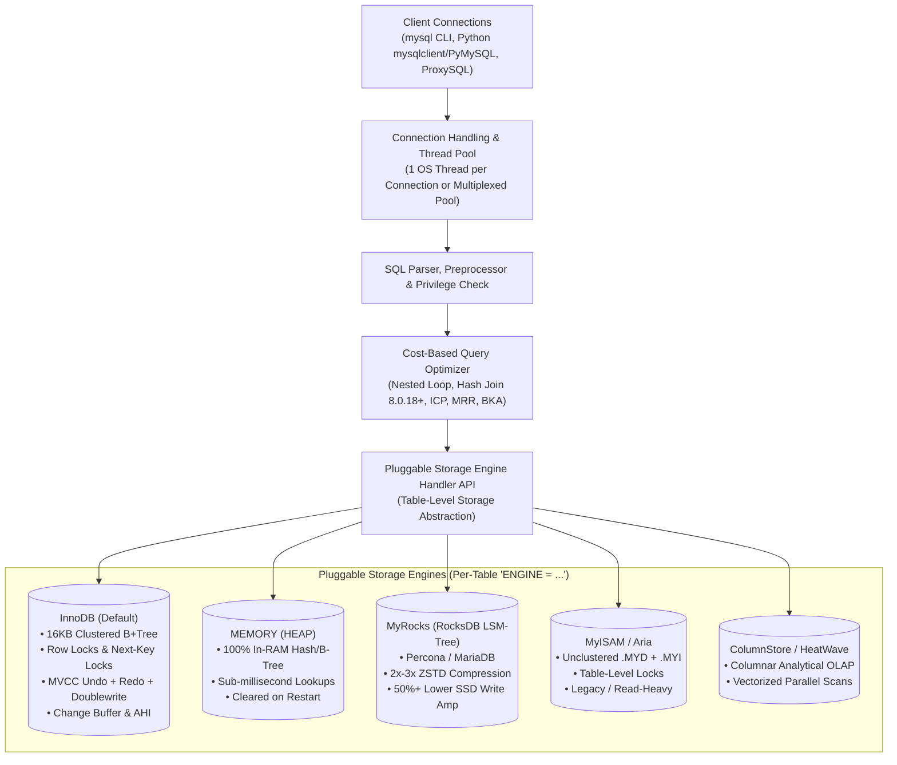
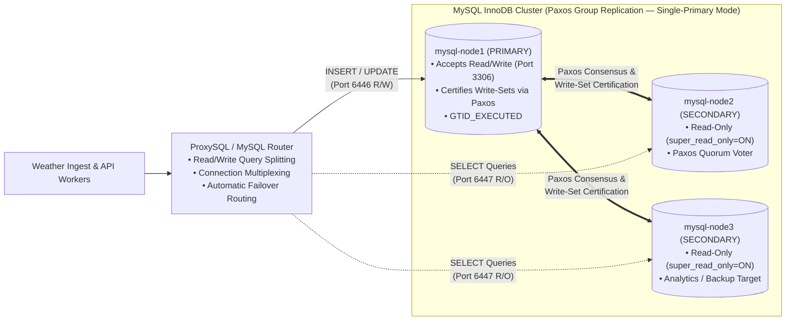

# Reference Card 14: MySQL 8.0/8.4 & MariaDB Complete Engineering Guide — InnoDB Internals, Pluggable Engines, Next-Key Locking, Spatial SQL, GTID HA & Production Tuning

> **Navigation:** [Bootcamp Home](../README.md) | [Reference Cards Index](./README.md) | [Interactive Portal](../bootcamp_portal.html) | [Day 2 PG vs. MySQL Guide](../day2/day2_postgres_vs_mysql_mvcc_guide.md)  
> **Card Sequence:** [⬅ Previous Card](./13_database_observability_prometheus_grafana_and_alerts.md) | **Card 14 of 14** | *Last Card*

---

## Quick-Jump Table of Contents

1. [Executive Overview: Where MySQL & MariaDB Shine in Production](#1-executive-overview-where-mysql--mariadb-shine-in-production)
2. [MySQL Architecture & The Pluggable Storage Engine Ecosystem (`SHOW ENGINES`)](#2-mysql-architecture--the-pluggable-storage-engine-ecosystem-show-engines)
3. [InnoDB 16 KB Clustered Index B+Tree Internals & Primary Key Engineering](#3-innodb-16-kb-clustered-index-btree-internals--primary-key-engineering)
4. [InnoDB Memory Architecture (`Buffer Pool`, `Change Buffer`, `AHI`, Scan-Resistant LRU)](#4-innodb-memory-architecture-buffer-pool-change-buffer-ahi-scan-resistant-lru)
5. [InnoDB MVCC, In-Place Updates, Undo Logs & Crash Recovery (`Doublewrite` + `Redo`)](#5-innodb-mvcc-in-place-updates-undo-logs--crash-recovery-doublewrite--redo)
6. [InnoDB Concurrency & Locking: Record, Gap, Next-Key & Insert Intention Locks](#6-innodb-concurrency--locking-record-gap-next-key--insert-intention-locks)
7. [MySQL 8.0/8.4 SQL Dialect, `JOIN` Compatibility, Data Types, `JSON_TABLE` & Spatial GIS](#7-mysql-8084-sql-dialect-join-compatibility-data-types-json_table--spatial-gis)
8. [Complete MySQL 8.0+ Weather Telemetry Blueprint (DDL, Heartbeat Upserts, Spatial & Window SQL)](#8-complete-mysql-80-weather-telemetry-blueprint-ddl-heartbeat-upserts-spatial--window-sql)
9. [High Availability: GTID Replication, MySQL InnoDB Cluster (Group Replication) & ProxySQL](#9-high-availability-gtid-replication-mysql-innodb-cluster-group-replication--proxysql)
10. [Production `my.cnf` Tuning Profile & Top 10 DBA Diagnostic Queries (`performance_schema` & `sys`)](#10-production-mycnf-tuning-profile--top-10-dba-diagnostic-queries-performance_schema--sys)

---

## 1. Executive Overview: Where MySQL & MariaDB Shine in Production

While our 5-day bootcamp executes its hands-on relational labs on **SQLite 3** (Day 1) and **PostgreSQL 16 + PostGIS** (Days 2–3), **MySQL (8.0 / 8.4 LTS)** and **MariaDB (10.11 / 11.4 LTS)** power a massive portion of the world's web infrastructure, IoT device management portals, user authentication services, and operational telemetry backends.

A senior data engineer must understand **both** PostgreSQL and MySQL—not as tribal rivals, but as two distinct storage architectures with opposite physical trade-offs:

### 1.1 The 5 Workloads Where MySQL (InnoDB / MyRocks) Outperforms PostgreSQL

| # | Workload Pattern | Why MySQL Wins Architecturally | Concrete Telemetry / Engineering Example |
| :-: | :--- | :--- | :--- |
| **1** | **High-Frequency In-Place Scalar `UPDATE`s (Heartbeat & State Tables)** | When updating non-indexed columns, **InnoDB modifies the row in-place** inside the 16 KB page and writes a compact delta to the Undo Log—**touching zero secondary indexes**! (PostgreSQL appends a brand-new heap tuple on every update, risking index write amplification and heap bloat). | A `station_live_status` table (`station_id PK`, `last_ping_utc`, `battery_volts`, `temp_c`) with 5 secondary indexes receiving 10,000 `INSERT ... ON DUPLICATE KEY UPDATE` heartbeats per second. |
| **2** | **Primary Key Point Lookups & Clustered Range Scans** | In InnoDB, the **Primary Key B+Tree leaf page IS the physical table** (**Index-Organized Table**). Fetching by Primary Key requires **0 heap pointer hops**, and range scans on a composite PK `PRIMARY KEY (station_id, obs_time)` read physically contiguous 16 KB leaf blocks! | Fetching the last 24 hours of telemetry for `station_id = 60390` when the table is clustered on `PRIMARY KEY (station_id, obs_time)`. |
| **3** | **Secondary Index Write Buffering (`The Change Buffer`)** | When inserting rows into a table with non-unique secondary indexes whose pages are not currently in RAM, **InnoDB buffers the index changes in RAM (`Change Buffer`)** and merges them asynchronously later—avoiding synchronous random disk reads! (PostgreSQL must read the index page immediately). | High-velocity ingestion into a table with secondary indexes on `region`, `sensor_type`, and `qc_flag` that exceed RAM. |
| **4** | **Compact Integer Types (`TINYINT`, `MEDIUMINT`, `UNSIGNED`)** | MySQL offers **1-byte `TINYINT`**, **3-byte `MEDIUMINT`**, and **`UNSIGNED`** modifiers across all integer types (doubling positive ID range without doubling byte width). PostgreSQL's smallest integer is 2-byte signed `SMALLINT`. | Storing `humidity_pct TINYINT UNSIGNED` (`0–100` in **1 byte** instead of 2–4 bytes) or `qc_code TINYINT UNSIGNED` across 1 billion rows saves **1–3 GB** of raw tuple payload. |
| **5** | **Pluggable Storage Engines per Table (`ENGINE = ...`)** | MySQL/MariaDB allow different tables in the **same database** to use different storage engines: `InnoDB` (ACID OLTP), `MEMORY` (in-RAM lookup caches), **`MyRocks`** (LSM-Tree cutting SSD write amplification by $50\%+$), or **`MariaDB ColumnStore`** (columnar OLAP). | Using `ENGINE=InnoDB` for `stations`, `ENGINE=MEMORY` for ephemeral radar session routing, and `ENGINE=ROCKSDB` (`MyRocks`) for 10-billion-row compressed raw sensor logs. |

---

## 2. MySQL Architecture & The Pluggable Storage Engine Ecosystem (`SHOW ENGINES`)

Unlike PostgreSQL's process-per-connection (`postgres` OS processes sharing `shared_buffers`), **MySQL (`mysqld`) is a single multi-threaded daemon** where each client connection runs as a lightweight OS thread (or is multiplexed via a Thread Pool in Percona/MariaDB/MySQL Enterprise).



### 2.1 Complete Comparison of MySQL / MariaDB Storage Engines

| Storage Engine | Physical Structure | Transactions & Locking | Crash Safety | Best Production Use Case |
| :--- | :--- | :--- | :--- | :--- |
| **`InnoDB`** *(Default in MySQL & MariaDB)* | **16 KB Clustered B+Tree** (`.ibd` tablespace files) | Full **ACID** (`READ UNCOMMITTED`, `READ COMMITTED`, `REPEATABLE READ` [default], `SERIALIZABLE`); **Row & Gap locks** | **Yes** (`Redo Log` + `Doublewrite Buffer` + `Undo Log`) | **99% of OLTP workloads:** station registries, live status tables, transactional telemetry, alerts. |
| **`MyRocks` (`ROCKSDB`)** *(Percona Server & MariaDB)* | **LSM-Tree (Log-Structured Merge-Tree):** `MemTable` $\rightarrow$ immutable `SSTable` levels | Full **ACID** + Snapshot Isolation + Row locks | **Yes** (WAL + immutable SSTables) | **High-volume time-series & archival tables on NVMe SSDs:** Zero B+Tree page fragmentation, $2\times\text{–}3\times$ smaller disk footprint than InnoDB, and $50\%+$ less SSD wear! |
| **`MEMORY` (`HEAP`)** | Fixed-length rows in **RAM** (Hash index by default, or `USING BTREE`) | Non-transactional; **Table-level locking** | **Volatile** (Structure persists on disk, data wiped on restart) | Ultra-fast ephemeral lookup caches, live active-socket routing tables, or temporary staging. |
| **`MyISAM`** *(Legacy)* / **`Aria`** *(MariaDB)* | Unclustered Heap data file (`.MYD`/`.MAD`) + B-Tree index file (`.MYI`/`.MAI`) | `MyISAM`: Non-transactional, **Table-level locks** (`Aria` adds crash-safe page logging) | **`MyISAM` corrupts on power loss** (`REPAIR TABLE`); `Aria` is crash-safe | Legacy read-only reference catalogs. **Never use `MyISAM` for live write workloads.** |
| **`ARCHIVE`** | `zlib`-compressed append-only stream (`.ARZ`) | Non-transactional; supports **only `INSERT` and `SELECT`** (no `UPDATE`/`DELETE`, no indexes except auto-increment) | Partial | Append-only audit logs where sequential full-scan is acceptable. |
| **`CSV`** | Plain-text `.CSV` file inside the MySQL data directory | Non-transactional; table-level lock; all columns must be `NOT NULL` | No | Instant zero-script data exchange: drop a `.csv` file or query a table to produce a `.csv` directly. |

---

## 3. InnoDB 16 KB Clustered Index B+Tree Internals & Primary Key Engineering

### 3.1 Physical Anatomy of an InnoDB 16 KB Page (`16,384 Bytes`)

While PostgreSQL uses **8 KB Unclustered Heap pages**, InnoDB formats every `.ibd` tablespace into **16 KB (`16,384`-byte) B+Tree pages** (`FIL_PAGE_INDEX`):

```text
+======================================================================================+
|                   MYSQL INNODB 16 KB (16,384-BYTE) B+TREE LEAF PAGE                  |
+======================================================================================+
| Byte 0..37 (38B)   : FIL HEADER                                                      |
|                      • Checksum (4B) • Page Offset/Number (4B)                       |
|                      • Prev Page Ptr (4B) & Next Page Ptr (4B) [Doubly-Linked List!] |
|                      • Page LSN (8B: Log Sequence Number of last modification)       |
|                      • Page Type (2B: 0x45BF = B+Tree Index/Data Node)               |
+--------------------------------------------------------------------------------------+
| Byte 38..93 (56B)  : INDEX HEADER & FSEG HEADER (20B)                                |
|                      • Number of Directory Slots • Heap Top Position                 |
|                      • Number of Records • Page Level (0 = Leaf Page, >0 = Branch)   |
+--------------------------------------------------------------------------------------+
| Byte 94..119 (26B) : SYSTEM RECORDS: [Infimum Record] & [Supremum Record]            |
|                      • Fixed lower and upper boundary sentinels for the page         |
+--------------------------------------------------------------------------------------+
| Byte 120..N        : USER RECORDS (Full Table Rows in Leaf Pages!)                   |
|   ┌──────────────────────────────────────────────────────────────────────────────┐   |
|   │ Record Header (5B) | Primary Key (station_id, obs_time)                      │   |
|   │ Hidden MVCC Fields : DB_TRX_ID (6B) | DB_ROLL_PTR (7B)                       │   |
|   │ Non-Key Columns    : temp_c (4B) | pressure_hpa (4B) | wind_kt (4B) ...      │   |
|   └───────────────────────────────────┬──────────────────────────────────────────┘   |
|                                       ▼ (Singly-linked list in strict PK sort order) |
+--------------------------------------------------------------------------------------+
|                    : FREE SPACE (Grows downward as rows are inserted;                |
|                      Target fill factor = 15/16 [93.75%] for sequential PK inserts)  |
+--------------------------------------------------------------------------------------+
| ...Byte 16375      : PAGE DIRECTORY (Sparse array of 2-byte offsets to every 4–8th   |
|                      record, enabling O(log K) binary search inside the 16KB page)   |
+--------------------------------------------------------------------------------------+
| Byte 16376..16383  : FIL TRAILER (8B: Checksum + low 4 bytes of LSN for torn-page    |
|                      verification against the FIL Header)                            |
+======================================================================================+
```

---

### 3.2 The 4 Golden Rules of Primary Key Design in MySQL InnoDB

Because **the Primary Key B+Tree IS the physical table** in InnoDB, choosing the wrong Primary Key destroys both write throughput and RAM capacity:

#### Rule 1: What Happens If You Omit a Primary Key?
If you create an InnoDB table without a `PRIMARY KEY`:
1. InnoDB first looks for the first `UNIQUE NOT NULL` index and promotes it to the Clustered Index.
2. If none exists, InnoDB silently generates a hidden **6-byte `DB_ROW_ID`** clustered index protected by a **single global mutex (`dict_sys->mutex`)**—creating a severe concurrency bottleneck under parallel inserts! **Always define an explicit `PRIMARY KEY` on every InnoDB table** (enforce this in production with `SET GLOBAL sql_generate_invisible_primary_key = ON;` in MySQL 8.0.30+ or `innodb_force_primary_key = ON`).

#### Rule 2: Keep Primary Keys Narrow (Why Secondary Indexes Duplicate the PK!)
In PostgreSQL, a secondary index points to a fixed **6-byte `ctid` `(block, offset)`** regardless of how wide your Primary Key is.  
In **MySQL InnoDB**, because rows move between 16 KB pages whenever a B+Tree page splits, **secondary indexes CANNOT store physical page pointers**! Instead, **every secondary index leaf entry stores a full copy of the row's Primary Key**:

```text
  Secondary Index Lookup in MySQL InnoDB (Double B+Tree Traversal):
  Query: SELECT temp_c FROM observations WHERE qc_flag = 'ERRONEOUS';

  Step 1: Traverse Secondary B+Tree (idx_qc_flag)
          Root ──► Branch ──► Leaf: ['ERRONEOUS' | PK Copy: (60571, '2026-10-06 12:00:00')]
                                                             │
  Step 2: Use extracted PK to traverse Clustered PK B+Tree!  ▼
          Root ──► Branch ──► 16KB Leaf Page: [(60571, '2026-10-06 12:00:00') -> temp_c: 68.5]
```

* **Byte-Bloat Math:**
  - If you use a `CHAR(36)` UUID string as your Primary Key on a 100-million-row table with 4 secondary indexes:
    $$100,000,000 \times 4\text{ indexes} \times 36\text{ bytes} = \mathbf{14.4\text{ GB of wasted secondary index overhead!}}$$
  - Using an `INT UNSIGNED` ($4\text{ bytes}$) or `BIGINT UNSIGNED` ($8\text{ bytes}$) cuts that secondary index footprint to **$1.6\text{ GB}$–$3.2\text{ GB}$** (saving $>11\text{ GB}$ of Buffer Pool RAM!).

#### Rule 3: Always Insert Monotonically Increasing Keys (Avoid Random UUIDv4 Page Splits!)
* **Sequential Inserts (`AUTO_INCREMENT` or Time-Ordered Keys):** InnoDB fills each 16 KB leaf page to **$15/16$ ($93.75\%$ full)** and cleanly allocates the next 16 KB page.
* **Random Inserts (`UUIDv4` or out-of-order keys):** InnoDB must insert into the middle of already-full 16 KB pages. It is forced to **split the 16 KB page into two pages**, copy $50\%$ of the rows to a newly allocated page, update parent pointers, and leave both pages half-empty ($\approx 50\%\text{–}65\%$ page fill factor)—**doubling disk consumption and slashing insert IOPS by $5\times\text{–}10\times$**!
* **If You Must Use UUIDs in MySQL 8.0+ or PostgreSQL:** Use **RFC 9562 `UUIDv7`** (48-bit big-endian Unix ms timestamp prefix — see [Day 2 Coursebook — Black Box 2D](../day2/day2_master_coursebook.md) for the bit-level diagram and `pg_wal` Full-Page Write amplification math) or MySQL 8.0's native **`UUID_TO_BIN(uuid, 1)`** (which swaps the timestamp bits of a UUIDv1 to the front and packs it into **16 binary bytes** `BINARY(16)` instead of 36 ASCII bytes!).

#### Rule 4: Composite Clustered PK `PRIMARY KEY (station_id, obs_time)` vs. Surrogate `BIGINT AUTO_INCREMENT`
In meteorological time-series tables in InnoDB, you have two choices:
1. **Option A: `PRIMARY KEY (station_id, obs_time)` (With NO secondary indexes, or minimal secondary indexes):**
   - **Pros:** All observations for `station_id = 60390` are stored **physically adjacent on disk in chronological order**! A query for `WHERE station_id = 60390 AND obs_time BETWEEN '2026-10-01' AND '2026-10-07'` reads a handful of contiguous 16 KB pages with **zero secondary index overhead** and saves the 8-byte `obs_id` column.
   - **Cons:** Inserting observations for 50 stations concurrently appends to 50 different "hot spots" in the B+Tree (1 active 16 KB leaf page per station—which easily fits in RAM (`50 * 16 KB = 800 KB`)!).
2. **Option B: `obs_id BIGINT UNSIGNED AUTO_INCREMENT PRIMARY KEY` + `UNIQUE KEY (station_id, obs_time)`:**
   - **Pros:** 100% strictly append-only at the right-most edge of the Clustered B+Tree; secondary indexes store only an 8-byte `obs_id`.
   - **Cons:** Queries filtering by `WHERE station_id = 60390 AND obs_time BETWEEN ...` must traverse the secondary `UNIQUE KEY` and then perform random Clustered PK lookups unless covered by the index.

---

## 4. InnoDB Memory Architecture (`Buffer Pool`, `Change Buffer`, `AHI`, Scan-Resistant LRU)

While PostgreSQL dedicates only $\approx 25\%$ of RAM to `shared_buffers` and relies on the Linux OS Page Cache for the rest, **MySQL InnoDB manages its own unified memory cache (`innodb_buffer_pool_size`, set to $70\%\text{–}80\%$ of total server RAM)** and opens `.ibd` files with **`O_DIRECT`** to bypass the Linux OS Page Cache completely (eliminating double-buffering!).

```text
+=========================================================================================+
|                MYSQL INNODB BUFFER POOL (70%–80% of RAM, e.g., 24 GB / 32 GB)           |
+=========================================================================================+
|                                                                                         |
|  1. SCAN-RESISTANT MIDPOINT INSERTION LRU LIST (16 KB Data & Index Pages)               |
|     ┌──────────────────────────────────────────┬──────────────────────────────────────┐ |
|     │         NEW / YOUNG SUBLIST (5/8)        │          OLD SUBLIST (3/8)           │ |
|     │  [MRU Head] ───────────────►             │  ▲ ─────────────► [LRU Tail (Evict)] │ |
|     │  Hot operational station & index pages   │  │ Midpoint Insertion Head           │ |
|     └──────────────────────────────────────────┴──┼───────────────────────────────────┘ |
|                                                   │                                     |
|        Every newly read disk page enters HERE ────┘ (NOT at the MRU Head!)              |
|        • Must survive > innodb_old_blocks_time (1000 ms) before second access           |
|          promotes it to the Young Sublist!                                              |
|        • Result: A full table scan (mysqldump / big SELECT) cycles harmlessly through   |
|          the 3/8 Old Sublist and NEVER evicts hot OLTP pages in the Young Sublist!      |
|                                                                                         |
|  2. THE CHANGE BUFFER (Up to 25% of Buffer Pool — innodb_change_buffer_max_size = 25)   |
|     • Buffers INSERT / UPDATE / DELETE changes to non-unique secondary index pages      |
|       that are NOT currently in the Buffer Pool.                                        |
|     • Avoids random disk IOPS during ingestion; merges changes later when the page      |
|       is read or by background master/io threads!                                       |
|                                                                                         |
|  3. ADAPTIVE HASH INDEX (AHI — Automatic O(1) In-Memory Hash Lookups)                   |
|     • Dynamically builds a hash table over frequently queried B+Tree index prefixes     |
|       so point lookups bypass B+Tree root-to-leaf traversal completely!                 |
+=========================================================================================+
```

---

## 5. InnoDB MVCC, In-Place Updates, Undo Logs & Crash Recovery (`Doublewrite` + `Redo`)

### 5.1 Why InnoDB Excels at High-Frequency Heartbeat `UPDATE`s (`In-Place` vs. `Out-of-Place`)

Compare what happens when station `60390` updates its live telemetry row (`UPDATE station_live_status SET temp_c = 24.8, last_seen = NOW() WHERE station_id = 60390`) 86,400 times a day:

1. **In PostgreSQL (Out-of-Place Heap MVCC):**
   - PostgreSQL marks the old tuple's `t_xmax` and writes a **complete copy of the entire row** at a new `ctid`. If any indexed column changed—or if the 8 KB page is full (preventing a `HOT` update)—PostgreSQL must insert new entries into **every index on the table**.
2. **In MySQL InnoDB (In-Place Clustered Page Mutation + Undo Log Delta):**
   - Because `station_id` (the Primary Key) did not change and `temp_c` is not indexed, InnoDB **overwrites `temp_c` directly in place** inside the 16 KB Clustered Index page!
   - Prior to overwriting, InnoDB writes only the **old delta** (`temp_c = 24.6`) into the **Undo Log** and updates the row's 7-byte `DB_ROLL_PTR` to point to that Undo record.
   - **Zero secondary indexes are touched**, and the 16 KB table page never grows or fragments!

### 5.2 The InnoDB "History List Length" (`HLL`) Trap (MySQL's Equivalent of Unvacuumed Bloat)
Just as an uncommitted `idle in transaction` session in PostgreSQL blocks `VACUUM` from reclaiming dead heap tuples, a long-running uncommitted transaction (or an open `REPEATABLE READ` snapshot) in MySQL **blocks InnoDB's background Purge Threads** from freeing old Undo Log records!
- In MySQL, the metric for unpurged Undo records is the **History List Length (`HLL`, `trx_rseg_history_len`)**.
- Healthy OLTP systems have **`HLL < 1,000`**. If an abandoned transaction holds a snapshot open during high write traffic, `HLL` climbs past **`1,000,000+`**, causing Undo Log chains to grow thousands of links deep and degrading point query latency by $10\times\text{–}100\times$!

### 5.3 Crash Recovery: Why InnoDB Uses a `Doublewrite Buffer` Instead of `full_page_writes`
Both PostgreSQL and MySQL face the **Torn-Page Hazard**: Linux filesystems (`ext4`/`xfs`) write in **4 KB blocks**, whereas PostgreSQL uses **8 KB pages** and MySQL InnoDB uses **16 KB pages**. If power fails halfway through flushing a 16 KB page, 8 KB on disk is new and 8 KB is old (a corrupted **Torn Page** that Redo Logs alone cannot fix because InnoDB Redo Logs use physiological logging!).

| Engine | Torn-Page Protection Mechanism | I/O Trade-Off |
| :--- | :--- | :--- |
| **PostgreSQL** | **`full_page_writes = on`:** The first time an 8 KB page is dirtied after a checkpoint, PostgreSQL writes a complete 8 KB image (`BKPBLOCK`) directly into the WAL stream (`pg_wal/`). | Inflates WAL volume right after checkpoints, requiring large `max_wal_size` and `checkpoint_completion_target = 0.9`. |
| **MySQL InnoDB** | **The Doublewrite Buffer (`#ib_16384_0.dblwr`):** Before flushing dirty 16 KB pages to their random `.ibd` file locations, InnoDB first writes them sequentially in a single batch to the **Doublewrite Buffer** on disk, calls `fsync()`, and only then writes them to the `.ibd` files. | Keeps InnoDB Redo Logs (`#ib_redo*`) ultra-compact! On crash recovery, if a `.ibd` page checksum fails, InnoDB simply restores the intact 16 KB copy from `.dblwr` and applies Redo records. |

---

## 6. InnoDB Concurrency & Locking: Record, Gap, Next-Key & Insert Intention Locks

One of the most important operational differences between PostgreSQL and MySQL InnoDB is how they handle **locking reads (`SELECT ... FOR UPDATE` / `FOR SHARE`), `UPDATE`, and `DELETE`** under their default isolation levels (**PostgreSQL defaults to `READ COMMITTED`**; **MySQL InnoDB defaults to `REPEATABLE READ`**!):

```text
  Suppose idx_station_id on observations contains station_id values: 60390, 60419, 60490

  Index Line:   ( -∞ , 60390 ]    ( 60390 , 60419 ]    ( 60419 , 60490 ]    ( 60490 , +∞ )
                └───┬────────┘    └───────┬───────┘    └───────┬───────┘    └──────┬─────┘
                    │                     │                    │                   │
                 Next-Key              Next-Key             Next-Key            Supremum
                 Interval              Interval             Interval            Gap Lock

  • RECORD LOCK   : Locks ONLY the index record itself (e.g., station_id = 60419).
  • GAP LOCK      : Locks ONLY the open gap between records (e.g., (60390, 60419)),
                    preventing any other transaction from INSERTING station_id = 60402!
  • NEXT-KEY LOCK : Record Lock + Gap Lock before it -> Half-open interval (60390, 60419].
```

### 6.1 The 3 InnoDB Locking Rules Every Engineer Must Know
1. **Plain `SELECT` Statements Never Lock Anything:**
   - `SELECT * FROM observations WHERE station_id = 60419;` is a **Consistent Non-Locking Read**. It reads the MVCC snapshot via Undo Logs and ignores all Record/Gap locks.
2. **Why `REPEATABLE READ` Uses Next-Key Locks on `UPDATE` / `DELETE` / `FOR UPDATE`:**
   - To prevent **Phantom Reads** (and ensure statement-based binlog safety), when Transaction A runs:
     ```sql
     BEGIN;
     SELECT * FROM observations WHERE station_id BETWEEN 60400 AND 60500 FOR UPDATE;
     ```
     InnoDB places **Next-Key Locks** across the entire index range `[60400, 60500]` plus the gap above it. If Transaction B tries to `INSERT` a new observation for `station_id = 60402` (`Bejaia`), Transaction B **blocks on an Insert Intention Lock** until Transaction A commits!
   - *Tip:* If you do not need Gap Locks and want PostgreSQL-style row-only locking in MySQL, set **`transaction_isolation = 'READ-COMMITTED'`** (in `READ COMMITTED`, InnoDB disables Gap Locks for searches/scans, using them only for foreign-key and duplicate-key checks!).
3. **The Unindexed `WHERE` Clause Disaster in InnoDB:**
   - Because InnoDB locks **index records**, if you run `UPDATE observations SET qc_flag = 'VALID' WHERE wind_speed_kt > 50.0;` and `wind_speed_kt` **has no index**, InnoDB must scan the entire Clustered Primary Key and place **Next-Key Locks on EVERY SINGLE ROW AND GAP IN THE TABLE**—freezing all concurrent inserts and updates across the entire table! **Always verify that `UPDATE` and `DELETE` predicates in MySQL use an index!**

---

## 7. MySQL 8.0/8.4 SQL Dialect, `JOIN` Compatibility, Data Types, `JSON_TABLE` & Spatial GIS

### 7.1 Complete 4-Engine SQL `JOIN` Compatibility Matrix

Connecting directly to our [Day 1 SQL `JOIN` Taxonomy](../day1/day1_master_coursebook.md#73-complete-taxonomy-of-sql-joins--sqlite-compatibility-matrix), here is how **MySQL 8.0 / 8.4** compares against **SQLite**, **PostgreSQL 16**, and **DuckDB**:

| SQL `JOIN` Type / Algorithm | SQLite `< 3.39` | SQLite `3.39+` | **MySQL 8.0 / 8.4** | PostgreSQL 16 | DuckDB | MySQL Engineering Notes |
| :--- | :---: | :---: | :---: | :---: | :---: | :--- |
| **`INNER JOIN`** (`JOIN`, `STRAIGHT_JOIN`) | Yes | Yes | ** Yes** | Yes | Yes | `STRAIGHT_JOIN` in MySQL forces the optimizer to join tables in the exact left-to-right order written in `FROM`. |
| **`LEFT [OUTER] JOIN`** | Yes | Yes | ** Yes** | Yes | Yes | Standard left outer join. |
| **`RIGHT [OUTER] JOIN`** | No | Yes | ** Yes** | Yes | Yes | Supported natively in all MySQL versions. |
| **`FULL [OUTER] JOIN`** | No | Yes | ** NO!** | Yes | Yes | **Crucial MySQL Gotcha:** Even in MySQL 8.4, `FULL OUTER JOIN` is **not supported**! You **must** use the `LEFT JOIN ... UNION ALL ... RIGHT JOIN ... WHERE a.id IS NULL` rewrite! |
| **`CROSS JOIN`** | Yes | Yes | ** Yes** | Yes | Yes | In MySQL, `JOIN`, `INNER JOIN`, and `CROSS JOIN` without an `ON` clause are syntactically interchangeable (always write `CROSS JOIN` explicitly for clarity). |
| **`SELF JOIN`** | Yes | Yes | ** Yes** | Yes | Yes | Supported via table aliases (`FROM stations s1 JOIN stations s2`). |
| **`LATERAL` Derived Tables** | No | No | ** Yes (8.0.14+)** | Yes | Yes | Added in **MySQL 8.0.14**! Enables top-$N$-per-group queries (`LEFT JOIN LATERAL (SELECT ... WHERE f.station_id = s.station_id ORDER BY ... LIMIT 3) AS top3`). |
| **`Hash Join` Execution** | No | No | ** Yes (8.0.18+)** | Yes | Yes | Added in **MySQL 8.0.18**! Replaces slow Block Nested Loop (`BNL`) for unindexed equi-joins. Controlled by `join_buffer_size`. |
| **`Sort-Merge Join` Execution** | No | No | ** No** | Yes | Yes | MySQL only has **Nested Loop** (+ Batched Key Access `BKA`) and **Hash Join**; it lacks `Merge Join`. |

---

### 7.2 MySQL Data Types vs. PostgreSQL (And Critical Meteorological Traps)

| Data Domain | MySQL 8.0 / 8.4 Type | PostgreSQL 16 Equivalent | Critical MySQL Engineering Rule |
| :--- | :--- | :--- | :--- |
| **1-Byte & 3-Byte Integers (`UNSIGNED`)** | `TINYINT UNSIGNED` (`0..255`, **1B**)<br>`SMALLINT UNSIGNED` (`0..65535`, **2B**)<br>`MEDIUMINT UNSIGNED` (`0..16.7M`, **3B**)<br>`INT UNSIGNED` (`0..4.29B`, **4B**)<br>`BIGINT UNSIGNED` (`0..1.84e19`, **8B**) | `SMALLINT` (2B signed)<br>`INTEGER` (4B signed)<br>`BIGINT` (8B signed)<br>*(No `TINYINT`, `MEDIUMINT`, or `UNSIGNED`)* | Use `TINYINT UNSIGNED` for `humidity_pct` (`0–100`) and `is_active` (`0/1`), and `SMALLINT UNSIGNED` for `wind_dir_deg` (`0–360`) and `station_id` (`60390`). |
| **Exact Fixed-Point Decimal** | `DECIMAL(6,2)` | `NUMERIC(6,2)` | Packed binary BCD (9 digits per 4 bytes). Use for calibrated sensor payloads and financial SLAs. |
| **UTC Timestamps (The 2038 Cliff!)** | **`TIMESTAMP(6)`** (4–7B, UTC epoch, **ONLY `1970-01-01` to `2038-01-19`**!)<br>vs.<br>**`DATETIME(6)`** (5–8B, **`1000-01-01` to `9999-12-31`**, no timezone conversion) | **`TIMESTAMPTZ`** (8B, UTC, `4713 BC` to `294,276 AD`) | **Critical Rule in MySQL:** Never use `TIMESTAMP` for historical WMO climatology (`< 1970`) or long-term forecasts (`> 2038`)! Instead, use **`DATETIME`**, set `default_time_zone = '+00:00'` in `my.cnf`, and store all timestamps strictly in UTC! *(Note: MySQL 8.0.28+ on 64-bit Linux still limits `TIMESTAMP` storage to `2038-01-19`!).* |
| **Enumerations (`ENUM`)** | `ENUM('VALID', 'SUSPECT', 'ERRONEOUS')` (**1 byte on disk!**) | `CREATE TYPE ... AS ENUM` (4 bytes) or `TEXT + CHECK` | MySQL stores `ENUM` values internally as a **1-byte integer (`1..255`)**! However, beware: `WHERE qc_flag = 2` matches the 2nd enum item (`'SUSPECT'`). Always query by string literal. |
| **Semi-Structured `JSON` & `JSON_TABLE`** | `JSON` (Binary DOM) + **Multi-Valued Functional Indexes** + **`JSON_TABLE()`** | `JSONB` + `GIN` index | In MySQL 8.0.17+, index a JSON array using a **Multi-Valued Index**: `INDEX idx_sensors ((CAST(payload->'$.sensors' AS CHAR(32) ARRAY)))` and query with `MEMBER OF()` or `JSON_CONTAINS()`! |
| **Geodesic Spatial Coordinates** | `POINT SRID 4326 NOT NULL` + `SPATIAL INDEX(geom)` + **`ST_Distance_Sphere(p1, p2)`** | `GEOGRAPHY(Point, 4326)` + `USING GIST(geom)` + `ST_DWithin` | **MySQL 8.0 SRID 4326 Axis Order Trap:** By default in MySQL 8.0, `ST_GeomFromText('POINT(lat lon)', 4326)` expects **`(latitude, longitude)`** (per EPSG:4326 standard), unless you pass `'axis-order=long-lat'` or use `ST_PointFromText(..., 4326, 'axis-order=long-lat')`! |

---

## 8. Complete MySQL 8.0+ Weather Telemetry Blueprint (DDL, Heartbeat Upserts, Spatial & Window SQL)

Below is a complete, production-grade **MySQL 8.0 / 8.4** reference script demonstrating how to build our WMO meteorological database in MySQL (`ENGINE=InnoDB`), taking full advantage of MySQL's Clustered Composite Keys, `TINYINT/SMALLINT UNSIGNED`, `ON DUPLICATE KEY UPDATE`, `LATERAL` joins, `FULL OUTER JOIN` emulation, `JSON_TABLE()`, and `ST_Distance_Sphere()` geodesic math:

```sql
-- ============================================================================
-- PRODUCTION MYSQL 8.0 / 8.4 METEOROLOGICAL TELEMETRY BLUEPRINT
-- ============================================================================
SET NAMES utf8mb4 COLLATE utf8mb4_0900_ai_ci;
SET time_zone = '+00:00';
SET sql_mode = 'STRICT_TRANS_TABLES,NO_ZERO_DATE,NO_ZERO_IN_DATE,ERROR_FOR_DIVISION_BY_ZERO,NO_ENGINE_SUBSTITUTION';

CREATE DATABASE IF NOT EXISTS weather_ops_mysql
  CHARACTER SET utf8mb4 COLLATE utf8mb4_0900_ai_ci;
USE weather_ops_mysql;

-- 1. WMO STATIONS REGISTRY (With MySQL 8.0 SRID 4326 Geodesic Spatial Index)
CREATE TABLE stations (
    station_id    INT UNSIGNED      NOT NULL,                     -- 4-byte unsigned WMO ID
    station_name  VARCHAR(64)       NOT NULL,
    latitude      DECIMAL(7,4)      NOT NULL,
    longitude     DECIMAL(7,4)      NOT NULL,
    elevation_m   DECIMAL(6,1)      NOT NULL,
    climate_zone  ENUM('Mediterranean', 'Arid', 'Semi-Arid', 'Highland', 'Maritime') NOT NULL, -- 1 byte!
    is_active     TINYINT UNSIGNED  NOT NULL DEFAULT 1,           -- 1 byte!
    geom          POINT SRID 4326   NOT NULL,                     -- Mandatory NOT NULL for SPATIAL INDEX
    sensor_meta   JSON              NULL,
    PRIMARY KEY (station_id),
    UNIQUE KEY uk_station_name (station_name),
    SPATIAL INDEX sx_stations_geom (geom),                        -- R-Tree Spatial Index
    CONSTRAINT chk_lat  CHECK (latitude BETWEEN -90.0 AND 90.0),  -- Enforced natively in MySQL 8.0.16+!
    CONSTRAINT chk_lon  CHECK (longitude BETWEEN -180.0 AND 180.0),
    CONSTRAINT chk_elev CHECK (elevation_m BETWEEN -500.0 AND 9000.0)
) ENGINE=InnoDB;

-- Seed Algerian WMO Stations (Using explicit 'axis-order=long-lat' for clarity!)
INSERT INTO stations (station_id, station_name, latitude, longitude, elevation_m, climate_zone, is_active, geom, sensor_meta) VALUES
(60390, 'Algiers - Dar El Beida',  36.6910,  3.2154,   25.0, 'Mediterranean', 1, ST_GeomFromText('POINT(3.2154 36.6910)', 4326, 'axis-order=long-lat'), '{"vendor":"Vaisala","sensors":["PTB330","HMP155","WMT700"]}'),
(60490, 'Oran - Es Senia',         35.6239, -0.6212,   90.0, 'Mediterranean', 1, ST_GeomFromText('POINT(-0.6212 35.6239)', 4326, 'axis-order=long-lat'), '{"vendor":"Campbell","sensors":["CR1000X","CS215"]}'),
(60419, 'Constantine - El Khroub', 36.2760,  6.6203,  694.0, 'Highland',      1, ST_GeomFromText('POINT(6.6203 36.2760)', 4326, 'axis-order=long-lat'), '{"vendor":"Vaisala","sensors":["PTB330","RG13"]}'),
(60571, 'Bechar - Ouakda',         31.6457, -2.2699,  811.0, 'Arid',          1, ST_GeomFromText('POINT(-2.2699 31.6457)', 4326, 'axis-order=long-lat'), '{"vendor":"Campbell","sensors":["CR3000","DustTrak"]}'),
(60680, 'Tamanrasset - Aguenar',   22.8115,  5.4510, 1377.0, 'Arid',          1, ST_GeomFromText('POINT(5.4510 22.8115)', 4326, 'axis-order=long-lat'), '{"vendor":"Vaisala","sensors":["MAWS301"]}'),
(60402, 'Bejaia - Soummam',        36.7120,  5.0699,    6.0, 'Mediterranean', 0, ST_GeomFromText('POINT(5.0699 36.7120)', 4326, 'axis-order=long-lat'), '{"vendor":"Vaisala","sensors":["AWS310"]}');

-- 2. HIGH-CHURN HEARTBEAT TABLE (Where InnoDB In-Place MVCC Beats PostgreSQL!)
CREATE TABLE station_live_status (
    station_id      INT UNSIGNED      NOT NULL,
    last_seen_utc   DATETIME          NOT NULL,
    battery_volts   DECIMAL(4,2)      NOT NULL,
    latest_temp_c   DECIMAL(4,1)      NULL,
    packets_rx_24h  INT UNSIGNED      NOT NULL DEFAULT 1,
    PRIMARY KEY (station_id),
    CONSTRAINT fk_live_station FOREIGN KEY (station_id) REFERENCES stations(station_id) ON DELETE CASCADE
) ENGINE=InnoDB;

-- Idempotent 1-Second Heartbeat Upsert (MySQL 8.0.20+ alias syntax 'AS incoming'):
INSERT INTO station_live_status (station_id, last_seen_utc, battery_volts, latest_temp_c, packets_rx_24h)
VALUES (60390, '2026-10-06 12:05:00', 13.42, 24.8, 1) AS incoming
ON DUPLICATE KEY UPDATE
    last_seen_utc  = incoming.last_seen_utc,
    battery_volts  = incoming.battery_volts,
    latest_temp_c  = incoming.latest_temp_c,
    packets_rx_24h = station_live_status.packets_rx_24h + 1;

-- 3. SYNOPTIC OBSERVATIONS (Clustered Composite PK: station_id + obs_time)
--    Co-locates each station's time-series physically inside contiguous 16 KB leaf pages!
CREATE TABLE observations (
    station_id     INT UNSIGNED      NOT NULL,
    obs_time       DATETIME          NOT NULL,                    -- Strictly UTC ('1000'..'9999', no 2038 limit!)
    temp_c         DECIMAL(4,1)      NULL,
    humidity_pct   TINYINT UNSIGNED  NULL CHECK (humidity_pct IS NULL OR humidity_pct <= 100),
    pressure_hpa   DECIMAL(6,1)      NULL,
    wind_speed_kt  DECIMAL(4,1)      NULL CHECK (wind_speed_kt IS NULL OR wind_speed_kt >= 0.0),
    precip_1h_mm   DECIMAL(6,1)      NULL,
    qc_flag        ENUM('VALID', 'SUSPECT', 'ERRONEOUS') NOT NULL DEFAULT 'VALID',
    PRIMARY KEY (station_id, obs_time),                           -- THE CLUSTERED INDEX!
    KEY idx_obs_time_qc (obs_time, qc_flag),                      -- Secondary B+Tree (automatically includes PK)
    CONSTRAINT fk_obs_station FOREIGN KEY (station_id) REFERENCES stations(station_id) ON DELETE CASCADE
) ENGINE=InnoDB;
```

### 8.1 Advanced MySQL 8.0+ Queries (Geodesic Proximity, `LATERAL` Top-$N$, `JSON_TABLE`, and `FULL OUTER JOIN` Emulation)

```sql
-- A) Geodesic Distance in Kilometers Between Algiers (60390) and All Other Stations (ST_Distance_Sphere)
SELECT
    s2.station_id,
    s2.station_name,
    s2.climate_zone,
    ROUND(ST_Distance_Sphere(s1.geom, s2.geom) / 1000.0, 2) AS distance_From_algiers_km
FROM stations s1
JOIN stations s2
    ON s1.station_id = 60390
   AND s2.station_id != 60390
ORDER BY distance_from_algiers_km ASC;

-- B) MySQL 8.0.14+ LATERAL JOIN: Fetch the 2 Warmest Observations Per Station
SELECT
    s.station_id,
    s.station_name,
    top_obs.obs_time,
    top_obs.temp_c
FROM stations s
LEFT JOIN LATERAL (
    SELECT o.obs_time, o.temp_c
    FROM observations o
    WHERE o.station_id = s.station_id
      AND o.qc_flag = 'VALID'
    ORDER BY o.temp_c DESC
    LIMIT 2
) AS top_obs ON TRUE
ORDER BY s.station_id, top_obs.temp_c DESC;

-- C) MySQL 8.0+ JSON_TABLE(): Unnest JSON Array Inside stations.sensor_meta Into Relational Rows!
--    (MySQL's equivalent of PostgreSQL jsonb_array_elements_text() or MongoDB $unwind!)
SELECT
    s.station_id,
    s.station_name,
    JSON_UNQUOTE(JSON_EXTRACT(s.sensor_meta, '$.vendor')) AS hardware_vendor,
    jt.sensor_slot,
    jt.sensor_model
FROM stations s
CROSS JOIN JSON_TABLE(
    s.sensor_meta,
    '$.sensors[*]' COLUMNS (
        sensor_slot  FOR ORDINALITY,
        sensor_model VARCHAR(32) PATH '$'
    )
) AS jt;

-- D) Emulating FULL OUTER JOIN in MySQL 8.0/8.4 (Since MySQL Lacks Native FULL OUTER JOIN)
SELECT s.station_id, s.station_name, l.last_seen_utc, l.latest_temp_c
FROM stations s
LEFT JOIN station_live_status l ON s.station_id = l.station_id
UNION ALL
SELECT l.station_id, s.station_name, l.last_seen_utc, l.latest_temp_c
FROM station_live_status l
LEFT JOIN stations s ON l.station_id = s.station_id
WHERE s.station_id IS NULL;
```

---

## 9. High Availability: GTID Replication, MySQL InnoDB Cluster (Group Replication) & ProxySQL

> [!IMPORTANT]
> **Black Box Demystified: How MySQL & MariaDB Replicas Actually Work Under the Hood (Why MySQL Has TWO Separate Logs & 3 Replication Threads)**
>
> Engineers moving between **PostgreSQL** and **MySQL / MariaDB** are often surprised to discover that MySQL replication works completely differently from PostgreSQL Streaming Replication:
> - In **PostgreSQL**, there is only **ONE log** (`pg_wal`): it serves as **both** the physical crash-recovery log *and* the byte-stream sent to Standby replicas.
> - In **MySQL**, because of its **Pluggable Storage Engine Architecture** (Section 2), there are **TWO completely separate logs** on the Primary:
>   1. **The `InnoDB Redo Log` (`#ib_redo*` — Storage Engine Layer):** Records low-level physical/physiological page modifications (`Space ID`, `Page No`, byte offset) used **only for local InnoDB crash recovery**. Replicas **never** receive the InnoDB Redo Log!
>   2. **The `Binary Log` (`binlog` / `mysql-bin.00000X` — MySQL Server Layer):** Records logical/row-level data changes (`Write_rows`, `Update_rows`, `Delete_rows` + `GTID` header) across *all* storage engines. This is the **stream shipped to Replicas** and CDC consumers (`Debezium` / Kafka).

### 9.1 The "Two-Log Problem" & Internal XA Two-Phase Commit (`2PC`) on Every `COMMIT`

If a meteorological ingestion worker executes `COMMIT;` on the MySQL Primary, what prevents the row from being written to the `InnoDB Redo Log` while crashing *before* it is written to the `binlog` (which would leave the Primary with the row, but every Replica missing the row forever)?

MySQL solves this by executing an **Internal XA Two-Phase Commit (`2PC`)** between the Server Layer (`binlog`) and the Storage Engine Layer (`InnoDB`) on **every single transaction**:

```
   CLIENT: COMMIT;
      │
      ▼
┌───────────────────────────────────────────────────────────────────────────────────┐
│ STEP 1: InnoDB PREPARE Phase (Storage Engine Layer)                               │
│ • InnoDB writes the transaction's dirty-page changes to the InnoDB Redo Log       │
│   buffer, marks the Undo/Redo record state as TRX_STATE_PREPARED (with the XID),  │
│   and flushes to disk if innodb_flush_log_at_trx_commit = 1.                      │
└─────────────────────────────────────────┬─────────────────────────────────────────┘
                                          │
                                          ▼
┌───────────────────────────────────────────────────────────────────────────────────┐
│ STEP 2: Binary Log WRITE & FSYNC Phase (MySQL Server Layer — The Commit Point!)   │
│ • The MySQL Server assigns a GTID (e.g., UUID:14521), writes the transaction's    │
│   row events + XID into mysql-bin.000042, and calls fsync() to NVMe disk          │
│   if sync_binlog = 1.                                                             │
│ * ARCHITECTURAL RULE: Once the XID hits the binlog on disk, the transaction is    │
│   officially COMMITTED! Even if power fails 1 microsecond later, upon reboot      │
│   MySQL scans the binlog, sees XID 14521, and tells InnoDB to roll it forward!    │
└─────────────────────────────────────────┬─────────────────────────────────────────┘
                                          │
                                          ▼
┌───────────────────────────────────────────────────────────────────────────────────┐
│ STEP 3: InnoDB COMMIT Phase (Storage Engine Layer)                                │
│ • InnoDB changes the transaction status from PREPARED to COMMITTED in the Undo    │
│   header, releases row/gap locks, and returns "Query OK" to the client.           │
└───────────────────────────────────────────────────────────────────────────────────┘
```

- **The Mandatory "Dual-1" Production Rule (`innodb_flush_log_at_trx_commit = 1` + `sync_binlog = 1`):**
  - If you set `sync_binlog = 0` (leaving `binlog` flushing to the OS page cache), an OS kernel panic or power loss can lose up to 1 second of `binlog` events that InnoDB already committed—causing **permanent silent divergence between Primary and Replicas**!
  - Modern MySQL 8.0/8.4 uses **Binary Log Group Commit** to batch dozens of concurrent client `COMMIT`s into a single `fsync()` call, preserving high throughput even with `Dual-1` enabled.

---

### 9.2 The 3-Pattern `binlog_format` Decision Matrix (`STATEMENT` vs. `ROW` vs. `MIXED`)

What actually gets written inside `mysql-bin.000042`? MySQL supports 3 formats, and choosing the wrong one can silently corrupt weather replicas:

| `binlog_format` | What Is Written to the `binlog` | What Happens on the Replica | Failure Mode / Why It Matters for Weather Telemetry |
| :--- | :--- | :--- | :--- |
| **1. `STATEMENT`**<br>*(Legacy SQL-level replication)* | The raw SQL text string:<br>`UPDATE station_live_status SET last_ping_utc = NOW() WHERE status = 'ONLINE' LIMIT 10;` | The Replica's SQL thread re-executes the exact SQL string against its own local tables. | **CRITICAL DATA DRIFT RISK:** Any non-deterministic SQL (`UUID()`, `SYSDATE()`, `RAND()`, `LIMIT` without `ORDER BY`, or triggers) evaluates to **different values or different rows on the Replica**! |
| **2. `ROW` (`RBR`)**<br>*(MySQL 8.0+ Default — **Production Gold Standard**)* | The exact **binary before-image and after-image of every modified row** (`Table_map_log_event` + `Write_rows` / `Update_rows` / `Delete_rows`). | The Replica applies the exact column byte values directly to the target PK row without re-evaluating SQL functions. | **100% Deterministic:** Replicas are guaranteed to have the exact same row values as the Primary, and Change Data Capture (`Debezium` $\rightarrow$ Kafka/Parquet) can stream every before/after state. *(Caution: a single `DELETE FROM observations WHERE obs_time < '2020-01-01'` deleting 10M rows writes 10M row events into the `binlog`—always chunk mass deletes!)* |
| **3. `MIXED`**<br>*(Hybrid fallback)* | Uses `STATEMENT` for deterministic queries and switches to `ROW` when MySQL detects `UUID()` or non-deterministic functions. | Replicas execute statements normally and apply row images for flagged queries. | Rarely used in modern setups; **`binlog_format = ROW`** with `binlog_row_image = FULL` (or `MINIMAL` to log only changed columns) is the universal enterprise standard. |

---

### 9.3 Anatomy of the MySQL 3-Thread Replication Pipeline & Parallel Workers (`MTS`)

Unlike PostgreSQL (where a single `walreceiver` streams physical blocks into `pg_wal` and the Startup process replays them), classic MySQL/MariaDB replication uses a **3-Thread Pipeline with an intermediate `Relay Log` on the Replica**:

```mermaid
flowchart LR
    subgraph PrimaryNode["MySQL Primary (Source — Port 3306)"]
        Commit["Client Transaction COMMIT\n(Internal XA 2PC)"]
        Binlog[("Binary Log\nmysql-bin.000042\n(GTID + Row Events)")]
        DumpThread["1. Binlog Dump Thread\n(Streams GTID Events over TCP)"]
        Commit --> Binlog --> DumpThread
    end

    subgraph ReplicaNode["MySQL Replica (super_read_only = ON)"]
        IOThread["2. Replica I/O Receiver Thread\n(Writes immediately to Relay Log)"]
        RelayLog[("Relay Log on NVMe\nrelay-bin.000019\n(Decouples Network from Replay)")]
        Coordinator["3a. SQL Coordinator Thread\n(Reads Relay Log & Schedules\nNon-Conflicting Transactions)"]
        Workers["3b. Parallel Applier Workers\n(replica_parallel_workers = 8)\nWRITESET Dependency Tracking"]
        ReplicaInnoDB[("Replica InnoDB\n16KB Clustered B+Trees\n+ Executed_Gtid_Set")]

        IOThread --> RelayLog --> Coordinator --> Workers --> ReplicaInnoDB
    end

    DumpThread ==>|"Async / Semi-Sync TCP Stream\n(SOURCE_AUTO_POSITION = 1)"| IOThread
```



1. **Thread 1 — Primary `Binlog Dump Thread` (`Binlog Dump GTID`):**
   - Spawned on the Primary for each connected Replica. It reads committed `GTID` transactions from `mysql-bin.000042` and pushes them over TCP to the Replica.
2. **Thread 2 — Replica `I/O Receiver Thread` (`Replica_IO_Running: Yes`) + `Relay Log`:**
   - Receives binlog events from the Primary and appends them sequentially into the Replica's local **`Relay Log` (`relay-bin.000019`)** on disk, updating `Retrieved_Gtid_Set`.
   - **Why does the `Relay Log` exist?** It decouples **network receipt** from **storage engine execution**! Even if the Replica's InnoDB Buffer Pool is busy running a heavy analytical query (delaying replay), the `I/O Thread` still captures every transaction onto the Replica's disk in sub-milliseconds so zero data is lost if the Primary catches fire!
3. **Thread 3 — Replica `SQL Applier Coordinator` + Parallel Worker Threads (`Replica_SQL_Running: Yes`):**
   - **The Historical MySQL Bottleneck:** Before MySQL 5.7/8.0, the Primary executed writes across **64 concurrent CPU threads**, while the Replica had only **1 single-threaded SQL Applier**—causing massive replication lag (`Seconds_Behind_Source` climbing to hours) during burst weather ingestion!
   - **The Modern Fix (`WRITESET` Multi-Threaded Applier — Default in MySQL 8.0.27+ / 8.4):**
     - By setting `replica_parallel_workers = 8` (or `16`), `binlog_transaction_dependency_tracking = WRITESET`, and `replica_preserve_commit_order = ON`, the Primary hashes the Primary Keys modified by each transaction (`WriteSet`).
     - Any two transactions touching **different weather stations (`station_id = 60390` vs. `station_id = 60580`)** have non-overlapping WriteSets and are replayed **in parallel across all 8 worker threads on the Replica** while preserving exact commit order for readers!

---

### 9.4 The 4-Pattern MySQL & MariaDB Replication & Failover Decision Matrix

When a Primary crashes or is isolated by a network partition, how does MySQL prevent data loss (`RPO = 0`) and `Split-Brain`?



| Replication Topology | How `COMMIT` Acknowledgement Works | Data Loss Risk on Primary Crash (`RPO`) | The "Phantom Read" Anomaly on Failover | Automatic Failover & Split-Brain Protection |
| :--- | :--- | :--- | :--- | :--- |
| **1. Asynchronous GTID Replication**<br>*(Default MySQL Replication)* | Primary commits locally (`2PC` between `Redo` + `binlog`) and returns `OK` immediately. `Dump Thread` ships events later. | **$\text{RPO} > 0$** (Transactions in flight not yet written to Replica's `Relay Log` are lost if Primary NVMe dies). | None on Primary before crash, but acknowledged writes vanish after failover. | **External Orchestrator Required:** (`Orchestrator`, `MHA`, or Cloud RDS controller) + `ProxySQL`. |
| **2. Semi-Synchronous (`AFTER_COMMIT`)**<br>*(Legacy MySQL 5.5/5.6 Semi-Sync)* | Primary commits inside InnoDB (**Step 3** of `2PC`), **then** waits for 1 Replica I/O thread to ACK `Relay Log` write before returning `OK` to client. | **$\text{RPO} = 0$** (Replica has the event in its `Relay Log`). | **YES — Phantom Read Trap!** Because InnoDB committed *before* waiting for the Replica ACK, *other* clients on the Primary can already read the new row even if the Primary crashes before the Replica ever receives it! | External Orchestrator + `super_read_only = ON`. |
| **3. Lossless Semi-Sync (`AFTER_SYNC`)**<br>*(MySQL 5.7 / 8.0+ Default Semi-Sync)* | Primary writes to `binlog` (**Step 2** of `2PC`), **waits for 1+ Replica I/O thread to ACK `Relay Log` receipt**, and **only then** executes **Step 3** (InnoDB commit + lock release)! | **$\text{RPO} = 0$ (True Lossless)** | **ZERO Phantom Reads!** No other session on the Primary can see the uncommitted row until at least 1 Replica safely holds the transaction in its `Relay Log`. | External Orchestrator / Kubernetes Operator + `ProxySQL`. |
| **4. MySQL InnoDB Cluster (`Paxos Group Replication`) / MariaDB `Galera` (`wsrep`)**<br>*(Enterprise Built-In HA)* | At `COMMIT`, the transaction's `WriteSet` is broadcast to a **3- or 5-node Paxos Group**. Majority quorum certifies there are no conflicting concurrent row updates before committing. | **$\text{RPO} = 0$** across the quorum. | **Zero.** (Can even enforce cluster-wide synchronous reads via `group_replication_consistency = BEFORE_ON_PRIMARY_FAILOVER`). | **100% Built-In Automatic Election (< 5–10s):** Minority nodes automatically fence themselves via **`super_read_only = ON`**, and **MySQL Router / ProxySQL** switches traffic automatically! |

> [!WARNING]
> **Critical MySQL DBA Rule: Always Set `super_read_only = ON` on Every Replica!**
> In MySQL, setting `read_only = ON` only blocks regular application users—it **still allows `SUPER` / `root` users (or misconfigured cron jobs/migration scripts using admin credentials) to accidentally run `INSERT`/`UPDATE` directly on a Replica**! A single stray write on a Replica injects an errant `GTID` (`gtid_executed`) that immediately halts replication or corrupts failover. Always enforce **both** `read_only = ON` and **`super_read_only = ON`** on every Replica so even `root` cannot write to a Secondary until it is explicitly promoted!

---

### 9.5 Essential MySQL 8.0/8.4 Replica Setup & Live Diagnostic SQL Commands

```sql
-- 1. ON THE REPLICA: Configure GTID Auto-Positioning & Start the 3-Thread Pipeline
CHANGE REPLICATION SOURCE TO
    SOURCE_HOST = '10.20.1.10',
    SOURCE_PORT = 3306,
    SOURCE_USER = 'repl_weather',
    SOURCE_PASSWORD = 'StrongReplPassword!',
    SOURCE_AUTO_POSITION = 1,          -- Uses GTID sets instead of fragile binlog file/pos!
    SOURCE_SSL = 1;

START REPLICA;

-- 2. Inspect Replica Health, Lag & GTID Sets (Classic CLI View)
SHOW REPLICA STATUS\G
-- Key fields to verify:
--   Replica_IO_Running: Yes
--   Replica_SQL_Running: Yes
--   Seconds_Behind_Source: 0
--   Retrieved_Gtid_Set: 3e11fa47-71ca-11e1-9e33-c80aa9429562:1-89410
--   Executed_Gtid_Set:  3e11fa47-71ca-11e1-9e33-c80aa9429562:1-89410
--   Auto_Position: 1

-- 3. Modern MySQL 8.0+ Structured Replication Forensics via performance_schema
SELECT
    c.CHANNEL_NAME,
    c.HOST AS source_host,
    c.SERVICE_STATE AS io_receiver_state,
    s.SERVICE_STATE AS sql_coordinator_state,
    w.WORKER_ID,
    w.SERVICE_STATE AS worker_state,
    w.LAST_APPLIED_TRANSACTION,
    w.LAST_ERROR_MESSAGE
FROM performance_schema.replication_connection_status c
JOIN performance_schema.replication_applier_status s USING (CHANNEL_NAME)
LEFT JOIN performance_schema.replication_applier_status_by_worker w USING (CHANNEL_NAME);
```

---

### 9.6 The Grand 3-Engine Replication & Failover Comparison Matrix (PostgreSQL vs. MySQL vs. MongoDB)

To tie together **Day 3 (PostgreSQL HA)**, **Day 4 (MongoDB Replica Sets)**, and **Reference Card 14 (MySQL HA)**, here is how all three engines solve replication, durability, and failover side-by-side:

| Architectural Dimension | PostgreSQL 16 (`Streaming Replication` + `Patroni`) | MySQL 8.0 / 8.4 (`GTID` + `Semi-Sync` / `InnoDB Cluster`) | MongoDB 7.0 (`Replica Set`) |
| :--- | :--- | :--- | :--- |
| **Replication Stream Source** | **Single Unified Physical Log (`pg_wal`)** — exact 8 KB page byte-deltas (`XLogRecord`). | **Dual-Log Architecture:** `InnoDB Redo Log` (local crash recovery) + **`Server Binary Log` (`binlog_format = ROW`)** synced via Internal XA `2PC`. | **Idempotent Logical Operation Log (`local.oplog.rs`)** — 5% disk capped collection inside WiredTiger. |
| **Intermediate Buffer on Replica** | Standby `walreceiver` writes directly into the Standby's own `pg_wal/` directory. | Replica `I/O Thread` writes into an intermediate **`Relay Log` (`relay-bin.00000X`)**, decoupled from the `SQL Applier`. | Secondary pulls batches via `oplog` cursor into memory/WiredTiger journal and applies in parallel batches. |
| **Parallel Replay on Replica** | Single Startup redo process *(PostgreSQL 16+ prefetches blocks via `recovery_prefetch = on`)*. | **Multi-Threaded Applier (`MTS`):** `replica_parallel_workers = 8+` using **`WRITESET`** Primary Key dependency hashing. | **Multi-Threaded Oplog Applier:** Replays document writes in parallel across 16 worker threads. |
| **How `RPO = 0` (Zero Data Loss) Is Configured** | `synchronous_commit = on` (or `remote_apply`) + `synchronous_standby_names = 'ANY 1 (...)'` | **Lossless Semi-Sync** (`rpl_semi_sync_source_wait_point = AFTER_SYNC` + `Dual-1`) or **InnoDB Cluster Paxos**. | Client Write Concern **`{ w: "majority", j: true }`** across a 3-node Replica Set. |
| **What Happens to Unreplicated Writes if Primary Crashes in Async Mode?** | Old Primary diverges; **`pg_rewind`** rolls back uncommitted WAL blocks after the divergence `LSN` so the node can rejoin as Standby. | If using Async/`AFTER_COMMIT`, unreplicated binlog events are lost on failover (or require manual flashback). | When the old `{ w: 1 }` Primary rejoins, it rolls back unreplicated `oplog` entries into **`rollback/<collection>.bson`** files on disk! |
| **Built-In vs. External Consensus & Failover** | **External Mandatory:** Requires **Patroni + 3-node `etcd` (Raft) + `/dev/watchdog` + `HAProxy`**. | **Choice of Both:** Classic Async/Semi-Sync uses external **`Orchestrator` + `ProxySQL`**; **MySQL InnoDB Cluster** has **built-in Paxos Group Replication** + `MySQL Router`. | **100% Built-In:** Native **Raft-like election** inside `mongod` + topology-aware `mongodb+srv://` smart drivers (zero external `etcd` or proxy required!). |
| **How Split-Brain Old Primaries Are Fenced** | Patroni `etcd` leader lease expiry $\rightarrow$ `pg_ctl stop -m immediate` or Linux kernel **`/dev/watchdog` hardware reset**. | InnoDB Cluster minority partition immediately enforces **`super_read_only = ON`** (blocking even `root` writes!). | Stepdown hook closes client sockets and rejects all writes with `NotWritablePrimary` in $< 1\text{ ms}$. |

---

## 10. Production `my.cnf` Tuning Profile & Top 10 DBA Diagnostic Queries (`performance_schema` & `sys`)

### 10.1 Production `my.cnf` for a Dedicated 32 GB RAM / 8-Core NVMe MySQL 8.0/8.4 Server

```ini
[mysqld]
# ================= 1. SQL STRICTNESS & UTC TIMEZONE =================
default_time_zone                = '+00:00'
character_set_server             = utf8mb4
collation_server                 = utf8mb4_0900_ai_ci
sql_mode                         = 'STRICT_TRANS_TABLES,NO_ZERO_DATE,NO_ZERO_IN_DATE,ERROR_FOR_DIVISION_BY_ZERO,NO_ENGINE_SUBSTITUTION'
transaction_isolation            = 'REPEATABLE-READ'  # Or 'READ-COMMITTED' to minimize Gap Locks

# ================= 2. INNODB BUFFER POOL & MEMORY ===================
innodb_buffer_pool_size          = 24G                # 75% of total RAM on dedicated DB host
innodb_buffer_pool_instances     = 8                  # 1 instance per 2–4 GB to avoid mutex contention
innodb_flush_method              = O_DIRECT           # Bypass Linux OS Page Cache (prevent double buffering)
innodb_old_blocks_time           = 1000               # 1000ms scan-resistance guard on Midpoint LRU
innodb_change_buffer_max_size    = 25                 # Up to 25% of pool for secondary index write buffering
innodb_buffer_pool_dump_at_shutdown = ON              # Save hot 16KB page IDs to ib_buffer_pool on shutdown
innodb_buffer_pool_load_at_startup  = ON              # Auto-prewarm Buffer Pool in background on startup!
innodb_adaptive_hash_index       = OFF                # Disable AHI on NVMe to prevent btr_search_latch stalls!
join_buffer_size                 = 8M                 # Per-join buffer for Hash Joins (MySQL 8.0.18+)
sort_buffer_size                 = 4M                 # Per-session sort buffer
tmp_table_size                   = 64M                # Max in-RAM TempTable before spilling to disk
max_heap_table_size              = 64M
thread_cache_size                = 128                # Cache OS pthreads to prevent thread-creation storms

# ================= 3. WAL (REDO LOG), DOUBLEWRITE & DURABILITY ======
innodb_redo_log_capacity         = 16G                # MySQL 8.0.30+ (replaces innodb_log_file_size)
innodb_log_buffer_size           = 64M                # Buffers Redo records in RAM before disk flush
innodb_doublewrite               = ON                 # Mandatory 16KB torn-page protection
innodb_flush_log_at_trx_commit   = 1                  # 1 = Strict ACID fsync; 2 = OS flush on commit, 1s fsync
sync_binlog                      = 1                  # 1 = Sync binary log on every commit (RPO = 0)
binlog_group_commit_sync_delay   = 100                # Wait 100 microseconds to batch Dual-1 commits into 1 fsync!

# ================= 4. NVME STORAGE IOPS, PARALLEL DDL & PURGE =======
innodb_file_per_table            = ON                 # Separate .ibd file per table (allows space reclaim)
innodb_autoinc_lock_mode         = 2                  # Interleaved AUTO_INCREMENT (zero table-level lock wait)
innodb_ddl_threads               = 4                  # Parallel worker threads for sorted B+Tree index builds!
innodb_ddl_buffer_size           = 1G                 # RAM sort buffer for fast online CREATE/ALTER INDEX
innodb_io_capacity               = 4000               # Baseline background IOPS for Enterprise NVMe
innodb_io_capacity_max           = 10000              # Peak background flushing IOPS
innodb_read_io_threads           = 8
innodb_write_io_threads          = 8
innodb_purge_threads             = 4                  # Parallel background Undo Log garbage collection
innodb_lock_wait_timeout         = 15                 # Abort row lock waits after 15 seconds (default 50s)
innodb_print_all_deadlocks       = ON                 # Log all deadlock graphs to error.log

# ================= 5. GTID REPLICATION & OBSERVABILITY ==============
server_id                        = 101
gtid_mode                        = ON
enforce_gtid_consistency         = ON
binlog_format                    = ROW                # Mandatory for safe replication & CDC (Debezium)
binlog_expire_logs_seconds       = 604800             # Retain 7 days of binary logs
slow_query_log                   = ON
long_query_time                  = 0.5                # Log queries taking > 500ms
performance_schema               = ON
```

---

### 10.2 Top 10 Production MySQL DBA Forensic Queries (`sys` & `performance_schema`)

MySQL 8.0+ includes the built-in **`sys` schema** (human-readable views over `performance_schema` and `information_schema`), making live diagnostics effortless:

```sql
-- 1. Live Lock Contention: Who Is Blocking Whom Right Now? (MySQL's pg_blocking_pids equivalent!)
SELECT
    wait_age_secs,
    locked_table,
    locked_index,
    locked_type,
    waiting_trx_id,
    waiting_pid,
    waiting_query,
    blocking_trx_id,
    blocking_pid,
    blocking_query
FROM sys.innodb_lock_waits;

-- 2. Check MVCC History List Length (HLL) — Is an Uncommitted Transaction Blocking Undo Purge?
SELECT NAME, COUNT AS history_list_length
FROM information_schema.INNODB_METRICS
WHERE NAME = 'trx_rseg_history_len';

-- 3. Spot Long-Running / Abandoned Uncommitted InnoDB Transactions
SELECT
    trx_id,
    trx_mysql_thread_id                              AS connection_id,
    trx_state,
    trx_started,
    TIMESTAMPDIFF(SECOND, trx_started, NOW())        AS age_seconds,
    trx_rows_locked,
    trx_rows_modified,
    trx_query
FROM information_schema.INNODB_TRX
ORDER BY trx_started ASC;

-- 4. Top 10 Slowest / Highest-Latency SQL Query Fingerprints (MySQL's pg_stat_statements equivalent!)
SELECT
    query,
    exec_count,
    total_latency,
    avg_latency,
    max_latency,
    rows_sent_avg,
    rows_examined_avg,
    full_scan
FROM sys.statement_analysis
ORDER BY total_latency DESC
LIMIT 10;

-- 5. Find Tables & Indexes Consuming the Most RAM Inside the 24 GB InnoDB Buffer Pool
SELECT
    object_schema,
    object_name,
    allocated,
    data,
    pages,
    pages_hashed AS ahi_pages,
    pages_old
FROM sys.innodb_buffer_stats_by_table
ORDER BY pages DESC
LIMIT 10;

-- 6. Identify Redundant / Duplicate Secondary Indexes (Wasting RAM & Write IOPS!)
SELECT
    table_schema,
    table_name,
    redundant_index_name,
    redundant_index_columns,
    dominant_index_name,
    dominant_index_columns,
    sql_drop_index
FROM sys.schema_redundant_indexes;

-- 7. Identify Completely Unused Secondary Indexes Since Last Server Restart
SELECT object_schema, object_name, index_name
FROM sys.schema_unused_indexes
WHERE object_schema NOT IN ('mysql', 'sys', 'performance_schema');

-- 8. Check Table Disk Size, Data Free (B+Tree Fragmentation), and Index Size
SELECT
    TABLE_SCHEMA,
    TABLE_NAME,
    ENGINE,
    TABLE_ROWS                                           AS est_rows,
    ROUND(DATA_LENGTH / 1024 / 1024, 2)                  AS clustered_data_mb,
    ROUND(INDEX_LENGTH / 1024 / 1024, 2)                 AS secondary_idx_mb,
    ROUND(DATA_FREE / 1024 / 1024, 2)                    AS fragmented_free_mb
FROM information_schema.TABLES
WHERE TABLE_SCHEMA = 'weather_ops_mysql'
ORDER BY (DATA_LENGTH + INDEX_LENGTH) DESC;

-- 9. Reclaim Fragmented B+Tree Space Online (InnoDB In-Place Table Rebuild)
--    (Unlike PostgreSQL VACUUM FULL, ALTER TABLE ... ENGINE=InnoDB uses Online DDL!)
ALTER TABLE weather_ops_mysql.observations ENGINE=InnoDB, ALGORITHM=INPLACE, LOCK=NONE;

-- 10. Real Execution Plan with Actual Row Counts & Timing (Added in MySQL 8.0.18+!)
EXPLAIN ANALYZE
SELECT s.station_name, COUNT(*), AVG(o.temp_c)
FROM weather_ops_mysql.stations s
INNER JOIN weather_ops_mysql.observations o ON s.station_id = o.station_id
WHERE o.obs_time >= '2026-10-05 00:00:00'
GROUP BY s.station_id, s.station_name;
```

---

### 10.3 Advanced MySQL 8.0 / 8.4 Performance Engineering: 7 High-Impact Production Optimizations

Just as PostgreSQL has non-obvious performance levers (`jit_above_cost`, `max_parallel_maintenance_workers`, `plan_cache_mode`), senior MySQL / MariaDB DBAs tune **7 high-impact InnoDB & optimizer subsystems** to squeeze maximum throughput out of NVMe hardware:

#### 1. Automatic Buffer Pool Warmup Across Restarts (`innodb_buffer_pool_dump_at_shutdown` & `load_at_startup`)
- **The Problem:** Because MySQL InnoDB opens `.ibd` files with **`O_DIRECT`** (bypassing the Linux OS Page Cache completely), restarting `mysqld` wipes the entire `24 GB` Buffer Pool! Unlike PostgreSQL (where the Linux OS Page Cache still holds warm pages after a `postgres` service restart), a restarted MySQL server suffers a brutal 20–30 minute "cold-cache IOPS storm" while queries hit raw disk.
- **The Fix:** Enable `innodb_buffer_pool_dump_at_shutdown = ON`, `innodb_buffer_pool_load_at_startup = ON`, and `innodb_buffer_pool_dump_pct = 50` (or `100`). On clean shutdown, InnoDB writes only the compact **8-byte `(space_id, page_no)` coordinates** (a few megabytes!) to `ib_buffer_pool` on disk, and on startup a background thread sorts those page IDs and sequentially pre-fetches them back into RAM in seconds!

#### 2. The Adaptive Hash Index (`AHI`) Contention Trap (`innodb_adaptive_hash_index = OFF`)
- **The Problem:** By default (`innodb_adaptive_hash_index = ON`), InnoDB monitors B+Tree lookups and automatically builds an in-memory hash table (`AHI`) pointing directly to 16 KB leaf pages. While `AHI` speeds up single-row primary key point lookups in RAM, **every range scan (`WHERE obs_time BETWEEN ...`), page split, or bulk `DELETE`/`DROP` must acquire global `btr_search_latch` read/write locks** on the AHI! Under 64+ concurrent weather station threads, `btr_search_latch` contention (visible in `SHOW ENGINE INNODB STATUS` under `SEMAPHORES`) frequently stalls CPU cores!
- **The Fix:** On modern NVMe servers running mixed time-range and high-concurrency telemetry workloads, set **`SET GLOBAL innodb_adaptive_hash_index = OFF;`**—eliminating `btr_search_latch` spinlocks and improving tail latency by **15%–35%**.

#### 3. Group Commit Batching (`binlog_group_commit_sync_delay`) for `Dual-1` Durability
- **The Problem:** As shown in Section 9.1, enforcing zero data loss (`Dual-1`: `innodb_flush_log_at_trx_commit = 1` + `sync_binlog = 1`) requires two disk `fsync()` barriers per commit. If transactions arrive slightly staggered, each transaction triggers its own individual NVMe `fsync()`.
- **The Fix:** Set **`binlog_group_commit_sync_delay = 100`** ($100\ \mu\text{s} = 0.1\text{ ms}$) and `binlog_group_commit_sync_no_delay_count = 32`. The Group Commit leader waits up to `0.1 ms` (or until 32 transactions queue up) before issuing **1 shared `fsync()`** to the Redo Log and **1 shared `fsync()`** to the `binlog`—multiplying `Dual-1` commit throughput by **$3\times\text{–}6\times$** while keeping commit latency under `1 ms`!

#### 4. High-Speed Bulk Ingestion: `LOAD DATA INFILE`, Parallel DDL (`innodb_ddl_threads`) & Redo Log Bypass
When backfilling 50 million historical WMO synoptic observations into MySQL 8.0.27+:
1. **Use `LOAD DATA INFILE` (MySQL's equivalent of PostgreSQL `COPY`):** Streams CSV/TSV files directly into InnoDB at **80,000–120,000 rows/sec** (especially when rows are pre-sorted by the Clustered Primary Key `(station_id, obs_time)`!).
2. **Parallel Sorted B+Tree Index Creation (`innodb_ddl_threads` & `innodb_ddl_buffer_size`):** Just like PostgreSQL's `max_parallel_maintenance_workers`, MySQL 8.0.27+ builds secondary B+Tree indexes in parallel! Set `SET SESSION innodb_ddl_threads = 4;` and `SET SESSION innodb_ddl_buffer_size = 1073741824;` (`1 GB`) before running `ALTER TABLE ... ADD INDEX`.
3. **Initial Load Redo-Log Bypass (MySQL 8.0.21+ equivalent of PG `UNLOGGED`):** When initializing a brand-new standalone server before putting it into production (never on a live production primary!), you can temporarily run `ALTER INSTANCE DISABLE INNODB REDO_LOG;`, load 100M rows at $3\times$ speed without Redo Log writes or Doublewrite Buffer overhead, and immediately run `ALTER INSTANCE ENABLE INNODB REDO_LOG;`.

#### 5. Zero-Downtime Online DDL (`ALGORITHM=INSTANT` vs. `INPLACE` vs. `COPY`)
In legacy MySQL 5.5, running `ALTER TABLE observations ADD COLUMN wind_gust_kt DECIMAL(4,1);` copied the entire 100 GB table and locked out writers for hours. In **MySQL 8.0.12+ / 8.0.29+**, always specify the explicit Online DDL clauses so a slow table copy never surprises you in production:
```sql
-- 1. Metadata-Only Column Add/Drop (< 5 milliseconds, zero table rebuild!):
ALTER TABLE observations
    ADD COLUMN sensor_firmware VARCHAR(16) DEFAULT 'v2.4',
    ALGORITHM=INSTANT;

-- 2. Online Secondary Index Build or B+Tree Defragmentation (Non-blocking for reads AND writes!):
ALTER TABLE observations
    ADD INDEX idx_obs_qc_time (qc_flag, obs_time),
    ALGORITHM=INPLACE, LOCK=NONE;
```

#### 6. Optimizer Column Histograms (`ANALYZE TABLE ... UPDATE HISTOGRAM`)
- **The Hidden Optimizer Difference vs. PostgreSQL:** In PostgreSQL, running `ANALYZE` automatically collects 100-bucket histograms (`pg_stats`) on **every column** of a table. In **MySQL 8.0+**, `ANALYZE TABLE` only updates **index cardinality statistics**—it collects **zero histograms on non-indexed columns** unless you explicitly ask for them!
- **The Fix:** Whenever queries filter or join on skewed meteorological columns (`qc_flag`, `temp_c`, `wind_speed_kt`) that are not the leading column of an index, build persistent 100-bucket Equi-Height / Singleton histograms stored in `information_schema.COLUMN_STATISTICS`:
  ```sql
  -- Build 100-bucket histograms so the MySQL 8.0 CBO knows exact selectivity of skewed columns:
  ANALYZE TABLE weather_ops_mysql.observations
      UPDATE HISTOGRAM ON qc_flag, temp_c, precip_1h_mm WITH 100 BUCKETS;

  -- Inspect collected histogram buckets:
  SELECT TABLE_NAME, COLUMN_NAME, HISTOGRAM->>'$."histogram-type"' AS hist_type
  FROM information_schema.COLUMN_STATISTICS
  WHERE SCHEMA_NAME = 'weather_ops_mysql';
  ```

#### 7. Safe Index Retirement with **Invisible Indexes** (`INVISIBLE` / `VISIBLE`)
- **The Problem:** `sys.schema_unused_indexes` shows a 15 GB secondary index hasn't been used this week. If you `DROP INDEX` and a critical end-of-month WMO climatology script suddenly runs a full 200M-row table scan, rebuilding that 15 GB index takes 30 minutes of emergency I/O!
- **The Fix (MySQL 8.0+ Superpower):** Make the index **`INVISIBLE`** first:
  ```sql
  -- 1. Hide the index from the Query Optimizer in 1 ms (InnoDB still maintains it on writes):
  ALTER TABLE weather_ops_mysql.observations ALTER INDEX idx_legacy_report INVISIBLE;

  -- 2. If a monthly query slows down, restore it in 1 ms without rebuilding the B+Tree!
  ALTER TABLE weather_ops_mysql.observations ALTER INDEX idx_legacy_report VISIBLE;
  ```

---

### 10.4 The Unified 10-Layer MySQL 8.0/8.4 & MariaDB Performance Optimization Master Matrix

| Layer | Optimization Lever | Default / Anti-Pattern | Production Weather Tuning (`my.cnf` / SQL) | Typical Speedup / Savings |
| :---: | :--- | :--- | :--- | :--- |
| **1. Hardware & OS** | `O_DIRECT` + `noatime` + `swappiness=1` | Buffered I/O double-caching in Linux Page Cache + InnoDB | `innodb_flush_method = O_DIRECT`; `/etc/fstab` `noatime,nodiratime`; `vm.swappiness = 1` | **Saves 20–30% RAM**; eliminates OS double-buffering |
| **2. Connections** | Thread Cache (`thread_cache_size`) + **`ProxySQL`** | Creating/destroying OS `pthread` on every sensor connect | `thread_cache_size = 128` + **`ProxySQL`** connection multiplexing & read/write split | **$3\times\text{–}5\times$ higher TPS** under 2,000-station bursts |
| **3. Buffer Pool** | 75% RAM Pool + Multi-Instance + Warmup Dump | `innodb_buffer_pool_size = 128M`; cold cache after restart; `AHI` latch stalls | `innodb_buffer_pool_size = 24G` (`8` instances), `dump_at_shutdown = ON`, `load_at_startup = ON`, `adaptive_hash_index = OFF` | **$10\times\text{–}30\times$ higher read IOPS**; instant warmup on restart |
| **4. Clustered PK** | Narrow Monotonic Clustered PK (`BIGINT` / **`UUIDv7`**) | `CHAR(36)` random `UUIDv4` as Clustered PK (splits 16 KB pages & bloats all secondary indexes!) | `BIGINT UNSIGNED AUTO_INCREMENT` (`8B`), `(station_id, obs_time)` (`12B`), or `BINARY(16)` **RFC 9562 `UUIDv7`** / `UUID_TO_BIN(u,1)` | **$5\times\text{–}10\times$ faster inserts**; **saves 11+ GB** of secondary index RAM per 100M rows! |
| **5. In-Place MVCC** | Undo Log Purge Threads & Short Transactions | Single purge thread + abandoned uncommitted sessions bloating `History List Length` | `innodb_purge_threads = 4`; keep transactions $< 1\text{s}$; monitor `trx_rseg_history_len < 1000` | Zero table heap bloat on 5-second station heartbeat `UPDATE`s |
| **6. Locking & Concurrency** | Interleaved `AUTO_INC` & `READ COMMITTED` | `REPEATABLE READ` Next-Key Gap Locks stalling unindexed updates | `innodb_autoinc_lock_mode = 2`; use indexed predicates or `READ COMMITTED` to avoid Gap Locks | Eliminates `ERROR 1205: Lock wait timeout exceeded` stalls |
| **7. Redo, Doublewrite & Group Commit** | 16 GB Redo Capacity + `Dual-1` Group Commit | Tiny `100 MB` Redo Log forcing furious page flush stalls; unbatched `fsync()` | `innodb_redo_log_capacity = 16G`, `innodb_doublewrite = ON`, `binlog_group_commit_sync_delay = 100` ($\mu\text{s}$) | **$3\times\text{–}6\times$ higher `Dual-1` (`RPO=0`) commit throughput** |
| **8. Bulk Ingestion & Parallel DDL** | `LOAD DATA INFILE` + Parallel Index Build | Single-row `INSERT`s; `ALGORITHM=COPY` blocking DDL | Pre-sorted `LOAD DATA INFILE` + `innodb_ddl_threads = 4` + `innodb_ddl_buffer_size = 1G` + `ALGORITHM=INSTANT`/`INPLACE, LOCK=NONE` | **`100,000+ rows/s`** ingest; **$< 5\text{ ms}$** `INSTANT` column additions |
| **9. Replicas & HA** | `WRITESET` Parallel Workers + `AFTER_SYNC` | Single-threaded SQL replica lagging hours behind; `AFTER_COMMIT` phantom reads | `binlog_format = ROW`, `replica_parallel_workers = 8`, `binlog_transaction_dependency_tracking = WRITESET`, `AFTER_SYNC`, `super_read_only = ON` | **$8\times\text{–}16\times$ faster replica replay**; zero split-brain errant GTIDs |
| **10. Optimizer & Indexes** | `ESR` Composite Indexes + **Histograms** + **Invisible Indexes** | Blind selectivity guesses on unindexed columns; risky `DROP INDEX` | `ANALYZE TABLE ... UPDATE HISTOGRAM ... WITH 100 BUCKETS`; test index removal via `ALTER INDEX ... INVISIBLE`; verify with `EXPLAIN ANALYZE` | Prevents catastrophic Nested Loop / Full Table Scan regressions |

---

### Reference Library Navigation

> **Navigation:** [Bootcamp Home](../README.md) | [Reference Cards Index](./README.md) | [Interactive Portal](../bootcamp_portal.html) | [Day 2 PG vs. MySQL Guide](../day2/day2_postgres_vs_mysql_mvcc_guide.md)  
> **Card Sequence:** [⬅ Previous Card](./13_database_observability_prometheus_grafana_and_alerts.md) | **Card 14 of 14** | *Last Card* | [⬆ Back to Top](#reference-card-14-mysql-8084--mariadb-complete-engineering-guide--innodb-internals-pluggable-engines-next-key-locking-spatial-sql-gtid-ha--production-tuning)

